# 入院から退院までの業務フロー

入院を、入院予定の登録からベッドの割り当てと入院実施、入院中の転室・転床・転科・転棟・外出泊、退院予定と退院、退院後の文書まで追う流れです。
入院は、患者 1 人の 1 回の入院を 1 件として扱います。入院予定から退院まで、その 1 件の状態と居場所(ベッド)が移っていきます。
入院中のオーダーはそれぞれの種別の流れに乗ります。退院のときは、食事・看護指示・リハビリ・栄養指導・服薬指導・入院の透析・持参薬を一緒に止められます。外出泊と退院予定で止まるのは食事だけです。
連動の細部は各種別の業務フローにあります([meal.md](meal.md)「入退院・外出泊との連動」、[看護指示](nursing.md)、[リハビリ](rehab.md)、[栄養指導・服薬指導](guidance.md))。

医療機関の運用を検討する人は「運用フロー」、院内の開発者は「開発者向け」を読みます。
画面のふるまいは [features/ward.md](../features/ward.md)、ベッドスケジュール・病床状況・入退院文書は [bed-management-design.md](../bed-management-design.md)、退院時サマリーは [discharge-summary-design.md](../discharge-summary-design.md)、DPC は [dpc-coding-design.md](../dpc-coding-design.md)、SS-MIX2 は [ssmix2-export-design.md](../ssmix2-export-design.md) が正典です。

## 運用フロー

### 全体の流れ

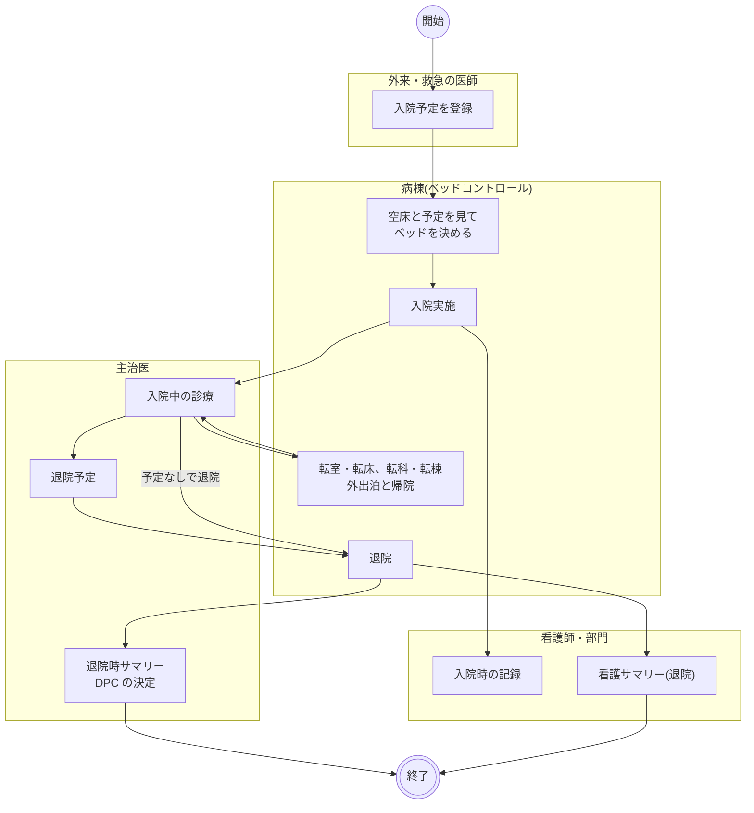

| 段 | 行うこと |
|---|---|
| ベッドを決める | ベッドスケジュールと病床状況で、空床(空いているベッド)と予定を見る |
| 入院実施 | 空床を選び、入院日時を確定する |
| 入院中の診療 | オーダー、クリニカルパス、入院診療計画書 |
| 入院時の記録 | 看護プロファイル、持参薬、栄養スクリーニング、褥瘡リスク評価 |
| 転科・転棟 | 主治医が転科・転棟予定を立て、病棟が実施する |
| 退院予定 | 登録すると、退院の時刻に合わせて食事が止まる |
| 退院 | 食事・看護指示・リハビリなどを一緒に止める |

この文書で使う呼び名は次のとおりです。

- **転室・転床**: 同じ病棟の中で、病室やベッドを移ること。
- **転科・転棟**: 別の病棟や別の診療科へ移ること。
- **空床**: 患者の入っていないベッド。
- **督促**: 文書の作成や DPC の決め直しを求める、主治医あての通知。

主に使う画面は次の 4 つです。ほかの画面は「ほかの画面とのつながり」にまとめます。

| 画面 | 見えるもの |
|---|---|
| 入院患者一覧 | 病棟と日付を選び、その日のベッドと患者を表で見る。入院・退院の操作の入口 |
| 病棟マップ | 病棟の間取りの上に、患者のカードが並ぶ |
| ベッドスケジュール | ベッド × 日付の表に、入院の期間が帯で出る |
| 病床状況 | 病棟ごとの在院数・空床数・稼働率などの集計 |

- **役割**: 役割の分け方は運用で決めます。入退院の操作はどの職種のログインでもできます。システムの権限で止めているのは、看護サマリーの承認など一部だけです。
- **クリニカルパス**: 入院実施の前でも、入院予定に対してクリニカルパスを当てられます。そのときの病日 1 は入院予定日です。

### 入院の状態

| 状態 | 意味 | 変わるきっかけ |
|---|---|---|
| 入院予定 | 入院が決まっている。病棟は決まっている | 入院予定の登録 |
| 入院中 | ベッドに居る | 入院実施、予定なしの入院登録 |
| 退院 | 退院日時で入院を終えた | 退院 |
| 入院予定取消 | 入院の予定がなくなった(誤りではない) | 入院予定取消 |
| 入院取消 | 誤って入院登録した | 入院取消 |

入院予定では、病室・ベッド・入院予定日は決まっていなくてもかまいません。

状態ごとの画面での見え方は次のとおりです。

| 状態 | 入院患者一覧 | 病棟マップ | ベッドスケジュール |
|---|---|---|---|
| 入院予定 | 「入院予定」タブ | 「本日の入院予定」 | 点線の帯。ベッド未定は最下段 |
| 入院中 | 「入院患者」タブ | 患者のカード | 塗りの帯 |
| 退院 | 「退院患者」タブ | – | 退院日までの帯 |
| 入院予定取消 | 出ない | 出ない | 出ない |
| 入院取消 | 出ない | 出ない | 出ない |

入院中の患者には、状態とは別に次の 3 種類の予定を登録できます。

| 予定 | 登録できる数 | 中身 | 済んだら |
|---|---|---|---|
| 転科・転棟予定 | 1 件。登録し直すと置き換わる | 予定日・移動先の病棟(必須)・病室・ベッド・診療科 | 転科・転棟の実施で消える |
| 外出泊 | 何件でも | 開始日時・帰院予定の日時・理由 | 帰院で「帰院済」になり、残る |
| 退院予定 | 1 件。登録し直すと置き換わる | 退院予定日時・理由 | 退院で消える |

- **履歴**: 退院・入院取消・入院予定取消のどれも、消さずに状態として残します。いつ誰が登録したかを後から追えます。
- **入院日数**: 入院日を 1 日目として数えます。
- **入院の情報を使うもの**: 入院中の患者の入院日・病棟・主治医は、次の 4 つの元になります。
    - オーダーの入院・外来の区分(入院が初めから選ばれる)
    - オーダーに残る入院病棟
    - クリニカルパスの病日
    - DPC の入院日

### 入院予定から入院実施まで

#### 入院予定の登録

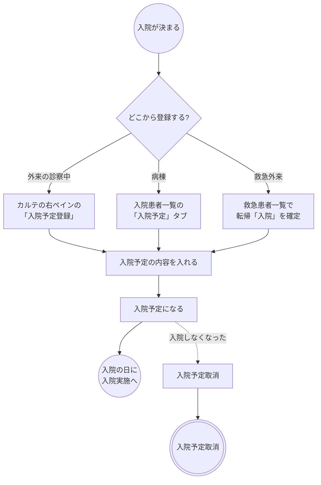

カルテの右ペインは、カルテの右側のオーダー入力の欄です。

| 項目 | 条件 |
|---|---|
| 病棟 | 必須。選ばずに登録すると入力エラーになる |
| 病室・ベッド | 任意 |
| 入院予定日 | 任意。空なら日付未定 |
| 診療科・主治医・担当看護師 | 任意 |
| 入院経路、予定・救急の区分、特記事項 | 任意 |

- **日付未定**: 入院予定は日付が決まっていなくても登録でき、そのまま入院実施できます。日付未定の入院予定は「入院予定」タブの先頭に並びます。
- **救急から**: 救急の転帰で「入院」を確定すると、そのまま入院予定の入力に進みます。病棟とベッドは救急では決めず、入院実施のときに決めます。
- **救急車**: 救急車で来た患者は、搬送の情報が入院経路に引き継がれます。
- **ベッドの重なり**: ベッドスケジュールでは、退院前の患者と入院予定が同じベッドに重なると、段を分けて並びます。ベッドを決めるときに重なりを見ます。

#### 入院実施

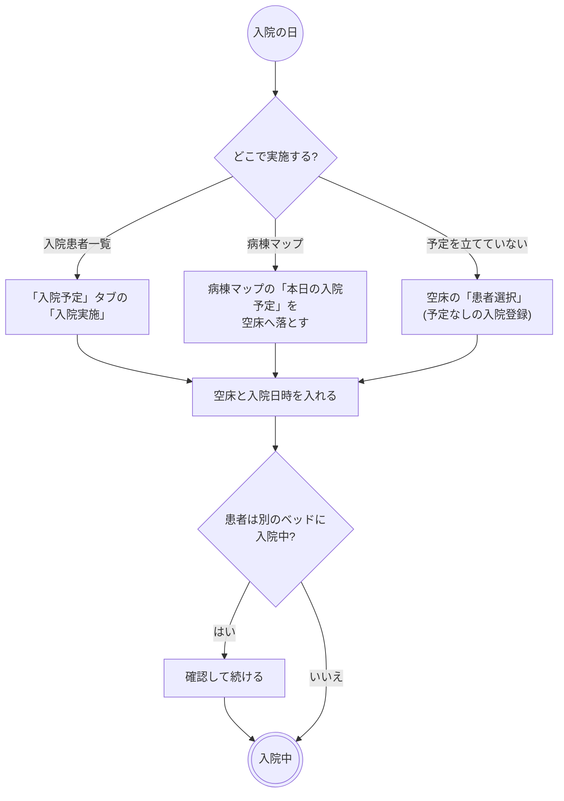

| 項目 | 条件 |
|---|---|
| ベッド | 必須。空床から選ぶ |
| 入院日時 | 初めは今の日時が入っている(入院予定日ではない) |
| 診療科 | 必須。入院予定から引き継ぐ |
| 主治医 | 入院予定から引き継ぐ |

- **ベッドの選び直し**: 入院予定のベッドが埋まっていれば、その病棟の空床から選び直します。
- **予定なしの入院登録**: 入院患者一覧と病棟マップの空床の「患者選択」から、入院予定を立てずに入院を登録できます。患者・診療科・主治医・入院日時を入れます。
- **別のベッドに入院中の患者**: 確認を出しますが、登録は止めません。転床やデータ修正の途中のことがあるためです。
- **取消の使い分け**: 入院の予定がなくなったときは「入院予定取消」、誤って入院を登録したときは「入院取消」です。

### 入院時に書くもの

「入退院文書」の画面は、入院ごとの行と、文書ごとの列でできた表です。入院すると、その入院の行ができ、文書ごとに作成状況と期限が出ます。

| 文書 | 期限(初めの設定) | 書く人の目安 | 対象 |
|---|---|---|---|
| 褥瘡リスク評価 | 入院日 + 1 日 | 看護師 | 全員 |
| 栄養スクリーニング | 入院日 + 3 日 | 看護師・管理栄養士 | 全員 |
| 入院診療計画書 | 入院日 + 7 日 | 主治医 | 全員 |
| 栄養管理計画書 | 入院日 + 7 日 | 管理栄養士 | 特別な栄養管理が要る入院 |
| 褥瘡対策計画書 | 入院日 + 7 日 | 看護師 | 計画が要ると判定された入院 |

- **書き始める**: 表のセルを押すとカルテが開きます。未作成なら、右ペインでその入院の文書の登録が始まります。
- **期限**: 期限を過ぎて作成済でないものは赤で出ます。
- **再評価**: 計画書は、再評価の時期を過ぎても入院が続いていると「再評価」と出ます。
- **栄養管理計画書の対象**: 栄養スクリーニングか入院診療計画書で「特別な栄養管理の必要性」を有とした入院です。
- **褥瘡対策計画書の対象**: 褥瘡リスク評価で計画が要ると判定された入院です。褥瘡リスク評価は看護プロファイルの中で書きます。
- **設定する人へ**: 期限と文書の様式は「施設設定」の「文書作成の督促」で決めます。様式を決めていない文書は、列が出ません。

このほかに、入院時には次の仕事があります。

- 持参薬の登録(カルテの「持参薬」タブ)。登録すると薬剤部に鑑別依頼が届きます。
- 看護プロファイルと看護計画。
- クリニカルパスの適用。

### 入院中の移動

#### 転室・転床

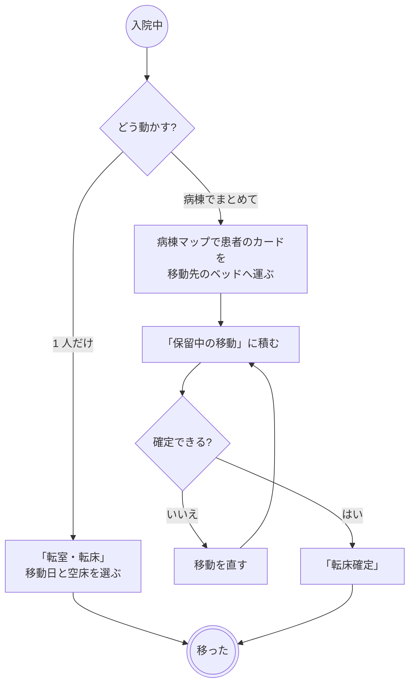

- **病棟マップでの入れ替え**: カードを別の患者の居るベッドへ運ぶと、2 人を入れ替えます。「一時退避」に置けば、ベッドを空けられます。
- **確定できる条件**: 「一時退避」に患者が残っていないこと、ほかの端末でその入院が変更されていないことです。
- **転床確定**: 保留中の移動を、全件まとめて登録します。
- **履歴**: 移った履歴は消えず、いつまでどのベッドに居たかが入院に残ります。ベッドスケジュールでは、ベッドごとに帯が分かれます。

#### 転科・転棟

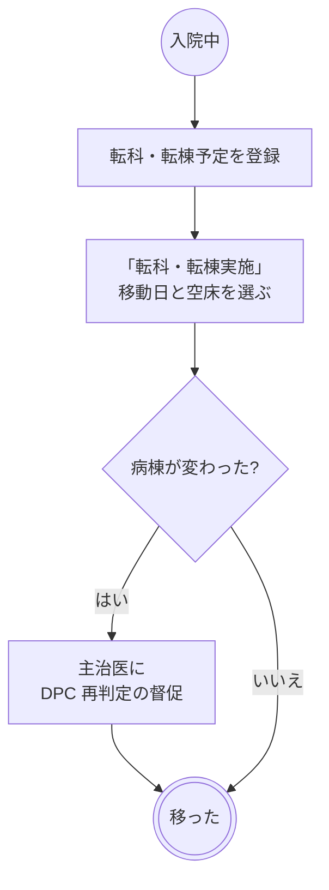

| 場面 | 項目 | 条件 |
|---|---|---|
| 転科・転棟予定 | 予定日 | 入れる |
| 転科・転棟予定 | 移動先の病棟 | 必須 |
| 転科・転棟予定 | 病室・ベッド・診療科 | 任意 |
| 転科・転棟実施 | 移動日 | 入れる |
| 転科・転棟実施 | ベッド | 予定の病棟の空床から選ぶ |
| 転科・転棟実施 | 診療科 | 変えられる |

- **予定の表示**: 転科・転棟予定は、ベッドまで決まっていれば、ベッドスケジュールに「転予」の点線で出ます。
- **予定の取消**: 「転科・転棟」タブの行のメニュー(行の「︙」)の「転科・転棟予定取消」です。
- **ベッドの選び直し**: 予定のベッドが埋まっていることがあるので、実施の時点で空いているベッドから選び直します。
- **DPC 再判定の督促**: 病棟が変わったときだけ出ます。その入院に未対応の督促が既にあれば、重ねて出しません。転棟時の DPC の決定を保存すると閉じます。

#### 転棟のときの注意

- **前に出したオーダーの病棟は変わりません**: オーダーに残る入院病棟は、オーダーを登録した時点のものです。
- **看護指示は前の病棟の指示簿に出続けます**: 転棟の前に出した看護指示は、転棟しても前の病棟の指示簿に出ます。

#### 担当者変更と移動取消

- **担当者変更**: 「入院患者」タブの行のメニューの「担当者変更」で、主治医と担当看護師を差し替えます。
- **移動取消**: 誤って移したときは、行のメニューの「移動取消」で直前の 1 回を取り消します。移動前のベッドと診療科に戻ります。
- **移動取消の確認**: 移動前のベッドに別の患者が入っていれば確認で知らせますが、止めません。
- **移動取消と督促**: その転棟で出した DPC 再判定の督促も取り下げます。

### 外出泊

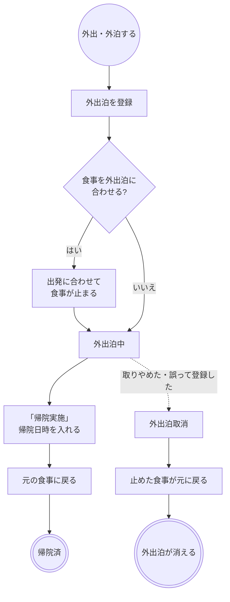

| 項目 | 条件 |
|---|---|
| 外出泊開始日時 | 必須 |
| 帰院予定の日時 | 任意。入れるなら開始より後 |
| 理由 | 任意 |
| 「食事オーダーを外出泊に合わせる」 | 初めはチェックが入っている |

食事は次のように止まり、戻ります。

| 時点 | 食事 |
|---|---|
| 出発 | 出発までに出る最後の食事で、いまの食事が止まる |
| 外出泊中 | 外泊食止めになる |
| 帰院予定の日時を入れたとき | 帰院後の最初の食事からの再開も、あらかじめ登録される |
| 帰院実施 | 帰院後の最初の食事から、元の食事に戻る |
| 外出泊取消 | 外泊食止めと再開が消え、元の食事に戻る |

- **表示**: 外出泊中の患者は、病棟マップのカードに札が付き、「外出泊」タブに並びます。
- **回数**: 1 回の入院に何度でも外出泊を登録できます。登録済みの外出泊は登録の画面に並び、間違えたものを外せます。
- **止める食事**: 止める食事と戻す食事は手で選びません。食事の提供時刻と、出発・帰院の時刻から決まります。登録の画面で、止める食事と再開する食事を確かめられます。
- **期間の変更**: 外出泊の期間を後から直す操作はありません。取り消して登録し直します。食事もいったん戻ってから、止まり直します。
- **食事のほかは止まりません**: 外出泊中でも、看護指示・リハビリなどは自動では止まりません。
- **設定する人へ**: 食事の提供時刻は施設設定で決めます。食止めの食種がマスタに無いと、外泊食止めは登録されず、食事の終了と再開だけが行われます。

### 退院予定と退院

#### 退院予定

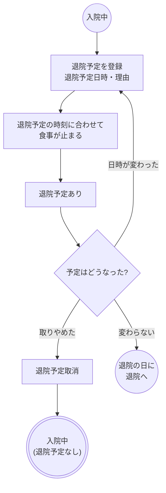

- **退院食止め**: 退院予定を登録すると、退院予定の時刻までに出る最後の食事で、食事が止まります。これを退院食止めと呼びます。
- **表示**: 退院予定のある患者は「退院予定」タブに並び、病棟マップのカードに札が付きます。ベッドスケジュールの帯は退院予定日で止まります。
- **登録し直す**: 退院予定を登録し直すと、止めた食事も新しい日時に合わせて止まり直します。
- **退院予定取消**: 退院予定がなくなり、退院食止めで止めた食事が元に戻ります。

#### 退院

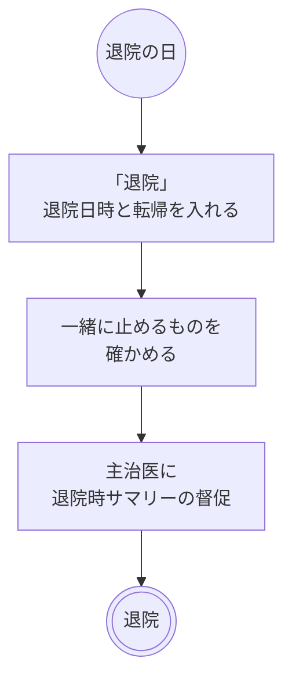

退院は、「退院予定」タブの「退院実施」か、「入院患者」タブの行のメニューの「退院」から行います。退院予定を立てずに、当日に退院することもできます。

| 項目 | 条件 |
|---|---|
| 退院日時 | 必須。初めは今の日時。入院日より前にはできない |
| 転帰(退院先) | 任意 |

一緒に止めるものは次のとおりです。初めはすべてチェックが入っています。

| 止めるもの | 止め方 |
|---|---|
| 食事 | 退院時刻までに出る最後の食事で終わる |
| 看護指示 | 退院日で終わる |
| リハビリ | 退院日で終わる。翌日以降の予約は取り消される |
| 栄養指導 | 退院日で終わる。翌日以降の予約は取り消される |
| 服薬指導 | 退院日で終わる |
| 入院の透析 | 退院日で終わる。翌日以降の予約は取り消される |
| 持参薬 | 継続中・休止中のものが終わる。鑑別依頼は取り下げられる |

- **同時に止まります**: 退院と、チェックしたものの終了は同時に登録されます。退院だけ登録されて、オーダーが残ることはありません。
- **チェックを外したもの**: 止まりません。外来で続けるリハビリや栄養指導は、チェックを外します。
- **退院予定から退院したとき**: 退院予定で止めていた食事は、止めた理由が「退院」に変わります。
- **看護指示**: 退院日が終了日になるだけで、指示受けの状態は変わりません。
- **リハビリ・栄養指導**: 部門の「終了」は、退院では付きません。部門が終了にします。
- **透析**: 止める候補に出るのは、入院のオーダーだけです。外来の維持透析は入院と退院をまたいで続くので、候補に出ません。
- **転帰**: 退院の画面でも、退院時サマリーでも書けます。
- **退院時サマリーの督促**: 確定済みの退院時サマリーがある入院と、未対応の督促がある入院には出しません。
- **クリニカルパス**: 退院しても自動では終わりません。パスタブで終了・中止を記録します。
- **ベッド**: 退院すると、そのベッドはすぐ空床として選べます。同じ日の入院予定を入れられます。

### 退院後に書くもの

| 文書 | 期限(初めの設定) | 書く人 |
|---|---|---|
| 退院時サマリー | 退院日 + 14 日 | 主治医 |
| 看護サマリー(区分「退院」) | 退院日 + 7 日 | 担当看護師 |
| DPC の決定(退院時) | なし | 主治医・医事 |
| DPC 様式 1 | なし | 医事 |

- **退院時サマリーの督促**: 退院すると、通知「文書作成」が主治医に届きます。退院時サマリーを確定で保存すると閉じます。退院時サマリーが要らない入院は、通知一覧の「対応済」で閉じます。
- **退院時サマリーの書き始め**: 入院中から書き始められます。
- **退院時サマリーに初めから入るもの**: 入院期間のプロブレム、入院経過、手術処置、退院時処方、アレルギーです。入院経過には、入院・転棟・転床・外泊・退院と手術が入ります。
- **看護サマリー**: 入退院文書の列に作成状況が出ます。病棟の「看護サマリー承認」で承認します。
- **DPC の決定**: カルテの「診断群分類」タブで判定して決定します。DPC 患者一覧で、未決定と期間Ⅱ超えを見ます。
- **DPC 様式 1**: 入院の情報と退院時サマリーなどから、初めの値が入ります。
- **入退院文書での表示**: 退院のときの文書は、退院するまで「退院後」と出ます。書き始めていれば、その状態が出ます。
- **設定する人へ**: 退院時サマリーの期限の日数は施設設定で決めます。

### 取消

| 取消 | どこから | 起きること |
|---|---|---|
| 入院予定取消 | 「入院予定」タブの行のメニュー | 状態が入院予定取消になる |
| 入院取消 | 「入院患者」タブの行のメニュー | 状態が入院取消になる |
| 移動取消 | 「入院患者」タブの行のメニュー | 直前の 1 回の移動を取り消す |
| 転科・転棟予定取消 | 「転科・転棟」タブの行のメニュー | 転科・転棟予定がなくなる |
| 外出泊取消 | 「外出泊」タブの行のメニュー、外出泊の登録の画面 | 外出泊がなくなり、止めた食事が戻る |
| 退院予定取消 | 「退院予定」タブの行のメニュー | 退院予定がなくなり、止めた食事が戻る |
| 退院取消 | 「退院患者」タブの行のメニュー | 入院中に戻る |

- **確認だけ**: 取消はどれも確認だけで、理由は残しません。
- **入院予定取消と入院取消**: どちらも、取り消した入院はどの一覧にも出なくなります。入院取消は、その入院の DPC 再判定の督促も取り下げます。
- **移動取消**: 一度でも移った入院にだけ出ます。前のベッドと診療科に戻り、その転棟の DPC 再判定の督促を取り下げます。
- **退院取消で戻るもの**: 入院と食事だけです。退院時サマリーの督促は取り下げます。
- **退院取消で戻らないもの**: 看護指示・リハビリ・栄養指導・服薬指導に入れた終了日、取り消した予約、終了にした持参薬、退院のときに消えた退院予定です。続けるものは出し直し、退院予定は必要なら立て直します。
- **退院取消の確認**: 退院したベッドに別の患者が入っていれば、確認で知らせます。

### ほかの画面とのつながり

| 画面 | 入院に関わる所 |
|---|---|
| 入院患者一覧 | その日のベッドと患者。6 つのタブ |
| 病棟マップ | 患者のカードと札、転床のまとめ確定、本日の入院予定 |
| ベッドスケジュール | 実績は塗りの帯、予定は点線の帯 |
| 病床状況 | 病棟ごとの集計 |
| 入退院文書 | 入院時・退院時の文書の作成状況と期限 |
| カルテ | 患者の見出しに入院中の病棟と入院日数 |
| 看護の画面 | 病棟の入院患者で一覧を組む |
| 給食部門の食事一覧 | 転棟した患者は、いまの病棟に出る |
| マルチチャート | 入院は期間のバー、転棟と外出泊は印 |
| データ抽出 | 「入院・外来」タブで、入院 1 件が 1 行 |

- **入院患者一覧のタブ**: 「入院予定」「入院患者」「転科・転棟」「外出泊」「退院予定」「退院患者」です。
- **入院患者一覧の列**: クリニカルパス・DPC・NEWS2 の列と、指示受けの札があります。経過表の一括入力もここから開きます。
- **病棟マップの札**: 退院予定・転棟予定・外出泊中の札が、患者のカードに付きます。
- **ベッドスケジュールの予定**: 入院予定は「入予」、転科・転棟予定は「転予」と出ます。ベッド未定の入院予定は最下段に並びます。
- **病床状況の集計**: 在院数、稼働率、空床数、当日の入退院と転出入、翌日の予定、病床利用率、平均在院日数です。
- **カルテのタブ**: 退院時サマリー、看護サマリー、持参薬、DPC のタブがあります。
- **看護の画面**: 指示簿、ワークシート、看護必要度、看護サマリー承認です。
- **同じ入院を見ています**: 入院患者一覧・病棟マップ・ベッドスケジュール・病床状況・入退院文書・看護必要度・DPC 患者一覧は、同じ入院の情報を表示します。

## 開発者向け

### シーケンス図の前提

- **上流**: backend が中継する先の FHIR サーバーです。ブラウザの `/fhir` への読み書きは、backend の `FhirProxyController` が上流へ中継します。
- **新規の入院は単発の POST**: 入院予定の登録と予定なしの入院登録は、`Encounter` 1 件の POST です(`useAdmitPatient` の `createResource`)。
- **それ以外は transaction**: 入院の書き換えは、どれも 1 回の transaction Bundle です。連動の entry(食事・看護指示・リハビリ・督促 Task など)を足すときも、同じ transaction に載せます。
- **楽観ロック**: 入院の書き換えは `postBundle` が版を `ifMatch` に添えます。2 台で同じ入院を操作すると、後の方が 412 で止まります。
- **病棟マップの転床確定**: 直前に入院を引き直し、他端末の変更が無いことも確かめます(`findStaleMoves`)。
- **図の省略**: 応答は上流から backend を通ってブラウザへ戻りますが、図では上流からブラウザへの 1 本で書きます。同じ形の操作(入力 → transaction 1 回)は図にせず、図の下の表に出します。
- **SS-MIX2**: 有効にしている施設では、中継が書き込みの控えを記録し(`Ssmix2::Recorder`)、`Encounter` の前後の版を比べて ADT のメッセージを組みます。

| 操作 | 画面 | 組み立て | hook |
|---|---|---|---|
| 一覧を読む | `pages/InpatientListPage.tsx`(6 タブ) | `fetchInpatients`、`fetchPlannedAdmissions` | `useInpatientEncounters`、`usePlannedAdmissions`、`usePatientAdmission` |
| 入院予定の登録 | `PlannedAdmissionForm.tsx`(下の注) | `fhir/encounterHelpers.ts`、`fhir/admissionRouteHelpers.ts` | `useAdmitPatient` |
| 入院実施 | `AdmissionExecuteModal.tsx` | `fhir/encounterHelpers.ts` | `useUpdateEncounter` |
| 予定なしの入院登録 | `AdmissionModal.tsx` | `fhir/encounterHelpers.ts` | `useAdmitPatient` |
| 入院予定取消 | `pages/InpatientListPage.tsx` | `fhir/encounterHelpers.ts` | `useUpdateEncounter` |
| 入院取消 | `pages/InpatientListPage.tsx` | `buildCancelledEncounter`、`fhir/dpcRecodingDueHelpers.ts` | `useCancelAdmission` |
| 転室・転床 | `BedTransferModal.tsx` | `buildBedTransferEncounter` | `useUpdateEncounter` |
| 病棟マップの転床確定 | `pages/WardMapPage.tsx` | `fhir/bedMovePlanHelpers.ts` の `buildMovePlanBundle` | `useCommitBedMoves` |
| 転科・転棟予定 | `TransferPlanModal.tsx` | `buildTransferPlanEncounter` | `useUpdateEncounter` |
| 転科・転棟の実施 | `TransferExecuteModal.tsx` | `buildTransferExecutedEncounter` | `useUpdateEncounter` |
| 移動取消 | `pages/InpatientListPage.tsx` | `buildTransferCancelledEncounter` | `useCancelTransfer` |
| 担当者変更 | `CareStaffModal.tsx` | `fhir/encounterHelpers.ts` | `useUpdateEncounter` |
| 外出泊・帰院 | `LeaveModal.tsx`、`LeaveReturnModal.tsx` | `fhir/mealEncounterSync.ts` | `useUpdateEncounter`、`hooks/useMealSyncContext.ts` |
| 退院予定 | `DischargePlanModal.tsx` | `fhir/mealEncounterSync.ts` | `useUpdateEncounter`、`hooks/useMealSyncContext.ts` |
| 退院 | `DischargeModal.tsx` | `fhir/dischargeSummaryHelpers.ts` ほか | `useDischargePatient` |
| 予定の取消・退院取消 | `components/InpatientPlanTables.tsx` の `handleCancel` | `fhir/mealEncounterSync.ts` | `useUpdateEncounter` |
| ベッドスケジュール・病床状況 | `pages/BedSchedulePage.tsx`、`pages/BedStatusPage.tsx` | `fhir/bedScheduleHelpers.ts` | `useEncountersInRange` |
| 入退院文書 | `pages/AdmissionDocumentsPage.tsx` | `fhir/admissionDocumentHelpers.ts` | `useAdmissionDocumentResources` |

- 入院予定のフォームは 3 か所で使います。入院患者一覧の `PlannedAdmissionModal`、カルテの右ペインの `planned-admission-create`、救急の `EmergencyRowModals.tsx` です。
- 入院の hook は `api/queries/encounter.ts`、ベッドスケジュールと入退院文書の hook は `api/queries/bedManagement.ts` にあります。
- `components/InpatientPlanTables.tsx` は、転科・転棟、外出泊、退院予定、退院患者の表と取消を持ちます。

### リソースの構成

入院は `Encounter` 1 件です。予定(転科・転棟予定、外出泊、退院予定)は `Encounter` の拡張に持ちます。

| リソース | 要素 | 中身 |
|---|---|---|
| `Encounter` | `class` | v3-ActCode `IMP` |
| `Encounter` | `status` | `planned` / `in-progress` / `finished` / `cancelled` / `entered-in-error` |
| `Encounter` | `period.start` | 入院日。入院予定では入院予定日 |
| `Encounter` | `period.end` | 退院日 |
| `Encounter` | `serviceProvider` | 診療科 |
| `Encounter` | `participant` | 主治医(`ATND`)と担当看護師(`encounter-participant-role\|nurse`) |
| `Encounter` | `hospitalization.dischargeDisposition` | 転帰 |
| `Encounter` | 拡張 `encounter-note` | 特記事項 |
| `Encounter` | `location`(入院予定) | `status` = `planned`。病棟(必須)・病室・ベッドを並べる |
| `Encounter` | `location`(入院中) | `location[0]` = いまのベッド(`active`) |
| `Encounter` | 拡張 `encounter-location-prior-department` | 科も変えた移動で、移動先の `location` に残す移る前の科 |
| `Encounter` | `hospitalization.admitSource` | 入院経路と、予定・救急の区分 |
| `Encounter` | 入院経路の拡張 | 紹介の有無、外来からの入院など(`admissionRouteHelpers.ts`) |
| `Encounter` | 拡張 `encounter-transfer-plan` | 転科・転棟予定。1 件だけ |
| `Encounter` | 拡張 `encounter-leave` | 外出泊。複数 |
| `Encounter` | 拡張 `encounter-discharge-plan` | 退院予定。1 件だけ |
| `Location` | `physicalType`、`partOf` | 病棟 `wa` → 病室 `ro` → ベッド `bd` |
| `QuestionnaireResponse` | `encounter` | 入院時・退院時の文書。`encounter` = 入院 |
| `Composition` | `type` | 退院時サマリー(LOINC `18842-5`)、看護サマリー |
| `Task` | `code` = `document-due` | 退院時サマリーの督促 |
| `Task` | `code` = `dpc-recoding-due` | DPC 再判定の督促 |
| `ServiceRequest`(食事) | 拡張 `meal-order-end-reason`、`previousEnd` | 連動で止めた理由と、戻すための元の終了 |
| `ServiceRequest`(看護指示) | 拡張 `nursing-order-end` | 退院日を終了日にする |
| `ServiceRequest`(リハビリ・栄養指導・服薬指導・透析) | 各種別の終了日 | 退院日を終了日にする |
| `MedicationStatement` | `context`、`status` | 持参薬。`context` = 入院。退院で `completed` |
| `Task` | `code` = `brought-med-review` | 持参薬の鑑別依頼。退院で `cancelled` |

- **入院予定の `location`**: `physicalType`(`wa` / `ro` / `bd`)を付けて並べるので、参照先を引かずに階層が分かります。
- **入院中の `location`**: 移動すると先頭に足し、前のベッドは `completed` + `period.end` で後ろに残します。
- **入院経路**: `admitSource` は `dpc-admission-route` / `dpc-admission-type` のローカル体系です。救急からは搬送を引き継ぎます。DPC 様式 1 の初期値になります。
- **拡張の子**: `encounter-transfer-plan` は `date` / `ward` / `room` / `bed` / `department`、`encounter-discharge-plan` は `date`(dateTime)/ `reason` です。
- **外出泊の子**: `id`(uuid)/ `start` / `end` / `reason` / `returned`。`end` は、帰院前は予定、帰院後は実際の日時です。
- **外出泊の `id`**: SS-MIX2 と食事の連動が、外出泊ごとに突き合わせるのに使います。
- **予定を拡張にしている理由**: R4 の `Encounter` に置き場が無いためです。
- **食事の理由**: `meal-order-end-reason` は `discharge-plan` / `discharge` / `leave` のどれかです。
- **ベッド**: ベッド数は配下のベッドの件数です。休止は `Location.status` です。
- **督促の Task**: `focus` / `encounter` = 入院、`owner` = 主治医。退院時サマリーは `restriction.period.end` = 期限です。
- **入退院文書の当て方**: 回答の `encounter` で当て、無ければ記入日で当てます。
- **入院予定の日付未定**: `period` を付けません。上流の `_sort=date` は期間の無いものを末尾に置くので、画面で先頭に並べ替えます(`sortPlannedAdmissions`)。

入院の読み方は次のとおりです。

| 読むもの | 関数 | 検索 |
|---|---|---|
| その日の入院 | `fetchInpatients` | `status=in-progress,finished&class=IMP`、`date=ge{日}&date=le{日}` |
| 入院予定 | `fetchPlannedAdmissions` | `status=planned&class=IMP&_sort=date&_include=Encounter:subject` |

- その日の入院は病棟で絞らずに全病棟ぶんを読み、ベッド id で突き合わせます。日付の条件は、入院の期間がその日に重なるものを拾います。
- 入院予定は日付で絞れないので、全件を読みます。

### 状態の持ち方

| 表示 | `Encounter.status` | `period` | `location[0]` |
|---|---|---|---|
| 入院予定 | `planned` | `start` = 予定日(未定なら無し) | 病棟・病室・ベッドが `planned` |
| 入院中 | `in-progress` | `start` = 入院日時 | ベッドが `active` |
| 退院 | `finished` | `end` = 退院日時 | ベッドが `completed` |
| 入院予定取消 | `cancelled` | そのまま | そのまま |
| 入院取消 | `entered-in-error` | `end` を付けない | そのまま |

- 退院取消は `in-progress` に戻し、`period.end` を消し、`location[0]` を `active` に戻します(`buildDischargeCancelledEncounter`)。退院で落とした退院予定の拡張は戻しません。
- 同じベッドに入院中が複数あれば、入院日(同日なら更新時刻)の新しいものを表示します(`latestEncounterByBed`)。二重入院は確認だけで止めません。

### シーケンス図: 入院予定・入院実施・入院取消

入院予定の登録です。

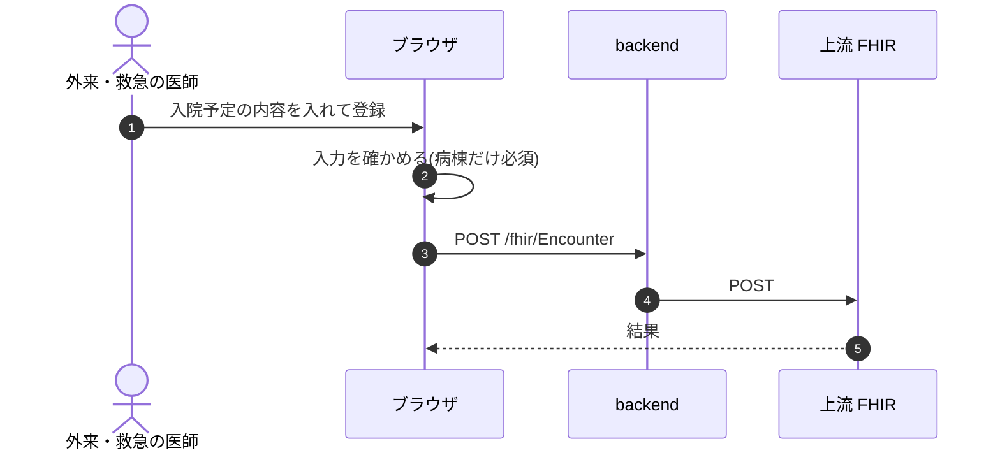

入院実施(入院予定から)です。

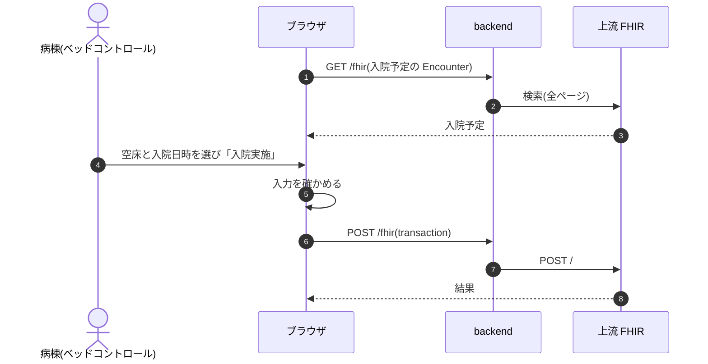

| 操作 | 入力と確認 | 書くもの |
|---|---|---|
| 入院予定の登録 | 病棟・病室・ベッド・予定日・診療科・主治医・入院経路。`validatePlannedAdmissionForm`(病棟だけ必須) | 単発の POST。`Encounter`(`status` = `planned`、`location` は `physicalType` 付きで `planned`) |
| 入院実施 | 空床・入院日時。`validateAdmissionForm`。別のベッドに入院中なら確認 | transaction。PUT `Encounter`(`in-progress`、`location` = ベッド 1 件 `active`、`ifMatch`) |
| 予定なしの入院登録 | 空床の「患者選択」→ 患者・診療科・主治医・入院日時 | 単発の POST。`Encounter`(`status` = `in-progress`) |
| 入院予定取消 | 確認だけ | transaction。PUT `Encounter`(`cancelled`) |
| 入院取消 | 確認だけ | transaction。PUT `Encounter`(`entered-in-error`)と、DPC 再判定の督促 Task を `cancelled` にする entry |

- 入院予定の登録のあとは、入院予定タブとベッドスケジュールを読み直します。
- 入院予定の検索式は「リソースの構成」の表にあります。

### シーケンス図: 転室・転床・転科転棟・移動取消

病棟マップの転床確定です。

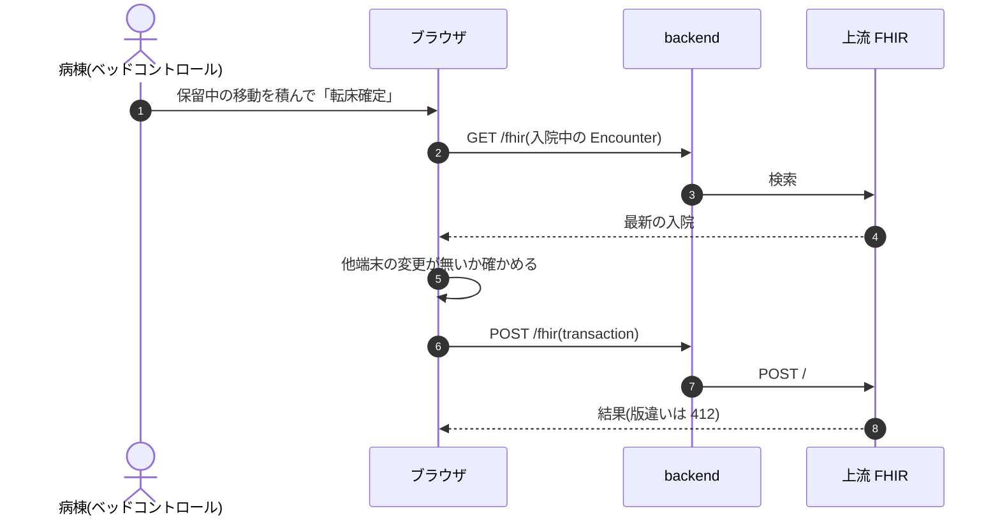

転科・転棟の実施です。

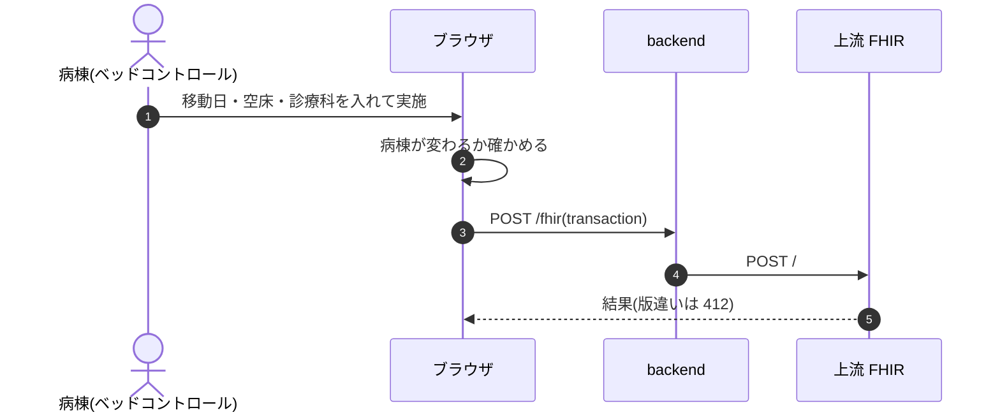

| 操作 | 入力と確認 | transaction の中身 |
|---|---|---|
| 転室・転床(1 人) | 移動日と空床 | PUT `Encounter`(先頭に新しいベッド `active`、前のベッドは `completed` + `period.end`) |
| 病棟マップの転床確定 | 転床日。`findStaleMoves` で他端末の変更を確かめる | 動かした入院ごとに PUT `Encounter` |
| 転科・転棟予定 | 予定日・移動先の病棟・病室・ベッド・診療科 | PUT `Encounter`(拡張 `encounter-transfer-plan`) |
| 転科・転棟の実施 | 移動日、空床(予定の病棟から)、診療科 | PUT `Encounter` と、条件に合えば POST `Task`(下の注) |
| 移動取消 | 確認だけ | PUT `Encounter` と、督促の取り下げ(下の注) |
| 担当者変更 | 主治医・担当看護師 | PUT `Encounter`(`participant` の主治医と担当看護師だけを入れ替える) |

- **転科・転棟の実施の PUT**: ベッドを移し、科が変われば `serviceProvider` と `encounter-location-prior-department` を書き、予定の拡張を外します。
- **転科・転棟の実施の Task**: 病棟が変わり、その入院に未対応の督促が無ければ、`dpc-recoding-due`(`owner` = 主治医)を POST します。
- **移動取消の PUT**: 先頭のベッドを外して前のベッドを `active` に戻し、`encounter-location-prior-department` があれば科を戻します。
- **移動取消の Task**: その移動日の `dpc-recoding-due` を `cancelled` にします。
- どの操作も、書いたあとに入院患者一覧・病棟マップ・ベッドスケジュールを読み直します。

### シーケンス図: 外出泊・帰院・退院予定

外出泊の登録です。帰院・外出泊取消・退院予定も、食事オーダーを読んでから transaction を 1 回書く同じ形です。

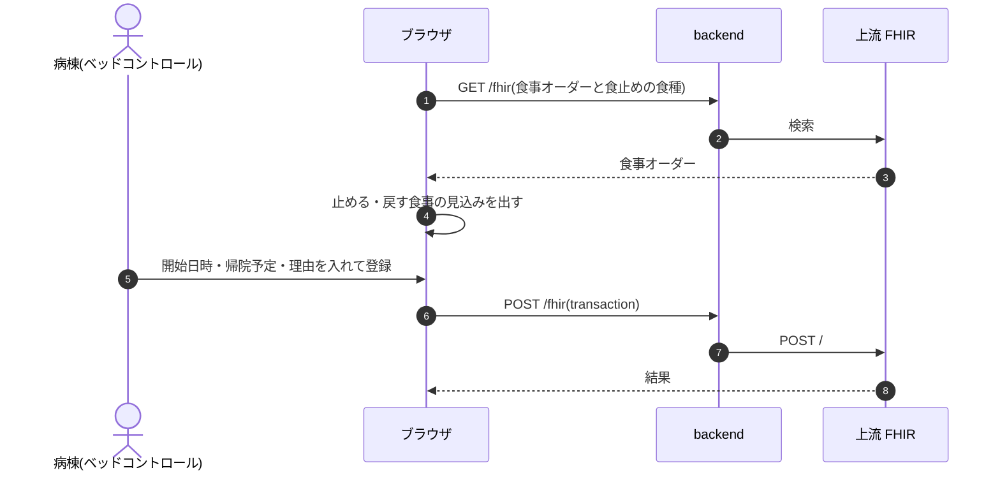

- 食事オーダーの検索は `ServiceRequest?subject=患者&category=order-type|meal&status=active` です。食止めの食種はマスタから読みます。
- 食事の連動は、`useMealSyncContext`(入院の食事オーダーと施設の食事の提供時刻)から `mealEncounterSync.ts` が entry を組みます。詳細は [meal.md](meal.md)「シーケンス図: 入退院・外出泊の連動」にあります。
- 書いたあとに `Encounter` と `ServiceRequest` を読み直します。

| 操作 | 入力 | PUT `Encounter` | 食事の entry |
|---|---|---|---|
| 外出泊の登録 | 開始日時・帰院予定・理由 | `encounter-leave` を足し、`id` を採番する | `buildLeaveStartEntries` |
| 帰院 | 帰院日時 | `returned` = true、`end` = 帰院日時 | `buildLeaveReturnEntries` |
| 外出泊取消 | 確認だけ | 外出泊を外す | `buildLeaveCancelEntries` |
| 退院予定の登録 | 退院予定日時・理由 | `encounter-discharge-plan` を付ける | `buildDischargeSyncEntries` |
| 退院予定取消 | 確認だけ | `encounter-discharge-plan` を外す | `buildDischargeRestoreEntries(["discharge-plan"])` |

| 関数 | 書くもの |
|---|---|
| `buildLeaveStartEntries` | 出発までで食事を終える PUT、外泊食止めと再開の POST |
| `buildLeaveReturnEntries` | 外泊食止めを帰院の直前で終える。再開を POST するか、あれば PUT する |
| `buildLeaveCancelEntries` | 食止めと再開を DELETE し、終了を戻す |
| `buildDischargeSyncEntries` | 食事を終える。`reason` = `discharge-plan`、`previousEnd` を残す |
| `buildDischargeRestoreEntries` | 渡した理由で止めた食事の終了を戻す |

### シーケンス図: 退院・退院取消

退院です。

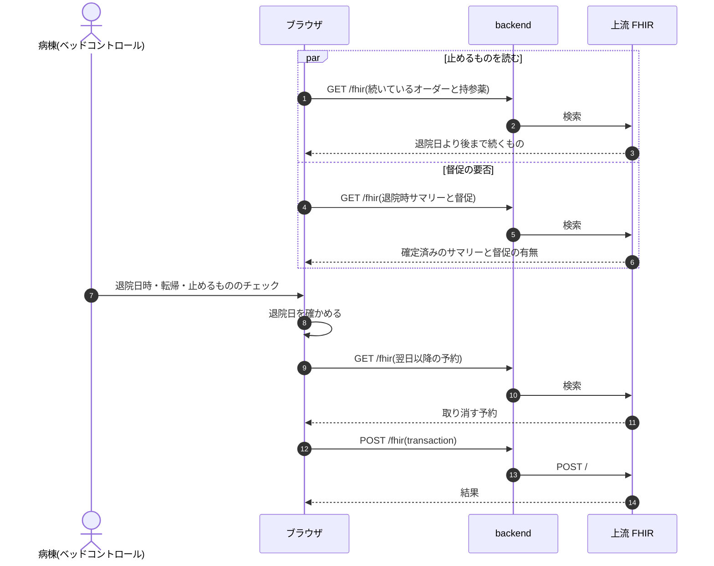

| 読むもの | 検索・条件 |
|---|---|
| 続いているオーダー | 食事・リハビリ・透析・栄養指導・服薬指導・看護指示の `ServiceRequest`。種別ごとの `…NeedsStop` で、退院日より後まで続くものを選ぶ |
| 持参薬 | `MedicationStatement`(`active` / `on-hold`)と、閉じていない鑑別依頼の `Task` |
| 退院時サマリー | `Composition?type=…\|18842-5&encounter=入院` |
| 督促 | `Task?code=document-due&encounter=入院` |
| 予約 | 打ち切るリハビリ・透析・栄養指導の、退院日の翌日以降の `Appointment` |

| transaction の中身 | 条件 |
|---|---|
| PUT `Encounter`(`finished`、`period.end`、`location[0]` を `completed`、`dischargeDisposition`、退院予定の拡張を外す) | 必ず |
| 食事を退院時刻までの最後の食事で終える(`reason` = `discharge`) | 食事のチェックがあるとき |
| リハビリ・透析・栄養指導・服薬指導・看護指示を退院日で終える | 種別ごとのチェックがあるとき |
| リハビリ・透析・栄養指導の予約を `cancelled` にする | そのオーダーを終えるとき |
| 持参薬を `completed`、鑑別依頼を `cancelled` にする | 持参薬のチェックがあるとき |
| POST `Task` `document-due`(`owner` = 主治医、期限 = 退院日 + N 日) | 確定済みのサマリーも未対応の督促も無いとき |

- 退院日の確認は `validateDischargeDate` です(入院日より前は不可)。
- 透析は入院のオーダーだけを止めます(`dialysisOrderNeedsStop`)。
- 書いたあとに `Encounter`・`ServiceRequest`・`Task`・`MedicationStatement`・予約を読み直します。

退院取消です。

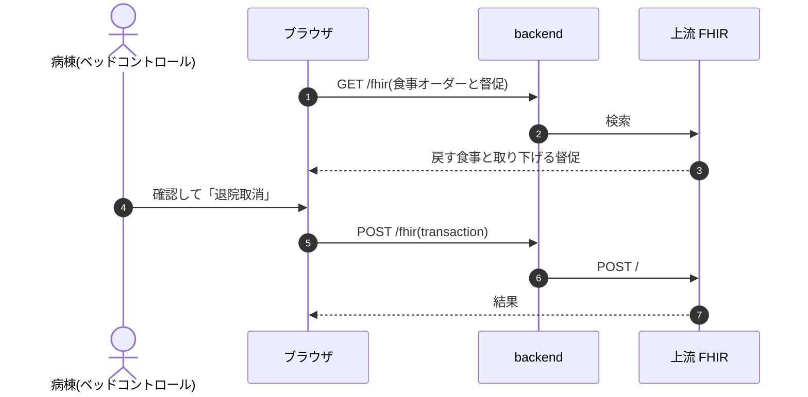

| transaction の中身 | 補足 |
|---|---|
| PUT `Encounter`(`in-progress`) | `period.end` を消し、`location[0]` を `active` に戻す |
| `buildDischargeRestoreEntries(["discharge", "discharge-plan"])` | 退院と退院予定で止めた食事を戻す |
| `document-due` の `Task` を `cancelled` にする | 督促は `Task?code=document-due&encounter=入院` で読む |

### 医事会計と SS-MIX2

入院の出来事は医事会計に送りません(会計送信の入口は外来患者一覧だけです)。入院中のオーダーの扱いは各種別の文書を読みます。
SS-MIX2 は `Encounter` の書き込みごとに前の版と比べて ADT を組みます。括弧の中の `ADT-21` などはデータ種別です。オーダ No は事象ごとに採番し、取消は同じ番号の DEL です。

| 起きたこと | SS-MIX2 |
|---|---|
| 入院予定の登録・変更 | `ADT^A14`(ADT-21、PV2-8 入院予定日。未定は `-`) |
| 入院予定取消 | `ADT^A27`(ADT-21、DEL) |
| 入院実施・予定なしの入院登録 | `ADT^A01`(ADT-22。予定からの実施も A01) |
| 入院取消 | `ADT^A11`(ADT-22、DEL) |
| 転室・転床・転科転棟の実施、ベッドを移さない転科 | `ADT^A02`(ADT-42) |
| 移動取消 | `ADT^A12`(ADT-42、DEL) |
| 転科・転棟予定の登録・変更 / 取消 | `ADT^A15` / `ADT^A26`(ADT-41)。実施で消えたときは出さない |
| 担当者変更(主治医) | `ADT^A54`(新しい主治医)/ `ADT^A55`(外れた主治医)(ADT-01) |
| 外出泊の登録・変更 / 取消 | `ADT^A21` / `ADT^A52`(ADT-31) |
| 帰院 / 帰院の取り消し | `ADT^A22` / `ADT^A53`(ADT-32) |
| 退院予定の登録・変更 / 取消 | `ADT^A16` / `ADT^A25`(ADT-51)。退院で消えたときは出さない |
| 退院 | `ADT^A03`(ADT-52、PV1-45 退院日) |
| 退院取消 | `ADT^A13`(ADT-52、DEL) |
| 連動で止めた・戻した食事 | 書き換えた食事オーダーごとに `OMD^O03` |
| 連動で止めた看護指示・リハビリ・栄養指導・服薬指導 | なし |
| 退院時サマリー・看護サマリー・入退院文書・督促 | なし |

- 「ベッドを移さない転科」(`serviceProvider` だけの変更)と「帰院の取り消し」(帰院済みでなくなる変更)は、いまの画面の操作では起きません。backend は `Encounter` の版の差から拾うので、ほかの経路で書かれたときに出ます。
