# 化学療法の業務フロー

レジメンの適用からクールの登録、当日の投与可否の確認、投与、終了までの流れです。
投与日の注射と内服は通常の注射・処方として流れるので、払出・調剤・実施の細部は[注射オーダーの業務フロー](injection.md)と[処方オーダーの業務フロー](prescription.md)を読みます。

医療機関の運用を検討する人は「運用フロー」、院内の開発者は「開発者向け」を読みます。
画面のふるまいは [features/orders-common.md](../features/orders-common.md#化学療法レジメンマスタ)、設計は [chemo-regimen-design.md](../chemo-regimen-design.md) が正典です。

## 運用フロー

このページで使う呼び名です。

- **レジメン**: 化学療法の治療計画の雛形です。施設が「マスタメンテ > 化学療法 > レジメン」に登録し、承認したものを患者に使います。
- **クール**: 投与期間と休薬期間を合わせた 1 回りです。クールの何日目かを Day 1、Day 8 のように呼びます。
- **適用**: 1 人の患者に 1 つのレジメンを使うことです。適用 1 件で、開始日から 1〜3 クールを一度に登録します。
- **投与日のオーダー**: 投与日ごとにできる注射と内服のオーダーです。その日の注射をまとめた 1 オーダーと、内服をまとめた 1 オーダーができます。通常の注射・処方と同じ流れで、薬剤部の一覧に並びます。
- **状態**: 投与日のオーダーの、薬剤部の作業と実施の進み具合です(依頼済・受付済・払出済など)。注射・処方と同じです。

使う画面は次のとおりです。

| 画面 | 開き方 | できること |
|---|---|---|
| カルテの右ペイン(右側のオーダー入力)の「化学療法」 | カルテの右ペインで選ぶ | レジメンを選んで適用する |
| 暦 | カルテの左ペインの「化学療法」タブ | 月の暦に投与日を出す。投与日をドラッグして移動する |
| 右ペインの「化学療法(投与日)」 | 暦の投与日を押すと開く | 投与可否の確認、移動、編集、中止・中止取消、化学療法室の予約 |
| レジメン詳細 | 「化学療法」タブの「レジメン詳細」 | クール一覧(計画書・有害事象・クール取消)、次クール登録、休止・再開、適用編集、完了、レジメン中止、スケジュール表 |

### 全体の流れ

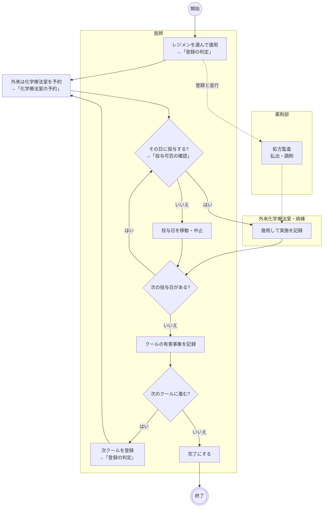

- **投与可否と薬剤部の作業**: 投与可否の確認は、処方監査・払出・調剤・実施を止めません。未確認のままでも払出と実施はできます。薬剤部の作業は、投与日のオーダーができた時点から始まります。
- **投与しない日**: 日を移して投与するときは投与日を移動(延期)し、その日の投与をやめるときは投与日を中止(取りやめ)します。
- **見合わせた日の薬剤**: 払い出したあとに投与をやめた薬剤の扱いは記録しません。運用で決めます。
- **実施**: 注射は通常の注射と同じく記録します。カルテのカード、注射カレンダー、経過表などから実施入力を開きます([injection.md](injection.md)「実施の流れ」)。
- **有害事象**: レジメン詳細のクール一覧の「記録」から、クールごとに CTCAE の用語と Grade を記録します。次クールの登録画面に、前のクールの有害事象が出ます。
- **完了**: 予定クール数に達しても自動では完了しません。最後のクールを終えたら医師が完了にします。途中でやめるときはレジメン中止にします。
- **外来化学療法室の一覧**: 「部門業務 > 外来化学療法室」は、予約の時間順にレジメン・クール・投与可否・状態を並べます。予約の無い患者は出ません。

### レジメンマスタの状態

| 状態 | 新しい適用 | 内容の変更 |
|---|---|---|
| 下書き | できない | できる |
| 承認済 | 有効期間内ならできる | できない。複製して承認し直し、元を廃止する |
| 廃止 | できない | できない |

- **下書きへ戻す**: 承認済を下書きへ戻せるのは、患者に 1 件も適用していないレジメンだけです。
- **治療中の患者の次クール**: 元のレジメンが廃止や有効期間外になっても、注意を出して登録できます。

### 適用の状態

| 状態 | 変わるきっかけ | レジメン詳細からできること |
|---|---|---|
| 適用中 | 適用、再開 | 次クール登録、休止、適用編集、完了、レジメン中止、クール取消 |
| 休止 | 休止 | 再開、適用編集、完了、レジメン中止、クール取消 |
| 完了 | 完了 | 帳票の表示 |
| 中止 | レジメン中止(理由を選ぶ) | 帳票の表示 |

- **休止**: 適用の状態だけを変えます。登録済みの投与日はそのまま残り、払出と実施も止まりません。一覧・払出登録・調剤登録に「休止中」の印が出ます。
- **休止の間**: 次クールは登録できません。クールの途中でも休止できます。投与を止めるときは、投与日を中止します。
- **完了とレジメン中止**: 未実施の投与日をすべて中止にし、その日の化学療法室の予約も取り消します。実施済の日は残ります。
- **予定クール数**: 適用編集で延ばせます。
- **患者帯**: 適用中・休止の適用があると、化学療法のピクトグラムが出ます。

### 登録の判定

適用と次クール登録は同じ画面で、同じ判定を通ります。

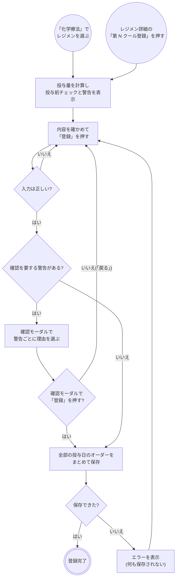

画面で確かめて入れるもの:

| 項目 | 説明 |
|---|---|
| 開始日 | Day 1 の日 |
| クール数 | 一度に 3 クールまで |
| 区分 | 入院か外来か |
| 投与量 | 体格(身長・体重)とレジメンの基準から計算した量。必要なら減量する |

警告は次のとおりです。

| 警告 | 確認を要する(理由が必須) | 表示のみ |
|---|---|---|
| 投与前チェック | 適応基準を外れる検査値 | 値が取れない、古い(7 日より前) |
| 薬剤アレルギー | 銘柄または成分が一致 | |
| 累積投与量 | 上限を超える | 判定できない |
| 体重の変化 | 前のクールから ±10% 以上 | |
| レジメンの重なり | 同じレジメンが適用中・休止 | 別のレジメンが進行中 |
| 開始日 | | 過去日、登録済みの投与日と重なる |
| 候補外のレジメン | | 廃止・有効期間外、適用後のマスタ変更 |
| 妊娠・授乳 | | 該当するとき |
| 施設の規則 | 規則の設定による | 規則の設定による |

- **登録を止める警告**: いまはありません。基準外でも、理由を選べば登録できます。
- **次クールの初期値**: 投与量・減量・区分は、前のクールと同じものが入ります。体格を新しい測定値で計算し直すときは「いまの体格で出し直す」を選びます。
- **外部の判断支援**: 処方と違い、問い合わせません。

### 投与可否の確認

その日に投与してよいかを、医師が投与日ごとに記録します。

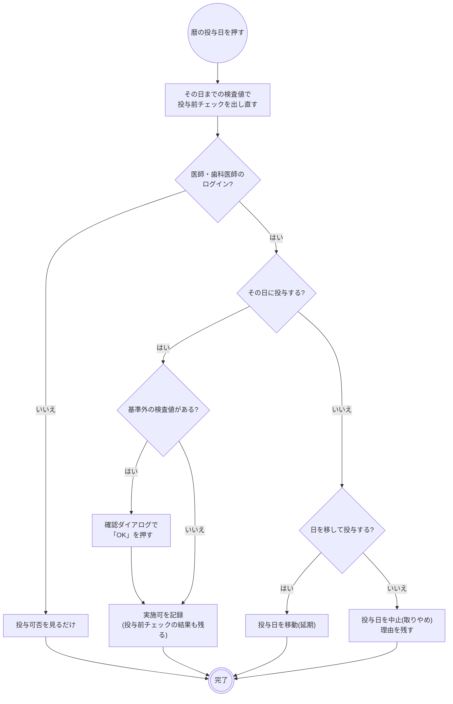

投与可否は、印で次のように出ます。

| 印 | 意味 | 出る場所 |
|---|---|---|
| 未確認 | 実施可の記録が無い | 「化学療法(投与日)」、注射一覧、処方一覧、外来化学療法室 |
| 実施可 | 医師が確認した | 「化学療法(投与日)」、注射一覧、処方一覧、外来化学療法室、暦 |
| 要再確認 | 確認のあとで移動・編集した | 「化学療法(投与日)」、注射一覧、処方一覧、外来化学療法室、暦 |
| 休止中 | 適用が休止中 | 注射一覧、処方一覧、外来化学療法室 |

- **記録できる人**: 医師・歯科医師のログインだけです。ほかの操作と違い、代行入力はできません。
- **記録の範囲**: 実施可は、同じ日の注射と内服の両方に記録します。「取消」で未確認に戻せます。
- **見合わせ**: 「見合わせ」という記録はありません。延期は移動、取りやめは中止で記録します。
- **休止中の印**: 一覧では、投与可否の印の代わりに出ます。
- **実施済・中止の日**: 確認欄も印も出ません。

### 化学療法室の予約

外来の投与日は、外来化学療法室の枠を予約します。

- **予約する場所**: 右ペインの「化学療法(投与日)」から、その投与日の枠だけを選べます。
- **日を変えるとき**: 予約だけを別の日にはできません。投与日を移動し、予約を取り直します。移動した日の予約は取り消されます。
- **暦の表示**: 予約のある日は、暦のマスに時計のアイコンと予約の時刻が出ます。
- **適用との関係**: 予約は適用とは別に取ります。枠が空いていなくても適用はできます。

### 変更・中止・削除

右ペインの「化学療法(投与日)」からの操作です。

| 操作 | 範囲 | できないとき | 化学療法室の予約 |
|---|---|---|---|
| 移動 | この日のみ / この日以降すべて | 実施済 | 取り消す |
| 編集 | その日 | | そのまま |
| 中止 | この日のみ / この日以降すべて | 実施済 | 取り消す |
| 中止取消 | この日のみ / この日以降すべて | | 戻らない(取り直す) |

ほかの画面からの操作です。

| 操作 | できる場所 | 範囲 | できないとき | 化学療法室の予約 |
|---|---|---|---|---|
| 移動 | 暦のドラッグ | この日のみ / この日以降すべて | 実施済 | 取り消す |
| 中止 | カルテの注射カード、注射一覧・処方一覧の行のメニュー | その日 | 注射・処方の中止と同じ | 取り消す |
| 中止取消 | カルテの注射カード、注射一覧・処方一覧の行のメニュー | その日 | | 戻らない(取り直す) |
| クール取消 | レジメン詳細のクール一覧 | クール全体 | 依頼済・中止以外の日を含む | 取り消す |
| 削除 | カルテのカード | その日 | 注射は実施の記録があるとき | 取り消す |

- **中止の理由と範囲**: 理由を入力でき、範囲を選べるのは右ペインの「化学療法(投与日)」だけです。どこから中止しても、予約の取消と、止めた人の記録は同じです。
- **中止取消の戻り先**: 中止する前の状態(受付済・払出済など)に戻ります。通常の注射・処方の中止取消は依頼済に戻るので、ここが違います。
- **編集と移動**: どちらも投与可否が要再確認に戻り、処方監査をやり直します。移動しても、投与量と状態は変わりません。
- **薬剤部の作業が進んだ日の移動**: 受付・払出・調剤を済ませた日を動かすときは、確認の画面にその件数が出ます。薬剤部へ通知は届かないので、移動した医師が薬剤部に日付の変更を伝えます。
- **最初の投与日の移動**: 適用の開始日も合わせて動きます。
- **中止した日の処方監査**: 投与日を中止しても、処方監査の未監査からは自動では消えません。一覧の状態に「中止」と出るので、薬剤師が監査済にして一覧から外します。完了・レジメン中止で止めた日も同じです。
- **クール取消**: 投与を止めるためではなく、登録の誤りを片付けるときに使います。
- **注射カレンダー**: 投与日のオーダーは、実施と実施取消だけができます。
- **代行入力**: 代行で移動・中止・完了・休止などをすると、指示医師の承認待ちに並びます。

### 帳票

| 帳票 | 開く場所 | 内容 |
|---|---|---|
| 化学療法実施計画書 | レジメン詳細のクール一覧の「計画書」 | クールの投与日ごとの薬剤・投与量・状態と、確認欄 |
| スケジュール表 | レジメン詳細の「スケジュール表」 | 患者向けの月の暦。中止した投与日は出さない |
| 公開用 PDF | レジメンマスタの編集画面の「公開用PDF」 | 外部向けのレジメンの内容。承認済のレジメンだけ |

- **注射箋・注射ラベル**: レジメン名・クール・Day が入ります。
- **処方箋**: 備考の先頭にレジメン名・クール・Day が入ります。

### 通常の注射・処方との違い

| 投与日のオーダー | 処方監査 | 帳票 | 払出・調剤 | 実施の記録 | 医事会計への送信 |
|---|---|---|---|---|---|
| 注射 | する(投与日ごと) | 注射箋・注射ラベル | 払出登録 | する | 外来は実施の記録から送る |
| 内服(入院) | する | 処方箋 | 調剤登録 | 経過表で記録 | 送らない |
| 内服(外来・院内) | する | 処方箋 | 調剤登録 | しない | 投与日の会計で送る |
| 内服(外来・院外) | しない | 院外処方箋 | 保険薬局が調剤 | しない | 投与日の会計で送る |

- **一覧の並び**: 注射は注射日で注射一覧に、内服は投与開始日で処方一覧に並びます。数クール分をまとめて登録しても、登録した日の一覧には載りません。
- **処方監査の単位**: 投与日のオーダーごとに監査します。連日の注射のように束ねません。
- **先のクールの処方監査**: 先のクールの投与日も、登録した日から処方監査の未監査に並びます。
- **一覧の表示**: 処方監査一覧と注射一覧にレジメン名・クール・Day が出ます。監査の画面では、体格と体表面積あたりの量も確かめられます。
- **施設設定**: 「監査済まで調剤登録・払出登録を出さない」は、通常の注射・処方と同じくかかります。
- **院外処方**: 内服の院外処方は、保険薬局が監査と調剤をします。
- **医事会計**: 外来の注射の会計には、外来化学療法加算と無菌製剤処理料が加わります。
- **疑義照会**: 注射・処方と同じです。薬剤師が照会を送ると状態が照会中になり、払出登録・調剤登録が止まります。医師が回答すると受付済に戻ります([prescription.md](prescription.md)「疑義照会の流れ」)。
- **DO**: 投与日のオーダーは DO(前回と同じ内容で出し直す)できません。同じ内容をもう一度出すときは、次クールを登録します。

## 開発者向け

### シーケンス図の前提

- **書き込みの経路**: `/fhir` への書き込みはどれも 1 回の transaction Bundle で、backend の `FhirProxyController` が上流へ中継します。
- **上流**: 上流の FHIR サーバーです。図では「上流 FHIR」と書きます。
- **応答の中継**: 上流の応答も backend を通って画面へ戻ります。図では省いて、上流から画面へ直接返す矢印で描きます。
- **SS-MIX2**: 有効にしている施設では、中継が書き込みの控えを記録します(`Ssmix2::Recorder`)。
- **楽観ロック**: 版は `postBundle` が `ifMatch` に添え、版が違えば 412 で止まります。
- **ヘッダ**: このページでは、適用 1 件を表す `ServiceRequest` を指します。
- **日オーダー**: 「運用フロー」節の「投与日のオーダー」です。通常の注射・処方の `ServiceRequest` + `MedicationRequest` です。
- **進捗 Task**: 日オーダーの状態を持つ Task で、注射は `injection`、処方は `rx-dispense` です。状態の対応は [injection.md](injection.md)「進捗 Task(`injection`)」と [prescription.md](prescription.md)「進捗 Task(`rx-dispense`)」のとおりです。
- **図の登場者**: 「運用フロー」節の部署に合わせています。化学療法室の予約だけは「利用者」としています(画面に職種の分けが無いため)。

### リソースの構成

- ヘッダ `ServiceRequest`(適用 1 件)
  - 日オーダー(投与日ごとの注射・処方の `ServiceRequest` + `MedicationRequest`。ヘッダと同じ `requisition` で結ぶ)
    - 進捗 Task(`injection` / `rx-dispense`)
    - 投与可否 Task(`chemo-go`。日オーダー 1 件に 1 件)
    - 監査 Task(`rx-verification`。日オーダーごと)
    - 予約 `Appointment`(`basedOn` = その日の注射の `ServiceRequest`)
  - 有害事象 `Observation`(`basedOn` = ヘッダ)

日オーダーはヘッダを `basedOn` で指しません。`basedOn` を持つと明細として扱われ、一覧から消えます([chemo-regimen-design.md](../chemo-regimen-design.md) §7.1)。

| リソース | 要素 | 中身 |
|---|---|---|
| ヘッダ `ServiceRequest` | `category` | `order-type|chemo-regimen` |
| ヘッダ `ServiceRequest` | `intent` | `plan` |
| ヘッダ `ServiceRequest` | `status` | 下の表 |
| ヘッダ `ServiceRequest` | `regimen` 拡張 | 完了日(`completedOn`)、中止の理由・詳細・中止日(`discontinuationReason`・`discontinuationNote`・`discontinuedOn`) |
| 日オーダー `ServiceRequest` | `requisition` | ヘッダと同じ uuid。system は `regimen-instance` |
| 日オーダー `ServiceRequest` | `regimen-order` 拡張 | クール・Day・体格 |
| 有害事象 `Observation` | `category` | 独自の `adverse-event` |
| 有害事象 `Observation` | `code.text` | CTCAE の用語(自由記述) |
| 有害事象 `Observation` | `valueInteger` | Grade |
| 有害事象 `Observation` | `effectivePeriod` | 発現日〜回復日(継続中は `end` 無し) |
| 有害事象 `Observation` | `treatment-context` 拡張 | 種別・名前の写しとクール |

化学療法の日オーダーかどうかは、`requisition` の system(`regimen-instance`)で判定します。

| 適用の状態 | ヘッダの `status` |
|---|---|
| 適用中 | `active` |
| 休止 | `on-hold` |
| 完了 | `completed` |
| 中止 | `revoked` |

### 投与可否 Task(`chemo-go`)

日オーダー 1 件に 1 件です。確認し直すときは、同じ Task を書き直します。

| 印 | 判定(`regimenDecisionOf`) |
|---|---|
| 未確認 | Task が無い、または `status = cancelled` |
| 実施可 | `status = completed` で、`input` の版が日オーダーの `meta.versionId` と一致 |
| 要再確認 | `status = completed` で、版が一致しない |

- **受付・払出で無効にならない理由**: 受付・払出は進捗 Task を書くだけで、日オーダーの `ServiceRequest` の版を動かしません。
- **版が読めないとき**: 投与日の一致だけで判定します。
- **注意**: 日オーダーの `ServiceRequest` を PUT する処理を足すと、版が変わるので実施可が要再確認に落ちます。

### 部品

| 操作 | 画面 | 組み立て | hook |
|---|---|---|---|
| 適用・次クール登録 | `components/RegimenApplyPanel.tsx` | `buildRegimenApplicationBundle`・`buildRegimenCycleBundle`(`fhir/regimenOrderHelpers.ts`) | `useCreatePrescription` |
| 投与可否 | `RegimenDecisionFields`(`components/RegimenDecision.tsx`) | `fhir/regimenDecisionHelpers.ts` | `useSaveRegimenDecision` |
| 化学療法室の予約 | `RegimenDayBooking`(`components/RegimenPanels.tsx`)・`ChemoBookModal` | `buildChemoAppointmentBundle` | `useBookChemoAppointment` |
| 移動 | `RegimenMoveModal`・`RegimenDayPanel`(`components/RegimenPanels.tsx`) | `buildRegimenMoveBundle`・`regimenStartDateEntries` | `useMoveRegimenDays` |
| 投与日の中止・中止取消 | `RegimenDayPanel` | `taskBeforeCancel` | `useRegimenDayStopEntries` |
| 休止・再開・完了 | `RegimenDetailView` | | `useUpdateRegimenStatus` |
| レジメン中止 | `RegimenRevokeModal` | | `useRevokeRegimen` |
| クール取消 | `RegimenDetailView` | `canDeleteCycle` | `useDeleteRegimenCycle` |
| 有害事象 | `RegimenAdverseEventPanel`・`AdverseEventEditor` | `fhir/adverseEventHelpers.ts` | `useSaveAdverseEvent`・`useDeleteAdverseEvent` |
| 一覧の印 | 注射一覧・処方一覧・払出登録・調剤登録 | `regimenOrderOf` | `useHeldRegimenIds`(休止中の判定) |

hook の置き場所は名前と合っていません。

- `useCreatePrescription` は `api/queries/labResult.ts` にあります。名前は処方由来ですが、全種別の登録が通ります。
- `useUpdateRegimenStatus`・`useDeleteRegimenCycle` は `api/queries/adverseEvent.ts` にあります(有害事象の hook と同じファイル)。
- `useSaveRegimenDecision`・`useBookChemoAppointment`・`useMoveRegimenDays`・`useRegimenDayStopEntries`・`useRevokeRegimen`・`useHeldRegimenIds` は `api/queries/regimen.ts` にあります。

適用編集(予定クール数の延長など)と有害事象の記録は、シーケンス図を省いています。有害事象は 1 件 = 1 `Observation` で、追加・更新は transaction Bundle の POST / PUT です(楽観ロックは使いません)。

### シーケンス図: 適用・次クール登録

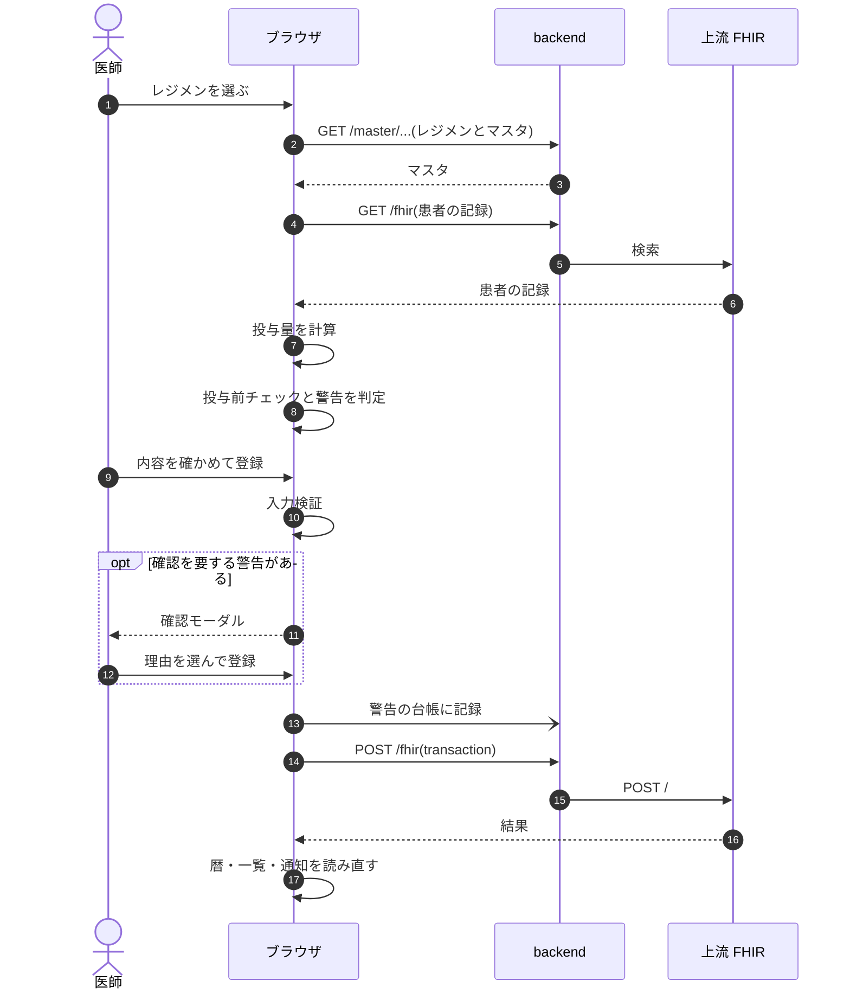

- 次クールは、レジメン詳細の「第 N クール登録」から始まります。
- マスタはレジメン・投与量換算・用量規則です。患者の記録は体格・検査結果・アレルギー・適用と日オーダーです。
- 投与量の計算は `planDrugDose`、入力検証は `validateRegimenApply` です。
- `-)` の矢印は応答を待たない送信です。警告の台帳は `POST /master/advisory_events`(発火・無視)です。

| transaction で書くもの | 条件 |
|---|---|
| POST ヘッダ `ServiceRequest` | 適用 |
| PUT ヘッダ `ServiceRequest` | 次クールで、体格か入外区分が変わったとき。身長・体重が揃わないクールは前の体格を残す |
| 投与日ごとに、注射と内服の `ServiceRequest` + `MedicationRequest` × 薬剤数 | いつも |
| `Provenance`(CREATE) | いつも |
| 監査 Task `rx-verification` | 注射と、院外を除く内服 |
| Task `order-approval` | 代行入力・研修医 |
| 警告の無視の `Provenance` | 確認モーダルで理由を選んだ |

### シーケンス図: 投与可否

実施可の記録です。

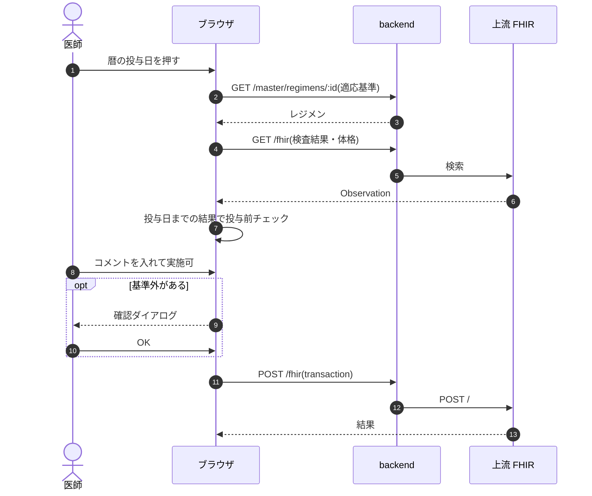

- 投与前チェックは `checkLabCriteria` です。
- transaction は、その日の未実施の日オーダーごとに Task `chemo-go` を書きます。

| Task `chemo-go` の要素 | 中身 |
|---|---|
| `status` | `completed` |
| `owner` | 確認した医師 |
| `input` | 投与日・日オーダーの版・レジメン |
| `output` | 投与前チェックの結果 |

「取消」です。

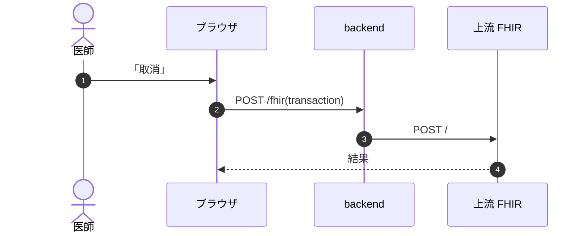

transaction は Task `chemo-go` を `status = cancelled` にします。

### シーケンス図: 化学療法室の予約

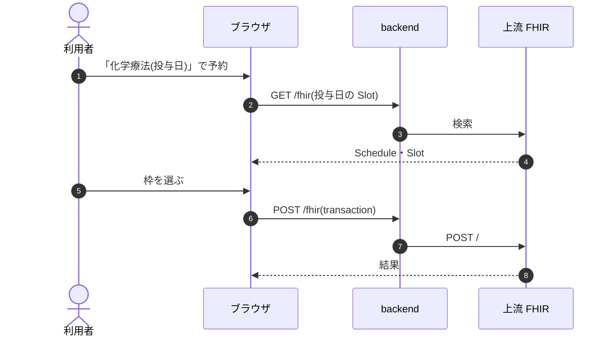

- 枠の検索は `service-type = chemo` です。
- transaction は `Appointment` の POST で、`basedOn` はその日の注射の `ServiceRequest` です。
- 予約はオーダーと別の transaction です。適用のときに取らないので、枠が空いていなくても適用は止まりません。

### シーケンス図: 移動

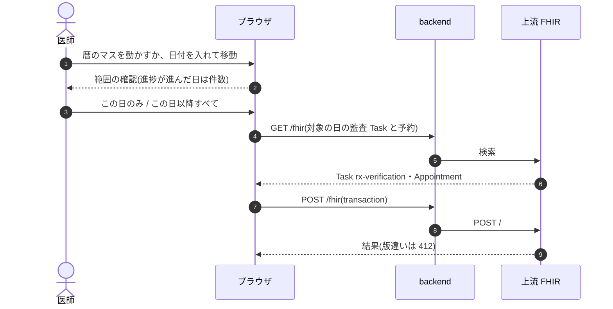

| transaction で書くもの | 条件 |
|---|---|
| PUT 日オーダーの `ServiceRequest`・`MedicationRequest` | 実施済を除く日。印と投与量の拡張は写す |
| PUT ヘッダの開始日 | 最初の投与日が変わったとき |
| 監査 Task `rx-verification` を未監査へ | いつも |
| `Provenance`(UPDATE) | いつも |
| 予約の取消 | 予約がある |

日オーダーを PUT するので、投与可否は要再確認になります。進捗 Task は変えません。

### シーケンス図: 投与日の中止・中止取消

中止です。

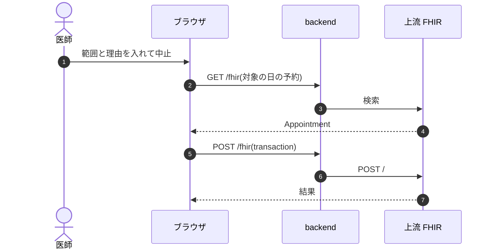

| transaction で書くもの | 中身 |
|---|---|
| 進捗 Task | `cancelled`。理由は `statusReason` |
| 日オーダー | `ServiceRequest` を `revoked`、`MedicationRequest` を `cancelled` |
| 予約 | 取消 |
| `Provenance` | CANCEL。対象は日オーダー |

中止取消です。

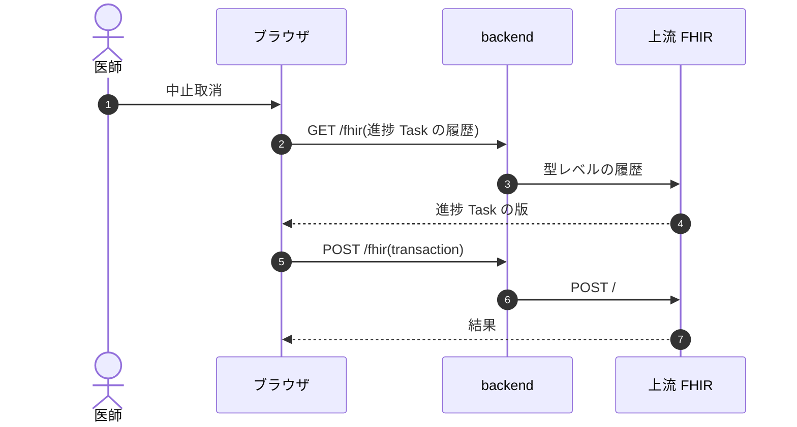

- 履歴は `GET /fhir/Task/_history` で、`_id` をカンマ区切りの OR で渡します。中止の前の版は `taskBeforeCancel` で選びます。

| transaction で書くもの | 中身 |
|---|---|
| 進捗 Task | 中止の前の版の内容に戻す。前の版が無ければ `requested` |
| 日オーダー | `ServiceRequest`・`MedicationRequest` を `active` |
| `Provenance` | REACTIVATE |

ほかの入口も同じ書き込みになります。

| 入口 | hook | 日オーダーの中止・中止取消のとき |
|---|---|---|
| カルテの注射カード、注射一覧 | `useUpdateInjectionTaskStatus` | `useRegimenDayStopEntries` で書く |
| 処方一覧 | `useUpdateRxTaskStatus` | `useRegimenDayStopEntries` で書く |

日オーダーの中止・中止取消かどうかは `isRegimenDayStop` で見分けます。通常の注射・処方の中止取消は `requested` に戻すので、戻り先が違います。

### シーケンス図: 休止・再開・完了・レジメン中止・クール取消

休止・再開です。

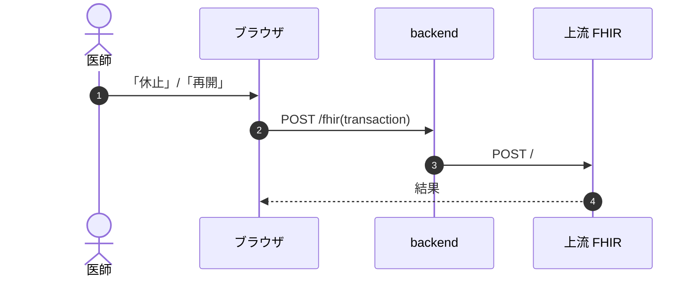

transaction はヘッダを `on-hold` / `active` で PUT し、`Provenance`(SUSPEND / RESUME)を足します。

完了・レジメン中止です。

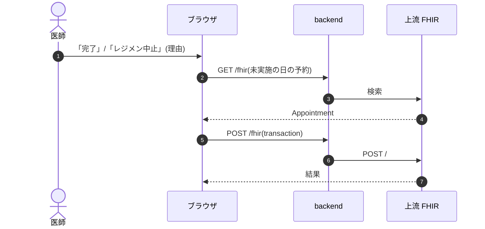

| transaction で書くもの | 中身 |
|---|---|
| ヘッダ | `completed` / `revoked` で PUT |
| 未実施の日の進捗 Task | `cancelled` |
| 未実施の日の日オーダー | `ServiceRequest` を `revoked`、`MedicationRequest` を `cancelled` |
| 予約 | 取消 |
| `Provenance` | COMPLETE / CANCEL。対象はヘッダ |

クール取消です。

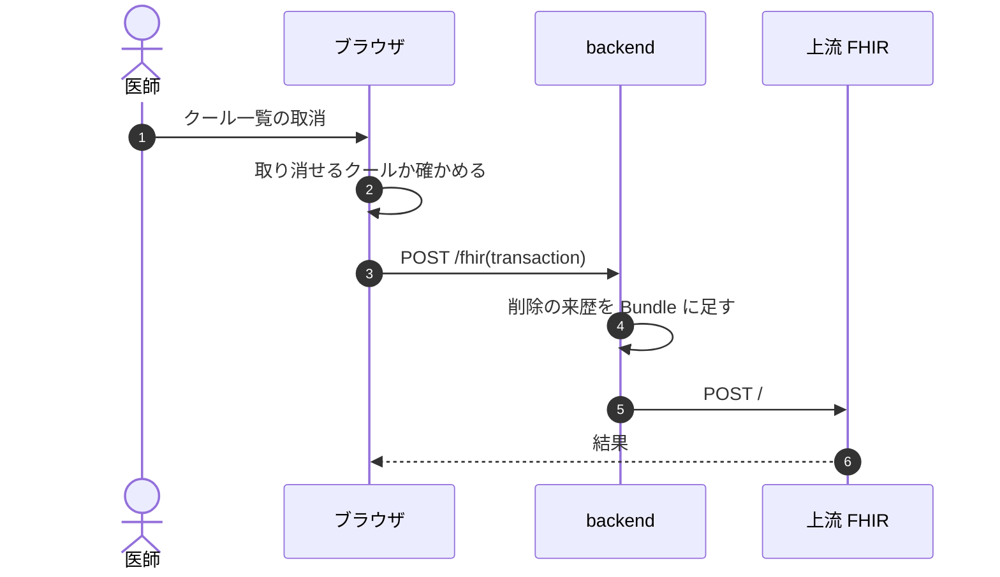

- 確かめるのは `canDeleteCycle` で、依頼済か中止の日だけのクールを取り消せます。
- transaction は、日オーダーの `ServiceRequest`・`MedicationRequest`、進捗 Task・投与可否 Task の DELETE と、予約の取消です。

### 払出・調剤・実施

日オーダーは通常の注射・処方なので、[injection.md](injection.md)「シーケンス図: 注射箋発行」「シーケンス図: 払出登録」「シーケンス図: 実施」、[prescription.md](prescription.md)「シーケンス図: 処方箋発行」「シーケンス図: 調剤登録」「シーケンス図: 与薬」と同じです。
違いは表示だけで、`regimenOrderOf` で印を読み、`useHeldRegimenIds` で休止中を判定します。

### 医事会計と SS-MIX2

医事会計(`BillingClaimBuilder`)は、ヘッダを送らず、日オーダーを通常の注射・処方と同じく送ります。SS-MIX2 の括弧内はデータ種別、INS / DEL は処理区分です。

| 起きたこと | 医事会計 | SS-MIX2 |
|---|---|---|
| 適用・休止・再開・完了・レジメン中止(ヘッダ) | 送らない(`OrderCatalog::IGNORED`) | 出さない |
| 日オーダーの登録・編集・移動 | 注射は送らない。内服は投与日の会計で送る | RDE^O11(注射は OMP-02、内服は OMP-01) |
| 投与日の中止、完了・レジメン中止で止めた日 | 対象から外れる。実施済みの施用は送る | RDE^O11 の `CA`(DEL) |
| 中止取消 | 対象に戻る | RDE^O11 の `NW`(INS) |
| クール取消・日オーダーの削除 | 対象から外れる | RDE^O11 の `CA`(DEL) |
| 注射の実施 | 通常の注射と同じく送り、外来化学療法加算と無菌製剤処理料を足す | RAS^O17(OMP-12) |
| 投与可否・有害事象 | 送らない | 出さない |

- **足す場所**: 外来化学療法加算と無菌製剤処理料は、その日の最初の注射の剤に 1 回だけ足します。
- **外来化学療法加算**: 15 歳未満は別のコードです。コードが施設設定に無いときは、送れなかった項目として報告します。
- **無菌製剤処理料**: コードが施設設定にあるときだけ足します。
