# クリニカルパスの業務フロー

クリニカルパスを、パス定義の作成と承認から患者への適用、病棟の日々の評価と実施、バリアンス、フェーズの進行、終了・中止まで追う流れです。医療機関の運用を検討する人は「運用フロー」、院内の開発者は「開発者向け」を読みます。
クリニカルパスは、疾患・術式ごとの入院診療の標準計画を**病日 × アウトカム**の格子(パスシート)で書いたものです。病日ごとに「患者がこうなっている」(アウトカム)、「それを何で判断するか」(観察項目)、「何をするか」(タスク)を置き、適用した患者ではタスクが日付の入ったオーダーになり、病棟は毎日アウトカムの達成・未達成(バリアンス)を記録します。
雛形から出たオーダー(処方・注射・検査・看護指示・食事など)はそれぞれの種別の流れに乗るので、部門の受付・実施の細部は各種別の業務フロー([看護指示](nursing.md)、[食事](meal.md)、[注射](injection.md)、[検体検査](lab.md)など)を読みます。
画面のふるまいは [features/orders-common.md](../features/orders-common.md#クリニカルパス定義マスタ)、設計は [clinical-pathway-design.md](../clinical-pathway-design.md)、不足機能は [clinical-pathway-backlog.md](../clinical-pathway-backlog.md) が正典です。基本仕様は JAMI・JSCP の ePath(ePath R4 実装ガイド)に準じます。

## 運用フロー

### オーダーセット・レジメンとの違い

| | オーダーセット | レジメン(化学療法) | クリニカルパス |
|---|---|---|---|
| 何を表すか | 医師がいつも出す組み合わせ | 化学療法の治療計画の雛形 | 疾患・術式ごとの入院診療の標準計画 |
| 持ち主 | 院内共通 / 診療科 / 医師 | 院内共通(承認制) | 院内共通(承認制) |
| 時間軸 | 無い(適用した日に全部出す) | 相対日(Day 1・8・15) | **病日**(入院日 = 1、入院前日 = -1) |
| 適用の単位 | 1 回で全部 | クール | **フェーズ**(分岐の無いパスは一括) |
| 適用後に残るもの | オーダーだけ | 適用の記録と投与日のオーダー | **パスシート**(病日ごとの計画)とオーダー |
| 評価 | 無い | 投与可否の確認 | **アウトカムの達成 / 未達成(バリアンス)**を病日ごとに記録 |
| 日々見る人 | なし | 化学療法室 | 病棟の看護師と主治医 |
| 終わり方 | なし | 完了・中止 | 終了・中止(手で記録) |

- 入口は、定義が「マスタメンテ > クリニカルパス > パス定義」、適用がカルテ右ペインの「クリニカルパス」、日々の記録がカルテの「パス」タブと病棟の指示簿です。
- アウトカム・観察項目は BOM(日本クリニカルパス学会の Basic Outcome Master)または施設のコードで持てます。BOM の配布ファイルは施設が学会から取得して「マスタ取込」で取り込みます。
- 1 つの入院に複数のパスを重ねて当てられます(術後に別のパスへ移るなど)。同じパスを同じ入院に二重には当てられません。

### パス定義の状態

| 状態 | 適用 | 内容の変更 |
|---|---|---|
| 下書き | できない | できる |
| 承認済 | 有効期間内ならできる | できない。複製して直し、承認し直す(版の小さい桁が 1 つ上がる) |
| 廃止 | できない | できない。使った記録として残す |

- 承認するときに確かめること: 適応基準・予定日数・版(「1」「1.1」の形式)がある、すべての病日にアウトカムが 1 つ以上ある、オーダー雛形を付けたタスクの中身が空でない、予定日数が標準の経路の最終病日以上。フェーズを分けたパスは、フェーズ名があり、分岐が循環せず、開始フェーズからすべてのフェーズに進め、フェーズの中の病日が連続していること。
- 承認済を下書きに戻せるのは、**患者に 1 件も適用していない**パスだけです。適用済みのパスは次のフェーズを定義から展開するので、直すと食い違うためです。
- 承認済の内容は凍結されますが、状態・有効期間・表示順は動かせます。削除は下書きだけです。

### 適用の状態

| 状態 | 意味 | 変わるきっかけ | できること |
|---|---|---|---|
| 進行中 | 評価・実施を記録している | 適用、終了の記録の取り消し | 評価・実施、次のフェーズ、予定外の追加、日程の変更、終了・中止、適用の取り消し(記録が無いときだけ) |
| 終了 | 予定どおりに終えた | 「終了・中止」で終了を選ぶ、分岐で「パスを終了」を選ぶ | 読む、ePath 出力、終了の記録の取り消し |
| 中止 | 途中でやめた(理由を残す) | 「終了・中止」で中止を選ぶ | 読む、ePath 出力、終了の記録の取り消し |

- 終了・中止は**手で記録**します。退院や最終病日の到来で自動的には終わりません。
- 取り消しは適用そのものを消すので、状態ではなく「なかったこと」になります。評価・実施・部門の受付が 1 つでもあれば取り消せず、中止にします。
- 進み具合(未評価・バリアンス・未実施の件数)はパスタブのオーバービューの見出し帯に出ます。

### 全体の流れ

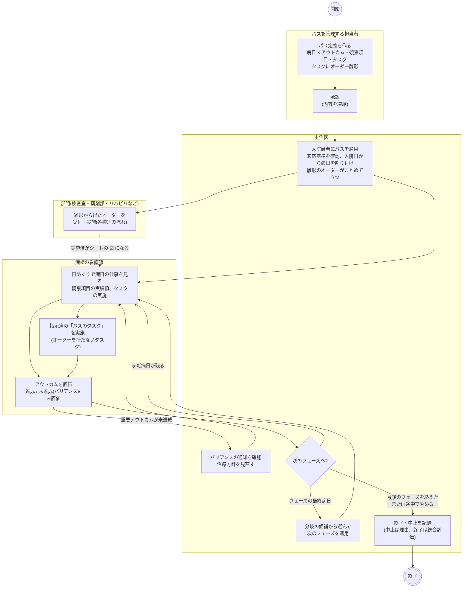

- 「パスを管理する担当者」はパス委員会や各科のパス担当を想定した呼び方で、システムの権限ではありません。定義の作成・承認はマスタメンテから誰でも行えます。
- 医師の操作はカルテから、看護師の操作はカルテのパスタブと病棟の指示簿からです。パスシートの記録はどの職種でも行え、記録者はログイン中の本人です。
- 部門は、パスから出たことを気にせずに通常どおり受け付け・実施します。オーダーには「パス」の印が付き、カルテのカードにバッジで出ます。

### パス定義の作成と承認

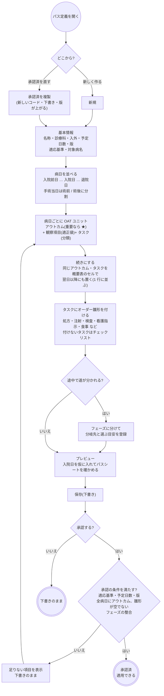

- アウトカム・観察項目のコードは、BOM を取り込んだ施設では「選択」で名称から探せます。アウトカムを選ぶと、そのアウトカムに属する観察項目の候補がチェックで選べます。取り込んでいない施設は手入力です。
- 看護観察(MEDIS)に結んだ観察項目は、適正値を数値の範囲や許容値として構造化できます。適用後の評価で実績値に ○ / ✕ が付き、達成状態の提案に使われます。
- 「続き」は、同じアウトカムやタスクを複数の病日に置いたものです。名前・コード・雛形は続き全体で揃い、適正値は日ごとに変えられます(術後 1 日目は疼痛 3 以下、4 日目は 2 以下など)。
- 病日の「主要イベント」で、手術・内視鏡・放射線治療のタスクを選んでおくと、適用後のシートに実施の時刻つきで出ます。
- 承認済の定義を直すときは複製して下書きで直し、承認し直して元を廃止します。進行中の患者は元の定義のまま進みます。
- サンプルとして 4 泊 5 日の腹腔鏡下胆嚢摘出術、1 泊 2 日の大腸ポリープ切除、2 泊 3 日の鼠径ヘルニア、7 日間の市中肺炎、分岐つきの市中肺炎が下書きで入っています。

### 適用の判定

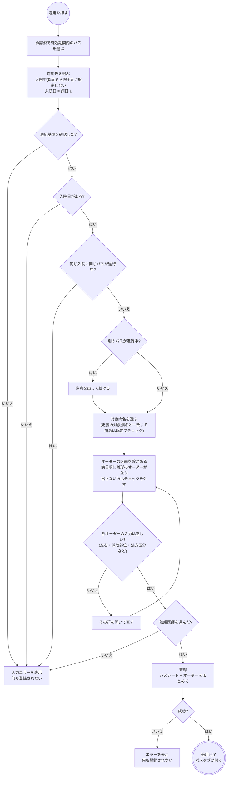

- 入口はカルテ右ペインの「クリニカルパス」です。適応基準の文がそのまま出て、「適応基準を確認した」にチェックしないと適用できません。
- 入院予定に当てると、入院日はその予定の日付です。予定の日付が未定なら当日が入ります。入院日を変えると病日 → 日付の表とオーダーの開始日が追随します。
- オーダーの区画には、雛形を持つタスクが病日順に並びます。開始日は入院日 + (病日 − 1)。続く病日の看護指示は 1 件にまとまり、食事・安静度は次の食事・安静度の直前で終わります。その他の種別(注射・検査・処方など)は病日ごとに 1 件です。
- 雛形が外来で作られていると処方区分が空になることがあります。検証に落ちた行があれば何も登録せず、その行を開きます。
- フェーズを分けたパスは、最初は開始フェーズの病日とオーダーだけを登録します。
- 代行入力は他のオーダーと同じです。雛形から出たオーダーには承認待ちの通知が付き、パスの適用そのものには付きません。
- 予約が要る項目(CT・MRI・内視鏡など)は、適用では予約されません。適用後に部門の予約で枠を取ります。

### 日々の評価と実施

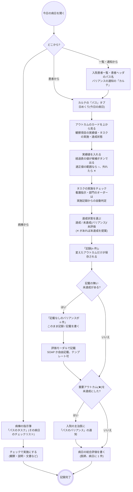

- パスタブは「日めくり」(1 病日ずつ)と「オーバービュー」(紙のパスシートと同じ格子。既定)の 2 つの見方があります。オーバービューはアウトカムのセルを押すと評価モーダル、タスクのセルを押すとそのオーダーの詳細(看護指示は実施入力)が開きます。
- 達成状態・実績値・タスクの実施は日めくりでまとめて入れ、記載(SOAP・自由記載)とコメントは評価モーダルで書きます。
- タスクの実施の決まり方は 3 通りです。オーダーを持たないチェックリストはチェックで記録する。看護指示・リハビリ・栄養指導を結んだタスクはその日の実施記録があれば ☑。その他のオーダーを結んだタスクは部門がオーダーを実施済みにすれば ☑。後の 2 つはパス側で押せません。
- オーダーの詳細から「実施入力」へ進めます(注射・輸血・放射線・生理・内視鏡・処置・手術・リハビリ・栄養指導)。部門の受付を済ませていなくても実施できます。検体検査・病理・細菌・他科依頼・食事・処方は部門や経過表で記録します。
- 同じアウトカムを 1 日に何度評価しても全部残ります。シートのセルには「×n」が付き、評価モーダルに履歴が並びます。実績値は前回と変えたものだけ新しく記録され、空にしても前の値は消えません。
- バリアンスの通知は重要アウトカム(★)を未達成にしたときだけ届きます。宛先は入院の主治医、強度は注意。未達成のまま記録し直しても出し直さず、達成・未評価に直すと未対応の通知は取り下げます。主治医は通知の「確認」で対応済みにします。
- 記載のある評価と病日の総合評価は、カルテのタイムラインに「パス評価」のカードとして記録日時の日に出ます。達成状態だけの評価はカードになりません。
- 指示簿の「パスのタスク」はオーダーを持たないタスクだけです。雛形から出た看護指示は同じ画面の上の表に、その他は各部門の画面に出るので重ねません。指示受けは要りません。

### フェーズの進行

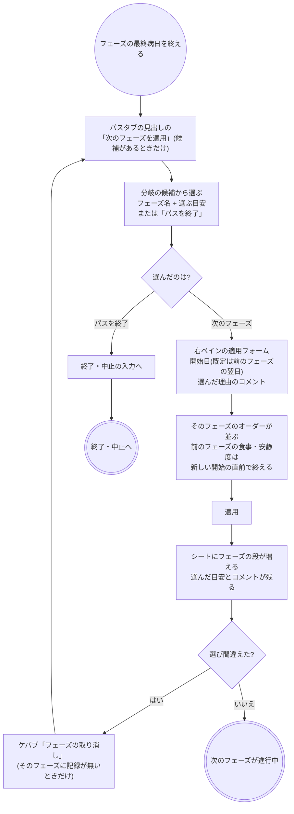

- 分岐は市中肺炎のように「3 日目の効果判定で、継続か抗菌薬変更か」のような道の分かれ目に使います。分岐の先頭が標準の経路です。
- 「どこまで適用したか」は適用済みの病日の印から決まります。最後のフェーズを終えたら「次のフェーズを適用」は出ません。
- 次のフェーズの開始日は、適用済みの最後の病日より後にします。前のフェーズの最終日より早くはできません。
- フェーズの取り消しで戻せるのは最後に適用した 2 つ目以降のフェーズだけで、条件は適用の取り消しと同じ(そのフェーズの病日に記録が無い)です。前のフェーズの食事・安静度に入れた終了は戻しません。

### 予定外・日程の変更・終了・中止・取り消し

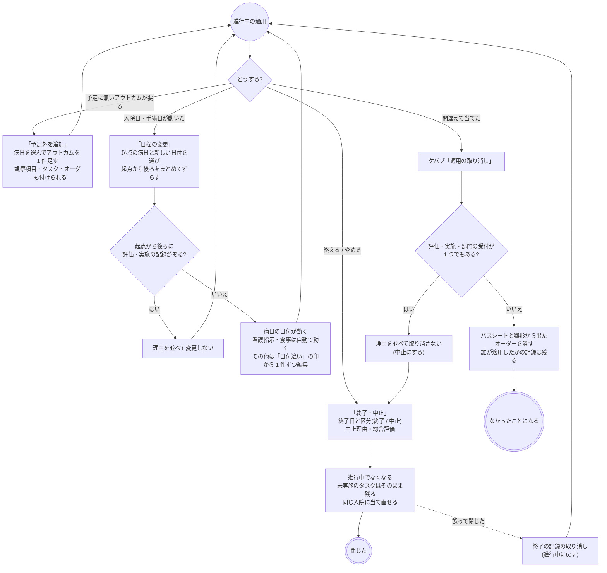

- 予定外のアウトカムは、シートでは「予定外」の印の付いた行として予定どおりのものと同じに扱えます。付けたオーダーは適用と同じ束に入ります。終了・中止したパスには足せません。
- 日程の変更で自動でずらすのは看護指示と食事だけです(日付が 1 本で完結する)。注射・検査・手術・処置などは、明細・予約・部門の受付を伴うので、シートのセルの「日付違い」を見て 1 件ずつオーダー詳細の「編集」で直します。記録のある病日はずらせません。
- 終了は予定どおり終えたとき、中止は途中でやめたときです。どちらも手で記録し、退院しても自動では終わりません。退院後に進行中のまま残らないよう、退院の前後に終了を記録する運用にします。
- 終了・中止すると「予定外を追加」「日程の変更」「次のフェーズ」は出なくなります。間違えて閉じたときは「終了の記録」から取り消して進行中に戻せます。
- 適用の取り消しは、雛形から出したオーダーをカルテのカードの削除と同じ種別ごとの処理で消します(予約の取消、テンプレートの記入の削除なども各種別に任せる)。看護指示も、普段は中止で残すところをここでは消します。途中で失敗したら、もう一度開けば残ったオーダーから続けられます。

### ほかの画面とのつながり

| 画面 | クリニカルパスの使い方 |
|---|---|
| カルテの時系列 | 雛形から出たオーダーのカードに「パス」のバッジ(ツールチップにパス名)。記載のある評価と病日の総合評価は「パス評価」のカード |
| 病棟の指示簿 | 看護指示の表の下に「パスのタスク」(オーダーを持たないタスク)。氏名からパスタブのその病日の日めくりへ。雛形から出た看護指示は上の表に出て、続く病日は 1 件の指示 |
| 入院患者一覧・患者ヘッダ | 進行中のパス名。押すとパスタブ |
| 通知 | 「パスのバリアンス」(重要アウトカムの未達成)。入院の主治医あて、強度は注意、「カルテ」でその病日の日めくり、「確認」で対応済み |
| 経過表 | 看護観察に結んだ観察項目の実績値の候補を経過表の値から出す(押して記録したときだけパスの実績になる)。パスの実績値そのものは経過表に出ない |
| 部門の一覧(検査・放射線・リハビリなど) | 雛形から出たオーダーが通常どおり並ぶ。実施済みにするとシートの ☑ になる。パスタブのオーダー詳細「実施入力」から部門と同じ実施入力を開ける |
| データ抽出・ダッシュボード | 「パス」タブで適用 1 件 1 行(状態・終了区分・予定日数と実日数・評価とバリアンスの件数・中止理由)。クラスタ・指標にも使える |
| ePath 出力 | 定義の編集画面で施設パス、パスタブのケバブで患者に適用したパス(評価・実施・総合評価を含む)を JAMI 標準の XML でダウンロード |

### 変更・中止・削除

| 操作 | できること |
|---|---|
| 定義の変更 | 下書きは自由に。承認済は複製して直し、承認し直す。承認済を下書きに戻すのは適用 0 件のときだけ |
| 定義の削除 | 下書きだけ。承認済は廃止にする |
| 適用後の計画の変更 | 予定外のアウトカムの追加、日程の変更。病日や予定どおりのアウトカムを消す手段は無い(予定外のアウトカムも名前を直せない) |
| 雛形から出たオーダーの変更 | 通常のオーダーと同じ(カルテのカードやパスタブのオーダー詳細の「編集」から)。オーダーを直してもパス側の計画は変わらない |
| 終了・中止 | 見出しのアイコン「終了・中止」。終了日・区分・中止理由・総合評価。取り消して進行中に戻せる |
| 取り消し | 何も記録していない進行中の適用だけ。シートとオーダーを消す |
| 評価の訂正 | 達成状態・記載は記録し直す(履歴に残る)。実績値は正しい値をもう一度記録する(前の値は消えない) |

### 帳票

専用の帳票はありません。パスシートの持ち出しは ePath 出力(JAMI 標準の XML)です。雛形から出たオーダーの帳票(処方箋・注射箋・ラベルなど)は各種別と同じです。

## 開発者向け

### リソースの構成

定義は backend の DB、適用後は上流 FHIR に ePath 準拠の CarePlan の木で置きます。

| もの | 置き場所 | 要点 |
|---|---|---|
| パス定義 | backend `master_pathways` と子(対象病名・フェーズ・分岐・病日・OAT ユニット・観察項目・タスク) | `pathway_code` で結び、子は 1 リクエストで丸ごと置換。OAT ユニット・観察項目・タスクの `*_key`(uuid)は画面が採り、適用後の識別子に持ち越す。オーダー雛形は `order_type` + `order_values`(jsonb。オーダーセットのエントリと同じ形) |
| BOM | backend `master_bom_outcomes` / `master_bom_assessments` / `master_bom_pairs` | 取込で全件洗い替え。検索専用 |
| 適用 | `CarePlan`(根。`partOf` 無し) | `category` = `care-plan-type\|clinical-pathway` + `pathway-level\|apply`、`instantiatesUri` = `…/pathway/{code}`、`identifier` = `apply-id\|{施設コード}.{適用uuid}`、`addresses` = 対象病名、`encounter`、`period.start` = 入院日、拡張 `pathway-version` |
| 病日 | `CarePlan`(`partOf` = [適用]) | `pathway-level\|event`、`identifier` = `event-id\|….{病日[-ステップ]}`、`period.start = end = その日`、拡張 `pathway-phase`(フェーズ)・`pathway-phase-note`・`pathway-major-event` |
| OAT ユニット | `CarePlan`(`partOf` = [適用, 病日]) | `pathway-level\|oat-unit`、`identifier` = `oat-unit-id\|….{unit_key}`、`category` に BOM の大分類・中分類・コード、重要アウトカム、予定外は `EPathCarePlanUnplannedKind` = `Y`、`goal` → アウトカムの Goal(評価後) |
| 観察項目 | `CarePlan`(`partOf` = [適用, 病日, OAT ユニット]) | `pathway-level\|assessment`、`identifier` = `assessment-id\|….{assessment_key}`、`goal` → 適正値の `Goal`(`assessment-goal-id`。`target.detailString` / `detailRange` / `detailCodeableConcept`)。結ぶ観察項目の無いタスクは `ZZZZZZZZZZ` の観察項目で包む |
| タスク | `Procedure`(`basedOn` = [観察項目の CarePlan, オーダーのヘッダ]) | `status` = `preparation`(未実施)/ `completed`(実施)、`performedDateTime`、`performer`、拡張 `EPathProcedureTaskPlannedDateTime`(予定日)、`pathway-display-order` |
| 雛形から出たオーダー | 各種別のヘッダ `ServiceRequest` | `identifier` = `pathway-instance\|{適用uuid}`、拡張 `pathway-order`(valueCoding = パスコード・名前)、`requisition` = 同じ uuid。参照はタスク → オーダーの一方向 |
| アウトカムの評価 | `Goal`(`outcome-goal-id` = OAT ユニットの識別子)+ `Observation`(`observation-evaluation-id` = `….{記録番号}`) | `Goal.achievementStatus` = `EPathStateOfAchievementCS` 1 達成 / 2 未達成 / 3 未評価(最新)、`outcomeReference` → 評価を記録順に全部。`Observation.code` = `EPathEvaluationItemCS\|judgement`、`component` = S / O / A / P または `comp-assessment`(自由記載)、`category[0]` = パスの印、`basedOn` → OAT ユニット |
| 観察項目の実績 | `Observation`(`observation-result-id` = `….{assessment_key}.{記録番号}`) | `code` = 観察項目のコード、`value[x]` は看護観察の表現タイプ、`basedOn` → 観察項目の CarePlan。値が前回と変わったときだけ POST、PUT・DELETE しない |
| 病日の総合評価 | `Observation`(`observation-comp-assessment-id` = 病日の識別子) | `code` = `comp-assessment`、`valueString`、`basedOn` → 病日の CarePlan。病日に 1 件、上書き(PUT)、空にしたら DELETE |
| 終了・中止 | `Goal`(`apply-goal-id` = 適用の識別子) | `lifecycleStatus` = `completed` / `cancelled`、拡張 `EPathGoalStatusReason` = `EPathPathClosingTypeCS` 1 終了 / 2 中止、`statusDate` = 終了日、`note` = 中止理由(「中止理由: 」で始める)と総合評価 |
| バリアンスの通知 | `Task`(`task-code\|pathway-variance`) | `priority` = `urgent`、`focus` → 評価の Observation、`basedOn` → OAT ユニット、`owner` → 入院の主治医(participant ATND)、`input` にパス名・適用・病日・アウトカム |
| 来歴 | `Provenance` | 適用の CarePlan を対象に 1 件(author = 依頼医師、enterer = ログイン本人)。雛形から出たオーダーには種別共通の来歴(代行なら承認待ちの通知) |

- 子孫は `partOf` に祖先すべてを並べます。`part-of=CarePlan/{適用}` の 1 回で木全体、`part-of:missing=true` で根だけが引けます。
- 階層は `pathway-level` の category で判定します(partOf の本数でも導けるが、木を全部読まないと分からない)。EP12 出力では落とします。
- 評価・実績の Observation は `category[0]` にパスの印を置きます(上流は category の先頭しか索引しない)。`vital-signs` を持たないので経過表に出ません。
- 適用の木は 1 ページ(500 件)を超えうるので、`usePathwayApplicationTree` は total から残りのページも読みます。

### 状態の持ち方

| 表示 | 定義(`master_pathways.status`) | 適用(`CarePlan.status`) | 適用の `Goal` |
|---|---|---|---|
| 下書き / 承認済 / 廃止 | `draft` / `approved` / `retired` | – | – |
| 進行中 | – | `active`、`period.end` 無し | 無い |
| 終了 | – | `completed`、`period.end` = 終了日 | `lifecycleStatus` = `completed`、終了区分 1 |
| 中止 | – | `revoked`、`period.end` = 終了日 | `lifecycleStatus` = `cancelled`、終了区分 2 |
| 終了の記録の取り消し | – | `active` に戻し `period.end` を落とす | DELETE |
| 取り消し | – | 木を DELETE | – |

- 「どこまでフェーズを適用したか」は保存せず、適用済みの病日の `pathway-phase` の印から逆算します(`nextPhasesOf`)。印の無い適用は先頭のフェーズとして読みます。
- タスクの実施は `pathwayTaskPerformedOn` で判定します。チェックリストは Procedure の `status`、看護指示・リハビリ・栄養指導はその日の実施記録(`OrderProgress.performedDates`)、その他はオーダーの進捗 Task(`orderProgressByOrderId`。Task で進み具合を持たない処方・食事・細菌・化学療法は `ServiceRequest.status`)です。
- 二重適用のガードは、同じ Encounter に `active` の同じ `pathwayCode` があるかだけを見ます。終了・中止した適用には当て直せます。
- 承認の取り消し(`approved` → `draft`)は、backend が上流に `CarePlan?instantiates-uri=…&_summary=count`(strict)を問い合わせ、1 件でもあれば 422、確認できないときも 422 です。

### シーケンス図の前提

`/fhir` への書き込みはどれも 1 回の transaction Bundle で、backend の `FhirProxyController` が上流へ中継します。
SS-MIX2 を有効にしている施設では、中継が書き込みの控えを記録します(`Ssmix2::Recorder`。CarePlan・Goal・パスの Observation・タスクの Procedure は対象外で、雛形から出たオーダーの `ServiceRequest` / `MedicationRequest` だけが各種別のメッセージになります)。
楽観ロックの版は `postBundle` が `ifMatch` に添え、版が違えば 412 で止まります。

| 部品 | 場所 |
|---|---|
| 定義の一覧・編集 | `pages/PathwayListPage.tsx`(`/pathways`)、`pages/PathwayEditorPage.tsx`(`/pathways/new`・`/pathways/:id`)、病日 `components/PathwayEventCard.tsx`、概要表 `PathwayOverviewTable.tsx`、雛形 `PathwayTaskTemplateModal.tsx`、分岐 `PathwayPhaseBranchModal.tsx`、プレビュー `PathwaySheetPreviewModal.tsx`、draft の型と検証 `fhir/pathwayHelpers.ts` |
| 定義の API | `api/masterClient/pathway.ts`・`api/masterQueries/pathway.ts`(`usePathwaySearch` / `usePathway` / `useApplicablePathways` / `usePathwayMutations`)、backend `Master::PathwaysController`(`validate_content!` が下書きと承認の検証)、BOM `BomOutcomesController` / `BomAssessmentsController` |
| 適用 | `components/PathwayApplyPanel.tsx`(右ペイン `pathway-apply` / `pathway-phase`)、`fhir/pathwayApplyHelpers.ts`(`buildPathwayApplyBundle` / `buildPathwayPhaseBundle` / `pathwayOrderPlan` / `stampPathwayOrders` / `buildUnplannedUnitBundle` / `parsePathwayApplication`)、`api/queries/pathway.ts`(`useApplyPathway` / `useAddUnplannedUnit` / `usePatientPlannedAdmissions`) |
| パスタブ | `components/KartePathwayTab.tsx`、日めくり `PathwayDayView.tsx`、評価 `PathwayEvaluatePanel.tsx`、総合評価 `PathwayDayAssessmentPanel.tsx`、タスク `PathwayTaskPanel.tsx`、オーダー詳細 `PathwayOrderModal.tsx`、シートの組み立て `fhir/pathwaySheetHelpers.ts`、評価の組み立て `fhir/pathwayEvaluationHelpers.ts`(`buildPathwayEvaluationBundle` / `buildPathwayDayAssessmentBundle` / `buildPathwayTaskBundle` / `judgeAssessment` / `proposeAchievement`) |
| 読み | `api/queries/pathway.ts`(`usePathwayApplications` / `usePathwayApplicationTree` / `usePathwayObservations` / `usePathwayApplyGoal` / `usePathwayVarianceTasks` / `useActivePathwaysByPatient` / `usePathwayWardTasks`) |
| 変更・終了 | `components/PathwayNextPhaseModal.tsx`、`PathwayUnplannedPanel.tsx`、`PathwaySchedulePanel.tsx`(`fhir/pathwayScheduleHelpers.ts` の `planPathwayShift` / `buildPathwayShiftBundle` / `planPhaseOrderClosings`)、`PathwayClosePanel.tsx`(`fhir/pathwayCloseHelpers.ts`)、`PathwayCancelPanel.tsx`(`planPathwayCancel` / `buildPathwayTreeDeleteBundle`、`useCancelPathwayApplication`) |
| バリアンス | `fhir/pathwayVarianceHelpers.ts`、`hooks/usePathwayVarianceNotice.ts`、`components/notifications/notificationRegistry.tsx`(`pathway-variance`) |
| ほかの画面 | `components/PathwayWardTasks.tsx`(指示簿、`fhir/pathwayWorklistHelpers.ts`)、`PathwayNameLinks.tsx`(入院患者一覧・患者ヘッダ)、`fhir/pathwayKarteHelpers.ts`(カルテのカード)、`fhir/pathwayExtractHelpers.ts`(データ抽出)、`fhir/epathMessageHelpers.ts` + `api/queries/epathExport.ts`(ePath XML) |

### シーケンス図: 定義の保存・承認・複製

定義は FHIR を通らず backend の DB だけです。承認の取り消しだけが上流に件数を問い合わせます。

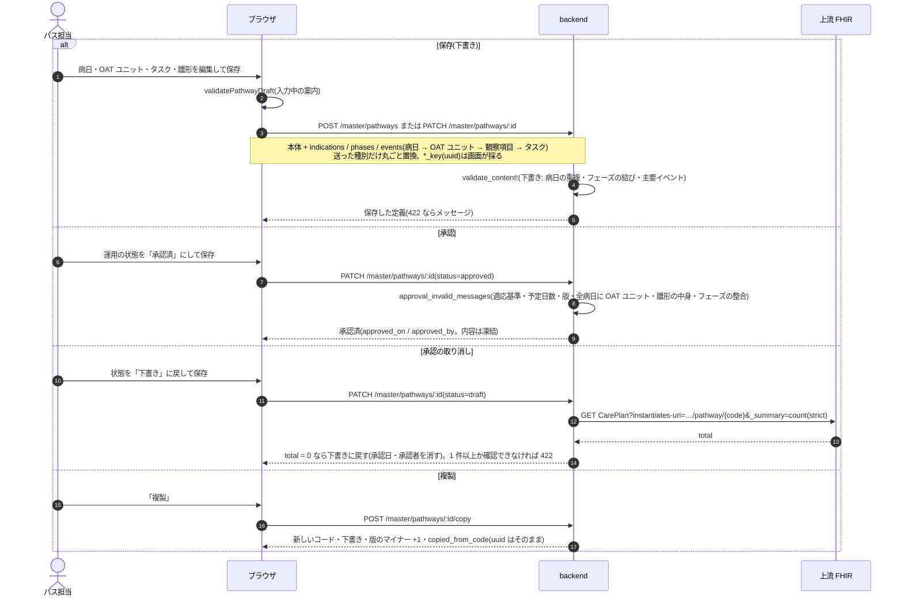

### シーケンス図: 適用(初回と次のフェーズ)

`buildPathwayApplyBundle` / `buildPathwayPhaseBundle`、`useApplyPathway`。計画の木とオーダーと来歴を 1 つの transaction にまとめます(`mergeTransactionBundles`)。

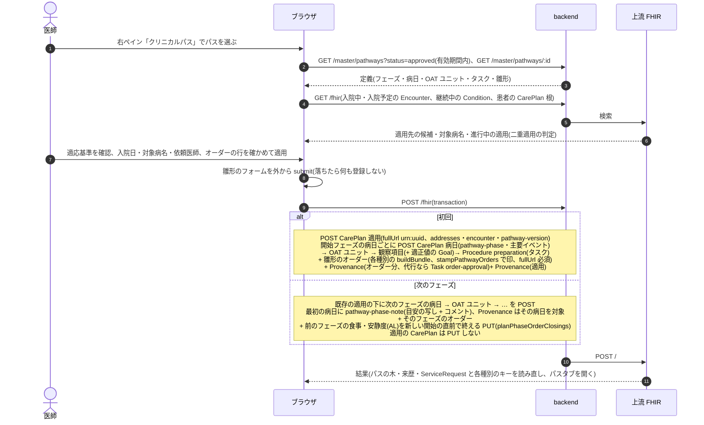

- 識別子は `{施設コード}.{適用uuid}` を先頭に階層ごとにピリオドで連ね、`unit_key` / `assessment_key` / `task_key` は定義の uuid です。定義を直しても同じアウトカムを追えます。
- 続く病日の看護指示は `orderContinuityOf` で 1 件にまとめ(先頭の病日の雛形、終了日は続きの最終日)、食事・安静度は後に並ぶ同じ種類のオーダーの直前で終えます(`pathwayOrderEnd`)。その他の種別は病日ごとに 1 件です。
- 予定外の追加(`buildUnplannedUnitBundle`、`useAddUnplannedUnit`)も同じ形で、選んだ病日の下に OAT ユニット → 観察項目 → Procedure を POST し、付けたオーダーを同じ transaction に入れます。`EPathCarePlanUnplannedKind` = `Y`、`unit_key` はその場の uuid です。

### シーケンス図: パスタブの読みと日次評価

`usePathwayApplicationTree`(木)・`usePathwayObservations`(評価・実績・総合評価、全ページ)・`usePathwayApplyGoal`(終了・中止)・`usePathwayVarianceTasks`、記録は `buildPathwayEvaluationBundle` と `useRecordPathwayEvaluation`。

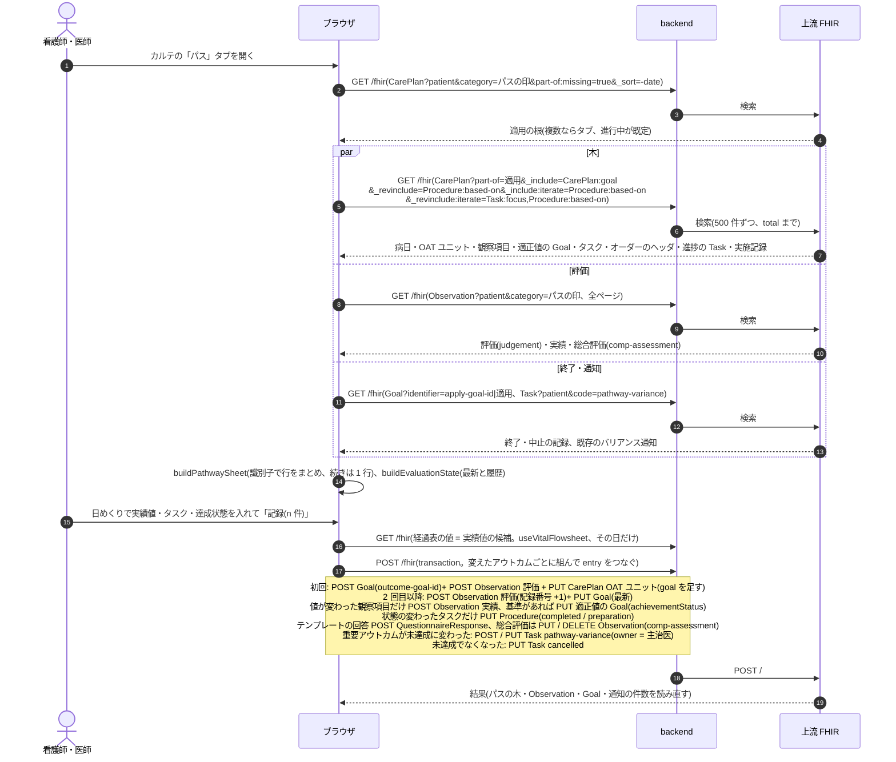

- 上流は `_revinclude:iterate` を 2 つ並べると最後の 1 つしか効かないので、カンマで 1 つにします。
- 既存の Observation には PUT も DELETE もしません(実績の訂正は正しい値をもう一度記録する)。テンプレートの回答も消さず、再編集したら新しい回答を POST して新しい評価だけが指します。
- オーダーを持たないタスクを 1 件だけ実施・未実施にする(`PathwayTaskPanel`、指示簿の「パスのタスク」)は `buildPathwayTaskBundle` の Procedure の PUT だけで、評価には触れません。
- パスタブから開いたオーダー詳細・実施入力・看護指示の実施入力は種別ごとの一覧しか読み直さないので、閉じたときに木を読み直します(`PATHWAY_TREE_KEY_PREFIX`)。

### シーケンス図: 指示簿のパスのタスク

`usePathwayWardTasks`、`parsePathwayWardTasks`。看護指示と違って `ward` 検索は使えないので、その日の入院患者のベッドから病棟を決めます。

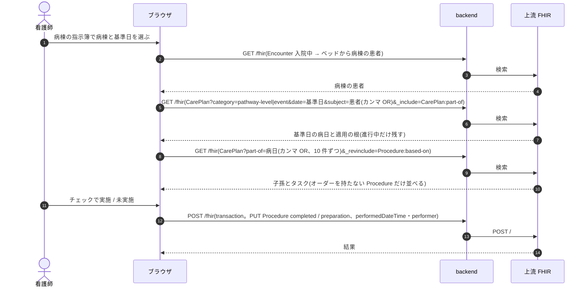

### シーケンス図: 終了・中止・日程の変更・取り消し

`buildPathwayCloseBundle` / `buildPathwayReopenBundle`(`useClosePathway`)、`planPathwayShift` / `buildPathwayShiftBundle`(`useShiftPathwaySchedule`)、`planPathwayCancel` / `buildPathwayTreeDeleteBundle`(`useCancelPathwayApplication`)。

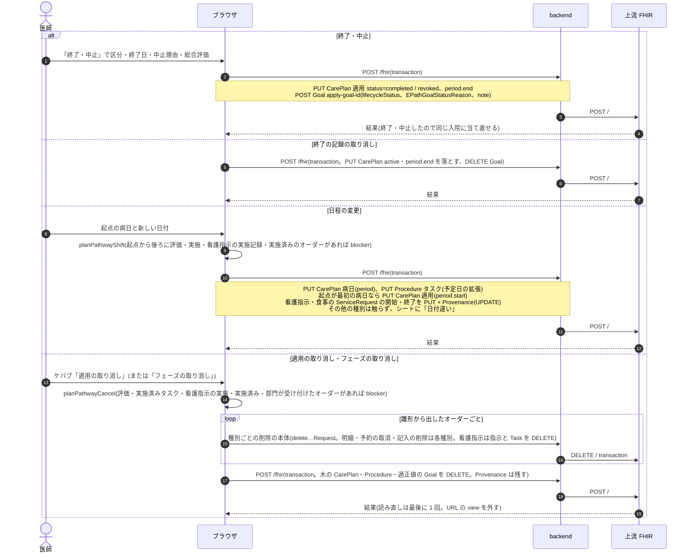

- 取り消しで種別ごとの削除の hook を使わないのは、hook が 1 件ごとに一覧を読み直させ、数十件を続けると上流の回数制限に当たるためです。途中で失敗したら木は残し、もう一度開けば残ったオーダーから続けられます。
- 退院の transaction はパスに触りません(看護指示・食事・リハビリの打ち切りだけ)。退院後も進行中のまま残るのは運用で閉じます(バックログ A-6)。

### 医事会計と SS-MIX2

パスの計画・評価そのもの(CarePlan・Goal・パスの Observation・タスクの Procedure)は請求の項目を持たず、SS-MIX2 の対象リソース(`Ssmix2::Dispatcher::RESOURCE_TYPES`)にも入っていません。雛形から出たオーダーは、パスから出たことに関係なく各種別の規則で送られます。

| 起きたこと | 医事会計(`BillingClaimBuilder`) | SS-MIX2 |
|---|---|---|
| 定義の保存・承認・複製・廃止 | なし | なし |
| 適用・次のフェーズ・予定外の追加(計画の木) | なし | なし |
| 雛形から出たオーダーの登録 | 種別ごと(処方・食事・看護指示・他科依頼は対象外、部門オーダーは実施記録から) | 種別ごと(処方・注射は `RDE^O11`、検体検査は `OML^O33`、放射線・生理などは `OMG^O19`、食事は `OMD^O03`。看護指示・他科依頼は出さない) |
| 雛形から出たオーダーの実施 | 種別ごと(実施記録から送る) | 種別ごと(`RAS^O17` / `OMI^Z23` など) |
| 評価・実績・総合評価・タスクの実施(チェックリスト) | なし | なし |
| 日程の変更 | なし(看護指示・食事の日付が動くだけ) | 書き換えた食事オーダーごとに `OMD^O03`(`NW`)。看護指示はメッセージにならない |
| 終了・中止・終了の記録の取り消し | なし | なし |
| 適用の取り消し | 消したオーダーが対象から外れる(種別ごと) | 消したオーダーの `CA`(DEL)(種別ごと) |
| バリアンスの通知 | なし | なし |

雛形から出たオーダーかどうかは、ヘッダの `identifier`(`pathway-instance`)と拡張 `pathway-order` で判定します(`pathwayOf`)。
