# 他科依頼・チーム依頼の業務フロー

他の診療科への依頼(他科依頼)と、NST・ICT・褥瘡対策などのチームへの介入依頼(チーム依頼)を、登録から受付・回答または回診・終了まで追う流れです。
2 つとも、検査室や薬剤部のような部門ではなく**人(医師・チーム)に判断を頼み、診療記録(文章)が返る**依頼です。受ける側の一覧は日付ごとではなく、「未回答かどうか」「介入中かどうか」で分かれます。
放射線治療科への依頼から放射線治療オーダーを立てる流れは[放射線治療の業務フロー](radiotherapy.md)にあります。

医療機関の運用を検討する人は「運用フロー」、院内の開発者は「開発者向け」を読みます。
設計は [consult-order-design.md](../consult-order-design.md)(他科依頼)・[care-team-design.md](../care-team-design.md)(チーム・チーム依頼・回診記録・スクリーニング)、
画面のふるまいは [features/nursing.md](../features/nursing.md)「チーム医療」・[features/notifications.md](../features/notifications.md)(チームあての通知)、
種別共通の約束(中止・削除・代行入力)は [features/orders-common.md](../features/orders-common.md)、リソースの要素は実装ガイド(`../fhir-ig`)が正典です。
放射線治療オーダーの設計は [radiotherapy-order-design.md](../radiotherapy-order-design.md) にあります。

## 運用フロー

このページでの呼び名です。

- **依頼医**: 依頼を出した医師。
- **状態**: 依頼を受ける側がどこまで進めたかの段階。一覧では「ステータス」の列に出ます。
- **回答**: 他科依頼に返す 1 件の診療記録。**回診記録**: チーム依頼に返す診療記録で、何度でも書きます。
- **「取消」**: 他科依頼を、依頼先の科が対応不要として閉じる操作です。閉じた依頼の状態も「取消」になります。チーム依頼では「却下」に当たります。
- **訂正の操作**: 押し間違いを 1 つ前の状態へ戻す操作(「受付取消」「回答取消」「取消戻し」「終了取消」「却下戻し」)。上の「取消」とは別のものです。

### 全体の流れ(他科依頼)

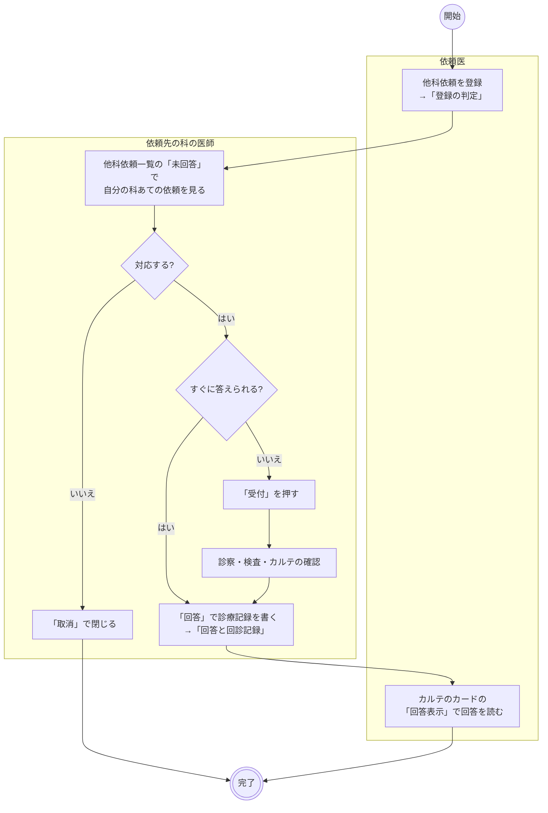

- **入口**: カルテの右ペイン(右側のオーダー入力)の「他科依頼」から出します。
- **受付は省ける**: 依頼済からそのまま回答できます。短い相談で受付だけが残らないようにするためです。
- **回答を書くと**: その時点で依頼は回答済になります。
- **回答の見え方**: 回答は通常の診療記録として、カルテのタイムラインにも出ます。依頼のカードの「回答表示」からも開けます。
- **指名医師**: その科の医師から選べます。指名しても、その医師だけの一覧はありません。一覧は科ごとです。

### 全体の流れ(チーム依頼)

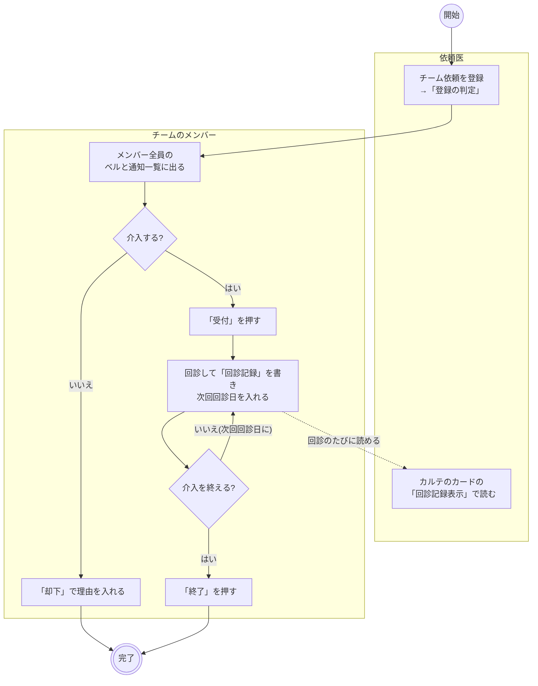

- **入口**: カルテの右ペインの「チーム依頼」から出します。ほかの入口は「ほかの画面とのつながり」にあります。
- **受付の場所**: 「受付」は、チーム依頼一覧と通知一覧のどちらからでも押せます。
- **受付を押さずに回診**: 依頼済のまま回診記録を書くと、受付を押さなくても介入中になります(回診したということは、受けたということです)。
- **終了**: 終了はチームが決めます。
- **次回回診日**: チームあての通知にはなりません。チーム依頼一覧の「回診予定のみ」の絞り込みと、赤い行(次回回診日が今日以前)で追います。

### 依頼の状態

**他科依頼**

| 状態 | 変わるきっかけ | 他科依頼一覧からできること |
|---|---|---|
| 依頼済 | 医師の登録、受付取消、取消戻し | 受付、回答、取消 |
| 対応中 | 受付、回答取消 | 回答、受付取消、取消 |
| 回答済 | 回答の登録 | 回答取消(対応中へ) |
| 取消 | 依頼先の科の「取消」 | 取消戻し(依頼済へ) |

**チーム依頼**

| 状態 | 変わるきっかけ | チーム依頼一覧からできること |
|---|---|---|
| 依頼済 | 医師の登録、受付取消、却下戻し | 受付、回診記録、却下 |
| 介入中 | 受付、回診記録の保存、終了取消 | 回診記録、終了、次回回診日、受付取消、却下 |
| 終了 | 「終了」 | 終了取消(介入中へ) |
| 却下 | 「却下」 | 却下戻し(依頼済へ) |

- **行に直接出るボタン**: 「受付」、「回答」(チーム依頼は「回診記録」)、「終了」、「表示」です。
- **行のメニュー**: 「取消」「却下」と訂正の操作は、行のメニュー(行の右端の「︙」)に入れてあります。
- **却下の理由**: 「却下」は理由が必須です。理由は、一覧の状態の吹き出しに出ます。「取消」には理由を入れません。
- **タブに残る依頼**: 他科依頼一覧の「未回答」タブと、チーム依頼一覧の「介入中」タブには、取消・却下した依頼も残ります。状態の列で見分けます。

一覧の絞り込みは次のとおりです。

| 一覧 | 絞り込み |
|---|---|
| 他科依頼一覧 | 依頼先の診療科、依頼種別、入外区分、病棟、依頼元の診療科、ステータス、「至急のみ」 |
| チーム依頼一覧 | チーム、入外区分、病棟、依頼元の診療科、ステータス、「至急のみ」、「回診予定のみ」 |

### 他科依頼とチーム依頼の違い

| | 他科依頼 | チーム依頼 |
|---|---|---|
| 依頼先 | 診療科(医師を指名できる) | チーム医療の有効なチーム |
| 入力する項目 | 依頼種別と指名医師がある(→「登録の判定」) | 依頼種別と指名医師が無い |
| 返るもの | **回答**(1 件の診療記録) | **回診記録**(何度でも書く診療記録) |
| 受ける側の一覧 | 「診療業務 > 他科依頼一覧」(「未回答」「回答済」) | 「診療業務 > チーム依頼一覧」(「介入中」「終了」) |
| 一覧を開いたときの絞り込み | 画面上部で選んでいる診療科あて | 自分がメンバーのチームの先頭 |
| 通知のベル | 出ない | 依頼済のあいだ、チームのメンバー全員に出る |
| 断るとき | 「取消」(理由は入れない) | 「却下」(理由が必須) |
| 次回の予定 | なし | 次回回診日 |
| オーダーセット・クリニカルパス | 入れられる | 入れられない |
| 登録時の警告 | なし | なし |

- **チームの準備**: チームは、設定する人が「マスタメンテ > 共通 > チーム医療」で登録します。
- **他科依頼の未回答の数**: ホームの「他科依頼」カードに、科あての未回答の数が出ます。

### 登録の判定

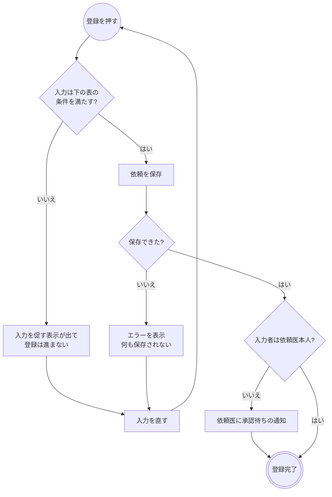

| 入力する項目 | 他科依頼 | チーム依頼 |
|---|---|---|
| 依頼先 | 診療科が必須 | チームが必須 |
| 指名医師 | 任意 | (項目なし) |
| 依頼種別 | 必須 | (項目なし) |
| 依頼目的 | 必須 | 必須 |
| 希望日 | 必須。オーダーセット・クリニカルパスに入れておく内容では不要 | 必須 |

このほかに、どちらも緊急度・対象プロブレム・補足を入れます。依頼種別は「診察依頼」「意見のみ」「検査依頼」「転科相談」から選びます。

- **希望日**: 初期値は今日です(なるべく早く)。カルテのカードは希望日の所に載ります。
- **空のとき**: 必須の欄が空のまま登録を押すと、その欄に入力を促す吹き出しが出ます。
- **チーム依頼の通知**: チーム依頼は、保存と同時にチームあての通知ができます。
- **承認待ち**: 承認待ちでも、依頼は依頼先に届きます。

### 依頼目的のテンプレート

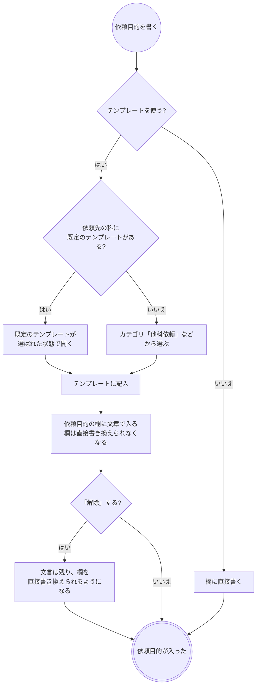

- **既定のテンプレート**: 他科依頼だけにあります。依頼先の科を選ぶと、その科の既定のテンプレートが、依頼目的の「テンプレート」で選ばれた状態になります(例: 放射線治療科には「他科依頼 放射線治療依頼」)。
- **既定を決める人**: 科ごとの既定のテンプレートは、設定する人が施設設定で決めます。チーム依頼には、チームごとの既定のテンプレートはありません。
- **汎用のテンプレート**: 「他科依頼 依頼目的」(カテゴリ「他科依頼」)です。科ごとの定型(術前評価など)は、同じカテゴリに足していきます。
- **読む側の見え方**: カルテのカード・一覧・回答や回診の画面には文章だけが出ます。テンプレートを使ったかどうかで、見え方は変わりません。
- **DO(前回と同じ内容で出し直す)**: 文言は写りますが、テンプレートから記入した扱いではなくなります。
- **削除**: 依頼を削除すると、テンプレートの記入内容も消えます。

### 回答と回診記録

**他科依頼の回答**

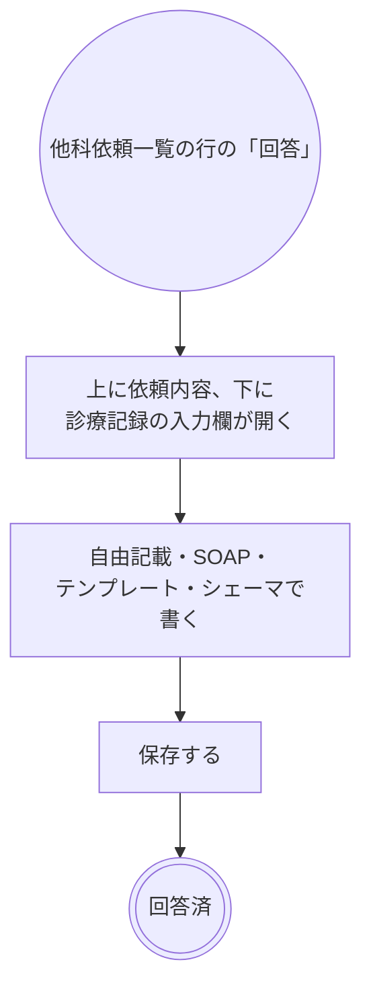

**チーム依頼の回診記録**

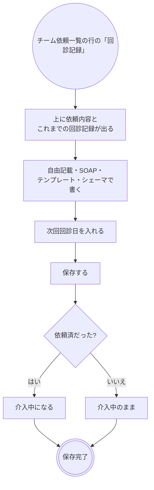

- **下書きでも状態が進む**: 回答も回診記録も「下書き」で保存できます。ただし、下書きでも保存した時点で、他科依頼は回答済に、チーム依頼は介入中になります。
- **保存できる人**: ログインした利用者が医療従事者として登録されていないと、保存できません。
- **一緒に保存されるもの**: 診療記録と依頼の状態は、同じ操作で一緒に保存されます。

| | 回答(他科依頼) | 回診記録(チーム依頼) |
|---|---|---|
| 開いたときの書き方 | 自由記載(SOAP に切り替えられる) | チームに既定のテンプレートがあればそのテンプレート、無ければ自由記載 |
| タイトルの初期値 | 「他科依頼回答(依頼元の科)」 | 「{チーム名} 回診記録」 |
| 記録の科 | 画面上部で選んでいる診療科を、答えた科として残す | 通常の記録と同じ |
| 対象プロブレム | 依頼の対象プロブレムを引き継ぐ | 依頼の対象プロブレムを引き継ぐ |
| 書ける回数 | 1 回(回答取消をすると書き直せる) | 何度でも |
| 保存で依頼に残るもの | 回答者と回答日 | 最後の回診日・記録者・次回回診日 |

**回答取消をしたとき**

- 依頼は対応中に戻り、依頼のカードから回答を開けなくなります。回答の診療記録そのものは残ります。
- もう一度回答すると、診療記録は 2 件になります。依頼のカードから開けるのは新しい方です。
- 回答の診療記録をカルテから削除しても、依頼は回答済のままです。状態を戻すのは、他科依頼一覧の「回答取消」です。

### チームあての通知

- **出る相手**: チーム依頼が依頼済のあいだ、チームのメンバー全員のベルと通知一覧に出ます。
- **消えるとき**: メンバーの誰か 1 人が受付・却下・回診記録の保存をすると、通知は全員の一覧から消えます。
- **「引受」**: 通知一覧の「引受」で自分あてにすると、ほかのメンバーの一覧から消えます。
- **チームを変えたとき**: 依頼医が依頼先のチームを変えると、通知は新しいチームあてに出し直されます。「引受」は外れます。

### 変更・取消・削除

| 操作 | 他科依頼 | チーム依頼 |
|---|---|---|
| 変更 | カルテのカードの編集。回答済でもできます | カルテのカードの編集 |
| 依頼先が断る | 他科依頼一覧の「取消」 | チーム依頼一覧の「却下」(理由が必須) |
| 削除 | 依頼済・対応中・取消のときにできます | 依頼済・却下のときにできます |
| DO | 依頼先・依頼種別・依頼目的を写します | 依頼先・依頼目的を写します |

- **回答済の変更**: 回答済の他科依頼を変更しても、回答済の状態と回答は保たれます。
- **削除できないとき**: 回答済の他科依頼は、先に「回答取消」をします。介入中・終了のチーム依頼は、先に「受付取消」「終了取消」をします。
- **DO の希望日**: どちらも、希望日は今日に戻ります。
- **依頼医の側の中止**: 依頼医の側に「中止」の操作はありません。要らなくなった依頼は削除するか、依頼先に「取消」「却下」をしてもらいます。

### ほかの画面とのつながり

**チーム依頼のほかの入口**

- データ抽出のスクリーニング結果の「チーム依頼」
- 褥瘡管理の行の「チーム依頼」
- 抗菌薬適正使用の一覧(AST チームあて)

**スクリーニング**

- データ抽出の保存条件の持ち主をチームにすると、その条件はチームの**スクリーニング**になります。
- スクリーニングの結果の表には「介入」の列が付きます。介入中の依頼がある患者は「介入中」と出ます。
- 介入中の依頼が無い患者には「チーム依頼」のリンクが出ます。押すと、その患者のカルテがチーム依頼の入力を開いた状態で開きます。

**放射線治療**

- 放射線治療科への他科依頼から放射線治療オーダーを立てる流れは、[放射線治療の業務フロー](radiotherapy.md)にあります。

### 帳票

専用の帳票はありません。

## 開発者向け

### シーケンス図の前提

- **書き込みの経路**: `/fhir` への書き込みはどれも 1 回の transaction Bundle で、backend の `FhirProxyController` が上流へ中継します。
- **上流**: backend の先にある FHIR サーバーのことです。図では「上流 FHIR」と書きます。
- **応答の中継は省く**: 図の `FHIR-->>UI` は、上流の応答を backend がそのままブラウザへ返すことを表します。
- **ヘッダ**: 依頼本体の `ServiceRequest` のことです。ほかの種別と呼び名を揃えていますが、この 2 種別は明細を持たず、ヘッダ 1 本だけです。
- **回答とテンプレートの記入内容**: このページの「回答」は、他科依頼に返す診療記録(`Composition`)です。テンプレートに記入した内容(`QuestionnaireResponse`)は「テンプレートの記入内容」と書き分けます。
- **楽観ロック**: 版は `postBundle` が `ifMatch` に添え、版が違えば 412 で止まります。
- **SS-MIX2**: 有効にしている施設では、中継が書き込みの控えを記録します(`Ssmix2::Recorder`)。この 2 種別はメッセージになりません。

### リソースの構成

どちらも同じ形です。

- ヘッダ `ServiceRequest`(依頼。明細は持たない)
  - `Task`(進捗。`focus` = ヘッダ)
  - `Composition`(返ってくる診療記録。`event[0].detail` = ヘッダ)
  - `QuestionnaireResponse`(依頼目的のテンプレートの記入内容。ヘッダの拡張が指す)
  - `Provenance`(代行入力。`target` = ヘッダ)

| リソース | 要素 | 他科依頼 | チーム依頼 |
|---|---|---|---|
| ヘッダ `ServiceRequest` | `category` | `order-type|consult` | `order-type|team-request` |
| | `code` | `consult-request-type`(consult / opinion / exam / transfer) | `care-team-kind`(チームの区分) |
| | `performer[0]` | `Organization`(科) | `CareTeam` |
| | `performer[1]` | `Practitioner`(指名医師、任意) | – |
| | `reasonCode[0].text` | 依頼目的 | 依頼目的 |
| | テンプレートの記入内容を指す拡張 | `consult-purpose-questionnaire-response` | `team-request-purpose-questionnaire-response` |
| | `status` = `active` | 依頼済・対応中 | 依頼済・介入中 |
| | `status` = `completed` | 回答済 | 終了 |
| | `status` = `revoked` | 取消 | 却下 |
| | 表示用に写しておく拡張 | `consult-reply`(回答の `Composition`) | `team-request-last-round`・`team-request-last-round-date`・`team-request-next-round` |
| `Task` | `code` | `task-code|consult` | `task-code|team-request` |
| | 作る時期 | **登録時には作らない**。Task が無い依頼は依頼済 | **登録と同じ transaction で作る** |
| | `owner` | – | `CareTeam` |
| | `description` | – | 依頼目的 |
| | `input` | – | 「希望日」 |
| | `statusReason.text` | – | 却下の理由 |
| `Composition` | `type` | LOINC 11488-4 | 11506-3 |
| | `category` | – | `clinical-note-category|team-round` |
| | `event[0].detail` | 依頼 | 依頼 |
| | `event[0].code` | `consult-note-event|reply` | `consult-note-event|round` |
| | 拡張 `order-department` | 答えた科 | – |

- **`consult-reply` の位置づけ**: 表示用の写しです。正本は、回答の `Composition` の `event.detail` です。
- **回診記録の一覧**: 上流は `Composition.event` を索引しません。チーム依頼の回診記録の一覧は、患者の回診記録(`Composition?patient=&category=…|team-round`)を引いて `event.detail` で絞ります(`useTeamRounds`)([server-improvement-backlog.md](../server-improvement-backlog.md) C-21)。
- **カルテのタイムライン**: `KARTE_NOTE_TYPE_SEARCH`(`fhir/clinicalNoteHelpers.ts`)で、経過記録と他科依頼回答の両方を引きます。
- **放射線治療・検査結果フォロー**: 放射線治療オーダーは、元の他科依頼を拡張 `radiotherapy-consult-request` で指せます。検査結果フォローの対応オーダーにも他科依頼を選べます。

### 進捗 Task と status

他の部門オーダーは進捗を Task だけで持ちますが、この 2 つは日付で一覧を引けないので、**Task の遷移と同じ transaction で `ServiceRequest.status` も動かします**(`consultOrderStatusFor` / `teamRequestOrderStatusFor`)。

- 表示の正本は Task です(依頼済と対応中を status で区別できないため)。
- status は、一覧を引くための索引です。
- 片方だけを書く入口を作りません。

| 書き込みの入口 | 他科依頼(`api/queries/consult.ts`) | チーム依頼(`api/queries/teamRequest.ts`) |
|---|---|---|
| 状態の変更 | `useUpdateConsultTaskStatus` | `useUpdateTeamRequestTaskStatus`(却下は理由を添える) |
| 記録の保存 | `useSaveConsultReply` | `useSaveTeamRound` |
| 次回回診日だけ | – | `useSetTeamRequestNextRound` |
| 通知一覧の受付 | – | `teamRequestAcceptEntries`(`api/notificationActions.ts`) |

遷移の表は `consultTaskActions`(`fhir/consultTaskHelpers.ts`)と `teamRequestTaskActions`(`fhir/teamRequestTaskHelpers.ts`)です。
`executionPeriod` は受付で `start`、回答・終了で `end` が入ります(`createTaskHelpers` の `buildTaskUpdate`)。

### 部品

| 操作 | 他科依頼 | チーム依頼 |
|---|---|---|
| フォーム | `components/ConsultOrderForm.tsx`・`ConsultOrderPanels.tsx` | `TeamRequestForm.tsx`・`TeamRequestPanels.tsx` |
| 組み立て(ファイル) | `fhir/consultOrderHelpers.ts`・`consultTaskHelpers.ts` | `fhir/teamRequestHelpers.ts`・`teamRequestTaskHelpers.ts` |
| 登録の組み立て | `buildConsultOrderBundle` | `buildTeamRequestBundle` |
| 編集の組み立て | `buildConsultOrderUpdateBundle` | `buildTeamRequestUpdateBundle` |
| 削除の組み立て | `buildConsultOrderDeleteBundle` | `buildTeamRequestDeleteBundle` |
| 登録の hook | `useCreatePrescription`(`api/queries/labResult.ts`。名前と違い全種別共通) | 同じ hook |
| 編集の hook | `useUpdateConsultOrder` | `useUpdateTeamRequest` |
| 削除の hook | `useDeleteConsultOrder` | `useDeleteTeamRequest` |
| 一覧 | `pages/ConsultWorklistPage.tsx`(`/consult-worklist`)、`useConsultWorklist` | `pages/TeamWorklistPage.tsx`(`/team-worklist`)、`useMyCareTeams`・`useTeamRequestWorklist` |
| 記録のモーダル | `components/ConsultReplyModal.tsx` | `components/TeamRoundModal.tsx` |
| 記録の組み立て | `buildClinicalNote` の `consultOrderId` / `department` | `buildClinicalNote` の `teamRequestId` |
| チームのマスタ | – | `pages/CareTeamPage.tsx`(`/care-teams`)、`fhir/careTeamHelpers.ts`、`api/queries/careTeam.ts` |
| 通知 | – | `components/notifications/notificationRegistry.tsx` の `team-request` |

### シーケンス図: 登録・編集・削除

**登録**

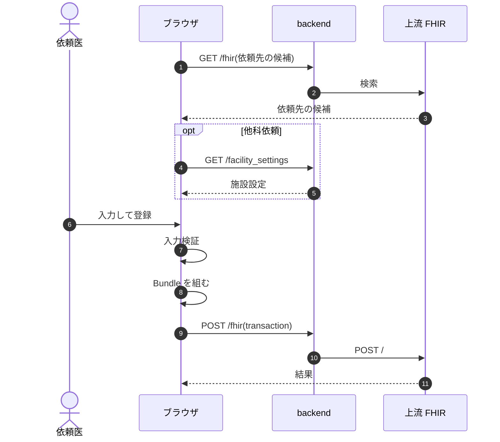

| 段 | 他科依頼 | チーム依頼 |
|---|---|---|
| 依頼先の候補の検索 | `Organization`(診療科)、科の医師 | `CareTeam?status=active`(有効なチーム) |
| 施設設定 | 科ごとの既定のテンプレート | 読まない |
| 入力 | 依頼先・依頼目的・希望日など | 同じ |
| 入力検証 | `validateConsultOrderForm` | `validateTeamRequestForm` |

| transaction に入れるもの | 条件 |
|---|---|
| ヘッダ `ServiceRequest`(fullUrl) | いつも。登録時の入院病棟を `order-ward` に入れる |
| `Provenance`(CREATE) | いつも |
| テンプレートの記入内容 `QuestionnaireResponse`(fullUrl) | テンプレートで依頼目的を書いたとき |
| `Task` requested(`owner` = `CareTeam`、`priority` はヘッダから) | チーム依頼 |
| `Task` order-approval | 代行・研修医のとき |

**編集**

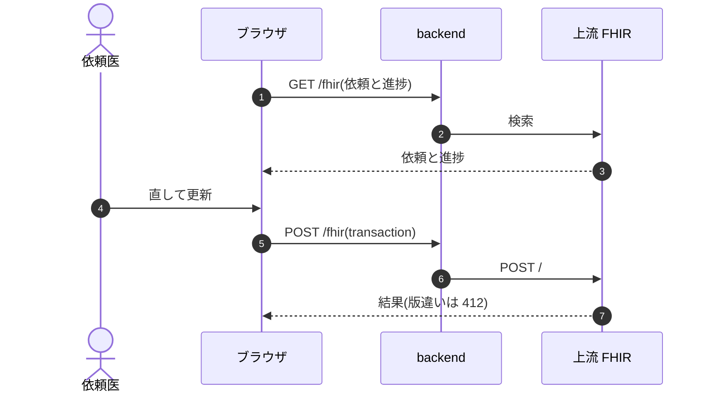

| 段 | 中身 |
|---|---|
| 依頼と進捗の検索 | `ServiceRequest?_id&_revinclude=Task:focus` |
| ヘッダ | PUT(`ifMatch`)。status と、表示用に写しておく拡張(回答・回診)は元の値を引き継ぐ |
| テンプレートの記入内容 | 外したものは DELETE |
| チーム依頼の `Task` | 依頼先・依頼目的・希望日を写し直す。チームが変われば引受けを外す |
| 来歴 | `Provenance`(UPDATE) |

**削除**

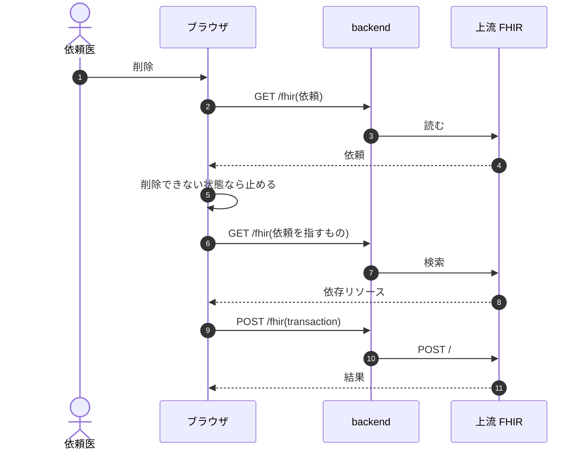

| 段 | 中身 |
|---|---|
| 依頼を読む | 依頼。チーム依頼は `Task` も読む |
| 止める条件 | 他科依頼は回答があれば止める。チーム依頼は介入中・終了なら止める |
| 依頼を指すものの検索 | `Task`・`Procedure`・`DiagnosticReport` ほか |
| transaction | DELETE ヘッダ・`Task`・テンプレートの記入内容 |

### シーケンス図: 他科依頼の受付・回答・取消

**一覧を開く**

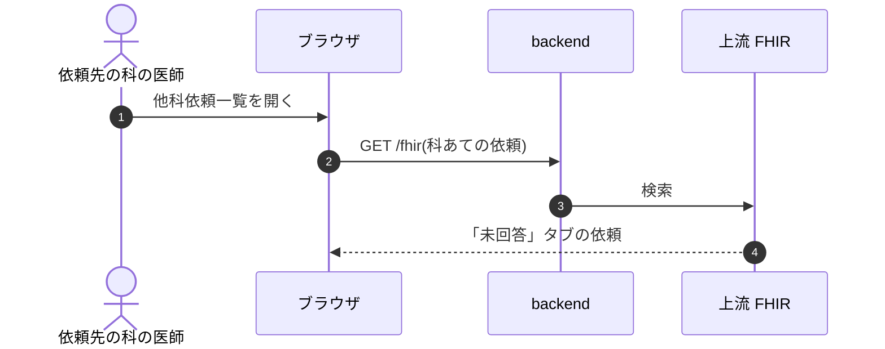

| タブ | 検索の条件 |
|---|---|
| 「未回答」 | `ServiceRequest?category=order-type|consult&status=active,revoked&performer=Organization/科`。取消した依頼も返る |
| 「回答済」 | 同じ検索で `status=completed` |
| どちらも | `based-on:missing=true`、`_sort=-authoredon`、`_include` 患者、`_revinclude` `Task:focus` |

絞り込みは上流が行います(`useConsultWorklist`)。

**状態の変更**

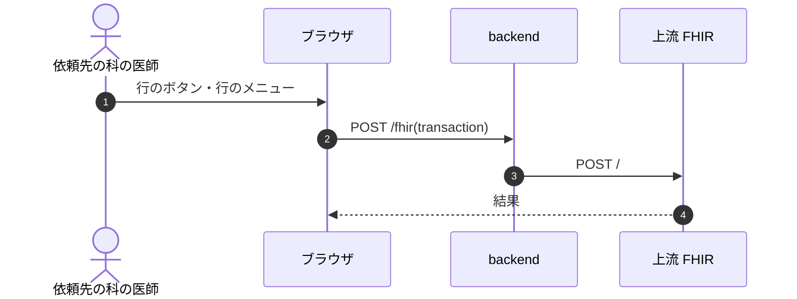

| 操作 | `Task` | ヘッダ |
|---|---|---|
| 受付・受付取消・取消・取消戻し・回答取消 | 新しい状態にする(無ければ POST) | PUT status(active / revoked) |
| 回答取消だけ | 同じ | 拡張 `consult-reply` も外す |

**回答**

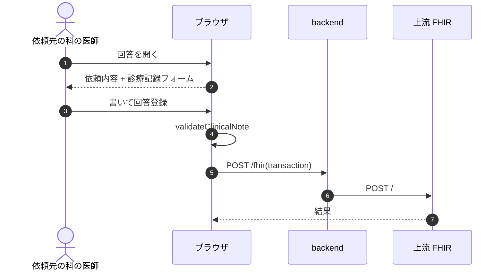

| 段 | 中身 |
|---|---|
| 入力検証 | `validateClinicalNote`。医療従事者に紐付かないログインは止める |
| 診療記録が生むもの | 生成 `Observation`・画像・診療記録のテンプレートの記入内容 |
| `Composition` | POST(fullUrl、`event.detail` = 依頼) |
| `Task` | completed |
| ヘッダ | PUT status = completed、`consult-reply` = `Composition` の urn:uuid |
| 結果 | urn:uuid は上流が実 ID に書き換える |

### シーケンス図: チーム依頼の受付・回診記録・終了・却下

**一覧を開く**

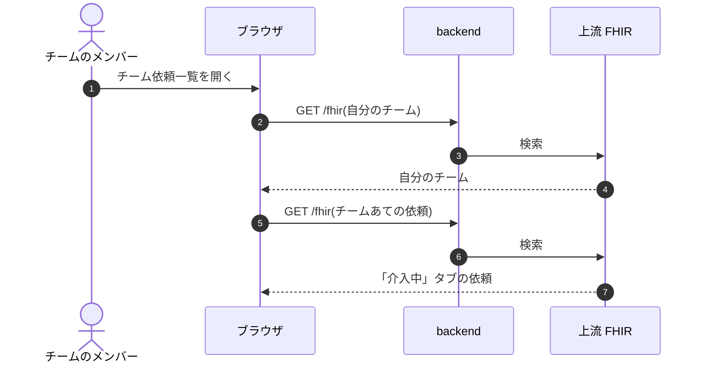

| 検索 | 条件 |
|---|---|
| 自分のチーム | `CareTeam?participant=Practitioner/自分`(`useMyCareTeams`) |
| チームあての依頼 | `ServiceRequest?category=order-type|team-request&status=active,revoked&performer=CareTeam/id`、`_include` 患者、`_revinclude` `Task:focus`(`useTeamRequestWorklist`)。却下した依頼も返る |

**状態の変更・次回回診日**

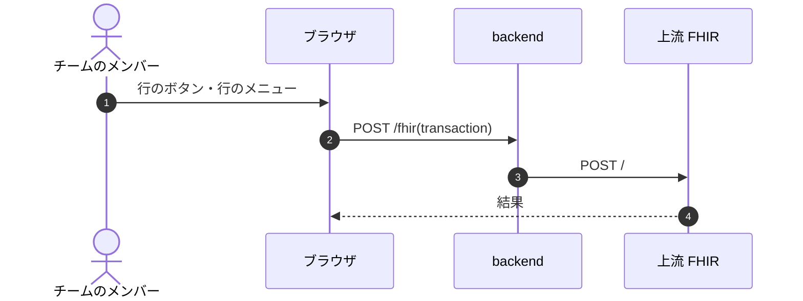

| 操作 | transaction |
|---|---|
| 受付・終了・却下・各取消 | `Task` を新しい状態にする(却下は `statusReason`)、PUT ヘッダ status(active / completed / revoked) |
| 行のメニューの次回回診日 | PUT ヘッダ `team-request-next-round` だけ |

**回診記録**

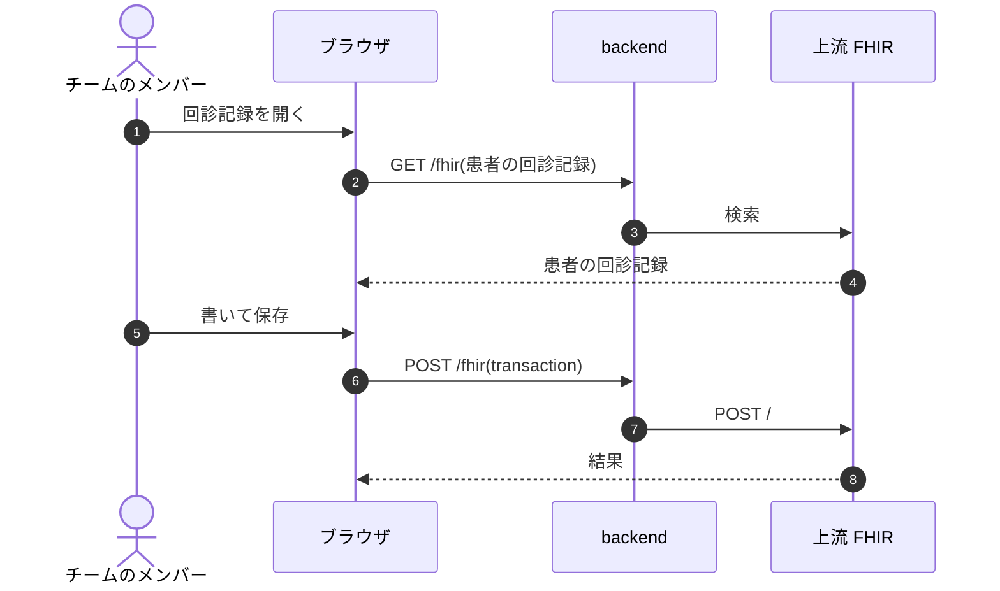

| 段 | 中身 |
|---|---|
| 患者の回診記録の検索 | `Composition?patient&category=team-round`。返った記録を `event.detail` で依頼に絞る |
| 入力 | 回診記録と次回回診日 |
| 診療記録が生むもの | 生成 `Observation`・画像・診療記録のテンプレートの記入内容 |
| `Composition` | POST(fullUrl、`category` = team-round、`event.detail` = 依頼) |
| `Task` | 依頼済なら accepted |
| ヘッダ | PUT 最後の回診・次回回診日 |

### シーケンス図: チームあての通知

依頼済の進捗 Task がそのまま通知です。共通の作法は `fhir/notificationHelpers.ts` です([features/notifications.md](../features/notifications.md))。

**通知を読む・受付**

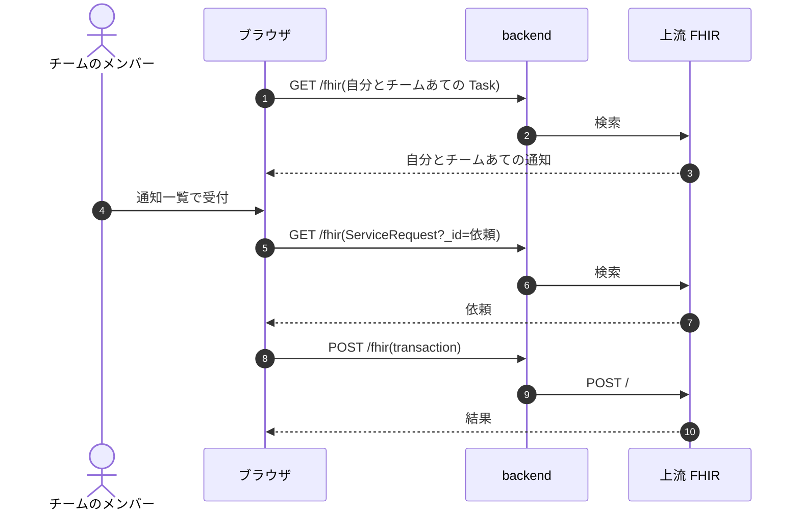

| 段 | 中身 |
|---|---|
| 通知の検索 | `Task?code=…,team-request&status=requested&owner=Practitioner/自分,CareTeam/チーム`、`_include=Task:subject` |
| ベルの件数 | total と、`priority=stat,asap` の件数 |
| 受付の transaction | PUT `Task` = accepted、PUT ヘッダ status = active |
| 受付の結果 | 通知は全員の一覧から消える |

**引受・戻す**

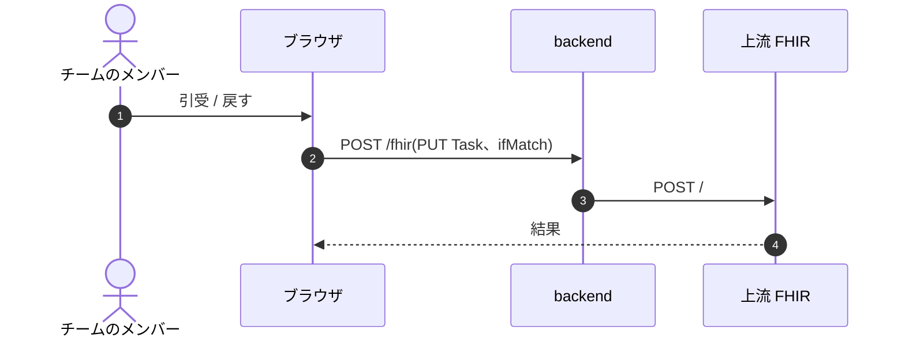

| 操作 | `Task` |
|---|---|
| 引受 | `owner` = 自分。元のチームは拡張 `notification-team` に残す |
| 戻す | `owner` = チーム |

先に他のメンバーが動かしていれば、412 で止まります。

### 医事会計と SS-MIX2

どちらも出来高で請求する項目が無いので、医事会計には送りません(`OrderCatalog::IGNORED`。「送れない項目」にも出しません)。栄養サポートチーム加算などの加算は、この依頼からは送りません。
SS-MIX2 のメッセージも作りません(`Ssmix2::Messages::OmgO19` などの対象外)。診療記録もメッセージにしません。
登録・編集・削除、受付・取消・却下・終了、回答・回診記録の保存のどれでも、医事会計と SS-MIX2 には何も送りません。
