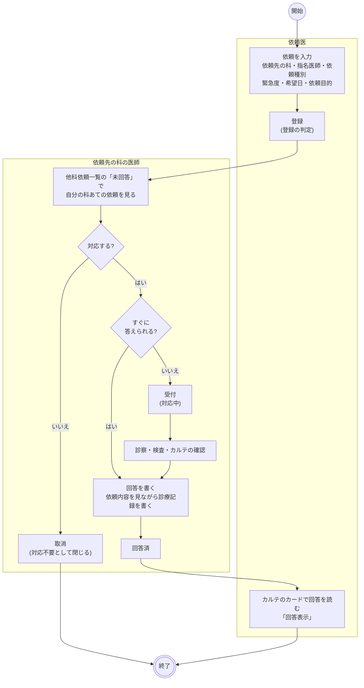
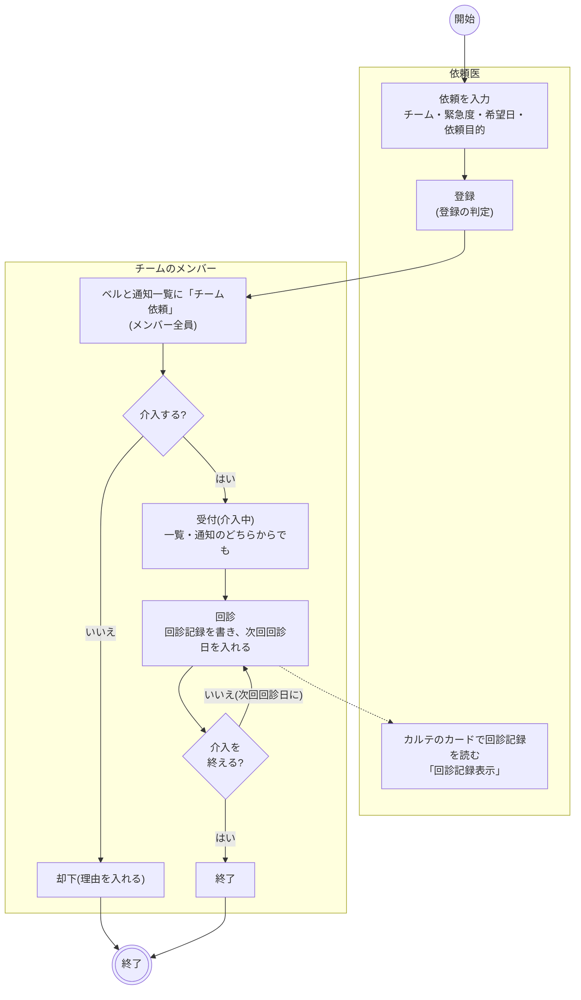
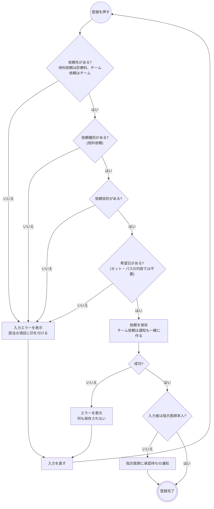
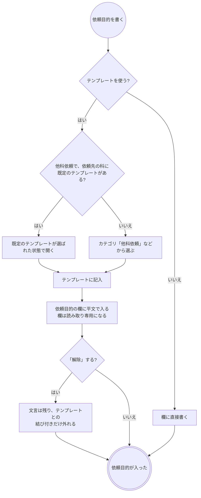
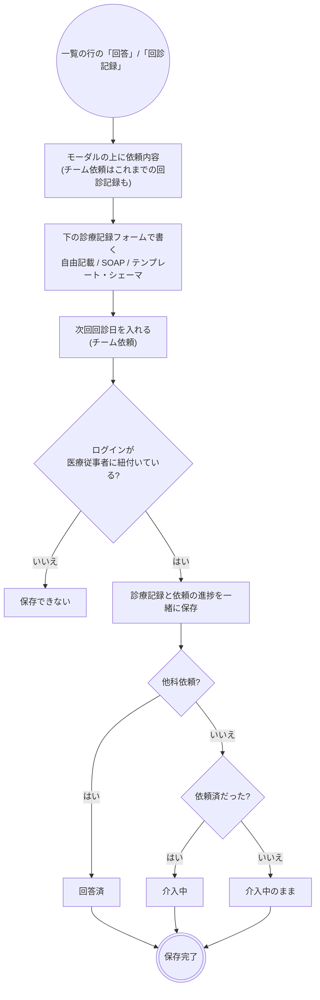
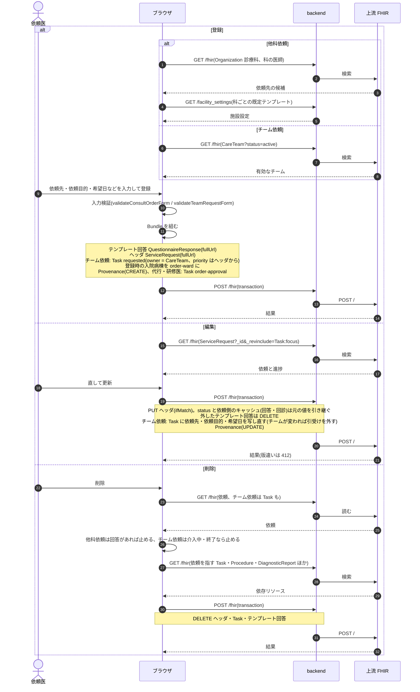
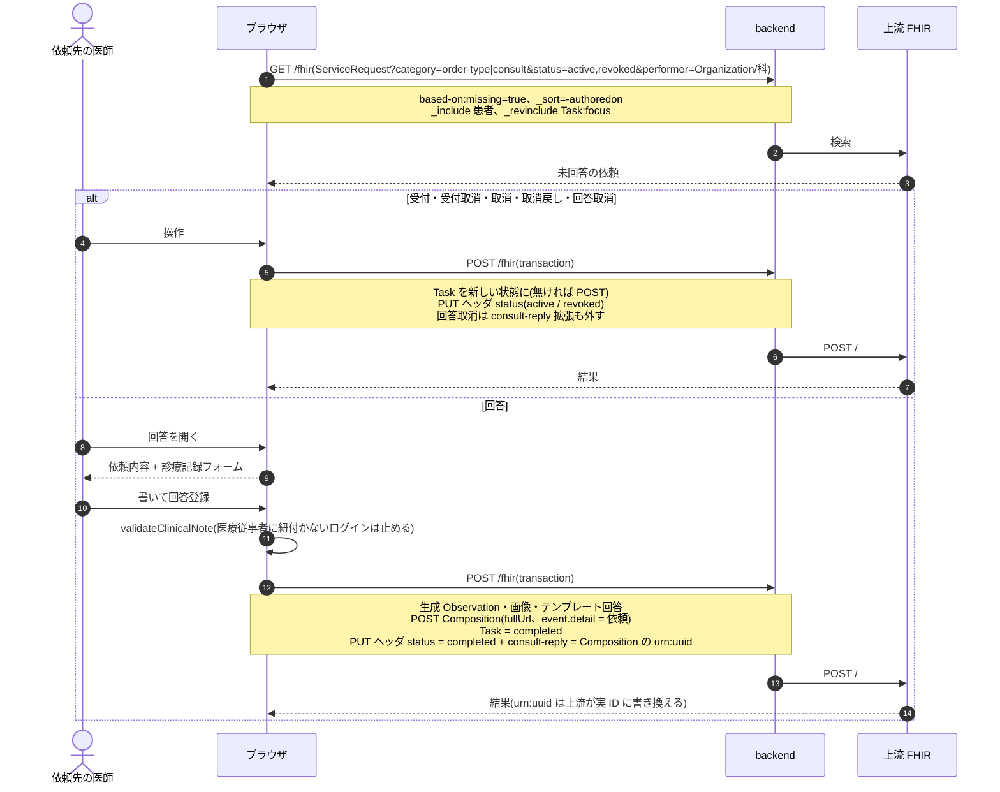
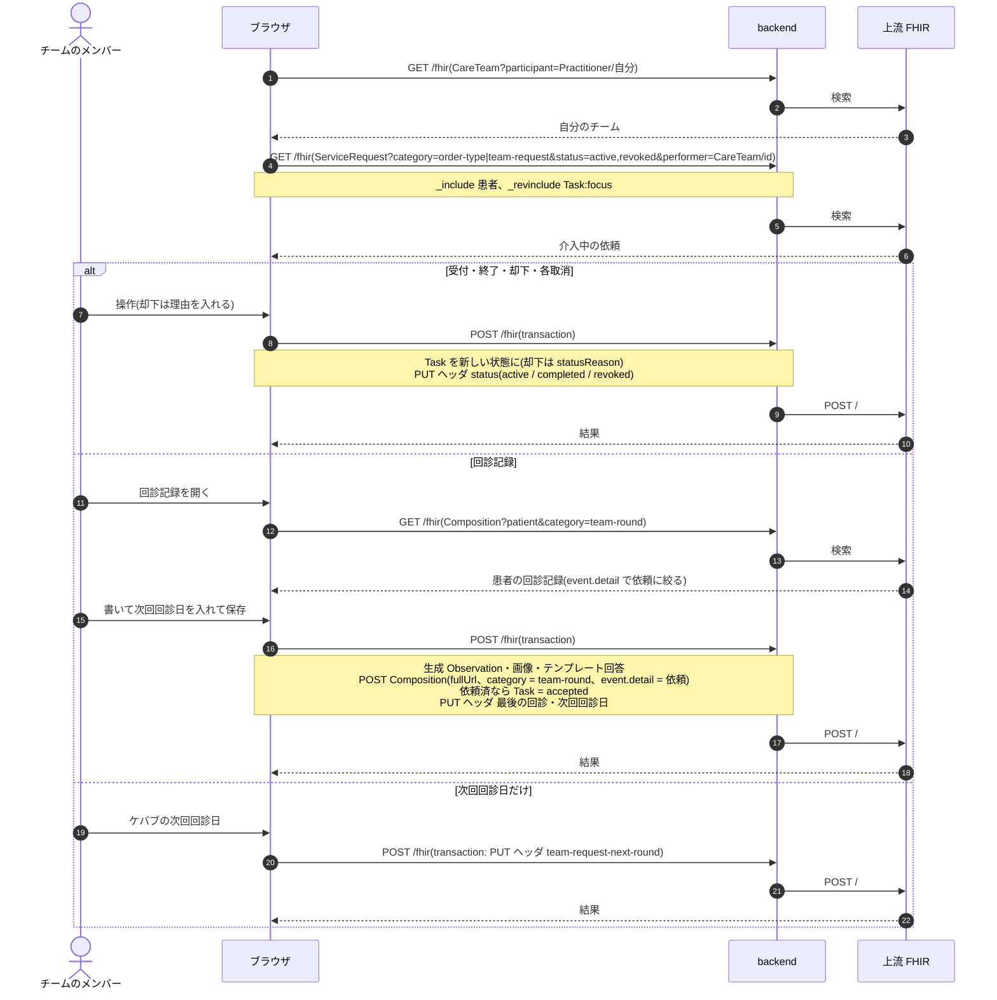
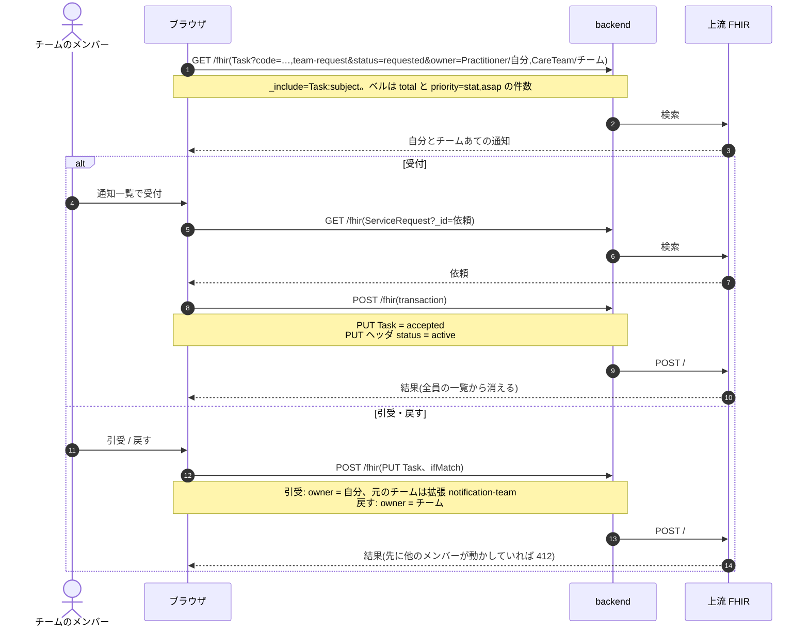

# 他科依頼・チーム依頼の業務フロー

他の診療科への依頼(他科依頼)と、NST・ICT・褥瘡対策などのチームへの介入依頼(チーム依頼)を、登録から受付・回答または回診・終了まで追う流れです。医療機関の運用を検討する人は「運用フロー」、院内の開発者は「開発者向け」を読みます。
2 つとも、検査室や薬剤部のような部門ではなく**人(医師・チーム)に判断を頼み、診療記録(文章)が返る**依頼です。明細を持たず、日付ではなく「未回答かどうか」「介入中かどうか」で一覧を切ります。
設計は [consult-order-design.md](../consult-order-design.md)(他科依頼)・[care-team-design.md](../care-team-design.md)(チーム・チーム依頼・回診記録・スクリーニング)、
画面のふるまいは [features/nursing.md](../features/nursing.md)「チーム医療」・[features/notifications.md](../features/notifications.md)(チームあての通知)、
種別共通の約束(中止・削除・代行入力)は [features/orders-common.md](../features/orders-common.md)、リソースの要素は実装ガイド(`../fhir-ig`)が正典です。
放射線治療科への依頼から放射線治療オーダーを立てる流れは放射線治療の設計([radiotherapy-order-design.md](../radiotherapy-order-design.md))にあります。

## 運用フロー

### 他科依頼とチーム依頼の違い

| | 他科依頼 | チーム依頼 |
|---|---|---|
| 依頼先 | 診療科(医師を指名できる) | チーム医療のチーム(マスタメンテ > 共通 >「チーム医療」で登録した有効なチーム) |
| 入力する項目 | 依頼先の診療科・指名医師・依頼種別(診察依頼 / 意見のみ / 検査依頼 / 転科相談)・緊急度・希望日・依頼目的・対象プロブレム・補足 | 依頼先のチーム・緊急度・希望日・依頼目的・対象プロブレム・補足 |
| 返るもの | **回答**(1 件の診療記録)。書いた時点で回答済になる | **回診記録**(何度でも書く診療記録)。終了はチームが決める |
| 受ける側の一覧 | 診療業務 > 他科依頼一覧(「未回答」「回答済」) | 診療業務 > チーム依頼一覧(「介入中」「終了」) |
| 一覧の既定の絞り込み | ヘッダーで選んでいる診療科あて | 自分がメンバーのチームの先頭 |
| 通知(ベル) | 出ない(ホームの「他科依頼」カードで科あての未回答を数える) | 依頼済のあいだ、チームのメンバー全員に出る |
| 断るとき | 「取消」(理由は入れない) | 「却下」(理由が必須) |
| 次回の予定 | なし | 次回回診日(今日以前の行は赤) |
| オーダーセット・クリニカルパス | 入れられる | 入れられない |
| 登録時の警告 | なし | なし |

- 入口はカルテの右ペイン「他科依頼」「チーム依頼」(並んでいます)です。チーム依頼はほかに、データ抽出のスクリーニング結果の「チーム依頼」、褥瘡管理の行の「チーム依頼」、抗菌薬適正使用の一覧(AST チームあて)からも出せます。
- 他科依頼の依頼先の科を選ぶと、施設設定で科ごとに決めた既定のテンプレート(例: 放射線治療科には `CONSULT_RT_01`)が依頼目的の「テンプレート」で選ばれた状態になります。チーム依頼にはチームごとの既定テンプレートはありません。
- 他科依頼の指名医師は、その科の医師から選びます。指名してもその医師だけの一覧はなく、一覧は科で切ります。

### 進捗の状態

**他科依頼**

| 状態 | 変わるきっかけ | 他科依頼一覧からできること |
|---|---|---|
| 依頼済 | 医師の登録、受付取消、取消戻し | 受付、回答、取消 |
| 対応中 | 受付、回答取消 | 回答、受付取消、取消 |
| 回答済 | 回答の登録 | 回答取消(対応中へ) |
| 取消 | 依頼先科の「取消」(対応不要として閉じる) | 取消戻し(依頼済へ) |

**チーム依頼**

| 状態 | 変わるきっかけ | チーム依頼一覧からできること |
|---|---|---|
| 依頼済 | 医師の登録、受付取消、却下戻し | 受付、回診記録、却下(理由必須) |
| 介入中 | 受付(一覧・通知から)、回診記録の保存、終了取消 | 回診記録、終了、次回回診日、受付取消、却下 |
| 終了 | 「終了」 | 終了取消(介入中へ) |
| 却下 | 「却下」 | 却下戻し(依頼済へ) |

- 一覧の行に直接出るのは受付・回答(回診記録)・終了・表示で、取消・却下・押し間違いの訂正はケバブメニューに畳んであります。
- 「未回答」タブ(他科依頼)と「介入中」タブ(チーム依頼)には、取消・却下した依頼も残ります(状態の列で分かります)。
- 他科依頼一覧は依頼先の診療科・依頼種別・入外区分・病棟・依頼元の診療科・ステータス・至急のみ、チーム依頼一覧はチーム・入外区分・病棟・依頼元の診療科・ステータス・至急のみ・回診予定のみで絞れます。

### 全体の流れ(他科依頼)

- 受付は省いて、依頼済からそのまま回答できます(短い相談で受付だけが残らないようにするため)。
- 回答は通常の診療記録としてカルテのタイムラインにも出ます。依頼のカードの「回答表示」からも開けます。
- 回答を取り消すと依頼は対応中に戻り、依頼から回答への結び付きが外れます。回答の診療記録そのものは残ります。もう一度回答すると、診療記録は 2 件になり、依頼から辿れるのは新しい方です。

### 全体の流れ(チーム依頼)

- 依頼済のまま回診記録を書くと、受付を押さなくても介入中になります(回診したということは受けたということ)。
- メンバーの誰か 1 人が受付・却下・回診記録をすると、通知は全員の一覧から消えます。通知一覧の「引受」で自分あてにすると、他のメンバーの一覧から消えます。
- 次回回診日はチームあての通知にはなりません。チーム依頼一覧の「回診予定のみ」と赤い行で追います。
- データ抽出の保存条件の持ち主をチームにすると、その条件はチームの**スクリーニング**になり、結果の表に「介入」の列が付きます(介入中の依頼がある患者は「介入中」、無い患者は「チーム依頼」のリンクでカルテを登録の状態で開きます)。

### 登録の判定

- 希望日の初期値は今日です(なるべく早く)。カルテのカードは希望日の日に載ります。
- 依頼先の科・チームと希望日はブラウザの必須欄なので、空のときはブラウザの吹き出しで止まり、項目の印は出ません。
- 承認待ちでも依頼は依頼先に届きます。

### 依頼目的のテンプレート

- 汎用のテンプレートは `CONSULT_PUR_01`(カテゴリ「他科依頼」)です。科ごとの定型(術前評価など)は同じカテゴリに足していきます。
- 読む側(カルテのカード・一覧・回答や回診のモーダル)は平文だけを見るので、テンプレートを使ったかどうかで見え方は変わりません。
- DO すると文言は写りますが、テンプレートとの結び付きは外れます。

### 回答と回診記録

| | 回答(他科依頼) | 回診記録(チーム依頼) |
|---|---|---|
| 開いたときの書き方 | 自由記載(SOAP に切り替えられる) | チームに既定のテンプレートがあればそのテンプレート、無ければ自由記載 |
| タイトルの初期値 | 「他科依頼回答(依頼元の科)」 | 「{チーム名} 回診記録」 |
| 記録の科 | ヘッダーで選んでいる科を「答えた科」として残す | 通常の記録と同じ |
| 対象プロブレム | 依頼の対象プロブレムを引き継ぐ | 依頼の対象プロブレムを引き継ぐ |
| 書ける回数 | 1 回(取り消すと書き直せる) | 何度でも |
| 保存で依頼に残るもの | 回答者と回答日 | 最後の回診日・記録者・次回回診日 |

- 回答も回診記録も「下書き」で保存できますが、保存した時点で回答済(介入中)になります。

### 変更・取消・削除

| 操作 | 他科依頼 | チーム依頼 |
|---|---|---|
| 変更 | カルテのカードの編集。回答済でもでき、回答済の状態と回答は保たれます | 同じ。依頼先のチームを変えると、通知は新しいチームあてに出し直します(引受けは外れます) |
| 依頼先が断る | 一覧の「取消」 | 一覧の「却下」(理由必須)。理由は一覧の状態の吹き出しに出ます |
| 削除 | 回答済はできません(先に「回答取消」)。依頼済・対応中・取消はできます | 依頼済・却下だけできます。介入中・終了はできません(先に受付取消・終了取消) |
| 依頼目的のテンプレート | 削除で記入内容も消えます | 同じ |
| DO | 依頼先・依頼種別・依頼目的を写し、希望日は今日に戻します | 依頼先・依頼目的を写し、希望日は今日に戻します |

- 回答の診療記録をカルテから削除しても、依頼は回答済のままです。戻すのは他科依頼一覧の「回答取消」です。
- 依頼した医師の側に「中止」の操作はありません。要らなくなった依頼は削除するか、依頼先に取消・却下してもらいます。

### 帳票

専用の帳票はありません。

## 開発者向け

### リソースの構成

どちらも明細を持たないヘッダの `ServiceRequest` 1 本と、進捗の `Task`(`focus` = ヘッダ)、返ってくる `Composition` です。

| もの | 他科依頼 | チーム依頼 |
|---|---|---|
| ヘッダ | `ServiceRequest`(`category` = `order-type|consult`) | `ServiceRequest`(`category` = `order-type|team-request`) |
| `code` | `consult-request-type`(consult / opinion / exam / transfer) | `care-team-kind`(チームの区分) |
| 依頼先 | `performer[0]` = `Organization`(科)、`performer[1]` = `Practitioner`(指名医師、任意) | `performer[0]` = `CareTeam` |
| 依頼目的 | `reasonCode[0].text`。テンプレート回答は拡張 `consult-purpose-questionnaire-response` | `reasonCode[0].text`。拡張 `team-request-purpose-questionnaire-response` |
| `status` | `active`(依頼済・対応中)/ `completed`(回答済)/ `revoked`(取消) | `active`(依頼済・介入中)/ `completed`(終了)/ `revoked`(却下) |
| 依頼側のキャッシュ | 拡張 `consult-reply`(回答の `Composition`。表示用で、正本は回答の `event.detail`) | 拡張 `team-request-last-round`・`team-request-last-round-date`・`team-request-next-round` |
| 進捗 | `Task`(`task-code|consult`)。**登録時には作らず**、Task が無い依頼は依頼済 | `Task`(`task-code|team-request`)。**登録と同じ transaction で作る**。`owner` = `CareTeam`、`description` = 依頼目的、`input`「希望日」、却下の理由は `statusReason.text` |
| 返るもの | `Composition`(`type` = LOINC 11488-4、`event[0].detail` = 依頼、`event[0].code` = `consult-note-event|reply`、拡張 `order-department` = 答えた科) | `Composition`(`type` = 11506-3、`category` = `clinical-note-category|team-round`、`event[0].detail` = 依頼、`event[0].code` = `consult-note-event|round`) |
| 代行入力 | `Provenance`(`target` = ヘッダ) | 同じ |

- 上流は `Composition.event` を索引しないので、チーム依頼の回診記録の一覧は患者の回診記録(`Composition?patient=&category=…|team-round`)を引いて `event.detail` で絞ります(`useTeamRounds`。`docs/server-improvement-backlog.md` C-21)。
- カルテのタイムラインは `KARTE_NOTE_TYPE_SEARCH`(`fhir/clinicalNoteHelpers.ts`)で経過記録と他科依頼回答の両方を引きます。
- 放射線治療オーダーは元の他科依頼を拡張 `radiotherapy-consult-request` で指せます。検査結果フォローの対応オーダーにも他科依頼を選べます。

### 進捗 Task と status

他の部門オーダーは進捗を Task だけで持ちますが、この 2 つは日付で一覧を切れないので、**Task の遷移と同じ transaction で `ServiceRequest.status` も動かします**(`consultOrderStatusFor` / `teamRequestOrderStatusFor`)。
表示の正本は Task(依頼済と対応中を status で区別できないため)、status は一覧を引くための索引です。片方だけを書く入口を作りません。

| 書き込みの入口 | 他科依頼(`api/queries/consult.ts`) | チーム依頼(`api/queries/teamRequest.ts`) |
|---|---|---|
| 状態の変更 | `useUpdateConsultTaskStatus` | `useUpdateTeamRequestTaskStatus`(却下は理由を添える) |
| 記録の保存 | `useSaveConsultReply` | `useSaveTeamRound` |
| その他 | – | `useSetTeamRequestNextRound`(次回回診日だけ)、通知一覧の受付(`teamRequestAcceptEntries`、`api/notificationActions.ts`) |

遷移の表は `consultTaskActions`(`fhir/consultTaskHelpers.ts`)と `teamRequestTaskActions`(`fhir/teamRequestTaskHelpers.ts`)です。
`executionPeriod` は受付で `start`、回答・終了で `end` が入ります(`createTaskHelpers` の `buildTaskUpdate`)。

### シーケンス図の前提

`/fhir` への書き込みはどれも 1 回の transaction Bundle で、backend の `FhirProxyController` が上流へ中継します。
SS-MIX2 を有効にしている施設では、中継が書き込みの控えを記録します(`Ssmix2::Recorder`。この 2 種別はメッセージになりません)。
楽観ロックの版は `postBundle` が `ifMatch` に添え、版が違えば 412 で止まります。

| 部品 | 他科依頼 | チーム依頼 |
|---|---|---|
| フォーム | `components/ConsultOrderForm.tsx`・`ConsultOrderPanels.tsx` | `TeamRequestForm.tsx`・`TeamRequestPanels.tsx` |
| 組み立て | `fhir/consultOrderHelpers.ts`・`consultTaskHelpers.ts` | `fhir/teamRequestHelpers.ts`・`teamRequestTaskHelpers.ts` |
| 一覧 | `pages/ConsultWorklistPage.tsx`(`/consult-worklist`) | `pages/TeamWorklistPage.tsx`(`/team-worklist`) |
| 記録のモーダル | `components/ConsultReplyModal.tsx` | `components/TeamRoundModal.tsx` |
| チームのマスタ | – | `pages/CareTeamPage.tsx`(`/care-teams`)、`fhir/careTeamHelpers.ts`、`api/queries/careTeam.ts` |
| 通知 | – | `components/notifications/notificationRegistry.tsx` の `team-request` |

### シーケンス図: 登録・編集・削除

`buildConsultOrderBundle` / `buildConsultOrderUpdateBundle` / `buildConsultOrderDeleteBundle`、`buildTeamRequestBundle` / `buildTeamRequestUpdateBundle` / `buildTeamRequestDeleteBundle`、
`useCreatePrescription`(`api/queries/labResult.ts`。全種別共通)、`useUpdateConsultOrder` / `useUpdateTeamRequest`、`useDeleteConsultOrder` / `useDeleteTeamRequest`。

### シーケンス図: 他科依頼の受付・回答・取消

`useConsultWorklist`(`status=active,revoked` / `completed` と `performer=Organization/{科}` で上流が絞る)、`useUpdateConsultTaskStatus`、`useSaveConsultReply`、`buildClinicalNote` の `consultOrderId` / `department`。

### シーケンス図: チーム依頼の受付・回診記録・終了・却下

`useMyCareTeams`(`CareTeam?participant=Practitioner/{自分}`)、`useTeamRequestWorklist`(`performer=CareTeam/{id}`)、`useUpdateTeamRequestTaskStatus`、`useSaveTeamRound`、`useSetTeamRequestNextRound`、`buildClinicalNote` の `teamRequestId`。

### シーケンス図: チームあての通知

依頼済の進捗 Task がそのまま通知です。共通の作法は `fhir/notificationHelpers.ts`、一覧は [features/notifications.md](../features/notifications.md)。

### 医事会計と SS-MIX2

どちらも出来高で請求する項目が無いので、医事会計には送りません(`OrderCatalog::IGNORED`。「送れない項目」にも出しません)。栄養サポートチーム加算などの加算は、この依頼からは送りません。
SS-MIX2 のメッセージも作りません(`Ssmix2::Messages::OmgO19` などの対象外)。

| 起きたこと | 医事会計(`BillingClaimBuilder`) | SS-MIX2 |
|---|---|---|
| 登録・編集・削除 | なし | なし |
| 受付・取消・却下・終了 | なし | なし |
| 回答・回診記録の保存 | なし | なし(診療記録はメッセージにしない) |
