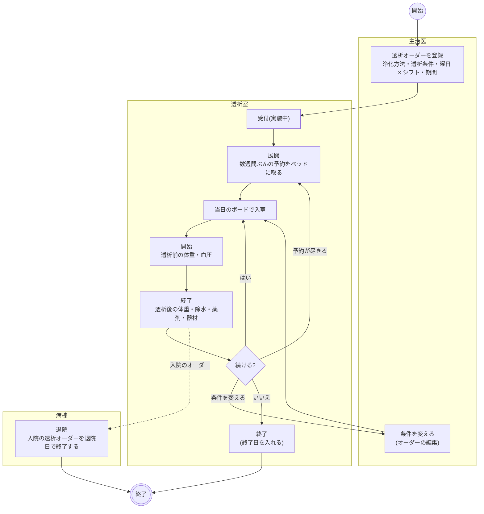
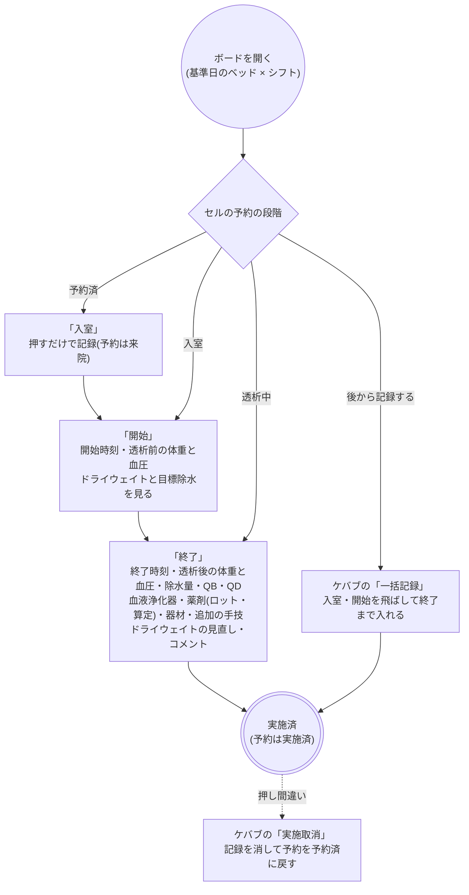
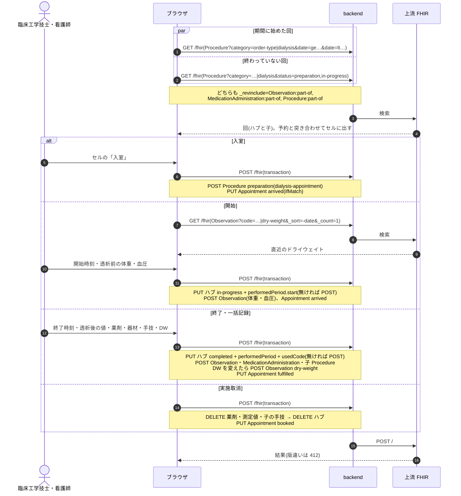

# 透析オーダーの業務フロー

透析(血液浄化)オーダーを、登録から透析室の受付・予約の展開・各回の入室〜終了・終了(退院での打ち切り)・医事会計まで追う流れです。医療機関の運用を検討する人は「運用フロー」、院内の開発者は「開発者向け」を読みます。
透析はリハビリと同じ**期間継続型**のオーダーで、1 つのオーダーが週 3 回を何か月も続けます。オーダーは「浄化方法と透析条件、曜日 × シフト、期間」という処方で、どのベッドで行うかは透析室が展開する予約、実際の体重・除水・薬剤は各回の実施記録が担います。
設計は [dialysis-order-design.md](../dialysis-order-design.md)、透析室とベッドの登録は [features/ward.md](../features/ward.md)、シフトと会計コードの設定は [features/facility.md](../features/facility.md)、
種別共通の約束(中止・削除・代行入力・オーダーセット)は [features/orders-common.md](../features/orders-common.md)、リソースの要素は実装ガイド(`../fhir-ig`)が正典です。

## 運用フロー

### リハビリとの違い

| | リハビリ | 透析 |
|---|---|---|
| 入力する項目 | 区分・療法・単位数・週あたりの回数 | 入外区分・浄化方法・開始日・終了日・曜日 × シフト(ベッドサイドは無し)・透析時間・QB・QD・血液浄化器・抗凝固薬と量・透析液・補充液・置換液・バスキュラーアクセス・穿刺針・対象プロブレム・透析部門への指示 |
| 予約 | 部門が 1 件ずつ取る | 曜日 × シフトから**数週間ぶんを一括で展開**する(ベッド × シフトの枠、1 ベッド 1 患者) |
| 実施 | 1 回の入力で終わる | **入室 → 開始 → 終了**の 3 段。途中を飛ばして後から一度に記録もできる |
| 実施で記録するもの | 療法・単位数・訓練内容 | 透析前後の体重・血圧、除水量、実透析時間、QB・QD、血液浄化器、薬剤(ロット)、器材、追加の手技、ドライウェイトの見直し |
| ベッドを取らない実施 | 無い | ベッドサイド(CHDF・血漿交換など)は予約なしで実施する |
| 退院での打ち切り | 全件 | **入院のオーダーだけ**(外来の維持透析は入院・退院をまたいで続く) |
| 医事会計 | 実施 1 回 = 1 剤、単位数 | 実施 1 回 = 1 剤、維持透析は実際の時間の区分でコードが分かれる |

- 入口はカルテの右ペイン「透析」です。クリニカルパスのタスク分類 `TPDI` の既定のオーダー種別で、オーダーセットにも入れられます。
- 部門の画面は「透析部門 > 透析一覧」(`/dialysis-worklist`)と「透析室の設定」(`/dialysis-unit`)です。ホームでは臨床工学技士に件数のカードが出ます。

### 進捗の状態

| 状態 | 意味 | 変わるきっかけ | 一覧からできること |
|---|---|---|---|
| 依頼済 | 透析室がまだ受けていない | 医師の登録、受付取消、中止取消 | 受付、中止 |
| 実施中 | 受けた。期間中ずっとこの状態で実施が積み上がる | 受付、終了取消 | 展開、臨時、各回の実施、終了、受付取消、中止 |
| 終了 | 期間を打ち切った | 終了(終了日) | 終了取消 |
| 中止 | 透析を取りやめた | 中止 | 中止取消 |

- 状態を動かすのは透析室(透析一覧)だけです。予約を展開しても、各回を実施しても状態は変わりません。

### 全体の流れ

- 条件を変えるときは新しいオーダーを出さず、同じオーダーを編集します(展開済みの予約がオーダーを指しているため)。各回の実施記録に実際の QB・QD・血液浄化器・薬剤を残すので、いつどの条件で行ったかは実施から読めます。
- オーダーのカードはカルテの開始日の日に 1 枚載り、浄化方法・曜日 × シフト・透析条件と、直近 3 回の実施(「11/11 前 62.4 → 後 60.2kg / 除水 2.2L / 4時間05分」)を出します。全件とドライウェイトは詳細で見ます。実施を出すのは実施中と終了のときです。
- 患者帯の透析のピクトグラムの吹き出しに、直近のドライウェイトと設定日を出します。

### 予約(展開・臨時・変更)

- 展開: オーダーのビューの「展開」で、曜日 × シフトから 1〜12 週ぶん(上限 40 件)の日を起こし、ベッドを選んで 1 回で取ります。ベッドの初期値は同じ曜日 × シフトの直近の予約のベッドです。先に別の患者が取った枠があれば全体が取れず、プレビューを読み直します。
- 臨時・予約変更: 日付とシフトを選び、その日 × シフトの空いているベッドから選びます。
- 予約取消: ボードのセルのケバブから。実施記録のある予約は取り消せません(先に実施取消)。

### 各回の実施

- 開始・終了の時刻は、その日の枠を今記録するときは今、別の日の枠を後から記録するときは枠の開始が初期値です。終了は「開始 + 指示の透析時間」と今の早いほうです。
- 透析前の体重と血圧は開始で入れ、終了では入力済みの値を変えません(入れていなければ終了で入れます)。除水量は透析前後の体重の差が初期値で、手で直せます。実透析時間は開始〜終了から出します。
- 血液浄化器・QB・QD・抗凝固薬はオーダーの値が初期値です。急性血液浄化(CHDF など)ではオーダーの透析液・補充液・置換液も薬剤の行に置きます。
- 薬剤の「算定」を外した行は記録に残しつつ医事会計に送りません。維持透析の抗凝固薬は初期値で外してあります(人工腎臓の所定点数に含まれるため)。ESA など所定点数に含まれる薬を足したときは手で外します。
- ドライウェイトは患者ごとの値で、終了の入力で値を変えたときだけ新しい値を記録します。
- ベッドサイドのオーダーはボードの格子の下の「ベッドサイド」の表から「開始」「一括記録」で実施します。CHDF のように日をまたぐ回は、終わっていなければ日付を変えても表に出続けます。
- 透析前後の血圧はバイタルとして記録するので、経過表の血圧の行にも出ます(体重は透析前後の 2 値が並ぶので経過表には出しません)。

### 透析中の記録(透析経過表)

開始後の回には、ボードのカードのケバブ(ベッドサイドの表では操作列)の「経過表」から、その回の透析経過表を開けます。
カルテの透析カードの詳細の実施履歴の行からも開けます(こちらはモーダル)。

- 30 分毎などのバイタル(血圧・脈拍・SpO2・体温)と装置の値(QB・QD・除水速度・累積除水・静脈圧・動脈圧・TMP)を時刻つきで足していきます。
  装置の値は前回の値が初期値で、変わったところだけ直します。グラフは血圧(∨ ∧)と脈拍(●)で、回の開始・終了が縦線で出ます。
- できごと(穿刺・除水停止・除水再開・血圧低下・補液・回路交換・返血・止血確認・その他)は時刻と種別で足します。補液は量をメモに書きます。
- 記録は 1 点ずつ保存されます。「確定」はありません(回の終了がその役で、終了後も書き忘れた血圧を足せます)。
- 終了の入力では、経過表の最後の血圧が透析後血圧、累積除水が除水量の初期値になります。実施取消をすると経過表も一緒に消えます。
- 経過表の打点は温度板(経過表)には出しません。

### 終了・中止・退院

- 終了(終了日)・中止・各取消はリハビリと同じです。終了は終了日の翌日以降、中止は今日以降の予約を同じ操作で取り消します。
- 退院の画面では「入院の透析オーダーを退院日で終了する」が出ます。対象は入外区分が入院で、退院日より後まで続くオーダーだけです。外来の維持透析は退院後も続くので触りません。退院日の翌日以降の予約は取り消します。
- 入院中に外来の維持透析を院内で続けるときは、入院のオーダーを別に出す運用です(外来のオーダーを一時中断する仕組みはありません)。

### 変更・削除

| 操作 | できること |
|---|---|
| 変更 | カルテのカードの編集。展開済みの予約と実施記録は変わりません |
| 削除 | 実施記録が無いオーダーだけ。取ってある予約は同じ操作で取り消します |
| DO | 開始日は今日、終了日は空にして写します |

## 開発者向け

### リソースの構成

| もの | リソース | 要点 |
|---|---|---|
| オーダー | `ServiceRequest` | `category` = `order-type|dialysis` + 入外区分、`code` = 浄化方法(`dialysis-modality`)、`occurrenceDateTime` = 開始日、拡張 `dialysis-order-end` / `dialysis-bedside` / `dialysis-schedule-pattern` / `dialysis-prescription`。明細は持たない |
| 進捗 | `Task`(`task-code|dialysis`) | 部門の受け入れ状態。実施では動かさない |
| 予約 | `Appointment` + `Slot` | 枠表は `Schedule`(`schedule-service-type|dialysis`、`actor` = ベッドの `Location`)、1 日 × シフトで 1 枠 |
| 1 回の実施 | `Procedure` ハブ(`basedOn` = オーダー) | `category` = `order-type|dialysis`、`code` = 浄化方法、`status` = `preparation`(入室)/ `in-progress`(開始)/ `completed`(終了)、`performedPeriod` = 開始〜終了、`usedCode` = 血液浄化器(`blood-purifier`)と器材(`medical-material`)+ `dialysis-material-quantity`、拡張 `dialysis-appointment` = 予約 |
| 測定値 | `Observation`(`partOf` = ハブ) | `dialysis-measurement` の `pre-weight` / `post-weight`(kg)・`ultrafiltration`(L)・`actual-minutes`(min)・`qb` / `qd`(mL/min)、`category` = `order-type|dialysis` |
| 血圧 | `Observation`(`partOf` = ハブ) | LOINC 85354-9 + component、`category` = `vital-signs` + `order-type|dialysis`、拡張 `dialysis-measurement-timing` = `pre` / `post` |
| 薬剤 | `MedicationAdministration`(`partOf` = ハブ) | ロットは `medication-lot-number`、算定しない薬剤は `dialysis-bundled-medication` = true |
| 追加の手技 | `Procedure`(`partOf` = ハブ、`basedOn` = オーダー) | `code` = `dialysis-procedure-code`(レセ電算の診療行為コード) |
| ドライウェイト | `Observation`(`partOf` 無し) | `dialysis-measurement|dry-weight`(kg)。患者単位の状態値で、直近 1 件を読む |
| 透析経過表 | `Procedure` ハブ(`partOf` = 実施のハブ、`basedOn` 無し) | `category` = `order-type|dialysis-chart`、`status` = `in-progress` / `completed`(回の終了で閉じる)。打点は `Observation`(`partOf` = 経過表のハブ、`category` = `order-type|dialysis-chart`。血圧・脈拍・SpO2・体温は LOINC、装置の値は `dialysis-measurement`)、できごとは `dialysis-event` の `Observation`(`docs/dialysis-chart-design.md`) |

- 入室のハブは `performed[x]` を持たないので日付で引けません。ボードは「期間に始めた回」と「`status=preparation,in-progress` の回」を別々に引いて束ねます(`fetchDialysisSessions`)。
- 予約と回の突き合わせはハブの `dialysis-appointment` を優先し、無ければ同じオーダー × 同じ日です(`dialysisSessionForAppointment`)。
- 実施取消は経過表 → 子 → ハブの順に DELETE し(entered-in-error で残さない)、予約を `booked` に戻します。ドライウェイトは消しません。
- 経過表のハブは `basedOn` を持たないので、カルテの詳細(`based-on` + `_revinclude:iterate`)に打点が乗りません。読むときは `Procedure?part-of=実施のハブ` で引きます。

### 部品

| 部品 | 場所 |
|---|---|
| オーダー | `components/DialysisOrderForm.tsx`・`DialysisOrderPanels.tsx`、詳細 `DialysisOrderDetailPanel.tsx`、カード `karteCardBodies/DialysisOrderCardBody.tsx` |
| 組み立て | `fhir/dialysisOrderHelpers.ts`(オーダー・終了日・退院の打ち切り)・`dialysisTaskHelpers.ts`(進捗)・`dialysisAppointmentHelpers.ts`(予約)・`dialysisUnitHelpers.ts`(透析室・ベッド・枠)・`dialysisResultHelpers.ts`(実施)・`dialysisChartHelpers.ts`(経過表。器は `timeSeriesChartHelpers.ts`) |
| 部門の画面 | `pages/DialysisWorklistPage.tsx`(ボード・週・オーダー)、`components/DialysisBoard.tsx`、`pages/DialysisUnitPage.tsx`、経過表 `pages/DialysisChartPage.tsx`(`/dialysis-sessions/:sessionId/chart`)・`components/DialysisChartPanel.tsx`・`DialysisChartModal.tsx`(器は `components/timeSeriesChart/`) |
| モーダル | 実施 `components/DialysisPerformModal.tsx`、展開 `DialysisExpandModal.tsx`、臨時・変更 `DialysisBookModal.tsx` |
| hook | `api/queries/dialysis.ts`(`useDialysisSessions`・`useDialysisPerform`・`useCancelDialysisPerform`・`useLatestDryWeight`・`usePatientDialysisOrders`・`useDialysisChart`・`useDialysisChartWrite`・`useDialysisSessionDetail` ほか) |
| 退院 | `components/DischargeModal.tsx`、`api/queries/encounter.ts`(`buildDialysisOrderStopEntries`) |

### シーケンス図: 各回の実施

### 医事会計

透析は実施記録から集めます(`BillingClaimBuilder` の `:procedure` 経路、`Resolvers::Dialysis`)。完了したハブ 1 件 = 1 剤で、日レセの診療種別区分は 400 です。
期間継続型(`continuous`)なので、実施記録の無い日のヘッダは報告しません。

- 手技: 維持透析(hd / hdf / i-hdf)は `performedPeriod` の分数で 4 時間未満 / 4〜5 時間 / 5 時間以上に分け、施設設定 `receipt_codes.dialysis` の浄化方法 × 時間区分のコードを引きます。急性血液浄化(chdf / chd / pe / dfpp / dhp)は浄化方法ごとに 1 つのコードです。追加の手技(子の Procedure)はそのコードのまま並べます。
- 薬剤: `dialysis-bundled-medication` の付いた薬剤は送りません。それ以外は処置と同じく医薬品コードと使用量で送ります。
- 器材: 血液浄化器は施設マスタ(`master_blood_purifiers`)の製品に紐付けた特定器材コード(`receipt_material_code`)に読み替えます(放射線の器材マスタと同じ解決。`PerformedItemBuilder::LOCAL_MATERIALS`)。紐付けの無い製品・手入力の製品は「送れない項目」に出します。
- 開始・終了の時刻が無い維持透析、施設設定にコードが無い浄化方法 × 時間区分は「送れない項目」に理由つきで出します。
- 送らないもの: 慢性維持透析患者外来医学管理料・導入期加算・障害者等加算・時間外加算(患者属性や月次の判定が要るため医事側で付けます)。

| 起きたこと | 医事会計 | SS-MIX2 |
|---|---|---|
| 登録・編集・削除・受付・終了・中止・予約 | なし | なし |
| 入室・開始 | なし(完了していないハブは集めない) | なし |
| 終了・一括記録 | 開始日に送る | なし |
| 実施取消 | 対象から外れる(DELETE) | なし |
