# 透析オーダーの業務フロー

透析(血液浄化)オーダーを、登録から透析室の受付・予約の展開・各回の入室〜終了・終了(中断・退院での打ち切り)・医事会計まで追う流れです。医療機関の運用を検討する人は「運用フロー」、院内の開発者は「開発者向け」を読みます。
透析はリハビリと同じ**期間継続型**のオーダーで、1 つのオーダーが週 3 回を何か月も続けます。オーダーは「浄化方法と透析条件、曜日 × シフト、期間」という処方で、どのベッドで行うかは透析室が展開する予約、実際の体重・除水・薬剤は各回の実施記録が担います。
設計は [dialysis-order-design.md](../dialysis-order-design.md)(透析経過表は [dialysis-chart-design.md](../dialysis-chart-design.md))、透析室とベッドの登録は [features/ward.md](../features/ward.md)、シフトと会計コードの設定は [features/facility.md](../features/facility.md)、
種別共通の約束(中止・削除・代行入力・オーダーセット)は [features/orders-common.md](../features/orders-common.md)、リソースの要素は実装ガイド(`../fhir-ig`)が正典です。

## 運用フロー

### リハビリとの違い

| | リハビリ([rehab.md](rehab.md)) | 透析 |
|---|---|---|
| 入力する項目 | 区分・療法・単位数・週あたりの回数 | 入外区分・浄化方法・開始日・終了日・曜日 × シフト(ベッドサイドは無し)・透析時間・QB・QD・血液浄化器・抗凝固薬と量・透析液・補充液・置換液・バスキュラーアクセス・穿刺針・対象プロブレム・透析部門への指示 |
| マスタ | 持たない | 血液浄化器の施設マスタ(製品と算定用の特定器材コード)。透析液などは医薬品マスタ |
| 施設設定 | 会計コード | 透析室のシフト(午前・午後など)、浄化方法 × 時間区分の会計コード、患者一覧の採血項目 |
| 場所 | リハ室(枠表 1 つ) | 透析室とベッド(ベッド 1 台に枠表 1 つ、1 日 × シフトで 1 枠) |
| 予約 | 部門が 1 件ずつ取る | 曜日 × シフトから**数週間ぶんを一括で展開**する(ベッド × シフトの枠、1 ベッド 1 患者)。臨時・空き枠から・ドラッグでも取れる |
| 実施 | 1 回の入力で終わる | **入室 → 開始 → 終了**の 3 段。途中を飛ばして後から一度に記録もできる |
| 実施で記録するもの | 療法・単位数・訓練内容 | 透析前後の体重・血圧、除水量、実透析時間、QB・QD、血液浄化器、薬剤(ロット)、器材、追加の手技、ドライウェイトの見直し。透析中の 30 分毎の値は透析経過表 |
| ベッドを取らない実施 | 無い | ベッドサイド(CHDF・血漿交換など)は予約なしで実施する |
| 一時的な休み | 無い(終了して出し直す) | **中断**(入院・旅行など)。期間は変えずその間の予約だけ取り消し、再開で戻す |
| 退院での打ち切り | 全件 | **入院のオーダーだけ**(外来の維持透析は入院・退院をまたいで続く) |
| 医事会計 | 実施 1 回 = 1 剤、単位数 | 実施 1 回 = 1 剤、維持透析は実際の時間の区分でコードが分かれる |

- 入口はカルテの右ペイン「透析」です。クリニカルパスのタスク分類 `TPDI` の既定のオーダー種別で、オーダーセットにも入れられます(パスからは登録まで。実施は透析一覧で行います)。
- 部門の画面は「部門業務 > 透析部門 > 透析一覧」(`/dialysis-worklist`。ボード・週・オーダー・患者・統計の 5 つのビュー)と「透析室の設定」(`/dialysis-unit`)です。ホームでは臨床工学技士に、当日に効いているオーダーと本日の予約の件数のカードが出ます。

### 準備(透析室を始める前に 1 度だけ)

| 準備 | 画面 | 内容 |
|---|---|---|
| シフト | 施設設定「透析室のシフト」 | 1 日の区切り(既定は午前 9:00〜13:30・午後 14:00〜18:30)。コード・名前・開始・終了。時間帯は重ねられません。オーダーの曜日 × シフト、ベッドの枠、ボードの列になります |
| 透析室とベッド | 透析室の設定 | 透析室を作り、台数を入れてベッドを足します(番号の続きで名前が付きます)。使わなくなったベッドは無効にします(枠を作らず、ボードにも出ません) |
| 枠 | 透析室の設定「枠の生成」 | 開始日と月数(上限 6)を入れると、有効なベッドに日 × シフトで 1 枠ずつ作ります。祝日・休診日にも作ります(行わない日は埋めないだけ)。既に枠のある日 × シフトは飛ばすので、シフトを足したあとに生成し直すと足したシフトの枠だけが増えます |
| 血液浄化器 | マスタ > 透析 > 血液浄化器 | 施設で使う製品(ダイアライザ・ヘモダイアフィルタ・血液濾過器・血漿分離器・吸着器など)と、算定に使う特定器材コードの紐付け |
| 会計コード | 施設設定「医事会計のレセプト電算コード」の透析 | 維持透析(HD・HDF・I-HDF)× 時間区分(4 時間未満・4〜5 時間・5 時間以上)と、急性血液浄化(CHDF・CHD・PE・DFPP・DHP)ごとの診療行為コード |
| 採血の項目 | 施設設定「透析患者一覧の採血項目」 | 患者一覧に並べる検査の結果項目コードと列の見出し(既定は Hb・Alb・K・P・Ca) |
| 患者メモの雛形 | テンプレート一覧 | 「透析の患者メモ」(HD_MEMO_01)を取り込みます。項目やシャントの台紙を施設に合わせて直すときは同じテンプレートの版を上げます |

### 進捗の状態

| 状態 | 意味 | 変わるきっかけ | 一覧からできること |
|---|---|---|---|
| 依頼済 | 透析室がまだ受けていない | 医師の登録、受付取消、中止取消 | 受付、中止 |
| 実施中 | 受けた。期間中ずっとこの状態で実施が積み上がる | 受付、終了取消、再開 | 展開、臨時、各回の実施、終了、中断、受付取消、中止 |
| 中断 | 入院などでしばらく透析室に来ない。期間は変えず予約だけ取り消してある | 中断(中断開始日・再開予定日) | 再開、中止 |
| 終了 | 期間を打ち切った | 終了(終了日) | 終了取消 |
| 中止 | 透析を取りやめた | 中止 | 中止取消 |

- 状態を動かすのは透析室(透析一覧のオーダーのビュー)だけです。予約を展開しても、各回を実施しても状態は変わりません。
- 行に直接出るのは「受付」「再開」「展開」「臨時」「表示」です。終了・中断・各取消・中止は押し間違えると期間や予約が動くので、行のケバブメニューに畳んであります。
- 予約を取れるのも、各回を実施できるのも実施中のオーダーだけです(ベッドサイドのオーダーは予約を取らず実施だけ)。中断中は空き枠からの予約の候補にも出ません。

### 全体の流れ

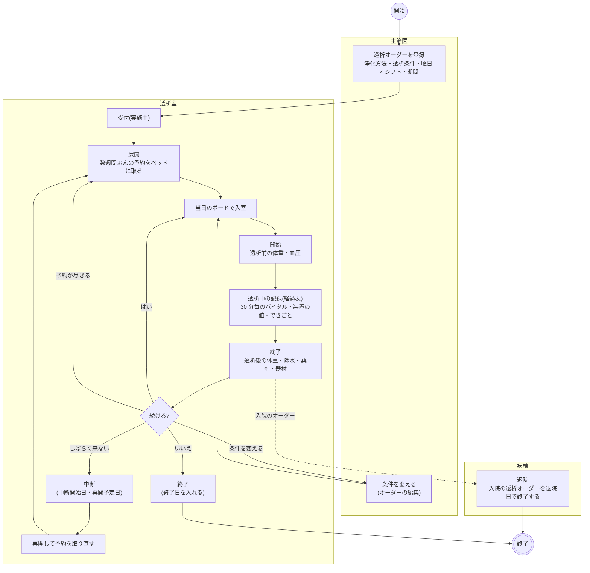

- 条件を変えるときは新しいオーダーを出さず、同じオーダーを編集します(展開済みの予約がオーダーを指しているため)。各回の実施記録に実際の QB・QD・血液浄化器・薬剤を残すので、いつどの条件で行ったかは実施から読めます。
- オーダーのカードはカルテの開始日の日に 1 枚載り、浄化方法・曜日 × シフト・透析条件と、直近 3 回の実施(「11/11 前 62.4 → 後 60.2kg / 除水 2.2L / 4時間05分」)を出します。全件とドライウェイトは詳細で見ます。実施を出すのは実施中・中断・終了のときです。
- 患者帯の透析のピクトグラムは今日が期間内の有効なオーダーがあるときに出し、吹き出しに浄化方法・曜日 × シフト・アクセスと、直近のドライウェイトと設定日を出します。

### 登録の判定

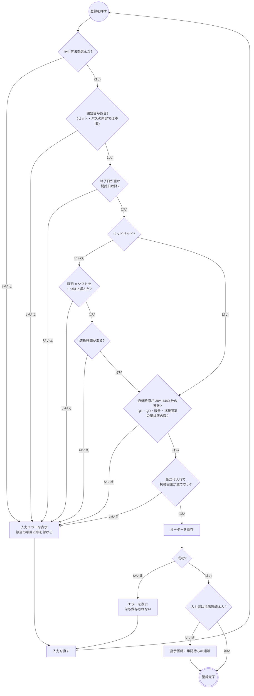

- 浄化方法で入力欄が変わります。透析液は HD・HDF・I-HDF・CHDF・CHD、補充液は HDF・I-HDF・CHDF、置換液は PE・DFPP で出し、DHP は液を持ちません。血液浄化器の種類と行数も浄化方法で決まります(HD はダイアライザ 1 行、DFPP は血漿分離器と血漿成分分画器の 2 行など)。
- 「ベッドサイド」を付けると、曜日 × シフトと透析時間は求めません。病棟のベッドで行う急性血液浄化のためで、透析室の予約を作りません。
- 入外区分の初期値は、入院中なら「入院」です。入院のオーダーには登録時点の病棟が焼き付きます(透析一覧の「病棟」列)。
- 登録時の警告(禁忌・重複など)はありません。承認待ちでもオーダーは部門に流れます。

### 予約(展開・臨時・空き枠・変更・ドラッグ・取消)

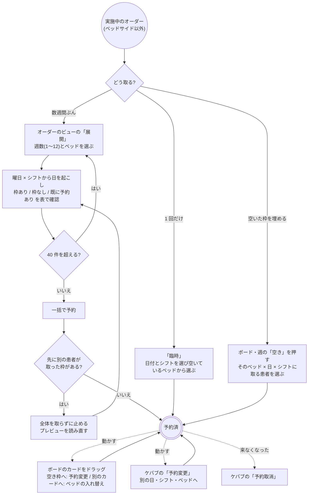

- 展開: 開始日は、まだ予約が無ければオーダーの開始日(過去なら今日)、展開済みなら最後の予約の翌日です。ベッドの初期値は同じ曜日 × シフトの直近の予約のベッドで、曜日 × シフトごとに変えられます。既に予約のある日は除外して表に出します。週数の上限は 12、1 回の件数の上限は 40 で、超えるときは黙って切らず止めます。
- 排他: 展開は全件を 1 回で取ります。先に別の患者が取った枠が 1 つでもあれば全体が取れず(部分成功は無い)、「別の患者が取った枠があります」と出してプレビューを読み直します。
- 臨時・予約変更: 日付とシフトを選び、その日 × シフトのベッドが「空き」「埋まり」「枠なし」で並びます。予約変更では今の枠を「現在」と出します。
- 空き枠から: ボード・週ビューの「空き」を押すと、ベッド × 日 × シフトが決まった状態で患者を選びます。候補は、その日が期間内で、実施中(中断は除く)、その日 × シフトにまだ予約の無いオーダーです。
- ドラッグ: 予約済でまだ入室していないカードだけ動かせます。空いている枠へ落とすと予約変更(日・シフトをまたいでもよい)、同じ日 × シフトの別の動かせるカードへ落とすとベッドの入れ替えです。入室以降のカードと、2 件以上入っているマスには落とせません。別の端末で先に枠や予約が変わっていたときは止まり、読み直します。
- 予約取消: ボードのセルのケバブと、カルテの予約タブから。実施記録のある予約は取り消せません(先に実施取消)。
- 予約はカルテの予約タブにも「透析」として並び、そこからも日時変更・取消ができます(枠の選び方は透析室の枠表)。外来一覧には出ません。
- ベッドの枠が無い日(枠を生成していない・ベッドを無効にした)は「枠なし」になり取れません。先に透析室の設定で枠を生成します。

### 各回の実施

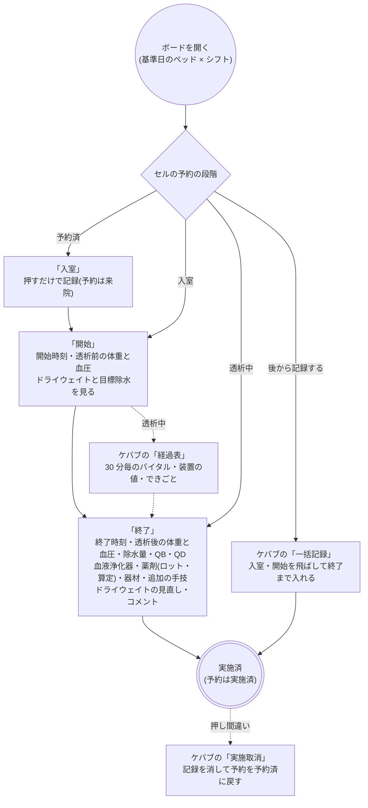

- 開始・終了の時刻は、その日の枠を今記録するときは今、別の日の枠を後から記録するときは枠の開始が初期値です。終了は「開始 + 指示の透析時間」と今の早いほうです。
- 判定: 開始には開始時刻が必須です。終了には終了時刻(開始より後)が必須で、体重は 1〜300 kg、血圧は収縮期と拡張期の両方、除水量は 0〜20 L、QB・QD は正の数でないと止めます。それ以外の項目は空でも記録できます。
- 透析前の体重と血圧は開始で入れ、終了では入力済みの値を変えません(入れていなければ終了で入れます)。除水量は透析前後の体重の差が初期値で、手で直せます。実透析時間は開始〜終了から出します。
- 血液浄化器・QB・QD・抗凝固薬はオーダーの値が初期値です。急性血液浄化(CHDF など)ではオーダーの透析液・補充液・置換液も薬剤の行に置きます。
- 薬剤の「算定」を外した行は記録に残しつつ医事会計に送りません。維持透析の抗凝固薬は初期値で外してあります(人工腎臓の所定点数に含まれるため)。ESA など所定点数に含まれる薬を足したときは手で外します。
- ドライウェイトは患者ごとの値で、終了の入力で値を変えたときだけ新しい値を記録します。
- ベッドサイドのオーダーはボードの格子の下の「ベッドサイド」の表から「開始」「一括記録」で実施します。CHDF のように日をまたぐ回は、終わっていなければ日付を変えても表に出続けます。
- 透析前後の血圧はバイタルとして記録するので、経過表(温度板)の血圧の行にも出ます(体重は透析前後の 2 値が並ぶので経過表には出しません)。
- ボードの各回はカルテの透析カードの詳細の実施履歴にも並び、そこから経過表を開けます。

### 透析中の記録(透析経過表)

開始後の回には、ボードのカードのケバブ(ベッドサイドの表では操作列)の「経過表」から、その回の透析経過表を開けます。
カルテの透析カードの詳細の実施履歴の行からも開けます(こちらはモーダル)。
経過表のある回には、ボード・週・ベッドサイドの表と、カルテの透析カードの実施の行・詳細の実施履歴に折れ線の印(「経過表あり」)が付きます。

- 30 分毎などのバイタル(血圧・脈拍・SpO2・体温)と装置の値(QB・QD・除水速度・累積除水・静脈圧・動脈圧・TMP)を時刻つきで足していきます。
  装置の値は前回の値が初期値で、変わったところだけ直します。グラフは血圧(∨ ∧)と脈拍(●)で、回の開始・終了が縦線で出ます。
  累積除水は右軸(■)に描き、目標除水(透析前体重 − ドライウェイト)が破線で出ます。
- できごと(穿刺・除水停止・除水再開・血圧低下・補液・回路交換・返血・止血確認・その他)は時刻と種別で足します。
- 透析中の薬剤(補液・昇圧薬など)は「薬剤」に医薬品マスタから選んで、単回(量)か持続(速度)と経路・時刻で足します。持続は「終了」で閉じます。
  この薬剤は会計には送りません。終了の入力で実施記録の薬剤の行の初期値になり、そこで算定するかを決めます。
- 記録は 1 点ずつ保存されます。「確定」はありません(回の終了がその役で、終了後も書き忘れた血圧を足せます)。
- 終了の入力では、経過表の最後の血圧が透析後血圧、累積除水が除水量、経過表の薬剤が薬剤の行の初期値になります(オーダーの抗凝固薬と同じ薬なら
  その行に量が入ります)。実施取消をすると経過表も一緒に消えます。
- 「印刷」で別タブに A4 横の紙面(見出し・グラフ・打点の表・できごと・薬剤)を開き、ブラウザから印刷します。
- 経過表の打点は温度板(経過表)の期間表示には出しません。日付の見出しを押した 24 時間表示にだけ、透析中の血圧・脈拍・SpO2・体温が重なります。

### 患者メモ

消毒液・止血方法・導入年月日・シャントのシェーマなど、穿刺・止血のたびに見返すことは患者メモに書きます。
患者 1 人に 1 枚で、入院・外来をまたいで同じものを書き直していきます。

- ボードのカードのケバブ「患者メモ」と、患者のビューの「メモ」で開きます。透析オーダーの詳細(カルテの透析カード・透析一覧の「表示」)にも出ます。
- シャントのシェーマは両上肢の台紙に描き込みます。項目や台紙はテンプレート「透析の患者メモ」(HD_MEMO_01)を直すと変えられます。
- カルテの時系列には出ません(患者のテンプレート回答の一覧には出ます)。

### 透析患者一覧・月間統計

- 透析一覧の「患者」では、その日に透析室で透析を受けている患者を 1 人 1 行で見られます(ベッドサイド・中止・受付取消を除き、中断中は載せます)。
  アクセス、ドライウェイトの推移、直近の透析(透析後体重と DW の差・除水量・時間)、透析間の体重増加、直近の採血(Hb・Alb・K・P・Ca)、次回予約が並びます。
  採血は基準日から 90 日前までを読み、基準日より前の回に測った項目には日付を添えます。
- 「統計」では月を選んで、実施回数・実患者数・平均の透析時間・ベッドの稼働率を見られます。浄化方法別、シフト別・ベッド別(枠・予約・未来院・実施)、
  日別の表があり、日別は CSV に出せます。稼働率は「透析室で実施した回 ÷ 枠」で、ベッドサイドの回は別に数えます。入室だけで開始していない回は数えません。

### 終了・中断・中止・退院

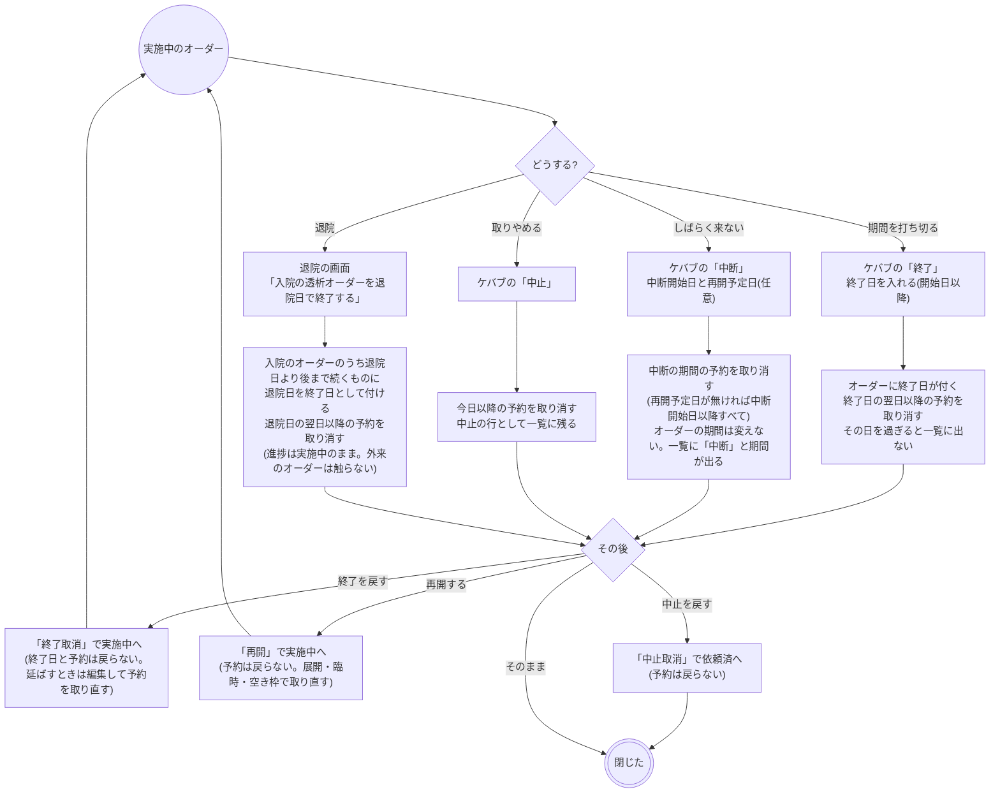

- 終了・中断・中止・退院では、もう来ない日の予約を同じ操作で取り消して枠を空けます。終了は終了日の翌日以降、中止は今日以降、退院は退院日の翌日以降、中断は中断の期間(両端を含む)の予約です。それより前の予約は通院の記録として残します。
- 終了取消・再開・中止取消で予約は戻りません(取り消したあとに枠が埋まっていることがあるため)。続けるときは展開・臨時・空き枠から取り直します。再開予定日より後の予約は残っているので、展開の開始日はその続きになります。中断の期間に穴が空いたまま再開が早まったときは臨時か空き枠から埋めます。
- 「終了取消」で終了日を消さないのは、打ち切った期間まで巻き戻すとその間の実施記録と食い違うためです。期間を延ばしたいときはオーダーを編集して終了日を直します。
- 中断の初期値は基準日と今日の遅いほうです。中断中のオーダーは患者一覧には載り、カルテのカードの実施も出ます。中断中は中止に移れますが終了にはできません(先に再開します)。
- 退院の対象は入外区分が入院で、退院日より後まで続く(終了日が無いか退院日より後の)オーダーだけです。外来の維持透析は退院後も続くので触りません。急性血液浄化が退院(転院・死亡を含む)で終わるときはここで閉じます。チェックは外せます。退院で止めたオーダーは終了日が付くだけで、進捗は「終了」になりません。
- 入院中に外来の維持透析を院内で続けるときは、入院のオーダーを別に出し、外来のオーダーは中断しておきます(入院の登録から自動で中断にはなりません)。
- 中止のオーダーは一覧の基準日が期間内なら中止の行として並び、そこから中止取消できます。

### 変更・中止・削除

| 操作 | できること |
|---|---|
| 変更 | カルテのカードの編集。進捗・展開済みの予約・実施記録は変わりません。中止のオーダーは中止のまま保存します |
| 中止 | 透析一覧の行のケバブ「中止」。カルテのカードに中止はありません |
| 削除 | 実施記録が無いオーダーだけできます。取ってある予約は同じ操作で取り消し、枠を空けます。実施があるときは実施を取り消してから削除するか、中止します |
| DO | 新しいオーダーとして写します。開始日は今日、終了日は空にし、透析条件・曜日 × シフト・アクセスはそのまま引き継ぎます。入外区分は今の状態(入院中なら入院)です |

- 入院 → 外来の切り替えを表す手段はありません。入外区分は登録時の値のままなので、外来で続けるときは新しいオーダーを出します。

### ほかの画面とのつながり

| 画面 | 透析との関係 |
|---|---|
| ホーム | 臨床工学技士のカードに、当日に効いているオーダーの件数と本日の予約の件数、進捗の内訳 |
| カルテの予約タブ | 透析の予約が「透析」のバッジで並び、日時変更・取消ができる |
| 患者帯 | 今日が期間内の透析オーダーがあると透析のピクトグラム。吹き出しに浄化方法・曜日 × シフト・アクセス・ドライウェイト |
| 経過表(温度板) | 透析前後の血圧がバイタルとして載る。透析中の打点は 24 時間表示にだけ重なる |
| クリニカルパス | タスク分類 `TPDI` から透析オーダーを登録できる。実施はパスの画面からはできず、透析一覧で行う |
| オーダーセット | 透析オーダーを入れられる(開始日・終了日・対象プロブレムは持ち込まない) |
| 退院 | 入院の透析オーダーを退院日で終了する(上の節) |
| 枠表の一覧 | 透析室のベッドの枠表が種別「透析」で並ぶ。枠カレンダーの停止・再開・個別追加は使える。名前・有効と枠の生成は透析室の設定で行う |
| 医事送信 | 終了した回を実施日の「透析」として送る(下の「医事会計と SS-MIX2」) |

### 帳票

専用の帳票はありません。透析経過表の「印刷」で A4 横の紙面をブラウザから印刷します。透析条件の指示書や透析記録の様式は未実装です。

## 開発者向け

### リソースの構成

| もの | リソース | 要点 |
|---|---|---|
| オーダー | `ServiceRequest` | `category` = `order-type|dialysis` + `prescription-setting`、`code` = 浄化方法(`dialysis-modality`)、`occurrenceDateTime` = 開始日(日付のみ)、`reasonReference` = 対象プロブレム、拡張 `dialysis-order-end`(終了日。無ければ継続中)/ `dialysis-bedside` / `dialysis-schedule-pattern`(曜日 × シフト。シフトは `dialysis-shift` の coding)/ `dialysis-prescription`(透析条件)。明細は持たない |
| 進捗 | `Task`(`task-code|dialysis`、`focus` = オーダー) | **登録時には作らず**、Task が無いオーダーは依頼済。部門の受け入れ状態で、実施では動かさない |
| 透析室・ベッド | `Location`(`type` = `location-type|dialysis-unit`) | 透析室は `physicalType` = `ro`、ベッドは `bd` + `partOf` = 透析室。無効は `status` = `inactive`。病床ではないので入院の `Encounter.location` にはしない |
| 枠 | `Schedule` + `Slot` | 枠表は `serviceType` = `schedule-service-type|dialysis`、`actor` = ベッドの `Location`(無効なベッドは `active` = false)。1 日 × シフト × ベッドで 1 枠(定員 1) |
| 予約 | `Appointment`(`basedOn` = オーダー) | `participant` = 患者 + ベッドの `Location`、`slot`、`serviceType` = dialysis、拡張 `dialysis-shift`。シフトは枠の開始時刻から引き、拡張は枠が読めないときの代わり |
| 1 回の実施 | `Procedure` ハブ(`basedOn` = オーダー) | `category` = `order-type|dialysis`、`code` = 浄化方法、`status` = `preparation`(入室)/ `in-progress`(開始)/ `completed`(終了)、`performedPeriod` = 開始〜終了、`usedCode` = 血液浄化器(`blood-purifier`)と器材(`medical-material`)+ `dialysis-material-quantity`、拡張 `dialysis-appointment` = 予約 |
| 測定値 | `Observation`(`partOf` = ハブ) | `dialysis-measurement` の `pre-weight` / `post-weight`(kg)・`ultrafiltration`(L)・`actual-minutes`(min)・`qb` / `qd`(mL/min)、`category` = `order-type|dialysis` |
| 血圧 | `Observation`(`partOf` = ハブ) | LOINC 85354-9 + component、`category` = `vital-signs` + `order-type|dialysis`、拡張 `dialysis-measurement-timing` = `pre` / `post` |
| 薬剤 | `MedicationAdministration`(`partOf` = ハブ) | ロットは `medication-lot-number`、算定しない薬剤は `dialysis-bundled-medication` = true |
| 追加の手技 | `Procedure`(`partOf` = ハブ、`basedOn` = オーダー) | `code` = `dialysis-procedure-code`(レセ電算の診療行為コード) |
| ドライウェイト | `Observation`(`partOf` 無し) | `dialysis-measurement|dry-weight`(kg)。患者単位の状態値で、直近 1 件を読む |
| 患者メモ | `QuestionnaireResponse`(`encounter` 無し) | テンプレート `Questionnaire/dialysis-memo-01` の回答を患者 1 人に 1 件。`meta.tag` = `questionnaire-response-purpose|dialysis-memo` で引き(`_tag`、strict)、カルテの時系列からは `_tag:not` で外す |
| 透析経過表 | `Procedure` ハブ(`partOf` = 実施のハブ、`basedOn` 無し) | `category` = `order-type|dialysis-chart`、`status` = `in-progress` / `completed`(回の終了で閉じる)。打点は `Observation`(`partOf` = 経過表のハブ、`category` = `order-type|dialysis-chart`。血圧・脈拍・SpO2・体温は LOINC、装置の値は `dialysis-measurement`)、できごとは `dialysis-event` の `Observation`、透析中の薬剤は `MedicationAdministration`(`partOf` = 経過表のハブ、同じ `category`。会計には乗らない)([dialysis-chart-design.md](../dialysis-chart-design.md)) |
| 代行入力 | `Provenance`(`target` = オーダー) | 種別共通 |

- 期間を `occurrencePeriod` にせず開始日 + 拡張にするのは、上流が `occurrenceDateTime` を索引するため(リハビリ・食事と同じ判断)。上流は `order-period` で開始日と `dialysis-order-end` を合わせて索引しています。
- 入室のハブは `performed[x]` を持たないので日付で引けません。ボードは「期間に始めた回」と「`status=preparation,in-progress` の回」を別々に引いて束ねます(`fetchDialysisSessions`)。
- 予約と回の突き合わせはハブの `dialysis-appointment` を優先し、無ければ同じオーダー × 同じ日です(`dialysisSessionForAppointment`)。
- 実施取消は経過表 → 子 → ハブの順に DELETE し(entered-in-error で残さない)、予約を `booked` に戻します。ドライウェイトは消しません。
- 経過表のハブは `basedOn` を持たないので、カルテの詳細(`based-on` + `_revinclude:iterate`)に打点が乗りません。読むときは `Procedure?part-of=実施のハブ` で引きます。
- 透析室とベッドにローカルの `location-type|dialysis-unit` を与えるのは、病棟(`type=HU` 起点)・診察室(`LOCATION_TYPE_OPTIONS`)・病床の集計のどれにも混ざらないようにするためです。`LOCATION_TYPE_OPTIONS` には足しません。

### 進捗 Task と status

**実施しても Task を動かしません。** リハビリと同じ逸脱で、他部門と同じ「実施記録 + Task を completed に」にすると初日の実施で終了扱いになります(`fhir/dialysisTaskHelpers.ts`・`dialysisResultHelpers.ts` の冒頭コメント)。

| Task | 表示 | `ServiceRequest.status` | ヘッダに書くもの | 予約 |
|---|---|---|---|---|
| (無し)/ `requested` | 依頼済 | `active` | – | – |
| `accepted` | 実施中 | `active` | – | – |
| `on-hold` | 中断 | `active` のまま | – (`Task.statusReason.text` = 「中断 2026-11-12〜2026-11-20」) | 中断の期間の有効な予約を cancelled に |
| `completed` | 終了 | `active` のまま | `dialysis-order-end`(終了日) | 終了日の翌日以降を cancelled に |
| `cancelled` | 中止 | `revoked` | – | 今日以降を cancelled に |

- 遷移の表は `dialysisTaskActions`、書き込みの入口は `useUpdateDialysisTaskStatus`(`api/queries/dialysis.ts`)です。中止・中止取消は `orderCancelEntries` でヘッダの status を揃えます。
- 終了で `dialysis-order-end` を書くのは、部門一覧・患者帯が `order-period` で引くので、終了日が無いと status=active のまま基準日に永久にヒットし続けるためです(`buildDialysisOrderCloseEntry`)。終了取消では消しません(意図した非対称)。
- 中断の期間は `Task.statusReason.text` に決まった書式で残し、`dialysisTaskHold` が読み戻して一覧のステータスの下に出します。再開(`accepted`)で消します。
- 終了・中断・中止・退院は、もう来ない日の有効な予約の取消(`PUT Appointment cancelled` + `PUT Slot free`)を同じ transaction に積みます(`fetchOrderAppointmentCancelEntries` の `from` / `to`)。取り消す対象の検索は strict で全ページを読み(条件が効かずに全件を拾うと、関係ない予約まで取り消すため)、欠けたら書き込みを止めます。
- `executionPeriod` は受付で `start`、終了で `end` が入ります(`createTaskHelpers` の `buildTaskUpdate`)。
- カルテのタイムラインは、`accepted` / `on-hold` / `completed` で実施情報を出します(`karteTimeline.ts` の dialysis 分岐)。

### シーケンス図の前提

`/fhir` への書き込みはどれも 1 回の transaction Bundle で、backend の `FhirProxyController` が上流へ中継します。
SS-MIX2 を有効にしている施設では、中継が書き込みの控えを記録します(`Ssmix2::Recorder`。透析はメッセージになりません)。
楽観ロックの版は `postBundle` が `ifMatch` に添え、版が違えば 412 で止まります。編集フォームは `useEditSnapshot` で開いた時点の版に固定します(`hooks/useDialysisOrderInitialValues.ts`)。
予約の展開・変更・入れ替えは、検索で読んだ `Slot` / `Appointment` をそのまま PUT するので、別の端末が先に動かしていれば 412 で全体が落ちます。部分成功は作りません。

| 部品 | 場所 |
|---|---|
| オーダー | `components/DialysisOrderForm.tsx`・`DialysisOrderPanels.tsx`、詳細 `DialysisOrderDetailPanel.tsx`、カード `karteCardBodies/DialysisOrderCardBody.tsx` |
| 組み立て | `fhir/dialysisOrderHelpers.ts`(オーダー・終了日・退院の打ち切り)・`dialysisTaskHelpers.ts`(進捗)・`dialysisShiftHelpers.ts`(シフト)・`dialysisAppointmentHelpers.ts`(予約・展開の計画・変更・入れ替え)・`dialysisUnitHelpers.ts`(透析室・ベッド・枠)・`dialysisResultHelpers.ts`(実施)・`dialysisChartHelpers.ts`(経過表。器は `timeSeriesChartHelpers.ts`)・`bloodPurifierHelpers.ts`(血液浄化器の行) |
| 部門の画面 | `pages/DialysisWorklistPage.tsx`(ボード・週・オーダー・患者・統計。終了・中断のモーダルもここ)、`components/DialysisBoard.tsx`、`pages/DialysisUnitPage.tsx`、経過表 `pages/DialysisChartPage.tsx`(`/dialysis-sessions/:sessionId/chart`)・`components/DialysisChartPanel.tsx`・`DialysisChartModal.tsx`・印刷 `pages/DialysisChartPrintPage.tsx`(`/dialysis-chart-print/:sessionId`)(器は `components/timeSeriesChart/`) |
| 患者一覧・統計 | `components/DialysisPatientTable.tsx`・`fhir/dialysisPatientListHelpers.ts`(`useDialysisPatientData`)、`components/DialysisMonthlyStats.tsx`・`fhir/dialysisStatsHelpers.ts`(`useDialysisMonth`) |
| 患者メモ | `components/DialysisMemo.tsx`(詳細の区画・ボードのモーダル)、`fhir/dialysisMemoHelpers.ts`、雛形 `docs/report-mappings/dialysis-memo-01.questionnaire.json` |
| モーダル | 実施 `components/DialysisPerformModal.tsx`、展開 `DialysisExpandModal.tsx`、臨時・変更 `DialysisBookModal.tsx`、空き枠から `DialysisCellBookModal.tsx` |
| マスタ・設定 | 血液浄化器 `pages/BloodPurifierPage.tsx`(`/blood-purifiers`、backend `master/blood_purifiers`)、施設設定 `dialysis_shifts` / `dialysis_lab_items` / `receipt_codes.dialysis`(`backend/app/models/facility_settings.rb`) |
| hook | `api/queries/dialysis.ts`(`useDialysisWorklist`・`useDialysisBoard`・`useDialysisSlots`・`useDialysisSessions`・`useDialysisPerform`・`useCancelDialysisPerform`・`useLatestDryWeight`・`usePatientDialysisOrders`・`useBookDialysisAppointments`・`useRescheduleDialysisAppointment`・`useSwapDialysisAppointments`・`useUpdateDialysisTaskStatus`・`useDialysisChart`・`useDialysisChartWrite`・`useDialysisMemo` ほか)、予約の取消は `api/queries/appointment.ts` |
| 退院 | `components/DischargeModal.tsx`、`api/queries/encounter.ts`(`buildDialysisOrderStopEntries` を退院の transaction に積む) |
| ホーム | `components/homeCards/HomeWorklistCard.tsx` の `DialysisCard`(`useDialysisWorklist` を当日で読む) |

### シーケンス図: 登録・編集・削除

`buildDialysisOrderBundle` / `buildDialysisOrderUpdateBundle`、`useCreatePrescription`(`api/queries/labResult.ts`。全種別共通)、`useUpdateDialysisOrder`、`deleteDialysisOrderRequest` / `postOrderDeleteBundle`(`api/queries/orderDelete.ts`)。

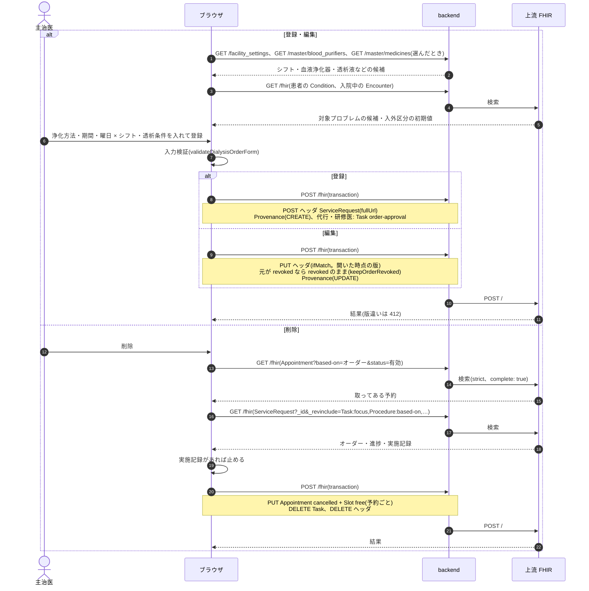

### シーケンス図: 透析一覧と進捗の変更

`useDialysisWorklist`(`fetchWorklistBundles` で 500 件ずつ)、`useUpdateDialysisTaskStatus`。一覧か予約が上限で欠けたら `truncated` を出します。ホームのカードも同じ読み込みです。

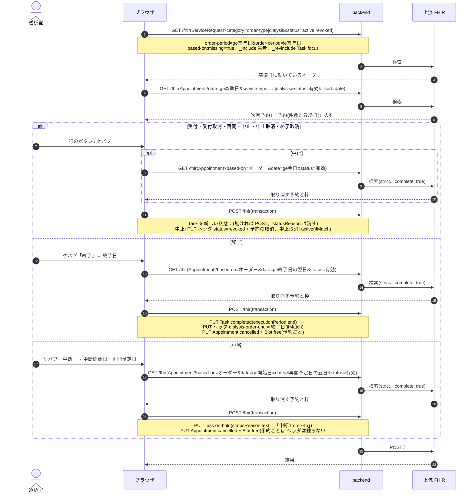

### シーケンス図: 予約の展開・臨時・空き枠・変更・入れ替え・取消

`planDialysisExpansion` / `buildDialysisAppointmentBatchBundle`(`useBookDialysisAppointments`)、`buildDialysisAppointmentBundle`、`buildDialysisRescheduleBundle`(`useRescheduleDialysisAppointment`)、`buildDialysisSwapBundle`(`useSwapDialysisAppointments`)、取消は `useCancelAppointment`。オーダーの登録とは独立した単独の transaction です。

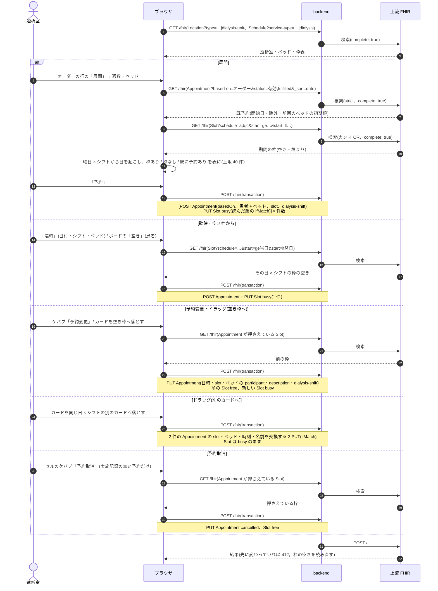

### シーケンス図: 各回の実施

`buildDialysisArrivalBundle` / `buildDialysisStartBundle` / `buildDialysisFinishBundle`(`useDialysisPerform`)、`buildDialysisPerformDeleteBundle`(`useCancelDialysisPerform`)。ボードは予約(`useDialysisBoard`)・枠(`useDialysisSlots`)・回(`useDialysisSessions`)を別々に読んで束ねます。

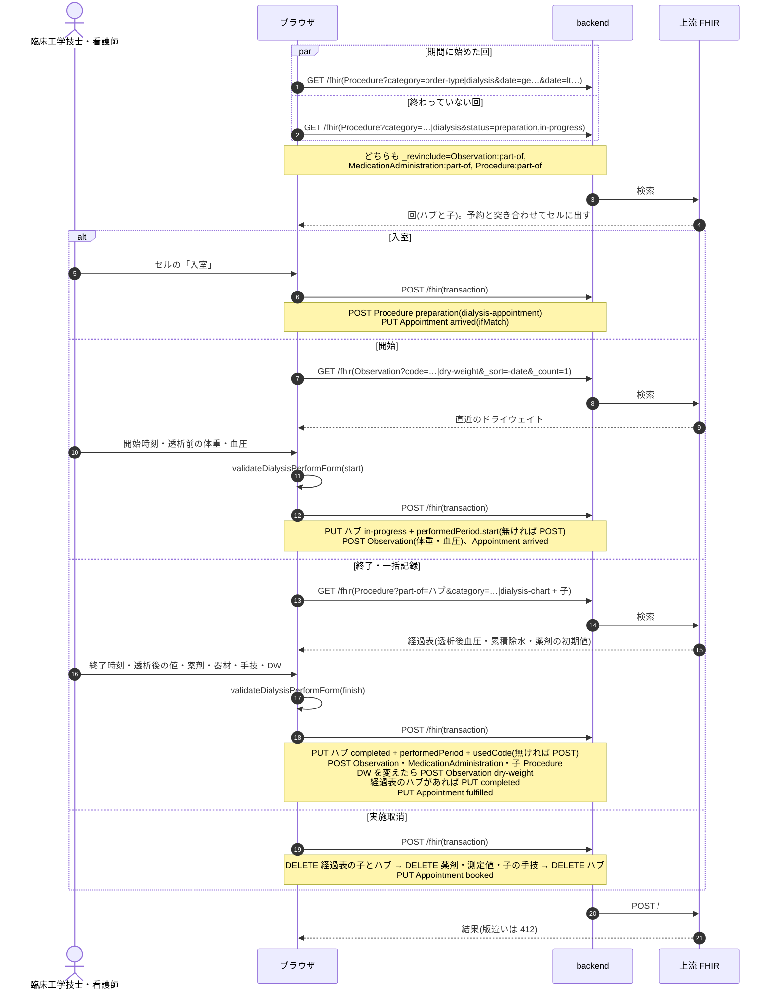

### シーケンス図: 経過表・患者メモ・患者一覧・統計

経過表の書き込みは `useDialysisChartWrite`(1 点ずつ)、患者メモは `QuestionnaireResponseCreatePanel` / 編集パネル(`tag` を渡す)、患者一覧は `useDialysisPatientData`、統計は `useDialysisMonth`。

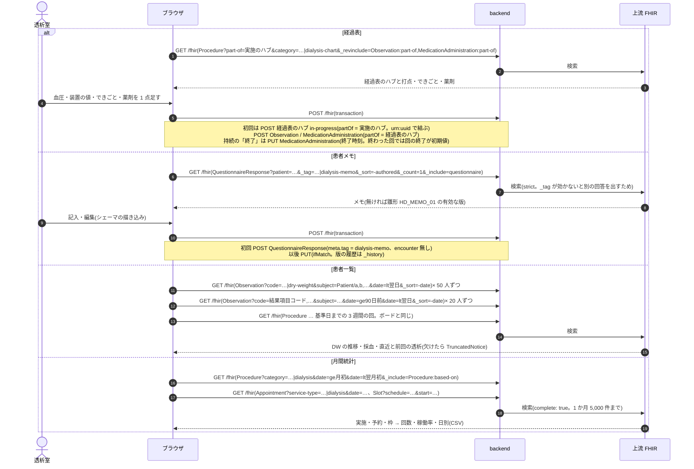

### シーケンス図: 退院での打ち切り

`usePatientDialysisOrders`(患者の有効なオーダーを全件読む)、`dialysisOrderNeedsStop`、`buildDialysisOrderStopEntries`(`api/queries/encounter.ts` の退院の transaction に積む)。

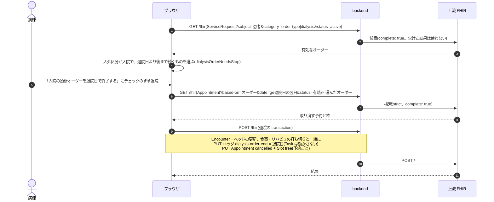

### 医事会計と SS-MIX2

透析は実施記録から集めます(`BillingClaimBuilder` の `:procedure` 経路、`Resolvers::Dialysis`)。完了したハブ 1 件 = 1 剤で、日レセの診療種別区分は 400 です。
期間継続型(`continuous`)なので、実施記録の無い日のヘッダは報告しません。

- 手技: 維持透析(hd / hdf / i-hdf)は `performedPeriod` の分数で 4 時間未満 / 4〜5 時間 / 5 時間以上に分け、施設設定 `receipt_codes.dialysis` の浄化方法 × 時間区分のコードを引きます。急性血液浄化(chdf / chd / pe / dfpp / dhp)は浄化方法ごとに 1 つのコードです。追加の手技(子の Procedure)はそのコードのまま並べます(resolver を持つ種別では `PerformedItemBuilder` が子の手技を拾わないので、`Resolvers::Dialysis` が自分で並べます)。
- 薬剤: `dialysis-bundled-medication` の付いた薬剤は送りません。それ以外は処置と同じく医薬品コードと使用量で送ります。経過表の薬剤は送りません(終了の入力で実施記録の行にしたものだけ)。
- 器材: 血液浄化器は施設マスタ(`master_blood_purifiers`)の製品に紐付けた特定器材コード(`receipt_material_code`)に読み替えます(放射線の器材マスタと同じ解決。`PerformedItemBuilder::LOCAL_MATERIALS`)。紐付けの無い製品・手入力の製品は「送れない項目」に出します。
- 開始・終了の時刻が無い維持透析、施設設定にコードが無い浄化方法 × 時間区分、診療行為コードの無い追加の手技は「送れない項目」に理由つきで出します。
- 送らないもの: 慢性維持透析患者外来医学管理料・導入期加算・障害者等加算・時間外加算(患者属性や月次の判定が要るため医事側で付けます)。

| 起きたこと | 医事会計(`BillingClaimBuilder`) | SS-MIX2 |
|---|---|---|
| 登録・編集・削除 | なし | なし(`OMG^O19` の対象外) |
| 受付・終了・中断・中止・退院での打ち切り | なし | なし |
| 予約の展開・臨時・変更・入れ替え・取消 | なし | なし |
| 入室・開始 | なし(完了していないハブは集めない) | なし |
| 終了・一括記録 | 開始日に送る。時刻・コードが無いときは「送れない項目」に出す | なし |
| 実施取消 | 対象から外れる(DELETE) | なし |
| 経過表・患者メモ・ドライウェイト | なし | なし |
