# 透析オーダーの業務フロー

透析(血液浄化)オーダーを、登録から透析室の受付、予約、各回の入室から回の終了まで、オーダーの終了・中断・退院での打ち切り、医事会計まで追う流れです。
透析はリハビリと同じ**期間継続型**のオーダーで、1 つのオーダーが週 3 回を何か月も続けます。オーダーには「浄化方法と透析条件、曜日 × シフト、期間」を書きます。どのベッドで行うかは透析室が取る予約で決まり、実際の体重・除水・薬剤は各回の実施記録に残します。
このページでは、1 回ぶんの透析を「回」、曜日 × シフトから数週間ぶんの予約をまとめて取ることを画面の表記どおり「展開」と呼びます。

医療機関の運用を検討する人は「運用フロー」、院内の開発者は「開発者向け」を読みます。
設計は [dialysis-order-design.md](../dialysis-order-design.md)(透析経過表は [dialysis-chart-design.md](../dialysis-chart-design.md))、透析室とベッドの登録は [features/ward.md](../features/ward.md)、シフトと会計コードの設定は [features/facility.md](../features/facility.md)、
種別共通の約束(中止・削除・代行入力・オーダーセット)は [features/orders-common.md](../features/orders-common.md)、リソースの要素は実装ガイド(`../fhir-ig`)が正典です。

## 運用フロー

### 全体の流れ

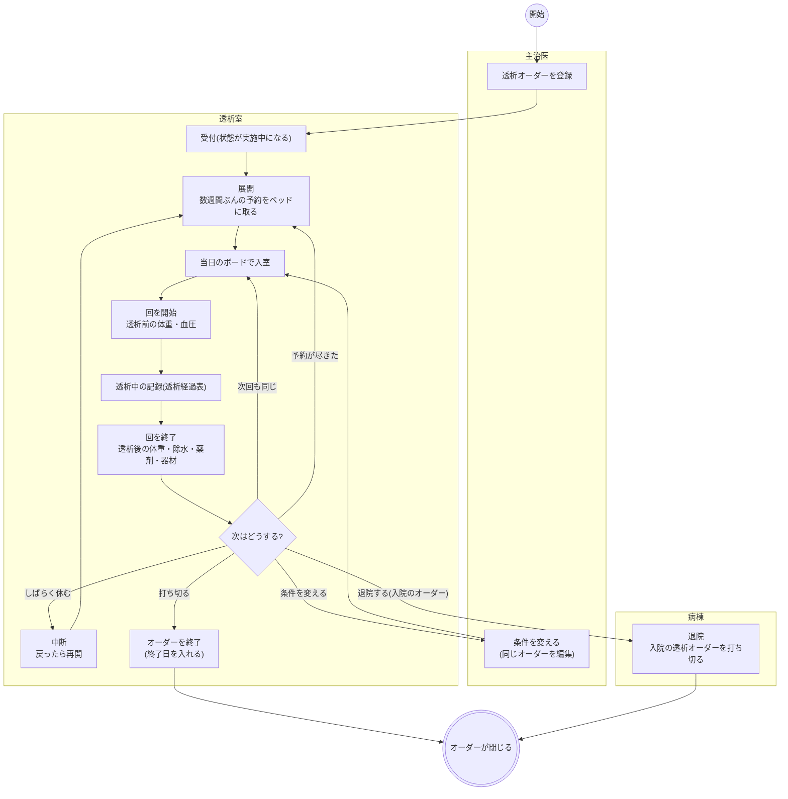

**使う画面**

| だれが | 画面 | すること |
|---|---|---|
| 主治医 | カルテの右ペイン(右側のオーダー入力)の「透析」 | オーダーの登録・編集 |
| 透析室 | 「部門業務 > 透析部門 > 透析一覧」 | 受付、予約、各回の実施、オーダーの終了・中断・中止 |
| 透析室 | 「部門業務 > 透析部門 > 透析室の設定」 | 透析室・ベッド・枠の準備 |
| 病棟 | 退院の画面 | 入院の透析オーダーの打ち切り |

- 透析一覧には「ボード」「週」「オーダー」「患者」「統計」の 5 つのビューがあります。一覧の上の「基準日」で、見る日を選びます。
- 透析オーダーは、オーダーセットにも入れられ、クリニカルパスのタスク分類「透析」の既定のオーダー種別でもあります。パスからできるのは登録までで、実施は透析一覧で行います。
- ホームでは臨床工学技士に、今日有効なオーダーの件数と、本日の予約の件数のカードが出ます。

**条件を変えるとき**

- 新しいオーダーを出さず、同じオーダーを編集します。取ってある予約はそのまま使えます。
- 各回の実施記録に実際の QB(血流量)・QD(透析液流量)・血液浄化器・薬剤が残るので、いつどの条件で行ったかは実施記録で分かります。

**カルテと患者帯の表示**

- オーダーのカードは、カルテの開始日の日に 1 枚載ります。浄化方法・曜日 × シフト・透析条件と、直近 3 回の実施(「11/11 前 62.4 → 後 60.2kg / 除水 2.2L / 4時間05分」)が出ます。
- 実施が出るのは、オーダーの状態が実施中・中断・終了のときです。全部の実施とドライウェイトは、カードの詳細で見ます。
- 患者帯の透析のピクトグラムは、今日が期間内の有効なオーダーがあるときに出ます。吹き出しに浄化方法・曜日 × シフト・アクセスと、直近のドライウェイトと設定日が出ます。

### オーダーの状態

| 状態 | 意味 | 変わるきっかけ | 一覧からできること |
|---|---|---|---|
| 依頼済 | 透析室がまだ受けていない | 医師の登録、「受付取消」、「中止取消」 | 「受付」「中止」 |
| 実施中 | 受けた。期間中ずっとこの状態で、回の実施が積み上がる | 「受付」、「終了取消」、「再開」 | 予約と各回の実施。「終了」「中断」「受付取消」「中止」 |
| 中断 | 入院などでしばらく透析室に来ない | 「中断」(中断開始日・再開予定日) | 「再開」「中止」 |
| 終了 | 期間を打ち切った | 「終了」(終了日) | 「終了取消」 |
| 中止 | 透析を取りやめた | 「中止」 | 「中止取消」 |

- 状態を変えるのは透析室だけで、透析一覧の「オーダー」のビューで行います。予約を展開しても、各回を実施しても状態は変わりません。
- 行に直接出るボタンは「受付」「再開」「展開」「臨時」「表示」です。「終了」「中断」「中止」と各取消は、押し間違えると期間や予約が動くので、行の「︙」のメニュー(以下、行のメニュー)に入っています。
- 予約を取れるのも、各回を実施できるのも実施中のオーダーだけです。中断中のオーダーは、空き枠からの予約の候補にも出ません。
- ベッドサイドのオーダー(病棟のベッドで行う透析)は予約を取らず、実施だけを記録します。
- 中断しても、オーダーの期間は変わりません。中断の間の予約だけが取り消されます。

### 準備(透析室を始める前に 1 度だけ)

設定を担当する人が、透析室を使い始める前に行います。

| 準備 | 画面 | 内容 |
|---|---|---|
| シフト | 施設設定「透析室のシフト」 | 1 日の区切りを、コード・名前・開始・終了で登録する |
| 透析室とベッド | 「透析室の設定」 | 透析室を作り、台数を入れてベッドを足す |
| 枠 | 「透析室の設定」の「枠の生成」 | 開始日と月数(上限 6)を入れて、予約の入れ物を作る |
| 血液浄化器 | 「マスタ > 透析 > 血液浄化器」 | 施設で使う製品と、算定に使う特定器材コードを登録する |
| 会計コード | 施設設定「医事会計のレセプト電算コード」の透析 | 浄化方法ごとの診療行為コードを登録する |
| 採血の項目 | 施設設定「透析患者一覧の採血項目」 | 患者一覧に並べる検査の結果項目のコードと、列の見出しを登録する |
| 患者メモの雛形 | 「テンプレート一覧」 | 「透析の患者メモ」を取り込む |

- **シフト**: 既定は午前 9:00〜13:30・午後 14:00〜18:30 です。時間帯は重ねられません。シフトは、オーダーの曜日 × シフト、ベッドの枠、ボードの列になります。
- **ベッド**: 番号の続きで名前が付きます。使わなくなったベッドは無効にします。無効のベッドには枠が作られず、ボードにも出ません。
- **枠**: 有効なベッドに、日 × シフトで 1 枠ずつできます。祝日・休診日にもできるので、行わない日は予約を入れずにおきます。
- **枠の作り直し**: 既に枠のある日 × シフトは飛ばします。シフトを足したあとに生成し直すと、足したシフトの枠だけが増えます。
- **血液浄化器**: ダイアライザ・ヘモダイアフィルタ・血液濾過器・血漿分離器・吸着器などを登録します。
- **会計コード**: 維持透析(HD・HDF・I-HDF)は時間区分(4 時間未満・4〜5 時間・5 時間以上)ごと、急性血液浄化(CHDF・CHD・PE・DFPP・DHP)は浄化方法ごとに登録します。
- **採血の項目**: 既定は Hb・Alb・K・P・Ca です。
- **患者メモの雛形**: 項目やシャントの台紙を施設に合わせて直すときは、同じテンプレートを直して版を上げます。

### 登録の判定

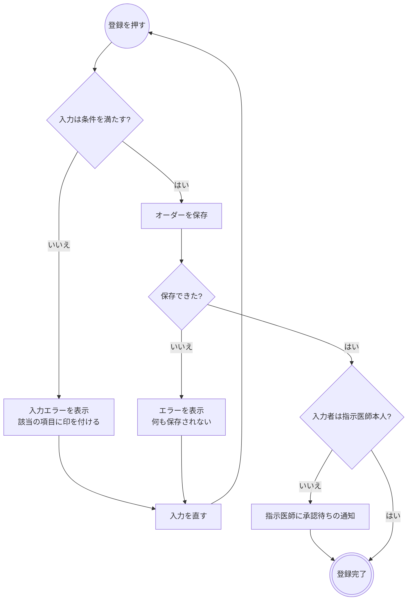

**入力の条件**

| 項目 | 条件 |
|---|---|
| 浄化方法 | 選ぶ |
| 開始日 | 入れる。オーダーセット・パスの内容として作るときは不要 |
| 終了日 | 空か、開始日以降 |
| 曜日 × シフト | 1 つ以上選ぶ。「ベッドサイド」を付けたときは不要 |
| 透析時間 | 入れる。「ベッドサイド」を付けたときは不要 |
| 透析時間の値 | 入れたときは 30〜1440 分の整数 |
| QB・QD・液量・抗凝固薬の量 | 入れたときは正の数 |
| 抗凝固薬 | 量を入れたときは、薬も選ぶ |

**入力する項目**

- 日程: 入外区分、開始日、終了日、曜日 × シフト、透析時間
- 透析条件: 浄化方法、QB(血流量)、QD(透析液流量)、血液浄化器
- 薬剤と液: 抗凝固薬と量、透析液、補充液、置換液
- アクセス: バスキュラーアクセス、穿刺針
- そのほか: 対象プロブレム、透析部門への指示、「ベッドサイド」

**浄化方法で変わる入力欄**

| 浄化方法 | 透析液 | 補充液 | 置換液 |
|---|---|---|---|
| 血液透析(HD) | ある | 無い | 無い |
| 血液透析濾過(HDF)・間歇補充型血液透析濾過(I-HDF) | ある | ある | 無い |
| 持続的血液濾過透析(CHDF) | ある | ある | 無い |
| 持続的血液透析(CHD) | ある | 無い | 無い |
| 血漿交換(PE)・二重膜濾過血漿交換(DFPP) | 無い | 無い | ある |
| 血液吸着(DHP) | 無い | 無い | 無い |

- 血液浄化器の種類と行数も浄化方法で決まります。HD はダイアライザ 1 行、DFPP は血漿分離器と血漿成分分画器の 2 行、などです。
- 「ベッドサイド」は、病棟のベッドで行う急性血液浄化に付けます。透析室の予約を作りません。
- 入外区分の初期値は、入院中なら「入院」です。入院のオーダーは、透析一覧の「病棟」列に登録したときの病棟が出ます。
- 登録時の警告(禁忌・重複など)はありません。
- 承認待ちでも、オーダーは透析室に届きます。

### 予約(展開・臨時・空き枠・変更・ドラッグ・取消)

予約は、透析一覧の「ボード」(基準日のベッド × シフトの表)と「週」のビューに並びます。このページでは、予約の入れ物(ベッド × 日 × シフト)を「枠」、枠に入った予約の表示を「カード」と呼びます。カードの「︙」のメニューを、カードのメニューと呼びます。

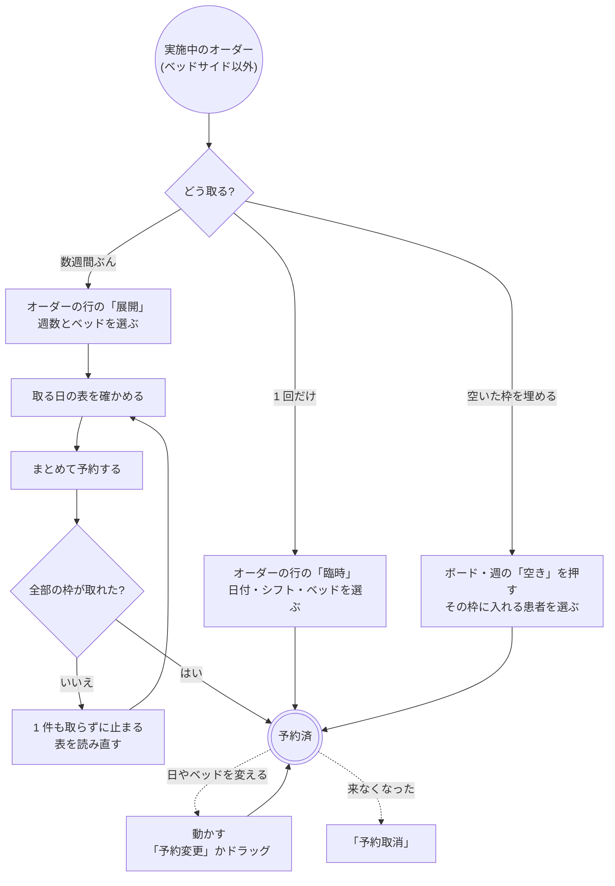

**展開**

- 週数(1〜12)とベッドを選ぶと、オーダーの曜日 × シフトから取る日の表ができます。表には、日ごとに「枠あり」「枠なし」「既に予約あり」が出ます。既に予約のある日は取りません。
- 開始日は、まだ予約が無ければオーダーの開始日(過去なら今日)、予約があれば最後の予約の翌日です。
- ベッドの初期値は、同じ曜日 × シフトの直近の予約のベッドです。曜日 × シフトごとに変えられます。
- 1 回に取れるのは 40 件までです。超えるときは一部だけを取ることはせず、取る前に止まるので、週数を減らします。
- 先に別の患者が取った枠が 1 つでもあると、1 件も予約されません。「別の患者が取った枠があります」と出て、表が読み直されます。

**臨時・予約変更**

- 日付とシフトを選ぶと、その日 × シフトのベッドが「空き」「埋まり」「枠なし」で並びます。
- 「予約変更」はカードのメニューから開きます。別の日・シフト・ベッドへ移せ、今の枠は「現在」と出ます。

**空き枠から**

- 「ボード」「週」のビューの「空き」を押すと、その枠に入れる患者を選べます。
- 候補に出るのは、その日が期間内で、状態が実施中で、その日 × シフトにまだ予約の無いオーダーです。

**ドラッグ**

| カードを落とす先 | 起きること |
|---|---|
| 空いている枠 | 予約変更。日・シフトをまたいでもよい |
| 同じ日 × シフトの、動かせる別のカード | ベッドの入れ替え |
| 入室以降のカード、予約が 2 件以上入っている枠 | 落とせない |

- 動かせるのは、予約済でまだ入室していないカードだけです。
- 別の端末で先に枠や予約が変わっていたときは、動かさずに止まり、ボードが読み直されます。

**予約取消**

- カードのメニューの「予約取消」と、カルテの予約タブから行います。
- 実施記録のある予約は取り消せません。先に「実施取消」をします。

**そのほか**

- 予約はカルテの予約タブにも「透析」として並び、そこからも日時変更・取消ができます。枠は透析室の枠表から選びます。
- 透析の予約は外来一覧には出ません。
- 枠を生成していない日や、無効にしたベッドは「枠なし」になり、予約を取れません。先に「透析室の設定」で枠を生成します。

### 各回の実施

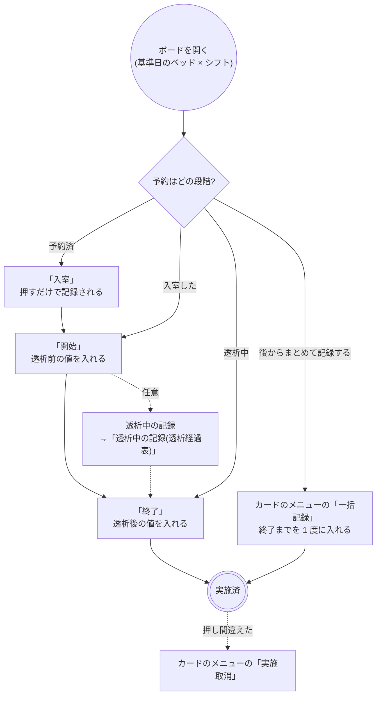

**段ごとに入れるもの**

| 段 | 入れるもの | 予約の表示 |
|---|---|---|
| 「入室」 | なし(押すだけ) | 来院 |
| 「開始」 | 開始時刻、透析前の体重と血圧 | 来院 |
| 「終了」 | 終了時刻、透析後の値、使ったもの、ドライウェイトの見直し、コメント | 実施済 |
| 「一括記録」 | 「開始」と「終了」の内容を 1 度に | 実施済 |
| 「実施取消」 | なし。回の記録を消す | 予約済に戻る |

- 「開始」の入力では、ドライウェイトと目標除水が見られます。
- 「終了」で入れる透析後の値は、体重、血圧、除水量、QB、QD です。
- 「終了」で入れる使ったものは、血液浄化器、薬剤(ロット・算定)、器材、追加の手技です。

**入力の条件**

| 項目 | 条件 |
|---|---|
| 開始時刻 | 「開始」で必須 |
| 終了時刻 | 「終了」で必須。開始時刻より後 |
| 体重 | 入れたときは 1〜300 kg |
| 血圧 | 入れたときは収縮期と拡張期の両方 |
| 除水量 | 入れたときは 0〜20 L |
| QB・QD | 入れたときは正の数 |

- 表に無い項目は、空でも記録できます。

**初期値**

- 開始時刻と終了時刻の初期値は、その日の枠を今記録するときは今の時刻、別の日の枠を後から記録するときは枠の開始時刻です。
- 終了時刻の初期値は、「開始時刻 + オーダーの透析時間」と今の時刻の早いほうです。
- 除水量の初期値は、透析前後の体重の差です。手で直せます。実透析時間は開始時刻と終了時刻から自動で出ます。
- 血液浄化器・QB・QD・抗凝固薬の初期値は、オーダーの値です。
- 急性血液浄化(CHDF など)では、オーダーの透析液・補充液・置換液も薬剤の行に入ります。
- 透析前の体重と血圧は「開始」で入れます。「開始」で入れていれば「終了」では変わらず、入れていなければ「終了」で入れます。

**薬剤の算定**

- 薬剤の「算定」を外した行は、記録には残りますが、医事会計には送りません。
- 維持透析の抗凝固薬は、初期値で「算定」が外れています。人工腎臓の所定点数に含まれるためです。
- ESA など、所定点数に含まれる薬を足したときは、手で「算定」を外します。

**ドライウェイト**

- ドライウェイトは患者ごとの値です。「終了」の入力で値を変えたときだけ、新しい値が記録されます。

**ベッドサイドのオーダー**

- ボードの表の下の「ベッドサイド」の表から、「開始」「一括記録」で実施します。
- CHDF のように日をまたぐ回は、終わるまで、基準日を変えても表に出続けます。

**ほかの画面への表示**

- 透析前後の血圧はバイタルとして記録されるので、温度板(病棟の経過表)の血圧の行にも出ます。
- 体重は、透析前後の 2 つの値が並ぶことになるので、温度板には出ません。
- 各回は、カルテの透析カードの詳細の実施履歴にも並びます。そこから透析経過表を開けます。

### 透析中の記録(透析経過表)

透析経過表は、1 回の透析の間のバイタル・装置の値・できごと・薬剤を、時刻つきで残す画面です。画面のボタンやメニューには「経過表」と出ます。病棟の経過表(このページでは温度板と呼びます)とは別の画面です。

**開き方**

- 開始後の回で、ボードのカードのメニューの「経過表」から開きます。「ベッドサイド」の表では操作の列にあります。
- カルテの透析カードの詳細の、実施履歴の行からも開けます。
- 透析経過表のある回には、折れ線の印(「経過表あり」)が付きます。印は、ボード・週・「ベッドサイド」の表と、カルテの透析カードの実施の行、詳細の実施履歴に出ます。

**記録するもの**

| 種類 | 中身 |
|---|---|
| バイタル | 血圧・脈拍・SpO2・体温 |
| 装置の値 | QB・QD・除水速度・累積除水・静脈圧・動脈圧・TMP |
| できごと | 時刻と種別 |
| 薬剤 | 医薬品マスタから選び、単回(量)か持続(速度)と、経路・時刻 |

- バイタルと装置の値は、30 分毎など、測るたびに時刻つきで足していきます。装置の値は前回の値が初期値なので、変わったところだけ直します。
- できごとの種別は、穿刺・除水停止・除水再開・血圧低下・補液・回路交換・返血・止血確認・その他です。
- 薬剤は、補液・昇圧薬などを「薬剤」に足します。持続の薬剤は「終了」で閉じます。
- 記録は 1 点ずつ保存されます。「確定」の操作はありません。回を終了したあとも、書き忘れた血圧を足せます。

**グラフ**

- 血圧(∨ ∧)と脈拍(●)が出て、回の開始と終了が縦線で出ます。
- 累積除水は右軸(■)に出ます。目標除水(透析前体重 − ドライウェイト)が破線で出ます。

**回の終了とのつながり**

| 透析経過表の値 | 「終了」の入力での初期値 |
|---|---|
| 最後の血圧 | 透析後血圧 |
| 累積除水 | 除水量 |
| 薬剤 | 薬剤の行 |

- 透析経過表の薬剤は、そのままでは医事会計に送りません。「終了」の入力で薬剤の行になったものについて、算定するかを決めます。
- 透析経過表の薬剤がオーダーの抗凝固薬と同じ薬なら、抗凝固薬の行に量が入ります。
- 「実施取消」をすると、その回の透析経過表も一緒に消えます。

**印刷と温度板**

- 「印刷」で別タブに A4 横の紙面を開き、ブラウザから印刷します。紙面には、見出し・グラフ・記録の表・できごと・薬剤が載ります。
- 透析経過表の記録は、温度板の期間表示には出ません。温度板で日付の見出しを押した 24 時間表示にだけ、透析中の血圧・脈拍・SpO2・体温が重なります。

### 患者メモ

消毒液・止血方法・導入年月日・シャントのシェーマなど、穿刺・止血のたびに見返すことは患者メモに書きます。
患者 1 人に 1 枚で、入院・外来をまたいで同じものを書き直していきます。

- ボードのカードのメニューの「患者メモ」と、「患者」のビューの「メモ」で開きます。
- 透析オーダーの詳細にも出ます。詳細は、カルテの透析カードと、透析一覧の「表示」から開きます。
- シャントのシェーマは、両上肢の台紙に描き込みます。
- 患者メモはカルテの時系列には出ません。患者のテンプレート回答の一覧には出ます。

### 透析患者一覧・月間統計

**「患者」のビュー**

基準日に透析室で透析を受けている患者を、1 人 1 行で見られます。

| 列 | 中身 |
|---|---|
| アクセス | バスキュラーアクセス |
| ドライウェイト | 推移 |
| 直近の透析 | 透析後体重とドライウェイトの差・除水量・時間 |
| 透析間の体重増加 | 前の回からの増加 |
| 直近の採血 | 準備で選んだ検査項目(既定は Hb・Alb・K・P・Ca) |
| 次回予約 | 次の予約の日 |

- ベッドサイド・中止・受付取消を除き、中断中の患者は載ります。
- 採血は、基準日から 90 日前までの結果を見ます。基準日より前の回に測った項目には、日付が添えられます。

**「統計」のビュー**

月を選んで、実施回数・実患者数・平均の透析時間・ベッドの稼働率を見られます。

- 表は、浄化方法別、シフト別、ベッド別、日別の 4 つです。シフト別とベッド別には、枠・予約・未来院・実施の数が出ます。
- 日別の表は CSV に出せます。
- 稼働率は「透析室で実施した回 ÷ 枠」です。ベッドサイドの回は別に数えます。
- 入室だけで開始していない回は数えません。

### 終了・中断・中止・退院

オーダーを閉じる・休む操作です。回の「終了」とは別で、透析一覧の「オーダー」のビューの行のメニューから行います。退院だけは退院の画面から行います。

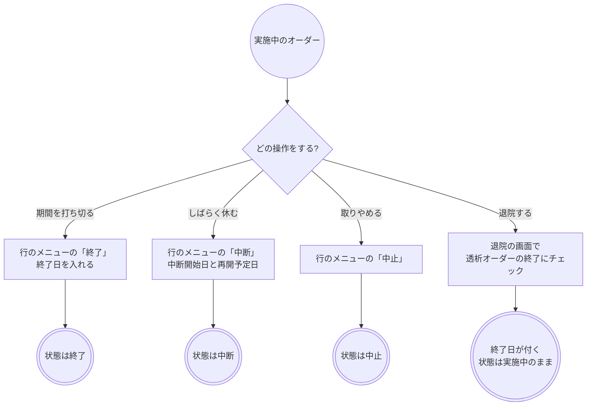

**操作ごとの結果**

| 操作 | 取り消される予約 | 一覧での見え方 |
|---|---|---|
| 「終了」 | 終了日の翌日以降 | 終了日を過ぎると出ない |
| 「中断」 | 中断の期間(両端を含む) | 「中断」と期間が出る |
| 「中止」 | 今日以降 | 中止の行として残る |
| 退院 | 退院日の翌日以降 | 状態は実施中のまま |

- どの操作でも、もう来ない日の予約が同じ操作で取り消され、枠が空きます。それより前の予約は、通院の記録として残ります。
- 「終了」の終了日は、開始日以降にします。
- 「中断」の再開予定日は任意です。入れなければ、中断開始日以降の予約がすべて取り消されます。中断開始日の初期値は、基準日と今日の遅いほうです。
- 「中止」は、依頼済と中断のオーダーにもできます。

**戻す操作**

| 戻す操作 | 戻した後の状態 | 戻らないもの |
|---|---|---|
| 「終了取消」 | 実施中 | 終了日、取り消された予約 |
| 「再開」 | 実施中 | 取り消された予約 |
| 「中止取消」 | 依頼済 | 取り消された予約 |

- 取り消された予約は、どの操作でも戻りません。取り消したあとに、枠が別の患者で埋まっていることがあるためです。続けるときは、展開・臨時・空き枠から取り直します。
- 「終了取消」をしても、終了日は消えません。打ち切った期間まで戻すと、その間の実施記録と食い違うためです。期間を延ばすときは、オーダーを編集して終了日を直します。
- 中止のオーダーは、基準日が期間内なら中止の行として並びます。そこから「中止取消」ができます。

**中断と再開**

- 中断中のオーダーも「患者」のビューに載り、カルテのカードには実施が出ます。
- 中断中のオーダーは、中止にはできますが、終了にはできません。終了するときは、先に再開します。
- 再開予定日より後の予約は残っています。再開したあとに展開すると、開始日はその続きになります。
- 再開が予定より早まって、中断の期間に予約の無い日ができたときは、臨時か空き枠から取ります。

**退院**

- 退院の画面に「入院の透析オーダーを退院日で終了する」のチェックが出ます。チェックは外せます。
- 対象は、入外区分が入院で、退院日より後まで続くオーダーです。終了日が無いか、終了日が退院日より後のものが当たります。
- 急性血液浄化が退院(転院・死亡を含む)で終わるときは、ここで閉じます。
- 外来の維持透析は退院後も続くので、対象になりません。
- 退院で打ち切ったオーダーは、退院日が終了日として付くだけで、状態は「終了」になりません。

**入院中に維持透析を続けるとき**

- 入院のオーダーを別に出し、外来のオーダーは中断しておきます。入院の登録では、外来のオーダーは自動で中断になりません。

### 変更・中止・削除

| 操作 | どこから | 条件と結果 |
|---|---|---|
| 変更 | カルテのカードの編集 | 状態・取ってある予約・実施記録は変わらない |
| 中止 | 透析一覧の行のメニューの「中止」 | カルテのカードからは中止できない |
| 削除 | カルテのカード | 実施記録が無いオーダーだけ。取ってある予約も取り消される |
| DO(前回と同じ内容で出し直す) | カルテのカード | 新しいオーダーとして登録される |

- **変更**: 中止のオーダーを編集しても、中止のまま保存されます。
- **削除**: 実施記録があるときは、先に各回の「実施取消」をしてから削除するか、中止にします。
- **DO**: 透析条件・曜日 × シフト・アクセスは元のオーダーのまま引き継ぎます。開始日は今日、終了日は空になります。入外区分は今の状態(入院中なら入院)になります。
- **入院から外来への切り替え**: 入外区分は登録したときの値のままで、後から変える手段はありません。外来で続けるときは、新しいオーダーを出します。

### ほかの画面とのつながり

| 画面 | 透析との関係 |
|---|---|
| ホーム | 臨床工学技士のカードに、今日有効なオーダーの件数・本日の予約の件数・状態の内訳が出る |
| カルテの予約タブ | 透析の予約が「透析」のバッジで並び、日時変更・取消ができる |
| 患者帯 | 今日が期間内の透析オーダーがあると、透析のピクトグラムが出る |
| 温度板(病棟の経過表) | 透析前後の血圧が載る。透析中の記録は 24 時間表示にだけ重なる |
| クリニカルパス | タスク分類「透析」から透析オーダーを登録できる。実施は透析一覧で行う |
| オーダーセット | 透析オーダーを入れられる。開始日・終了日・対象プロブレムはセットに入らない |
| 退院 | 入院の透析オーダーを退院日で打ち切る(「終了・中断・中止・退院」) |
| 枠表の一覧 | 透析室のベッドの枠表が種別「透析」で並ぶ |
| 医事送信 | 終了した回を、回を始めた日の「透析」として送る |

- 患者帯のピクトグラムの吹き出しには、浄化方法・曜日 × シフト・アクセス・ドライウェイトが出ます。
- 枠表の一覧では、枠カレンダーの停止・再開・個別追加が使えます。枠表の名前・有効の切り替えと枠の生成は「透析室の設定」で行います。

### 帳票

専用の帳票はありません。透析経過表の「印刷」で、A4 横の紙面をブラウザから印刷します。透析条件の指示書や透析記録の様式は、まだ出せません。

### リハビリとの違い

リハビリの流れは[リハビリオーダーの業務フロー](rehab.md)にあります。

| | リハビリ | 透析 |
|---|---|---|
| 入力する項目 | 区分・療法・単位数・週あたりの回数 | 浄化方法・透析条件・曜日 × シフト・期間など(「登録の判定」) |
| マスタ | 持たない | 血液浄化器(製品と算定用の特定器材コード)。透析液などは医薬品マスタ |
| 施設設定 | 会計コード | シフト、会計コード、患者一覧の採血項目 |
| 場所 | リハ室(枠表 1 つ) | 透析室とベッド(ベッド 1 台に枠表 1 つ) |
| 予約 | 部門が 1 件ずつ取る | **数週間ぶんをまとめて展開**する。臨時・空き枠・ドラッグでも取れる |
| 実施 | 1 回の入力で終わる | **入室 → 開始 → 終了**の 3 段。後から 1 度に記録もできる |
| 実施で記録するもの | 療法・単位数・訓練内容 | 透析前後の値と使ったもの(「各回の実施」)。透析中の値は透析経過表 |
| ベッドを取らない実施 | 無い | ベッドサイド(CHDF・血漿交換など)は予約なしで実施する |
| 一時的な休み | 無い(終了して出し直す) | **中断**(入院・旅行など)。期間は変えず、その間の予約だけ取り消す |
| 退院での打ち切り | 全件 | **入院のオーダーだけ**。外来の維持透析は入院・退院をまたいで続く |
| 医事会計 | 実施 1 回 = 1 剤、単位数 | 実施 1 回 = 1 剤。維持透析は実際の時間の区分でコードが分かれる |

- 透析の枠は、1 日 × シフトで 1 枠、1 つの枠に 1 患者です。

## 開発者向け

### シーケンス図の前提

**書き込みの経路**

- `/fhir` への書き込みはどれも 1 回の transaction Bundle で、backend の `FhirProxyController` が上流へ中継します。
- SS-MIX2 を有効にしている施設では、中継が書き込みの控えを記録します(`Ssmix2::Recorder`)。透析はメッセージになりません。
- 楽観ロックの版は `postBundle` が `ifMatch` に添え、版が違えば 412 で止まります。
- 編集フォームは `useEditSnapshot` で開いた時点の版に固定します(`hooks/useDialysisOrderInitialValues.ts`)。
- 予約の展開・変更・入れ替えは、検索で読んだ `Slot` / `Appointment` をそのまま PUT します。別の端末が先に動かしていれば 412 で transaction の全体が失敗し、一部だけが書かれることはありません。

**このページの呼び名**

| 呼び名 | 指すもの |
|---|---|
| 上流 | backend が中継する先の FHIR サーバー |
| ヘッダ | オーダーの `ServiceRequest`。透析は明細を持たない |
| 進捗 | オーダーの状態を持つ `Task`。運用フローの「オーダーの状態」 |
| ハブ | 1 回の実施(回)をまとめる `Procedure` |
| 子 | ハブを `partOf` で指す測定値・血圧・薬剤・追加の手技 |
| 経過表のハブ | 透析経過表をまとめる `Procedure`。実施のハブを `partOf` で指す |
| 厳密な検索 | `Prefer: handling=strict` を付けた検索。上流が知らない条件を読み飛ばさず、エラーにする(`SearchOptions.strict`) |
| 読み切る検索 | 上限に達したらエラーにして、欠けた結果を使わない検索(`complete: true`) |
| `status=有効` | 予約の検索で、取り消されていない状態を並べたもの(`ACTIVE_APPOINTMENT_STATUSES`) |

**図の書き方**

- 図では、上流から backend を通ってブラウザへ返る応答を、上流からブラウザへの 1 本の矢印で書きます。
- 検索の条件と transaction の中身は、図の下の表に書きます。

### リソースの構成

- オーダー(`ServiceRequest`。ヘッダだけで、明細は持たない)
  - 進捗(`Task`。`focus` = オーダー)
  - 予約(`Appointment`。`basedOn` = オーダー)
    - 枠(`Slot`)→ 枠表(`Schedule`)→ ベッド(`Location`)→ 透析室(`Location`)
  - 1 回の実施のハブ(`Procedure`。`basedOn` = オーダー)
    - 測定値・血圧(`Observation`。`partOf` = ハブ)
    - 薬剤(`MedicationAdministration`。`partOf` = ハブ)
    - 追加の手技(`Procedure`。`partOf` = ハブ)
    - 経過表のハブ(`Procedure`。`partOf` = 実施のハブ)
      - 打点・できごと(`Observation`。`partOf` = 経過表のハブ)
      - 透析中の薬剤(`MedicationAdministration`。`partOf` = 経過表のハブ)
- 患者に直に付くもの: ドライウェイト(`Observation`)、患者メモ(`QuestionnaireResponse`)

**オーダーと進捗**

| リソース | 要素 | 中身 |
|---|---|---|
| `ServiceRequest` | `category` | `order-type|dialysis` + 入外区分(v3 ActCode の `IMP` / `AMB`) |
| `ServiceRequest` | `code` | 浄化方法(`dialysis-modality`) |
| `ServiceRequest` | `occurrenceDateTime` | 開始日(日付のみ) |
| `ServiceRequest` | `reasonReference` | 対象プロブレム |
| `ServiceRequest` | 拡張 `dialysis-order-end` | 終了日。無ければ継続中 |
| `ServiceRequest` | 拡張 `dialysis-bedside` | ベッドサイド |
| `ServiceRequest` | 拡張 `dialysis-schedule-pattern` | 曜日 × シフト。シフトは `dialysis-shift` の coding |
| `ServiceRequest` | 拡張 `dialysis-prescription` | 透析条件 |
| `Task` | `code` | `task-code|dialysis` |
| `Task` | `focus` | オーダー |
| `Provenance` | `target` | オーダー。代行入力の記録で、種別共通 |

- `Task` は**登録時には作りません**。`Task` が無いオーダーは依頼済です。
- `Task` は透析室の受け入れの状態で、回の実施では動かしません。

**透析室・枠・予約**

| リソース | 要素 | 中身 |
|---|---|---|
| `Location`(透析室・ベッド) | `type` | `location-type|dialysis-unit` |
| `Location`(透析室) | `physicalType` | `ro` |
| `Location`(ベッド) | `physicalType` | `bd` |
| `Location`(ベッド) | `partOf` | 透析室 |
| `Location` | `status` | 無効は `inactive` |
| `Schedule`(枠表) | `serviceType` | `schedule-service-type|dialysis` |
| `Schedule`(枠表) | `actor` | ベッドの `Location` |
| `Schedule`(枠表) | `active` | 無効なベッドは false |
| `Slot`(枠) | – | 1 日 × シフト × ベッドで 1 枠(定員 1) |
| `Appointment`(予約) | `basedOn` | オーダー |
| `Appointment`(予約) | `participant` | 患者 + ベッドの `Location` |
| `Appointment`(予約) | `slot` | 枠 |
| `Appointment`(予約) | `serviceType` | dialysis |
| `Appointment`(予約) | 拡張 `dialysis-shift` | シフト |

- 透析のベッドは病床ではないので、入院の `Encounter.location` にはしません。
- 予約のシフトは枠の開始時刻から引きます。拡張 `dialysis-shift` は、枠が読めないときの代わりです。

**1 回の実施**

| リソース | 要素 | 中身 |
|---|---|---|
| `Procedure`(ハブ) | `basedOn` | オーダー |
| `Procedure`(ハブ) | `category` | `order-type|dialysis` |
| `Procedure`(ハブ) | `code` | 浄化方法 |
| `Procedure`(ハブ) | `status` | `preparation`(入室)/ `in-progress`(開始)/ `completed`(終了) |
| `Procedure`(ハブ) | `performedPeriod` | 開始〜終了 |
| `Procedure`(ハブ) | `usedCode` | 血液浄化器(`blood-purifier`)と器材(`medical-material`)+ `dialysis-material-quantity` |
| `Procedure`(ハブ) | 拡張 `dialysis-appointment` | 予約 |
| `Observation`(測定値) | `partOf` | ハブ |
| `Observation`(測定値) | `code` | `dialysis-measurement`(下の表) |
| `Observation`(測定値) | `category` | `order-type|dialysis` |
| `Observation`(血圧) | `partOf` | ハブ |
| `Observation`(血圧) | `code` | LOINC 85354-9 + component |
| `Observation`(血圧) | `category` | `vital-signs` + `order-type|dialysis` |
| `Observation`(血圧) | 拡張 `dialysis-measurement-timing` | `pre` / `post` |
| `MedicationAdministration`(薬剤) | `partOf` | ハブ |
| `MedicationAdministration`(薬剤) | `medication-lot-number` | ロット |
| `MedicationAdministration`(薬剤) | `dialysis-bundled-medication` | 算定しない薬剤は true |
| `Procedure`(追加の手技) | `partOf` | ハブ |
| `Procedure`(追加の手技) | `basedOn` | オーダー |
| `Procedure`(追加の手技) | `code` | `dialysis-procedure-code`(レセ電算の診療行為コード) |

| `dialysis-measurement` のコード | 単位 |
|---|---|
| `pre-weight` / `post-weight` | kg |
| `ultrafiltration` | L |
| `actual-minutes` | min |
| `qb` / `qd` | mL/min |
| `dry-weight` | kg |

**ドライウェイトと患者メモ**

| リソース | 要素 | 中身 |
|---|---|---|
| `Observation`(ドライウェイト) | `code` | `dialysis-measurement|dry-weight` |
| `Observation`(ドライウェイト) | `partOf` | 無し |
| `QuestionnaireResponse`(患者メモ) | `questionnaire` | テンプレート `Questionnaire/dialysis-memo-01` |
| `QuestionnaireResponse`(患者メモ) | `meta.tag` | `questionnaire-response-purpose|dialysis-memo` |
| `QuestionnaireResponse`(患者メモ) | `encounter` | 無し |

- ドライウェイトは患者単位の状態値で、直近 1 件を読みます。
- 患者メモは患者 1 人に 1 件です。`_tag` の厳密な検索で引き、カルテの時系列からは `_tag:not` で外します。

**透析経過表**([dialysis-chart-design.md](../dialysis-chart-design.md))

| リソース | 要素 | 中身 |
|---|---|---|
| `Procedure`(経過表のハブ) | `partOf` | 実施のハブ |
| `Procedure`(経過表のハブ) | `basedOn` | 無し |
| `Procedure`(経過表のハブ) | `category` | `order-type|dialysis-chart` |
| `Procedure`(経過表のハブ) | `status` | `in-progress` / `completed`(回の終了で閉じる) |
| `Observation`(打点) | `partOf` | 経過表のハブ |
| `Observation`(打点) | `category` | `order-type|dialysis-chart` |
| `Observation`(打点) | `code` | 血圧・脈拍・SpO2・体温は LOINC、装置の値は `dialysis-measurement` |
| `Observation`(できごと) | `code` | `dialysis-event` |
| `MedicationAdministration`(透析中の薬剤) | `partOf` | 経過表のハブ |
| `MedicationAdministration`(透析中の薬剤) | `category` | `order-type|dialysis-chart` |

- 透析中の薬剤は会計に乗りません。

**この形にした理由と読み方**

- **期間**: `occurrencePeriod` にせず開始日 + 拡張にするのは、上流が `occurrenceDateTime` を索引するためです。リハビリ・食事と同じ判断です。上流は `order-period` で開始日と `dialysis-order-end` を合わせて索引しています。
- **入室のハブ**: `performed[x]` を持たないので日付で引けません。ボードは「期間に始めた回」と「`status=preparation,in-progress` の回」を別々に引いて束ねます(`fetchDialysisSessions`)。
- **予約と回の突き合わせ**: ハブの `dialysis-appointment` を優先し、無ければ同じオーダー × 同じ日です(`dialysisSessionForAppointment`)。
- **実施取消**: 経過表 → 子 → ハブの順に DELETE し、予約を `booked` に戻します。entered-in-error では残しません。ドライウェイトは消しません。
- **経過表の読み方**: 経過表のハブは `basedOn` を持たないので、カルテの詳細(`based-on` + `_revinclude:iterate`)に打点が乗りません。読むときは `Procedure?part-of=実施のハブ` で引きます。
- **場所の type**: 透析室とベッドにローカルの `location-type|dialysis-unit` を与えるのは、病棟(`type=HU` 起点)・診察室(`LOCATION_TYPE_OPTIONS`)・病床の集計のどれにも混ざらないようにするためです。`LOCATION_TYPE_OPTIONS` には足しません。

### 進捗 Task と status

**回を実施しても Task を動かしません。** ほかの部門は「実施記録 + Task を completed に」としますが、透析はそうしません(リハビリも同じ)。そうすると、初日の実施でオーダーが終了扱いになるためです(`fhir/dialysisTaskHelpers.ts`・`dialysisResultHelpers.ts` の冒頭コメント)。

| Task | 表示 | `ServiceRequest.status` | ヘッダに書くもの | 取り消す予約 |
|---|---|---|---|---|
| (無し)/ `requested` | 依頼済 | `active` | – | – |
| `accepted` | 実施中 | `active` | – | – |
| `on-hold` | 中断 | `active` のまま | – | 中断の期間の有効な予約 |
| `completed` | 終了 | `active` のまま | `dialysis-order-end`(終了日) | 終了日の翌日以降 |
| `cancelled` | 中止 | `revoked` | – | 今日以降 |

- **遷移**: 遷移の表は `dialysisTaskActions`、書き込みの入口は `useUpdateDialysisTaskStatus`(`api/queries/dialysis.ts`)です。中止・中止取消は `orderCancelEntries` でヘッダの status を揃えます。
- **終了日を書く理由**: 部門一覧・患者帯は `order-period` で引きます。終了日が無いと、status=active のまま基準日に当たり続けます(`buildDialysisOrderCloseEntry`)。
- **終了取消**: `Task` だけを `accepted` に戻し、`dialysis-order-end` は消しません。意図した非対称で、理由は運用フローの「終了・中断・中止・退院」の「戻す操作」にあります。
- **中断の期間**: `Task.statusReason.text` に「中断 2026-11-12〜2026-11-20」の書式で残します。`dialysisTaskHold` が読み戻して一覧の状態の下に出し、再開(`accepted`)で消します。
- **予約の取消**: 終了・中断・中止・退院は、もう来ない日の有効な予約の取消(`PUT Appointment cancelled` + `PUT Slot free`)を同じ transaction に積みます(`fetchOrderAppointmentCancelEntries` の `from` / `to`)。
- **取り消す対象の検索**: 厳密な検索で全ページを読みます。条件が効かずに全件を拾うと、関係ない予約まで取り消すためです。欠けたら書き込みを止めます。
- **`executionPeriod`**: 受付で `start`、終了で `end` が入ります(`createTaskHelpers` の `buildTaskUpdate`)。
- **カルテのタイムライン**: `accepted` / `on-hold` / `completed` で実施情報を出します(`karteTimeline.ts` の dialysis 分岐)。

### 部品

組み立ては `fhir/`、hook は `api/queries/dialysis.ts`、画面は `components/` と `pages/` にあります。

| 操作 | 画面 | 組み立て | hook |
|---|---|---|---|
| 登録 | `DialysisOrderForm.tsx`・`DialysisOrderPanels.tsx` | `buildDialysisOrderBundle` | `useCreatePrescription` |
| 編集 | 同じ 2 つ | `buildDialysisOrderUpdateBundle` | `useUpdateDialysisOrder` |
| 削除 | カルテのカード | `deleteDialysisOrderRequest` | `postOrderDeleteBundle` |
| 一覧の読み込み | `pages/DialysisWorklistPage.tsx` | `fetchWorklistBundles` | `useDialysisWorklist` |
| 状態の変更 | `pages/DialysisWorklistPage.tsx` | `dialysisTaskHelpers.ts` | `useUpdateDialysisTaskStatus` |
| 展開 | `DialysisExpandModal.tsx` | `planDialysisExpansion`・`buildDialysisAppointmentBatchBundle` | `useBookDialysisAppointments` |
| 臨時 | `DialysisBookModal.tsx` | `buildDialysisAppointmentBundle` | `useBookDialysisAppointments` |
| 空き枠から | `DialysisCellBookModal.tsx` | `buildDialysisAppointmentBundle` | `useBookDialysisAppointments` |
| 予約変更 | `DialysisBookModal.tsx`・`DialysisBoard.tsx` | `buildDialysisRescheduleBundle` | `useRescheduleDialysisAppointment` |
| 入れ替え | `DialysisBoard.tsx` | `buildDialysisSwapBundle` | `useSwapDialysisAppointments` |
| 予約取消 | `DialysisBoard.tsx` | – | `useCancelAppointment` |
| ボードの読み込み | `DialysisBoard.tsx` | `fetchDialysisSessions` | `useDialysisBoard`・`useDialysisSlots`・`useDialysisSessions` |
| 入室・開始・回の終了 | `DialysisPerformModal.tsx` | `buildDialysisArrivalBundle`・`buildDialysisStartBundle`・`buildDialysisFinishBundle` | `useDialysisPerform`・`useLatestDryWeight` |
| 実施取消 | `DialysisBoard.tsx` | `buildDialysisPerformDeleteBundle` | `useCancelDialysisPerform` |
| 透析経過表 | `pages/DialysisChartPage.tsx`・`DialysisChartPanel.tsx`・`DialysisChartModal.tsx` | `dialysisChartHelpers.ts` | `useDialysisChart`・`useDialysisChartWrite` |
| 透析経過表の印刷 | `pages/DialysisChartPrintPage.tsx` | `dialysisChartHelpers.ts` | `useDialysisChart` |
| 患者メモ | `DialysisMemo.tsx`(詳細の区画・ボードのモーダル) | `dialysisMemoHelpers.ts` | `useDialysisMemo` |
| 患者一覧 | `DialysisPatientTable.tsx` | `dialysisPatientListHelpers.ts` | `useDialysisPatientData` |
| 月間統計 | `DialysisMonthlyStats.tsx` | `dialysisStatsHelpers.ts` | `useDialysisMonth` |
| 退院での打ち切り | `DischargeModal.tsx` | `dialysisOrderNeedsStop`・`buildDialysisOrderStopEntries` | `usePatientDialysisOrders` |
| ホームのカード | `homeCards/HomeWorklistCard.tsx` の `DialysisCard` | – | `useDialysisWorklist` |

- 終了・中断のモーダルは `pages/DialysisWorklistPage.tsx` の中にあります。

名前と置き場所が合わないもの:

- `useCreatePrescription` は `api/queries/labResult.ts` にあり、全種別共通の登録の hook です。
- `postOrderDeleteBundle` は `api/queries/orderDelete.ts` にあります。
- `useCancelAppointment` は `api/queries/appointment.ts` にあります。
- 退院の transaction は `api/queries/encounter.ts` が組み、そこに `buildDialysisOrderStopEntries` を積みます。
- 患者メモの書き込みは、`QuestionnaireResponseCreatePanel` と編集パネルに `tag` を渡して行います。

そのほかの置き場所:

| もの | 場所 |
|---|---|
| オーダーの詳細 | `components/DialysisOrderDetailPanel.tsx` |
| カルテのカード | `components/karteCardBodies/DialysisOrderCardBody.tsx` |
| オーダー・終了日・退院の打ち切りの組み立て | `fhir/dialysisOrderHelpers.ts` |
| シフト | `fhir/dialysisShiftHelpers.ts` |
| 予約・展開の計画・変更・入れ替え | `fhir/dialysisAppointmentHelpers.ts` |
| 透析室・ベッド・枠 | `fhir/dialysisUnitHelpers.ts`、画面は `pages/DialysisUnitPage.tsx` |
| 実施 | `fhir/dialysisResultHelpers.ts` |
| 血液浄化器の行 | `fhir/bloodPurifierHelpers.ts` |
| 経過表の器 | `fhir/timeSeriesChartHelpers.ts`、`components/timeSeriesChart/` |
| 透析経過表の経路 | `/dialysis-sessions/:sessionId/chart`、印刷は `/dialysis-chart-print/:sessionId` |
| 患者メモの雛形 | `docs/report-mappings/dialysis-memo-01.questionnaire.json` |
| 血液浄化器のマスタ | `pages/BloodPurifierPage.tsx`(`/blood-purifiers`)、backend `master/blood_purifiers` |
| 施設設定 | `dialysis_shifts` / `dialysis_lab_items` / `receipt_codes.dialysis`(`backend/app/models/facility_settings.rb`) |

### シーケンス図: 登録

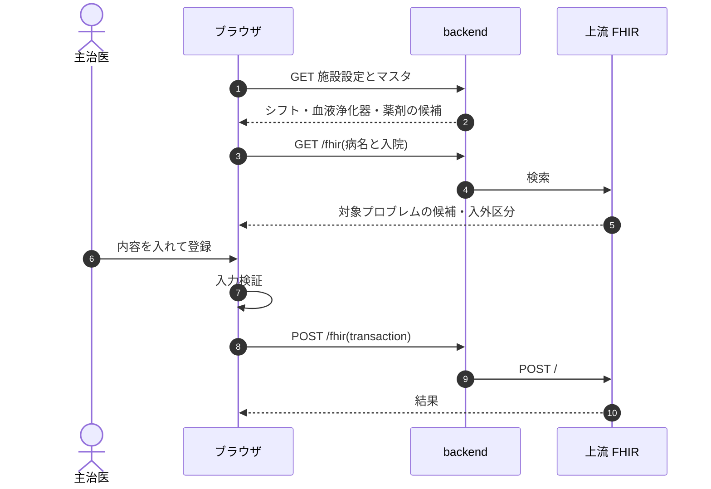

| 読むもの | 取得先 |
|---|---|
| シフト | `GET /facility_settings` |
| 血液浄化器 | `GET /master/blood_purifiers` |
| 透析液などの候補 | `GET /master/medicines`(選んだとき) |
| 対象プロブレムの候補 | `GET /fhir` で患者の `Condition` |
| 入外区分の初期値 | `GET /fhir` で入院中の `Encounter` |

| transaction に書くもの | 条件 |
|---|---|
| POST `ServiceRequest`(ヘッダ。fullUrl を付ける) | 常に |
| POST `Provenance`(CREATE) | 常に |
| POST `Task` `order-approval` | 代行入力・研修医のとき |

- 主治医が入れるのは、浄化方法・期間・曜日 × シフト・透析条件です。
- 入力検証は `validateDialysisOrderForm` です。

### シーケンス図: 編集

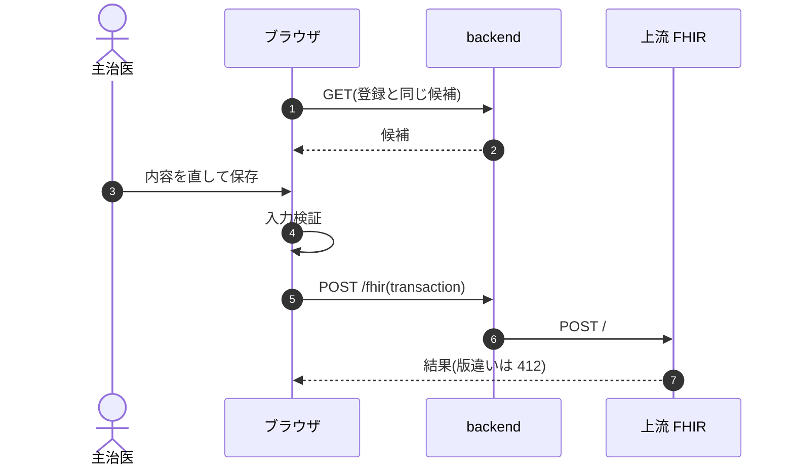

| transaction に書くもの | 条件 |
|---|---|
| PUT `ServiceRequest`(ヘッダ) | `ifMatch` は開いた時点の版 |
| ヘッダの `status` | 元が `revoked` なら `revoked` のまま(`keepOrderRevoked`) |
| POST `Provenance`(UPDATE) | 常に |

### シーケンス図: 削除

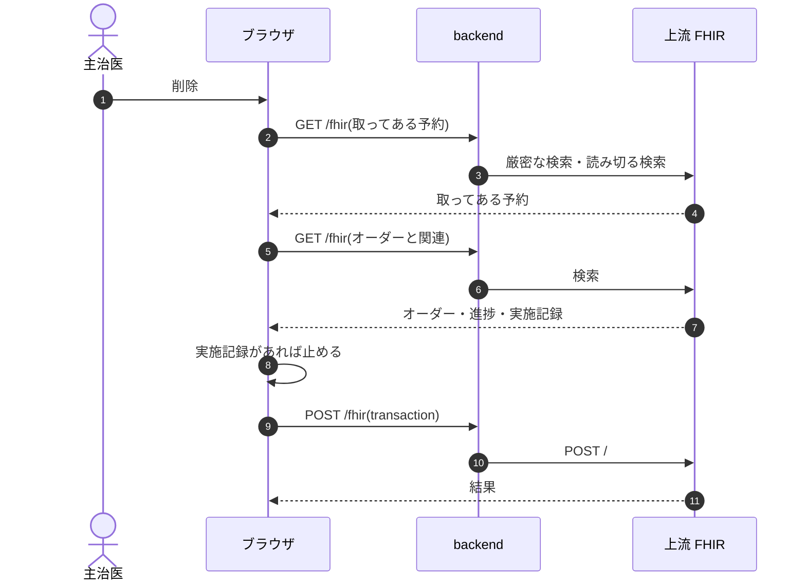

| 読むもの | 検索 |
|---|---|
| 取ってある予約 | `Appointment?based-on=オーダー&status=有効` |
| オーダー・進捗・実施記録 | `ServiceRequest?_id&_revinclude=Task:focus,Procedure:based-on,…` |

| transaction に書くもの | 条件 |
|---|---|
| PUT `Appointment` cancelled + `Slot` free | 取ってある予約ごと |
| DELETE `Task` | – |
| DELETE `ServiceRequest`(ヘッダ) | – |

### シーケンス図: 透析一覧の読み込み

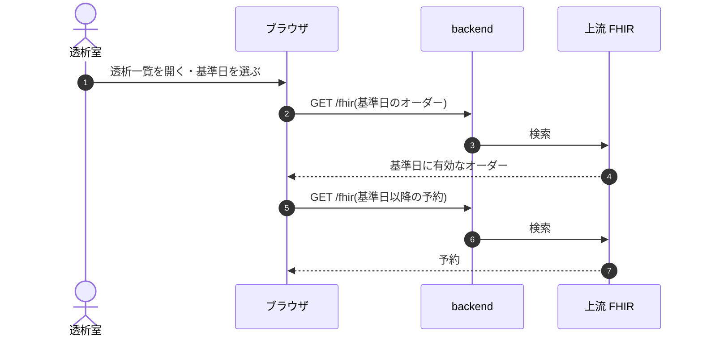

| 読むもの | 検索 |
|---|---|
| 基準日に有効なオーダー | `ServiceRequest?category=order-type|dialysis&status=active,revoked&order-period=ge基準日&order-period=le基準日&based-on:missing=true` |
| 患者と進捗 | 上の検索に `_include` 患者、`_revinclude` `Task:focus` |
| 予約 | `Appointment?date=ge基準日&service-type=…|dialysis&status=有効&_sort=date` |

- `fetchWorklistBundles` で 500 件ずつ読みます。一覧か予約が上限で欠けたら `truncated` を出します。
- 予約は、一覧の「次回予約」「予約(件数と最終日)」の列になります。
- ホームのカードも同じ読み込みで、当日で読みます。

### シーケンス図: 状態の変更

受付・受付取消・再開・中止取消・終了取消は、予約を読まずに transaction を送ります。終了・中断・中止は、先に取り消す予約を読みます。

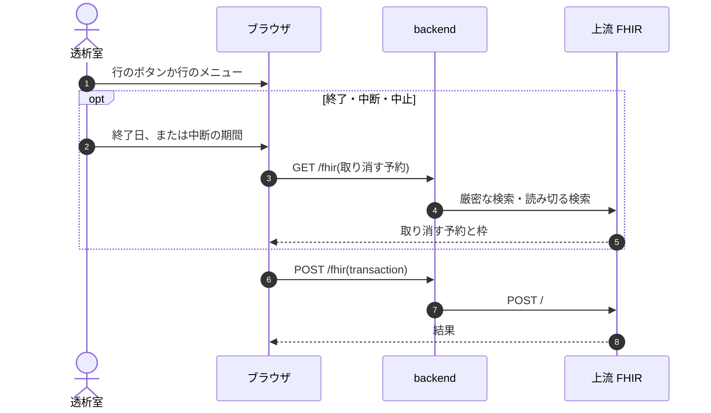

| 操作 | 取り消す予約の検索(`Appointment?based-on=オーダー&status=有効` に足す条件) |
|---|---|
| 終了 | `date=ge終了日の翌日` |
| 中断 | `date=ge開始日&date=lt再開予定日の翌日` |
| 中止 | `date=ge今日` |

| 操作 | transaction に書くもの |
|---|---|
| 受付・受付取消・再開・終了取消 | `Task` を新しい状態に(無ければ POST)。`statusReason` は消す |
| 中止 | `Task` を新しい状態に、PUT ヘッダ `status=revoked`、予約の取消 |
| 中止取消 | `Task` を新しい状態に、PUT ヘッダ `status=active`(`ifMatch`) |
| 終了 | PUT `Task` completed(`executionPeriod.end`)、PUT ヘッダ `dialysis-order-end` = 終了日(`ifMatch`)、予約の取消 |
| 中断 | PUT `Task` on-hold(`statusReason.text` = 「中断 from〜to」)、予約の取消。ヘッダは触らない |

- 予約の取消は、予約ごとに PUT `Appointment` cancelled + `Slot` free です。
- 中断では、中断開始日と再開予定日を入れます。

### シーケンス図: 予約の展開

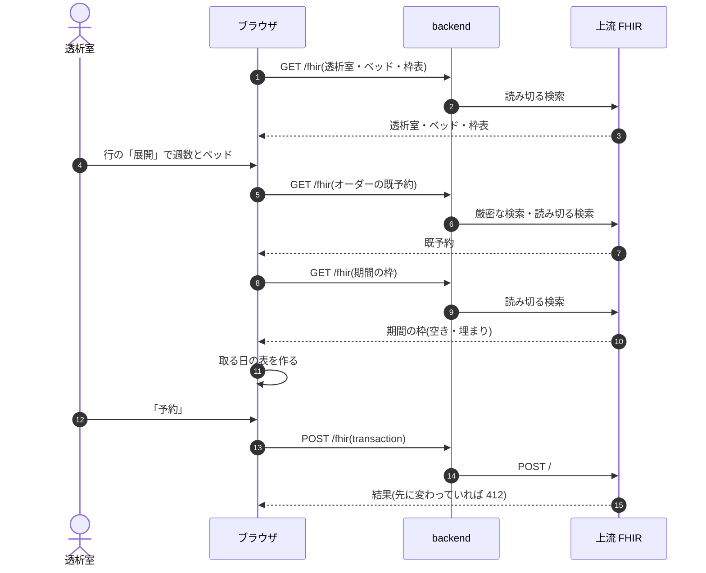

| 読むもの | 検索 |
|---|---|
| 透析室・ベッド | `Location?type=…|dialysis-unit` |
| 枠表 | `Schedule?service-type=…|dialysis` |
| オーダーの既予約 | `Appointment?based-on=オーダー&status=有効,fulfilled&_sort=date` |
| 期間の枠 | `Slot?schedule=a,b,c&start=ge…&start=lt…`(カンマ OR) |

| transaction に書くもの | 条件 |
|---|---|
| POST `Appointment`(`basedOn`、患者 + ベッド、`slot`、`dialysis-shift`) | 件数ぶん |
| PUT `Slot` busy | 件数ぶん。読んだ版の `ifMatch` |

- 既予約は、開始日・除外する日・前回のベッドの初期値に使います。
- 取る日の表は、曜日 × シフトから日を起こし、枠あり / 枠なし / 既に予約あり を出します(`planDialysisExpansion`)。上限は 40 件です。
- 412 のときは枠の空きを読み直します。
- 予約の transaction は、オーダーの登録とは独立した単独の transaction です。下の予約の図も同じです。

### シーケンス図: 臨時・空き枠からの予約

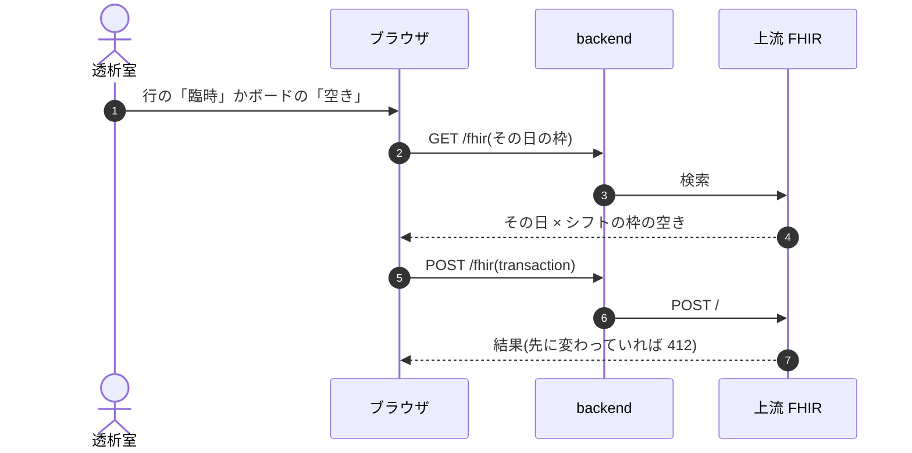

| 読むもの | 検索 |
|---|---|
| その日の枠 | `Slot?schedule=…&start=ge当日&start=lt翌日` |

| transaction に書くもの | 条件 |
|---|---|
| POST `Appointment` + PUT `Slot` busy | 1 件 |

- 「臨時」では日付・シフト・ベッドを、ボードの「空き」では患者を選びます。
- 透析室・ベッド・枠表は、展開の図と同じ検索で先に読んであります。

### シーケンス図: 予約変更・入れ替え・取消

どれも、カードの予約を 1 回の transaction で書き換えます。

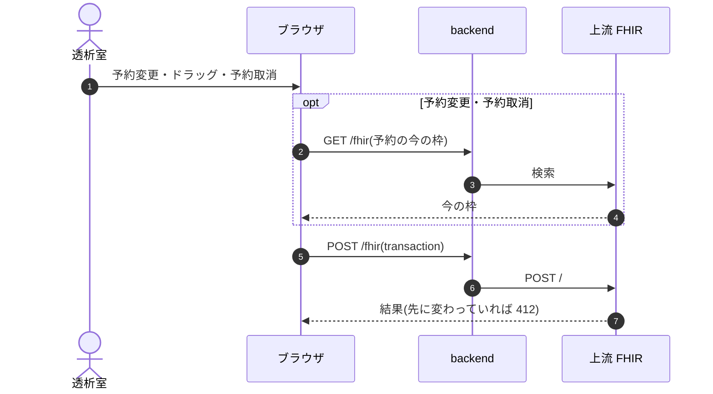

| 操作 | 画面の操作 | transaction に書くもの |
|---|---|---|
| 予約変更 | カードのメニューの「予約変更」、カードを空き枠へ落とす | PUT `Appointment`、前の `Slot` free、新しい `Slot` busy |
| 入れ替え | カードを同じ日 × シフトの別のカードへ落とす | 2 件の `Appointment` の PUT(`ifMatch`)。`Slot` は busy のまま |
| 予約取消 | カードのメニューの「予約取消」 | PUT `Appointment` cancelled、`Slot` free |

- 予約変更の PUT は、日時・`slot`・ベッドの `participant`・`description`・`dialysis-shift` を書き換えます。
- 入れ替えは、2 件の `Appointment` の `slot`・ベッド・時刻・名前を交換します。
- 予約取消ができるのは、実施記録の無い予約だけです。
- 今の枠は、`Appointment` が押さえている `Slot` を検索して読みます。
- 412 のときは枠の空きを読み直します。

### シーケンス図: ボードの読み込み

ボードは予約(`useDialysisBoard`)・枠(`useDialysisSlots`)・回(`useDialysisSessions`)を別々に読んで束ねます。図は回の読み込みです。

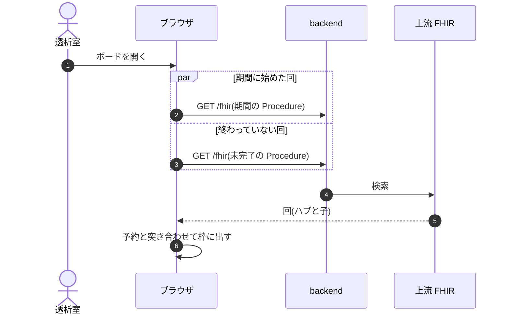

| 読むもの | 検索 |
|---|---|
| 期間に始めた回 | `Procedure?category=order-type|dialysis&date=ge…&date=lt…` |
| 終わっていない回 | `Procedure?category=…|dialysis&status=preparation,in-progress` |
| 子(どちらの検索にも付ける) | `_revinclude=Observation:part-of,MedicationAdministration:part-of,Procedure:part-of` |

### シーケンス図: 入室

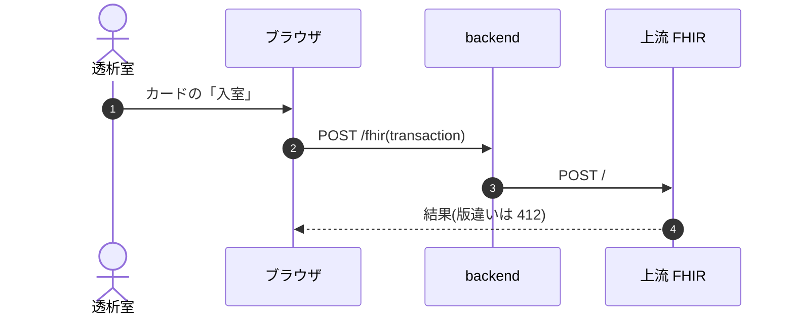

| transaction に書くもの | 条件 |
|---|---|
| POST `Procedure` preparation(`dialysis-appointment`) | – |
| PUT `Appointment` arrived | `ifMatch` |

### シーケンス図: 開始

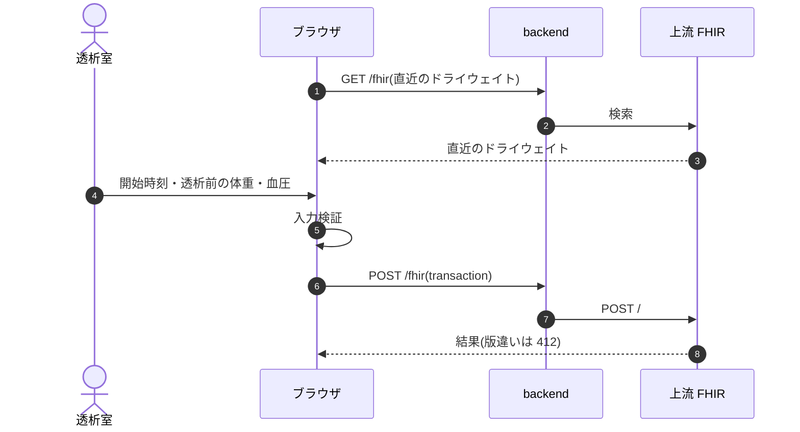

| 読むもの | 検索 |
|---|---|
| 直近のドライウェイト | `Observation?code=…|dry-weight&_sort=-date&_count=1` |

| transaction に書くもの | 条件 |
|---|---|
| PUT ハブ in-progress + `performedPeriod.start` | ハブが無ければ POST |
| POST `Observation`(体重・血圧) | – |
| `Appointment` arrived | – |

- 入力検証は `validateDialysisPerformForm`(start)です。

### シーケンス図: 回の終了・一括記録

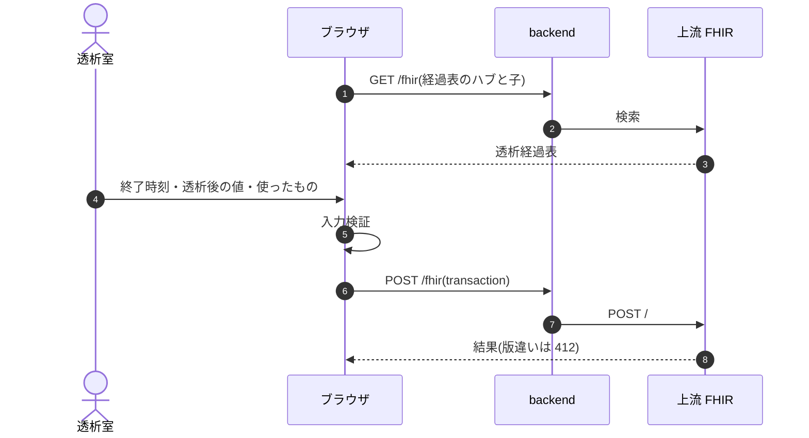

| 読むもの | 検索 |
|---|---|
| 透析経過表 | `Procedure?part-of=ハブ&category=…|dialysis-chart` と、その子 |

| transaction に書くもの | 条件 |
|---|---|
| PUT ハブ completed + `performedPeriod` + `usedCode` | ハブが無ければ POST |
| POST `Observation`・`MedicationAdministration`・子の `Procedure` | – |
| POST `Observation` dry-weight | ドライウェイトを変えたとき |
| PUT 経過表のハブ completed | 経過表のハブがあるとき |
| PUT `Appointment` fulfilled | – |

- 透析経過表は、透析後血圧・累積除水・薬剤の初期値に使います。
- 画面で入れるのは、終了時刻・透析後の値・薬剤・器材・手技・ドライウェイトです。
- 入力検証は `validateDialysisPerformForm`(finish)です。

### シーケンス図: 実施取消

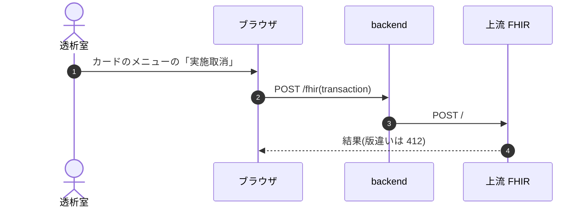

| transaction に書くもの(この順) |
|---|
| DELETE 経過表の子と経過表のハブ |
| DELETE 薬剤・測定値・子の手技 |
| DELETE ハブ |
| PUT `Appointment` booked |

### シーケンス図: 透析経過表

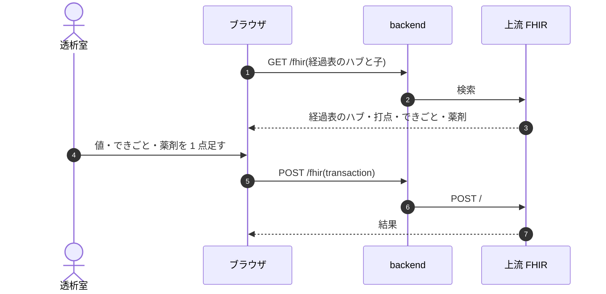

| 読むもの | 検索 |
|---|---|
| 経過表のハブと子 | `Procedure?part-of=実施のハブ&category=…|dialysis-chart&_revinclude=Observation:part-of,MedicationAdministration:part-of` |

| transaction に書くもの | 条件 |
|---|---|
| POST 経過表のハブ in-progress(`partOf` = 実施のハブ) | 初回だけ。urn:uuid で結ぶ |
| POST `Observation` / `MedicationAdministration`(`partOf` = 経過表のハブ) | 足した 1 点 |
| PUT `MedicationAdministration`(終了時刻) | 持続の薬剤の「終了」 |

- 書き込みは `useDialysisChartWrite` で、1 点ずつです。足すのは血圧・装置の値・できごと・薬剤です。
- 持続の薬剤の終了時刻の初期値は、終わった回では回の終了です。

### シーケンス図: 患者メモ

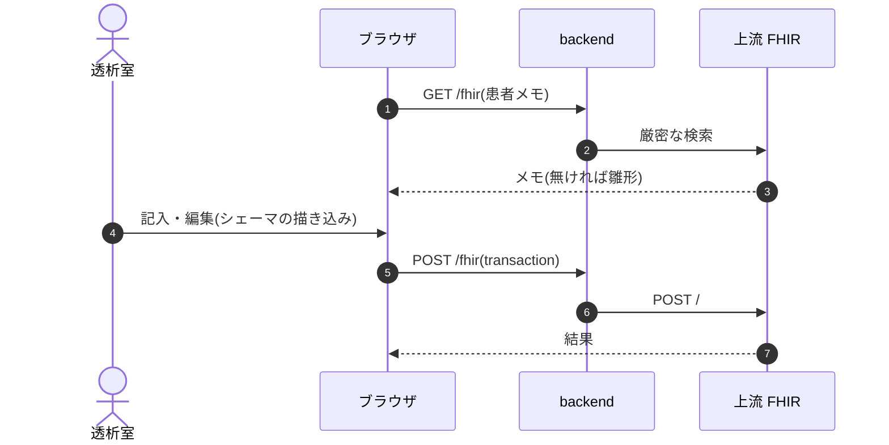

| 読むもの | 検索 |
|---|---|
| 患者メモ | `QuestionnaireResponse?patient=…&_tag=…|dialysis-memo&_sort=-authored&_count=1&_include=questionnaire` |

| transaction に書くもの | 条件 |
|---|---|
| POST `QuestionnaireResponse`(`meta.tag` = dialysis-memo、`encounter` 無し) | 初回 |
| PUT `QuestionnaireResponse` | 以後。`ifMatch`。版の履歴は `_history` |

- 厳密な検索にするのは、`_tag` が効かないと別の回答を出すためです。
- メモが無いときは、雛形 HD_MEMO_01 の有効な版を出します。

### 患者一覧・月間統計の読み込み

どちらも読むだけです。

| 画面 | 読むもの | 検索 | 補足 |
|---|---|---|---|
| 患者一覧 | ドライウェイトの推移 | `Observation?code=…|dry-weight&subject=Patient/a,b,…&date=lt翌日&_sort=-date` | 50 人ずつ |
| 患者一覧 | 採血 | `Observation?code=結果項目コード,…&subject=…&date=ge90日前&date=lt翌日&_sort=-date` | 20 人ずつ |
| 患者一覧 | 直近と前回の透析 | 基準日までの 3 週間の回の `Procedure`。ボードと同じ | – |
| 月間統計 | 実施 | `Procedure?category=…|dialysis&date=ge月初&date=lt翌月初&_include=Procedure:based-on` | 読み切る検索 |
| 月間統計 | 予約 | `Appointment?service-type=…|dialysis&date=…` | 読み切る検索 |
| 月間統計 | 枠 | `Slot?schedule=…&start=…` | 読み切る検索 |

- 患者一覧は、結果が欠けたら `TruncatedNotice` を出します。
- 月間統計は 1 か月 5,000 件までで、実施・予約・枠から回数・稼働率・日別(CSV)を出します。

### シーケンス図: 退院での打ち切り

```mermaid
sequenceDiagram
  autonumber
  actor Ward as 病棟
  participant UI as ブラウザ
  participant BE as backend
  participant FHIR as 上流 FHIR

  UI->>BE: GET /fhir(患者の有効なオーダー)
  BE->>FHIR: 読み切る検索
  FHIR-->>UI: 有効なオーダー
  UI->>UI: 打ち切るオーダーを選ぶ
  Ward->>UI: チェックを付けたまま退院
  UI->>BE: GET /fhir(取り消す予約)
  BE->>FHIR: 厳密な検索・読み切る検索
  FHIR-->>UI: 取り消す予約と枠
  UI->>BE: POST /fhir(退院の transaction)
  BE->>FHIR: POST /
  FHIR-->>UI: 結果
```

| 読むもの | 検索 |
|---|---|
| 患者の有効なオーダー | `ServiceRequest?subject=患者&category=order-type|dialysis&status=active` |
| 取り消す予約 | `Appointment?based-on=オーダー&date=ge退院日の翌日&status=有効`(選んだオーダーごと) |

| 退院の transaction に書くもの | 条件 |
|---|---|
| PUT ヘッダ `dialysis-order-end` = 退院日 | 選んだオーダーごと。`Task` は動かさない |
| PUT `Appointment` cancelled + `Slot` free | 予約ごと |

- 打ち切るオーダーは `dialysisOrderNeedsStop` が選びます。入外区分が入院で、退院日より後まで続くものです。
- 有効なオーダーの検索は全件を読み(`usePatientDialysisOrders`)、欠けた結果は使いません。
- チェックは「入院の透析オーダーを退院日で終了する」です。
- 退院の transaction には、`Encounter`・ベッドの更新、食事・リハビリの打ち切りも一緒に入ります。

### 医事会計と SS-MIX2

透析のオーダー・予約・実施は、SS-MIX2 のメッセージになりません(`OMG^O19` の対象外です)。

医事会計は実施記録から集めます(`BillingClaimBuilder` の `:procedure` 経路、`Resolvers::Dialysis`)。完了したハブ 1 件 = 1 剤で、日レセの診療種別区分は 400 です。
期間継続型(`continuous`)なので、実施記録の無い日のヘッダは報告しません。

| 起きたこと | 医事会計(`BillingClaimBuilder`) |
|---|---|
| オーダーの登録・編集・削除 | なし |
| 受付・オーダーの終了・中断・中止・退院での打ち切り | なし |
| 予約の展開・臨時・変更・入れ替え・取消 | なし |
| 入室・開始 | なし。完了していないハブは集めない |
| 回の終了・一括記録 | 回を始めた日(`performedPeriod.start` の日)に送る |
| 実施取消 | 対象から外れる(DELETE) |
| 透析経過表・患者メモ・ドライウェイト | なし |

- 回の終了・一括記録で、時刻・コードが無いときは「送れない項目」に出します。

**手技**

- 維持透析(hd / hdf / i-hdf)は、`performedPeriod` の分数で 4 時間未満 / 4〜5 時間 / 5 時間以上に分けます。施設設定 `receipt_codes.dialysis` の浄化方法 × 時間区分のコードを引きます。
- 急性血液浄化(chdf / chd / pe / dfpp / dhp)は、浄化方法ごとに 1 つのコードです。
- 追加の手技(子の `Procedure`)は、そのコードのまま並べます。resolver を持つ種別では `PerformedItemBuilder` が子の手技を拾わないので、`Resolvers::Dialysis` が自分で並べます。

**薬剤**

- `dialysis-bundled-medication` の付いた薬剤は送りません。それ以外は、処置と同じく医薬品コードと使用量で送ります。
- 透析経過表の薬剤は送りません。送るのは、回の終了の入力で実施記録の行にしたものだけです。

**器材**

- 血液浄化器は、施設マスタ(`master_blood_purifiers`)の製品に紐付けた特定器材コード(`receipt_material_code`)に読み替えます。放射線の器材マスタと同じ解決です(`PerformedItemBuilder::LOCAL_MATERIALS`)。
- 紐付けの無い製品・手入力の製品は「送れない項目」に出します。

**送れない項目に出すもの**(理由つき)

- 開始・終了の時刻が無い維持透析
- 施設設定にコードが無い浄化方法 × 時間区分
- 診療行為コードの無い追加の手技

**送らないもの**

- 慢性維持透析患者外来医学管理料・導入期加算・障害者等加算・時間外加算は送りません。患者属性や月次の判定が要るため、医事側で付けます。
