# 注射オーダーの業務フロー

注射オーダーの登録から払出・実施までの流れです。
化学療法のレジメンから出た注射は、レジメンの適用や投与可否の確認が加わるので[化学療法の業務フロー](chemotherapy.md)を読みます。

医療機関の運用を検討する人は「運用フロー」、院内の開発者は「開発者向け」を読みます。
画面のふるまいは [features/medication.md](../features/medication.md)、リソースの要素は実装ガイド(`../fhir-ig` の `medication.md`)、
連日オーダーと実施記録の設計は [injection-order-design.md](../injection-order-design.md)、監査の設計は [rx-verification-design.md](../rx-verification-design.md) が正典です。

## 運用フロー

このページで使う呼び名です。

- **RP**: 同じルートから同時に投与する薬剤の組(混注)です。注射ラベルは RP ごとに 1 枚で、RP のバーコードが付きます。
- **施用**: 1 回の投与です。1 日に開始時刻が複数ある注射は、1 日に複数回の施用があります。
- **連日の注射**: 期間と実施パターン(毎日・N 日ごと・曜日指定)で登録した注射です。登録すると、日ごとに 1 つずつのオーダーに分かれます。
- **状態**: 薬剤部の作業と実施がどこまで進んだかを示します(依頼済・受付済・払出済・実施済など)。

### 区分ごとの違い

入院(定時・臨時・緊急)も外来も、処方監査・注射箋と注射ラベルの発行・払出登録・実施の記録を同じように通ります。
違いは医事会計への送信だけで、外来は実施の記録から送り、入院は送りません。

注射は 1 日 1 オーダーです。処方監査は連日の注射をまとめて 1 回、注射箋発行・払出・実施は日ごとに進みます。

### 全体の流れ

1 日ぶんの流れです。連日の注射は、日ごとに注射箋の発行から繰り返します。

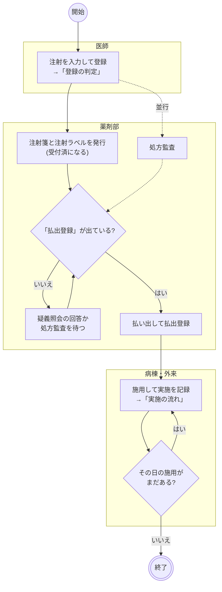

「払出登録」が出ないのは次のときです。

| とき | 「払出登録」が出るようになる条件 |
|---|---|
| 依頼済(注射箋を発行していない) | 注射箋発行で受付済にする |
| 照会中・処方変更待ち | 疑義照会の回答か取下げで受付済に戻る(→「疑義照会の流れ」) |
| 未監査で、施設設定「監査済まで調剤登録・払出登録を出さない」が有効 | 処方監査で監査済にする |

- **入力**: 新規のほか、カルテの注射カードの DO(前回と同じ内容で出し直す)からも登録できます。
- **処方監査と注射箋発行**: 並行して進みます。施設設定を有効にしていなければ、未監査でも払出登録できます。
- **処方監査の結果**: 「問題なし」か「介入あり」を記録します。介入ありのときは介入の種別・内容と医師の対応を残します。どちらでも監査済になります。
- **注射ラベル**: 発行しても状態は変わりません。中止以外のどの状態でも刷れます。
- **予定の表示**: 登録した時点で、注射カレンダー・経過表・看護ワークシートに予定が出ます。
- **実施**: 払出・処方監査・疑義照会を待たずに記録できます。実施できないのは中止した注射だけです。
- **システムの外の作業**: 薬剤部から病棟へ薬を届ける作業は記録しません。

### 注射の状態

| 状態 | 変わるきっかけ | 注射一覧の行のメニューからできること |
|---|---|---|
| 依頼済 | 医師の登録、受付取消、中止取消、実施取消 | 中止 |
| 受付済 | 注射箋発行、疑義照会の回答・取下げ、払出取消 | 受付取消(依頼済へ)、中止 |
| 照会中・処方変更待ち | 疑義照会 | なし(疑義照会の操作で変わる) |
| 払出済 | 払出登録 | 払出取消(受付済へ)、中止 |
| 実施済 | 実施の記録が予定回数に達する | なし |
| 中止 | 中止 | 中止取消(依頼済へ) |

- 「照会中」は薬剤師が疑義照会を送って回答を待っている状態、「処方変更待ち」は医師が「処方を変更する」と回答して、注射の編集を待っている状態です。
- 「払出取消」は状態だけを戻します。払出登録で入れた記録は残ります。
- 実施済の注射は、カルテの「実施取消」で依頼済に戻します。実施取消は実施の記録をすべて消します。払出済だった注射も、払出済ではなく依頼済に戻ります。

### 登録の判定

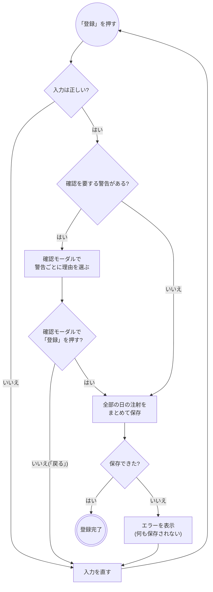

- **連日の注射の上限**: 一度に登録できるのは 14 日ぶん、期間は 90 日までです。超えると入力エラーになります。
- **警告の重さ**: 処方と同じ 2 段階です。「表示のみ」(橙)はそのまま登録でき、「確認を要する」(赤。アレルギーの一致・併用禁忌・用量の上限超過など)は確認モーダルで 1 件ずつ理由を選びます([prescription.md](prescription.md)「登録の判定」)。
- **登録を止める警告**: いまはありません。
- **外部の判断支援**: 処方と違い、注射では問い合わせません。

### 疑義照会の流れ

薬剤師が医師に問い合わせ、回答を受けるまでの流れです。処方と同じ仕組みで、注射では日ごとのオーダーに対して照会します。

- 薬剤師が「部門業務 > 薬剤部門 > 注射一覧」の行の「疑義照会」から照会を送ると、状態が照会中になり、「払出登録」が消えます。
- 医師は通知かカルテの注射カードから回答します。「処方どおり」「薬剤部で変更してよい」なら受付済に戻ります。
- 「処方を変更する」と回答すると処方変更待ちになり、医師が注射を編集して保存すると受付済に戻ります。
- 回答の前なら、薬剤師が照会を取り下げられます。依頼済の注射にも照会できます。

図と細かい決まりは [prescription.md](prescription.md)「疑義照会の流れ」にあります。「調剤登録」を「払出登録」に読み替えます。

### 実施の流れ

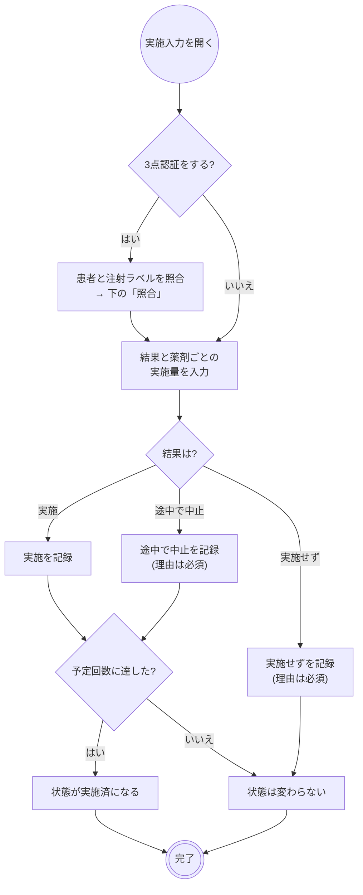

実施入力を開ける場所は次のとおりです。

- カルテの注射カード
- 注射カレンダー
- 経過表の注射欄
- 看護ワークシート
- 血糖インスリン指示患者一覧
- クリニカルパスのタスク
- 「看護業務 > 注射バーコード実施」(患者番号と RP のバーコードを読んでから実施入力を開く画面)

入力について。

- **オーダーに無い薬剤**: 実施入力で RP ごとに足せます。
- **予定回数**: RP の開始時刻の数です。RP が複数あれば最も多いもの、開始時刻が無ければ 1 回です。「実施」と「途中で中止」の記録だけを数えます。
- **インスリンのスケール**: 前後の血糖値や主食の摂取量から、案内の量を出します。案内と違う量にしたら理由が必須です。

#### 照合(3点認証)

3点認証は、患者・薬剤(注射ラベルの RP)・実施者の 3 つを確かめる照合です。施設設定「注射の3点認証」を有効にすると、実施入力の前に出ます。
「注射バーコード実施」から開いたときは、施設設定に関わらず照合します。

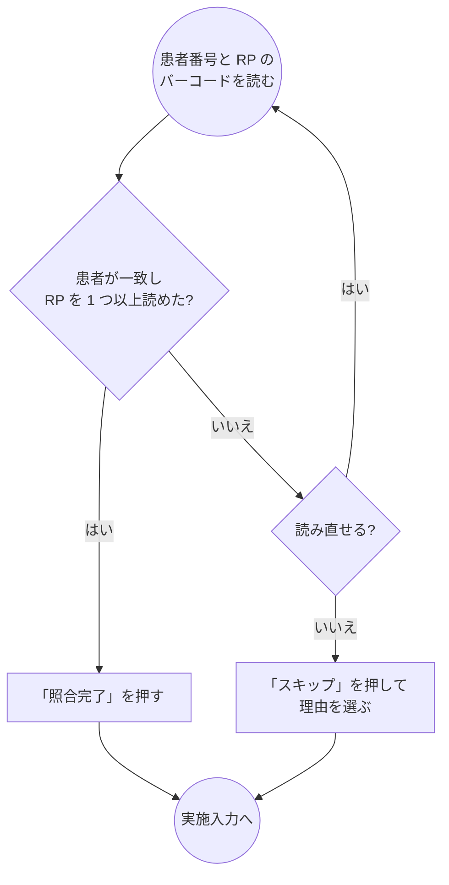

| 確かめるもの | 読むもの | 一致しないとき |
|---|---|---|
| 患者 | リストバンドか注射ラベルの患者番号 | 「患者番号 … はこの患者ではありません。」と出て、「照合完了」を押せない |
| 薬剤 | 注射ラベルの RP のバーコード | 「別のオーダーのラベルです。」「このオーダーに RP… はありません。」と出て、読んだことにならない |
| 実施者 | 読まない(ログイン中の医療従事者を実施者とする) | 医療従事者と結び付いていないログインでは、スキップしかできない |

- **読む順**: 患者番号と RP のバーコードは、どちらから読んでもかまいません。
- **不一致のとき**: 患者が一致しないあいだは先へ進めません。正しいリストバンドやラベルを読み直します。
- **読んでいない RP**: 施用の対象から外れます。その RP も施用するときは、照合に戻って読みます。
- **スキップ**: 照合できないときは、理由(緊急・急変、リストバンド未装着・読取不可、ラベル未発行・読取不可、リーダー不調、その他)を選んで入力へ進みます。「その他」は理由の記入が必須です。
- **記録**: 照合の結果は実施の記録に残り、カルテの注射カードに「照合済」「照合スキップ(理由)」と出ます。

### 変更・中止・削除・継続

| 操作 | できる場所 | 範囲 | できないとき |
|---|---|---|---|
| 変更 | カルテの注射カード、注射カレンダー | この日のみ / この日以降すべて | |
| 中止 | カルテの注射カード、注射カレンダー | この日のみ / この日以降すべて | 実施済 |
| 中止 | 注射一覧の行のメニュー | その日のみ | 実施済、照会中・処方変更待ち |
| 中止取消 | カルテの注射カード、注射カレンダー | この日のみ / この日以降すべて | 中止以外 |
| 中止取消 | 注射一覧の行のメニュー | その日のみ | 中止以外 |
| 受付取消・払出取消 | 注射一覧の行のメニュー | その日のみ | 受付済・払出済以外 |
| 削除 | カルテの注射カード、注射カレンダー | この日のみ / この日以降すべて | 実施の記録がある |
| 継続 | 注射カレンダーの行のメニュー | 連日の最後の日の後ろに日を足す | |

- **再監査**: 変更と継続をすると、監査済でも未監査に戻り、処方監査をやり直します。
- **薬剤部への連絡**: 変更・中止をしても、薬剤部へ通知は届きません。薬剤部は、変更を再監査の一覧で、中止を注射一覧の状態で知ります。
- **払い出した薬剤**: 変更・中止のあとの返品と再払出は記録しません。運用で決めます。
- **注射ラベル**: 内容を変更した注射は、ラベルを刷り直します。古いラベルを読んでも、内容が変わったことは分かりません。
- **「この日以降すべて」の中止**: 実施済の日は除きます。中止取消の「この日以降すべて」は、中止した日だけを戻します。
- **中止取消**: 中止の前の状態ではなく、依頼済に戻ります。
- **削除**: 理由の入力が必須です。実施の記録があるときは、先に「実施取消」をします。
- **継続**: 最後の日と同じ内容で、選んだ終了日まで日を足します。
- **医事会計**: 中止した注射は医事会計へ送られません。1 日に複数回の施用があり、中止の前に実施した分は送られます。会計を送ったあとに中止したときは医事課へ連絡し、医事課が送り直します。

### 帳票

| 帳票 | 出す場所 | 内容 |
|---|---|---|
| 注射箋 | 注射一覧の行の「注射箋発行」 | 注射指示票を兼ねる。A5 |
| 注射ラベル | 注射一覧の行の「注射箋発行」、行のメニューの「注射ラベル発行」 | RP ごとに 1 枚。患者番号と RP のバーコード |

- 依頼済の注射の「注射箋発行」は、注射箋と注射ラベルを 1 つのタブに並べて開き、状態を受付済にします。用紙が違うので、それぞれ印刷します。
- 注射箋の再発行と、注射ラベルだけの発行は、行のメニューから行います。状態は変わりません。

## 開発者向け

### シーケンス図の前提

- **書き込みの経路**: `/fhir` への書き込みはどれも 1 回の transaction Bundle で、backend の `FhirProxyController` が上流へ中継します。
- **上流**: 上流の FHIR サーバーです。図では「上流 FHIR」と書きます。
- **応答の中継**: 上流の応答も backend を通って画面へ戻ります。図では省いて、上流から画面へ直接返す矢印で描きます。
- **SS-MIX2**: 有効にしている施設では、中継が書き込みの控えを記録します(`Ssmix2::Recorder`)。
- **楽観ロック**: 版は `postBundle` が `ifMatch` に添え、版が違えば 412 で止まります。
- **日ごとのオーダー**: 注射 1 日ぶんの `ServiceRequest`(ヘッダ)と、薬剤の行の `MedicationRequest` です。
- **束ね**: 連日の注射の日ごとのオーダーをまとめる単位です。全部の日が同じ `requisition` を持ちます。
- **後続日**: 同じ束ねの、選んだ日より後の日です。「この日以降すべて」の操作で一緒に書きます。
- **進捗 Task・監査 Task**: 状態を持つ Task(`injection`)と、処方監査を待つ Task(`rx-verification`)です。
- **ハブ**: 実施 1 回を表す `Procedure` です。薬剤ごとの `MedicationAdministration` がぶら下がります。
- **図の登場者**: 「運用フロー」節の部署(医師・薬剤部・病棟・外来)に合わせています。薬剤部は薬剤師、病棟・外来は看護師です。

### リソースの構成

- 束ね(`requisition` が同じ日ごとのオーダーの集まり)
  - 監査 Task(`rx-verification`。束ねに 1 件)
  - 日ごとのオーダーのヘッダ `ServiceRequest`
    - `MedicationRequest`(薬剤の行。`basedOn` でヘッダを指す)
      - `MedicationDispense`(払出登録。`authorizingPrescription` で薬剤の行を指す)
    - 進捗 Task(`injection`。日ごとのオーダーに 1 件)
    - 実施のハブ `Procedure`(`basedOn` でヘッダを指す。実施 1 回に 1 件)
      - `MedicationAdministration`(施用した薬剤。`partOf` でハブを指す)

| リソース | 要素 | 中身 |
|---|---|---|
| ヘッダ `ServiceRequest` | `category` | オーダー種別 `order-type|injection`、入外区分(v3 ActCode の `IMP` / `AMB`)、注射区分(`injection-category`) |
| ヘッダ `ServiceRequest` | `requisition` | 束ねの uuid(`injection-series`) |
| ヘッダ `ServiceRequest` | 拡張 `injection-series-start` | 束ねの開始日 |
| ヘッダ `ServiceRequest` | 拡張 `injection-series-schedule` | 実施パターン(毎日のときは付けない) |
| ヘッダ `ServiceRequest` | `status` | 中止で `revoked`、中止取消で `active` |
| `MedicationRequest` | `status` | 中止で `cancelled`、中止取消で `active` |
| 監査 Task | `groupIdentifier` | 束ねの uuid |
| 監査 Task | `focus` | 束ねの最初の日 |
| ハブ `Procedure` | 拡張 `injection-verification` | 3点認証の照合の結果 |
| `MedicationAdministration` | `request` | 薬剤の行。オーダーに無い薬剤を足したときは持たない |

監査 Task が指す最初の日を削除すると、残りの最初の日へ付け替えます(`rxVerificationDeleteEntries`)。

### 進捗 Task(`injection`)

Task は登録時には作りません。**Task が無いオーダーは依頼済**として扱い、最初のステータス変更で作ります。
日ごとのオーダーに 1 件です([injection-order-design.md](../injection-order-design.md) §5)。

| 状態 | `Task.status` |
|---|---|
| 依頼済 | `requested`(または Task 無し) |
| 受付済 | `accepted` |
| 照会中・処方変更待ち | `on-hold` + `statusReason` |
| 払出済 | `in-progress` |
| 実施済 | `completed` |
| 中止 | `cancelled` |

### 部品

| 操作 | 画面 | 組み立て | hook |
|---|---|---|---|
| 登録 | `components/InjectionForm.tsx`・`InjectionPanels.tsx` | `buildInjectionBundle`(`fhir/injectionHelpers.ts`) | `useCreatePrescription` |
| 編集 | `InjectionEditPanel` | `fhir/injectionHelpers.ts` | `useInjectionSeriesLater`(後続日) |
| 継続 | `InjectionContinueModal` | `injectionExtensionDates` | 同上 |
| 削除 | `InjectionDeleteModal` | `deleteInjectionSeriesRequest` | `postOrderDeleteBundle`(`api/queries/orderDelete.ts`) |
| 中止・中止取消・受付取消・払出取消 | `InjectionCancelModal`、`pages/InjectionWorklistPage.tsx` | `rxOrderCancelEntries` | `useUpdateInjectionTaskStatus` |
| 注射箋発行 | `pages/InjectionWorklistPage.tsx`・`InjectionPrintPage.tsx` | backend の `InjectionReport` | `useUpdateInjectionTaskStatus` |
| 払出登録 | `components/InjectionDispenseModal.tsx` | `fhir/injectionDispenseHelpers.ts` | `useRegisterInjectionDispense` |
| 実施 | `components/InjectionPerformModal.tsx`・`InjectionVerifyStep.tsx` | `fhir/injectionPerformHelpers.ts` | `useRegisterInjectionPerform`・`useCancelInjectionPerforms` |

hook の置き場所は名前と合っていません。

- `useCreatePrescription` は `api/queries/labResult.ts` にあります。名前は処方由来ですが、全種別の登録が通ります。
- `useUpdateInjectionTaskStatus`・`useRegisterInjectionPerform`・`useCancelInjectionPerforms` は `api/queries/outpatient.ts` にあります。

### シーケンス図: 登録

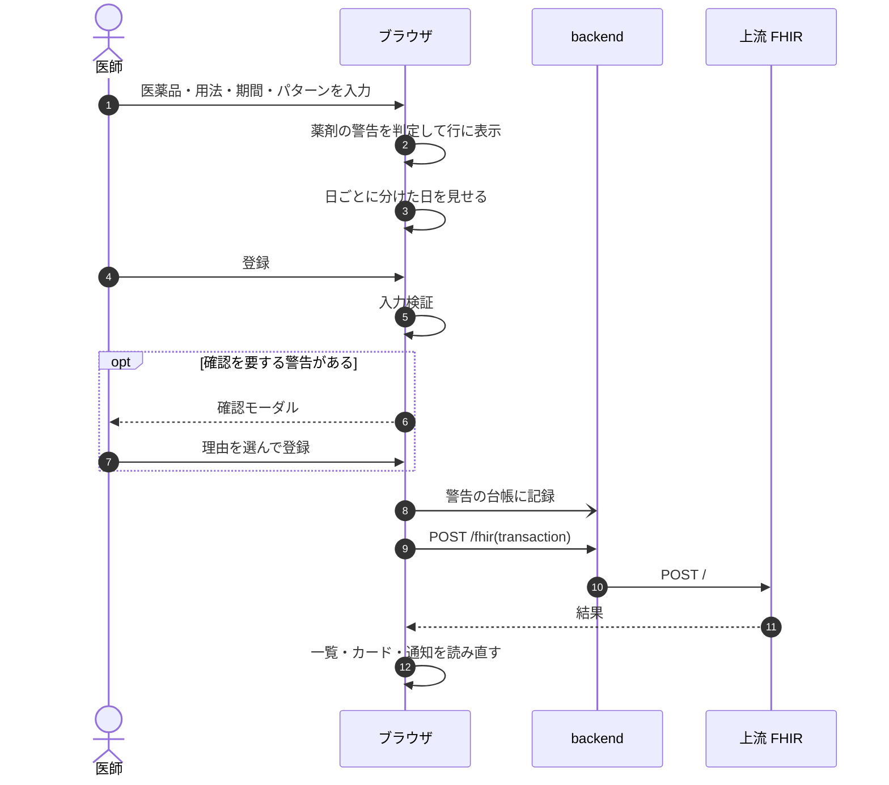

- 日ごとに分ける日は `injectionDates` で計算します。
- `-)` の矢印は応答を待たない送信です。警告の台帳は `POST /master/advisory_events`(発火・無視)です。

| transaction で書くもの | 条件 |
|---|---|
| 日ごとに `ServiceRequest` + `MedicationRequest` × 薬剤数 | いつも。全部の日で `requisition` と開始日が同じ |
| `Provenance`(CREATE) | いつも |
| 監査 Task `rx-verification` | いつも。束ねに 1 件 |
| Task `order-approval` | 代行入力・研修医 |
| 警告の無視の `Provenance` | 確認モーダルで理由を選んだ |
| 届出の通知の Task | 特定抗菌薬を含む。連日でも 1 件 |

### シーケンス図: 編集・継続・削除

どの操作も、先に後続日を引きます。検索の条件は `requisition` と `occurrence` で、後続日の `ServiceRequest`・`MedicationRequest`・Task が返ります。

編集です。登録と同じ警告の判定を通ります(図では省いています)。

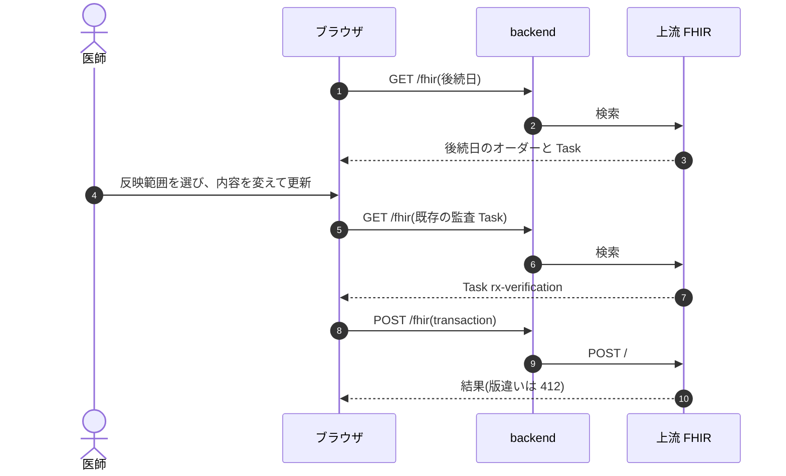

| transaction で書くもの | 反映範囲 |
|---|---|
| PUT `ServiceRequest`・`MedicationRequest` | この日のみ |
| POST 追加した薬剤の行 / DELETE 消した薬剤の行 | この日のみ |
| 後続日の PUT `ServiceRequest` | この日以降 |
| 後続日の `MedicationRequest` の差し替え | この日以降 |
| `Provenance`(UPDATE) | どちらでも |
| 監査 Task `rx-verification` を未監査へ | どちらでも |
| 進捗 Task を受付済へ | 処方変更待ちのとき |

継続です。

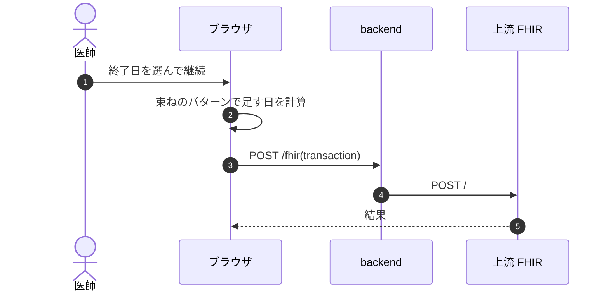

足す日は `injectionExtensionDates` で計算します。

| transaction で書くもの | 条件 |
|---|---|
| 足す日の `ServiceRequest` + `MedicationRequest` | いつも。`requisition`・開始日・パターンは元の束ねと同じ |
| `Provenance`(CREATE) | いつも |
| 監査 Task `rx-verification` を未監査へ | いつも |

削除です。

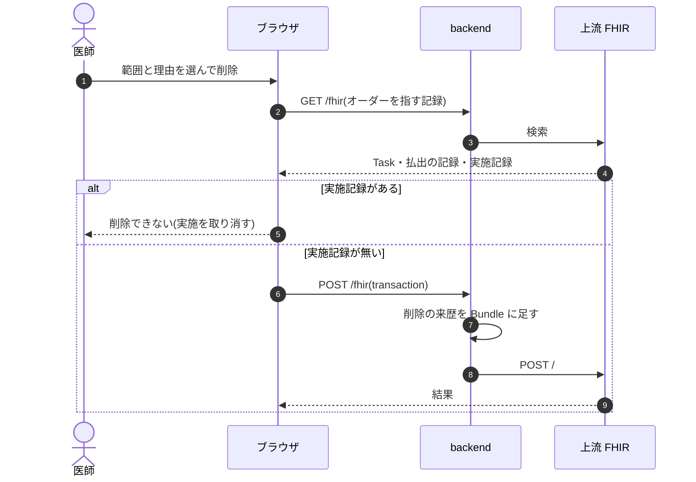

| transaction で書くもの | 条件 |
|---|---|
| DELETE `ServiceRequest`・`MedicationRequest` | いつも |
| DELETE Task・`MedicationDispense` | あれば |
| 監査 Task の付け替え | 束ねに残る日がある |
| 予約の取消 | 予約がある |

### シーケンス図: 中止・中止取消

カルテのカードと注射カレンダーからの中止です。中止取消も同じ流れです。

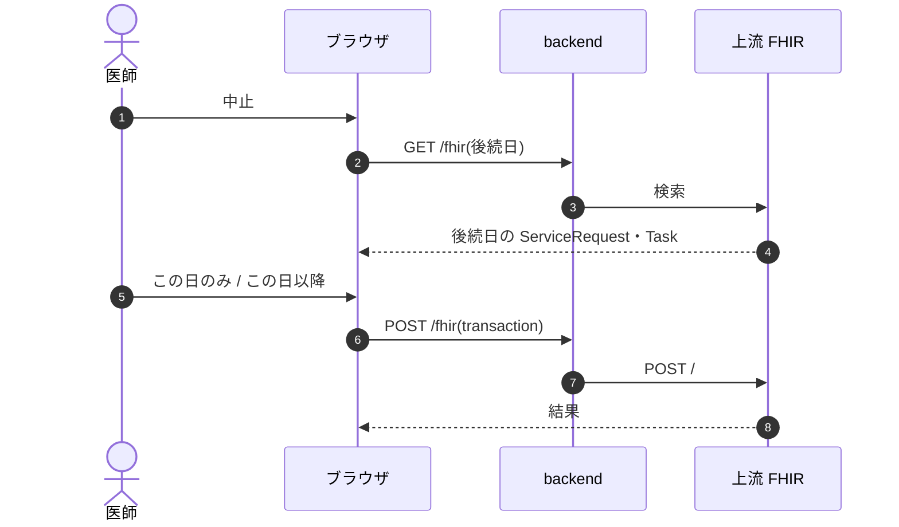

transaction は、選んだ日ぶんを次のように書きます。

| 操作 | 進捗 Task `injection` | `ServiceRequest` | `MedicationRequest` |
|---|---|---|---|
| 中止 | `cancelled` | `revoked` | `cancelled` |
| 中止取消 | `requested` | `active` | `active` |
| 受付取消 | `requested` | 変えない | 変えない |
| 払出取消 | `accepted` | 変えない | 変えない |

- オーダーの `status` を揃えるのは `rxOrderCancelEntries` です。
- 注射一覧の行のメニューは範囲を選ばず、同じ hook(`useUpdateInjectionTaskStatus`)でその日だけを書きます。受付取消・払出取消も同じ hook です。
- 払出取消は進捗を受付済へ戻すだけで、`MedicationDispense` は残ります。
- 中止取消の戻り先は依頼済(`requested`)です。化学療法の投与日の注射だけは中止の前の進捗に戻します([chemotherapy.md](chemotherapy.md)「シーケンス図: 投与日の中止・中止取消」)。

### 処方監査・疑義照会

処方と同じ画面・hook を使います([prescription.md](prescription.md)「シーケンス図: 処方監査」「シーケンス図: 疑義照会」)。
注射一覧の「監査」「疑義照会」から開き、進捗の組み立てだけを `progressBuilderOf("injection")` で切り替えます。

### シーケンス図: 注射箋発行

PDF の生成は上流を読むだけです。再発行と注射ラベルだけの発行は同じ PDF を刷り、進捗を動かしません。

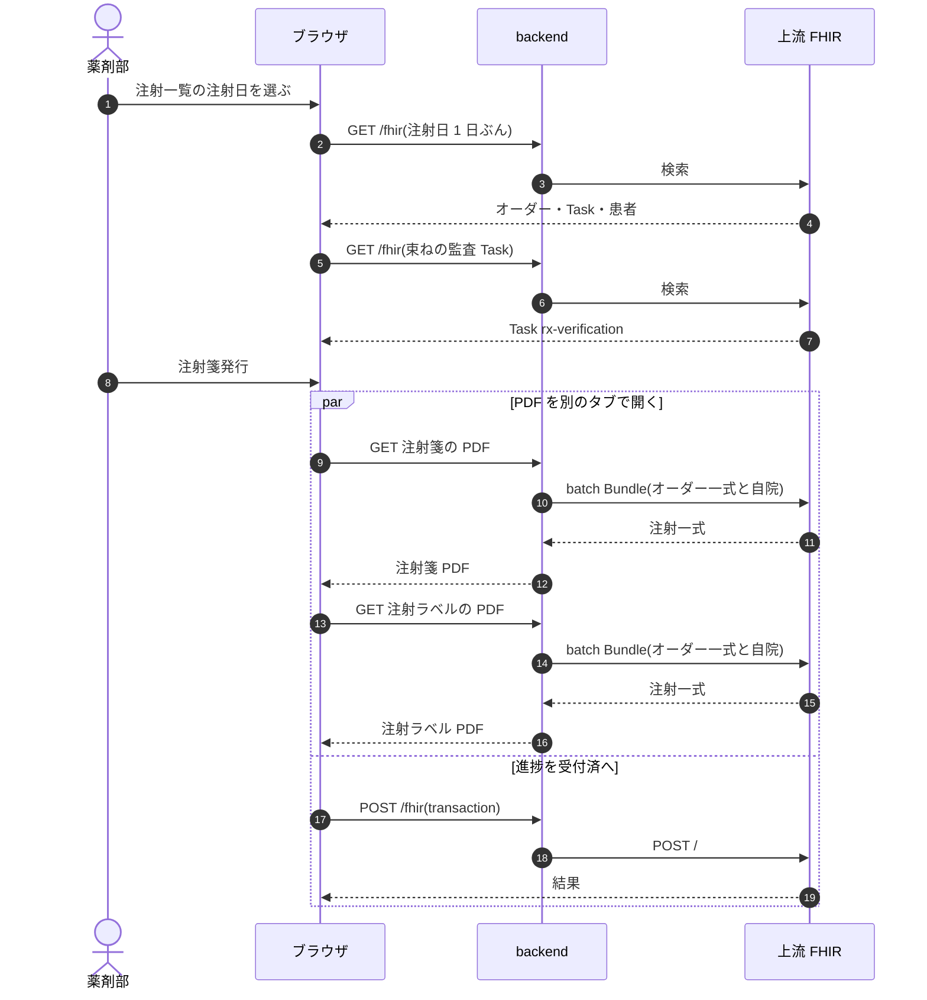

- 1 日ぶんの検索は `ServiceRequest`・`MedicationRequest`・Task・患者を返します。
- 別のタブは `/injection-print/:order_id` で、注射箋と注射ラベルの PDF を並べます。
- 注射箋は `GET /reports/injections/:order_id/pdf`、注射ラベルは `GET /reports/injection_labels/:order_id/pdf` です。
- transaction は進捗 Task `injection` を `accepted` にします。

### シーケンス図: 払出登録

「払出登録」は受付済の行にだけ出ます。

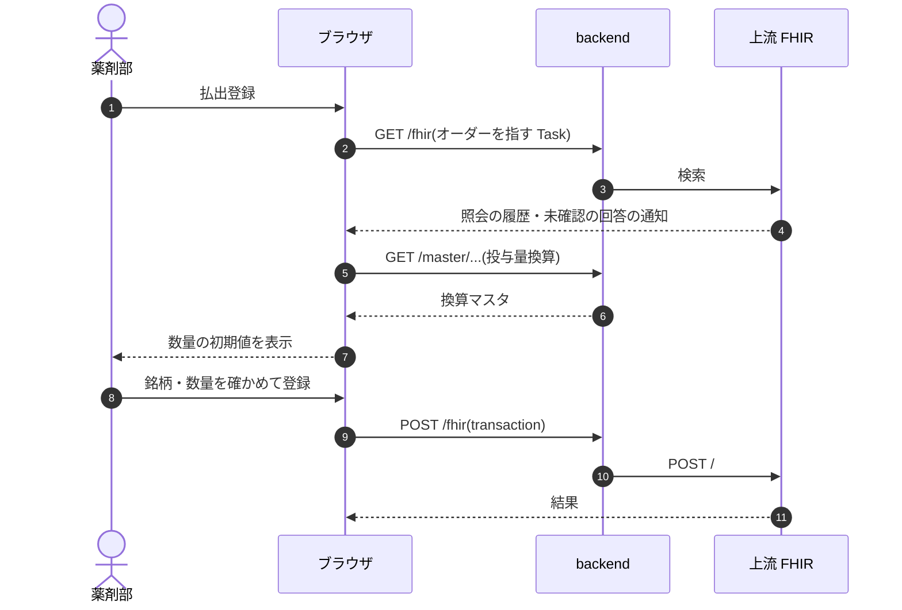

- Task の検索は `focus` がこのオーダーの Task で、照会の履歴と未確認の回答の通知を取り出します。
- 数量の初期値は、投与量 × その日の施用回数を、換算マスタで製剤数に直したものです。

| transaction で書くもの | 条件 |
|---|---|
| POST `MedicationDispense` × 薬剤数 | いつも |
| 進捗 Task を `in-progress`(払出済) | いつも |
| 回答の通知を `completed` | 未確認の回答の通知がある |

### シーケンス図: 実施

払出済かどうかに関わらず記録できます。

実施入力です。

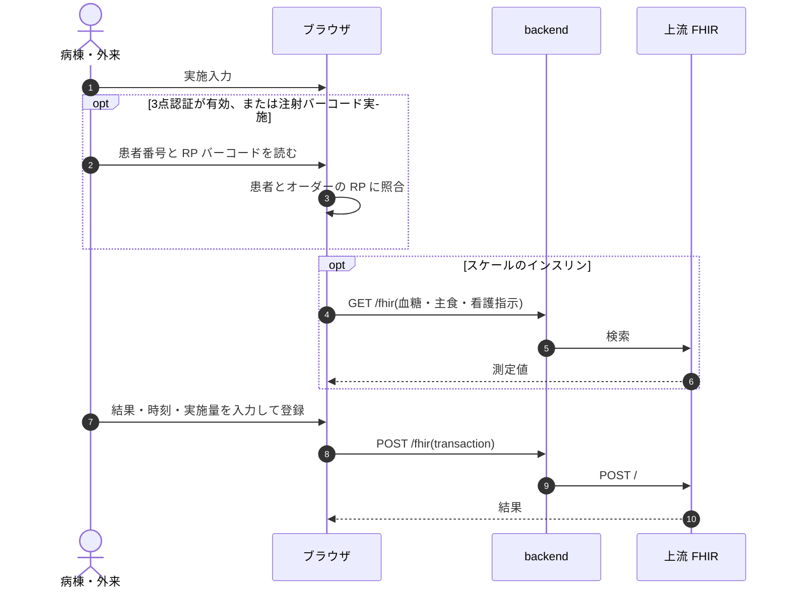

- 照合は、患者の `identifier` とオーダーの RP の番号に対して行います。照合できないときは理由を選んでスキップします。
- インスリンの検索は、血糖と主食の `Observation` と、血糖の看護指示です。
- 実施量は薬剤ごとに入れます。

| 結果 | transaction で書くもの |
|---|---|
| 実施・途中で中止 | POST `Procedure`(`completed` / `stopped`。照合の結果は拡張) |
| 実施・途中で中止 | POST `MedicationAdministration` × 施用した薬剤 |
| 実施・途中で中止 | POST `Observation`(手入力の血糖値があるとき) |
| 実施・途中で中止 | 進捗 Task `injection` を `completed`(予定回数に達したとき) |
| 実施せず | POST `Procedure`(`not-done`、理由) |

実施取消です。

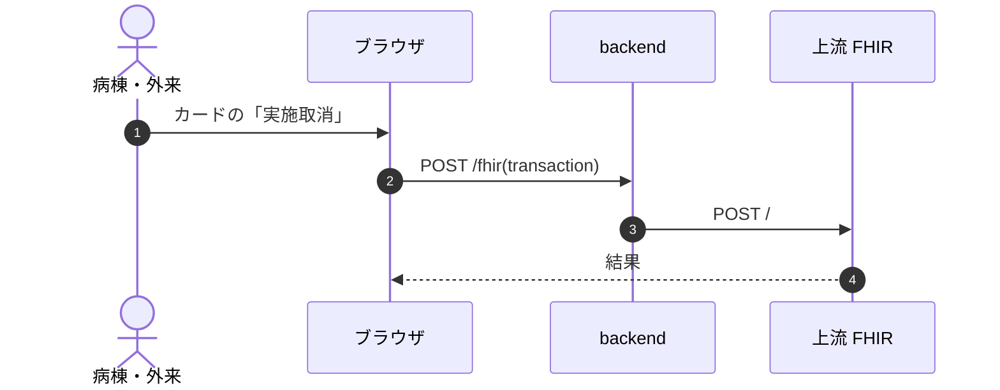

transaction は、そのオーダーの実施記録すべてについて `MedicationAdministration`、`Procedure` の順に DELETE します。実施済だった進捗 Task `injection` は `requested` に戻します(払出済だったかは分からないので、いちばん手前に戻します)。

### 医事会計と SS-MIX2

医事会計(`BillingClaimBuilder`)は、注射を実施記録から送ります。SS-MIX2 の括弧内はデータ種別、INS / DEL は処理区分です。

| 起きたこと | 医事会計 | SS-MIX2 |
|---|---|---|
| 登録・編集 | 送らない | RDE^O11(OMP-02)。`ServiceRequest` を書くと出す |
| 削除 | 対象から外れる | RDE^O11 の `CA`(DEL) |
| 中止 | 対象から外れる。実施済みの施用は送る | RDE^O11 の `CA`(DEL) |
| 中止取消 | 対象に戻る | RDE^O11 の `NW`(INS) |
| 実施 | 薬剤の行を 1 施用 1 剤で送る | RAS^O17(OMP-12)。実施ごとに採番 |
| 途中で中止・実施せず | 請求せず理由を報告 | RAS^O17 |
| 実施取消 | 対象から外れる | RAS^O17 の DEL |

実施の剤の区分は、手技・用法種別・経路から決まります。手技料は日レセが算定します。
