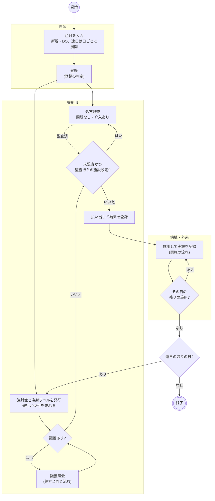
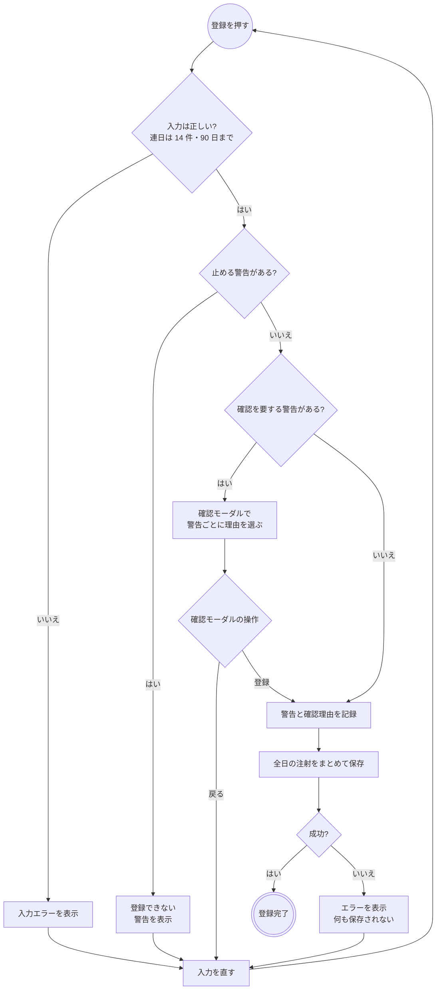
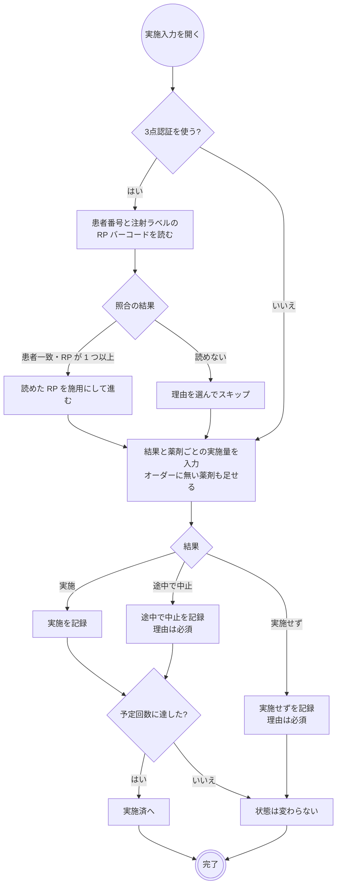
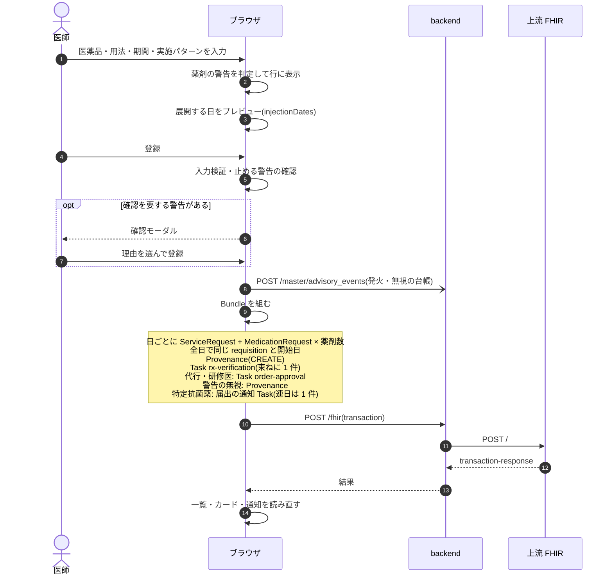
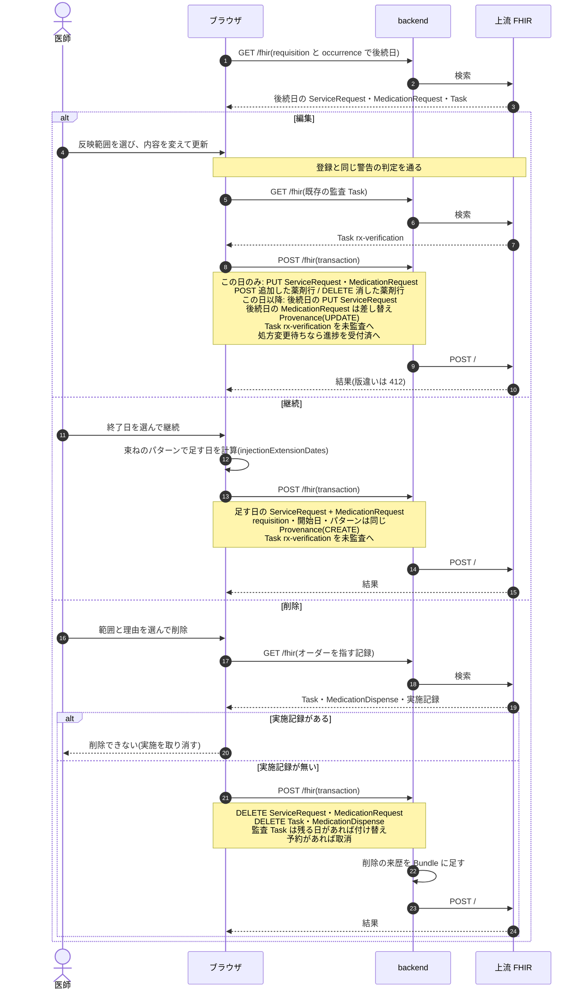
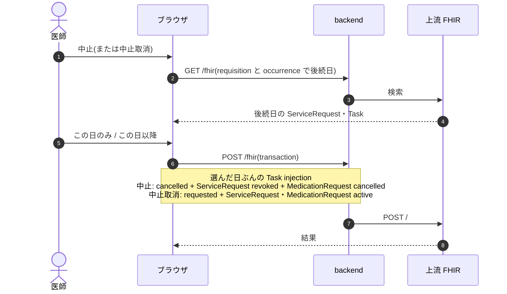
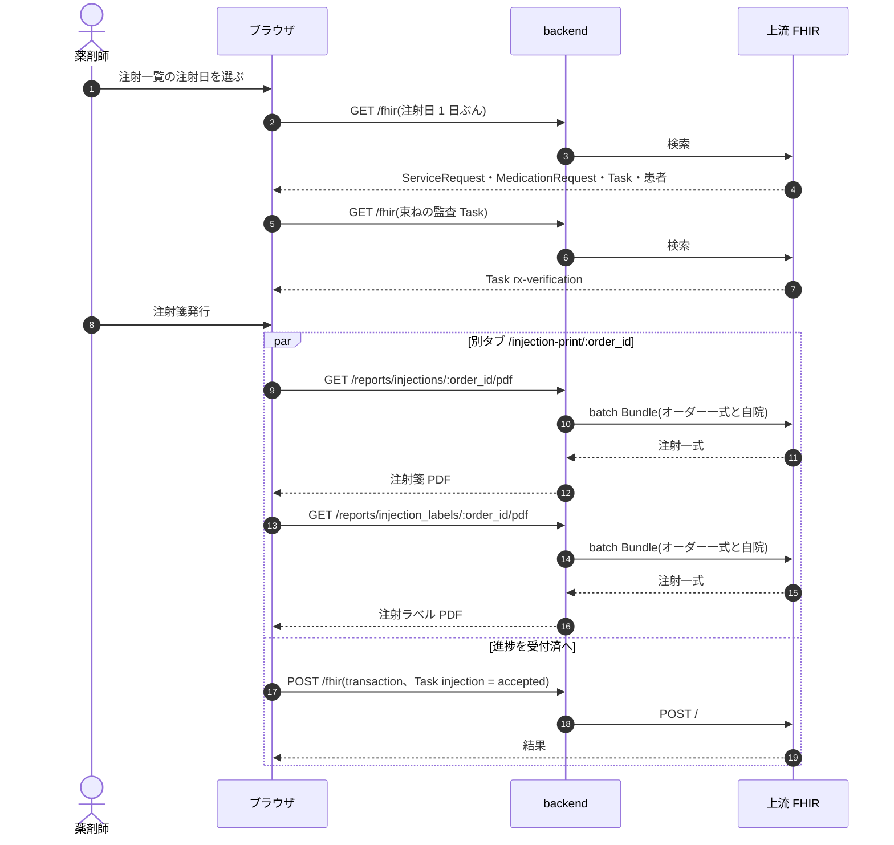
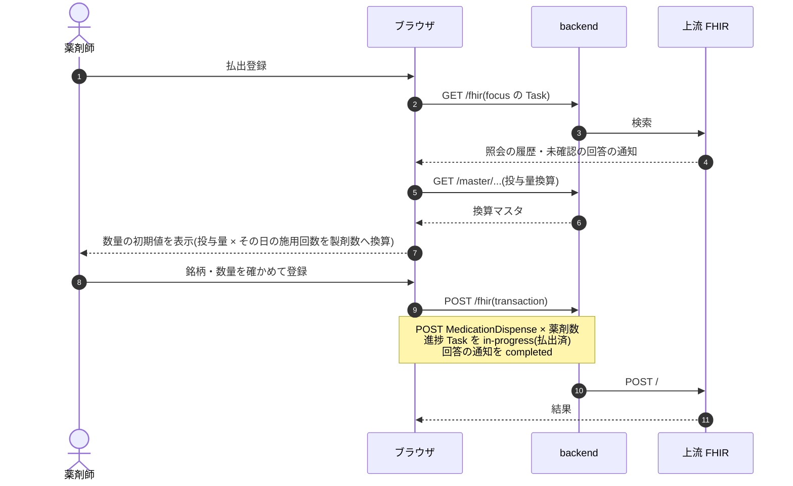
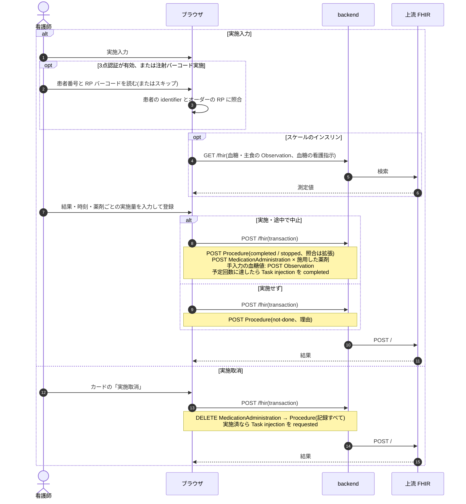

# 注射オーダーの業務フロー

注射オーダーの登録から払出・実施までの流れです。医療機関の運用を検討する人は「運用フロー」、院内の開発者は「開発者向け」を読みます。
画面のふるまいは [features/medication.md](../features/medication.md)、リソースの要素は実装ガイド(`../fhir-ig` の `medication.md`)、
連日オーダーと実施記録の設計は [injection-order-design.md](../injection-order-design.md)、監査の設計は [rx-verification-design.md](../rx-verification-design.md) が正典です。
化学療法の日オーダーは[化学療法の業務フロー](chemotherapy.md)を読みます。

## 運用フロー

### 区分ごとの違い

| 注射 | 処方監査 | 注射箋・注射ラベル | 払出登録 | 実施の記録 | 医事会計への送信 |
|---|---|---|---|---|---|
| 入院(定時・臨時・緊急) | あり | あり | あり | あり | なし(外来のみ) |
| 外来 | あり | あり | あり | あり | 実施の記録から |

注射は 1 日 1 オーダーです。連日の指示は登録のときに日ごとのオーダーへ展開します。処方監査は連日をまとめて 1 回、それ以外(注射箋発行・払出・実施)は日ごとに進みます。

### 注射の状態

薬剤部と実施の進み具合を示す状態です。

| 状態 | 変わるきっかけ | 注射一覧のメニューからできること |
|---|---|---|
| 依頼済 | 医師の登録、受付取消、中止取消、実施取消 | 中止 |
| 受付済 | 注射箋発行、疑義照会の回答・取下げ、払出取消 | 受付取消(依頼済へ)、中止 |
| 照会中・処方変更待ち | 疑義照会 | なし(疑義照会の操作で変わる) |
| 払出済 | 払出登録 | 払出取消(受付済へ。払出の記録は残る)、中止 |
| 実施済 | 実施の記録が予定回数に達する | なし(カルテの実施取消で依頼済へ) |
| 中止 | 中止 | 中止取消(依頼済へ) |

実施取消は実施の記録をすべて消します。実施済だった注射は、払い出し済みだったかどうかに関わらず依頼済へ戻ります。

### 全体の流れ

- 監査と注射箋発行は並行して進みます。既定では未監査でも払出登録でき、施設設定「監査済まで調剤登録・払出登録を出さない」のときだけ待ちます。
- 疑義照会は依頼済からも送れます(図は受付済からの経路だけを示します)。照会は日ごとのオーダーに対して行います。
- 払出登録は受付済の注射にだけ出ます。注射ラベルは進捗を動かさず、中止以外のどの状態でも刷れます。
- 予定は登録した時点で注射カレンダー・経過表・看護ワークシートに出ます。
- 実施は払出・監査・疑義照会を待ちません。止まるのは中止した注射だけです。薬剤部から病棟へ薬を届ける作業は記録の対象ではありません。

### 登録の判定

処方と違い、外部の判断支援への問い合わせはありません。

### 実施の流れ

- 開く場所はカルテのカード、注射カレンダー、経過表の注射欄、看護ワークシート、血糖インスリン指示患者一覧、パスのタスク、注射バーコード実施です。
- 3点認証は施設設定で有効にしたときに出ます。実施者はログイン中の医療従事者で代替します。
- 注射バーコード実施(`/injection-scan`)は、患者番号と RP バーコードを読んだ状態で実施入力を開き、施設設定に関わらず照合を記録します。
- 予定回数は RP の開始時刻の数です(複数の RP なら最も多いもの。時刻が無ければ 1 回)。「実施」「途中で中止」の記録だけを数えます。
- インスリンのスケールは、前後の血糖値・主食の摂取量から案内量を出します。案内と違う量にしたら理由が必須です。

### 変更・中止・削除・継続

| 操作 | できる場所 | 範囲 | できないとき |
|---|---|---|---|
| 変更 | カルテのカード、注射カレンダー | この日のみ / この日以降すべて | |
| 中止 | カルテのカード、注射カレンダー | この日のみ / この日以降すべて | 実施済 |
| 中止 | 注射一覧のメニュー | その日のみ | 実施済、照会中・処方変更待ち |
| 中止取消 | カルテのカード、注射カレンダー、注射一覧のメニュー | 中止と同じ | |
| 削除 | カルテのカード、注射カレンダー | この日のみ / この日以降すべて。理由は必須 | 実施の記録がある |
| 継続 | 注射カレンダーの行のメニュー | 連日の最後の日に、同じ内容の日を足す | |

- 変更と継続は、監査済でも未監査へ戻り、再監査になります。
- 変更・中止は薬剤部へ通知しません。変更は再監査で、中止は注射一覧の状態で見えます。払い出した薬剤の返品・再払出はシステムの記録の対象外です。
- 注射ラベルの読み取りは内容の変更を見分けません。変更した注射はラベルを刷り直します。
- 「この日以降すべて」の中止は実施済の日を除きます。中止取消は中止した日だけを戻します。
- 中止した注射は医事会計へ送られません。1 日に複数回の注射で、中止の前に実施した分は送られます。会計を送ったあとに中止したときは医事へ連絡し、医事が送り直します。

### 疑義照会の流れ

処方と同じです([処方オーダーの疑義照会の流れ](prescription.md#疑義照会の流れ))。「調剤登録」を「払出登録」に読み替えます。

## 開発者向け

### 進捗 Task(`injection`)

Task は登録時には作りません。**Task が無いオーダーは依頼済**として扱い、最初のステータス変更で作ります。
日ごとのオーダーに 1 件です([injection-order-design.md](../injection-order-design.md) §5)。

| 状態 | `Task.status` |
|---|---|
| 依頼済 | `requested`(または Task 無し) |
| 受付済 | `accepted` |
| 照会中・処方変更待ち | `on-hold` + `statusReason` |
| 払出済 | `in-progress` |
| 実施済 | `completed` |
| 中止 | `cancelled` |

監査 Task(`rx-verification`)は束ね(`requisition`)に 1 件で、`groupIdentifier` に束ねの uuid、`focus` に束ねの最初の日を持ちます。
最初の日を削除すると残りの最初の日へ付け替えます(`rxVerificationDeleteEntries`)。

中止は同じ transaction で `ServiceRequest` を `revoked`、`MedicationRequest` を `cancelled` にします(`rxOrderCancelEntries`)。中止取消は `active` に戻します。

### シーケンス図の前提

`/fhir` への書き込みはどれも 1 回の transaction Bundle で、backend の `FhirProxyController` が上流へ中継します。
SS-MIX2 を有効にしている施設では、中継が書き込みの控えを記録します(`Ssmix2::Recorder`)。
楽観ロックの版は `postBundle` が `ifMatch` に添え、版が違えば 412 で止まります。

### シーケンス図: 登録

`components/InjectionForm.tsx`・`InjectionPanels.tsx`、`buildInjectionBundle`(`fhir/injectionHelpers.ts`)、`useCreatePrescription`(`api/queries/labResult.ts`。全種別共通)。

### シーケンス図: 編集・継続・削除

`InjectionEditPanel`、`InjectionContinueModal`、`InjectionDeleteModal`、`useInjectionSeriesLater`(後続日)、`deleteInjectionSeriesRequest`、`postOrderDeleteBundle`(`api/queries/orderDelete.ts`)。

### シーケンス図: 中止・中止取消

`InjectionCancelModal`、`useUpdateInjectionTaskStatus`(`api/queries/outpatient.ts`)。注射一覧のメニューは範囲を選ばず、同じ hook でその日だけを書きます。

### 処方監査・疑義照会

処方と同じ画面・hook を使います([処方監査](prescription.md#シーケンス図-処方監査)、[疑義照会](prescription.md#シーケンス図-疑義照会))。
注射一覧の「監査」「疑義照会」から開き、進捗の組み立てだけを `progressBuilderOf("injection")` で切り替えます。

### シーケンス図: 注射箋発行

`pages/InjectionWorklistPage.tsx`・`InjectionPrintPage.tsx`、`useUpdateInjectionTaskStatus`、`InjectionReport`。
PDF の生成は読むだけで、再発行と注射ラベル単独の発行は同じ PDF を刷り進捗を動かしません。

### シーケンス図: 払出登録

`components/InjectionDispenseModal.tsx`、`fhir/injectionDispenseHelpers.ts`、`useRegisterInjectionDispense`。受付済の行にだけ出ます。

払出取消は進捗を受付済へ戻すだけで、`MedicationDispense` は残ります。

### シーケンス図: 実施

`components/InjectionPerformModal.tsx`・`InjectionVerifyStep.tsx`、`fhir/injectionPerformHelpers.ts`、`useRegisterInjectionPerform`・`useCancelInjectionPerforms`。
払出済かどうかに関わらず記録できます。

### 医事会計と SS-MIX2

| 起きたこと | 医事会計(`BillingClaimBuilder`) | SS-MIX2 |
|---|---|---|
| 登録・編集 | なし | RDE^O11(OMP-02)。`ServiceRequest` を書くと出す |
| 削除 | 対象から外れる | RDE^O11 の `CA`(DEL) |
| 中止 | 対象から外れる。実施済みの施用は送る | RDE^O11 の `CA`(DEL) |
| 中止取消 | 対象に戻る | RDE^O11 の `NW`(INS) |
| 実施 | 薬剤行を 1 施用 1 剤で送る。剤区分は手技・用法種別・経路から決まり、手技料は日レセが算定 | RAS^O17(OMP-12)。実施ごとに採番 |
| 途中で中止・実施せず | 請求せず理由を報告 | RAS^O17 |
| 実施取消 | 対象から外れる | RAS^O17 の DEL |
