# 検体検査オーダーの業務フロー

検体検査オーダーの登録から採取・到着・結果報告・結果確認までの流れです。医療機関の運用を検討する人は「運用フロー」、院内の開発者は「開発者向け」を読みます。
画面のふるまいは [features/lab.md](../features/lab.md)、種別共通の約束(削除・代行入力・日付)は [features/orders-common.md](../features/orders-common.md)、
リソースの要素は実装ガイド(`../fhir-ig`)、ラベル・到着・取込の設計は [lab-label-design.md](../lab-label-design.md)・
[lab-arrival-design.md](../lab-arrival-design.md)・[lab-result-import-design.md](../lab-result-import-design.md) が正典です。
細菌検査・病理検査は進捗の考え方が同じですが、容器・採取の記録・レポートが違うので別の文書で扱います。

## 運用フロー

### 区分ごとの違い

| 検体検査 | ラベル発行 | 到着確認 | 結果の登録 | 医事会計への送信 |
|---|---|---|---|---|
| 入院 | 病棟ごとに一括発行(前日・当日の朝)。行からも発行できる | あり | あり | なし(外来のみ) |
| 外来 | 患者が採血室に来てから行で発行 | あり | あり | 検査日のオーダーから。採血料は血液の検体があれば 1 回 |

検体検査オーダーは検査日(検体を採る日)を持ち、時刻は持ちません。予約枠は使いません。日付未定にはできません。

### 検体検査の状態

採血室・検査室の進み具合を示す状態です。結果の登録では変わりません。

| 状態 | 変わるきっかけ | 検体検査一覧のメニューからできること |
|---|---|---|
| 依頼済 | 医師の登録、取消、中止取消 | 受付(ラベルを刷れない環境の代替)、中止 |
| 受付済 | ラベル発行(行・一括)、到着確認の取消 | 実施(スキャナが使えないときの代替。管ごとの到着は残らない)、取消(依頼済へ)、中止 |
| 実施済 | 到着確認でオーダーの全部の管が揃う | 取消(受付済へ) |
| 中止 | 中止 | 中止取消(依頼済へ) |

管(採取管)1 本ごとに別の状態があります。**未発行 → 発行済 → 到着済**で、検体検査一覧の検査内容の欄に出ます。
オーダーの状態は部門の作業がどこまで進んだか、管の状態は現物がどこにあるかを指します(再発行しても管の状態は変わりません)。

### 全体の流れ

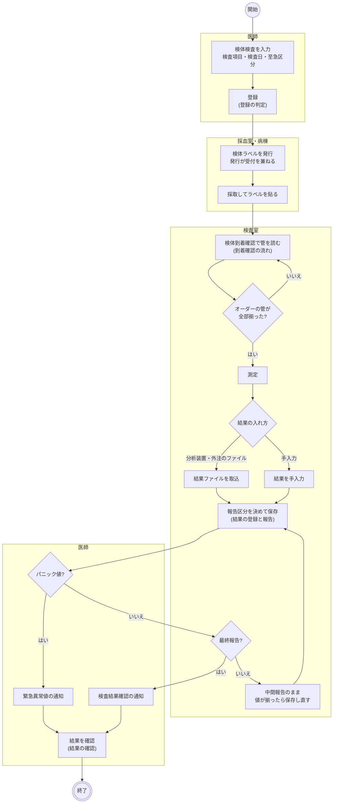

- 入院はラベルを前にまとめて刷り、外来は患者が来てから刷ります。どちらも発行で受付済になります。
- 採取そのものは記録しません(誰がいつ採ったかは残りません。細菌検査だけ採取の記録があります)。看護ワークシートの採取の印は、ラベルを刷れば「ラベル済」、検査室に届けば済になります。
- 到着確認は管ごとに行い、オーダーの管が全部揃うと実施済になります。到着を待たずに結果を登録することもできます(カルテの検査結果タブから)。
- 中間報告は何度でも出し直せます。最終報告にすると医師への通知が出ます。確定した結果を直すと訂正報告になり、通知が未確認に戻ります。
- パニック値は報告区分に関わらず通知します。中間報告のうちは通知を確認しても既読にはなりません。

### 登録の判定

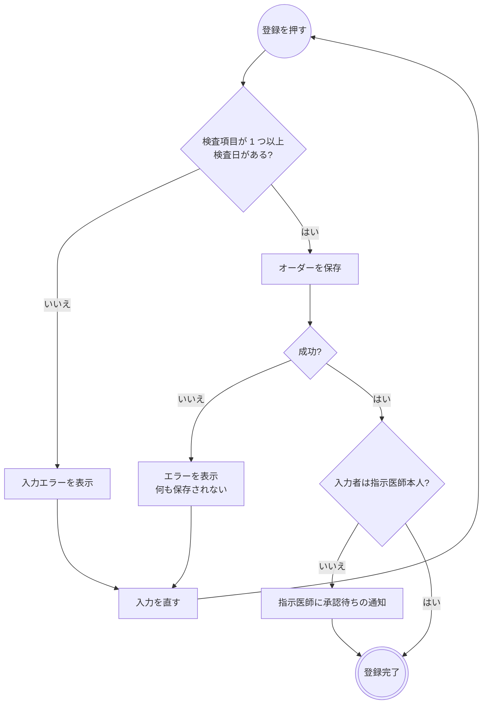

- 薬剤と違い、重複・回数・施設の規則の警告は出ません。判断支援への問い合わせもありません。
- 検査項目は検査伝票(レイアウト)・セット・検索から選びます。パネル(セット項目)は 1 行で、構成項目はオーダーに展開して持ちます。
- 承認待ちでもオーダーは部門に流れます。承認は通知の一覧かカルテの詳細から行います。
- オーダーセット・クリニカルパス・レジメンからの適用も同じ保存を通ります。

### 到着確認の流れ

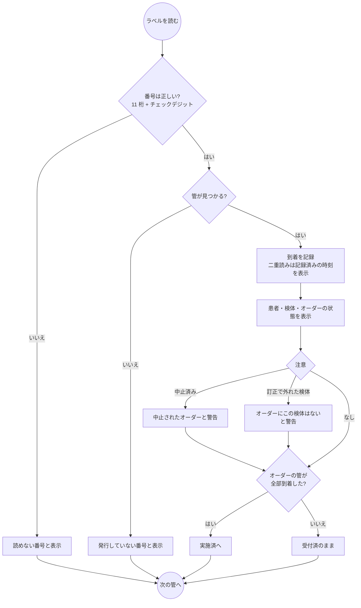

- 画面は**部門業務 > 臨床検査部門 > 検体到着確認**です。読んだ順に上から積み、患者氏名と検体を必ず出します(貼り間違いに気付くため)。
- 中止されたオーダーの管も到着は記録します(現物が届いた事実を残すため)。要らなければ行の「取消」で消します。
- 「取消」は管の到着を消し、実施済まで進んでいたオーダーは受付済へ戻します。
- 細菌検査の容器も同じ画面で読みます(揃ったときの進捗は受付済)。

### 結果の登録と報告

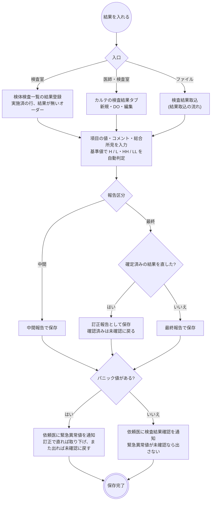

- 検体検査一覧の「結果登録」はオーダーが行で決まっているので、検査項目を結果項目に展開した状態で開きます。結果が付いたオーダーは押せません(確定・訂正はカルテから)。
- カルテからはオーダーを選んで紐付けるか、紐付けずに登録できます。紐付けないと通知の宛先(依頼医)が決まりません。
- 実施施設は自院、実施者はログインユーザーが入ります。編集しても最初の実施者が残ります。報告日時は保存のたびに更新されます。
- 結果の印刷(検査結果報告書)は内容表示の「印刷」から。1 件 1 枚で、材料は刷りません。

### 結果取込の流れ

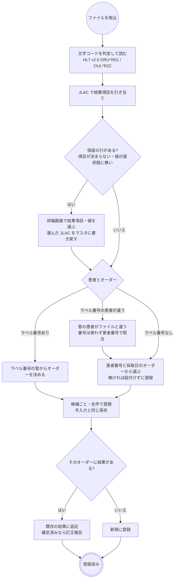

- 画面は**部門業務 > 臨床検査部門 > 検査結果取込**。取込は台帳に載せるまでで、上流への登録は人が確認して押します。
- H/L は施設の基準値で付け直します。基準値の無い項目だけファイルの異常フラグを写します。
- 報告区分はファイルの値(OBR-25)から決めます(`P` は中間、`F` / `C` は最終)。
- 同じメッセージ ID のファイルは知らせますが止めません。二重登録は「結果があるオーダーは追記になる」ことで防ぎます。

### 結果の確認

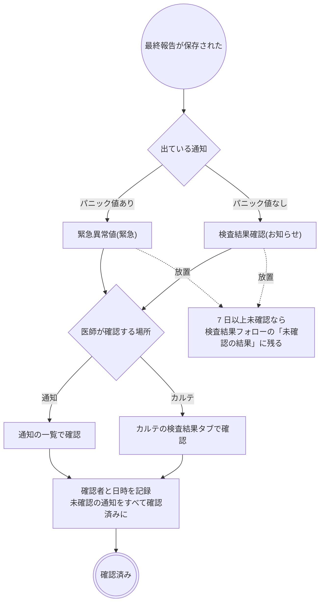

- 宛先は依頼医ですが、確認は誰でもできます(当直医・主治医が先に読む)。記録には確認した本人が残ります。
- 緊急異常値と検査結果確認は同じ結果に 2 件出しません。緊急異常値を確認すれば最終報告なら既読も残り、カルテで確認すれば緊急異常値も確認済みになります。
- 中間報告のうちは確認できません。訂正報告になると未確認に戻ります。
- 確認は通知の一覧からもカルテからもできますが、「未確認の結果」の一覧からはできません(カルテで内容を見て確認します)。

### 変更・中止・削除

| 操作 | できる場所 | できないとき・注意 |
|---|---|---|
| 変更 | カルテのカード | 結果が付いていても止まりません。ラベル発行後に検体を足したら、新しい管のラベルを刷り直します |
| 中止 | 検体検査一覧のメニュー | 到着した管はそのまま残ります。医事会計・SS-MIX2 には伝わりません(下の表) |
| 中止取消 | 検体検査一覧のメニュー | 依頼済に戻ります(受付済・実施済には戻りません) |
| 取消 | 検体検査一覧のメニュー | 1 つ前の状態へ戻す訂正。管の到着記録は消えません |
| 削除 | カルテのカード | 結果が付いているとできません(結果を削除してから)。進捗は一緒に消え、発行済みの管の記録は残ります |
| 結果の削除 | カルテの検査結果タブ | 結果と通知が消え、一覧の「結果登録」が押せるようになります。管の記録は残ります |

- 変更は再度の承認を要する場合があります(代行入力のとき)。部門への通知はなく、一覧の内容で見えます。
- 検体を外す変更をしても、刷ってしまったラベルの管は記録に残ります。到着確認で読むと「オーダーにこの検体はありません」と警告します。

### 帳票

| 帳票 | 出す場所 | 内容 |
|---|---|---|
| 検体ラベル | 検体検査一覧の行、ラベル一括発行 | 管 1 本 1 枚。バーコード(番号)・患者番号・カナ・性別・生年月日・検体・採取管(色)・検査日・至急・項目の略称 |
| 検査結果報告書 | カルテの検査結果の内容表示 | 1 件 1 枚(A4 縦・2 段)。項目・結果値・判定・単位・基準値、コメント、総合所見 |

## 開発者向け

### リソースの構成

オーダーはヘッダの `ServiceRequest`(`order-type|lab`)と、検査項目 1 件ずつの明細 `ServiceRequest`(`basedOn` でヘッダを指す)です。パネルの構成項目はさらに明細を `basedOn` で指します。
明細はオーダー時点のマスタの内容(項目コード・名称・JLAC・検体・採取管)を写し、採る検体は contained の `Specimen` で `ServiceRequest.specimen` から指します(`fhir/labOrderHelpers.ts`)。

| もの | リソース | 補足 |
|---|---|---|
| 進捗 | `Task`(`task-code|lab-exam`、`focus` = ヘッダ) | 下の表 |
| 管(採取管)の台帳 | `Specimen`(`request` = ヘッダ、`accessionIdentifier` = ラベル番号) | 発行 = 作成、到着 = `receivedTime` + `status: available`、記録者は拡張 `lab-arrival-recorder` |
| 結果 | `DiagnosticReport`(`basedOn` = ヘッダ)+ `Observation`(`result`) | 報告区分は `status`(`preliminary` / `final` / `corrected`)、採取日は `effectiveDateTime`、報告日時は `issued` |
| 結果の検体 | `DiagnosticReport.specimen` | 材料の一致する管の `Specimen` を参照(書き換えない)。無い材料・紐付け無しの結果は結果側が `Specimen` を作って所有する |
| 緊急異常値の通知 | `Task`(`task-code|lab-panic`、`focus` = 結果、`owner` = 依頼医、`priority = stat`) | 項目は `input` に構造化 |
| 検査結果確認の通知 | `Task`(`task-code|result-review`、`focus` = 結果、`owner` = 依頼医) | 最終報告のときだけ |
| 確認(既読) | `Provenance`(`target` = 結果、`agent.type = verifier`、`signature`) | 正本。通知は宛先と未確認・確認済みだけ |
| 代行入力 | `Provenance`(`target` = ヘッダ、`activity` CREATE / UPDATE) | 明細は `target` に入れない |

### 進捗 Task(`lab-exam`)

Task は登録時には作りません。**Task が無いオーダーは依頼済**として扱い、最初のステータス変更で作ります(`fhir/labTaskHelpers.ts`)。
中止でも `ServiceRequest` の `status` は動かしません(注射・処方の `revoked` と違います)。

| 状態 | `Task.status` | `executionPeriod` |
|---|---|---|
| 依頼済 | `requested`(または Task 無し) | なし |
| 受付済 | `accepted` | `start` |
| 実施済 | `completed` | `start` / `end` |
| 中止 | `cancelled` | なし |

受付済へは行の「ラベル発行」と一括発行、実施済へは到着確認の全管到着が進めます。メニューの「受付」「実施」は同じ Task の書き込みを手で行う代替です。

### シーケンス図の前提

`/fhir` への書き込みはどれも 1 回の transaction Bundle で、backend の `FhirProxyController` が上流へ中継します。
SS-MIX2 を有効にしている施設では、中継が書き込みの控えを記録します(`Ssmix2::Recorder`)。
楽観ロックの版は `postBundle` が `ifMatch` に添え、版が違えば 412 で止まります。
例外はラベルの PDF で、backend(`LabLabelReport`)が上流を直接読み書きします。

### シーケンス図: 登録・編集・削除

`components/LabOrderForm.tsx`・`LabOrderPanels.tsx`、`buildLabOrderBundle` / `buildLabOrderUpdateBundle` / `buildLabOrderDeleteBundle`(`fhir/labOrderHelpers.ts`)、
`useCreatePrescription` / `useUpdatePrescription`(`api/queries/labResult.ts`。全種別共通)、`useDeleteLabOrder`(`api/queries/lab.ts`)。

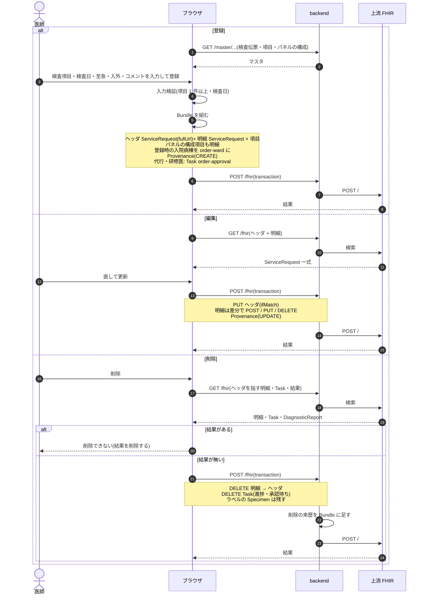

### シーケンス図: ラベル発行

`pages/LabWorklistPage.tsx`、`components/LabLabelBatchModal.tsx`、`useUpdateLabTaskStatus` / `useIssueLabLabels`(`api/queries/lab.ts`)、`LabLabelReport`(backend)。
番号は上流が `Specimen` の作成時に採番します(連番 10 桁 + チェックデジット)。

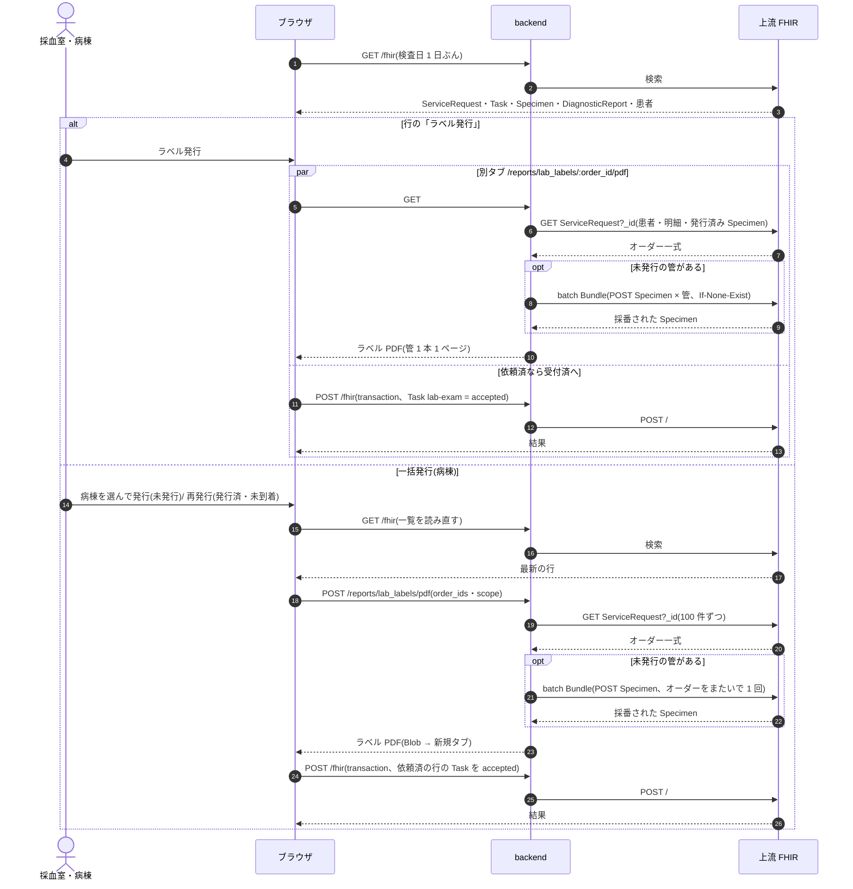

Task の書き込みに失敗しても `Specimen` は残るので、再発行で同じ番号を刷れます。

### シーケンス図: 到着確認

`pages/LabArrivalPage.tsx`、`fetchLabelSpecimenByNumber` / `fetchLabArrivalContext`(`api/queries/injection.ts`)、`buildSpecimenArrival` / `buildSpecimenArrivalCancel`(`fhir/labSpecimenHelpers.ts`)。

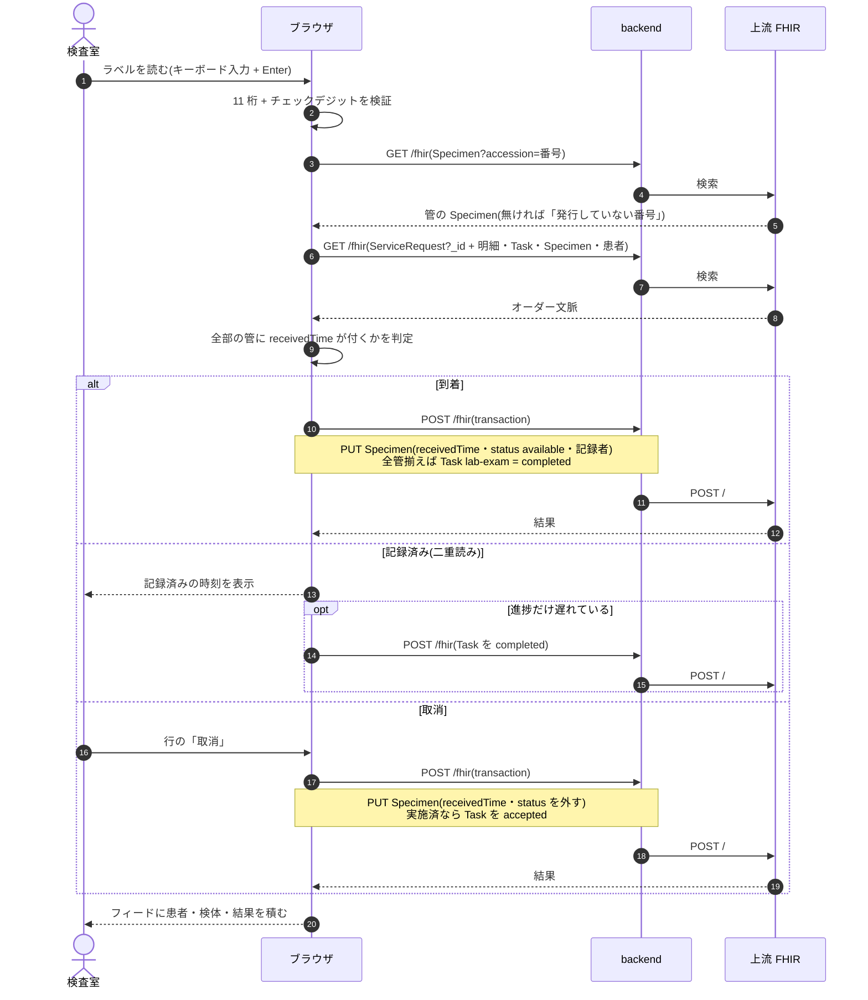

### シーケンス図: 結果登録・訂正

`components/LabResultEntryModal.tsx`(一覧)・`KarteLabResultTab.tsx`・`LabResultForm.tsx`、`buildLabResultBundle` / `buildLabResultUpdateBundle` / `buildLabResultDeleteBundle`(`fhir/labResultHelpers.ts`)、
`useCreateLabResult` / `useUpdateLabResult` / `useDeleteLabResult`(`api/queries/labResult.ts`)。通知の組み立ては `fhir/labPanicHelpers.ts`・`fhir/resultReviewHelpers.ts`。

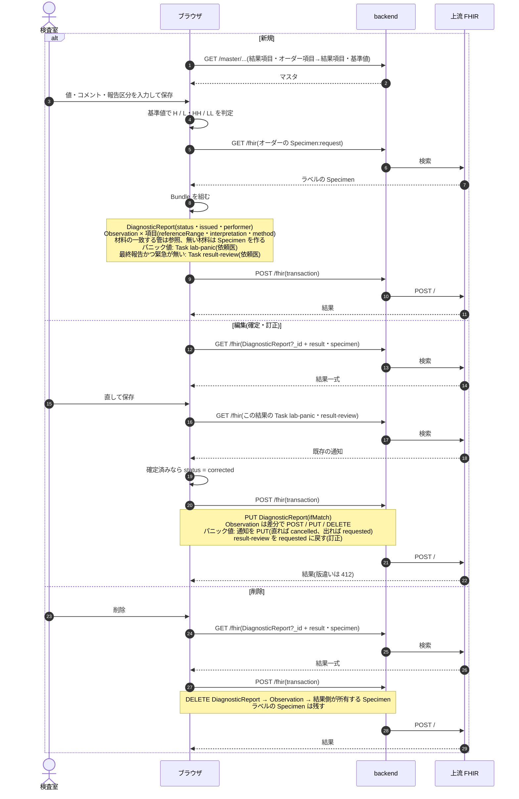

### シーケンス図: 結果取込

`pages/LabResultImportPage.tsx`・`LabResultImportDetailPage.tsx`、`hooks/useLabImportGroupContext.ts`、`fhir/labImportHelpers.ts`、backend の `LabImport::*`。
上流への登録は手入力と同じ `useCreateLabResult` / `useUpdateLabResult` を通ります。

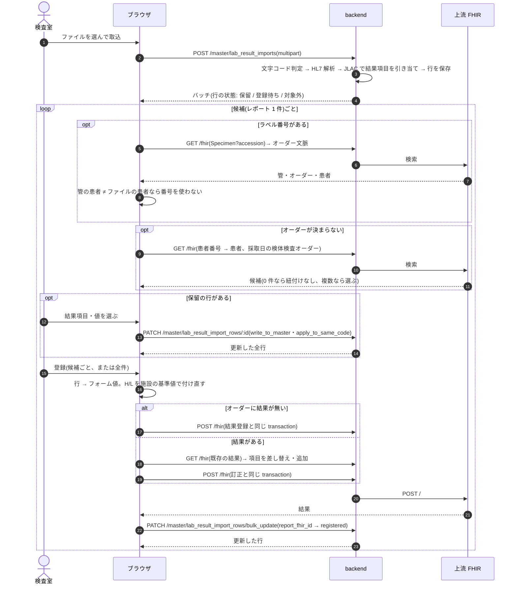

### シーケンス図: 結果確認

`pages/NotificationPage.tsx`(`components/notifications/notificationRegistry.tsx`)、`useMarkResultReviewed`(`api/queries/notification.ts`)、`urgentConfirmationEntries`(`api/notificationActions.ts`)、
`buildReviewProvenance`(`fhir/provenanceHelpers.ts`)。

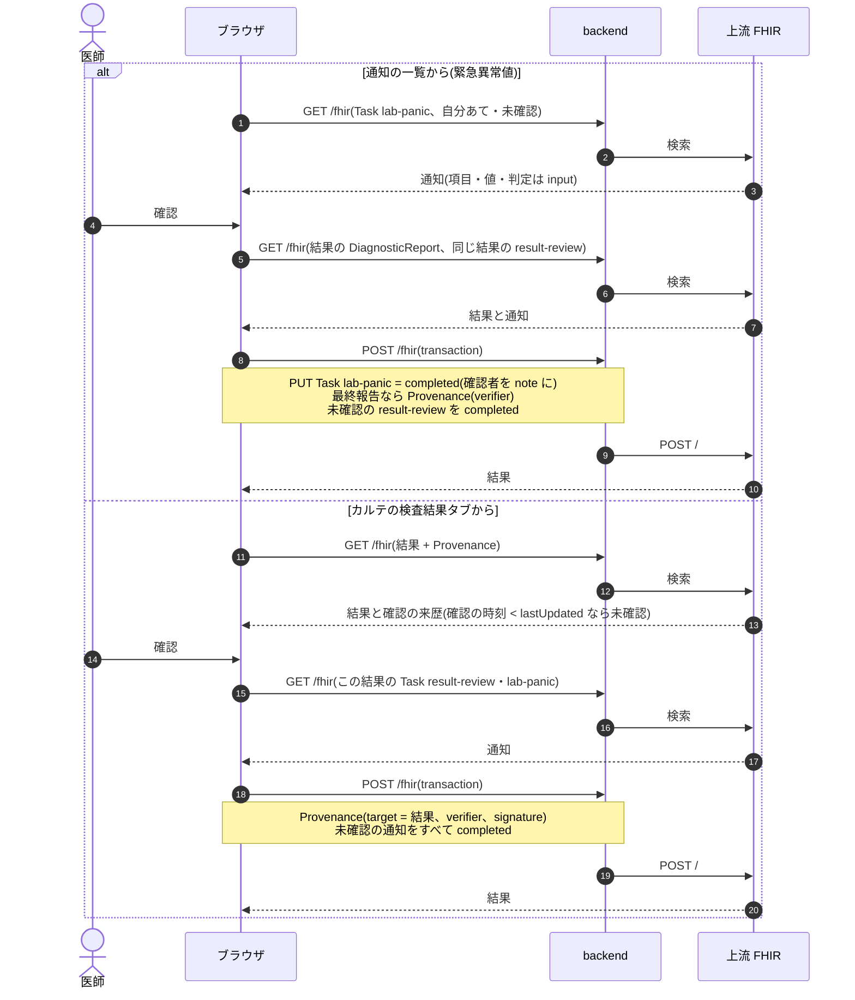

### 医事会計と SS-MIX2

検体検査は実施入力を持たないので、医事会計はオーダーの検査日で集めます(`BillingClaimBuilder` の `:order` 経路)。進捗 Task は見ません。

| 起きたこと | 医事会計(`BillingClaimBuilder`) | SS-MIX2 |
|---|---|---|
| 登録・編集 | 検査日のオーダーの項目を `receipt_code` で送る。血液の検体があれば採血料を最初の剤に 1 回足す。`receipt_code` の無い項目は「送れない項目」に出す | OML^O33(OML-01)。ヘッダを書くと出す。編集も INS |
| 削除 | 対象から外れる | OML^O33 の `CA`(DEL) |
| 中止(Task) | **対象から外れない**(`ServiceRequest` は `active` のまま) | **出ない**(`ServiceRequest.status` を見る) |
| 受付・到着 | なし | なし(Specimen の作成・更新はメッセージにしない) |
| 結果の登録・確定・訂正 | なし | OUL^R22(OML-11)。訂正も INS(前の有効ファイルは過去履歴になる) |
| 結果の削除 | なし | OUL^R22 の `CA`(DEL) |

外来迅速検体検査加算は「当日結果説明」を判定できないので送りません。
