# 検体検査オーダーの業務フロー

検体検査オーダーの登録から採取・到着・結果報告・結果確認までの流れです。
細菌検査・病理検査は状態の考え方が同じですが、容器・採取の記録・レポートが違うので別の文書で扱います。

医療機関の運用を検討する人は「運用フロー」、院内の開発者は「開発者向け」を読みます。
画面のふるまいは [features/lab.md](../features/lab.md)、種別共通の約束(削除・代行入力・日付)は [features/orders-common.md](../features/orders-common.md)、
リソースの要素は実装ガイド(`../fhir-ig`)、ラベル・到着・取込の設計は [lab-label-design.md](../lab-label-design.md)・
[lab-arrival-design.md](../lab-arrival-design.md)・[lab-result-import-design.md](../lab-result-import-design.md) が正典です。

## 運用フロー

このページで使う呼び名です。

- **管(採取管)**: 検体を入れる容器 1 本です。ラベルは管 1 本に 1 枚刷り、到着も管ごとに記録します。同じ検体でも、院内で測る分と外注先に出す分は別の管になります。
- **外注**: 外部の検査センター(外注先)に出して測る検査です。どの検査項目を外注にするか、どこに出すかは、あらかじめマスタと施設設定で決めておきます(「外注検査の流れ」)。
- **依頼医**: オーダーを指示した医師です(画面では「依頼医師」「指示医師」)。結果の通知の宛先になります。
- **状態**: 採血室・検査室の作業がどこまで進んだかを示します(依頼済・受付済・実施済・中止)。検体検査一覧の「ステータス」の列に出ます。
- **パニック値**: 結果項目ごとに決めた、すぐに知らせるべき危険な値の範囲です。外れると判定が HH / LL になり、依頼医に「緊急異常値」の通知が届きます。

### 区分ごとの違い

| 検体検査 | ラベル発行 | 到着確認 | 結果の登録 | 医事会計への送信 |
|---|---|---|---|---|
| 入院 | 病棟ごとに一括で発行する | する | する | 送らない |
| 外来 | 患者が来てから行で発行する | する | する | 送る |

- **入院のラベル**: 前日か当日の朝に、病棟ごとに「ラベル一括発行」でまとめて刷ります。検体検査一覧の行から 1 件ずつ刷ることもできます。
- **外来のラベル**: 患者が採血室に来てから、検体検査一覧の行の「ラベル発行」で刷ります。
- **医事会計への送信**: 外来だけです。検査日のオーダーから送り、血液の検体があれば採血料を 1 回足します。
- **検査日**: 検体検査オーダーは検査日(検体を採る日)を持ち、時刻は持ちません。予約枠は使いません。日付未定にはできません。

### 全体の流れ

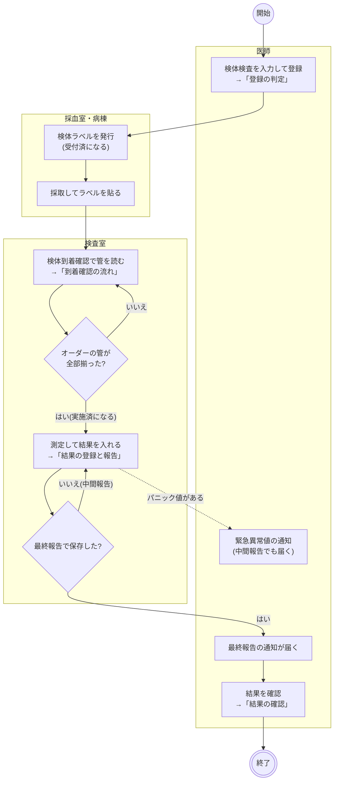

- **ラベル発行**: 入院はラベルを前にまとめて刷り、外来は患者が来てから刷ります。どちらも発行で受付済になります。
- **採取**: 採取そのものは記録しません。誰がいつ採ったかは残りません。採取を記録するのは細菌検査と病理検査です。
- **看護ワークシート**: 採取の印は、ラベルを刷ると「ラベル済」、管が全部届くと「到着済」になります。
- **到着の前の結果**: 到着を待たずに、カルテの「検体検査」タブから結果を登録することもできます。
- **報告区分**: 中間報告は何度でも出し直せます。最終報告にすると、依頼医に通知が届きます。確定した結果を直すと訂正報告になり、通知は未確認に戻ります。
- **パニック値**: 報告区分に関わらず、緊急異常値の通知が届きます。中間報告のうちに確認しても、結果の確認は済みません(「結果の確認」)。
- **結果の入れ方**: 手入力のほか、分析装置・外注のファイルを取り込めます(「結果取込の流れ」)。
- **外注**: 外注の検査も、ラベル発行・採取・到着確認までは院内の検査と同じ画面と手順です。届いた管を外注先に提出し、返ってきた結果を入れます(「外注検査の流れ」)。

### 検体検査の状態

採血室・検査室の進み具合を示す状態です。結果の登録では変わりません。

| 状態 | 変わるきっかけ | 検体検査一覧の行のメニューからできること |
|---|---|---|
| 依頼済 | 医師の登録、受付済からの「取消」、「中止取消」 | 「受付」、「中止」 |
| 受付済 | 「ラベル発行」(行・一括)、「受付」、実施済からの「取消」、到着の取消 | 「実施」、「取消」、「中止」 |
| 実施済 | 到着確認でオーダーの全部の管が揃う、「実施」 | 「取消」 |
| 中止 | 「中止」 | 「中止取消」 |

- **行に直接出るボタン**: 「ラベル発行」(依頼済・受付済の行)、「結果登録」(実施済の行)、「表示」です。
- **「受付」**: ラベルを刷れない環境のための代わりの操作です。ふだんは「ラベル発行」が受付を兼ねます。
- **「実施」**: スキャナが使えないときの代わりの操作です。管ごとの到着は記録されません。
- **一覧の「取消」**: 押し間違いを直すために、1 つ前の状態へ戻します(実施済 → 受付済、受付済 → 依頼済)。管の到着の記録は消えません。
- **「中止」**: 検査を取りやめます。「中止取消」で依頼済に戻ります。

管 1 本ごとにも状態があり、未発行 → 発行済 → 到着済と進みます。検体検査一覧の検査内容の欄に出ます。
オーダーの状態は作業がどこまで進んだかを、管の状態は現物がどこにあるかを示します。ラベルを刷り直しても、管の状態は変わりません。
外注の管は、到着の後に外注先への提出を記録します。提出と結果の届き具合は「外注検査」の画面で追います(「外注検査の流れ」)。

### 登録の判定

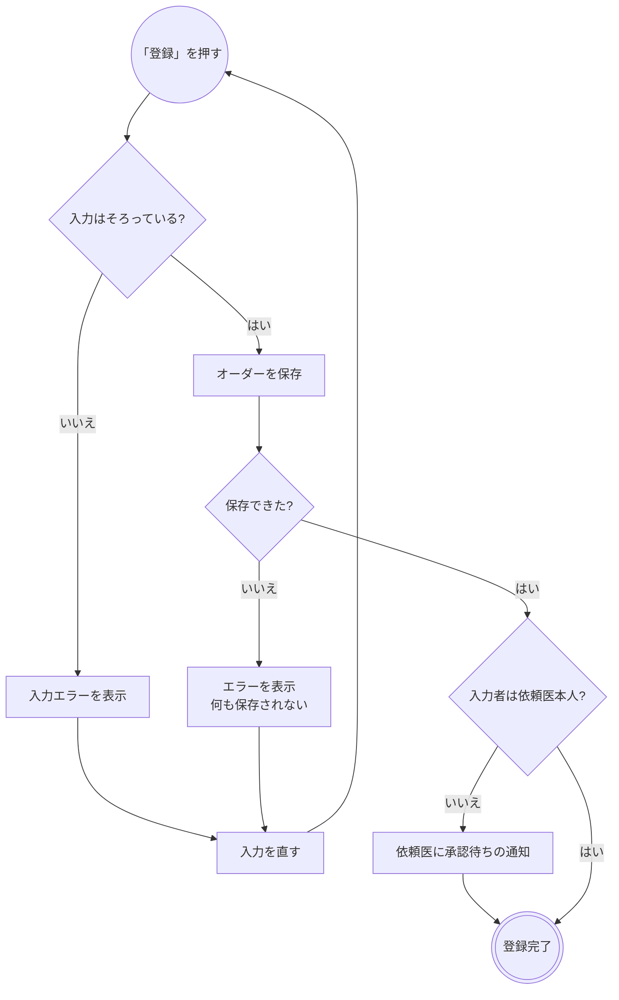

| 項目 | 条件 |
|---|---|
| 検査項目 | 1 つ以上 |
| 検査日 | 必須(オーダーセット・クリニカルパスの内容として作るときは不要) |

- **警告**: 処方・注射で出る重複・回数・施設の規則の警告は、検体検査では出ません。外部の判断支援への問い合わせもありません。
- **検査項目の選び方**: 検査伝票(レイアウト)のタブか「検査項目検索」から選びます。「肝機能セット」のような項目のまとまりも、ほかの項目と同じくここから選びます。オーダーセットは、カルテの右ペインの「セット」から出します。
- **パネル**: パネルを選ぶと、その構成項目も一緒に入ります。構成項目を外すと、その項目だけを除いてオーダーできます。
- **外注の項目**: 「選択中」で、外注の項目に「外注」の印が付きます。院内の項目と同じ検体でも、別の管(GP)に分かれます。外注先は登録した時点のマスタと施設設定で決まり、後でマスタを変えても登録済みのオーダーは変わりません。
- **承認待ち**: 承認待ちのあいだも、オーダーは検体検査一覧に出ます。承認は通知の一覧か、カルテの詳細から行います。
- **セット・パス・レジメン**: オーダーセット・クリニカルパス・レジメンから出した検体検査も、ここと同じ判定で登録されます。

### 到着確認の流れ

画面は「部門業務 > 臨床検査部門 > 検体到着確認」です。管のラベルを 1 本ずつ読みます。

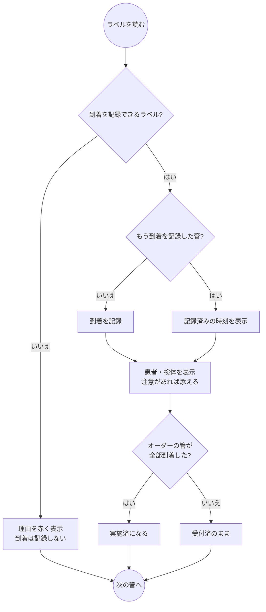

到着を記録しないラベルと、画面に出る文言です。

| 読んだラベル | 画面の文言 |
|---|---|
| 番号の形式が違う(11 桁でない、末尾の 1 桁が合わない) | 「番号の形式が正しくありません(読み取りエラーの可能性)」 |
| 発行していない番号 | 「この番号の発行記録がありません」 |
| 病理検査のラベル | 「病理検査の検体です(病理の受付で読んでください)」 |
| 細菌検査の取り下げたラベル | 「取り下げたラベルです(刷り直したラベルを読んでください)」 |
| 通信が切れた | 「到着を記録できませんでした(通信エラー)。もう一度スキャンしてください」 |

到着は記録したうえで、注意を添えるラベルです。

| 読んだラベル | 画面の注意 |
|---|---|
| 中止したオーダーの管 | 「このオーダーは中止されています」 |
| 訂正で外れた検体の管 | 「オーダーにこの検体はありません(訂正で外れた可能性)」 |
| 削除したオーダーの管 | 「オーダーが見つかりません(削除された可能性)」 |

- **番号**: ラベルの番号は 11 桁で、末尾の 1 桁は読み間違いを見つけるための検査用の数字です。手で打ち込むこともできます。
- **並び**: 読んだ順に上から積みます。貼り間違いに気付けるよう、患者氏名と検体を必ず出します。
- **実施済になるとき**: オーダーが受付済で、全部の管が届いたときです。もう記録した管を読み直したときも、揃っていれば実施済に進みます。
- **中止したオーダーの管**: 現物が届いた事実を残すため、到着は記録します。要らなければ、行の「取消」で消します。
- **到着の取消**: 行の「取消」は、その管の到着を消します。実施済まで進んでいたオーダーは受付済に戻ります。検体検査一覧の「取消」とは別の操作です。
- **細菌検査**: 細菌検査の容器も同じ画面で読みます。細菌検査は、容器が揃うと実施済ではなく受付済になります。

### 外注検査の流れ

外注の管を外注先に渡し、結果が返ってくるまでを追います。画面は「部門業務 > 臨床検査部門 > 外注検査」です。外注の管を 1 本 1 行で並べます。

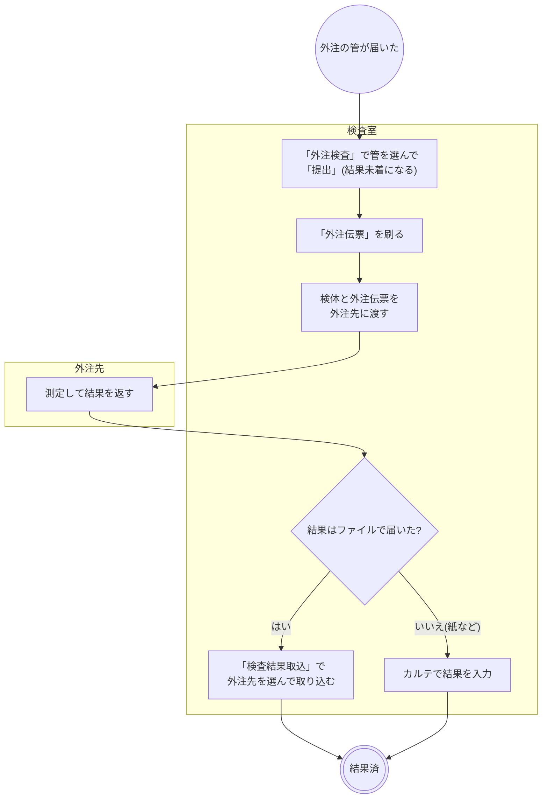

「外注検査」の画面の「状況」です。

| 外注の管の状況 | 意味 |
|---|---|
| ラベル未発行 | まだラベルを刷っていない。提出できない |
| 提出待ち | ラベルを刷ったが、まだ提出していない |
| 結果未着 | 提出したが、その管の結果がまだ確定していない |
| 結果済 | その管の結果が確定した |

**日々の操作**

- **提出**: 提出待ちの管にチェックを付けて「提出」を押すと、提出した日時と記録した人が残ります。到着確認とは別の操作で、到着を記録していなくても提出できます。
- **提出の取消**: 結果未着の行の「取消」で、提出待ちに戻ります。
- **外注伝票**: 外注先と提出日を選んで「外注伝票」を押すと、その日にその外注先へ提出した管の一覧(外注検査依頼書)が別のタブで開きます。ブラウザから A4 縦で印刷し、検体と一緒に渡します。
- **絞り込み**: 外注先・検査日の期間・状況で絞ります。期間ははじめは今日までの 30 日、状況ははじめは提出待ちです。中止した検査は出ません。

**結果の届き具合**

- 管ごとに見ます。院内の項目だけを先に確定しても、外注の管は結果未着に残ります。
- 外注先が一部の項目だけ先に返したときも、1 項目でも確定すれば結果済になります。項目ごとの未着は追いません。
- 外注の結果は、取込で外注先を選ぶか、オーダーの項目を並べて手入力したときに、その管の結果として数えられます。

**ほかの画面での見え方**

- **検体検査一覧**: 外注の項目を含むオーダーの検査内容に「外注」の印が付きます。「実施区分」で院内・外注に絞れます。院内と外注が混ざるオーダーは、どちらで絞っても出ます。
- **表示・カルテ**: 外注の管(GP)の見出しに「外注: 外注先の名前」が付きます。
- **検体ラベル**: 外注の管のラベルには「外注」と外注先の名前が刷られます。

**準備(マスタと施設設定を管理する人)**

- **外注先**: 「マスタメンテ > 連携先 > 連携先医療機関」で、外注先の医療機関に「検査委託先」のチェックを付けます。
- **外注にする検査項目**: 「マスタメンテ > 検体検査 > 検査オーダー項目」で、実施区分を「外注」にします。出す先がほかと違う項目だけ「外注先」を選びます。
- **既定の外注先**: 「管理 > 施設設定」の「検体検査の外注」で決めます。外注先を選んでいない外注の項目は、ここに出します。
- 項目にも施設設定にも外注先が無い外注の項目は、院内の検査として扱われます。

### 結果の登録と報告

結果を入れる場所は 3 つあります。

| 入れる場所 | 入れる人 | 対象のオーダー |
|---|---|---|
| 検体検査一覧の「結果登録」 | 検査室 | 実施済の行で、結果がまだ無いオーダー。オーダーは行で決まる |
| カルテの「検査結果」>「検体検査」タブの「新規登録」「DO」「編集」 | 医師・検査室 | オーダーを選んで紐付けるか、紐付けずに登録する |
| 「検査結果取込」 | 検査室 | →「結果取込の流れ」 |

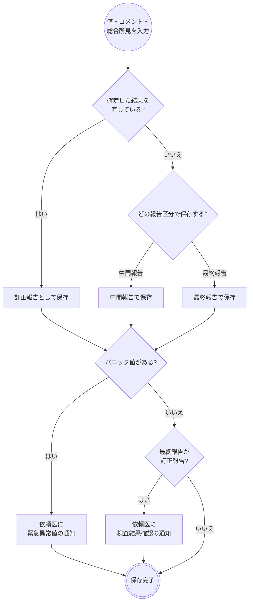

**判定と報告区分**

- 基準値で H / L、パニック値で HH / LL を自動で付けます。
- 中間報告では、検査結果確認の通知は出ません。緊急異常値の通知は出ます。
- 確定した結果を直して保存すると、訂正報告になります。確認済みの通知は未確認に戻ります。

**緊急異常値と検査結果確認**

- 同じ結果に、2 つの通知を並べて出しません。未確認の緊急異常値の通知があるあいだは、検査結果確認の通知を出しません。
- 訂正で値が直ってパニック値でなくなると、緊急異常値の通知は取り下げられます。訂正でまたパニック値になると、同じ通知が未確認に戻ります。

**入れる場所ごとの違い**

- 検体検査一覧の「結果登録」は、オーダーの検査項目が並んだ状態で開きます。結果が付いたオーダーでは押せません。確定・訂正はカルテから行います。
- カルテでオーダーに紐付けずに登録すると、依頼医が決まらないので、通知の宛先がありません。
- DO(前回の結果と同じ検査項目で、新しく登録する)は、カルテの「検体検査」タブで選んだ結果から始めます。

**記録されること**

- 実施施設は自院、実施者はログインした人が入ります。編集しても、最初の実施者が残ります。実施者は画面には出ません。
- 外注の項目は、項目ごとに外注先が実施施設として残ります。オーダーの項目を並べて入力したときと、外注先を選んで取り込んだときに入ります。登録画面と内容表示で、項目名の横に「外注」の印が付きます。
- 画面で足した項目、オーダーに紐付けない結果、DO で作った結果は、院内の結果になります。
- 報告日時は、保存のたびに更新されます。

**印刷**

- 結果の内容表示の「印刷」で、検査結果報告書を刷ります。1 件 1 枚で、材料は刷りません。

### 結果取込の流れ

検査室の分析装置・外注ラボから受け取った結果のファイルを読み込み、手入力と同じ形で結果を登録します。画面は「部門業務 > 臨床検査部門 > 検査結果取込」です。

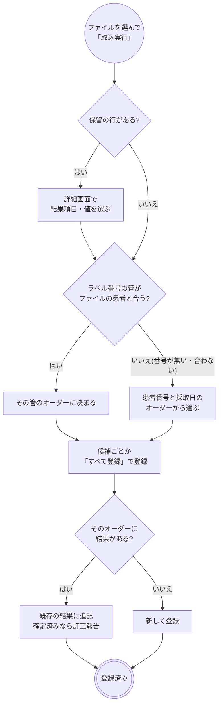

**読み込み**

- ファイルの文字コードは自動で判定します。外れるときは、取込の画面で文字コードを指定できます。
- 取込の画面で「外注先」を選びます。外注先から届いたファイルはその外注先を、院内の分析装置のファイルは「院内」を選びます。外注先を選ぶと、そのファイルの結果はすべてその外注先で測った結果になります。
- 結果項目は、ファイルの検査項目コード(JLAC)で結果項目マスタから引き当てます。

**保留の行**

- 結果項目が決まらない行と、値が選択肢に無い行は保留になります。詳細画面で結果項目と値を選びます。
- 結果項目を選ぶとき、その JLAC を結果項目マスタに書き込めます。次からは自動で当たります。

**患者とオーダー**

- ファイル 1 件の中の検査ごとに、結果 1 件の候補ができます。
- ラベル番号の管の患者がファイルの患者と違うときは、番号を使わず、患者番号で照合し直します。
- 採取日のオーダーが無ければ、オーダーに紐付けずに登録します。複数あれば画面で選びます。

**登録**

- 読み込んだだけでは、結果は登録されません。人が確かめて、登録を押します。
- 登録は手入力と同じなので、パニック値の通知・検査結果確認の通知・報告区分の扱いも同じです。
- H / L は施設の基準値で付け直します。基準値の無い項目だけ、ファイルの判定を写します。
- 中間報告か最終報告かは、ファイルに書かれた報告区分で決まります。
- 前に読み込んだファイルと同じ識別番号(メッセージ ID)のファイルは、詳細画面で知らせます。訂正版が同じ番号で届くことがあるので、読み込みは止めません。
- 結果のあるオーダーへの登録は追記になるので、同じ結果が 2 件にはなりません。

### 結果の確認

最終報告か訂正報告が保存されると、依頼医に通知が届きます。医師が結果を読んで「確認」を押すと、確認した人と日時が残ります。

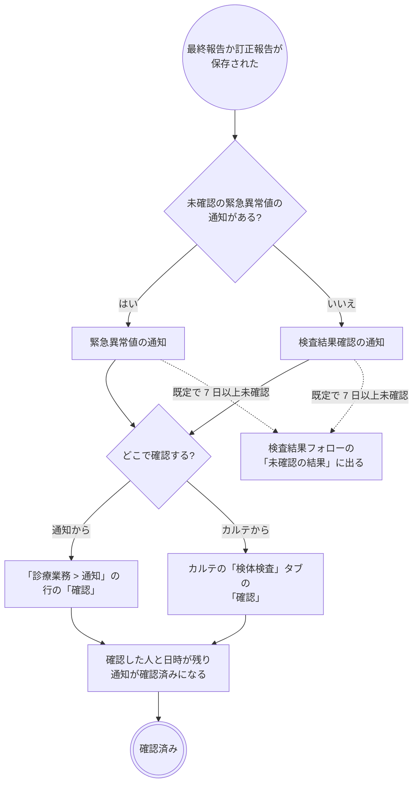

**誰が確認するか**

- 宛先は依頼医ですが、確認は誰でもできます(当直医・主治医が先に読むことがあるため)。記録には確認した本人が残ります。

**確認した場所ごとに残ること**

- **緊急異常値の通知で確認したとき**: 通知が確認済みになります。最終報告・訂正報告なら、結果の確認も同時に残ります。
- **中間報告のうちに緊急異常値を確認したとき**: 結果の確認は残りません。最終報告にしたときに、検査結果確認の通知が改めて届きます。
- **カルテで確認したとき**: 結果の確認が残り、未確認の緊急異常値の通知も確認済みになります。

**確認できないとき**

- 中間報告のうちは、結果の確認はできません。訂正報告になると、未確認に戻ります。
- 検査結果フォローの「未確認の結果」の一覧からは確認できません。カルテで内容を見て確認します。

### 変更・中止・削除

| 操作 | できる場所 | できるとき |
|---|---|---|
| 変更 | カルテのカード | いつでも(結果があってもできる) |
| 中止 | 検体検査一覧の行のメニュー | 依頼済・受付済 |
| 中止取消 | 検体検査一覧の行のメニュー | 中止 |
| 一覧の「取消」 | 検体検査一覧の行のメニュー | 受付済・実施済 |
| 到着の取消 | 検体到着確認の行の「取消」 | 管の到着を記録したあと |
| 削除 | カルテのカード | 結果が無いとき |
| 結果の削除 | カルテの「検体検査」タブ | 結果があるとき |

- **変更**: 代行入力のときは、もう一度承認が要ることがあります。検査室への通知は出ず、検体検査一覧の内容が変わります。
- **検体を足す変更**: ラベルを刷った後に検体を足したら、新しい管のラベルを刷ります。
- **検体を外す変更**: 刷ったラベルの管は記録に残ります。到着確認で読むと「オーダーにこの検体はありません(訂正で外れた可能性)」と出ます。
- **中止**: 到着した管の記録はそのまま残ります。医事会計の対象から外れます。会計を送ったあとの中止は、医事課が送り直します。
- **中止取消**: 依頼済に戻ります。受付済・実施済には戻りません。
- **一覧の「取消」と到着の取消**: 一覧の「取消」は状態を 1 つ戻すだけで、管の到着は消えません。到着の取消は管の到着を消し、実施済のオーダーは受付済に戻ります。
- **削除**: 結果があるオーダーは、先に結果を削除します。オーダーを削除すると状態も消えますが、発行した管の記録は残ります。
- **結果の削除**: 結果と通知が消え、検体検査一覧の「結果登録」がまた押せるようになります。管の記録は残ります。

### 帳票

| 帳票 | 出す場所 | 内容 |
|---|---|---|
| 検体ラベル | 検体検査一覧の行の「ラベル発行」、「ラベル一括発行」 | 管 1 本に 1 枚 |
| 検査結果報告書 | カルテの「検体検査」タブの内容表示の「印刷」 | 結果 1 件に 1 枚(A4 縦・2 段) |
| 外注伝票(外注検査依頼書) | 「外注検査」の「外注伝票」 | 外注先 1 つ・提出日 1 日ぶんで 1 枚(A4 縦)。ブラウザから印刷する |

検体ラベルに刷る内容です。

- バーコード(番号)
- 患者番号・カナ・性別・生年月日
- 検体・採取管(色)
- 検査日・至急
- 検査項目の略称
- 外注の管は「外注」と外注先の名前

検査結果報告書には、検査項目・結果値・判定・単位・基準値と、コメント・総合所見を刷ります。外注の印はまだ刷れません。

外注伝票には、依頼先・依頼元・提出日・本数と、管ごとに採取番号・患者番号・氏名・性別・生年月日・検査日・検体・検査項目を刷ります。

## 開発者向け

### シーケンス図の前提

- **書き込みの経路**: `/fhir` への書き込みはどれも 1 回の transaction Bundle で、backend の `FhirProxyController` が上流へ中継します。
- **上流**: 上流の FHIR サーバーです。図では「上流 FHIR」と書きます。
- **応答の中継**: 上流の応答も backend を通って画面へ戻ります。図では省いて、上流から画面へ直接返す矢印で描きます。
- **SS-MIX2**: 有効にしている施設では、中継が書き込みの控えを記録します(`Ssmix2::Recorder`)。
- **楽観ロック**: 版は `postBundle` が `ifMatch` に添え、版が違えば 412 で止まります。
- **例外**: ラベルの PDF は、backend(`LabLabelReport`)が上流を直接読み書きします。こちらは batch Bundle です。
- **ヘッダと明細**: ヘッダはオーダー 1 件を表す `ServiceRequest`、明細は検査項目 1 件を表す `ServiceRequest` です。
- **進捗 Task**: 採血室・検査室の作業の状態を持つ Task(`lab-exam`)です。
- **管の Specimen**: ラベルを刷った管 1 本を表す `Specimen` です。発行で作り、到着を記録します。
- **結果の Specimen**: 結果に付ける検体です。材料の一致する管の Specimen を指すか、結果側が作ります。
- **ラベル番号**: 連番 10 桁 + チェックデジット 1 桁の計 11 桁です。上流が管の Specimen の作成時に採番します。
- **図の登場者**: 「運用フロー」節の部署(医師・採血室・病棟・検査室)に合わせています。

### リソースの構成

- ヘッダ `ServiceRequest`(`order-type|lab`)
  - 明細 `ServiceRequest`(検査項目 1 件。`basedOn` でヘッダを指す)
    - パネルの構成項目の明細(`basedOn` でパネルの明細を指す)
    - contained `Specimen`(採る検体。`ServiceRequest.specimen` から指す)
  - 進捗 Task(`lab-exam`。`focus` でヘッダを指す)
  - 管の Specimen(`request` でヘッダを指す)
  - 結果 `DiagnosticReport`(`basedOn` でヘッダを指す)
    - `Observation`(項目の結果。`result` から指す)
    - 結果の Specimen(`DiagnosticReport.specimen` から指す)
    - 緊急異常値の通知 Task(`lab-panic`。`focus` で結果を指す)
    - 検査結果確認の通知 Task(`result-review`。`focus` で結果を指す)
    - 確認の来歴 `Provenance`(`target` で結果を指す)

| リソース | 要素 | 中身 |
|---|---|---|
| 明細 `ServiceRequest` | `code` ほか | オーダー時点のマスタの内容(項目コード・名称・JLAC・検体・採取管)を写す |
| 明細 `ServiceRequest` | `performer` | 外注の項目だけ、外注先の `Organization`。院内は持たない |
| ヘッダ `ServiceRequest` | `performer` | 明細の外注先を重複なしで写す(外注検査の画面が外注先で引くため) |
| 管の Specimen | `identifier`(`lab-tube-destination`) | 外注の管の行き先(外注先の id)。院内の管は持たない |
| 管の Specimen | 拡張 `lab-outsource-shipped-at`・`lab-outsource-shipment-recorder` | 外注先への提出の日時と記録した人 |
| `Observation` | `performer` | 外注の項目だけ、外注先の `Organization`。院内は持たない |
| 管の Specimen | `accessionIdentifier` | ラベル番号 |
| 管の Specimen | `receivedTime` と `status: available` | 到着 |
| 管の Specimen | 拡張 `lab-arrival-recorder` | 到着を記録した人 |
| `DiagnosticReport` | `status` | 報告区分(`preliminary` / `final` / `corrected`) |
| `DiagnosticReport` | `effectiveDateTime` | 採取日 |
| `DiagnosticReport` | `issued` | 報告日時 |
| 結果の Specimen | (参照するとき) | 材料と行き先の一致する管の Specimen を参照する。書き換えない |
| 結果の Specimen | (作るとき) | 材料と行き先の一致する管が無いときと、紐付けの無い結果のとき。結果側が作って所有し、外注なら行き先の `identifier` を付ける |
| 緊急異常値の通知 Task | `owner`・`priority` | 依頼医、`stat` |
| 緊急異常値の通知 Task | `input` | パニック値の項目・値・判定 |
| 検査結果確認の通知 Task | `owner` | 依頼医。最終報告と訂正報告のときだけ作る |
| 確認の来歴 `Provenance` | `agent.type`・`signature` | `verifier`。確認の正本。通知は宛先と未確認・確認済みだけを持つ |
| 代行入力の `Provenance` | `target`・`activity` | ヘッダ(明細は入れない)、CREATE / UPDATE |

明細の組み立ては `fhir/labOrderHelpers.ts` にあります。

### 進捗 Task(`lab-exam`)

- Task は登録時には作りません。**Task が無いオーダーは依頼済**として扱い、最初のステータス変更で作ります(`fhir/labTaskHelpers.ts`)。
- 中止は同じ transaction でヘッダを `revoked` にし、中止取消で `active` に戻します(`orderCancelEntries`)。
- 中止したオーダーを編集しても `revoked` のままです(`keepOrderRevoked`)。

| 状態 | `Task.status` | `executionPeriod` |
|---|---|---|
| 依頼済 | `requested`(または Task 無し) | なし |
| 受付済 | `accepted` | `start` |
| 実施済 | `completed` | `start` / `end` |
| 中止 | `cancelled`(ヘッダは `revoked`) | なし |

- **ふだんの進め方**: 行の「ラベル発行」と一括発行が受付済へ、全部の管の到着が実施済へ進めます。
- **代わりの操作**: 行のメニューの「受付」「実施」は、同じ Task の書き込みを手で行う代わりの操作です。
- **一覧の「取消」と到着の取消**: 一覧の「取消」は Task を 1 つ前に戻すだけです。到着の取消は管の Specimen の到着を外し、実施済なら Task を `accepted` に戻します。

### 部品

| 操作 | 画面 | 組み立て | hook |
|---|---|---|---|
| 登録 | `components/LabOrderForm.tsx`・`LabOrderPanels.tsx` | `buildLabOrderBundle`(`fhir/labOrderHelpers.ts`) | `useCreatePrescription` |
| 編集 | 同上 | `buildLabOrderUpdateBundle` | `useUpdatePrescription` |
| 削除 | カルテのカード | `buildLabOrderDeleteBundle` | `useDeleteLabOrder`(`api/queries/lab.ts`) |
| 一覧・状態の変更 | `pages/LabWorklistPage.tsx` | `fhir/labTaskHelpers.ts` | `useUpdateLabTaskStatus`(`api/queries/lab.ts`) |
| ラベル一括発行 | `components/LabLabelBatchModal.tsx` | backend の `LabLabelReport` | `useIssueLabLabels`(`api/queries/lab.ts`) |
| 到着確認 | `pages/LabArrivalPage.tsx` | `buildSpecimenArrival` / `buildSpecimenArrivalCancel`(`fhir/labSpecimenHelpers.ts`) | `useUpdateLabArrival`、`fetchLabelSpecimenByNumber` / `fetchLabArrivalContext` |
| 結果登録・訂正・削除 | `components/LabResultEntryModal.tsx`(一覧)・`KarteLabResultTab.tsx`・`LabResultForm.tsx` | `buildLabResultBundle` / `buildLabResultUpdateBundle` / `buildLabResultDeleteBundle`(`fhir/labResultHelpers.ts`) | `useCreateLabResult` / `useUpdateLabResult` / `useDeleteLabResult`(`api/queries/labResult.ts`) |
| 結果の通知 | 同上 | `fhir/labPanicHelpers.ts`・`fhir/resultReviewHelpers.ts` | 同上 |
| 外注検査・提出 | `pages/LabOutsourcePage.tsx` | `labOutsourceTubes`(`fhir/labOutsourceHelpers.ts`)、`buildSpecimenShipment` / `buildSpecimenShipmentCancel`(`fhir/labSpecimenHelpers.ts`) | `useLabOutsourceWorklist` / `useUpdateLabShipment`(`api/queries/lab.ts`) |
| 外注伝票 | `pages/LabOutsourceSlipPage.tsx`(印刷用の別タブ) | 同上 | `useLabOutsourceWorklist` |
| 結果取込 | `pages/LabResultImportPage.tsx`・`LabResultImportDetailPage.tsx` | `fhir/labImportHelpers.ts`、`hooks/useLabImportGroupContext.ts`、backend の `LabImport::*` | `useCreateLabResult` / `useUpdateLabResult` |
| 結果確認(通知から) | `pages/NotificationPage.tsx`(`components/notifications/notificationRegistry.tsx`) | `urgentConfirmationEntries`(`api/notificationActions.ts`) | `useMarkResultReviewed` |
| 結果確認(カルテから) | `KarteLabResultTab.tsx` の `ResultReviewAction` | `buildReviewProvenance`(`fhir/provenanceHelpers.ts`) | `useMarkResultReviewed` |

hook の置き場所は名前と合っていません。

- `useCreatePrescription`・`useUpdatePrescription` は `api/queries/labResult.ts` にあります。名前は処方由来ですが、全種別の登録・編集が通ります。
- `useUpdateLabArrival`・`fetchLabelSpecimenByNumber`・`fetchLabArrivalContext` は `api/queries/injection.ts` にあります。
- `useMarkResultReviewed` は `api/queries/notification.ts` にあります。

### シーケンス図: 登録・編集・削除

登録です。

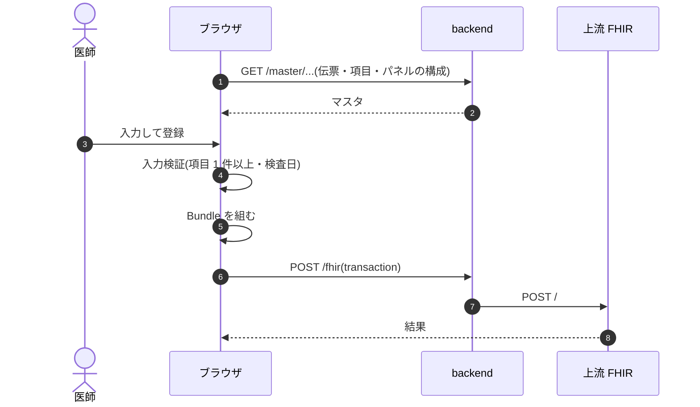

医師が入れるのは、検査項目・検査日・至急・入外区分・コメントです。

| transaction で書くもの | 条件 |
|---|---|
| ヘッダ `ServiceRequest` | `fullUrl` を付ける。登録時の入院病棟を `order-ward` に入れる |
| 明細 `ServiceRequest` × 項目 | パネルの構成項目も明細にする |
| `Provenance`(CREATE) | 毎回 |
| `Task` `order-approval` | 代行入力・研修医のとき |

編集です。

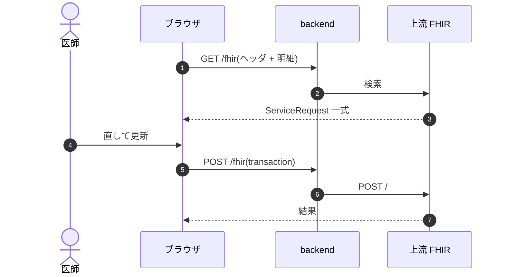

| transaction で書くもの | 条件 |
|---|---|
| PUT ヘッダ | `ifMatch` を添える |
| 明細の POST / PUT / DELETE | 差分で書く |
| `Provenance`(UPDATE) | 毎回 |

削除です。

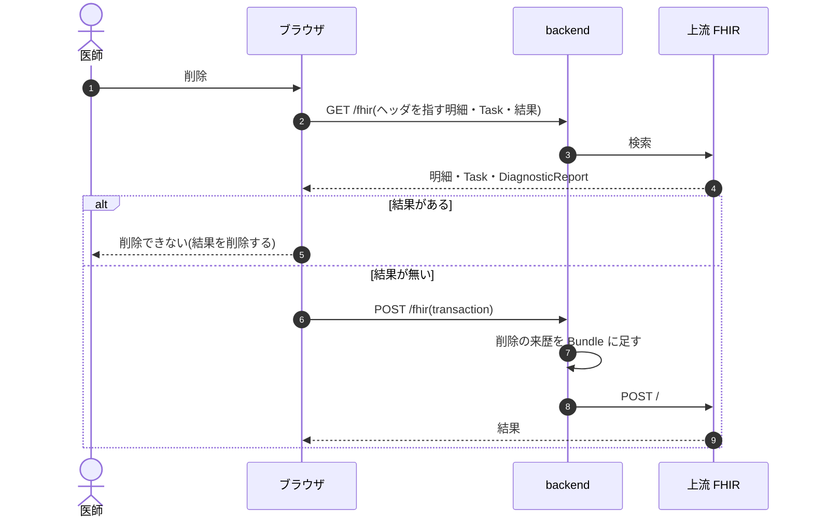

| transaction で書くもの | 条件 |
|---|---|
| DELETE 明細 → ヘッダ | この順に積む |
| DELETE `Task` | 進捗・承認待ち |
| 管の Specimen | 消さずに残す |

### シーケンス図: ラベル発行

行の「ラベル発行」です。

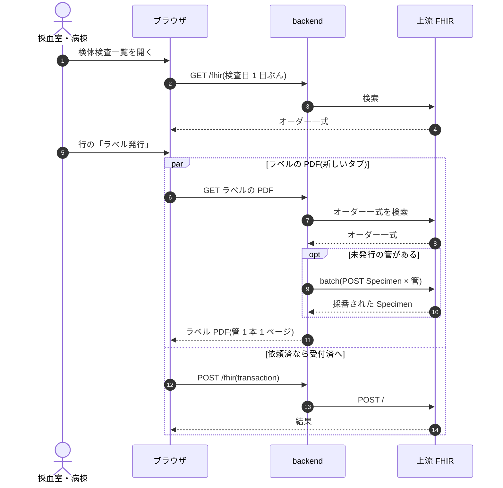

| 読む・書くもの | 条件 |
|---|---|
| 一覧の検索 | 検査日 1 日ぶんの `ServiceRequest`・`Task`・`Specimen`・`DiagnosticReport`・患者 |
| ラベルの PDF | `GET /reports/lab_labels/:order_id/pdf` |
| backend の検索 | `ServiceRequest?_id` に、患者・明細・発行済みの管の Specimen を含める |
| 管の Specimen の作成 | 未発行の管だけ。`If-None-Exist`(オーダー・検体・行き先)を添える。院内の管は `identifier:missing=true` |
| `Task` `lab-exam` = `accepted` | 依頼済のときだけ |

「ラベル一括発行」です。

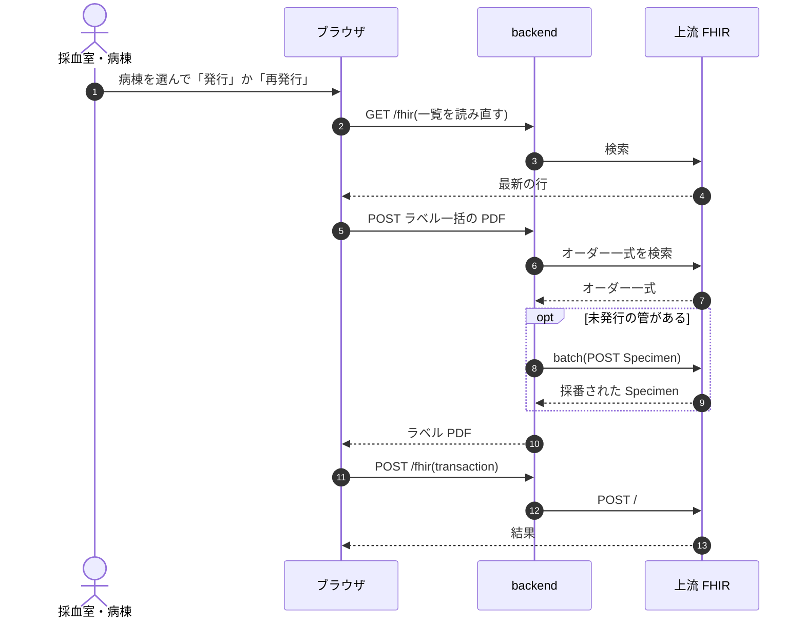

| 読む・書くもの | 条件 |
|---|---|
| ラベル一括の PDF | `POST /reports/lab_labels/pdf`(`order_ids`・`scope`) |
| `scope` | 「発行」は未発行の管、「再発行」は発行済みで未到着の管 |
| backend の検索 | `ServiceRequest?_id` を 100 件ずつ |
| 管の Specimen の作成 | オーダーをまたいで 1 回の batch |
| PDF の受け取り | Blob で受けて新しいタブで開く |
| `Task` `lab-exam` = `accepted` | 依頼済の行だけ |

Task の書き込みに失敗しても管の Specimen は残るので、再発行で同じ番号を刷れます。

### シーケンス図: 到着確認

管を読んで到着を記録するときです。

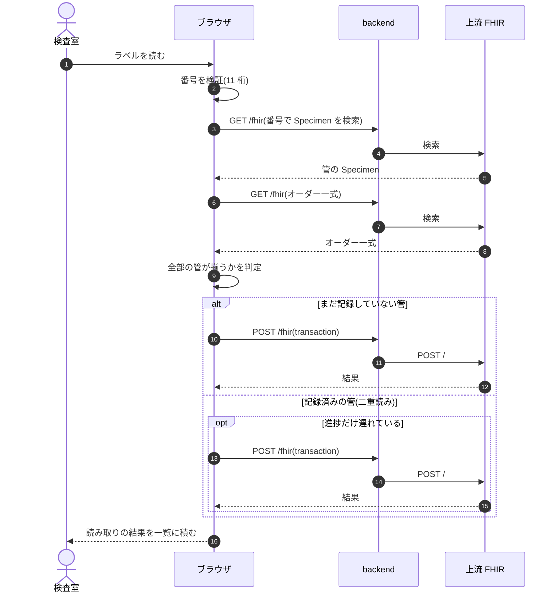

| 読む・書くもの | 条件 |
|---|---|
| 番号の検証 | 11 桁で、末尾のチェックデジット(M10W3)が合うか |
| 管の検索 | `Specimen?accession=番号`。無ければ「この番号の発行記録がありません」 |
| オーダー一式の検索 | `ServiceRequest?_id` に、明細・`Task`・`Specimen`・患者を含める |
| 揃ったかの判定 | オーダーの管(検体と行き先の組)のどれにも、到着した管があるか。今回の管も数える |
| PUT 管の Specimen | `receivedTime`・`status: available`・記録者 |
| `Task` `lab-exam` = `completed` | 全部の管が揃い、`Task` が `accepted` のとき |

- 細菌検査の容器は、同じ画面で別の判定(容器が揃うと受付済)をします。
- 病理の容器と、細菌検査の取り下げたラベルは、到着を記録しません。

到着の取消です。

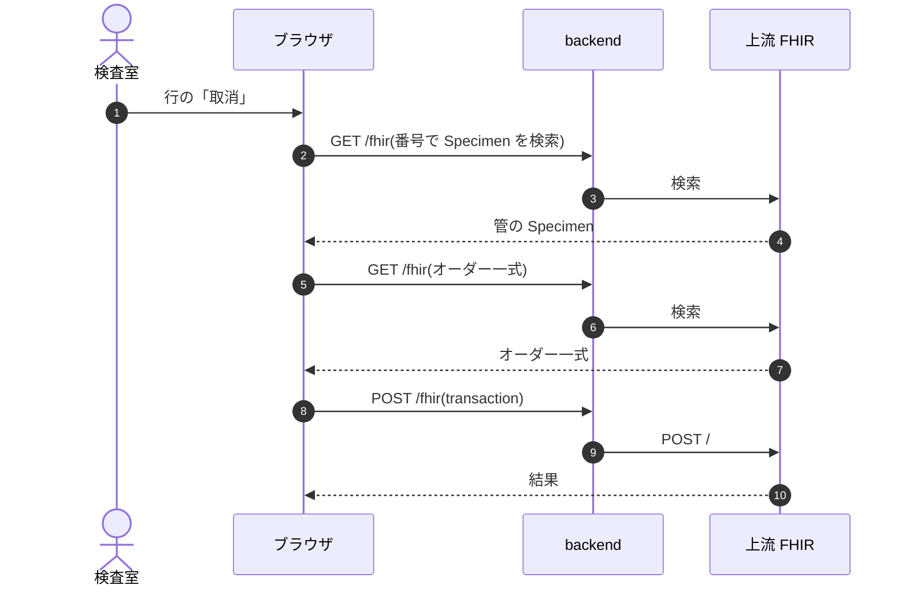

| transaction で書くもの | 条件 |
|---|---|
| PUT 管の Specimen | `receivedTime` と `status` を外す |
| `Task` `lab-exam` = `accepted` | `Task` が `completed` のとき |

画面を開いたまま別の端末で状態が変わっていることがあるので、取消でも管と進捗を読み直します。

### シーケンス図: 外注の提出

外注検査の画面で、選んだ管の提出を記録するときです。

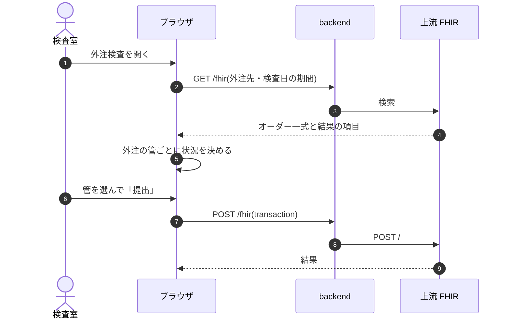

| 読む・書くもの | 条件 |
|---|---|
| 一覧の検索 | `ServiceRequest?performer=外注先`(「すべて」は検査委託先の id をカンマ OR)と `occurrence` の期間。明細・`Task`・管の `Specimen`・`DiagnosticReport` に加え、`_include:iterate=DiagnosticReport:result` で `Observation` を含める |
| 状況の判定 | 管の `Specimen` が無ければラベル未発行、提出の拡張が無ければ提出待ち。その管を参照する確定した `Observation` があれば結果済、無ければ結果未着 |
| PUT 管の Specimen × 選んだ管 | 提出の拡張(日時・記録した人)を足す。取消は拡張を外す |

外注伝票は同じ検索を印刷用の別タブで行い、指定した外注先と提出日の管だけを並べます。

### シーケンス図: 結果登録・訂正

新規です。

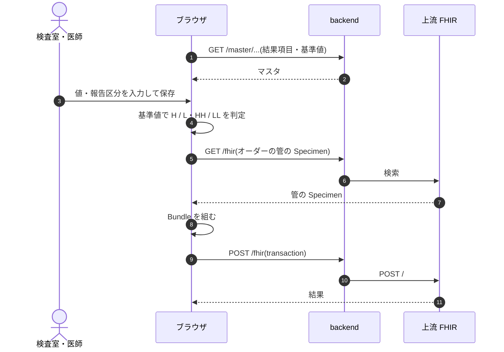

| 読む・書くもの | 条件 |
|---|---|
| マスタ | 結果項目、オーダー項目から結果項目への対応、基準値 |
| 管の検索 | `Specimen:request` でオーダーの管を引く |
| `DiagnosticReport` | `status`・`issued`・`performer` |
| `Observation` × 項目 | `referenceRange`・`interpretation`・`method` |
| 結果の Specimen | 材料と行き先の一致する管があれば参照し、無ければ作る |
| `Task` `lab-panic`(依頼医) | パニック値があるとき。報告区分によらない |
| `Task` `result-review`(依頼医) | 最終報告で、未確認の緊急異常値の通知が無いとき |

編集(確定・訂正)です。

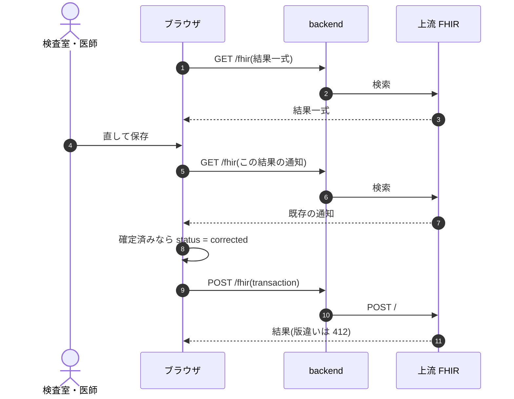

| 読む・書くもの | 条件 |
|---|---|
| 結果一式の検索 | `DiagnosticReport?_id` に `result`・`specimen` を含める |
| 通知の検索 | この結果の `Task` `lab-panic`・`result-review` |
| PUT `DiagnosticReport` | `ifMatch` を添える |
| `Observation` の POST / PUT / DELETE | 差分で書く |
| PUT `Task` `lab-panic` | パニック値が直れば `cancelled`、またパニック値になれば `requested` |
| `Task` `result-review` | 訂正なら `requested` に戻す。未確認の緊急異常値の通知があるあいだは作らず、未確認のものは取り下げる |

削除です。

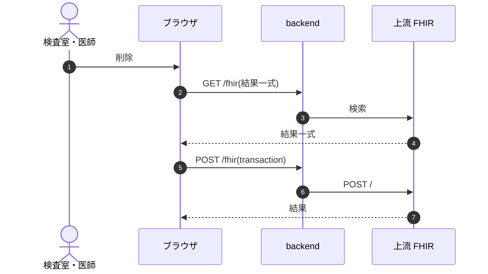

| transaction で書くもの | 条件 |
|---|---|
| DELETE `DiagnosticReport` → `Observation` → 結果側が作った Specimen | この順に積む |
| 管の Specimen | 消さずに残す |

### シーケンス図: 結果取込

ファイルの読み込みです。

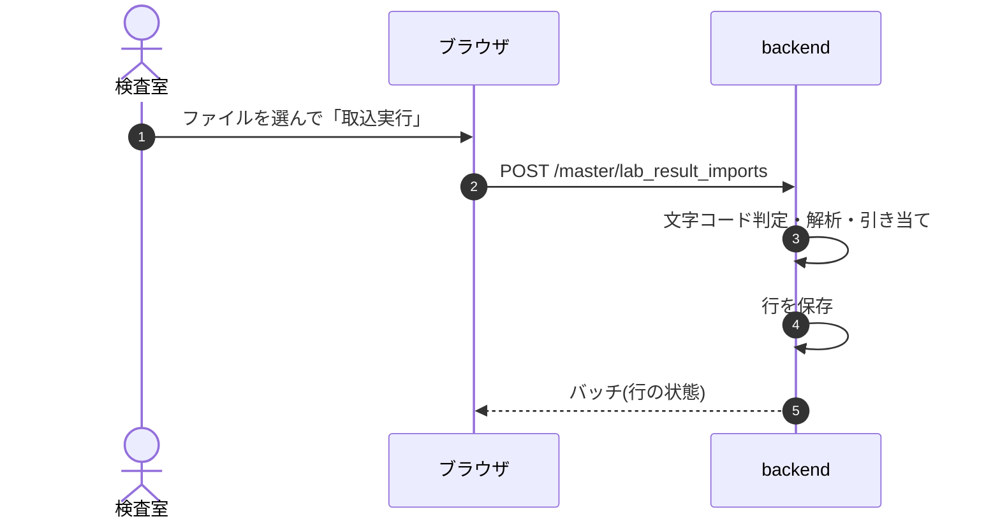

| backend の処理 | 中身 |
|---|---|
| 受け付ける形式 | JAHIS 臨床検査データ交換規約(HL7 v2.5)の ORU^R01(ファイル転送型)と OUL^R22(会話型)。multipart で送る |
| 文字コード | BOM → ESC シーケンス → MSH-18 の宣言 → UTF-8 として妥当か → CP932 の順に判定する。宣言と中身が食い違うファイルは取り込まない |
| 結果項目の引き当て | JLAC10 / JLAC11 の完全一致 → 17 桁の先頭 12 桁の前方一致の順。決まらない行は保留 |
| 値の検証 | CD / CO の値が選択肢に無い行、PQ に数値でない値が来た行は保留 |
| 取り込まない行 | OBX-11 が `X`・`D` の行と、SPM 直下の OBX |
| 候補 | ORC・OBR 群 1 件が結果 1 件 |
| 行の状態 | 保留 / 登録待ち / 対象外 |
| 同じメッセージ ID | 詳細画面で知らせるが、取込は止めない(訂正版が同じ ID で来ることがあるため) |
| 外注先 | 取込の画面で選んだ外注先をバッチに持つ。登録する `Observation` の `performer` になる |

候補ごとの登録です。

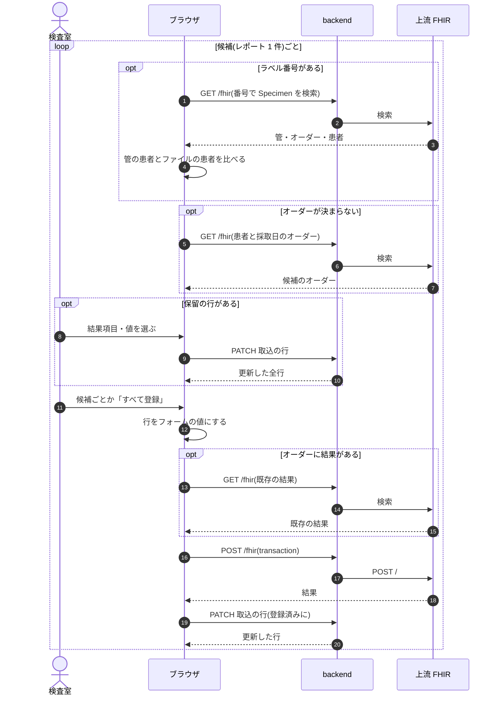

| 読む・書くもの | 条件 |
|---|---|
| オーダーの決め方 | 人が選んだオーダー → ラベル番号 → 患者番号 + 採取日の順 |
| ラベル番号の検索 | `Specimen?accession` から、管・オーダー・患者を引く。管の患者がファイルの患者と違えば番号を使わない |
| 患者と採取日の検索 | 患者番号から患者を引き、採取日の検体検査オーダーを探す。0 件なら紐付けなし、複数なら選ぶ |
| 保留の行の更新 | `PATCH /master/lab_result_import_rows/:id`(`write_to_master`・`apply_to_same_code`) |
| フォームの値 | H / L を施設の基準値で付け直す。基準値の無い項目だけ OBX-8 を写す。OBX-7 は画面に出すだけ |
| 報告区分 | OBR-25 の `P` は中間報告、`F` / `C` は最終報告 |
| transaction | 結果が無ければ結果登録と同じ。あれば項目を差し替え・追加して、訂正と同じ(`useCreateLabResult` / `useUpdateLabResult`) |
| 登録済みの印 | `PATCH /master/lab_result_import_rows/bulk_update`(`report_fhir_id` を付けて `registered` に) |

### シーケンス図: 結果確認

通知の一覧から(緊急異常値)です。

```mermaid
sequenceDiagram
  autonumber
  actor Dr as 医師
  participant UI as ブラウザ
  participant BE as backend
  participant FHIR as 上流 FHIR

  UI->>BE: GET /fhir(自分あての緊急異常値)
  BE->>FHIR: 検索
  FHIR-->>UI: 通知(項目・値・判定)
  Dr->>UI: 確認
  UI->>BE: GET /fhir(結果と、同じ結果の通知)
  BE->>FHIR: 検索
  FHIR-->>UI: 結果と通知
  UI->>BE: POST /fhir(transaction)
  BE->>FHIR: POST /
  FHIR-->>UI: 結果
```

| 読む・書くもの | 条件 |
|---|---|
| 通知の検索 | `Task` `lab-panic`、自分あて・未確認。項目・値・判定は `input` |
| 結果と通知の検索 | 結果の `DiagnosticReport` と、同じ結果の `result-review` |
| PUT `Task` `lab-panic` = `completed` | 確認者を `note` に入れる |
| `Provenance`(verifier) | 最終報告・訂正報告のとき |
| 未確認の `result-review` を `completed` に | あるとき |

カルテの検査結果タブからです。

```mermaid
sequenceDiagram
  autonumber
  actor Dr as 医師
  participant UI as ブラウザ
  participant BE as backend
  participant FHIR as 上流 FHIR

  UI->>BE: GET /fhir(結果と確認の来歴)
  BE->>FHIR: 検索
  FHIR-->>UI: 結果と来歴
  UI->>UI: 確認の時刻と最終更新を比べる
  Dr->>UI: 確認
  UI->>BE: GET /fhir(この結果の通知)
  BE->>FHIR: 検索
  FHIR-->>UI: 通知
  UI->>BE: POST /fhir(transaction)
  BE->>FHIR: POST /
  FHIR-->>UI: 結果
```

| 読む・書くもの | 条件 |
|---|---|
| 未確認の判定 | 確認の来歴の時刻が、結果の `meta.lastUpdated` より前なら未確認 |
| 通知の検索 | この結果の `Task` `result-review`・`lab-panic` |
| `Provenance` | `target` = 結果、`agent.type = verifier`、`signature` |
| 未確認の通知を `completed` に | `result-review` も `lab-panic` も |

### 医事会計と SS-MIX2

医事会計(`BillingClaimBuilder`)は、検体検査を実施記録からではなくオーダーの検査日で集めます(`:order` 経路)。進捗 Task は見ず、中止は `ServiceRequest.status` で判定します。
SS-MIX2 の括弧内はデータ種別、INS / DEL は処理区分です。

| 起きたこと | 医事会計 | SS-MIX2 |
|---|---|---|
| 登録・編集 | 検査日のオーダーの項目を `receipt_code` で送る | OML^O33(OML-01)。編集も INS |
| 削除 | 対象から外れる | OML^O33 の `CA`(DEL) |
| 中止 | 対象から外れる(`ServiceRequest` が `revoked`) | OML^O33 の `CA`(DEL) |
| 中止取消 | 対象に戻る | OML^O33 の `NW`(INS) |
| 受付・到着 | 送らない | 送らない |
| 結果の登録・確定・訂正 | 送らない | OUL^R22(OML-11)。訂正も INS |
| 結果の削除 | 送らない | OUL^R22 の `CA`(DEL) |

- **採血料**: 血液の検体があれば、採血料を最初の剤に 1 回足します。
- **送れない項目**: `receipt_code` の無い項目は「送れない項目」に出します。
- **会計を送ったあとの中止**: 医事課が送り直します。
- **OML^O33**: ヘッダを書くと出します。
- **受付・到着**: `Specimen` の作成・更新はメッセージにしません。
- **結果の訂正**: 前の有効なファイルは過去の履歴になります。
- **外来迅速検体検査加算**: 「当日結果説明」を判定できないので送りません。
