# 食事オーダーの業務フロー

入院患者の食事オーダーを、入院時の開始から食事変更・パターン食・外出泊・退院までの流れと、給食部門の食事一覧・病棟の摂取量の記録まで追います。
食事オーダーは**始まった食から次の指示まで続く**オーダーで、同時に出ているのは 1 本だけが正しい状態です。食事を変えるときは、新しいオーダーを出して、前のオーダーを新しいオーダーが始まる 1 つ前の食で終わらせます。
部門の受付・実施・予約はありません。給食部門はその日の一覧と食数を見るだけで、オーダーの状態は動かしません。

医療機関の運用を検討する人は「運用フロー」、院内の開発者は「開発者向け」を読みます。
設計は [meal-order-design.md](../meal-order-design.md)、食事一覧の画面は [features/ward.md](../features/ward.md)「食事一覧(給食部門)」、摂取量の記録は [features/karte.md](../features/karte.md)「経過表」と [features/ward.md](../features/ward.md)「一括入力」、
種別共通の約束(削除・代行入力・オーダーセット・クリニカルパス)は [features/orders-common.md](../features/orders-common.md)、リソースの要素は実装ガイド(`../fhir-ig`)が正典です。

## 運用フロー

### 全体の流れ

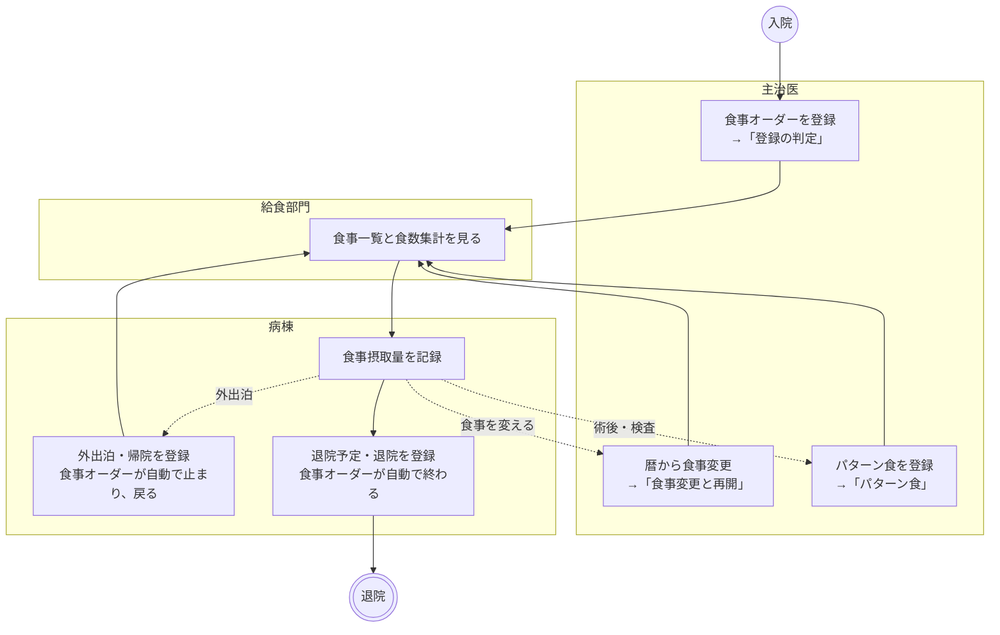

この文書で使う呼び名は次のとおりです。

| 呼び名 | 指すもの |
|---|---|
| 食(1 食) | 朝食・昼食・夕食のどれか 1 回。オーダーの開始と終了は、日付と朝・昼・夕で決める |
| 食事オーダー | 始まった食から終わりの食まで続く、食事の指示 1 本 |
| いま出ている食事オーダー | その食を出しているオーダー |
| 欠食 | 朝・昼・夕のうち一部の食を出さないこと。主食の欄で選ぶ |
| 食止め | 3 食とも出さないこと。食種で「食止め」を選ぶ |
| 暦 | カルテの「食事」タブに出るカレンダー。1 日が 1 マス |
| カード | カルテに出る、そのオーダーのカード |
| 連動 | 入退院・外出泊の操作に合わせて、食事オーダーが自動で止まり、戻ること |
| 給食部門 | 食事を用意する部門。画面のメニューでは「栄養部門」の下にある |

- **入口**: カルテの右ペイン(右側のオーダー入力)の「食事」と、カルテの「食事」タブの暦です。入院中でない患者には登録できません。
- **部門の画面**: 「部門業務 > 栄養部門 > 食事一覧」です。
- **カード**: オーダーが始まった日のカルテに 1 枚出ます。見出しは「9/1 朝〜 継続中」のような期間で、食種・主食・副食形態・塩分制限・食物アレルギーが出ます。
- **続いている日**: 続いている日のカルテには何も出ません。その日に何を食べているかは「食事」タブの暦で見ます。
- **暦の 1 マス**: その日の朝・昼・夕を出しているオーダーが並びます。1 日の途中で食事が変わった日だけ、2 つ以上並びます。
- **オーダーセット・クリニカルパス**: 食事オーダーはオーダーセットに入れられます。クリニカルパスでは、タスク分類「食事」から出せます。

### オーダーの種別と暦の印

食事オーダーには、依頼済・実施済のような状態がありません。登録から削除まで「有効」のままです。終了を決めても「有効」のままで、終わりの食を過ぎると暦と食事一覧に出なくなります。
代わりに、どういうきっかけで出たオーダーかを種別として持ち、暦のマスの印とカードに出します。

| 種別 | 出るきっかけ | 暦の印 |
|---|---|---|
| 開始 | いま出ている食事オーダーが無いときの登録(入院時など) | 開始 |
| 変更 | いま出ている食事オーダーを終わらせての登録 | 変更 |
| | パターン食の 2 段階目以降 | 変更 |
| 再開 | 期限付きのオーダーの後に、元の食事へ戻すオーダー | 再開 |
| 外泊食止め | 外出泊の登録で自動で出る食止め | 外泊食止め |

- **期限付きのオーダー**: 外泊中の食止めや検査前の絶食のように、終了を決めて出すオーダーです。
- **終わり方の理由**: 退院予定・退院で終わったオーダーは、最後の日のマスに「退院食止め」の印が付きます。カードの期間は「9/2 昼まで(退院食止め)」と出ます。「退院食止め」はオーダーの種別ではなく、終わり方の理由です。
- **手で入れた終了**: オーダーの編集で手で入れた終了には、理由が付きません。

### 登録の判定

食事オーダーのフォームは、入院中の患者にだけ出ます。入院中でない患者では「食事オーダーは入院中の患者にだけ登録できます。」と出ます。

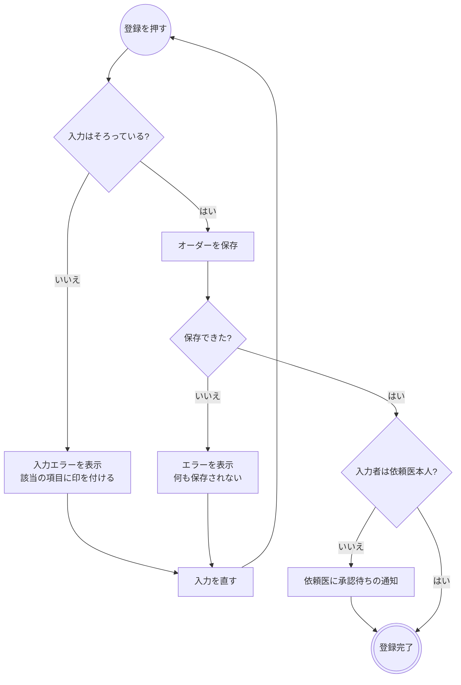

依頼医は、オーダーを指示した医師です。登録のときに確かめる項目は次のとおりです。

| 項目 | 条件 |
|---|---|
| 食種 | 必須 |
| 主食 | 3 食すべてを欠食にはできない(食止めの食種を除く) |
| 塩分制限 | 空か、0 以上の数値 |
| 開始日 | 必須(オーダーセット・クリニカルパスの内容として作るときは不要) |
| 終了 | 空か、開始と同じか後 |

**食種と主食**

- 食種は「食種選択」の表から選びます。表には主成分量(熱量・蛋白質など)と適応が並びます。
- 表の上に、患者の身長・体重・BMI と、熱量・蛋白質の目安(標準体重 × 係数)が出ます。選んだ食種が目安を外れると「目安未満」「目安超」の印が付きます。
- 主食は朝・昼・夕の 3 行で選び、末尾の選択肢が「欠食」です。3 食とも出さないときは、欠食ではなく食種で「食止め」を選びます。
- 食止めの食種を選ぶと、主食・副食形態・塩分制限は入力できなくなり、保存もされません。

**欠食理由**

- 食止めのときと、1 食でも欠食があるときだけ欄が出ます。
- 選択肢は、絶食(NPO)・手術絶食・検査絶食・外泊・退院・その他です。
- 給食部門の食事一覧と暦に出ます。

**期間**

- 開始と終了は、日付と朝・昼・夕で選びます。終了が空なら、次の指示まで続きます。
- いま出ている食事オーダーがあるときは、それを終わらせるチェックがフォームに出ます(「食事変更と再開」)。

**食物アレルギー**

- 食物アレルギーはフォームで選びません。保存した時点の、患者の有効な食物アレルギーが全件オーダーに写ります。食止めにも写ります。

**そのほか**

- 施設が食事オーダーに出すと決めた警告があれば、フォームの上に出ます。登録は止まりません。警告は「管理 > 警告の集計と設定」で決めます。
- 承認待ちのあいだも、食事は給食部門の食事一覧に出ます。

### 食事変更と再開

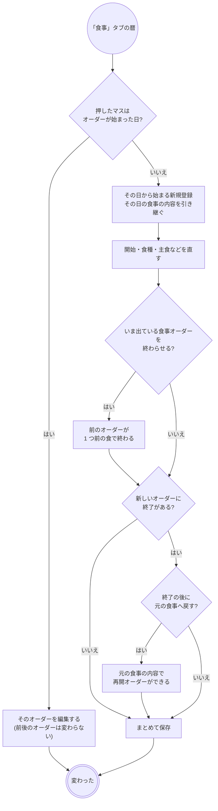

フォームの「いま出ている食事」の欄に、チェックが 2 つ出ます。どちらも初めからチェックが入っています。

| チェック | 出るとき | 入れたままにすると |
|---|---|---|
| 前のオーダーを終了する | いま出ている食事オーダーがあるとき | 前のオーダーが、新しいオーダーの 1 つ前の食で終わる |
| 終了後、この食事に戻す | 新しいオーダーに終了があるとき | 終了の次の食から、元の食事の再開オーダーができる |

前のオーダーが終わる食は、新しいオーダーが始まる食で決まります。

| 新しいオーダーが始まる食 | 前のオーダーが終わる食 |
|---|---|
| 朝 | 前日の夕 |
| 昼 | 同じ日の朝 |
| 夕 | 同じ日の昼 |

再開オーダーが始まる食は、新しいオーダーが終わる食で決まります。

| 新しいオーダーが終わる食 | 再開オーダーが始まる食 |
|---|---|
| 朝 | 同じ日の昼 |
| 昼 | 同じ日の夕 |
| 夕 | 翌日の朝 |

例: 8/1 朝から一般食が続いていて、8/10 朝〜8/11 夕の食止めを出すと、一般食は 8/9 夕で終わり、8/12 朝から一般食の再開オーダーができます。再開しないと、8/12 以降の食事が無くなります。

- **直せるマス**: オーダーは、自分が始まった日のマスからだけ直せます。続いている途中の日を押すと「その日から変える」新規登録になるので、過去の食事がさかのぼって変わることはありません。
- **再開オーダー**: 元のオーダーの続きではなく、別のオーダーです。元のオーダーが継続なら再開も継続になり、元に終了があればそれを引き継ぎます。
- **右ペインからの登録**: カルテの右ペインの「食事」から新規に登録しても、いま出ている食事オーダーがあれば同じチェックが出ます。
- **オーダーセット**: オーダーセットから出した食事オーダーは、前のオーダーを終わらせません。適用の後に、「食事」タブで重なりを直します。
- **クリニカルパス**: パスから出した食事オーダーも、いま出ている食事オーダーを終わらせません。パスが続く病日に出す食事オーダーは、次の食事オーダーの 1 つ前の食で終わります。

### パターン食

術後の食上げや検査食のように、段階を追って変わる食事をまとめて登録します。

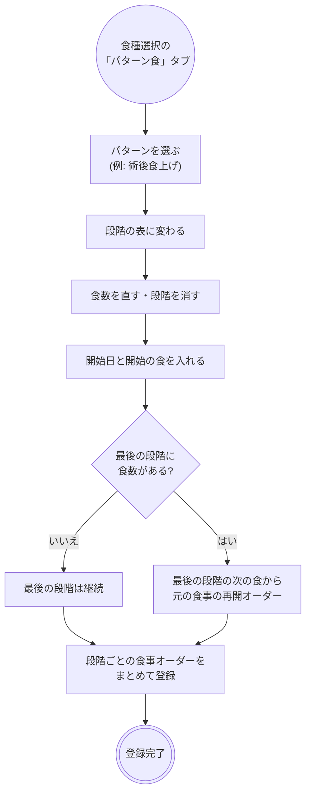

- **段階の表**: 段階ごとの食種・食数・期間が並びます。登録のときに直せるのは食数と段階の削除で、食種と主食はマスタで直します。
- **段階の長さ**: 日数ではなく食数で数えます。昼から始めても「3 食」は昼・夕・翌朝です。
- **最後の段階**: 最後の段階だけ食数を空にでき、そのときは次の指示まで続きます。途中の段階は空にできません。
- **いま出ている食事オーダー**: 最初の段階の 1 つ前の食で終わります。
- **登録の後**: 段階ごとに別々の食事オーダーになります。暦とカードに「術後食上げ 2/5」のように出ます。パターン単位でまとめて直す・消す操作はないので、1 段階ずつ暦から直します。
- **パターンの用意**: パターンは施設がマスタで作ります。はじめから「術後食上げ」「大腸検査食」が入っています。

### 入退院・外出泊との連動

入院患者一覧・病棟マップで退院予定・退院・外出泊・帰院を登録すると、食事オーダーも一緒に変わります。

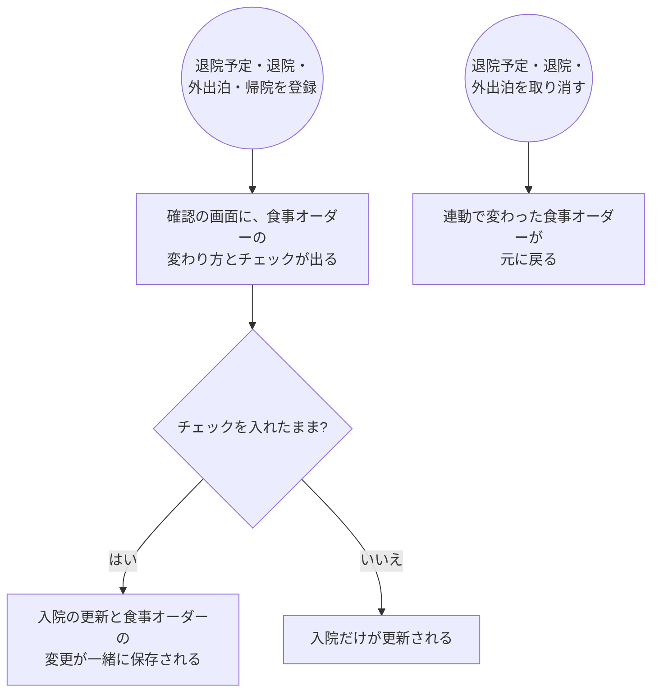

| 操作 | 確認の画面のチェック | 食事オーダーに起きること |
|---|---|---|
| 退院予定の登録・変更 | 「食事オーダーを … 食までで止める(退院食止め)」 | 予定時刻までに出る最後の食で終わる |
| 退院 | 「食事オーダーを … 食までで終了する」 | 退院時刻までに出る最後の食で終わる |
| 外出泊の登録 | 「食事オーダーを外出泊に合わせる」 | 出発までの最後の食で終わり、外泊食止めが出る |
| 帰院 | 「食事を … 食から元に戻す」 | 帰院後の最初の食から再開する |
| 各取消 | なし(確認の文に、食事オーダーも元に戻ると出る) | 連動で付いた終了が元に戻る |

チェックの「…」には、日付と朝・昼・夕が入ります。

**どの食まで・どの食から**

- 手では選びません。施設設定の「食事の提供時刻」(既定は 08:00 / 12:00 / 18:00)と、退院・出発・帰院の時刻から決まります。
- 例: 11:00 に退院なら朝食まで、14:00 に帰院なら夕食からです。

**退院予定・退院**

- 退院では食事オーダーが終わるだけで、新しいオーダーは出ません。
- 退院予定で終わらせた後に予定の日時を変えると、退院予定を登録する前の終了に戻してから、新しい日時で終わらせ直します。
- 退院予定のまま退院した後で取り消しても、戻る先は退院予定を登録する前の終了です。
- 退院の画面では、食事のほかにリハビリ・栄養指導・服薬指導・看護指示も同じ操作で止められます。

**外出泊・帰院**

- 外出泊を登録すると、帰院までのあいだは外泊食止めのオーダーが出ます。帰院の日時が決まっていれば、再開オーダーも一緒にできます。
- 帰院を登録すると、外泊食止めが帰院の 1 つ前の食で終わり、帰院後の最初の食から再開します。
- 帰院が早くて 1 食も抜けないときは、外泊食止めのオーダーは消えます。
- 外泊食止めには、食種マスタの「食止め」を使います。食止めの食種がマスタに無い施設では、食止めオーダーだけが出ず、終了と再開は行われます。
- 外出泊の期間を後から直す操作はありません。外出泊を取り消して登録し直すと、食事オーダーもいったん元に戻ってから、新しい期間で変わります。

**取消**

- 取消で元に戻るのは、連動で付いた終了だけです。外出泊で出た食止めと再開オーダーは消えます。
- 連動で付いた終了を、オーダーの編集で手で変えると、取消をしても元に戻らなくなります。

**連動しない操作**

- 入院取消(誤登録の取り消し)・転床・転科転棟では、食事オーダーは変わりません。
- 転棟した後、給食部門の食事一覧には新しい病棟で出ます。

### 食物アレルギー

食事オーダーには、保存した時点の有効な食物アレルギーが写ります。後からアレルギーが変わったときは、次のように知らせます。

新しく有効な食物アレルギーを保存したときです。

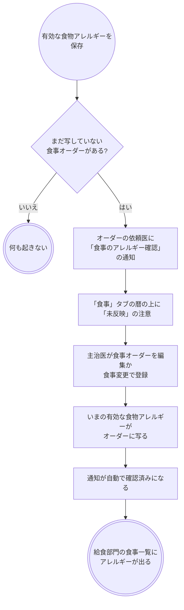

食物アレルギーを解消・否定・削除したときです。

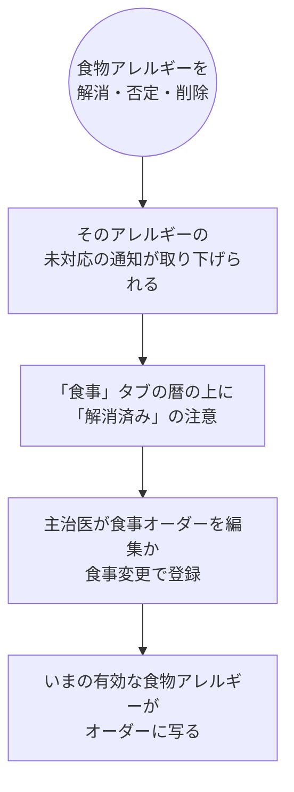

- **見るオーダー**: 通知の対象は、今日の朝以降も食事を出す食事オーダーです。
- **通知の強さ**: アレルギーの重篤化リスクが「高」のときは、通知がアラートになります。
- **通知の数**: オーダー 1 件とアレルギー 1 件の組ごとに 1 通です。同じ組の未対応の通知があれば、新しくは作りません。
- **手で閉じる**: 通知は、通知一覧の「確認」で手で閉じることもできます。
- **確かめる内容**: 確かめるのは、「未反映」(有効なのにオーダーに写っていない)と「解消済み」(写っているのに有効でなくなった)の 2 つだけです。食種の中身(卵を使うかなど)とは突き合わせません。
- **除去の内容**: 何を除くかは、オーダーのコメントに書きます。

### 給食部門の食事一覧と病棟の摂取量

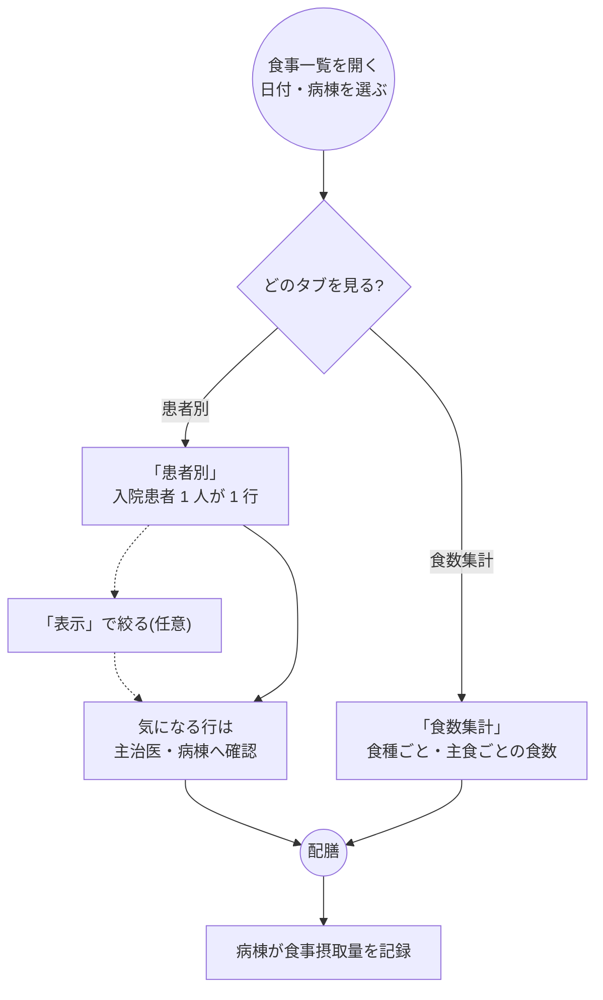

**「患者別」のタブ**

- 列は、病棟・病室・患者・朝・昼・夕・副食形態・塩分・アレルギー・欠食理由・コメントです。
- その日に在院した入院患者が 1 人 1 行で出ます。入院中で食事オーダーの無い患者は、「—」(オーダーなし)として出ます。
- 退院済みの患者は、終了の無い食事オーダーが残っていても出ません。
- 病棟は、いまのベッドの病棟です。食事オーダーを登録した後に転棟しても、新しい病棟で出ます。
- その食から食事が変わった欄には「変更」の印が付きます。
- 「表示」で「変更あり」「オーダーなし」に絞れます。
- 患者名を押すと、その患者の「食事」タブが開きます。

**「食数集計」のタブ**

- 食種ごと・主食ごとに、朝・昼・夕と計の食数が出ます。欠食とオーダーなしの数も出ます。

**病棟の食事摂取量**

- 経過表か一括入力で、主食と副食をそれぞれ 0〜10 割で記録します。
- 摂取量は、その食を出している食事オーダーの記録として残ります。カルテのカードには出ません。
- オーダーの無い食・食止め・欠食の食には、記録の枠が出ません。

**まだ無いもの**

- 配膳の進み具合の記録、はい膳表・食札の印刷、栄養量の合計は、まだありません。

### 変更・削除

| 操作 | できる場所 |
|---|---|
| 変更 | 暦の、オーダーが始まった日のマス。または、カードのメニューの編集 |
| 食事を変える | 暦の、続いている途中の日のマス(「食事変更と再開」) |
| 終わらせる | オーダーの編集で終了を入れる |
| 削除 | カードのメニュー |

- **変更**: 変わるのはそのオーダーだけで、前後のオーダーの開始・終了は変わりません。
- **終わらせる**: 食事オーダーに中止はありません。終わらせるときは終了を入れます。
- **削除できないとき**: 摂取量の記録が付いたオーダーは消せません。先に摂取量の記録を消します。
- **食事変更を取り消すとき**: 新しいオーダーを削除しても、前のオーダーの終了は元に戻りません。前のオーダーを編集して、終了を外します。
- **DO(前回と同じ内容で出し直す)**: カードに DO はありません。暦の続いている途中の日を押すと、その日の食事の内容を引き継いだ登録が開きます。終了は引き継ぎません。

### 他のオーダーとの違い

| | 検査・処置・リハビリ | 食事 |
|---|---|---|
| オーダーの単位 | 検査 1 回 / 期間(日) | 期間(始まりの食〜終わりの食) |
| 時刻の刻み | 日時・日 | 日付と朝・昼・夕 |
| 入外区分・至急 | 選ぶ | 無い(入院中の患者だけに出す) |
| 部門の受付・実施 | ある | 無い(給食部門は一覧と食数を見る) |
| 変える | オーダーの編集 | 新しいオーダーを出す(食事変更) |
| 入退院との関係 | 退院で打ち切る(リハビリ・栄養指導) | 退院・外出泊で自動で止まり、戻る |
| 実施の記録 | 部門の実施記録 | 病棟の食事摂取量 |
| 医事会計 | 実施記録から送る | 送らない |

食事オーダーで入力する項目は次のとおりです。

- 食種
- 主食(朝・昼・夕ごと。欠食もここで選ぶ)
- 副食形態・塩分制限
- 欠食理由
- 開始・終了
- 対象プロブレム・コメント

施設がマスタで用意するのは、食種(食止めを含む)・主食・副食形態・食種の種別・パターン食です。

### 帳票

専用の帳票はありません。はい膳表・食札は、まだ印刷できません。

## 開発者向け

### シーケンス図の前提

- **書き込みの経路**: `/fhir` への書き込みはどれも 1 回の transaction Bundle で、backend の `FhirProxyController` が上流へ中継します。
- **SS-MIX2**: 有効にしている施設では、中継が書き込みの控えを記録し(`Ssmix2::Recorder`)、食事オーダーの書き込みごとに `OMD^O03` を組みます。
- **図の描き方**: 応答は backend を通って戻りますが、図では上流からブラウザへ直接描きます。検索の条件と transaction の中身は、図の下の表に出します。

楽観ロックの版の決め方は、書き込みで違います。

| 書き込み | 版の決め方 |
|---|---|
| 共通 | `postBundle` が版を `ifMatch` に添える。版が違えば 412 で止まる |
| 編集フォーム | `useEditSnapshot` で開いた時点の版に固定し(`MealOrderPanels.tsx`)、`withVersionLock` でその版を添える |
| 食事変更で終わらせる、前のオーダー | 読んだ版で PUT する |

このページで使う呼び名は次のとおりです。

| 呼び名 | 指すもの |
|---|---|
| 上流 | 上流の FHIR サーバー |
| ヘッダ | 食事オーダー 1 本を表す `ServiceRequest`。明細は持たない |
| 点 | 日付と朝・昼・夕の組。文字列 `YYYY-MM-DDTHH:mm` で持ち、時刻 08 / 12 / 18 が朝・昼・夕 |
| 担当 | ある点の食を出しているオーダーであること |
| 連動 | 入退院・外出泊の書き込みと同じ transaction で、食事オーダーを止め、戻すこと |
| 全件の検索 | 全ページを読み切る検索(`complete: true`)。欠けたら結果を使わない |
| 雛形 | オーダーセット・パスのタスク・パターン食の段階に持つ、オーダーの内容 |

### リソースの構成

ヘッダ(`ServiceRequest`)の要素は次のとおりです。

| 要素 | 中身 |
|---|---|
| `category` | `order-type|meal` と `v3-ActCode|IMP` |
| `code` | 食種(`meal-type`) |
| `orderDetail[]` | 主食(`meal-staple-food`)と副食形態(`meal-side-dish-form`) |
| `orderDetail[]` の拡張 `meal-timing` | 主食がどの食のものか(朝昼夕)。無ければ全食共通 |
| `occurrenceDateTime` | 開始の点 |
| `note` | コメント |
| `reasonReference` | 対象プロブレム |
| `encounter` | 入院 |
| `supportingInfo` | 写した食物アレルギー(`AllergyIntolerance` の参照と名称) |

ヘッダの拡張は次のとおりです。

| 拡張 | 中身 |
|---|---|
| `meal-order-end` | 終了の点。無ければ継続 |
| `meal-skipped-timing` | 欠食。朝昼夕ぶん繰り返す |
| `meal-fasting-reason` | 欠食理由 |
| `meal-salt-limit` | 塩分制限(UCUM `g`) |
| `meal-pattern` | パターン食の名称・段階 |
| `order-department` / `order-ward` | 登録時の診療科・病棟 |
| `meal-order-link` | 種別。`kind`・`source`・`leave`(外出泊 id)を持つ |
| `meal-order-end-reason` | 終了の理由。`reason`・`leave`・`previousEnd`(連動の前の終了)を持つ |

| 拡張の値 | 取る値 |
|---|---|
| `meal-order-link.kind` | `start` / `change` / `resume` / `leave-fasting` |
| `meal-order-end-reason.reason` | `change` / `discharge-plan` / `discharge` / `leave` |

ヘッダのほかのリソースは次のとおりです。

| もの | リソース | 要点 |
|---|---|---|
| 進捗 | 無い | 部門の受付・実施が無いので `Task` を作らない |
| 摂取量 | `Observation` | `basedOn` = その食を担当するヘッダ。1 食に主食・副食の 2 件 |
| 外出泊 | `Encounter` の拡張(子拡張 `id`) | 食事側は `meal-order-link.leave` と `meal-order-end-reason.leave` の id で結び付く |
| アレルギーの通知 | `Task` | `task-code|meal-allergy-check`、`focus` = ヘッダ、`input` = アレルギー |
| 代行入力 | `Provenance` | `target` = ヘッダ。種別共通 |

- **摂取量**: コードは MEDIS 看護観察マスタの「食事摂取量(主食)/(副食)％」です。`effectiveDateTime` の時刻は 08 / 12 / 18 です。
- **アレルギーの通知**: 通知は `Task` に統一してあり、その 1 種別です。
- **期間の持ち方**: 期間を `occurrencePeriod` にせず、開始と拡張に分けています。上流が `occurrenceDateTime` を索引するためです。
- **その日に掛かる食事オーダー**: 上流は `order-period` で、開始と `meal-order-end` を合わせて索引しています。「その日に掛かる食事オーダー」は、これで上流が絞ります。
- **08 / 12 / 18**: SS-MIX2(TQ1-7/8、ODS-2)の食事タイミングのコードです。施設の食事提供時刻(`facility_settings.meal_schedule`)とは別物です。提供時刻は、連動で「どの食まで / どの食から」を決めるのにだけ使います。
- **食止め**: マスタの食種の属性(`is_fasting`)で、オーダーには写しません。編集で開くとマスタを引き直して判定します。`doNotPerform` は使いません。
- **欠食理由**: `reasonCode` には入れません。`reasonCode` / `reasonReference` は、オーダーを出す理由(治療食の病名)を入れる要素です。欠食理由は、オーダーの一部(食事を出さない指示)に付く理由なので、拡張に持ちます。

### 状態の持ち方

**`ServiceRequest.status` は登録から削除まで `active` のまま**で、Task も無く、中止(`revoked`)もありません。ある点の食をどのオーダーが担当するかは、開始と終了の点の文字列を辞書順に比べて決めます。

| 判定 | 規則 | 実装 |
|---|---|---|
| ある点の担当 | 開始 ≦ その点、かつ終了が無いか、その点 ≦ 終了のオーダー。複数あれば、いちばん後に始まったもの | `mealOrderAt`。1 日ぶんは `mealDayEntries` |
| 食事変更で終わらせる候補 | 新しいオーダーの開始日に掛かる有効なオーダー | `useActiveMealOrders`(`order-period=ge日&le日`) |
| 終わらせる点 | 新しいオーダーの開始の 1 つ前の点 | `previousMealPoint` |
| 再開する点 | 新しいオーダーの終了の次の点 | `nextMealPoint` |
| 再開できるか | 元のオーダーが、新しいオーダーの終了より後まで続くはずだったなら再開できる | `mealOrderResumable`(`mealOrderNeedsStop` と同じ条件) |
| 連動で止める点 | その時刻までに出た最後の点 | `lastMealAtOrBefore` |
| 連動で戻す点 | その時刻以降の最初の点 | `firstMealAtOrAfter` |
| 連動の取消で戻すか | `meal-order-end-reason` の理由が一致するものだけ、`previousEnd` に戻す | `buildMealOrderRestoreEntry`、`isSameEndCauseFamily` |
| アレルギーの照合・通知の対象か | 今日以降も食事を出すオーダーなら対象 | `mealOrderServesOnOrAfter` |

- **終わらせる候補**: 開始日も見ます。まだ始まっていないオーダーを候補にしないためです。
- **同じ系統**: 連動の取消では、退院予定と退院を同じ系統の理由として扱います。
- **担当する食が無いオーダー**: 終了が開始より前になったオーダーは、担当する食が無く、暦と食事一覧に出ません(カードには出ます)。同じ点から始まる食事変更を続けると起きます。
- **開始と終了が同じ点のオーダー**: 上の規則では、その 1 食だけを担当します。
- **編集で引き継ぐもの**: 編集(`buildMealOrderUpdateBundle`)は、登録日時・種別・入院・パターンを元のオーダーから引き継ぎます。終了の理由は、終了を変えていなければ引き継ぎ、手で変えたら外します。

### 部品

| 部品 | 場所 |
|---|---|
| オーダーのフォーム | `components/MealOrderForm.tsx` |
| 入院の判定・食事変更の候補 | `components/MealOrderPanels.tsx` |
| 食種選択 | `components/MealDietPickerModal.tsx` |
| パターン食のタブ | `components/MealPatternPickerList.tsx` |
| パターン食の段階の表 | `components/MealPatternStepsTable.tsx` |
| オーダーの詳細 | `components/MealOrderDetailPanel.tsx` |
| カード | `components/karteCardBodies/MealOrderCardBody.tsx` |
| 暦(マスの押し分け) | `components/KarteMealTab.tsx` |
| 暦の上のアレルギーの注意 | `components/MealAllergyNotice.tsx` |
| 組み立て(登録・食事変更・再開・編集・担当の判定) | `fhir/mealOrderHelpers.ts` |
| 組み立て(パターン食) | `fhir/mealPatternHelpers.ts` |
| アレルギーの照合 | `fhir/mealAllergyHelpers.ts` |
| アレルギーの通知 | `fhir/mealAllergyTaskHelpers.ts` |
| 連動の組み立て(純関数) | `fhir/mealEncounterSync.ts` |
| 連動の材料を揃える hook | `hooks/useMealSyncContext.ts` |
| 連動の一覧とチェック | `components/MealSyncSummary.tsx` |
| 連動を呼ぶ画面 | `DischargePlanModal`・`DischargeModal`・`LeaveModal`・`LeaveReturnModal`、各取消は `InpatientPlanTables` |
| 食事一覧 | `pages/MealWorklistPage.tsx`(`/meal-worklist`) |
| 食事一覧の集計 | `fhir/mealWorklistHelpers.ts` |
| 摂取量(経過表と一括入力の枠と記録) | `fhir/flowsheetMealHelpers.ts` |
| hook | `api/queries/meal.ts` |

### シーケンス図: 登録・食事変更・編集・削除

| 操作 | 組み立て | hook |
|---|---|---|
| 登録・食事変更 | `buildMealOrderBundle` | `useCreateMealOrder` |
| パターン食 | `buildMealPatternBundle` | `useCreateMealOrder` |
| 編集 | `buildMealOrderUpdateBundle` | `useUpdateMealOrder` |
| 削除 | `deleteMealOrderRequest` | `postOrderDeleteBundle`(`api/queries/orderDelete.ts`) |

`useCreateMealOrder` は、全種別共通の `useCreatePrescription` に通知の自動完了を足したものです。

フォームを開いたときの読み込みです。3 つを並行して読みます。

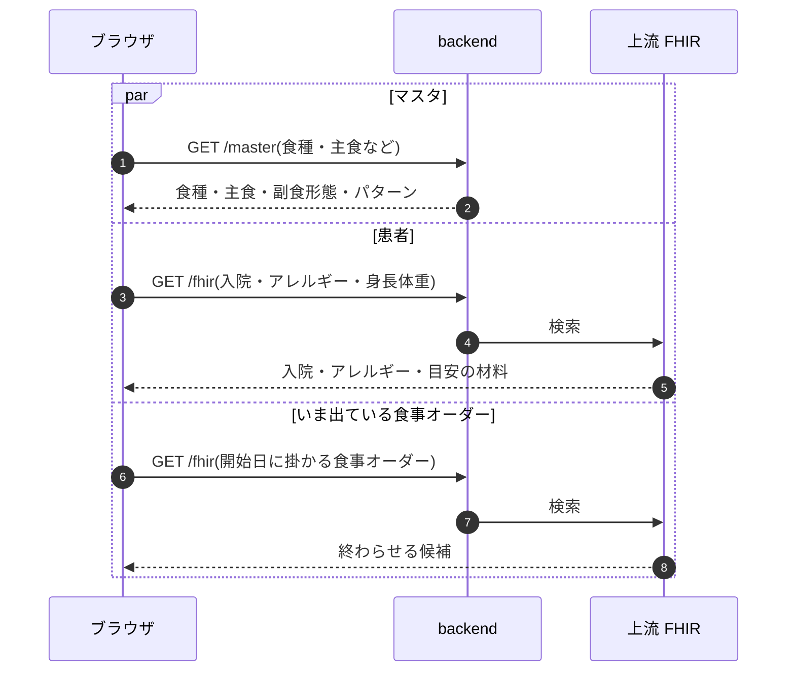

| 読むもの | 条件 |
|---|---|
| マスタ | `GET /master/meal_diets`・`meal_items`・`meal_patterns` |
| 患者 | 入院中の `Encounter`、`AllergyIntolerance`、身長・体重の `Observation` |
| 患者から得るもの | 入院・病棟、有効な食物アレルギー、栄養量の目安の材料 |
| 終わらせる候補 | `ServiceRequest?subject&category=order-type|meal&status=active&order-period=ge開始日&le開始日` |

登録・食事変更・パターン食です。

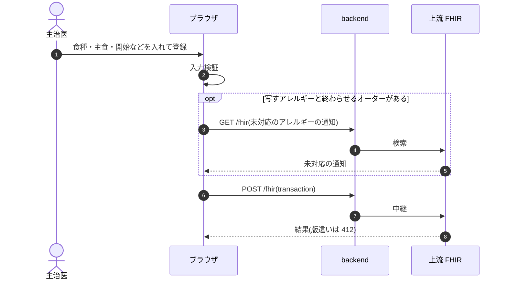

| 読む・書くもの | 条件 |
|---|---|
| 入力検証 | `validateMealOrder`。パターン食は `validateMealPatternOrder` |
| 未対応の通知の検索 | `Task?code=meal-allergy-check&subject&status=requested` |
| POST ヘッダ | `fullUrl` を付ける。パターン食は段階ぶん |
| PUT 前のオーダー | `meal-order-end` と `end-reason=change` を入れる。`ifMatch` を添える |
| POST 再開オーダー | `kind=resume`。再開するとき |
| PUT 通知の `Task` を `completed` に | 新しいオーダーにアレルギーが写ったもの |
| `Provenance`(CREATE) | 毎回 |
| `Task` `order-approval` | 代行入力・研修医のとき |

雛形はアレルギーの写しを持ちません。適用のときに、その患者の有効なものを入れます(`BuildBundleArgs.foodAllergies`)。

編集です。

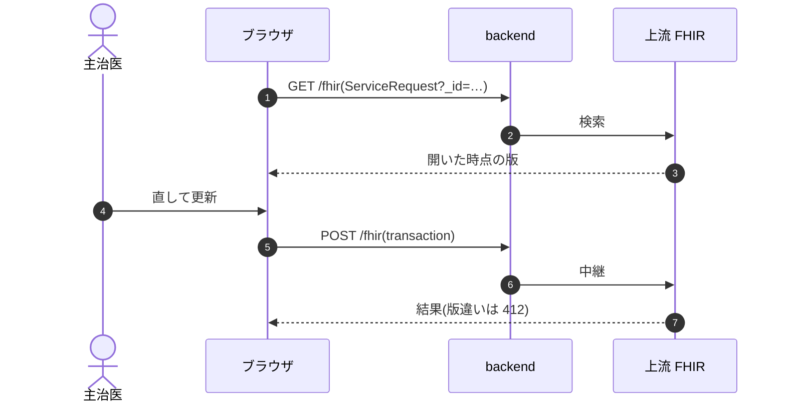

| 書くもの | 条件 |
|---|---|
| PUT ヘッダ | `ifMatch` を添える(`useEditSnapshot` で固定した版)。`supportingInfo` は保存時点の有効なものに入れ直す |
| PUT 通知の `Task` を `completed` に | アレルギーが写ったもの |
| `Provenance`(UPDATE) | 毎回 |

削除です。

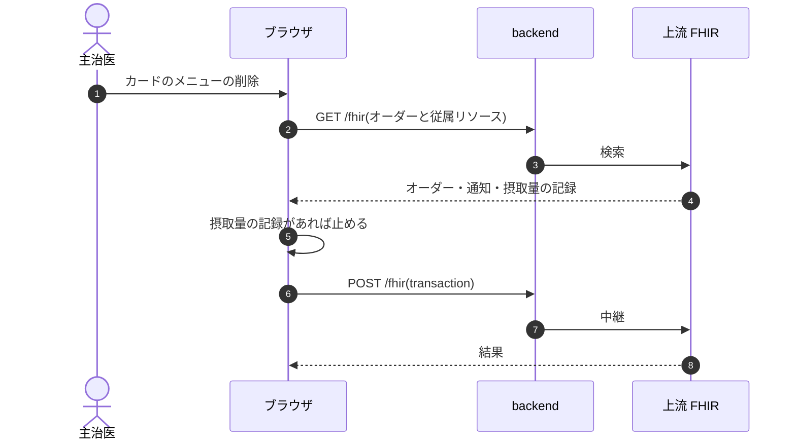

| 読む・書くもの | 条件 |
|---|---|
| 検索 | `ServiceRequest?_id&_revinclude=Task:focus,Observation:based-on,…` |
| DELETE ヘッダ | 摂取量の記録が無いとき |
| DELETE `Task` | 承認待ちの通知・アレルギーの通知 |

### シーケンス図: 入退院・外出泊の連動

- 材料は、モーダルでは `useMealSyncContext`、行メニューでは `useMealSyncContextLoader` が揃えます。
- `mealEncounterSync.ts` の純関数が entry を組みます。
- 組んだ entry は、入院の書き換え(`buildEncounterUpdateBundle` の第 2 引数)と同じ transaction に載せます。

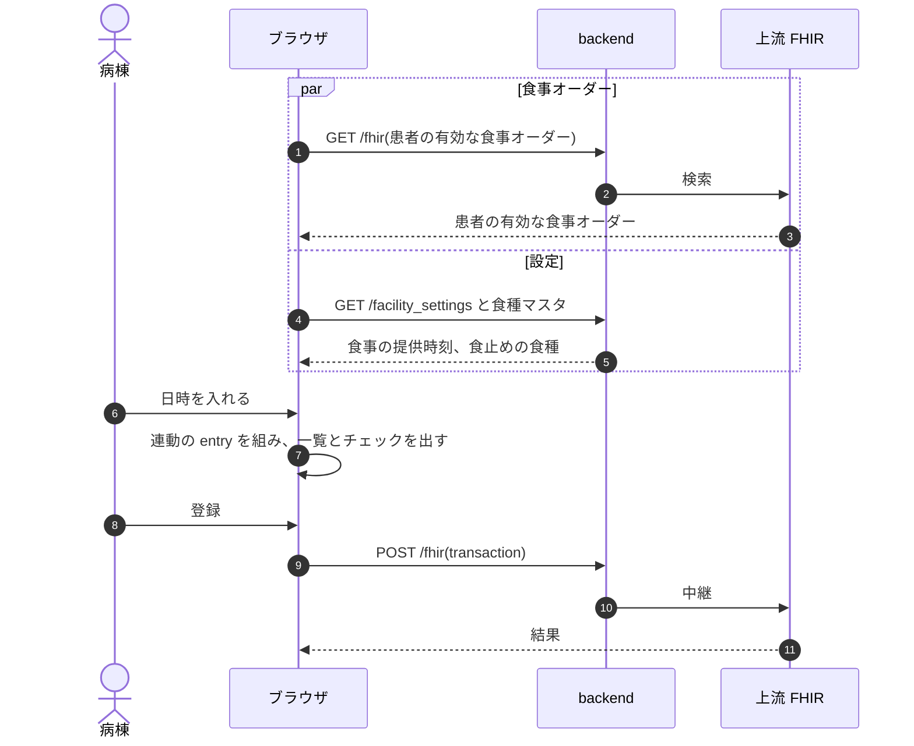

| 読む・書くもの | 条件 |
|---|---|
| 食事オーダーの検索 | `ServiceRequest?subject&category=order-type|meal&status=active&_sort=-authoredon&_count=50` |
| 設定 | `GET /facility_settings`、`GET /master/meal_diets`(食止めの食種) |
| PUT `Encounter` と食事オーダーの entry | 同じ transaction に載せる |
| リハビリ・栄養指導・服薬指導・看護指示の打ち切り | 退院のとき。同じ transaction に載せる |

操作ごとに組む entry は次のとおりです。

| 操作 | 組み立て | 食事オーダーの entry |
|---|---|---|
| 退院予定の登録・変更、退院 | `buildDischargeSyncEntries`(`lastMealAtOrBefore`) | 止める点より後まで続くオーダーに、終了と `end-reason`(`discharge-plan` / `discharge`、`previousEnd`)を入れる |
| | | 同じ系統で止めてあり、もう止める必要が無いオーダーは元に戻す |
| 外出泊の登録 | `buildLeaveStartEntries`(`previewLeaveSync`) | 止めるオーダーに、終了と `end-reason=leave`(外出泊 id)を入れる |
| | | POST 外泊食止め(`kind=leave-fasting`)。アレルギーの写しは止める元から取る |
| | | 帰院が決まっていれば、POST 再開オーダー(`kind=resume`) |
| 帰院 | `buildLeaveReturnEntries`(`firstMealAtOrAfter`) | 外泊食止めに終了を書く。1 食も抜けなければ DELETE |
| | | 再開オーダーの開始を動かす。無ければ POST |
| 各取消 | `buildDischargeRestoreEntries` / `buildLeaveCancelEntries` | 理由が一致するオーダーを `previousEnd` に戻す |
| | | 外出泊の食止め・再開オーダーは DELETE |

- 外出泊の取消・帰院で消す食止め・再開オーダーは、入院の transaction に直接 `DELETE` を積みます(削除の共通経路 `postOrderDeleteBundle` は通りません)。
- 外出泊 id を持たない、連動の仕組みを入れる前のデータは、帰院実施で食事を戻せません(画面に注意を出します)。

### シーケンス図: 食事一覧・摂取量・アレルギーの通知

| 操作 | hook・組み立て |
|---|---|
| 食事一覧 | `useMealOrdersOn`、`useInpatientEncounters`、`useBedWardIndex`、`buildMealWorklist` / `countMeals` |
| 摂取量の記録 | `fhir/flowsheetMealHelpers.ts` |
| 食物アレルギーの保存 | `useCreateAllergy` / `useUpdateAllergy` / `useDeleteAllergy`。`mealAllergyCheckEntriesFor` で通知を同梱する |

食事一覧(給食部門)です。2 つを並行して読みます。

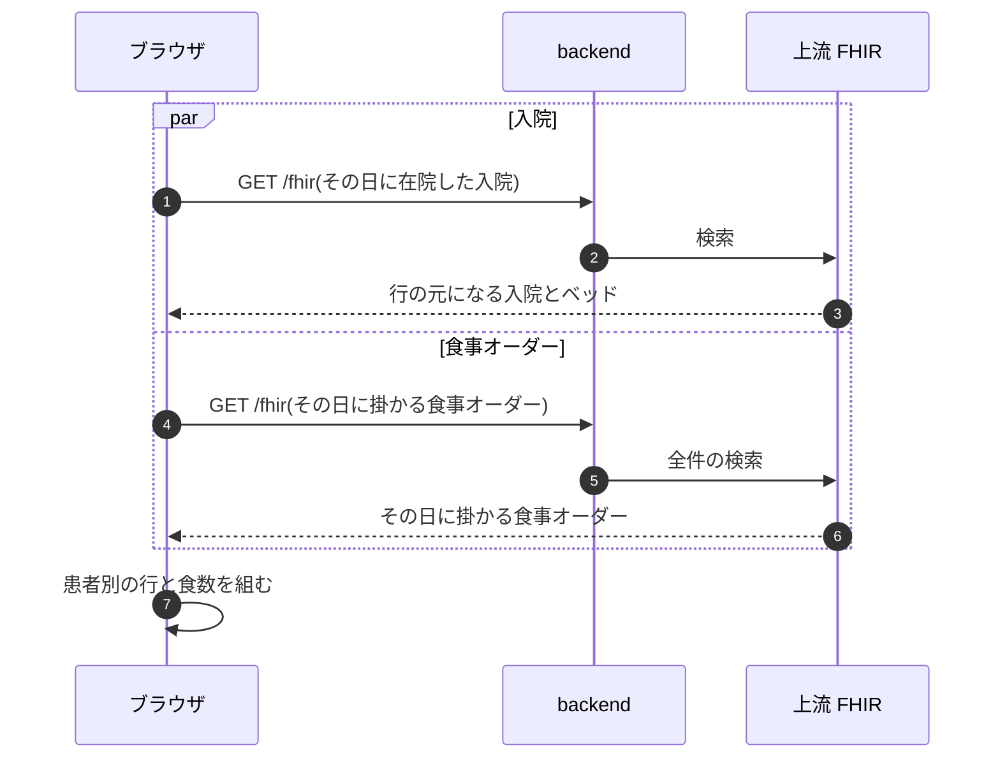

| 読むもの | 条件 |
|---|---|
| 入院 | その日に在院した `Encounter` |
| 食事オーダー | `ServiceRequest?category=order-type|meal&status=active&order-period=ge日&le日` |
| 行と食数 | `buildMealWorklist` / `countMeals`。朝昼夕の担当は `mealOrderAt` で決める |

食事オーダーは `useMealOrdersOn` の全件の検索で読みます。食数の合計に使うので、500 件 × 4 ページで欠けたら止めます。

摂取量の記録(病棟)です。

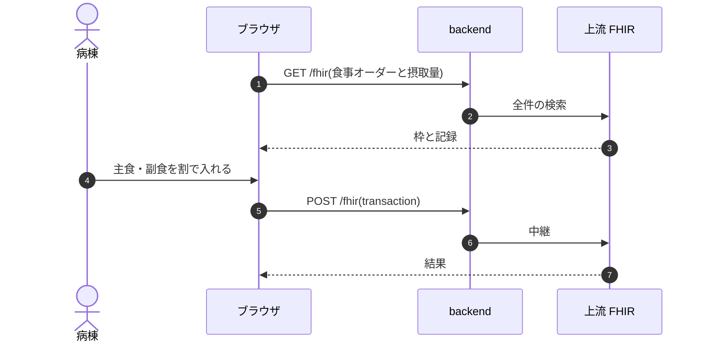

| 読む・書くもの | 条件 |
|---|---|
| 検索 | 期間ぶんの食事オーダーと、摂取量の `Observation`。欠けると上書き・二重登録になるので、全件の検索にする |
| POST / PUT `Observation` | `basedOn` = その食を担当する食事オーダー |
| DELETE `Observation` | 空にした記録 |

食物アレルギーの保存です。アレルギータブで保存したときに、通知も同じ transaction に載せます。

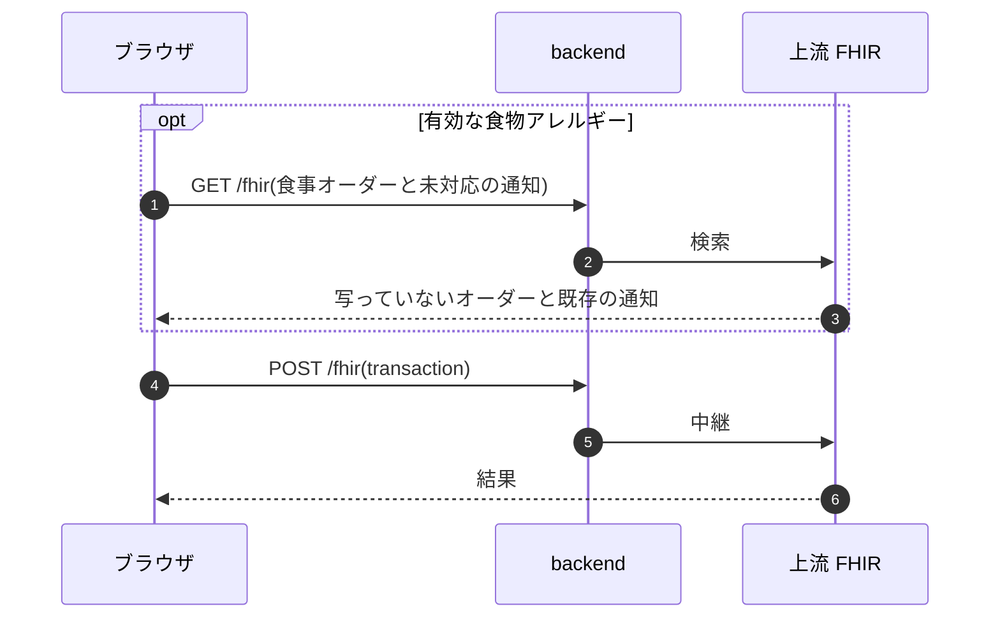

| 読む・書くもの | 条件 |
|---|---|
| 検索 | 患者の有効な食事オーダーと、未対応の `meal-allergy-check` |
| POST / PUT `AllergyIntolerance` | 新規は `fullUrl` を付ける |
| POST `Task` `meal-allergy-check` | `input` = アレルギー。写っていないオーダーごと |
| 未対応の通知を `cancelled` に | 解消・削除のとき |

### 医事会計と SS-MIX2

- **医事会計**: 食事はレセコン送信の対象外で、どの操作でも何も送りません(`OrderCatalog::IGNORED`。出来高で請求する項目が無い種別として報告もしません)。入院時食事療養費の算定は扱っていません。
- **SS-MIX2**: 食事オーダーの書き込みごとに `OMD^O03` を組みます(`Ssmix2::Messages::OmdO03`)。

| 項目 | `OMD^O03` での持ち方 |
|---|---|
| 食種 | ODS-1 T。食止めは `NPO^食止め^SSMIXTF01` |
| 主食 | 食ごとの ODS-1 D。ODS-2 に時間帯 |
| 欠食 | 時間帯付きの食止め |
| 副食形態・塩分制限 | 食種の ODS-4 |
| コメント | NTE |
| 写した食物アレルギー | AL1 |
| 開始・終了 | TQ1-7/8(`YYYYMMDDHH`) |

| 起きたこと | SS-MIX2 |
|---|---|
| 登録・パターン食・再開オーダー・外泊食止め | 新しいオーダーごとに `OMD^O03`(ORC-1 `NW`) |
| 編集、食事変更で終わらせる、連動で終了が付く / 戻る | 書き換えたオーダーごとに `OMD^O03`(`NW`。TQ1-8 が新しい終了) |
| 削除、外出泊の取消や帰院で消える食止め・再開 | `OMD^O03`(ORC-1 `CA`) |
| 摂取量の記録 | なし |
| 食物アレルギーの保存 | `ADT^A60`(アレルギー側。食事オーダーの電文は出ない) |
