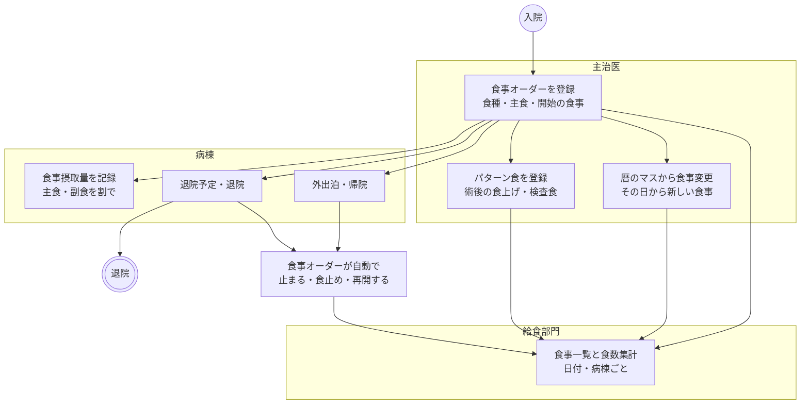
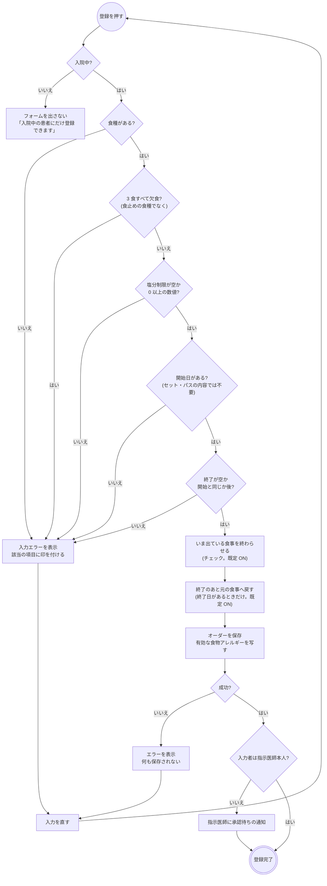
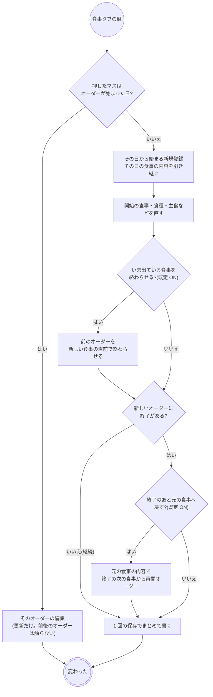
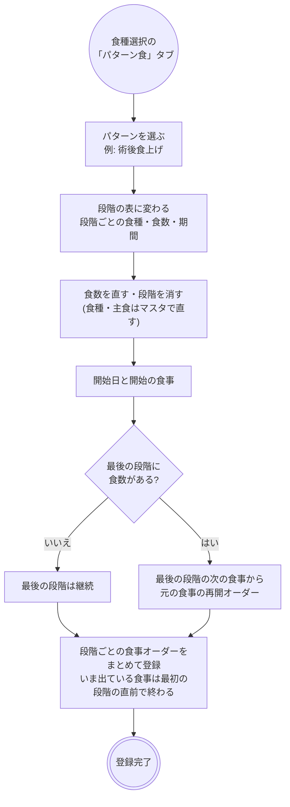
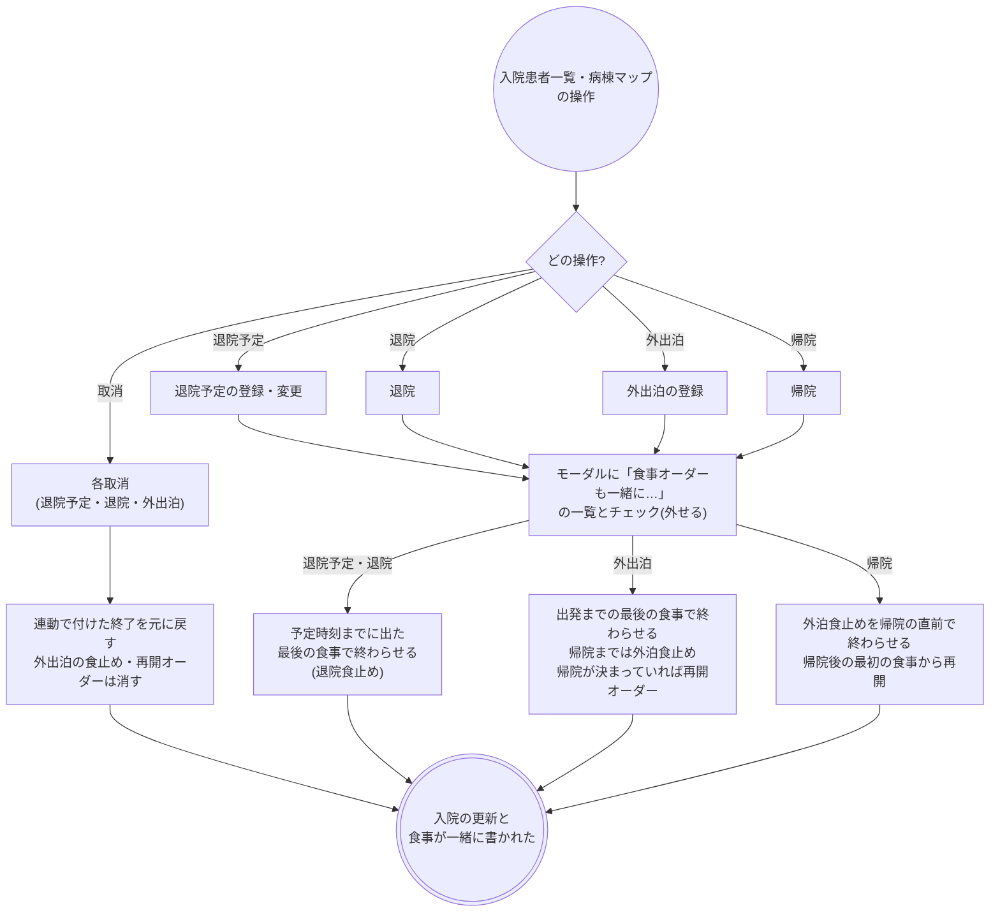
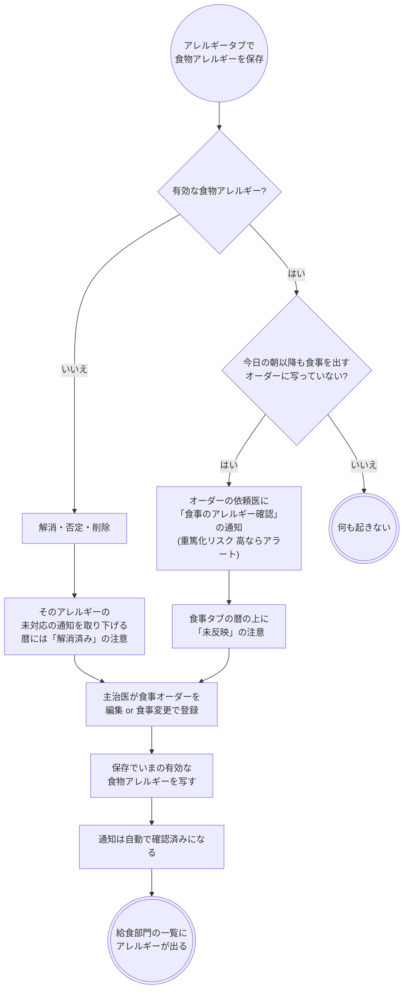
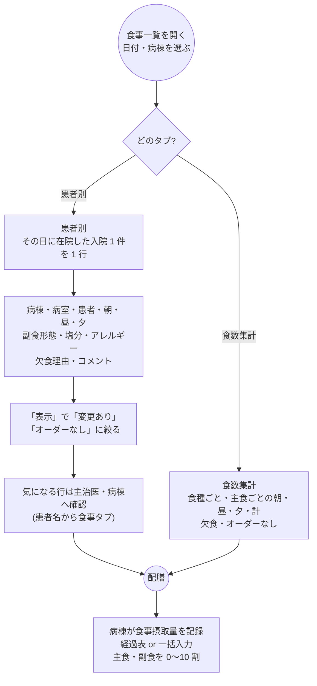
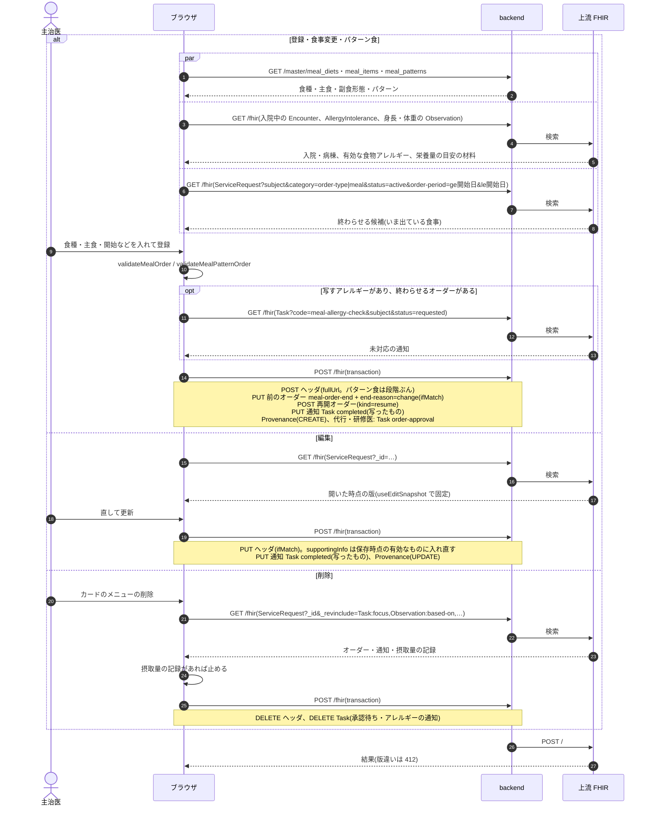
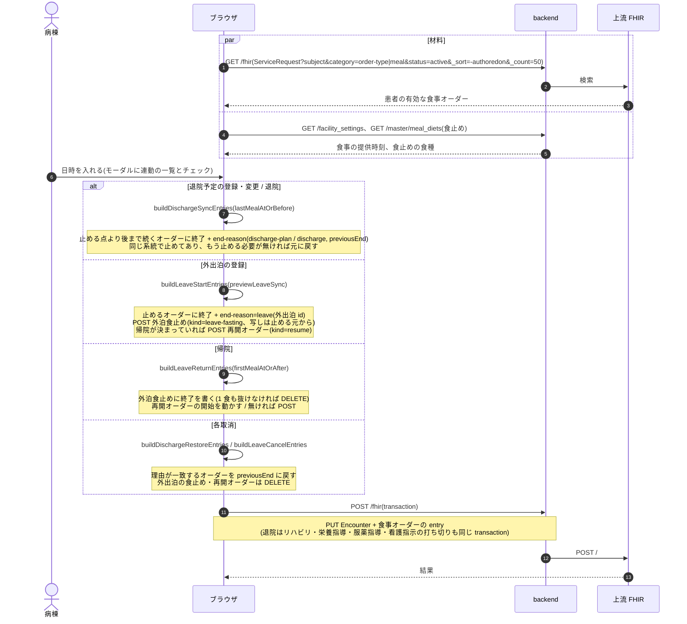
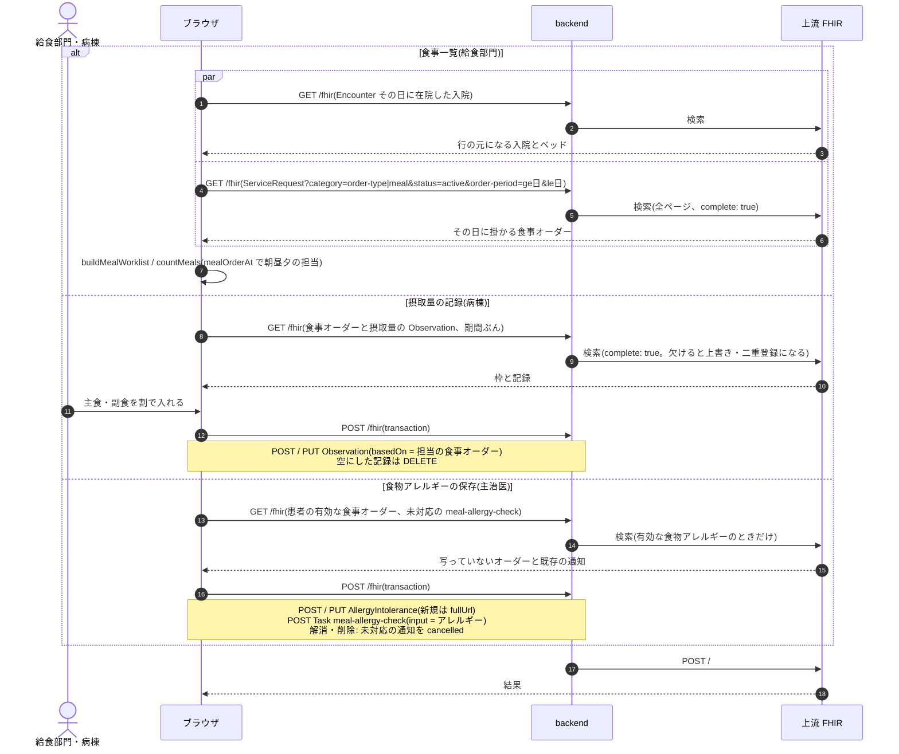

# 食事オーダーの業務フロー

入院患者の食事オーダーを、入院時の開始から食事変更・パターン食・外出泊・退院までの流れと、給食部門の食事一覧・病棟の摂取量の記録まで追います。医療機関の運用を検討する人は「運用フロー」、院内の開発者は「開発者向け」を読みます。
食事は**開始した食事から次の指示まで続く**オーダーで、同時に出ているのは 1 本だけが正しい状態です。食事を変えるときは、新しいオーダーを出して前のオーダーをその直前の食事で終わらせます。
部門の受付・実施・予約はありません。給食部門はその日の一覧と食数を見るだけで、オーダーの状態は動かしません。
設計は [meal-order-design.md](../meal-order-design.md)、食事一覧の画面は [features/ward.md](../features/ward.md)「食事一覧(給食部門)」、摂取量の記録は [features/karte.md](../features/karte.md)「経過表」と [features/ward.md](../features/ward.md)「一括入力」、
種別共通の約束(削除・代行入力・オーダーセット・クリニカルパス)は [features/orders-common.md](../features/orders-common.md)、リソースの要素は実装ガイド(`../fhir-ig`)が正典です。

## 運用フロー

### 他のオーダーとの違い

| | 検査・処置・リハビリ | 食事 |
|---|---|---|
| オーダーの単位 | 検査 1 回 / 期間(日) | 期間(開始の食事〜終了の食事。終了が無ければ次の指示まで続く) |
| 時刻の刻み | 日時・日 | 日付 + 朝・昼・夕 |
| 入力する項目 | 項目・部位・量など | 食種・主食(朝・昼・夕ごと。欠食もここ)・副食形態・塩分制限・欠食理由・開始・終了・対象プロブレム・コメント |
| マスタ | 項目マスタ・伝票 | 食種(食止めを含む)・主食・副食形態・食種の種別・パターン食 |
| 入外区分・至急 | 選ぶ | 無い(入院中の患者だけに出す) |
| 部門の受付・実施 | ある | 無い。給食部門はその日の一覧と食数を見る |
| 変える | オーダーの編集 | 新しいオーダーを出し、前のオーダーを直前の食事で終わらせる(食事変更) |
| 入退院との関係 | 退院で打ち切る(リハビリ・栄養指導) | 退院予定・退院・外出泊・帰院とその取消で、自動で止まり・戻る |
| 実施の記録 | 部門の実施記録 | 病棟の食事摂取量(主食・副食を割で) |
| 医事会計 | 実施記録から送る | 送らない |

- 入口はカルテの右ペイン「食事」と、カルテの「食事」タブの暦です。入院中でない患者では登録できません。
- クリニカルパスのタスク分類「食事」の既定のオーダー種別です。オーダーセットにも入れられます。
- 部門の画面は「部門業務 > 栄養部門 > 食事一覧」(`/meal-worklist`)です。

### オーダーの種別と暦の印

食事オーダーは進捗を持ちません。代わりに、どの文脈で出たかを種別として持ち、暦のマスの印とカードに出します。

| 種別 | 出どころ | 暦の印 |
|---|---|---|
| 開始 | いま出ている食事が無いときの登録(入院時など) | 開始 |
| 変更 | いま出ている食事を終わらせての登録、パターン食の 2 段階目以降 | 変更 |
| 再開 | 期限付きのオーダー(外泊中の食止め・検査前の絶食など)のあとに元の食事へ戻すオーダー | 再開 |
| 外泊食止め | 外出泊の登録で自動で出る食止め | 外泊食止め |

- 終わり方にも理由が付きます。退院予定・退院で止めたオーダーは最後の日のマスに「退院食止め」の印が付き、カードの期間は「9/2 昼まで(退院食止め)」と出ます。
- 手で入れた終了には理由を付けません。連動の取消で戻るのは、連動が付けた終了だけです。

### 全体の流れ

- オーダーのカードはカルテの開始日の日に 1 枚載り、「9/1 朝〜 継続中」のように期間を見出しに、食種・主食・副食形態・塩分制限・食物アレルギーを出します。続いている日のカルテには何も出ないので、その日に何を食べているかは食事タブの暦で見ます。
- 暦の 1 マスには、その日の朝・昼・夕を担当するオーダーが並びます。1 日の途中で食事が変わった日だけ 2 つ以上並びます。
- オーダーの状態はずっと「有効」のままです。終了を決めても状態は変わらず、終了の食事を過ぎると暦と一覧に出なくなるだけです。

### 登録の判定

- 食種は「食種選択」の表から選びます。表には主成分量(熱量・蛋白質など)と適応が並び、上に患者の身長・体重・BMI と熱量・蛋白質の目安(標準体重 × 係数)が出ます。選んだ食種が目安を外れると「目安未満」「目安超」の印が付きます。
- 主食は朝・昼・夕の 3 行で選び、末尾の選択肢が「欠食」です。3 食すべて欠食にするときは、欠食ではなく食種で「食止め」を選びます。
- 食止めの食種を選ぶと、主食・副食形態・塩分制限は無効になり、保存でも落とします。
- 欠食理由(絶食(NPO)・手術絶食・検査絶食・外泊・退院・その他)は、食止めか 1 食でも欠食があるときだけ欄が出ます。給食部門の一覧と暦に出ます。
- 開始・終了は日付と朝・昼・夕で選びます。終了が空なら次の指示まで続きます。
- 食物アレルギーは選ばせません。保存した時点の患者の有効な食物アレルギーを全件、オーダーに写します(食止めにも写します)。
- 施設の規則(管理 > 警告の集計と設定)で食事に出す規則があれば、フォームの上に出します。登録は止めません。
- 承認待ちでも食事は給食部門の一覧に出ます。

### 食事変更と再開

| 新しい食事の開始 | 前のオーダーの終了 | | このオーダーの終了 | 再開オーダーの開始 |
|---|---|---|---|---|
| 朝 | 前日の夕 | | 朝 | 同じ日の昼 |
| 昼 | 同じ日の朝 | | 昼 | 同じ日の夕 |
| 夕 | 同じ日の昼 | | 夕 | 翌日の朝 |

- オーダーは自分が始まった日のマスからだけ直せます。続いている途中の日を押すと「その日から変える」新規登録になり、過去の食事が遡って変わる事故が起きません。
- 例: 8/1 朝から一般食が継続中で、8/10 朝〜8/11 夕に食止めを出すと、一般食は 8/9 夕で終わり、8/12 朝から一般食の再開オーダーが立ちます。再開しないと 8/12 以降の食事が無くなります。
- 再開オーダーは元のオーダーの延長ではなく別のオーダーです。元のオーダーが継続なら再開も継続、元に終了があればそれを引き継ぎます。
- 右ペインの「食事」から新規に登録しても、いま出ている食事があれば同じチェックが出ます。
- オーダーセット・クリニカルパスから出す食事は前の食事を終わらせません(パスは続く病日の食事を次の食事の直前で終わらせます)。セット適用のあとは食事タブで重なりを直します。

### パターン食

- 段階の長さは日数ではなく食数で数えます。昼から始めても「3 食」は昼・夕・翌朝です。
- 最後の段階だけ食数を空にでき、そのときは次の指示まで続きます。途中の段階を空にはできません。
- 展開したあとは段階ごとに独立した食事オーダーです。暦とカードに「術後食上げ 2/5」のように出ますが、パターン単位でまとめて直す・消す操作はありません(1 段階ずつ暦から直します)。
- パターンはマスタ(`/meal-patterns`)で施設が作ります。seed に「術後食上げ」「大腸検査食」があります。

### 入退院・外出泊との連動

- 「どの食事まで / どの食事から」は手で選ばせず、施設設定の**食事の提供時刻**(既定 08:00 / 12:00 / 18:00)と、退院・出発・帰院の時刻から決めます。11:00 に退院なら朝食まで、14:00 に帰院なら夕食からです。
- 退院予定で止めたあとに予定を動かすと、止める前の終了を基準に立て直します。予定のまま退院しても、取消で戻る先は連動の前の終了です。
- 退院では食事を止めるだけで新しいオーダーは出しません。退院の画面では食事のほか、リハビリ・栄養指導・服薬指導・看護指示も同じ操作で止められます。
- 外泊食止めは食種マスタの「食止め」を使います。食止めの食種がマスタに無い施設では食止めオーダーだけを省き、終了と再開は行います。
- 帰院が早く 1 食も抜けないときは、外泊食止めのオーダーは消えます。
- 外出泊の期間を後から直す操作はありません。外出泊を取り消して登録し直すと、食事も戻ってから掛かり直ります。
- 入院取消(誤登録)・転床・転科転棟では食事に触りません。転棟後の病棟は、給食部門の一覧がベッドから引き直します。

### 食物アレルギー

- 照合は「有効なのにオーダーに写っていない(未反映)」と「写っているのに有効でなくなった(解消済み)」の 2 つだけです。食種の中身(卵を使うかなど)との突き合わせはしません。除去の具体はコメントに書きます。
- 通知はオーダー 1 件 × アレルギー 1 件ごとに 1 通です。同じ組の未対応の通知があれば作りません。
- 通知は通知一覧から「確認」で手で閉じることもできます。

### 給食部門の食事一覧と病棟の摂取量

- 行の元は入院です。退院済みの患者に終了の無いオーダーが残っていても出ず、入院中でオーダーの無い患者は「—」(オーダーなし)として出ます。
- 病棟は入院のいまのベッドから決めます。オーダーに残る病棟は登録時のもので、転棟後は合わないため使いません。
- その食事から食事が変わった欄には「変更」の印が付きます。
- 配膳の進捗、はい膳表・食札の印刷、栄養量の合計はありません。
- 摂取量はその食事を出しているオーダーの記録として残ります。オーダーの無い食事・食止め・欠食の食事には記録の枠が出ません。摂取量はカルテのカードには出しません。

### 変更・削除

| 操作 | できること |
|---|---|
| 変更 | 暦の「オーダーが始まった日」のマス、またはカードのメニューの編集。更新するのはそのオーダーだけで、前後のオーダーの開始・終了は動きません。終了を手で変えると、連動で付いた終了の理由は外れます(連動の取消で戻らなくなります) |
| 食事を変える | 暦の続いている途中の日のマスから新規登録(「食事変更と再開」) |
| 終わらせる | オーダーの編集で終了を入れる。中止はありません |
| 削除 | カードのメニュー。摂取量の記録が付いたオーダーは消せません(記録を消してから)。前のオーダーの終了は戻らないので、変更を取り消すときは前のオーダーの終了も編集で外します |
| DO | カードに DO はありません。暦の続いている途中の日を押すと、その日の食事の内容を引き継いだ登録が開きます(終了は引き継がない) |

### 帳票

専用の帳票はありません。はい膳表・食札の印刷も未実装です。

## 開発者向け

### リソースの構成

| もの | リソース | 要点 |
|---|---|---|
| オーダー(ヘッダ) | `ServiceRequest` | `category` = `order-type|meal` + `prescription-setting|inpatient`、`code` = 食種(`meal-type`)、`orderDetail[]` = 主食(`meal-staple-food`、拡張 `meal-timing` で朝昼夕。無ければ全食共通)と副食形態(`meal-side-dish-form`)、`occurrenceDateTime` = 開始(時刻 08/12/18 = 朝昼夕)、`note` = コメント、`reasonReference` = 対象プロブレム、`encounter` = 入院、`supportingInfo` = 写した食物アレルギー(`AllergyIntolerance` の参照 + 名称)。明細は持たない |
| 期間・中身 | ヘッダの拡張 | `meal-order-end`(終了。無ければ継続)、`meal-skipped-timing`(欠食。朝昼夕ぶん繰り返す)、`meal-fasting-reason`(欠食理由)、`meal-salt-limit`(塩分制限、UCUM `g`)、`meal-pattern`(パターン食の名称・段階)、`order-department` / `order-ward` |
| 種別・終了の理由 | ヘッダの拡張 | `meal-order-link`(`kind` = start / change / resume / leave-fasting、`source`、`leave` = 外出泊 id)、`meal-order-end-reason`(`reason` = change / discharge-plan / discharge / leave、`leave`、`previousEnd` = 連動の前の終了) |
| 進捗 | 無い | 部門の受付・実施が無いので `Task` を作らない |
| 摂取量 | `Observation`(`basedOn` = その食事を出しているヘッダ) | 1 食 × 主食 / 副食で 2 件。MEDIS 看護観察マスタの「食事摂取量(主食)/(副食)％」、`effectiveDateTime` は 08/12/18 |
| 外出泊 | `Encounter` の拡張(子拡張 `id`) | 食事側は `meal-order-link.leave` / `meal-order-end-reason.leave` の id で結び付く |
| アレルギーの通知 | `Task`(`task-code|meal-allergy-check`、`focus` = ヘッダ、`input` = アレルギー) | 通知は Task に統一の 1 種別 |
| 代行入力 | `Provenance`(`target` = ヘッダ) | 種別共通 |

- 期間を `occurrencePeriod` にせず開始 + 拡張にするのは、上流が `occurrenceDateTime` を索引するため。上流は `order-period` で開始と `meal-order-end` を合わせて索引しており、「その日に掛かる食事」はこれで上流が絞ります。
- 08/12/18 は SS-MIX2(TQ1-7/8、ODS-2)の食事タイミングのコードで、施設の食事提供時刻(`facility_settings.meal_schedule`)とは別物です。提供時刻は入退院の連動で「どの食事まで / から」を決めるのにだけ使います。
- 食止めはマスタの食種の属性(`is_fasting`)で、オーダーには写しません。編集で開くとマスタを引き直して判定します。`doNotPerform` は使いません。
- 欠食理由は `reasonCode` に入れません。`reasonCode` / `reasonReference` はオーダーを出す理由(治療食の病名)の席で、欠食理由はオーダーの一部(食事を出さない指示)に付く理由のため。

### 状態の持ち方

**`ServiceRequest.status` は登録から削除まで `active` のまま**で、Task も無く、中止(`revoked`)もありません。どの食事を誰が担当するかは開始・終了の文字列(`YYYY-MM-DDTHH:mm`)の辞書順で決めます。

| 判定 | 規則 | 実装 |
|---|---|---|
| ある食事の担当 | 開始 ≦ その食事 かつ(終了なし または その食事 ≦ 終了)。複数あればいちばん後に始まったもの | `mealOrderAt`、1 日ぶんは `mealDayEntries` |
| 食事変更で終わらせる候補 | 新しい食事の開始日に掛かる有効なオーダー(開始日も見る。まだ始まっていないオーダーを候補にしない) | `useActiveMealOrders`(`order-period=ge日&le日`) |
| 終わらせる点 / 再開する点 | 直前の食事 / 次の食事 | `previousMealPoint` / `nextMealPoint` |
| 再開できるか | 元のオーダーが新しい終了より後まで続くはずだったか | `mealOrderResumable`(`mealOrderNeedsStop` と同じ条件) |
| 連動の止める点 / 戻す点 | 時刻までに出た最後の食事 / 時刻以降の最初の食事 | `lastMealAtOrBefore` / `firstMealAtOrAfter` |
| 連動の取消で戻すか | `meal-order-end-reason` の理由が一致するものだけ `previousEnd` に戻す。退院予定 → 退院は同じ系統 | `buildMealOrderRestoreEntry`、`isSameEndCauseFamily` |
| 今日以降も食事を出すか | アレルギーの照合・通知の対象 | `mealOrderServesOnOrAfter` |

- 開始と終了が同じ点、または終了が開始より前になったオーダーは担当する食事が無く、暦と一覧に出ません(カードには出ます)。食事変更を続けると自然に起きます。
- 編集(`buildMealOrderUpdateBundle`)は、終了を変えていなければ終了の理由を引き継ぎ、手で変えたら外します。登録日時・種別・入院・パターンは元のオーダーから引き継ぎます。

### シーケンス図の前提

`/fhir` への書き込みはどれも 1 回の transaction Bundle で、backend の `FhirProxyController` が上流へ中継します。
SS-MIX2 を有効にしている施設では、中継が書き込みの控えを記録し(`Ssmix2::Recorder`)、食事オーダーの書き込みごとに `OMD^O03` を組みます。
楽観ロックの版は `postBundle` が `ifMatch` に添え、版が違えば 412 で止まります。編集フォームは `useEditSnapshot` で開いた時点の版に固定し(`MealOrderPanels.tsx`)、`withVersionLock` でその版を添えます。食事変更で終わらせる前のオーダーは読んだ版で PUT します。

| 部品 | 場所 |
|---|---|
| オーダーのフォーム | `components/MealOrderForm.tsx`・`MealOrderPanels.tsx`(入院判定・食事変更の候補)、食種選択 `MealDietPickerModal.tsx`(パターン食のタブ `MealPatternPickerList.tsx`、段階の表 `MealPatternStepsTable.tsx`)、詳細 `MealOrderDetailPanel.tsx`、カード `karteCardBodies/MealOrderCardBody.tsx` |
| 暦 | `components/KarteMealTab.tsx`(マスの押し分け)、アレルギーの注意 `MealAllergyNotice.tsx` |
| 組み立て | `fhir/mealOrderHelpers.ts`(登録・食事変更・再開・編集・担当の判定)、パターン食 `fhir/mealPatternHelpers.ts`、アレルギーの照合 `fhir/mealAllergyHelpers.ts`・通知 `fhir/mealAllergyTaskHelpers.ts` |
| 入退院の連動 | `fhir/mealEncounterSync.ts`(純関数)、材料 `hooks/useMealSyncContext.ts`、一覧とチェック `components/MealSyncSummary.tsx`、`DischargePlanModal` / `DischargeModal` / `LeaveModal` / `LeaveReturnModal` / `InpatientPlanTables`(各取消) |
| 部門の画面 | `pages/MealWorklistPage.tsx`(`/meal-worklist`)、集計 `fhir/mealWorklistHelpers.ts` |
| 摂取量 | `fhir/flowsheetMealHelpers.ts`(経過表と一括入力の枠と記録) |
| hook | `api/queries/meal.ts` |

### シーケンス図: 登録・食事変更・編集・削除

`buildMealOrderBundle` / `buildMealPatternBundle` / `buildMealOrderUpdateBundle`、`useCreateMealOrder`(`useCreatePrescription` に通知の自動完了を足したもの)、`useUpdateMealOrder`、`deleteMealOrderRequest` / `postOrderDeleteBundle`(`api/queries/orderDelete.ts`)。

- 雛形(オーダーセット・パスのタスク・パターン食の段階)はアレルギーの写しを持たず、適用時にその患者の有効なものを入れます(`BuildBundleArgs.foodAllergies`)。

### シーケンス図: 入退院・外出泊の連動

`useMealSyncContext`(モーダル)/ `useMealSyncContextLoader`(行メニュー)が材料を揃え、`mealEncounterSync.ts` の純関数が entry を組み、入院の書き換え(`buildEncounterUpdateBundle` の第 2 引数)と同じ transaction に載せます。

- 外出泊の取消・帰院で消す食止め・再開オーダーは、入院の transaction に直接 `DELETE` を積みます(削除の共通経路 `postOrderDeleteBundle` は通りません)。
- 外出泊 id の無い連動前のデータは、帰院実施で食事を戻せません(画面に注意を出します)。

### シーケンス図: 食事一覧・摂取量・アレルギーの通知

`useMealOrdersOn`(`complete: true`。食数の合計に使うので、500 件 × 4 ページで欠けたら止める)、`useInpatientEncounters`、`useBedWardIndex`。アレルギー側は `useCreateAllergy` / `useUpdateAllergy` / `useDeleteAllergy` が `mealAllergyCheckEntriesFor` で通知を同梱します。

### 医事会計と SS-MIX2

食事はレセコン送信の対象外です(`OrderCatalog::IGNORED`。出来高で請求する項目が無い種別として報告もしません)。入院時食事療養費の算定は扱っていません。
SS-MIX2 は食事オーダーの書き込みごとに `OMD^O03` を組みます(`Ssmix2::Messages::OmdO03`)。食種は ODS-1 T(食止めは `NPO^食止め^SSMIXTF01`)、主食は食事ごとの ODS-1 D(ODS-2 に時間帯)、欠食は時間帯付きの食止め、副食形態・塩分制限は食種の ODS-4、コメントは NTE、写した食物アレルギーは AL1、開始・終了は TQ1-7/8(`YYYYMMDDHH`)です。

| 起きたこと | 医事会計 | SS-MIX2 |
|---|---|---|
| 登録・パターン食・再開オーダー・外泊食止め | なし | 新しいオーダーごとに `OMD^O03`(ORC-1 `NW`) |
| 編集・食事変更で終わらせる・入退院の連動で終了が付く / 戻る | なし | 書き換えたオーダーごとに `OMD^O03`(`NW`。TQ1-8 が新しい終了) |
| 削除・外出泊の取消や帰院で消える食止め・再開 | なし | `OMD^O03`(ORC-1 `CA`) |
| 摂取量の記録 | なし | なし |
| 食物アレルギーの保存 | なし | `ADT^A60`(アレルギー側。食事オーダーの電文は出ない) |
