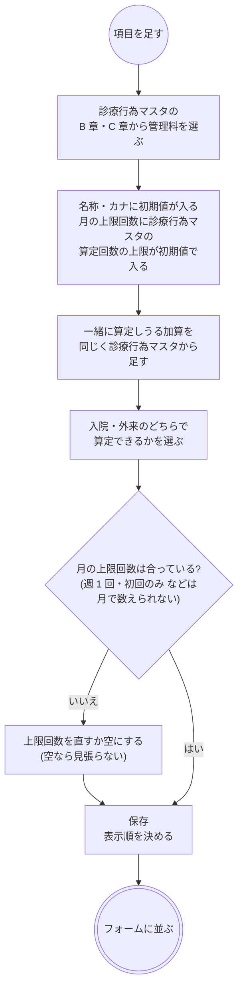
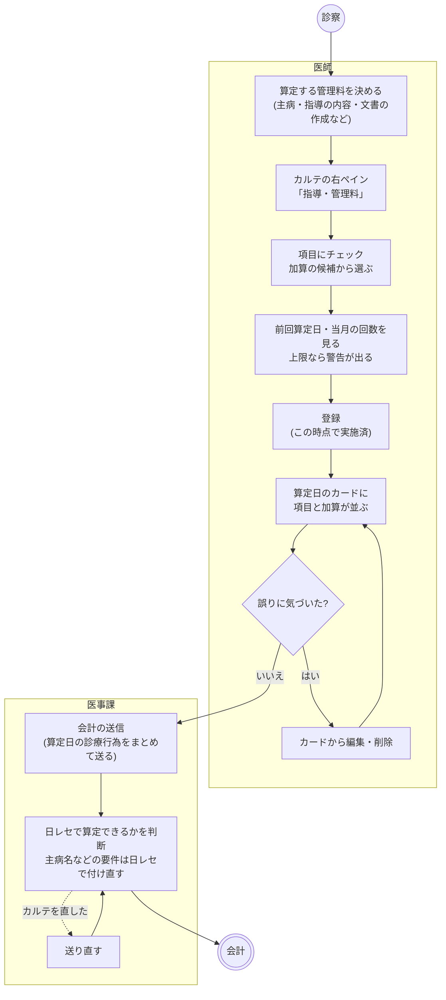
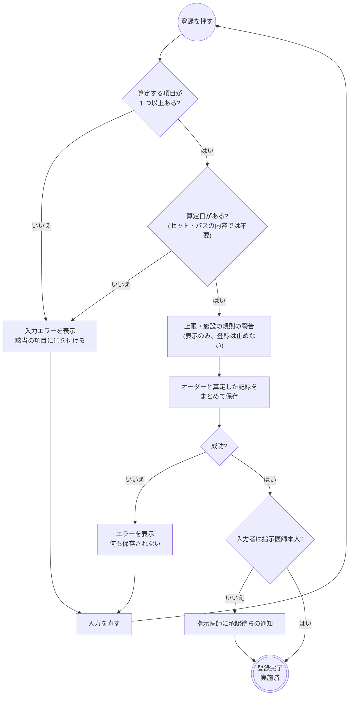
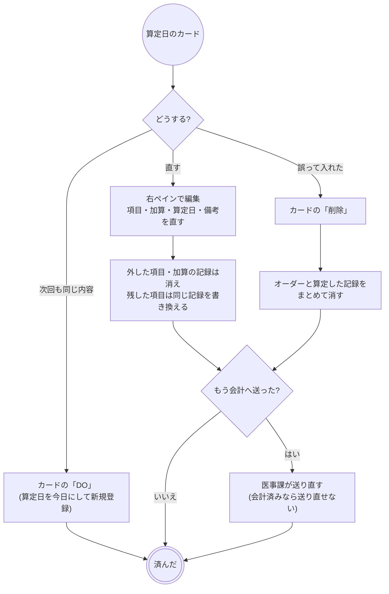
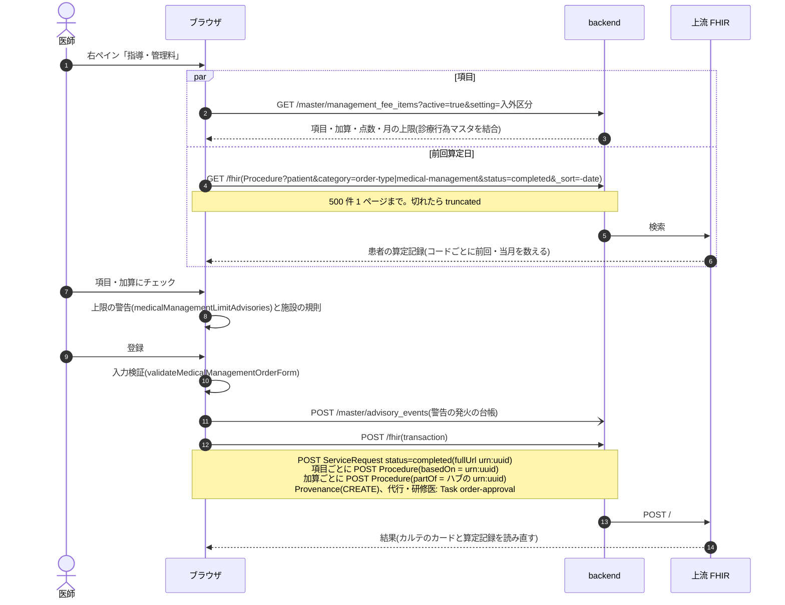
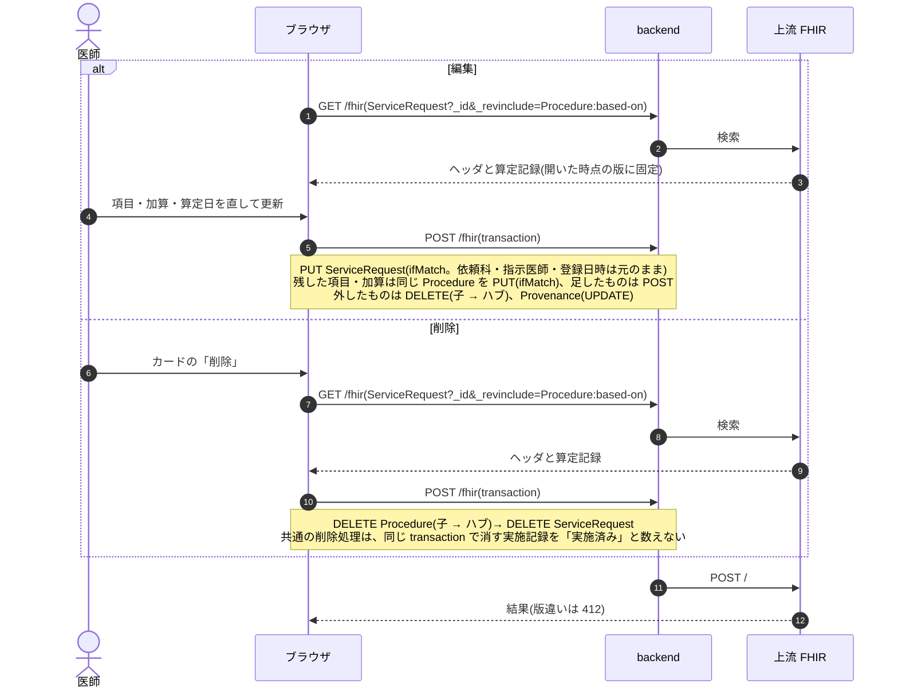
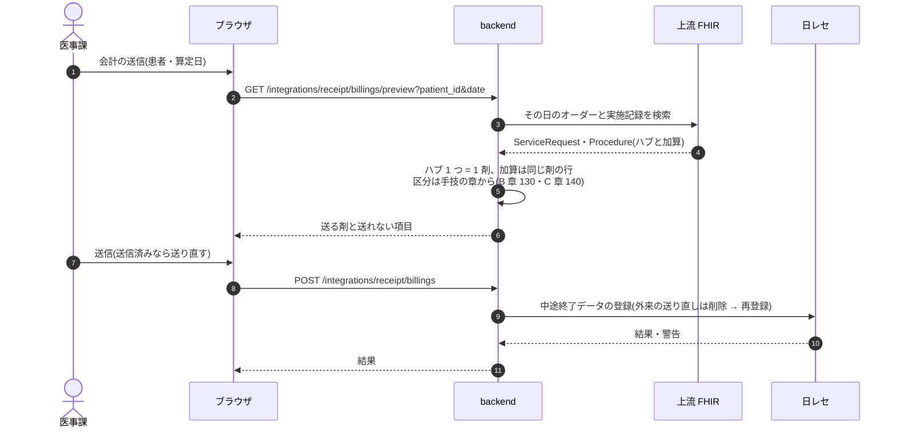

# 指導・管理料の業務フロー

医学管理料(点数表 B 章。特定疾患療養管理料・生活習慣病管理料・診療情報提供料など)と在宅(C 章。在宅自己注射指導管理料・訪問診療など)を、医師がカルテで算定してから医事会計へ送るまでの流れです。医療機関の運用を検討する人は「運用フロー」、院内の開発者は「開発者向け」を読みます。
指導・管理料は部門が受けて実施する依頼ではなく、医師が「この日にこの管理料を算定した」ことを記録するものです。そのため**登録と同時に実施済**になり、受付・予約・部門の一覧を持ちません。
設計は [medical-management-order-design.md](../medical-management-order-design.md)、画面のふるまいは [features/orders-common.md](../features/orders-common.md)「指導・管理料」、医事会計への送り方は [receipt-billing-design.md](../receipt-billing-design.md)、
種別共通の約束(削除・代行入力・警告・オーダーセット・クリニカルパス)は [features/orders-common.md](../features/orders-common.md)、リソースの要素は実装ガイド(`../fhir-ig`)が正典です。

## 運用フロー

### 他のオーダーとの違い

| | 部門オーダー(処置・リハビリなど) | 指導・管理料 |
|---|---|---|
| 受ける人 | 部門(処置室・リハ部門など) | いない。登録した医師が算定した記録になる |
| 進捗 | 受付・実施済などが進む | **持たない**。登録した時点で実施済 |
| 日付 | 実施予定日・予約日 | 算定日(1 日) |
| 選ぶもの | 部門のマスタの項目 | 施設が「指導・管理料項目」に登録した管理料と、その加算 |
| 算定の見張り | 項目ごとの規則・施設の規則 | 前回算定日と当月の回数を項目の横に出し、月の上限に達していれば警告(表示のみ) |
| カルテでの見え方 | 時系列のカード(進捗つき) | 算定日のカード。項目と加算を並べ、進捗は出さない |
| 削除 | 実施記録があればできない | **実施記録ごと消せる** |
| 医事会計 | 部門の実施記録から送る | 登録した項目をそのまま送る(1 項目 1 剤) |

- 入口はカルテの右ペイン「指導・管理料」です。オーダーセット・クリニカルパスのタスク雛形にも入ります。
- 栄養指導料・薬剤管理指導料・退院時薬剤情報管理指導料は、栄養指導・服薬指導の実施から送る(予定の)ものなので、この項目には入れません。薬剤情報提供料は日レセが自動で算定するので入れません。どれも入れると二重に算定されます。
- 初診料・再診料は日レセの自動算定のままです。

### 項目の準備

施設が算定する管理料だけを、マスタメンテ > 医学管理 > 指導・管理料項目(`/management-fee-items`)に登録しておきます。カルテのフォームにはここに登録した有効な項目だけが並びます。

- 初期値として主な管理料・文書料・在宅の 27 件が入っています(`db:seed`)。特定疾患療養管理料は施設の規模でコードが分かれ、初期値は 100 床以上 200 床未満の病院のコードなので、施設に合わせて選び直します。
- 名称と点数は診療行為マスタのものを表示します。点数改定で診療行為マスタを取り込み直せば、項目マスタを直さなくても点数が変わります。
- 使わなくなった項目は無効にします。無効にしても、それを算定した過去の記録はそのまま残ります。

### 全体の流れ

- 算定日の初期値は今日です。後日まとめて入れるときは算定日を変えます。
- 入外区分の初期値は、入院中なら入院、そうでなければ外来です。項目の一覧は入外区分で絞られるので、入院中の患者に外来の管理料を入れるときは入外区分を外来に変えます。
- 対象プロブレムを選べます。主病名を日レセへ送るものではありません(主病名の要件は日レセ側で付けます)。
- 備考はカルテのカードと詳細にだけ出し、日レセへのコメントにはしません。
- 代行入力(医師以外が入力した、研修医が入力した)のときは、指示医師に承認待ちの通知が出ます。承認を待たずに会計へ送れます(代行入力と同じ方針)。

### 登録の判定

- 1 回の登録で複数の項目を入れられます。カードの見出しは「特定疾患療養管理料 ほか1件」のようにまとめます。
- 加算の候補は、項目にチェックを入れるとその下に出ます。初めはどれもチェックされていません。
- 警告はどれも表示のみで、理由を選ばせることもありません。算定できるかの最終判断は日レセに任せます。

### 前回算定日と上限

フォームを開くと、その患者のこれまでの指導・管理料の記録から、項目ごとに次の値を出します。

| 表示 | 意味 |
|---|---|
| 前回 9/12 | その項目(加算も同じく)を最後に算定した日 |
| 当月 1/2回 | 算定日の月にもう算定した回数 / 項目マスタの月の上限 |
| 当月 1回 | 上限を登録していない項目で、その月にもう算定した回数 |

- 「当月の回数 + 今回の 1 回」が上限を超える項目を選ぶと、「○○は当月すでに N 回算定しています(上限 M 回)」の警告が出ます。
- 数える月は算定日の月です。算定日を変えると数え直します。
- 編集中は、そのオーダー自身の記録を数えません(保存し直すと置き換わるので)。
- 記録は新しいほうから 500 件まで読みます。それより古い記録がある患者では「前回算定日は直近 500 件の記録から求めています」と出ます。
- 週 1 回・初回のみ・6 か月に 1 回などの、月以外の期間の上限と、施設基準・届出は見ていません。

### 編集・削除

- 編集で開いたフォームの元データは、開いた時点の版に固定します。その間に別の人が同じオーダーを書き換えていると、保存が版違いで止まります。
- 保存済みの項目は、あとで項目マスタで無効にしたり入外区分が合わなくなったりしても、編集のフォームに行として残ります(チェックを外すと消えます)。
- 中止はありません。算定を取り消すときは削除します。
- 会計へ送ったあとにカルテを直しても、日レセの側は自動では直りません。医事課が会計の送信画面で「送り直す」と、その日の診療行為が入れ替わります。日レセで会計済み・編集済みのときは送り直せないので、日レセ側で直します。

### オーダーセット・クリニカルパスから出る指導・管理料

| 入口 | 算定日 | 対象プロブレム |
|---|---|---|
| 右ペインの「指導・管理料」 | 入力どおり(初期値は今日) | 入力どおり |
| カードの「DO」 | 今日 | 元のオーダーのもの |
| オーダーセットの適用 | 適用した日 | 持ち込まない |
| クリニカルパスの適用 | そのタスクを置いた病日 | 持ち込まない |

- セット・パスで出したものも、登録した時点で実施済です。先の病日に置いた管理料は、その病日の算定として記録されます(その日の会計の送信で送られます)。
- パスの適用を取り消すと、その適用で作った指導・管理料は算定した記録ごと消えます。

### ほかの画面とのつながり

| 画面 | 指導・管理料の使い方 |
|---|---|
| カルテ | 算定日にカードを置く。項目と加算(字下げ)と備考を並べ、進捗は出さない |
| 外来患者一覧 | 当日のオーダーの列に「管」の印 |
| 文書作成(紹介状など) | カルテのカードから転記すると、項目と加算の名前を並べる |
| 会計の送信 | 算定日の診療行為として、ほかのオーダーと一緒に送る |
| 警告の集計と設定 | 施設の規則で出す場所に「指導・管理料」を選べる |

### 変更・中止・削除

| 操作 | できること |
|---|---|
| 変更 | カルテの右ペインで編集。項目・加算・算定日・入外区分・対象プロブレム・備考を直せます |
| 中止 | ありません(削除します) |
| 削除 | カードの「削除」。算定した記録ごと消えます |
| DO | 項目と加算・備考を引き継ぎ、算定日を今日、入外区分をいまの状態にします |

### 帳票

専用の帳票はありません。生活習慣病療養計画書など、算定の要件になる文書は文書作成で書きます(指導・管理料のオーダーとは結び付きません)。

## 開発者向け

### リソースの構成

| もの | リソース | 要点 |
|---|---|---|
| オーダー(ヘッダ) | `ServiceRequest` | `status` = `completed`(登録時から)、`category` = `order-type|medical-management` + `prescription-setting`(入外区分)、`code.text` = 項目名のまとめ、`occurrenceDateTime` = 算定日(日付のみ)、`note` = 備考、`reasonReference` = 対象プロブレム、依頼科・病棟は `applyOrderContext` / `withOrderWard`。明細の `ServiceRequest` は持たない |
| 算定した項目 | `Procedure`(ハブ、`basedOn` = ヘッダ) | 項目 1 つに 1 つ。`category` = `order-type|medical-management`、`code` = `medical-management-procedure-code|レセ電算コード`、`status` = `completed`、`performedDateTime` = 算定日、`performer` = 指示医師、`order-department` 拡張 |
| 加算 | `Procedure`(子、`partOf` = ハブ) | `basedOn` もヘッダを指す(`_revinclude=Procedure:based-on` 1 本でハブと加算を一緒に引くため) |
| 代行入力 | `Provenance`(`target` = ヘッダ) | 種別共通。登録・編集で付ける。代行・研修医は `Task` `order-approval` |
| 項目マスタ | backend `master_management_fee_items` | `receipt_code`・`addition_codes`(jsonb)・`inpatient` / `outpatient`・`monthly_limit`・`active`・`display_order`。名称・点数は一覧 API が診療行為マスタを LEFT JOIN して添える |

- 進捗の `Task` を作りません。部門が受けない種別なので、部門一覧・予約・受付もありません。
- 備考を `Procedure.note` に置かないのは、実施記録の note が会計送信でフリーコメント(810000001)として日レセへ送られるためです。
- 実施記録のコード体系を `{種別}-procedure-code` にしてあるので、会計側に種別ごとの対応表は要りません(`OrderCatalog::Definition#procedure_code_system`)。

### 状態の持ち方

| 表示 | `ServiceRequest.status` | `Procedure.status` |
|---|---|---|
| 登録済み(= 実施済) | `completed` | `completed` |
| 削除 | リソースごと消す | リソースごと消す |

- 状態の遷移はありません。`revoked` も書きません。
- カルテ・前回算定日・会計で読むのは `status = completed` の `Procedure` だけです(`medicalManagementItemsByOrderId` / `medicalManagementHistoryByCode`)。

### シーケンス図の前提

`/fhir` への書き込みはどれも 1 回の transaction Bundle で、backend の `FhirProxyController` が上流へ中継します。
SS-MIX2 を有効にしている施設では、中継が書き込みの控えを記録します(`Ssmix2::Recorder`。指導・管理料はメッセージになりません)。
楽観ロックの版は `postBundle` が `ifMatch` に添え、版が違えば 412 で止まります。編集フォームは `useEditSnapshot` で開いた時点の版に固定し(`hooks/useMedicalManagementOrderInitialValues.ts`)、`withVersionLock` でヘッダと実施記録の元の版を添えます。

| 部品 | 場所 |
|---|---|
| フォーム | `components/MedicalManagementOrderForm.tsx`・`MedicalManagementOrderPanels.tsx`(右ペイン)、詳細 `MedicalManagementOrderDetailPanel.tsx`、カード `karteCardBodies/MedicalManagementOrderCardBody.tsx` |
| 組み立て | `fhir/medicalManagementOrderHelpers.ts`(登録・更新・削除の Bundle、前回算定日・上限の警告、カード用の束ね) |
| hook | `api/queries/medicalManagement.ts`(詳細・更新・削除・患者の算定記録)、登録は `useCreatePrescription`(全種別共通) |
| 項目マスタ | `pages/ManagementFeeItemPage.tsx`、`api/masterClient/managementFee.ts`、backend `Master::ManagementFeeItemsController` |
| セット・パス | `components/orderSetRegistry.tsx`(`medicalManagementOrder`)、パスの取消 `api/queries/pathway.ts`(`useCancelPathwayApplication`) |
| 会計 | backend `Integrations::ReceiptComputer::OrderCatalog`(`medical-management`)・`BillingClaimBuilder`・`Integrations::Orca::MedicalMessage` |

### シーケンス図: 登録

`buildMedicalManagementOrderBundle`、`useCreatePrescription`、`usePatientMedicalManagementProcedures`。

### シーケンス図: 編集・削除

`buildMedicalManagementOrderUpdateBundle` / `buildMedicalManagementOrderDeleteBundle`、`useUpdateMedicalManagementOrder`、`useDeleteMedicalManagementOrder`。

- 編集で同じコードの記録を使い回すのは、会計の送り直しで同じ剤の記録 id が変わらないようにするためです。

### シーケンス図: 会計の送信

`BillingClaimBuilder` の `:procedure` 経路(既定の組み立て。種別専用の resolver はありません)。

### 医事会計と SS-MIX2

指導・管理料は実施記録から集めます(`OrderCatalog` の `medical-management`、`source: :procedure`)。ハブの `Procedure` 1 つが 1 剤で、加算(子)は同じ剤の行になり、コードは `medical-management-procedure-code` のレセ電算コードをそのまま送ります。日レセの診療種別区分は手技の章から決まります(`MedicalMessage::CHAPTER_CLASS`。B 章 130・C 章 140、引けなければ 130)。期間継続型(`continuous`)の扱いにしてあるので、実施記録の無いヘッダを「未実施」と報告しません(登録と同時に記録を書くので通常は起きません)。
SS-MIX2 は、ヘッダの `ServiceRequest` が `OMG^O19` の対象種別(放射線・内視鏡・生理)に入らず、実施記録の `Procedure` も `RAS^O17`(処方・注射)・`OMI^Z23`(放射線・内視鏡)の対象種別ではないので、メッセージになりません。

| 起きたこと | 医事会計(`BillingClaimBuilder`) | SS-MIX2 |
|---|---|---|
| 登録 | 算定日に送る(項目 1 つ = 1 剤) | なし |
| 編集 | 算定日の内容で送る。送信済みなら送り直しで入れ替わる | なし |
| 削除 | 対象から外れる。送信済みなら送り直しで消える | なし |
| オーダーセット・パスの適用 | 置いた日に送る | なし |
| パスの適用の取消 | 対象から外れる | なし |
