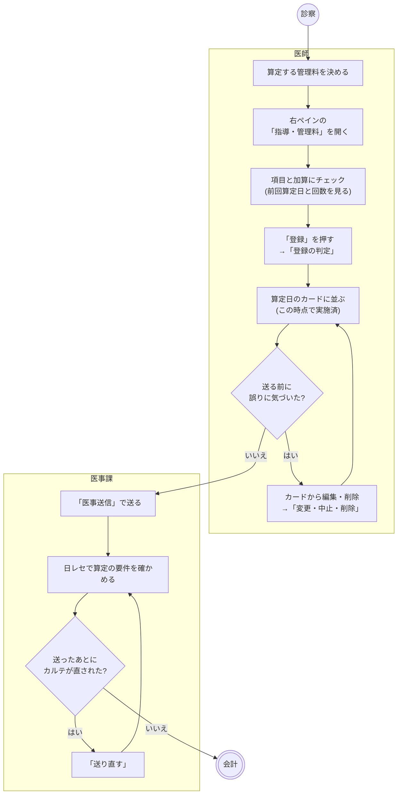
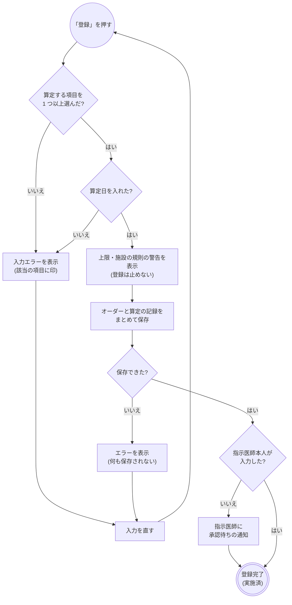
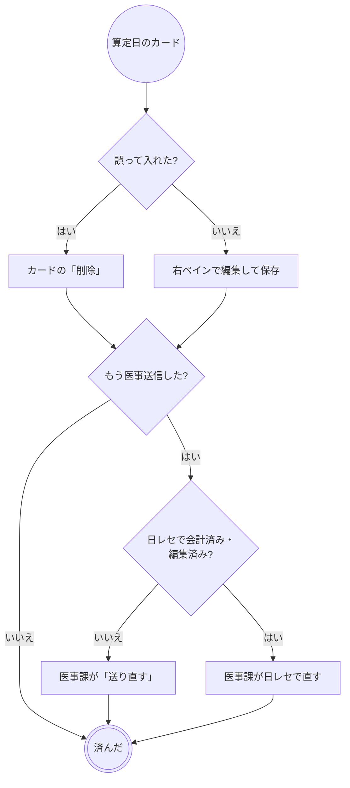
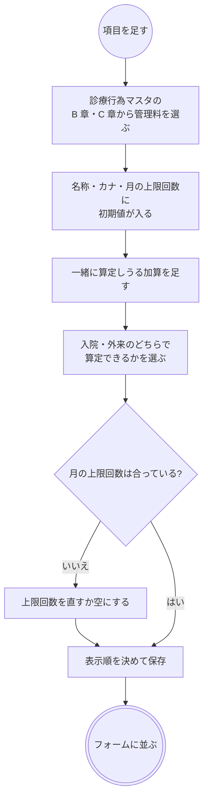
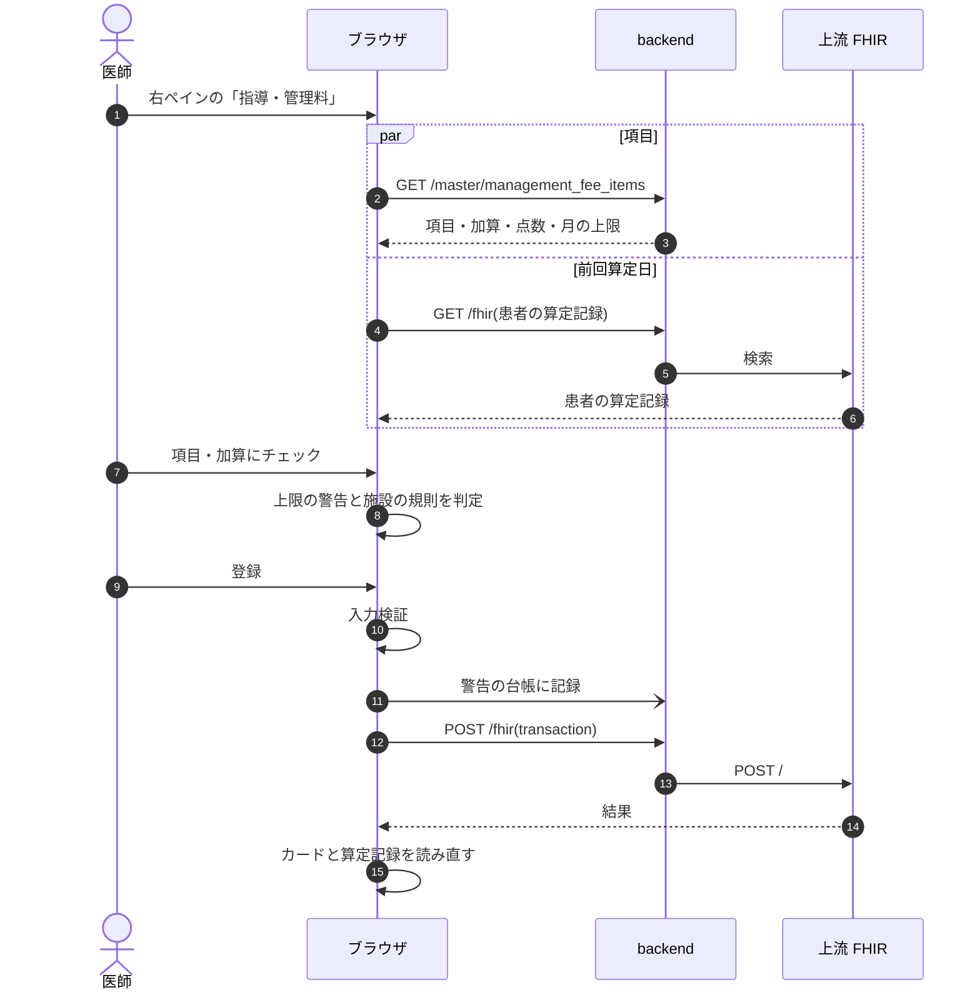
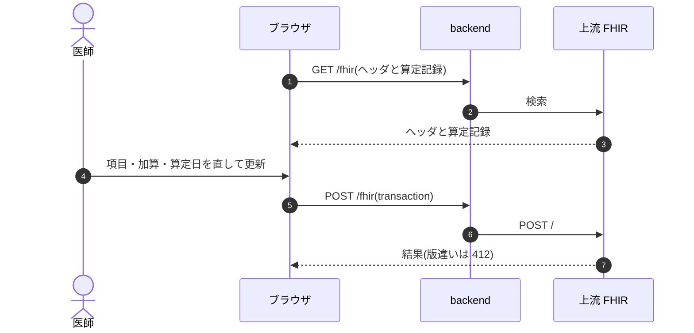
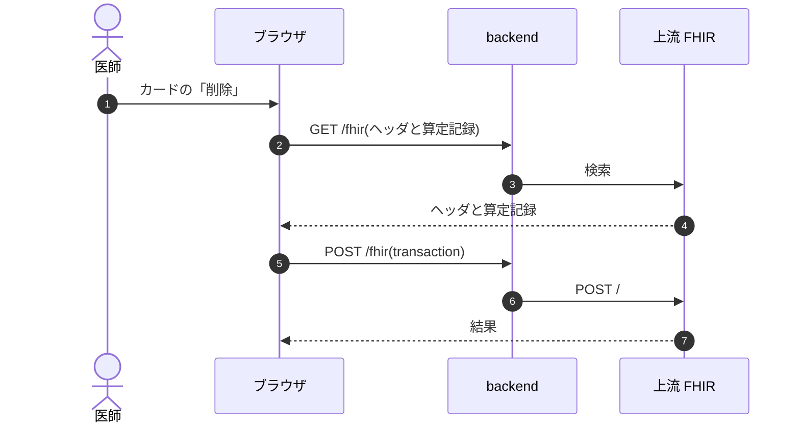
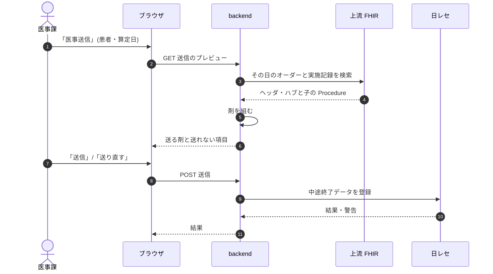

# 指導・管理料の業務フロー

医師がカルテで指導・管理料を算定してから、医事会計へ送るまでの流れです。
対象は、点数表 B 章の医学管理料(特定疾患療養管理料・生活習慣病管理料・診療情報提供料など)と、C 章の在宅(在宅自己注射指導管理料・訪問診療など)です。
指導・管理料は、部門が受けて実施する依頼ではありません。医師が「この日にこの管理料を算定した」ことを記録するものなので、**登録と同時に実施済**になり、受付・予約・部門の一覧を持ちません。

医療機関の運用を検討する人は「運用フロー」、院内の開発者は「開発者向け」を読みます。
設計は [medical-management-order-design.md](../medical-management-order-design.md)、画面のふるまいは [features/orders-common.md](../features/orders-common.md)「指導・管理料」、医事会計への送り方は [receipt-billing-design.md](../receipt-billing-design.md)、
種別共通の約束(削除・代行入力・警告・オーダーセット・クリニカルパス)は [features/orders-common.md](../features/orders-common.md)、リソースの要素は実装ガイド(`../fhir-ig`)が正典です。

## 運用フロー

このページで使う呼び名です。

- **算定日**: その管理料を算定した日です。1 件の登録に 1 日だけ持ちます。
- **加算**: 管理料と一緒に算定する加算です。項目ごとに、施設が候補を決めておきます。
- **算定の記録**: 登録した項目と加算の 1 つずつの記録です。医事会計へ送るのはこの記録です。
- **日レセ**: 医事課が使うレセプトコンピュータです。カルテの「医事送信」で、その日の診療行為を日レセへ送ります。算定できるかの最終判断は日レセで行います。
- **カルテの右ペイン**: カルテの右側のオーダー入力です。指導・管理料は、右ペインの「指導・管理料」から入れます。

### 全体の流れ

- **算定する管理料を決める**: 主病・指導の内容・文書の作成などから、医師が決めます。
- **算定日**: 初期値は今日です。後日まとめて入れるときは、算定日を変えます。
- **入外区分**: 初期値は、入院中なら入院、そうでなければ外来です。並ぶ項目は入外区分で絞られるので、入院中の患者に外来の管理料を入れるときは、入外区分を外来に変えます。
- **対象プロブレム**: 選べます。日レセへ主病名を送るものではありません。主病名などの算定の要件は、医事課が日レセで付けます。
- **備考**: カルテのカードと詳細にだけ出ます。日レセへのコメントにはなりません。
- **代行入力**: 医師以外や研修医が入力したときは、指示医師に承認待ちの通知が出ます。ほかのオーダーの代行入力と同じく、承認を待たずに医事送信できます。

### 登録の判定

- **複数の項目**: 1 回の登録で、複数の項目を入れられます。カードの見出しは「特定疾患療養管理料 ほか1件」のようにまとめます。
- **加算の候補**: 項目にチェックを入れると、その下に出ます。初めはどれもチェックされていません。
- **警告**: どれも表示のみで、理由を選ぶ必要もありません。算定できるかの最終判断は日レセに任せます。
- **オーダーセット・クリニカルパスの中身**: 中身として作るときは、算定日を入れません。適用した日・病日が算定日になります(→「入口ごとの算定日と対象プロブレム」)。

### 前回算定日と上限

見るのは、算定日の月の回数だけです。週 1 回・初回のみ・6 か月に 1 回などの月以外の期間の上限と、施設基準・届出は見ていません。

フォームを開くと、その患者のこれまでの算定の記録から、項目ごとに次の値を出します。

| 表示 | 意味 |
|---|---|
| 前回 9/12 | その項目を最後に算定した日。加算も同じ |
| 当月 1/2回 | 算定日の月にもう算定した回数 / 項目に登録した月の上限 |
| 当月 1回 | 上限を登録していない項目で、その月にもう算定した回数 |

- **上限の警告**: 「当月の回数 + 今回の 1 回」が上限を超える項目を選ぶと、「○○は当月すでにN回算定しています(上限M回)」と出ます。
- **数える月**: 算定日の月です。算定日を変えると数え直します。
- **編集中**: 編集しているオーダー自身の記録は数えません。
- **古い記録**: 新しいほうから 500 件まで読みます。それより古い記録がある患者では「前回算定日は直近 500 件の記録から求めています」と出ます。

### 変更・中止・削除

| 操作 | できる場所 | 結果 |
|---|---|---|
| 編集 | カードから右ペインで | 項目・加算・算定日・入外区分・対象プロブレム・備考を直せる |
| 削除 | カードの「削除」 | オーダーと算定の記録がまとめて消える |
| 中止 | ない | 算定を取り消すときは削除する |
| DO(前回と同じ内容で出し直す) | カードの「DO」 | 新しく登録する(下の表) |

- **編集で外した項目**: 外した項目・加算は、算定の記録から消えます。
- **同時に編集したとき**: 編集を開いているあいだに、ほかの人が同じオーダーを書き換えていると、保存がエラーで止まります。ほかの人の変更を上書きしないためです。
- **無効にした項目**: 保存済みの項目は、あとで項目を無効にしたり入外区分が合わなくなったりしても、編集の画面に行として残ります。チェックを外すと消えます。
- **医事送信のあとの直し**: カルテを直しても、日レセの側は自動では直りません。医事課が「医事送信」で「送り直す」と、その日の診療行為が入れ替わります。
- **送り直せないとき**: 日レセで会計済み・編集済みのときは、送り直せません。医事課が日レセ側で直します。

### 入口ごとの算定日と対象プロブレム

| 入口 | 算定日 | 対象プロブレム |
|---|---|---|
| 右ペインの「指導・管理料」 | 入力どおり(初期値は今日) | 入力どおり |
| カードの「DO」 | 今日 | 元のオーダーのもの |
| オーダーセットの適用 | 適用した日 | 持ち込まない |
| クリニカルパスの適用 | そのタスクを置いた病日 | 持ち込まない |

- **DO で引き継ぐもの**: 項目・加算・備考です。入外区分は、いまの状態になります。
- **オーダーセット・クリニカルパス**: オーダーセットと、クリニカルパスのタスクのオーダー雛形に入れられます。出したものも、登録した時点で実施済です。
- **先の病日に置いた管理料**: パスを適用した時点で、その病日に算定した記録として入ります。その日の医事送信で送られます。算定しないことになったら、カードから削除します。
- **パスの適用の取消**: その適用で作った指導・管理料は、算定の記録ごと消えます。

### ほかの画面とのつながり

| 画面 | 指導・管理料の出方 |
|---|---|
| カルテ | 算定日にカードを置く。項目と加算(字下げ)と備考を並べ、状態は出さない |
| 外来患者一覧 | 当日のオーダーの列に「管」の印 |
| 文書作成(紹介状など) | カルテのカードから転記すると、項目と加算の名前が並ぶ |
| 医事送信 | 算定日の診療行為として、ほかのオーダーと一緒に送る |
| 警告の集計と設定 | 施設の規則で、出す場所に「指導・管理料」を選べる |

### 帳票

専用の帳票はありません。生活習慣病療養計画書など、算定の要件になる文書は文書作成で書きます。文書は指導・管理料のオーダーとは結び付きません。

### 項目の準備

施設のマスタを設定する人の作業です。施設が算定する管理料だけを、「マスタメンテ > 医学管理 > 指導・管理料項目」に登録しておきます。カルテのフォームには、ここに登録した有効な項目だけが並びます。

- **月の上限回数の初期値**: 診療行為マスタの算定回数の上限が入ります。週 1 回・初回のみなど、月で数えられない上限のものは直すか空にします。空にすると、上限の警告は出ません。
- **加算**: 管理料と同じく、診療行為マスタから選びます。
- **最初から入っている項目**: 主な管理料・文書料・在宅の 27 件が登録されています。
- **特定疾患療養管理料**: 施設の規模でコードが分かれます。最初から入っているのは 100 床以上 200 床未満の病院のコードなので、施設に合わせて選び直します。
- **名称と点数**: 診療行為マスタのものを出します。点数改定で診療行為マスタを取り込み直せば、項目を直さなくても点数が変わります。
- **使わなくなった項目**: 無効にします。無効にしても、それを算定した過去の記録はそのまま残ります。
- **入れない項目**: 栄養指導料・薬剤管理指導料・退院時薬剤情報管理指導料は、栄養指導・服薬指導の実施から送るものなので入れません。栄養指導料はいまも栄養指導の実施から送っています。薬剤管理指導料・退院時薬剤情報管理指導料は、服薬指導から送る形がまだできていません。
- **日レセが自動で算定するもの**: 薬剤情報提供料、初診料・再診料は、日レセが自動で算定するので入れません。入れると二重に算定されます。

### 他のオーダーとの違い

| | 部門オーダー(処置・リハビリなど) | 指導・管理料 |
|---|---|---|
| 受ける人 | 部門(処置室・リハ部門など) | いない |
| 状態 | 受付・実施済などと進む | 持たない(登録した時点で実施済) |
| 日付 | 実施予定日・予約日 | 算定日(1 日) |
| 選ぶもの | 部門のマスタの項目 | 施設が登録した管理料と、その加算 |
| 算定回数の確かめ方 | 項目ごとの規則・施設の規則 | 前回算定日と当月の回数を出す |
| カルテでの見え方 | 状態つきのカード | 算定日のカード(状態は出さない) |
| 削除 | 実施記録があればできない | 算定の記録ごと消せる |
| 医事会計 | 部門の実施記録から送る | 登録した項目を送る |

- **受ける人がいない**: 登録した医師の算定の記録になります。
- **算定回数**: 月の上限に達している項目を選ぶと、警告(表示のみ)が出ます(→「前回算定日と上限」)。
- **医事会計**: 項目 1 つずつを、日レセの 1 つの診療行為の組として送ります。加算は同じ組に入ります。

## 開発者向け

### シーケンス図の前提

- **書き込みの経路**: `/fhir` への書き込みはどれも 1 回の transaction Bundle で、backend の `FhirProxyController` が上流へ中継します。
- **上流**: 上流の FHIR サーバーです。図では「上流 FHIR」と書きます。
- **応答の中継**: 上流の応答も backend を通って画面へ戻ります。図では省いて、上流から画面へ直接返す矢印で描きます。
- **SS-MIX2**: 有効にしている施設では、中継が書き込みの控えを記録します(`Ssmix2::Recorder`)。指導・管理料はメッセージになりません。
- **楽観ロック**: 版は `postBundle` が `ifMatch` に添え、版が違えば 412 で止まります。
- **編集の版の固定**: 編集フォームは `useEditSnapshot` で開いた時点の版に固定し(`hooks/useMedicalManagementOrderInitialValues.ts`)、`withVersionLock` でヘッダと実施記録の元の版を添えます。
- **ヘッダ**: オーダー 1 件を表す `ServiceRequest` です。明細の `ServiceRequest` は持ちません。
- **ハブ**: 項目 1 つの実施記録の `Procedure` です。
- **子**: 加算 1 つの実施記録の `Procedure` で、`partOf` でハブを指します。
- **算定記録**: ハブと子の `Procedure` をまとめた呼び名です。「運用フロー」節の「算定の記録」に当たります。

### リソースの構成

- ヘッダ `ServiceRequest`(オーダー 1 件)
  - ハブ `Procedure`(項目 1 つに 1 つ。`basedOn` = ヘッダ)
    - 子 `Procedure`(加算 1 つに 1 つ。`partOf` = ハブ、`basedOn` = ヘッダ)
  - `Provenance`(`target` = ヘッダ。登録・編集で付ける)
  - Task `order-approval`(代行入力・研修医のとき)

子も `basedOn` でヘッダを指すのは、`_revinclude=Procedure:based-on` 1 本でハブと子を一緒に引くためです。

| リソース | 要素 | 中身 |
|---|---|---|
| ヘッダ `ServiceRequest` | `status` | `completed`(登録したときから) |
| ヘッダ `ServiceRequest` | `category` | `order-type|medical-management` と、入外区分の `prescription-setting` |
| ヘッダ `ServiceRequest` | `code.text` | 項目名のまとめ |
| ヘッダ `ServiceRequest` | `occurrenceDateTime` | 算定日(日付のみ) |
| ヘッダ `ServiceRequest` | `note` | 備考 |
| ヘッダ `ServiceRequest` | `reasonReference` | 対象プロブレム |
| ヘッダ `ServiceRequest` | 依頼科・病棟 | `applyOrderContext` / `withOrderWard` で付ける |
| ハブ・子 `Procedure` | `category` | `order-type|medical-management` |
| ハブ・子 `Procedure` | `code` | `medical-management-procedure-code|レセ電算コード` |
| ハブ・子 `Procedure` | `status` | `completed` |
| ハブ・子 `Procedure` | `performedDateTime` | 算定日 |
| ハブ・子 `Procedure` | `performer` | 指示医師 |
| ハブ・子 `Procedure` | `order-department` 拡張 | 依頼科 |

backend の項目マスタ(`master_management_fee_items`)の列です。

| 列 | 中身 |
|---|---|
| `receipt_code` | 管理料のレセ電算コード |
| `addition_codes` | 加算の候補(jsonb) |
| `inpatient` / `outpatient` | 入院・外来で算定できるか |
| `monthly_limit` | 月の上限回数 |
| `active` | 有効か |
| `display_order` | 表示順 |

名称と点数は列に持たず、一覧の API が診療行為マスタを LEFT JOIN して添えます。

- **進捗 Task**: 作りません。部門が受けない種別なので、部門一覧・予約・受付もありません。
- **備考の置き場所**: 備考を `Procedure.note` に置かないのは、実施記録の `note` が会計送信でフリーコメント(810000001)として日レセへ送られるためです。
- **コード体系**: 実施記録のコード体系を `{種別}-procedure-code` にしてあるので、会計側に種別ごとの対応表は要りません(`OrderCatalog::Definition#procedure_code_system`)。

### 状態の持ち方

| 表示 | `ServiceRequest.status` | `Procedure.status` |
|---|---|---|
| 登録済み(= 実施済) | `completed` | `completed` |
| 削除 | リソースごと消す | リソースごと消す |

- **遷移**: 状態の遷移はありません。`revoked` も書きません。
- **読むもの**: カルテ・前回算定日・会計で読むのは、`status = completed` の `Procedure` だけです(`medicalManagementItemsByOrderId` / `medicalManagementHistoryByCode`)。

### 部品

| 操作 | 画面 | 組み立て | hook |
|---|---|---|---|
| 登録 | `components/MedicalManagementOrderForm.tsx`・`MedicalManagementOrderPanels.tsx`(右ペイン) | `buildMedicalManagementOrderBundle`(`fhir/medicalManagementOrderHelpers.ts`) | `useCreatePrescription` |
| 前回算定日と上限 | 同上 | `medicalManagementLimitAdvisories`(同上) | `usePatientMedicalManagementProcedures` |
| 編集 | 同上 | `buildMedicalManagementOrderUpdateBundle`(同上) | `useUpdateMedicalManagementOrder` |
| 削除 | カルテのカード | `buildMedicalManagementOrderDeleteBundle`(同上) | `useDeleteMedicalManagementOrder` |
| 表示 | 詳細 `MedicalManagementOrderDetailPanel.tsx`、カード `karteCardBodies/MedicalManagementOrderCardBody.tsx` | カード用の束ね(同上) | |
| 項目マスタ | `pages/ManagementFeeItemPage.tsx` | `api/masterClient/managementFee.ts` | backend `Master::ManagementFeeItemsController` |
| オーダーセット・パス | `components/orderSetRegistry.tsx`(`medicalManagementOrder`) | | パスの取消は `useCancelPathwayApplication`(`api/queries/pathway.ts`) |
| 会計 | | backend `Integrations::ReceiptComputer::OrderCatalog`(`medical-management`)・`BillingClaimBuilder`・`Integrations::Orca::MedicalMessage` | |

hook の置き場所です。

- `useCreatePrescription` は `api/queries/labResult.ts` にあります。名前は処方由来ですが、全種別の登録が通ります。
- 詳細・更新・削除・患者の算定記録の hook は `api/queries/medicalManagement.ts` にあります。

### シーケンス図: 登録

| 読むもの | 条件 |
|---|---|
| 項目 | `active=true&setting=<入外区分>`。backend が診療行為マスタを結合して名称・点数を添える |
| 患者の算定記録 | `Procedure?patient&category=order-type|medical-management&status=completed&_sort=-date` |

- **算定記録の件数**: 500 件 1 ページまで読み、切れたら truncated として「直近 500 件」の注記を出します。コードごとに前回算定日と当月の回数を数えます。
- **判定と検証**: 上限の警告は `medicalManagementLimitAdvisories`、入力検証は `validateMedicalManagementOrderForm` です。
- **台帳**: `-)` の矢印は応答を待たない送信です。警告の台帳は `POST /master/advisory_events`(警告の発火)です。

| transaction で書くもの | 条件 |
|---|---|
| POST ヘッダ `ServiceRequest`(`status = completed`、`fullUrl` は urn:uuid) | いつも |
| POST ハブ `Procedure`(`basedOn` = ヘッダの urn:uuid) | 項目ごと |
| POST 子 `Procedure`(`partOf` = ハブの urn:uuid) | 加算ごと |
| `Provenance`(CREATE) | いつも |
| Task `order-approval` | 代行入力・研修医 |

### シーケンス図: 編集・削除

編集です。

- 検索は `ServiceRequest?_id&_revinclude=Procedure:based-on` です。読んだ内容は、開いた時点の版に固定します。

| transaction で書くもの | 条件 |
|---|---|
| PUT ヘッダ `ServiceRequest`(`ifMatch`) | いつも。依頼科・指示医師・登録日時は元のまま |
| PUT ハブ・子 `Procedure`(`ifMatch`) | 残した項目・加算 |
| POST ハブ・子 `Procedure` | 足した項目・加算 |
| DELETE 子 → ハブ | 外した項目・加算 |
| `Provenance`(UPDATE) | いつも |

残した項目は、同じ `Procedure` を PUT します。会計を送り直したときに、剤の実施記録の id が変わらないようにするためです。

削除です。

- 検索は編集と同じです。
- transaction は、子 → ハブの順に `Procedure` を DELETE し、最後にヘッダの `ServiceRequest` を DELETE します。
- 種別共通の削除処理は、実施記録のあるオーダーの削除を止めます。ただし、同じ transaction で消す実施記録は「実施済み」と数えません。

### シーケンス図: 会計の送信

会計の組み立ては `BillingClaimBuilder` の `:procedure` 経路です(既定の組み立てで、種別専用の resolver はありません)。

| 呼び出し | パス |
|---|---|
| 送信のプレビュー | `GET /integrations/receipt/billings/preview?patient_id&date` |
| 送信 | `POST /integrations/receipt/billings` |

- **剤の組み方**: ハブ 1 つが 1 剤で、子(加算)は同じ剤の行になります。
- **診療種別区分**: 手技の章から決めます(`MedicalMessage::CHAPTER_CLASS`)。B 章は 130、C 章は 140、引けなければ 130 です。
- **送り直し**: 外来の送り直しは、削除してから再登録します。
- **送れないとき**: 日レセで会計済み・編集済みのときは、送り直しも取消も止めます。理由は backend が返します。

### 医事会計と SS-MIX2

医事会計(`BillingClaimBuilder`)は、指導・管理料を実施記録から集めます(`OrderCatalog` の `medical-management`、`source: :procedure`)。SS-MIX2 にはどの操作も出しません。

| 起きたこと | 医事会計 |
|---|---|
| 登録 | 算定日に送る(項目 1 つ = 1 剤) |
| 編集 | 算定日の内容で送る。送信済みなら、送り直しで入れ替わる |
| 削除 | 対象から外れる。送信済みなら、送り直しで消える |
| オーダーセット・パスの適用 | 置いた日に送る |
| パスの適用の取消 | 対象から外れる |

- **コード**: `medical-management-procedure-code` のレセ電算コードを、そのまま送ります。
- **未実施の報告**: 期間継続型(`continuous`)の扱いにしてあるので、実施記録の無いヘッダを「未実施」と報告しません。登録と同時に記録を書くので、通常は起きません。
- **SS-MIX2 に出ない理由**: ヘッダの `ServiceRequest` は `OMG^O19` の対象種別(放射線・内視鏡・生理)ではありません。実施記録の `Procedure` も、`RAS^O17`(処方・注射)・`OMI^Z23`(放射線・内視鏡)の対象種別ではありません。
