# 細菌検査オーダーの業務フロー

細菌検査オーダーの登録からラベル発行・採取・到着・中間報告・最終報告・結果確認までの流れです。医療機関の運用を検討する人は「運用フロー」、院内の開発者は「開発者向け」を読みます。
進捗の考え方は検体検査と同じなので、この文書は [lab.md](lab.md) との違いを中心に書きます。
設計は [micro-order-design.md](../micro-order-design.md)(オーダー・ラベル・採取)・[micro-result-design.md](../micro-result-design.md)(結果)、画面のふるまいは [features/lab.md](../features/lab.md)「細菌検査一覧と進捗」、
種別共通の約束(中止・削除・代行入力)は [features/orders-common.md](../features/orders-common.md)、リソースの要素は実装ガイド(`../fhir-ig`)が正典です。
迅速抗原・毒素・PCR は検体検査オーダーで扱います。判断の基準は、培養・鏡検の流れに乗るかどうかです。

## 運用フロー

### 検体検査との違い

| | 検体検査 | 細菌検査 |
|---|---|---|
| オーダーの単位 | 検体をまたいで 1 オーダー | **1 オーダー = 1 検体**。血液培養の 2 セット目は DO して採取部位を変える |
| ラベル発行 | 発行が受付を兼ねる。病棟は一括発行 | **進捗を動かさない**。カルテのカードか一覧の行から 1 件ずつ |
| 採取の記録 | なし | **あり**。採取日時・採取者・部位・方法 |
| 受付済 | ラベルを発行した | **検体が検査室に届いた** |
| 終わりの状態 | 全部の管が届くと実施済 | **最終報告で報告済**。培養の間は受付済のまま |
| 報告区分 | 中間・最終・訂正 | 中間・最終。確定後に直しても最終のまま |
| 緊急の通知 | パニック値 | なし |
| 結果の入れ方 | 手入力とファイル取込 | 手入力だけ |

検査日は必須で、予約枠は使いません。日付未定・即実施・事後はありません。登録時の警告もありません。

### 細菌検査の状態

検査室の進み具合を示す状態です。中間報告はこの状態に含めず、一覧の「結果」の列とカードの印で見せます。

| 状態 | 変わるきっかけ | 細菌検査一覧からできること |
|---|---|---|
| 依頼済 | 医師の登録、取消、到着の取消、中止取消 | 受付、ラベル発行、中止 |
| 受付済 | 全容器の到着、受付、中間報告の保存、結果の削除 | 結果登録・結果編集、ラベルの刷り直し、取消(依頼済へ)、中止 |
| 報告済 | 最終報告の保存 | 結果編集、ラベルの刷り直し |
| 中止 | 中止 | 中止取消(依頼済へ) |

- 報告済へは手で進めません。結果の保存が報告区分に合わせて状態を動かします。
- 一覧の「日数」は、検査日を 1 日目として今日が何日目かを依頼済・受付済の行に出します。「未完了(14日)」で、選んだ日までの 14 日ぶんの依頼済・受付済を古い順に見られます。

容器 1 つごとに別の状態があります。**未発行 → 発行済 → 到着済**で、一覧の「表示」に番号と一緒に出ます。

### 全体の流れ

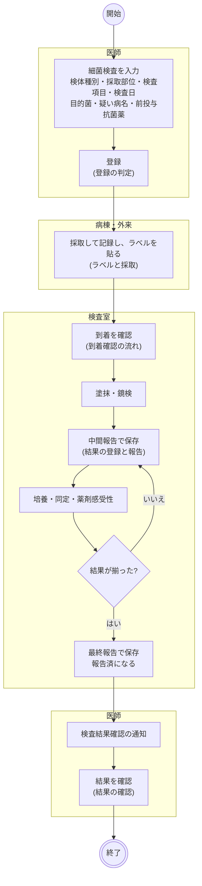

- 中間報告は任意です。塗抹の所見がすぐ要らなければ、最終報告だけでも構いません。
- 医師は中間報告の内容をカルテで読めますが、通知は出ず、確認の記録も残せません。
- 外来の診察終了で、当日の細菌検査が依頼済・受付済のまま残っていると「一時終了」を選べます。
- 看護ワークシートの採取の印は、記録すると「採取済」、ラベルだけなら「ラベル済」、全容器が届くか受付済で「到着済」になります。

### 登録の判定

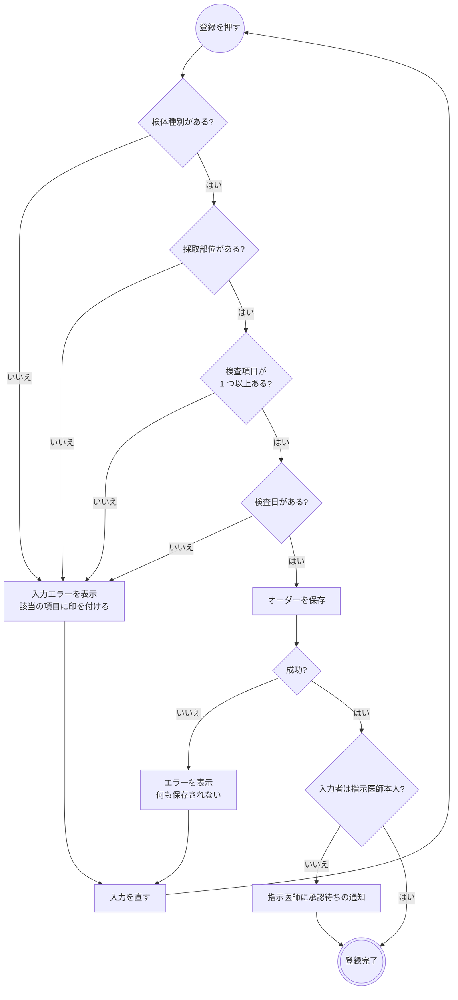

- 検査項目はマスタの全項目をチェックボックスで並べます。伝票とセットはありません。検体種別と検査項目の組み合わせは検査しません。
- 目的菌は頻用菌のチェックと全件検索から複数選べます。
- 前投与抗菌薬は培養の解釈に使う情報です。「処方取込」で直近の処方・注射の抗菌薬を文字に取り込み、そのまま直せます。
- 検査目的は診断目的と監視培養から選びます。
- 承認待ちでもオーダーは部門に流れます。オーダーセット・クリニカルパスからの適用も同じ保存を通ります。

### ラベルと採取

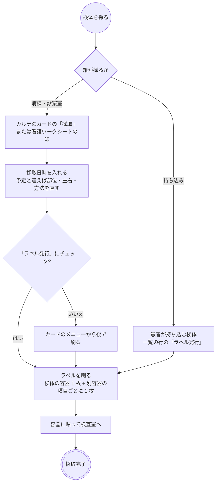

- 容器は検体の容器 1 つと、別容器の項目 1 つごとです。血液培養の好気・嫌気ボトルが別容器で、ボトルだけのオーダーに検体の容器のラベルは出ません。
- 採取者は記録したログインユーザーです。入力欄はなく、直しても最初に記録した人のままです。
- 採取の記録は依頼済・受付済のあいだ書けます。受付後に足すこともできます。
- 採取日時はカード・ラベルに出ます。未記録ならラベルは「予定」の日時です。結果登録の検体採取日にも写ります。
- 同じ容器は刷り直しても同じ番号です。項目を外して刷り直すと、外した容器のラベルは取り下げになります。戻すと同じ番号で復帰します。
- 検体検査の「ラベル一括発行」に細菌検査は入りません。中止したオーダーには発行できません。

### 到着確認の流れ

画面は検体検査と同じ**部門業務 > 臨床検査部門 > 検体到着確認**で、番号の検査と二重読みの扱いも同じです([lab.md](lab.md)「到着確認の流れ」)。読んだ後の進み方だけが違います。

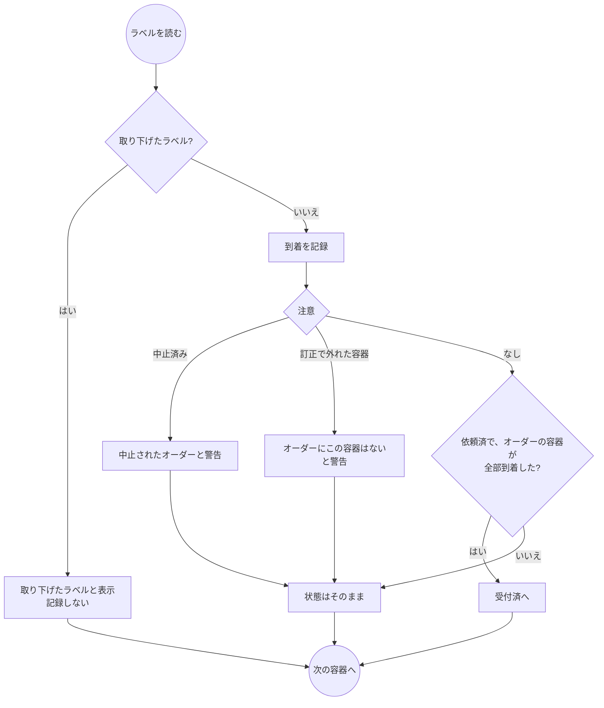

- 「取消」は到着を消し、受付済を依頼済へ戻します。結果が付いていれば検体は届いているので、状態は戻しません。
- ラベルの無い検体は一覧の「受付」で受付済にします。
- 病理のラベルを読むと「病理の受付で読んでください」と出して記録しません。

### 結果の登録と報告

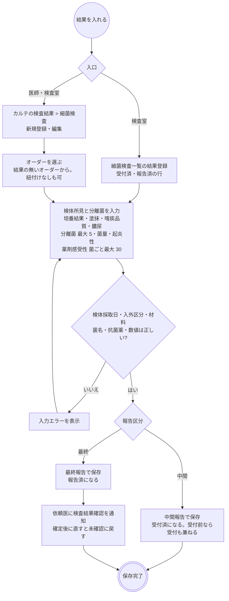

- 一覧から開くとオーダーは行で決まり、材料・依頼科・検体採取日をオーダーから写します。
- オーダーに紐付けない結果は状態を動かしません。
- 分離菌と感受性の抗菌薬は JANIS のコードから選びます。頻用薬は直接並び、ほかは検索します。
- 1 オーダーに結果は 1 件です。中間報告を編集して最終報告に切り替えます。
- 最終報告を中間報告に直すと受付済に戻ります。出ている検査結果確認の通知はそのまま残ります。
- 中止したオーダーは、結果を保存しても中止のままです。
- 分離菌の結果を使う機能は 2 つあります。AST 一覧の血液培養タブは入院中の患者の血液培養の陽性を出し、データ抽出の細菌検査タブは分離菌 1 株を 1 行にして出します。感染症の発生届の検知には結び付いていません。

### 結果の確認

確認の仕組みは検体検査と同じです([lab.md](lab.md)「結果の確認」)。細菌検査に緊急の通知はないので、最終報告の検査結果確認だけです。

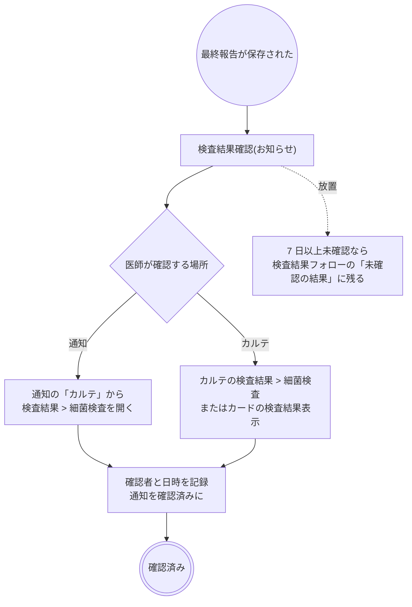

- 宛先は依頼医ですが、確認は誰でもできます。記録には確認した本人が残ります。
- 中間報告のうちは確認できません。確定後に編集すると未確認に戻ります。

### 変更・中止・削除

| 操作 | できる場所 | できないとき・注意 |
|---|---|---|
| 変更 | カルテのカード | 進捗では止まりません。項目を足し引きしたら、ラベルを刷り直します |
| 採取の修正 | カルテのカードの「採取修正」 | 依頼済・受付済のあいだ。採取者は最初に記録した人のままです |
| 中止 | 細菌検査一覧のメニュー | 依頼済・受付済から。報告済からはできません。結果が付いていても止まらず、結果は残ります |
| 中止取消 | 細菌検査一覧のメニュー | 依頼済に戻ります |
| 取消 | 細菌検査一覧のメニュー | 受付済を依頼済へ戻す訂正です。容器の到着記録は消えません |
| 削除 | カルテのカード | 結果が付いているとできません(結果を削除してから)。進捗は一緒に消え、発行済みの容器の記録は残ります |
| 結果の削除 | カルテの検査結果 > 細菌検査 | 分離菌・感受性と結果側の検体を消し、報告済は受付済に戻ります。**検査結果確認の通知は取り下げません** |

- 変更は再度の承認を要する場合があります(代行入力のとき)。部門への通知はなく、一覧の内容で見えます。
- 報告済の結果を直すときは、最終報告のまま編集します。報告済から戻す操作は、中間報告への変更か結果の削除だけです。
- DO はオーダーの内容だけを写します。採取の記録・ラベル・結果は写りません。

### 帳票

| 帳票 | 出す場所 | 内容 |
|---|---|---|
| 検体ラベル | カルテのカード、採取の記録、細菌検査一覧の行 | 容器 1 つ 1 枚。バーコード(番号)・患者番号・氏名・カナ・検体か項目・採取日時または予定 |

細菌検査結果の報告書はありません。検査結果報告書は検体検査だけです。

## 開発者向け

### リソースの構成

オーダーは 3 層です。ヘッダの `ServiceRequest`(`order-type|micro`)← `basedOn` ── 検体グループ明細(contained `Specimen`)← `basedOn` ── 検査項目明細です。UI は 1 オーダー 1 検体に制限していますが、構造は複数検体を持てます(`fhir/microOrderHelpers.ts`)。
ヘッダは拡張 `micro-prior-antimicrobial`(前投与抗菌薬)・`micro-exam-purpose`(検査目的)を持ち、検体グループ明細は `orderDetail`(目的菌)・`reason*`(疑い病名)・採取予定日時を持ちます。

| もの | リソース | 補足 |
|---|---|---|
| 進捗 | `Task`(`task-code|micro-exam`、`focus` = ヘッダ) | 下の表 |
| 採取の記録 | 検体グループ明細の contained `Specimen` の `collection`(`collectedDateTime`・`collector`・`bodySite`・`method`) | 明細だけを PUT する(ヘッダを組み直すと依頼医が替わる)。来歴は付けない |
| 容器の台帳 | `Specimen`(`request` = [ヘッダ, 検体グループ明細]、`identifier` = `micro-container`、`accessionIdentifier` = ラベル番号) | 発行 = 作成、到着 = `receivedTime` + `status: available`、取り下げ = `entered-in-error`。番号は検体検査の採取管と同じ採番。`identifier` は検体の容器なら検体グループ明細の id、ボトルなら検査項目明細の id |
| 結果 | `DiagnosticReport`(`category` = v2-0074 `MB`、`code` = LOINC `18725-2`、`basedOn` = ヘッダ、`status` = `preliminary` / `final`)+ `Observation` | 培養・塗抹・喀痰品質・膿尿・分離菌(`component` に菌量・起炎性)。プロファイルは付けない |
| 薬剤感受性 | `Observation`(`derivedFrom` = 分離菌の `Observation`、`code` = JANIS 抗菌薬) | MIC は `valueQuantity`、S / I / R は `interpretation`、阻止円径は `component`。分離菌の並びは `DiagnosticReport.result` の順 |
| 結果の検体 | `Specimen`(`type` = JANIS 材料コード) | 結果側が所有する。ラベルの台帳とは別で、参照しない |
| 検査結果確認の通知 | `Task`(`task-code|result-review`、`focus` = 結果、`owner` = 依頼医) | 最終報告のときだけ |
| 確認(既読) | `Provenance`(`target` = 結果、`agent.type = verifier`、`signature`) | 検体検査と同じ |
| 代行入力 | `Provenance`(`target` = ヘッダ、`activity` CREATE / UPDATE) | 明細は `target` に入れない |

### 進捗 Task(`micro-exam`)

Task は登録時には作りません。**Task が無いオーダーは依頼済**として扱い、最初の受付・中止か結果の保存で作ります(`fhir/microTaskHelpers.ts`)。
中止は同じ transaction でヘッダを `revoked` にし、中止取消で `active` に戻します(`orderCancelEntries`)。中止したオーダーを編集しても `revoked` のままです(`keepOrderRevoked`)。
Task が無いまま結果があるオーダー(進捗を持つ前のデータ)は、表示だけ報告区分から読みます(`microOrderStatus`)。

| 状態 | `Task.status` | `executionPeriod` | 進めるもの |
|---|---|---|---|
| 依頼済 | `requested`(または Task 無し) | なし | 取消、到着の取消、中止取消 |
| 受付済 | `accepted` | `start` | 全容器の到着、一覧の受付、中間報告の保存、結果の削除(報告済から) |
| 報告済 | `completed` | `start` / `end` | 最終報告の保存 |
| 中止 | `cancelled` | なし | 一覧の中止。結果の保存では動かない |

結果の保存・削除で進める判定は `microTaskStatusForReport` です。報告区分は `DiagnosticReport.status` が正本で、Task には持ちません。

### シーケンス図の前提

`/fhir` への書き込みはどれも 1 回の transaction Bundle で、backend の `FhirProxyController` が上流へ中継します。
楽観ロックの版は `postBundle` が `ifMatch` に添え、版が違えば 412 で止まります。
例外はラベルの PDF で、backend(`MicroLabelReport`)が上流を直接読み書きします。

### シーケンス図: 登録・編集・削除

`components/MicroOrderForm.tsx`・`MicroOrderPanels.tsx`、`buildMicroOrderBundle` / `buildMicroOrderUpdateBundle` / `buildMicroOrderDeleteBundle`(`fhir/microOrderHelpers.ts`)、
`useCreatePrescription` / `useUpdatePrescription`(`api/queries/labResult.ts`。全種別共通)、`useDeleteMicroOrder`(`api/queries/micro.ts`)、処方取込は `hooks/useAntimicrobialSuggestions.ts`。

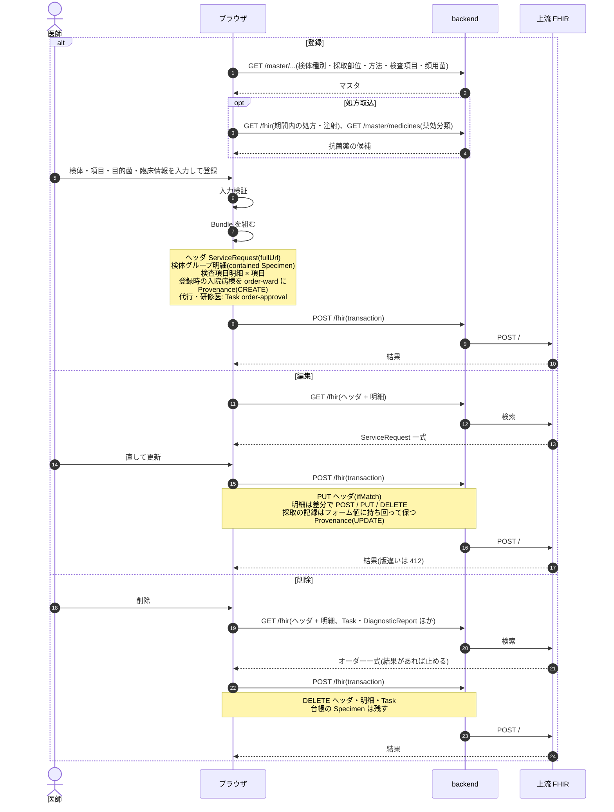

### シーケンス図: 採取の記録とラベル発行

`components/MicroCollectionModal.tsx`、`useRecordMicroCollection`(`api/queries/micro.ts`)、`buildMicroCollectionBundle`(`fhir/microOrderHelpers.ts`)、
`Reports::MicroLabelPdfsController`、`MicroLabelReport`・`Reports::MicroLabelRenderer`(backend)。レイアウトは `docs/report-mappings/micro-label-01.md`。

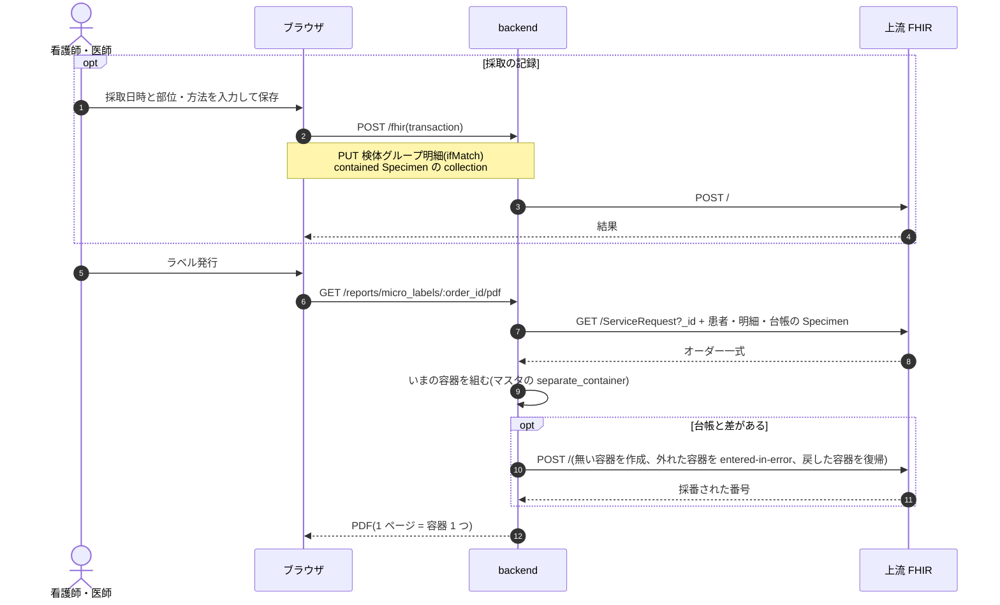

### シーケンス図: 到着確認

`pages/LabArrivalPage.tsx`(台帳の識別子で検体検査・細菌・病理を振り分ける)、`fetchMicroArrivalContext`(`api/queries/micro.ts`)、`allMicroContainersArrived`(`fhir/microContainerHelpers.ts`)、`useUpdateLabArrival`(`api/queries/injection.ts`)。

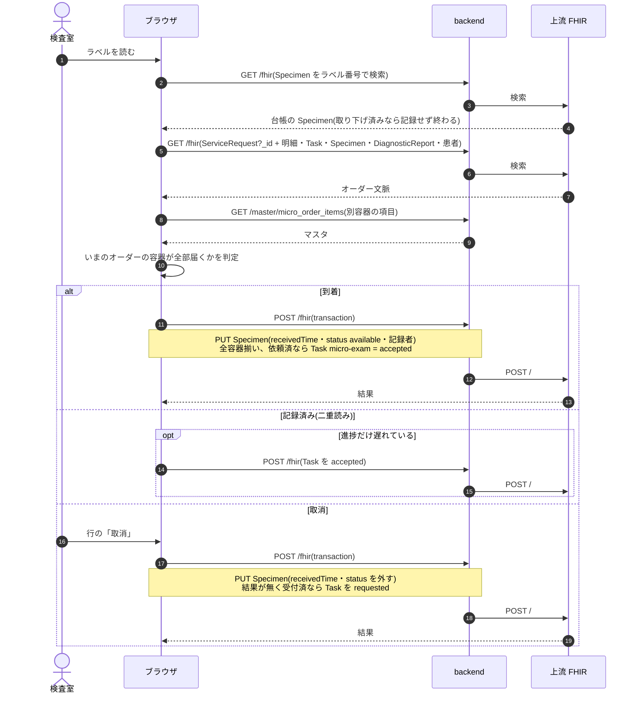

### シーケンス図: 一覧・受付・中止

`pages/MicroWorklistPage.tsx`、`useMicroWorklist` / `useUpdateMicroTaskStatus`(`api/queries/micro.ts`)、`makeUpdateTaskStatusHook`(`api/queries/worklist.ts`)。

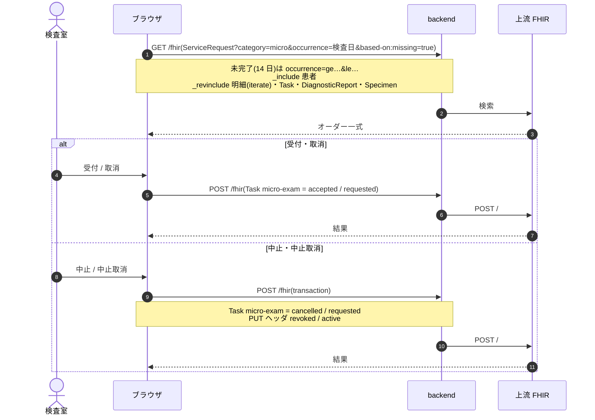

### シーケンス図: 結果登録・編集・削除

`components/KarteMicroResultTab.tsx`・`MicroResultForm.tsx`・`MicroResultDetailPanel.tsx`、`buildMicroResultBundle` / `buildMicroResultUpdateBundle` / `buildMicroResultDeleteBundle`(`fhir/microResultHelpers.ts`)、
`useCreateMicroResult` / `useUpdateMicroResult` / `useDeleteMicroResult`(`api/queries/micro.ts`)、`withResultReviewTask`(`api/queries/notification.ts`)。

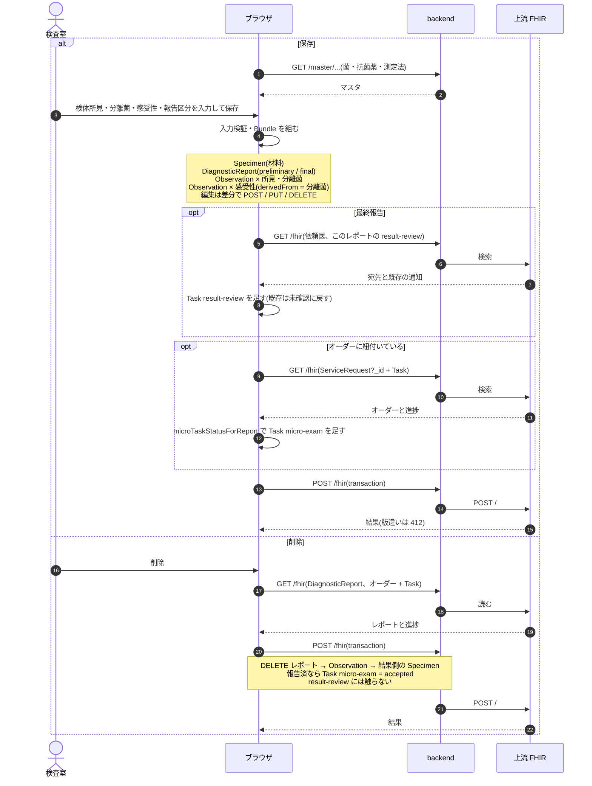

結果確認の書き込みは [lab.md](lab.md)「シーケンス図: 結果確認」のカルテからの経路と同じです(`ResultReviewAction`、`useMarkResultReviewed`)。

### 医事会計と SS-MIX2

細菌検査は検体検査と同じくオーダーの検査日で集める種別です(`BillingClaimBuilder` の `:order` 経路)。進捗 Task は見ず、中止は `ServiceRequest.status` で判定します。
ただし**いまは算定できません**。集計はヘッダの直下の明細から項目コードを読みますが、細菌検査の項目はその下の階層にあるためです。`master_micro_order_items.receipt_code` を設定しても、検体グループ明細が「項目マスタにレセプト電算コードが設定されていません」として「送れない項目」に出ます(開発環境で確認、2026-11-07)。
SS-MIX2 の電文は持ちません。`OmlO33` は `order-type|lab`、`OulR22` は v2-0074 `LAB` だけを対象にします。

| 起きたこと | 医事会計(`BillingClaimBuilder`) | SS-MIX2 |
|---|---|---|
| 登録・編集 | 検査日のオーダーが「送れない項目」に出る(上の理由) | なし |
| ラベル発行・採取・到着・受付 | なし | なし |
| 中間報告・最終報告・結果の削除 | なし | なし |
| 中止 | 対象から外れる(`ServiceRequest` が `revoked`) | なし |
| 削除 | 対象から外れる | なし |
