# 細菌検査オーダーの業務フロー

細菌検査オーダーの登録からラベル発行・採取・到着・中間報告・最終報告・結果確認までの流れです。
進捗の考え方は検体検査と同じなので、この文書は [lab.md](lab.md) との違いを中心に書きます。先に [lab.md](lab.md) を読むと、流れをつかみやすくなります。
迅速抗原・毒素・PCR は検体検査オーダーで扱います。判断の基準は、培養・鏡検の流れに乗るかどうかです。

医療機関の運用を検討する人は「運用フロー」、院内の開発者は「開発者向け」を読みます。
設計は [micro-order-design.md](../micro-order-design.md)(オーダー・ラベル・採取)・[micro-result-design.md](../micro-result-design.md)(結果)、画面のふるまいは [features/lab.md](../features/lab.md)「細菌検査一覧と進捗」、
種別共通の約束(中止・削除・代行入力)は [features/orders-common.md](../features/orders-common.md)、リソースの要素は実装ガイド(`../fhir-ig`)が正典です。

## 運用フロー

### 全体の流れ

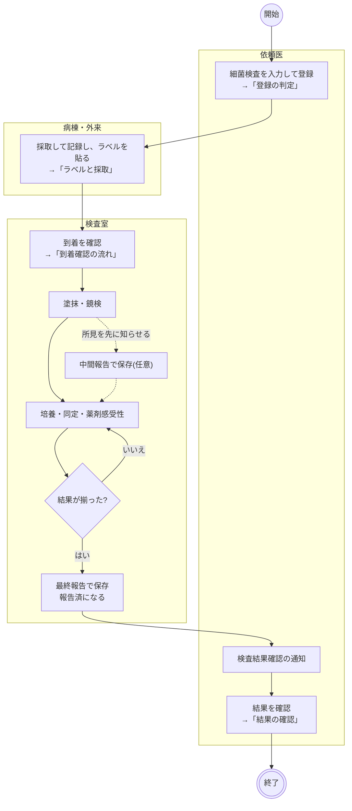

この文書で使う呼び名です。

| 呼び名 | 意味 |
|---|---|
| 依頼医 | オーダーを出した医師。検査結果確認の通知の宛先になる |
| カード | カルテに出る、オーダー 1 件ぶんの表示 |
| 容器 | ラベルを 1 枚貼る単位。検体を入れる容器と、項目ごとに分ける別容器(血液培養のボトルなど)がある |
| 一覧の「取消」 | 細菌検査一覧で、受付済を依頼済へ戻す訂正 |
| 到着の取消 | 検体到着確認の画面の「取消」。容器の到着の記録を消す |
| 中止 | 検査をやめる。「中止取消」で依頼済に戻せる |
| 削除 | オーダーそのものを消す |

- **入力する項目**: 検体種別・採取部位・検査項目・検査日・目的菌・疑い病名・前投与抗菌薬です。検査の結果の入れ方は「結果の登録と報告」に書きます。
- **検査日**: 検査日は必須です。予約枠は使いません。日付を決めない登録、登録と一緒の実施入力、事後の入力はありません。登録時の警告もありません。
- **中間報告**: 中間報告は任意です。塗抹の所見がすぐ要らなければ、最終報告だけでも構いません。
- **中間報告の読み方**: 依頼医は中間報告の内容をカルテで読めますが、通知は出ず、確認の記録も残せません。
- **外来の一時終了**: 外来の診察終了で、当日の細菌検査が依頼済・受付済のまま残っていると「一時終了」を選べます。
- **看護ワークシート**: 採取の印は、採取を記録すると「採取済」、ラベルだけなら「ラベル済」、全容器が届くか受付済で「到着済」になります。

### 細菌検査の状態

検査室の進み具合を示す状態です。中間報告はこの状態に含めず、細菌検査一覧の「結果」の列とカードの印で見せます。

| 状態 | 変わるきっかけ | 細菌検査一覧からできること |
|---|---|---|
| 依頼済 | 依頼医の登録、一覧の「取消」、到着の取消、中止取消 | 受付、ラベル発行、中止 |
| 受付済 | 全容器の到着、一覧の「受付」、中間報告の保存、結果の削除 | 結果登録・結果編集、ラベルの刷り直し、一覧の「取消」、中止 |
| 報告済 | 最終報告の保存 | 結果編集、ラベルの刷り直し |
| 中止 | 中止 | 中止取消(依頼済へ) |

受付済になるきっかけは 4 つです。

- 検体到着確認で、オーダーの容器が全部到着した。
- ラベルの無い検体を、細菌検査一覧の「受付」で受け付けた。
- 中間報告を保存した(受付前なら受付も兼ねる)。
- 報告済のオーダーで、結果を削除したか、最終報告を中間報告に直した。

報告済へは手で進めません。結果の保存が、報告区分に合わせて状態を動かします。

**容器の状態**

容器 1 つごとに、オーダーとは別の状態があります。細菌検査一覧の「表示」に、ラベルの番号と一緒に出ます。

| 容器の状態 | 意味 |
|---|---|
| 未発行 | ラベルをまだ刷っていない |
| 発行済 | ラベルを刷った |
| 到着済 | 検体到着確認でラベルを読んだ |

項目を外してラベルを刷り直すと、外した容器のラベルは取り下げになります(「ラベルと採取」)。

**一覧の見方**

- 「日数」の列は、検査日を 1 日目として今日が何日目かを出します。依頼済・受付済の行にだけ出ます。
- 「未完了(14日)」を選ぶと、選んだ日までの 14 日ぶんの依頼済・受付済を古い順に見られます。

### 登録の判定

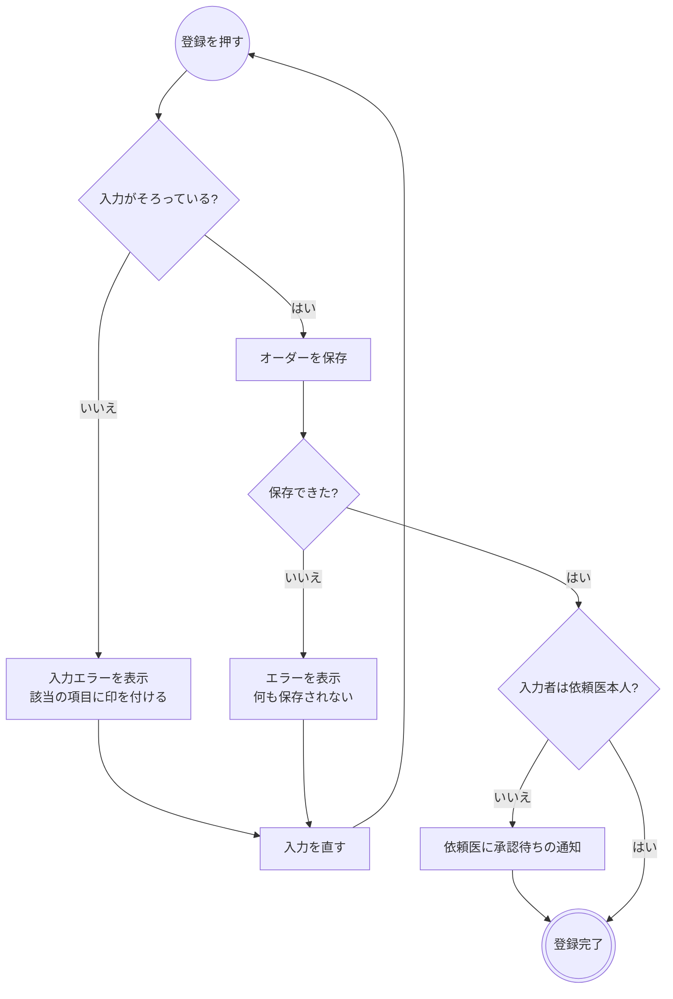

「入力がそろっている?」で確かめるのは次の項目です。

| 項目 | 条件 |
|---|---|
| 検体種別 | 入っている |
| 採取部位 | 入っている |
| 検査項目 | 1 つ以上ある |
| 検査日 | 入っている |

- **検査項目**: マスタの全項目をチェックボックスで並べます。伝票とセットはありません。検体種別と検査項目の組み合わせが合っているかは確かめません。
- **目的菌**: 頻用菌のチェックと全件検索から複数選べます。
- **前投与抗菌薬**: 培養の解釈に使う情報です。「処方取込」で直近の処方・注射の抗菌薬を文字に取り込み、そのまま直せます。
- **検査目的**: 診断目的と監視培養から選びます。
- **承認**: 入力者が依頼医本人でないとき(代行入力)は、依頼医の承認待ちになります。承認待ちでもオーダーは検査室に出ます。
- **オーダーセット・クリニカルパス**: 適用したときも、同じ条件で登録します。

### ラベルと採取

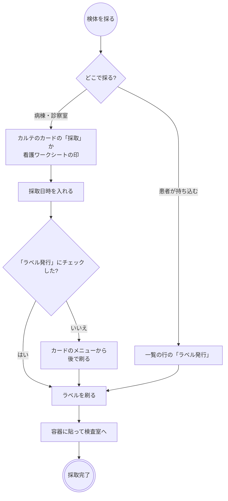

**容器とラベル**

- ラベルは容器 1 つに 1 枚です。容器は、検体の容器 1 つと、別容器の項目 1 つごとです。
- 血液培養の好気・嫌気ボトルが別容器です。ボトルだけのオーダーには、検体の容器のラベルは出ません。
- 同じ容器は、刷り直しても同じ番号です。
- 項目を外して刷り直すと、外した容器のラベルは取り下げになります。項目を戻して刷り直すと、同じ番号で復帰します。
- 検体検査の「ラベル一括発行」に細菌検査は入りません。中止したオーダーには発行できません。
- 患者が持ち込む検体は、細菌検査一覧の行の「ラベル発行」で刷ります。

**採取の記録**

- 採取日時を入れます。予定と違えば、部位・左右・方法を直します。
- 採取者は、採取を記録したログインユーザーです。入力欄はなく、あとで直しても最初に記録した人のままです。
- 採取の記録は、依頼済・受付済のあいだ書けます。受付後に足すこともできます。
- 採取日時はカード・ラベルに出ます。未記録なら、ラベルには「予定」の日時が出ます。結果登録の検体採取日にも写ります。

### 到着確認の流れ

画面は検体検査と同じ「部門業務 > 臨床検査部門 > 検体到着確認」です。ラベルを読むと、番号を確かめて到着を記録します。番号の確かめ方と、同じラベルを 2 度読んだときの扱いは検体検査と同じです([lab.md](lab.md)「到着確認の流れ」)。読んだ後の進み方だけが違います。

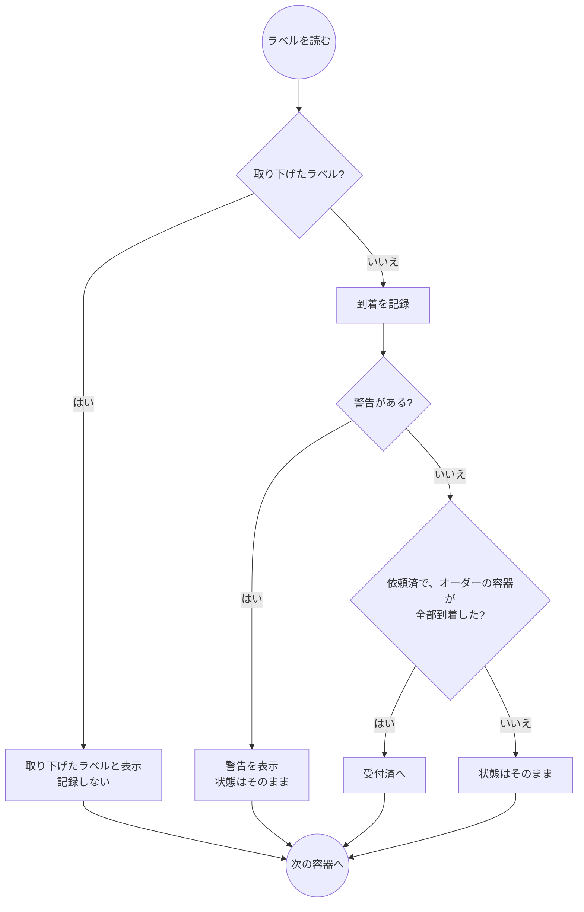

| 読んだラベル | 表示 | 到着の記録 |
|---|---|---|
| 取り下げたラベル(項目を外して刷り直す前のラベル) | 「取り下げたラベルです(刷り直したラベルを読んでください)」 | しない |
| 中止されたオーダーのラベル | 中止されたオーダーと警告 | する |
| いまのオーダーに無い容器のラベル | 「オーダーにこの容器はありません(訂正で外れた可能性)」 | する |
| 病理のラベル | 「病理検査の検体です(病理の受付で読んでください)」 | しない |

- **到着の取消**: 検体到着確認の画面の「取消」は、到着を消し、受付済を依頼済へ戻します。結果が付いていれば検体は届いているので、状態は戻しません。
- **ラベルの無い検体**: 細菌検査一覧の「受付」で受付済にします。

### 結果の登録と報告

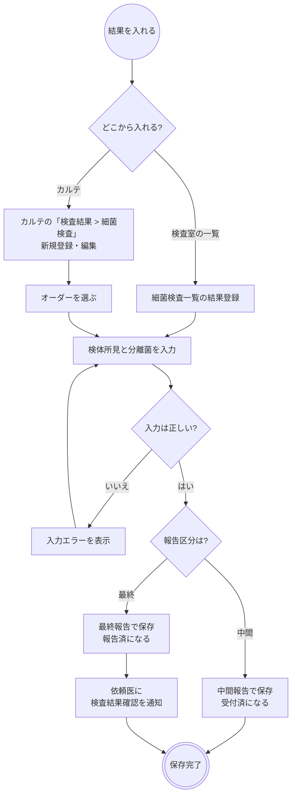

入力する内容は次のとおりです。

| 区分 | 内容 |
|---|---|
| 検体所見 | 培養結果・塗抹・喀痰品質・膿尿 |
| 分離菌 | 最大 5。菌量・起炎性も入れる |
| 薬剤感受性 | 菌ごとに最大 30 |

「入力は正しい?」で確かめるのは、検体採取日・入外区分・材料・菌名・抗菌薬・数値です。

**入口**

- 細菌検査一覧の結果登録は、受付済・報告済の行からできます。オーダーは行で決まり、材料・依頼科・検体採取日をオーダーから写します。
- カルテの「検査結果 > 細菌検査」は、依頼医も検査室も使えます。結果の無いオーダーから選びます。オーダーを選ばずに登録することもできます。
- オーダーを選ばずに登録した結果は、オーダーの状態を動かしません。

**入力**

- 分離菌と感受性の抗菌薬は JANIS のコードから選びます。頻用薬は直接並び、ほかは検索します。
- 1 オーダーに結果は 1 件です。中間報告を編集して最終報告に切り替えます。

**報告区分と状態**

- 中間報告を保存すると受付済になります。受付前なら受付も兼ねます。
- 最終報告を中間報告に直すと受付済に戻ります。出ている検査結果確認の通知はそのまま残ります。
- 最終報告(確定)の後に結果を直すと、検査結果確認は未確認に戻ります。
- 中止したオーダーは、結果を保存しても中止のままです。

**結果を使うほかの画面**

- AST(抗菌薬適正使用)の一覧の血液培養タブは、入院中の患者の血液培養の陽性を出します。
- データ抽出の細菌検査タブは、分離菌 1 株を 1 行にして出します。
- 感染症の発生届の検知には、まだ使えません。

### 結果の確認

確認の仕組みは検体検査と同じです([lab.md](lab.md)「結果の確認」)。細菌検査に緊急の通知はないので、最終報告の検査結果確認だけです。

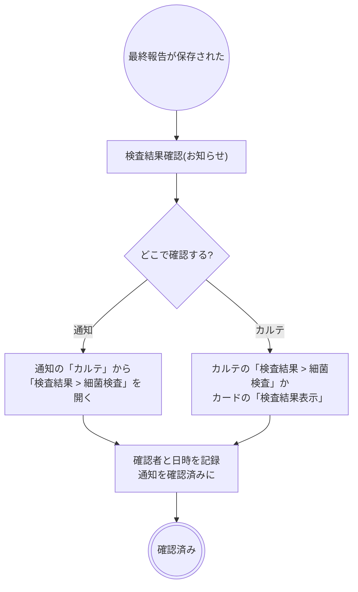

- **確認できる人**: 宛先は依頼医ですが、確認は誰でもできます。記録には確認した本人が残ります。
- **中間報告のうち**: 確認できません。
- **確定後に編集したとき**: 未確認に戻ります。
- **未確認のまま 7 日**: 7 日以上未確認なら、検査結果フォローの「未確認の結果」に残ります。

### 変更・中止・削除

| 操作 | できる場所 | できるとき |
|---|---|---|
| 変更 | カルテのカード | いつでも(状態では止まらない) |
| 採取の修正 | カルテのカードの「採取修正」 | 依頼済・受付済のあいだ |
| 中止 | 細菌検査一覧の行のメニュー | 依頼済・受付済から(報告済からはできない) |
| 中止取消 | 細菌検査一覧の行のメニュー | 中止のとき |
| 一覧の「取消」 | 細菌検査一覧の行のメニュー | 受付済のとき |
| 削除 | カルテのカード | 結果が付いていないとき(結果を削除してから) |
| 結果の削除 | カルテの「検査結果 > 細菌検査」 | 結果があるとき |

- **変更**: 項目を足し引きしたら、ラベルを刷り直します。変更しても検査室への通知は出ず、一覧の内容で見えます。代行入力のときは、再度の承認を要する場合があります。
- **採取の修正**: 採取者は最初に記録した人のままです。
- **中止**: 結果が付いていても中止でき、結果は残ります。
- **中止取消**: 依頼済に戻ります。
- **一覧の「取消」**: 受付済を依頼済へ戻す訂正です。容器の到着の記録は消えません。到着の記録を消すのは、検体到着確認の画面の「取消」(到着の取消)です。
- **削除**: 状態は一緒に消え、発行済みの容器の記録は残ります。
- **結果の削除**: 分離菌・感受性と結果側の検体を消し、報告済は受付済に戻ります。**検査結果確認の通知は取り下げません**。
- **報告済の結果を直す**: 最終報告のまま編集します。報告済から戻す操作は、中間報告への変更か結果の削除だけです。
- **DO**: DO(前回と同じ内容で出し直す)はオーダーの内容だけを写します。採取の記録・ラベル・結果は写りません。

### 検体検査との違い

| | 検体検査 | 細菌検査 |
|---|---|---|
| オーダーの単位 | 検体をまたいで 1 オーダー | 1 オーダー = 1 検体 |
| ラベル発行 | 発行が受付を兼ねる。病棟は一括発行 | 状態を動かさない。1 件ずつ刷る |
| 採取の記録 | なし | あり(採取日時・採取者・部位・方法) |
| 受付済の意味 | ラベルを発行した | 検体が検査室に届いた |
| 終わりの状態 | 全部の採取管が届くと実施済 | 最終報告で報告済 |
| 報告区分 | 中間・最終・訂正 | 中間・最終 |
| 緊急の通知 | パニック値 | なし |
| 結果の入れ方 | 手入力とファイル取込 | 手入力だけ |

- 血液培養の 2 セット目は、DO して採取部位を変えます。
- 細菌検査のラベルは、カルテのカードか細菌検査一覧の行から刷ります。
- 細菌検査は、培養の間は受付済のままです。
- 細菌検査は、確定後に直しても最終報告のままです。

### 帳票

| 帳票 | 出す場所 | 内容 |
|---|---|---|
| 検体ラベル | カルテのカード、採取の記録、細菌検査一覧の行 | 容器 1 つに 1 枚 |

- ラベルに出るのは、バーコード(番号)・患者番号・氏名・カナ・検体か項目・採取日時または予定です。
- 細菌検査結果の報告書はありません。検査結果報告書は検体検査だけです。

## 開発者向け

### シーケンス図の前提

- **書き込みの経路**: `/fhir` への書き込みはどれも 1 回の transaction Bundle で、backend の `FhirProxyController` が上流の FHIR サーバー(以下「上流」)へ中継します。
- **例外**: ラベルの PDF だけは、backend(`MicroLabelReport`)が上流を直接読み書きします。
- **図の省略**: 図では、上流の応答が backend を通ってブラウザへ戻る矢印を省き、上流からブラウザへの 1 本で描きます。
- **楽観ロック**: 版は `postBundle` が `ifMatch` に添え、版が違えば 412 で止まります。
- **ヘッダ**: オーダー 1 件の `ServiceRequest`(`order-type|micro`)です。
- **検体グループ明細**: 検体 1 つぶんの `ServiceRequest` です。contained の `Specimen` を持ち、`basedOn` でヘッダを指します。
- **検査項目明細**: 検査項目 1 件ずつの `ServiceRequest` です。`basedOn` で検体グループ明細を指します。
- **容器の台帳**: ラベルを刷った容器 1 つごとの `Specimen` です。以下「台帳」とも書きます。

### リソースの構成

オーダーは 3 層です。下の層が上の層を `basedOn` で指します。

- ヘッダ `ServiceRequest`(`order-type|micro`)
  - 検体グループ明細 `ServiceRequest`(contained `Specimen`)
    - 検査項目明細 `ServiceRequest`
  - 進捗 `Task`(`focus` = ヘッダ)
  - 容器の台帳 `Specimen`(`request` = [ヘッダ, 検体グループ明細])
  - 結果 `DiagnosticReport`(`basedOn` = ヘッダ)
    - 所見・分離菌の `Observation`
      - 薬剤感受性の `Observation`(`derivedFrom` = 分離菌)
    - 結果の検体 `Specimen`
    - 検査結果確認の通知 `Task`、確認の `Provenance`
  - 代行入力の `Provenance`(`target` = ヘッダ)

UI は 1 オーダー 1 検体に制限していますが、構造は複数検体を持てます(`fhir/microOrderHelpers.ts`)。

**オーダー**

| リソース | 要素 | 中身 |
|---|---|---|
| ヘッダ | 拡張 `micro-prior-antimicrobial` | 前投与抗菌薬 |
| ヘッダ | 拡張 `micro-exam-purpose` | 検査目的 |
| 検体グループ明細 | `orderDetail` | 目的菌 |
| 検体グループ明細 | `reason*` | 疑い病名 |
| 検体グループ明細 | 採取予定日時 | 採取の予定 |
| 検体グループ明細 | contained `Specimen` の `collection` | 採取の記録 |
| 進捗 `Task` | `code` | `task-code|micro-exam` |

- 採取の記録は `collectedDateTime`・`collector`・`bodySite`・`method` です。
- 採取の記録は、明細だけを PUT します(ヘッダを組み直すと依頼医が替わるため)。`Provenance` は付けません。

**容器の台帳 `Specimen`**

| 要素 | 中身 |
|---|---|
| `request` | [ヘッダ, 検体グループ明細] |
| `identifier`(`micro-container`) | 検体の容器なら検体グループ明細の id、ボトルなら検査項目明細の id |
| `accessionIdentifier` | ラベル番号。検体検査の採取管と同じ採番 |

| 容器に起きたこと | 台帳 |
|---|---|
| 発行 | 作成 |
| 到着 | `receivedTime` + `status: available` |
| 取り下げ | `entered-in-error` |

**結果**

| もの | リソース | 補足 |
|---|---|---|
| 結果 | `DiagnosticReport`(`category` = v2-0074 `MB`、`code` = LOINC `18725-2`) | `status` = `preliminary` / `final`。プロファイルは付けない |
| 所見・分離菌 | `Observation` | 培養・塗抹・喀痰品質・膿尿・分離菌。分離菌は `component` に菌量・起炎性 |
| 薬剤感受性 | `Observation`(`code` = JANIS 抗菌薬) | MIC は `valueQuantity`、S / I / R は `interpretation`、阻止円径は `component` |
| 結果の検体 | `Specimen`(`type` = JANIS 材料コード) | 結果側が所有する。容器の台帳とは別で、参照しない |
| 検査結果確認の通知 | `Task`(`task-code|result-review`、`focus` = 結果、`owner` = 依頼医) | 最終報告のときだけ |
| 確認(既読) | `Provenance`(`target` = 結果、`agent.type = verifier`、`signature`) | 検体検査と同じ |
| 代行入力 | `Provenance`(`target` = ヘッダ、`activity` CREATE / UPDATE) | 明細は `target` に入れない |

分離菌の並びは `DiagnosticReport.result` の順です。

### 進捗 Task(`micro-exam`)

- Task は登録時には作りません。**Task が無いオーダーは依頼済**として扱い、最初の受付・中止か結果の保存で作ります(`fhir/microTaskHelpers.ts`)。
- 中止は同じ transaction でヘッダを `revoked` にし、中止取消で `active` に戻します(`orderCancelEntries`)。
- 中止したオーダーを編集しても `revoked` のままです(`keepOrderRevoked`)。
- Task が無いまま結果があるオーダー(進捗を持つ前のデータ)は、表示だけ報告区分から読みます(`microOrderStatus`)。
- 結果の保存・削除で状態を動かす判定は `microTaskStatusForReport` です。報告区分は `DiagnosticReport.status` が正本で、Task には持ちません。

| 状態 | `Task.status` | `executionPeriod` | この状態にするもの |
|---|---|---|---|
| 依頼済 | `requested`(または Task 無し) | なし | 一覧の取消、到着の取消、中止取消 |
| 受付済 | `accepted` | `start` | 全容器の到着、一覧の受付、中間報告の保存、結果の削除(報告済から) |
| 報告済 | `completed` | `start` / `end` | 最終報告の保存 |
| 中止 | `cancelled` | なし | 一覧の中止。結果の保存では動かない |

### 部品

| 操作 | 画面 | 組み立て | hook |
|---|---|---|---|
| 登録 | `components/MicroOrderForm.tsx`・`MicroOrderPanels.tsx` | `buildMicroOrderBundle` | `useCreatePrescription` |
| 編集 | 同じ | `buildMicroOrderUpdateBundle` | `useUpdatePrescription` |
| 削除 | 同じ | `buildMicroOrderDeleteBundle` | `useDeleteMicroOrder` |
| 採取の記録 | `components/MicroCollectionModal.tsx` | `buildMicroCollectionBundle` | `useRecordMicroCollection` |
| ラベル発行 | backend の `Reports::MicroLabelPdfsController` | `MicroLabelReport`・`Reports::MicroLabelRenderer` | なし |
| 到着確認 | `pages/LabArrivalPage.tsx` | `allMicroContainersArrived` | `useUpdateLabArrival` |
| 一覧・受付・中止 | `pages/MicroWorklistPage.tsx` | `fhir/microTaskHelpers.ts` | `useMicroWorklist`・`useUpdateMicroTaskStatus` |
| 結果の保存 | `components/KarteMicroResultTab.tsx`・`MicroResultForm.tsx` | `buildMicroResultBundle`・`buildMicroResultUpdateBundle` | `useCreateMicroResult`・`useUpdateMicroResult` |
| 結果の削除 | `components/MicroResultDetailPanel.tsx` | `buildMicroResultDeleteBundle` | `useDeleteMicroResult` |
| 結果確認 | カルテ | `ResultReviewAction` | `useMarkResultReviewed` |

- **置き場所**: オーダーと採取の組み立ては `fhir/microOrderHelpers.ts`、結果は `fhir/microResultHelpers.ts`、容器は `fhir/microContainerHelpers.ts`、細菌検査の hook は `api/queries/micro.ts` です。
- **全種別共通の hook**: `useCreatePrescription` / `useUpdatePrescription`(`api/queries/labResult.ts`)は、名前に反して全種別共通の登録・編集の hook です。
- **処方取込**: `hooks/useAntimicrobialSuggestions.ts` です。
- **到着確認**: `pages/LabArrivalPage.tsx` は、台帳の識別子で検体検査・細菌・病理を振り分けます。オーダー文脈は `fetchMicroArrivalContext`(`api/queries/micro.ts`)で読みます。`useUpdateLabArrival` は `api/queries/injection.ts` にあります。
- **ステータス変更**: `useUpdateMicroTaskStatus` は `makeUpdateTaskStatusHook`(`api/queries/worklist.ts`)で作ります。
- **通知**: 検査結果確認の通知は `withResultReviewTask`(`api/queries/notification.ts`)で足します。

### シーケンス図: 登録・編集・削除

**登録**

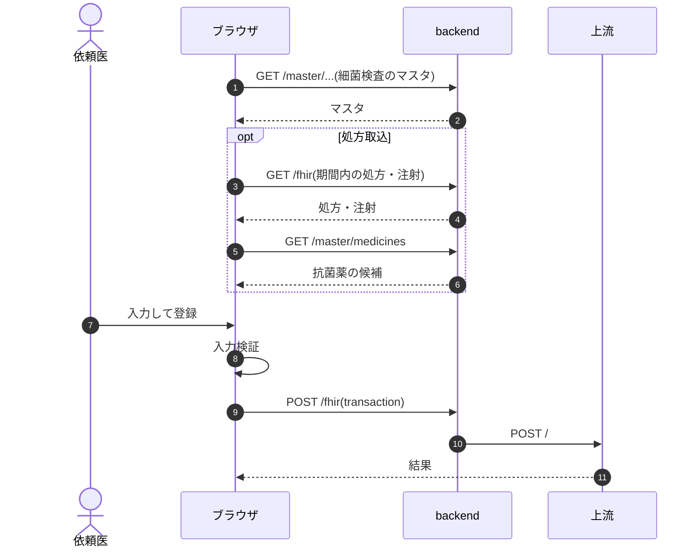

- マスタは、検体種別・採取部位・方法・検査項目・頻用菌です。
- `/master/medicines` からは薬効分類を読み、抗菌薬を選び出します。
- 依頼医が入力するのは、検体・項目・目的菌・臨床情報です。

| 書くもの | 条件 |
|---|---|
| ヘッダ `ServiceRequest`(`fullUrl`) | いつも |
| 検体グループ明細(contained `Specimen`) | いつも |
| 検査項目明細 × 項目 | いつも |
| 登録時の入院病棟を `order-ward` に | いつも |
| `Provenance`(CREATE) | いつも |
| `Task` `order-approval` | 代行・研修医 |

**編集**

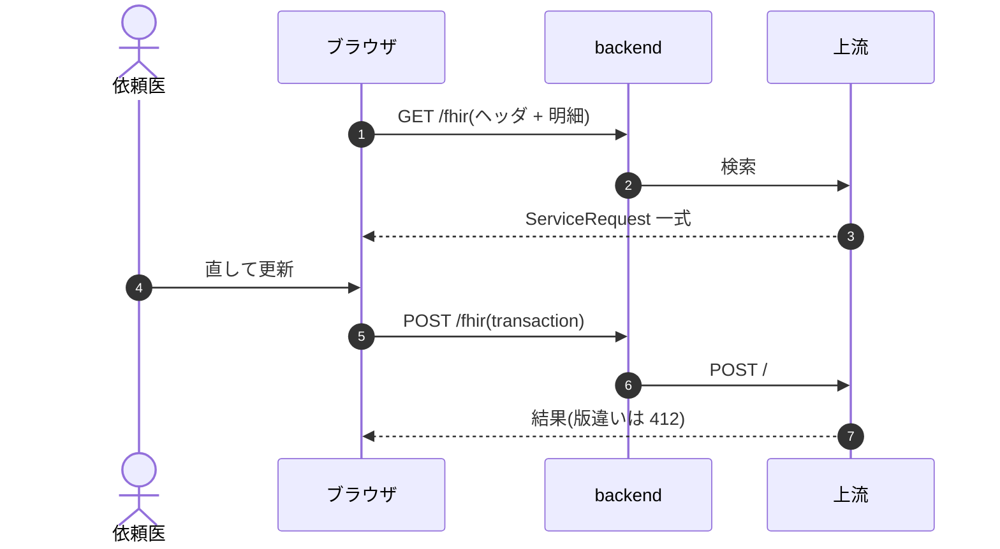

| 書くもの | 条件 |
|---|---|
| PUT ヘッダ(`ifMatch`) | いつも |
| 明細を差分で POST / PUT / DELETE | いつも |
| `Provenance`(UPDATE) | いつも |

採取の記録は、フォーム値に持ち回って保ちます。

**削除**

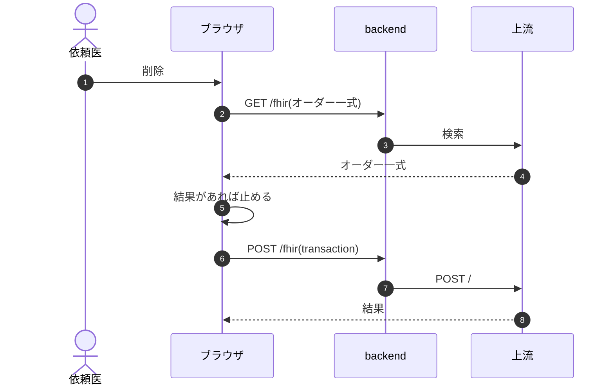

検索は、ヘッダ + 明細と、`Task`・`DiagnosticReport` ほかです。

| 書くもの | 条件 |
|---|---|
| DELETE ヘッダ・明細・`Task` | いつも |

台帳の `Specimen` は残します。

### シーケンス図: 採取の記録とラベル発行

**採取の記録**

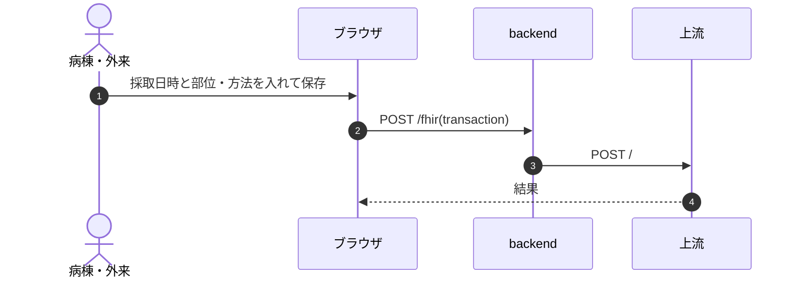

| 書くもの | 条件 |
|---|---|
| PUT 検体グループ明細(`ifMatch`) | contained `Specimen` の `collection` を書く |

**ラベル発行**

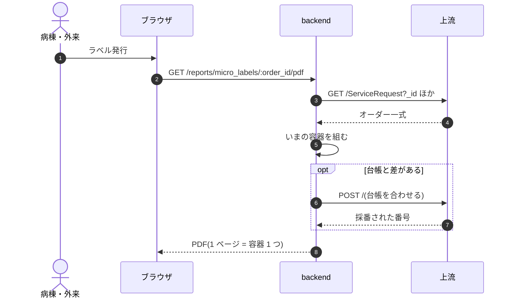

- 読むのは、`ServiceRequest?_id` + 患者・明細・台帳の `Specimen` です。
- いまの容器は、マスタの `separate_container` から組みます。

| 台帳との差 | 書くもの |
|---|---|
| 台帳に無い容器 | 作成 |
| 外れた容器 | `entered-in-error` |
| 戻した容器 | 復帰 |

### シーケンス図: 到着確認

**到着**

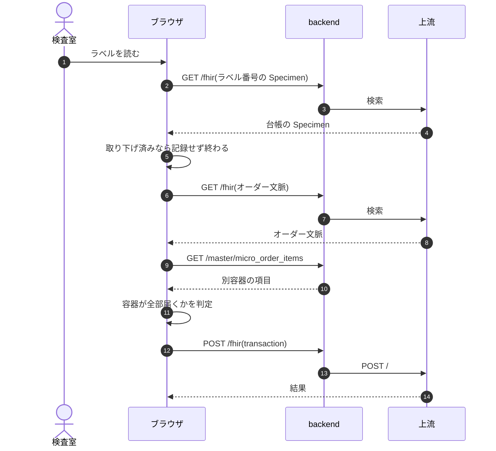

- オーダー文脈の検索は `ServiceRequest?_id` + 明細・`Task`・`Specimen`・`DiagnosticReport`・患者です。
- 判定するのは、いまのオーダーの容器が全部届くかです。

| 書くもの | 条件 |
|---|---|
| PUT `Specimen`(`receivedTime`・`status` `available`・記録者) | いつも |
| `Task` `micro-exam` = `accepted` | 全容器が揃い、依頼済のとき |

すでに到着を記録した容器を読んだとき(二重読み)は、到着を書き直しません。進捗だけ遅れていれば、`Task` を `accepted` にします。

**到着の取消**

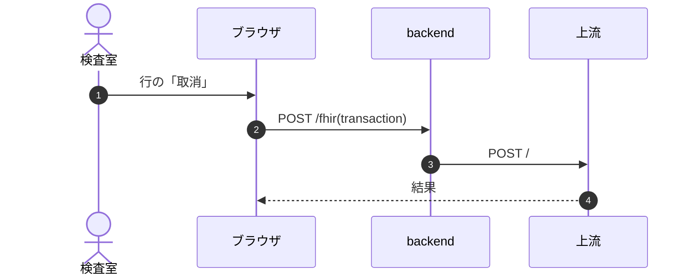

| 書くもの | 条件 |
|---|---|
| PUT `Specimen`(`receivedTime`・`status` を外す) | いつも |
| `Task` を `requested` | 結果が無く、受付済のとき |

### シーケンス図: 一覧・受付・中止

**一覧を開く**

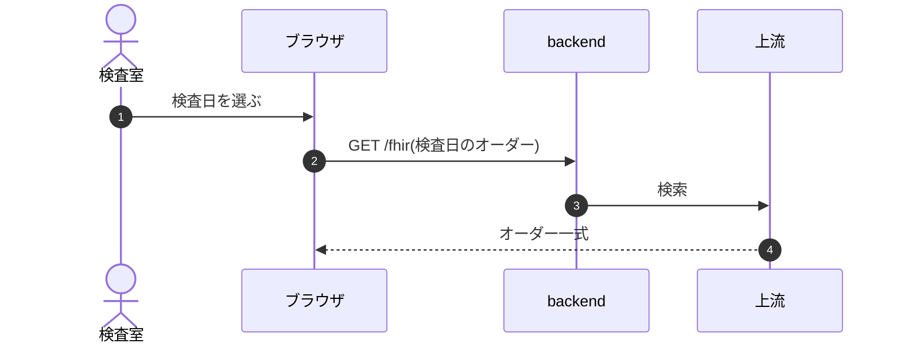

- 検索は `ServiceRequest?category=micro&occurrence=検査日&based-on:missing=true` です。
- 未完了(14 日)は `occurrence=ge…&le…` で引きます。
- `_include` で患者、`_revinclude` で明細(iterate)・`Task`・`DiagnosticReport`・`Specimen` を付けます。

**受付・取消・中止・中止取消**

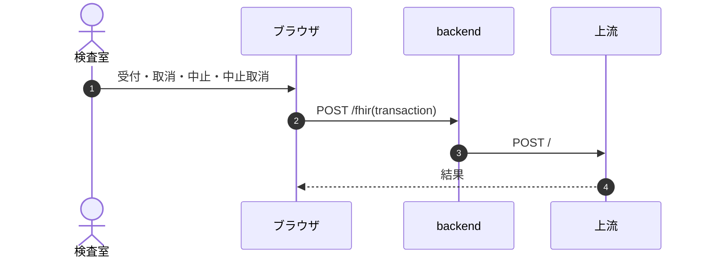

| 操作 | 書くもの |
|---|---|
| 受付 | `Task` `micro-exam` = `accepted` |
| 一覧の取消 | `Task` `micro-exam` = `requested` |
| 中止 | `Task` `micro-exam` = `cancelled`、PUT ヘッダ `revoked` |
| 中止取消 | `Task` `micro-exam` = `requested`、PUT ヘッダ `active` |

### シーケンス図: 結果登録・編集・削除

**保存**

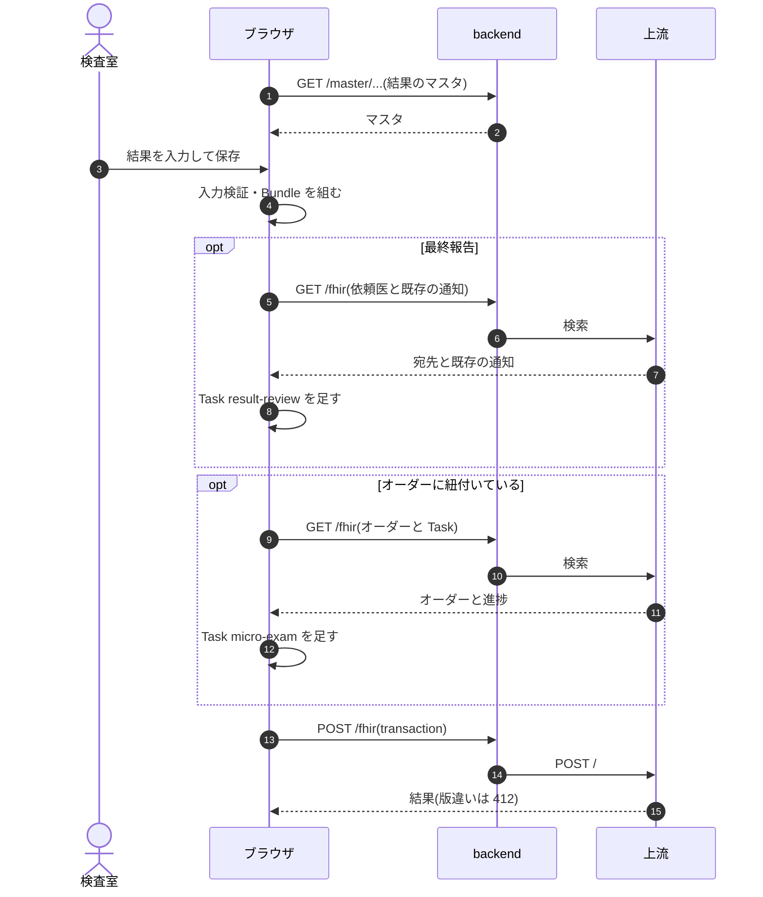

- マスタは、菌・抗菌薬・測定法です。
- 入力するのは、検体所見・分離菌・感受性・報告区分です。
- 既存の通知の検索は、このレポートの `result-review` です。既存の通知は未確認に戻します。
- オーダーの検索は `ServiceRequest?_id` + `Task` です。`Task` `micro-exam` の状態は `microTaskStatusForReport` で決めます。

| 書くもの | 条件 |
|---|---|
| `Specimen`(材料) | いつも |
| `DiagnosticReport`(`preliminary` / `final`) | いつも |
| `Observation` × 所見・分離菌 | 入力したぶん |
| `Observation` × 感受性(`derivedFrom` = 分離菌) | 入力したぶん |
| `Task` `result-review` | 最終報告 |
| `Task` `micro-exam` | オーダーに紐付いているとき |

編集は、差分で POST / PUT / DELETE します。

**削除**

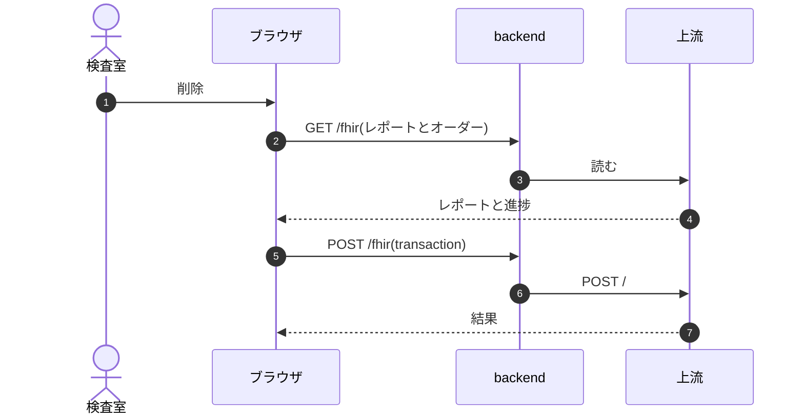

読むのは、`DiagnosticReport` と、オーダー + `Task` です。

| 書くもの | 条件 |
|---|---|
| DELETE レポート → `Observation` → 結果側の `Specimen` | いつも |
| `Task` `micro-exam` = `accepted` | 報告済のとき |

`result-review` には触りません。

**結果確認**

結果確認の書き込みは [lab.md](lab.md)「結果確認」のカルテからの経路と同じです(`ResultReviewAction`、`useMarkResultReviewed`)。

### 医事会計と SS-MIX2

細菌検査は、検体検査と同じくオーダーの検査日で集める種別です(`BillingClaimBuilder` の `:order` 経路)。SS-MIX2 の電文は持ちません。`OmlO33` は `order-type|lab`、`OulR22` は v2-0074 `LAB` だけを対象にします。

- **状態の見方**: 進捗 Task は見ず、中止は `ServiceRequest.status` で判定します。
- **項目の集め方**: 項目はヘッダの孫(検体グループ明細の下)にあるので、`_revinclude:iterate` で辿ります。項目コードを持たない明細は、その下の項目に置き換えて集めます(`item_details`)。
- **レセ電算コード**: 検査項目マスタの `receipt_code` です。同梱の seed には入っていません。施設が細菌検査オーダーマスタの検査項目で設定します。
- **項目の分け方**: 1 項目に 1 コードなので、検体の系統で点数が変わる培養は、項目を分けないと正しく算定できません。

| 起きたこと | 医事会計(`BillingClaimBuilder`) |
|---|---|
| 登録・編集 | 検査日のオーダーの項目を `receipt_code` で送る |
| ラベル発行・採取・到着・受付 | なし |
| 中間報告・最終報告・結果の削除 | なし |
| 中止 | 対象から外れる(`ServiceRequest` が `revoked`) |
| 削除 | 対象から外れる |

`receipt_code` の無い項目は「送れない項目」に出します。
