# 看護指示の業務フロー

看護指示を、医師の登録から看護師の指示受け・日々の実施・終了(退院での打ち切り)まで追う流れです。
看護指示は入院患者に出す看護向けの指示(安静度・清潔・排泄・観察項目など)で、病棟では「指示簿」と呼びます。受けるのは部門ではなく**病棟の看護師**で、指示は 1 行ずつ別々に始まり、終わり、取りやめになります。何をいつ行うかは指示の頻度から日ごとに決まり、実施の記録が日々積み上がります。

医療機関の運用を検討する人は「運用フロー」、院内の開発者は「開発者向け」を読みます。
設計は [nursing-order-design.md](../nursing-order-design.md)、看護計画からの展開は [features/nursing.md](../features/nursing.md)「看護計画」、ワークシートは同じく「看護ワークシートと業務分担」、退院の画面は [features/ward.md](../features/ward.md)、
種別共通の約束(代行入力・オーダーセット・クリニカルパス)は [features/orders-common.md](../features/orders-common.md)、リソースの要素は実装ガイド(`../fhir-ig`)が正典です。

## 運用フロー

### 全体の流れ

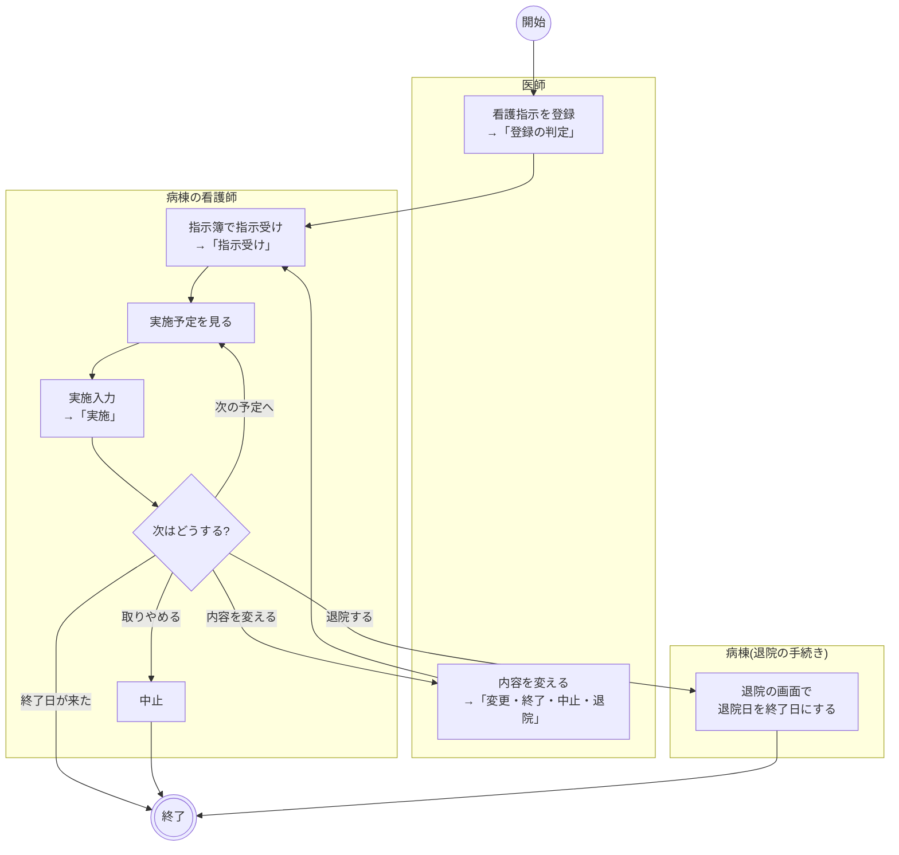

- **入口**: 医師はカルテの右ペイン(右側のオーダー入力)の「看護指示」か、カルテの「指示簿」タブの「指示追加」から登録します。看護計画の行からの「指示展開」、オーダーセット、クリニカルパスの適用からも出せます。
- **病棟の画面**: 病棟の看護師は「看護業務 > 指示簿」(以下「病棟の指示簿」)で、病棟の患者の指示をまとめて見ます。患者 1 人ぶんはカルテの「指示簿」タブで見ます。
- **並び方**: 指示簿は、その日に効いている指示を区分(看護行為の第 1・第 2 階層 / 観察 / その他)ごとにまとめて並べます。「終了・中止も表示」で終わった指示も混ぜて見られます。
- **履歴**: カルテの「指示簿」タブの「履歴」では、同時に出した指示をひとまとまりにして、発行日・指示医師・各行の状態(有効・終了・中止)を新しい順に並べます。
- **用語**: 指示内容は MEDIS 看護実践用語標準マスター(看護行為編・看護観察編)から選びます。マスタに無い指示は自由記載で書けます。
- 看護計画から出した指示には「看護計画」の印が付きます。

### 指示の状態

看護指示は「指示そのものの状態」と「指示受けの状態」を別々に持ちます。

| 指示の状態 | 意味 | 変わるきっかけ |
|---|---|---|
| 有効 | 始まっていて、まだ終わっていない | 登録 |
| 終了 | 終了日を過ぎた | 終了日の到来(操作は要らず、日付で切り替わる) |
| 中止 | 指示を取り下げた | 指示簿の「中止」、看護計画の「取消」 |

| 指示受けの状態 | 意味 | 変わるきっかけ |
|---|---|---|
| 指示受け待ち | まだ誰も受けていない | 医師の登録、オーダーセット・クリニカルパスの適用 |
| 指示受け済 | 看護師が受けた(受けた人と日時が残る) | 指示簿の指示受け、看護計画からの「指示展開」 |
| 中止 | 指示が取り下げられた | 指示の中止 |

- 指示受け待ちの指示は、病棟の指示簿の「未指示受け」タブに並びます。
- 看護計画から「指示展開」で出した指示は、出した看護師が受けたことになります。
- 指示受けの取消(指示受け済を指示受け待ちに戻す)はありません。
- 終了日の到来や退院での打ち切りでは、指示受けの状態は動きません。実施を記録しても動きません。
- 指示受けの前でも実施は記録できます。受けてからに限るかは運用で決めます。

### 登録の判定

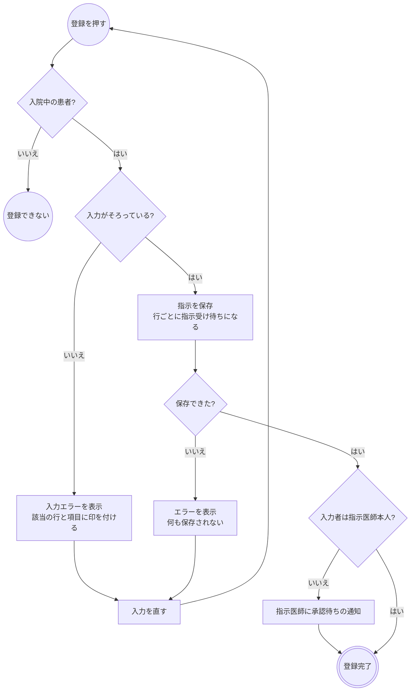

「入力がそろっている?」で確かめるのは次の項目です。

| 項目 | 条件 |
|---|---|
| 指示の行 | 1 行以上ある |
| 指示内容 | どの行にも入っている |
| 開始日 | どの行にも入っている(オーダーセット・クリニカルパスの内容では不要) |
| 終了日 | 空か、開始日以降 |
| 頻度 | 選んだ頻度に要る時刻・間隔・起点の時刻・曜日が入っている |

- **入院中の患者だけ**: 看護指示は入院中の患者にだけ出せます。入院していない患者では「看護指示は入院中の患者にだけ登録できます。」と出て登録できません。
- **複数行**: 1 回の登録で複数行を出せます。行は保存すると別々の指示になり、その後は 1 行ずつ編集・中止・終了します。
- **指示内容の選び方**: 用語の検索で選びます。看護行為 / 看護観察のタブと階層で絞り込めます。自由記載もできます。
- **修飾語**: 看護行為は、行為を選んでから修飾語(「入浴」に対する「全介助(リフト)」など)を選ぶ二段の選び方です。修飾語を変えると指示内容の文言も変わります。
- **頻度**: 「適宜 / 1日1〜4回 / 4・6・8時間毎 / 時刻指定 / 週N回」から選び、時刻を微調整します。
- **条件**: 条件(「38℃以上で報告」「疼痛時」)は頻度とは別に自由記載で書きます。
- **対象プロブレム**: 指示の対象プロブレムを選べます。
- **代行入力**: 看護師が医師の口頭指示を代わりに入れたときのように、入力者が指示医師本人でないと、指示医師の承認待ちになります。承認前でも指示は病棟に出ます。
- **外来の患者**: オーダーセットに看護指示を入れて外来の患者に適用すると、注意が出ます。

設定する人へ: 「1日N回」の時刻の初期値は、施設設定の「看護指示の既定時刻」です。

### 頻度と予定

指示に付けた頻度から、日ごとの予定の時刻が決まります。予定の時刻は、指示簿・実施入力・看護ワークシート・経過表・血糖インスリン一覧のどれでも同じです。

| 頻度 | その日の予定 |
|---|---|
| 適宜・必要時 | 予定を持たない(看護ワークシートでは「随時」の列) |
| 1日N回 | 指示に入れた時刻 |
| N時間毎 | 起点の時刻から N 時間刻みで、その日の 0〜24 時に入る時刻 |
| 時刻指定 | 入れた時刻 |
| 週N回 | 選んだ曜日だけ、入れた時刻 |

- 「1日N回」の時刻は、登録した時刻のまま変わりません。あとで施設設定の既定時刻を変えても、出してある指示は動きません。
- 「N時間毎」は、起点の時刻より前の時間帯にも N 時間刻みでさかのぼって予定を置きます。
- 24 時間を割り切れない間隔(5 時間毎・7 時間毎)は、日によって時刻がずれます。
- 実施の記録は、最も近い予定に 1 対 1 で当てます。
- 予定から離れすぎた記録は「予定外」になります。離れすぎの基準は、60 分と予定の間隔の半分のうち短いほうです(6 時間毎なら 60 分、1 時間毎なら 30 分)。

### 指示受け

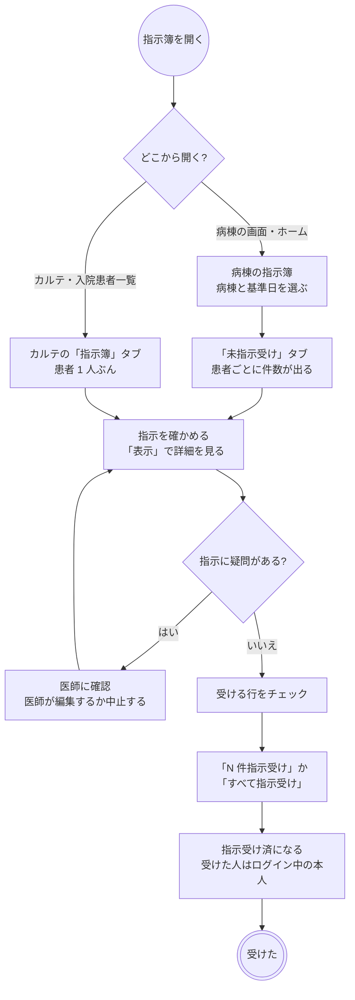

| 開く場所 | 開く画面 |
|---|---|
| 「看護業務 > 指示簿」 | 病棟の指示簿 |
| ホームの「看護指示」カード | 病棟の指示簿 |
| カルテの「指示簿」タブ | その患者の指示簿 |
| 入院患者一覧の「指示受け N」の札 | その患者のカルテの「指示簿」タブ |
| 入院患者一覧のタブ行の右 | 病棟の指示簿 |

- **病棟の指示簿**: 病棟ごとに患者でまとめて並べます。見出し行に病室・氏名・未指示受けの件数が出て、氏名からカルテの「指示簿」タブを開けます。依頼科・指示受けの状態で絞り込めます。
- **タブ**: 病棟の指示簿には「未指示受け」「実施予定」「全指示」のタブがあります。
- **まとめて選ぶ**: 受ける行は、患者の見出しのチェックでまとめて選べます。
- **できる人**: 指示受けは医療従事者としてログインしているときにできます。
- **転棟したとき**: 指示は、出したときの入院病棟の指示簿に出ます。転棟すると、転棟前に出した指示は前の病棟の指示簿に出続けます。
- 入院患者一覧の「指示受け N」は塗りつぶしの札です。

### 実施

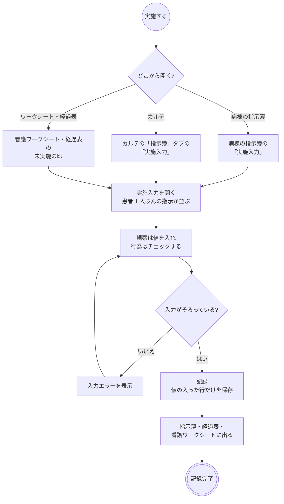

「入力がそろっている?」で確かめるのは次の項目です。

| 項目 | 条件 |
|---|---|
| 記録日時 | 入っている |
| 値 | 観察の値か行為のチェックが 1 つ以上ある |
| 数値の観察 | 数値で、用語ごとに決まった桁の上限以下 |
| 値が 2 つの観察(縦×横・血圧) | 2 つとも数値で入っている |

**実施予定を見る**

- 病棟の指示簿の「実施予定」タブは、基準日が今日なら、遅れている予定と、現在時刻の前後 1 時間に未実施の予定がある指示だけを患者ごとに並べます。表示は 1 分ごとに見直します。
- 今日以外の日は、その日に未実施の予定がある指示を並べます。
- 病棟の指示簿では、患者の見出しの「実施入力」から実施入力を開きます。

**実施入力の画面**

- その日に効いている指示がすべて並び、いま予定のある指示が上に来ます。予定の時間でない指示も薄く出て、入力できます(臨時の測定・頓用の記録のため)。
- 指示ごとに、その日の予定の時刻が並びます。「✓」は実施済、「●」は次に入れる予定です(遅れは赤)。
- 記録日時を変えると、並びと強調もその日時に合わせて変わります。
- 実施者の初期値はログイン中の本人で、別の人に変えられます。
- 観察の入力欄の形は、用語ごとに決まっています(数値と単位 / 選択肢 / 文字 / 縦×横 / 血圧)。

**記録した後**

- 指示簿の「本日」の列は、予定のうち実施済の数と次の予定を「1/3 次 14:00」のように出します。
- 実施を記録しても、指示受けの状態は変わりません。
- 体温・SpO2・脈拍数・呼吸数・体重・身長・血圧の観察は、手入力のバイタルと同じ経過表の行に並びます。それ以外の観察は指示の項目ごとの行です。
- 実施の取消は、指示の「表示」→ 実施履歴の「取消」です。1 件ずつ取り消します。

### 変更・終了・中止・退院

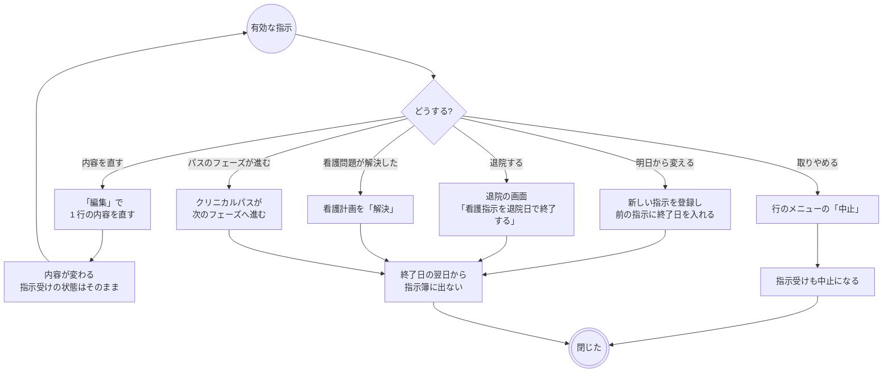

| 操作 | できる場所 | 起きること |
|---|---|---|
| 編集 | カルテの右ペイン | 1 行ずつ直す。指示受けの状態・発行日・同時に出した指示のまとまりは変わらない |
| 明日から変える | カルテの右ペイン | 新しい指示を登録し、前の指示を編集して終了日を入れる |
| 中止 | カルテの「指示簿」タブ・病棟の指示簿の行のメニュー「中止」 | 指示受けも中止になり、「終了・中止も表示」でだけ見える |
| 退院 | 退院の画面の「看護指示を退院日で終了する」 | 退院日より後まで続く指示に、退院日が終了日として入る |
| 看護計画の「解決」 | 看護計画 | 解決日より後まで続く、その計画の指示に、解決日が終了日として入る |
| 看護計画の「取消」 | 看護計画 | その計画から出した有効な指示が中止になる |
| パスのフェーズが進む | クリニカルパス | 前の安静度の指示が、新しい安静度の開始の前日で終わる |
| 削除 | なし | できない。やめるときは中止する |

- **編集**: 内容を変えるのは医師の操作なので、編集できるのはカルテの右ペインだけです。病棟の指示簿に編集はありません。中止した指示は編集できません。
- **編集が重なったとき**: 編集している間に別の人が同じ指示を書き換えていると、保存は止まります。編集を開き直してやり直します。
- **中止**: 中止に取消はありません。続けるときは新しい指示を出します。
- **退院**: 「看護指示を退院日で終了する」のチェックは、食事・リハビリなどの打ち切りと並んで初期値で入っています。退院で止めた指示は終了日が入るだけで、指示受けの状態は動きません。
- **看護計画の「取消」**: 誤って立てた看護問題を取り消す操作です。
- **終了の扱い**: 終了日を過ぎた指示を閉じる操作はありません。終了かどうかは、終了日と見ている日で決まります。
- **オーダーセット・クリニカルパスに入れた指示**: 適用すると、開始日は適用した日になり、終了日は空になります。

### 看護計画・クリニカルパス・オーダーセットから出る指示

| 入口 | 依頼者 | 指示受け | 期間 |
|---|---|---|---|
| 右ペイン・「指示簿」タブの「指示追加」 | 選んだ指示医師 | 指示受け待ち | 入力どおり |
| 看護計画の「指示展開」 | ログイン中の看護師本人 | 出した時点で指示受け済 | 入力どおり |
| オーダーセットの適用 | 適用時の指示医師 | 指示受け待ち | 開始日は適用した日。終了日は引き継がない |
| クリニカルパスの適用 | 適用時の指示医師 | 指示受け待ち | 続く病日を 1 つの指示にまとめる |

- **指示追加**: 入力者が指示医師本人でなければ、代行入力の承認待ちになります。
- **看護計画**: 「指示展開」で出した指示は、受けた人も出した看護師本人です。対象プロブレムには看護問題が入り、計画のどの行から出した指示かが残ります。計画を「解決」すると、解決日が終了日になります。
- **指示展開の選択**: 「指示展開」を開くと、有効な指示をすでに出してある行は、初めは選ばれていません。
- **クリニカルパスの期間**: 続く病日は 1 つの指示にまとまり、続きの最終日で終わります。安静度(タスク分類「活動・安静度」)は、次の安静度が始まる前日で終わります。
- **パスのタスク**: クリニカルパスの指示簿には、オーダーを持たないパスのタスク(観察・説明・文書など)も、看護指示の表の下に並びます。指示受けは要らないので「未指示受け」タブには出ません。

### 他のオーダーとの違い

| | 部門オーダー(検査・リハビリなど) | 看護指示 |
|---|---|---|
| 伝票の単位 | 1 回の登録が 1 つのオーダー | 指示 1 行が 1 つのオーダー |
| 受ける人 | 部門(検査室・リハ部門など) | 病棟の看護師(指示受け) |
| 進み具合の意味 | 部門の作業の進み具合(受付・実施済など) | 看護師がその指示を確認して受けたか |
| 対象の患者 | 外来・入院とも | 入院中の患者だけ |
| 期間 | 検査は 1 回、リハビリは期間 | 開始日〜終了日(終了日が無ければ継続中) |
| 予定 | 予約や実施予定日 | 頻度から日ごとの時刻が決まる |
| 実施 | 1 回で終わるか、リハビリのように積み上がる | 観察は値、行為はチェックで記録し、日々積み上がる |
| カルテでの見え方 | 時系列のカード | カードにならず、「指示簿」タブでだけ見る |
| 終わり方 | 部門の実施・終了 | 終了日の到来、中止、退院での打ち切り |
| 削除 | 実施記録が無ければできる | できない(中止する) |
| 医事会計 | 実施記録から送る | 送らない |

- 部門オーダーには、1 つのオーダーが明細を持つものもあります。看護指示で同時に出した行は、「同じ登録」として束ねるだけで、指示としては別々です。
- カードにしないのは、いつ出したかより、今なにが効いているかを見る情報だからです。
- 病棟の指示簿は、部門ではなく病棟の画面なので、「部門業務」ではなく「看護業務」のメニューにあります。

### ほかの画面とのつながり

| 画面 | 看護指示の使い方 |
|---|---|
| 経過表 | 看護欄に観察・行為の行と予定の印が出る。印から実施入力を開ける |
| 看護ワークシート | 病棟の 1 日の予定に、頻度から決まった時刻で「看」の印が出る。未実施の印から実施入力を開ける |
| 血糖インスリン一覧 | 看護観察「血糖値」の指示がある患者を集め、血糖測定の予定にする |
| 入院患者一覧 | 「指示受け N」の札。タブ行の右から病棟の指示簿へ |
| ホーム | 看護師の「看護指示」カードに病棟の指示受け待ちの件数 |
| クリニカルパス | 観察項目を看護観察に結んでおくと、評価の入力でその表現タイプを借り、経過表の値を読む |

- 経過表では、体温・SpO2・血圧などの観察はバイタルの行に合流します。
- インスリンの実施入力で入れた血糖値も、有効な「血糖値」の指示があれば、その指示の記録になります。

### 帳票

専用の帳票はありません。

## 開発者向け

### シーケンス図の前提

- **書き込みの経路**: `/fhir` への書き込みはどれも 1 回の transaction Bundle で、backend の `FhirProxyController` が上流の FHIR サーバー(以下「上流」)へ中継します。
- **図の省略**: 図では、上流の応答が backend を通ってブラウザへ戻る矢印を省き、上流からブラウザへの 1 本で描きます。
- **楽観ロック**: 版は `postBundle` が `ifMatch` に添え、版が違えば 412 で止まります。編集フォームは `useEditSnapshot` で開いた時点の版に固定し、`withVersionLock` で元の版を添えます。
- **全ページを読み切る検索**: 欠けた結果を使えない検索は、全ページを読み切ります(`complete: true`)。
- **SS-MIX2**: 有効にしている施設では、中継が書き込みの控えを記録します(`Ssmix2::Recorder`)。看護指示とその実施はメッセージになりません。
- **指示**: 看護指示 1 行の `ServiceRequest` を「指示」と呼びます。明細もヘッダも持ちません。

### リソースの構成

- 指示 `ServiceRequest`(1 行に 1 つ)
  - 指示受け `Task`(`focus` = 指示。指示 1 行に 1 つ)
  - 実施(観察) `Observation`(`basedOn` = 指示)
  - 実施(行為) `Procedure`(`basedOn` = 指示)
  - 代行入力 `Provenance`(`target` = 指示。種別共通で、登録・編集で付ける)

**指示 `ServiceRequest`**

| 要素 | 中身 |
|---|---|
| `category` | `order-type|nursing` + `prescription-setting|inpatient`(固定) |
| `code`(看護行為) | 16 桁の階層コード `master-nursingAction-16digits` + 管理番号 `urn:oid:1.2.392.200119.4.704` |
| `code`(看護観察) | `master-nursingObservationKeyCode` |
| `code`(自由記載) | `text` だけ |
| `orderDetail[0].text` | 条件 |
| `occurrenceDateTime` | 開始日(日付のみ) |
| `encounter` | 入院 |
| `reasonReference` | 対象プロブレム |
| 拡張 `nursing-order-end` | 終了日。無ければ継続中 |
| 拡張 `nursing-order-schedule` | 頻度(`valueTiming`)。無ければ適宜 |
| `requisition` | `nursing-order-requisition|uuid`。同時に出した行 |
| 拡張 `nursing-care-plan-activity` | 看護計画の `CarePlan` と行の id |
| 依頼科・病棟の拡張 | `applyOrderContext` / `withOrderWard` で付ける(他のオーダーと同じ) |

**指示受け `Task`**

| 要素 | 中身 |
|---|---|
| `code` | `task-code|nursing` |
| `status` | 登録の transaction で `requested` を作る |
| `owner` | 受けた人 |
| `executionPeriod.start` | 受けた日時 |

**実施(観察) `Observation`**

| 要素 | 中身 |
|---|---|
| `category` | `order-type|nursing` **だけ** |
| `code` | MEDIS 観察コード + LOINC(`NURSING_LOINC_MAP` にあれば) |
| `value[x]` | 表現タイプで決まる |
| `identifier` | `nursing-perform-entry|uuid`。1 回の記録の束ね |

**実施(行為) `Procedure`**

| 要素 | 中身 |
|---|---|
| `category` | `order-type|nursing` |
| `status` | `completed` |
| `performedDateTime` | 実施日時 |
| `performer[].actor` | 実施者 |

**この形にした理由**

- **頻度を拡張に置く**: `occurrence[x]` は choice なので、`occurrenceTiming` は開始日の `occurrenceDateTime` と併用できません。上流も `occurrenceDateTime` しか索引しません(リハビリの週あたり回数と同じ判断)。
- **期間の検索**: 上流は `order-period` で、開始日と `nursing-order-end` を合わせて索引しています。「その日に効いている指示」は `order-period=ge{日}&order-period=le{日}` で上流に絞らせます。
- **病棟の検索**: 病棟の指示簿は、`order-ward` の `ward` 検索で絞ります。
- **観察に `vital-signs` を付けない**: 上流は `Observation.category` の先頭しか索引しません。`vital-signs` を先頭に置くと、カルテのバイタル検索に混ざります。すると、カードにならない記録で診療日だけが増えます。経過表だけ `category=vital-signs,nursing` で引きます。
- **カルテの時系列**: 看護指示は `ORDER_KINDS`(`fhir/orderKinds.ts`)に入っていません。カルテの時系列からは `karteTimeline.ts` の `orderRequests` で外しています。外さないと、種別の振り分けの最後に落ちて処方カードになります。

### 状態の持ち方

| 指示の状態・指示受けの状態 | `ServiceRequest.status` | 終了日の拡張 | 指示受け `Task` |
|---|---|---|---|
| 有効・指示受け待ち | `active` | 無いか、見る日以降 | `requested` |
| 有効・指示受け済 | `active` | 無いか、見る日以降 | `accepted`(`owner`) |
| 終了 | `active` のまま | 見る日より前 | 動かさない |
| 中止 | `revoked` | そのまま | `cancelled` |

| 判定 | 関数 |
|---|---|
| 状態(終了は日付で決める) | `nursingOrderState` |
| 指示簿に残すか | `isNursingOrderRunningOn` |
| 退院などで打ち切るか | `nursingOrderNeedsStop` |

- `completed` は読めますが、書く経路はありません。終了日を過ぎても `active` のまま上流の検索に残ります(`order-period` で絞るので一覧には出ません)。
- **実施しても指示受けの Task を動かしません**。指示受けは「受けたか」で、作業の進み具合ではないためです(実施が日々積み上がる点はリハビリと同じ)。
- 編集は元の `status` を保ちます(中止・終了した指示を編集で有効に戻さない)。

### 部品

| 操作 | 画面 | 組み立て | hook |
|---|---|---|---|
| 登録 | `components/NursingOrderForm.tsx`・`NursingOrderPanels.tsx`(右ペイン `nursing-order-create`) | `buildNursingOrderBundle` | `useCreatePrescription` |
| 編集 | 同じフォーム(右ペイン `nursing-order-edit`) | `buildNursingOrderUpdateBundle` | `useUpdateNursingOrder` |
| 中止 | `components/KarteNursingTab.tsx`・`pages/NursingWorklistPage.tsx` | `fhir/nursingOrderHelpers.ts` | `useRevokeNursingOrder` |
| 病棟の指示簿 | `pages/NursingWorklistPage.tsx`(`/nursing-worklist`) | `fhir/nursingScheduleHelpers.ts` | `useNursingWorklist`・`useNursingPerformsOn` |
| 指示受け | 病棟の指示簿・`components/KarteNursingTab.tsx` | `fhir/nursingTaskHelpers.ts` | `useAcceptNursingOrders` |
| 実施 | `components/NursingPerformModal.tsx` | `buildNursingPerformBundle` | `useRegisterNursingPerform` |
| 実施の取消 | `components/NursingOrderDetailModal.tsx` | なし(1 件の DELETE) | `useDeleteNursingPerform` |
| 退院 | `components/DischargeModal.tsx` | `buildNursingOrderStopEntries` | `api/queries/encounter.ts` |
| 看護計画の指示展開 | `components/NursingCarePlanPanels.tsx` | `buildNursingOrderBundle` | `useCreatePrescription` |
| 看護計画の解決・取消 | 看護計画の画面 | `fhir/nursingCarePlanHelpers.ts` | 看護計画の hook |
| パス・セット | `components/orderSetRegistry.tsx` | `fhir/pathwayApplyHelpers.ts`・`fhir/pathwayScheduleHelpers.ts` | パス・セットの hook |

- **置き場所**: 指示・終了日・中止・退院の打ち切りの組み立ては `fhir/nursingOrderHelpers.ts`、実施記録は `fhir/nursingPerformHelpers.ts`、看護指示の hook は `api/queries/nursing.ts` です(`useActiveNursingOrders` / `usePatientNursingOrders` も)。
- **全種別共通の hook**: `useCreatePrescription`(`api/queries/labResult.ts`)は、名前に反して全種別共通の登録の hook です。
- **カルテ**: `components/KarteNursingTab.tsx` が一覧と履歴、`NursingOrderDetailModal.tsx` が詳細です。用語の検索は `NursingItemSearchModal.tsx` です。
- **病棟の画面**: 病棟の指示簿は「未指示受け」「実施予定」「全指示」の 3 タブです。`pages/InpatientListPage.tsx` に未指示受けの札があります。
- **頻度**: `fhir/nursingScheduleHelpers.ts` は、頻度の Timing・展開・突き合わせを持ちます。
- **打ち切り**: 個々の指示を閉じる組み立ては `buildNursingOrderCloseEntry` です。パスは `orderContinuityOf`(`pathwayApplyHelpers.ts`)と `planPhaseOrderClosings`(`pathwayScheduleHelpers.ts`)を使います。

### シーケンス図: 登録

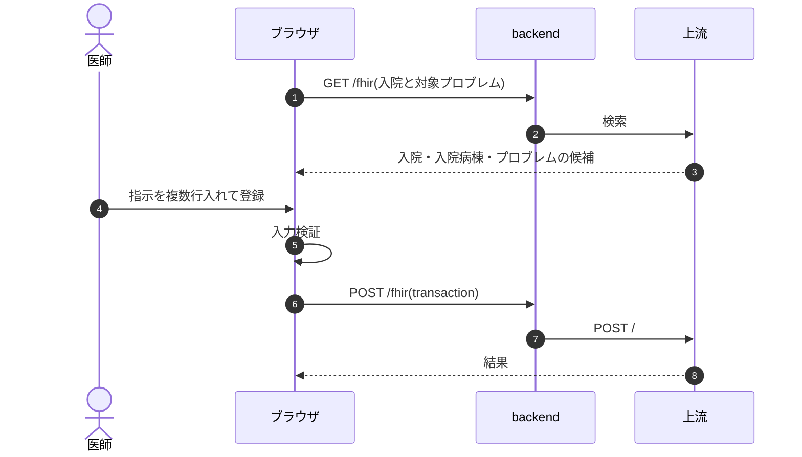

| 読むもの | 条件 |
|---|---|
| `Encounter` | 入院中 |
| `Condition` | 患者のもの |

入力検証は `validateNursingOrderForm` です。

| 書くもの | 条件 |
|---|---|
| POST `ServiceRequest`(`fullUrl` は `urn:uuid`、同じ `requisition`) | 行ごと |
| POST `Task` `requested`(`focus` = その `urn:uuid`) | 行ごと |
| `Provenance`(CREATE) | いつも |
| `Task` `order-approval` | 代行・研修医 |
| `Task` を `accepted` + `owner` = 看護師本人にする | 看護計画から出したとき |

### シーケンス図: 編集

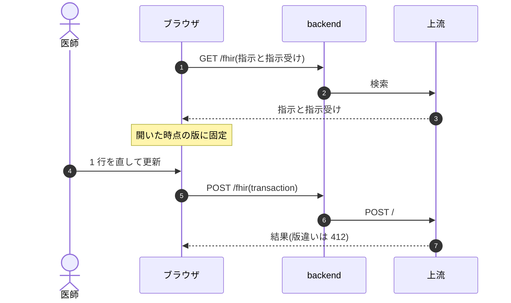

検索は `ServiceRequest?_id&_revinclude=Task:focus` です。

| 書くもの | 条件 |
|---|---|
| PUT `ServiceRequest`(`ifMatch`) | `requisition`・発行日・`status` は元のまま |
| `Provenance`(UPDATE) | いつも |

### シーケンス図: 中止

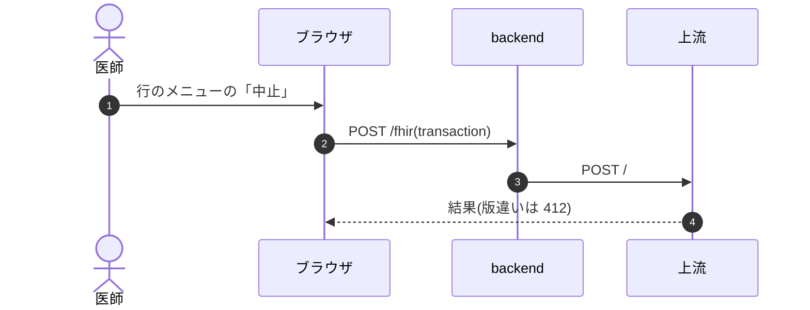

| 書くもの | 条件 |
|---|---|
| PUT `ServiceRequest` `status=revoked`(`ifMatch`) | いつも |
| `Task` `cancelled` | Task が無ければ POST |

### シーケンス図: 病棟の指示簿

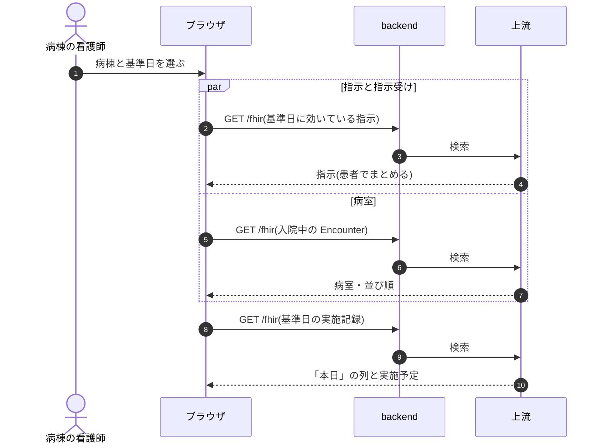

| 検索 | 条件 |
|---|---|
| 指示と指示受け | `ServiceRequest?category=order-type|nursing&status=active` |
| 同上(期間) | `order-period=ge基準日&order-period=le基準日` |
| 同上(病棟と付随) | `ward=Location/病棟`、`_include` 患者、`_revinclude` `Task:focus` |
| 病室 | `Encounter`(入院中、病棟)。入院患者一覧と同じキャッシュ |
| 実施記録 | `Observation`・`Procedure?category=order-type|nursing&date=基準日&patient=…` |

- 指示の検索は `fetchWorklistBundles` で 500 件ずつ引きます。一覧が上限で欠けたら `truncated` を出します。
- 実施記録の検索は、患者 20 人ずつに分けて並列で引き、全ページを読み切ります。
- 頻度の展開と、実施との突き合わせは画面側でします。

### シーケンス図: 指示受け

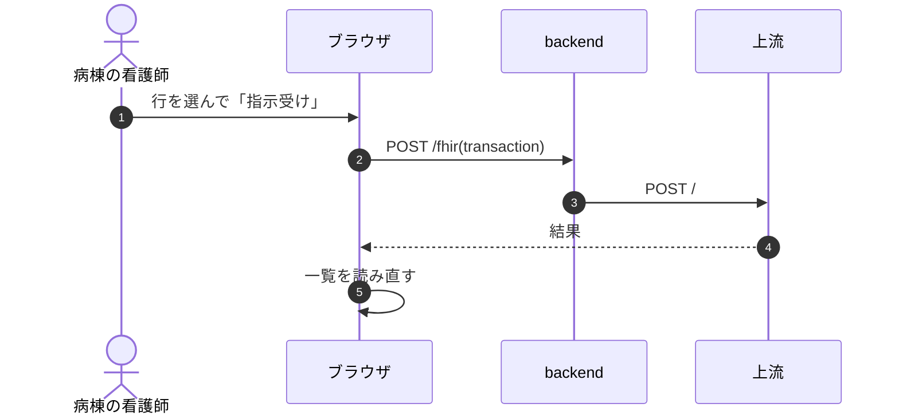

| 書くもの | 条件 |
|---|---|
| `Task` `accepted` + `owner` = ログイン中の本人 | 選んだ行ごと。Task が無ければ POST、あれば PUT |

読み直すのは、指示簿・カルテのタブ・入院患者一覧の札です。

### シーケンス図: 実施

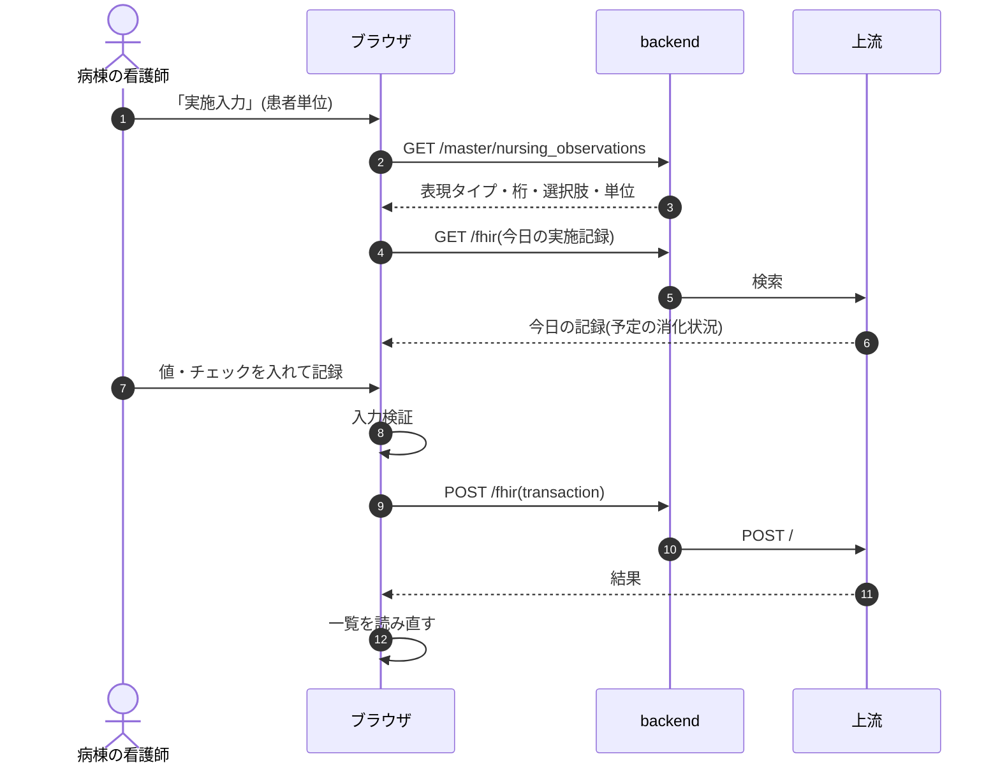

- マスタは管理番号で引きます。
- 今日の実施記録の検索は `Observation`・`Procedure?category=order-type|nursing&date=今日&patient=患者` です。
- 入力検証は `validateNursingPerformForm` です。
- 読み直すのは、経過表・「本日」の列・実施履歴です。

| 書くもの | 条件 |
|---|---|
| POST `Observation`(`basedOn` = 指示) | 値の入った観察ごと |
| POST `Procedure`(`basedOn` = 指示) | チェックした行為ごと |
| 同じ `nursing-perform-entry` | 1 回の記録を束ねる |

指示受けの `Task` は動かしません。

### シーケンス図: 実施の取消

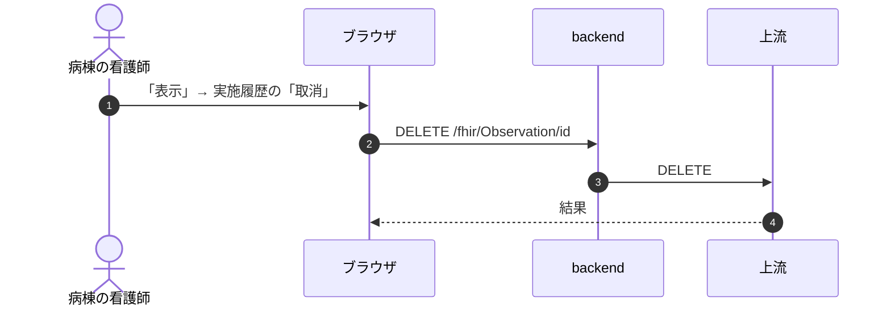

行為の記録なら `DELETE /fhir/Procedure/id` です。

### シーケンス図: 退院での打ち切り

退院・看護計画の解決・パスのフェーズでの打ち切りは、どれも「その日より後まで続く有効な指示に、その日を終了日として書く」で、指示受けの Task は触りません。

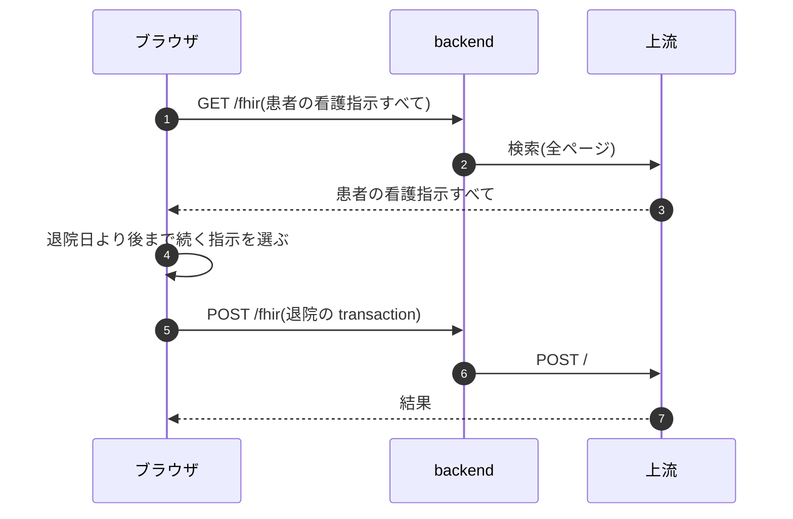

- 操作するのは退院の画面です(`components/DischargeModal.tsx`)。
- 検索は `ServiceRequest?subject=患者&category=order-type|nursing&_revinclude=Task:focus` で、全ページを読み切ります。欠けた結果は使いません。
- 退院日より後まで続く指示は `nursingOrderNeedsStop` で選びます。

| 書くもの | 条件 |
|---|---|
| PUT `ServiceRequest` の `nursing-order-end` = 退院日 | 退院日より後まで続く指示ごと |
| `Encounter`・ベッドの更新、食事・リハビリなどの打ち切り | 同じ transaction に一緒に積む |

### シーケンス図: 看護計画の解決・取消

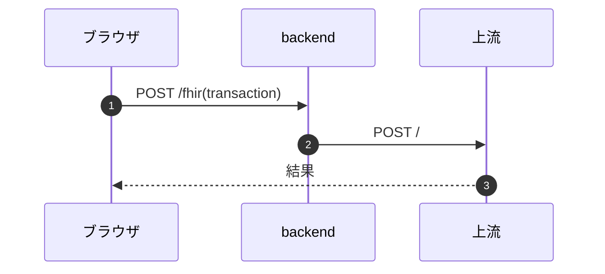

| 書くもの | 条件 |
|---|---|
| PUT `Condition`(`resolved` / `entered-in-error`)、PUT `CarePlan` | 解決は `resolved`、取消は `entered-in-error` |
| 計画から出した指示に `nursing-order-end` = 解決日 | 解決 |
| 有効な指示を `status=revoked` | 取消 |

### シーケンス図: パスの次のフェーズ

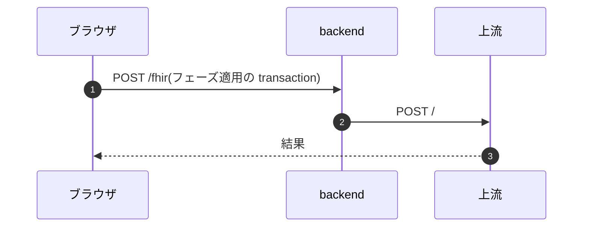

| 書くもの | 条件 |
|---|---|
| POST 新しい安静度の指示 | フェーズの適用 |
| 前の安静度(AL)の指示に `nursing-order-end` = 新しい開始の前日 | フェーズの適用 |

### 医事会計と SS-MIX2

看護指示は、登録・編集・中止・指示受け・実施・実施の取消・打ち切りのどれでも、医事会計にも SS-MIX2 にも何も送りません。退院そのものは `ADT` で出ます。

- **医事会計**: 出来高で請求する項目を持たないので、対象外です(`OrderCatalog::IGNORED` の `nursing`)。送れない項目としても報告しません。
- **SS-MIX2(指示)**: 看護指示の `ServiceRequest` は、どのメッセージ種別にも当たりません。
- **SS-MIX2(観察)**: 単独で書いた `Observation`(看護観察・バイタル)は、対象のリソースに入っていません(`Ssmix2::Dispatcher::RESOURCE_TYPES`)。
- **SS-MIX2(行為)**: 行為の `Procedure` も、実施記録のメッセージ(`RAS^O17` / `OMI^Z23`)の対象種別ではありません。
