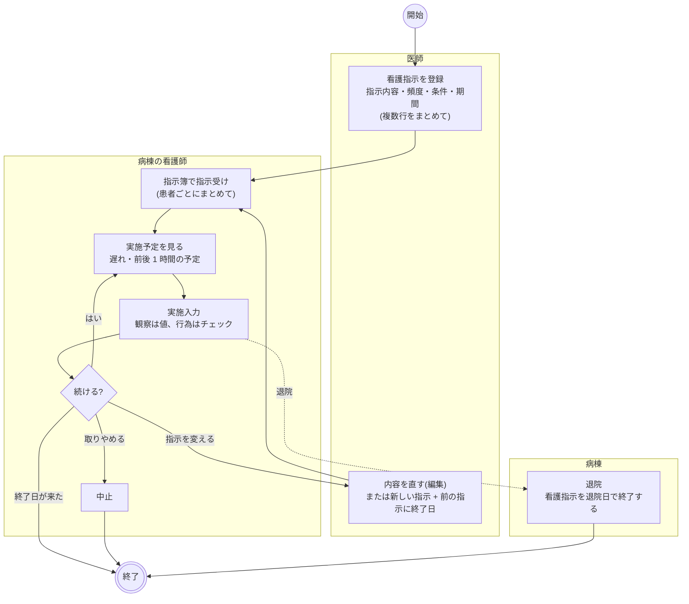
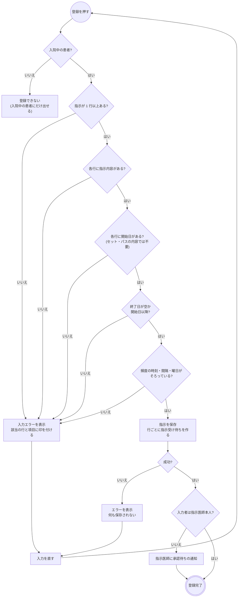
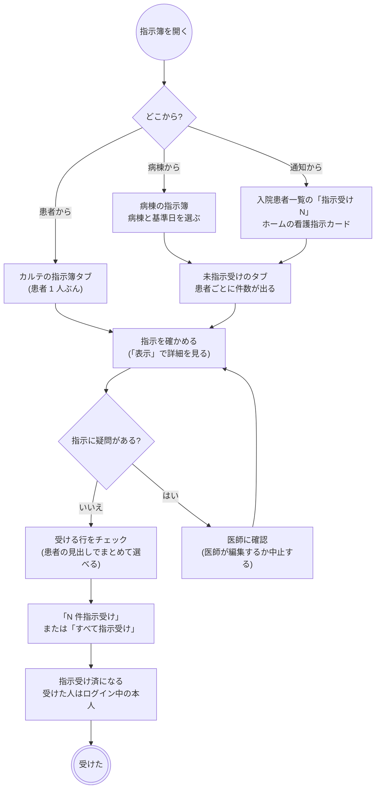
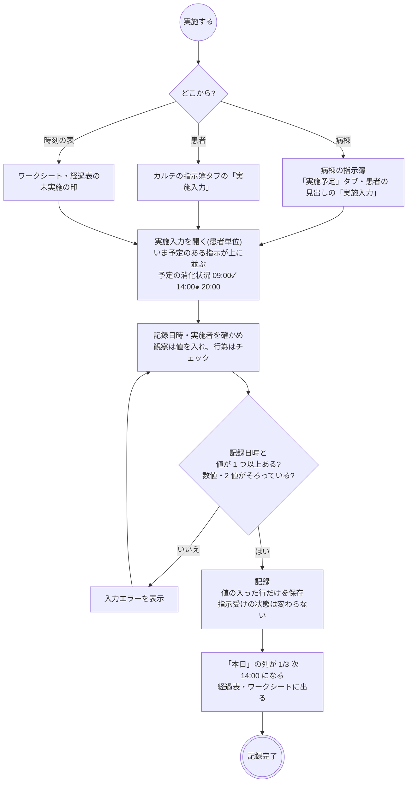
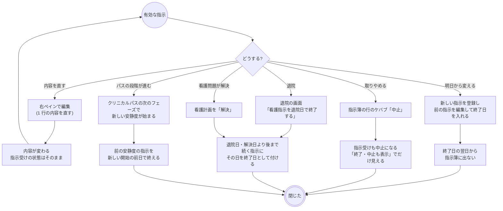
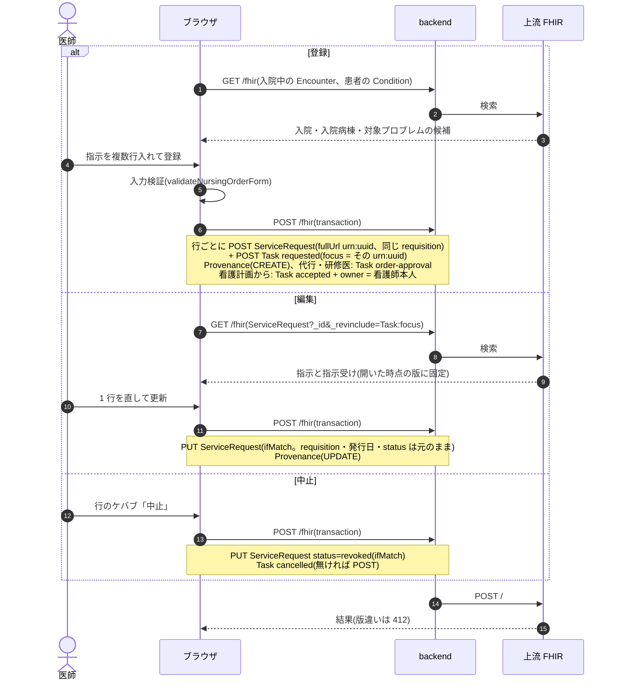
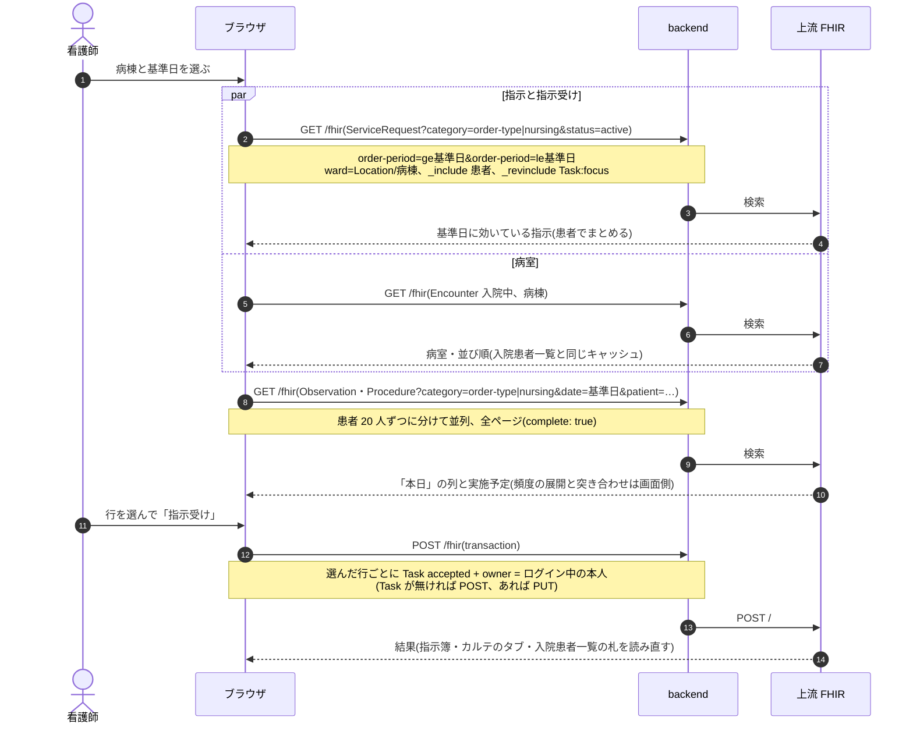
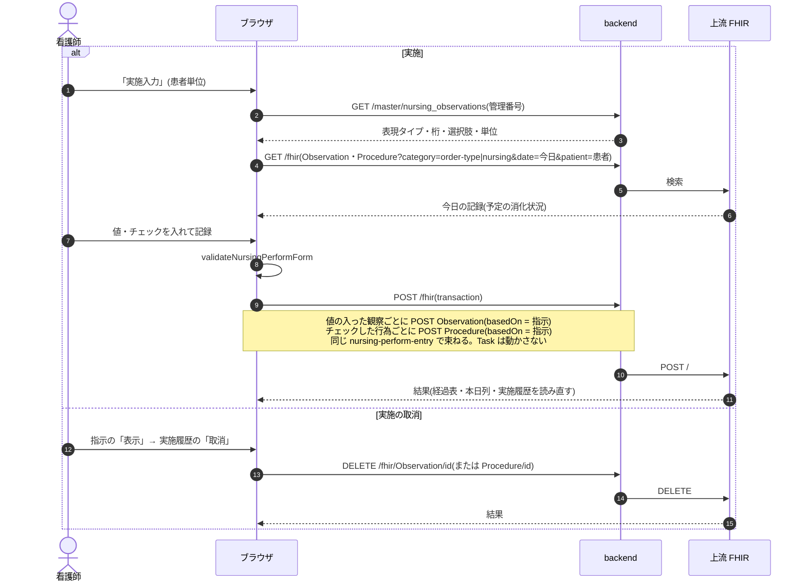
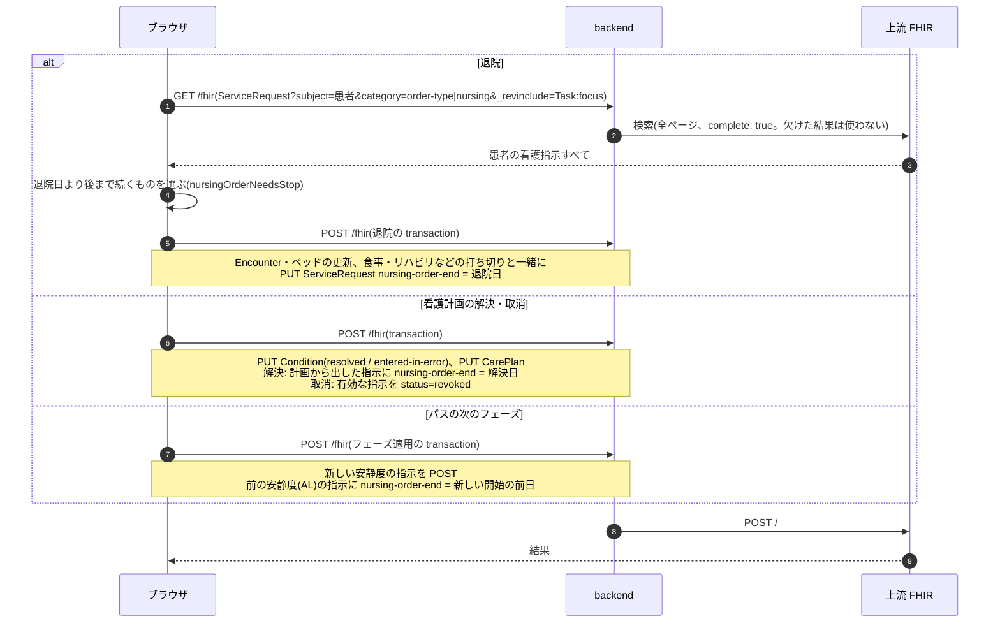

# 看護指示の業務フロー

看護指示を、医師の登録から看護師の指示受け・日々の実施・終了(退院での打ち切り)まで追う流れです。医療機関の運用を検討する人は「運用フロー」、院内の開発者は「開発者向け」を読みます。
看護指示は入院患者に出す看護向けの指示(安静度・清潔・排泄・観察項目など)で、病棟では「指示簿」と呼びます。受けるのは部門ではなく**病棟の看護師**で、指示は 1 行ずつ別々に始まり、終わり、取りやめになります。何をいつ行うかは指示の頻度から日ごとに決まり、実施の記録が日々積み上がります。
設計は [nursing-order-design.md](../nursing-order-design.md)、看護計画からの展開は [features/nursing.md](../features/nursing.md)「看護計画」、ワークシートは同じく「看護ワークシートと業務分担」、退院の画面は [features/ward.md](../features/ward.md)、
種別共通の約束(代行入力・オーダーセット・クリニカルパス)は [features/orders-common.md](../features/orders-common.md)、リソースの要素は実装ガイド(`../fhir-ig`)が正典です。

## 運用フロー

### 他のオーダーとの違い

| | 部門オーダー(検査・リハビリなど) | 看護指示 |
|---|---|---|
| 伝票の単位 | 1 回の登録が 1 つのオーダー(明細を持つものもある) | **指示 1 行が 1 つのオーダー**。同時に出した行は「同じ登録」として束ねるだけ |
| 受ける人 | 部門(検査室・リハ部門など) | 病棟の看護師(指示受け) |
| 進捗の意味 | 部門の作業の進み具合(受付・実施済など) | 看護師がその指示を確認して受けたか |
| 対象の患者 | 外来・入院とも | 入院中の患者だけ |
| 期間 | 検査は 1 回、リハビリは期間 | 開始日〜終了日(終了日が無ければ継続中) |
| 予定 | 予約や実施予定日 | 頻度(1日3回・6時間毎・週2回など)から日ごとに時刻を展開する |
| 実施 | 1 回で終わる、またはリハビリのように積み上がる | 観察は値、行為はチェックで記録し、日々積み上がる。指示受けの状態は変わらない |
| カルテでの見え方 | 時系列のカード | **カードにしない**。カルテの「指示簿」タブでだけ見る(いつ出したかより、今なにが効いているかを見る情報なので) |
| 終わり方 | 部門の実施・終了 | 終了日の到来、中止、退院での打ち切り |
| 削除 | 実施記録が無ければできる | できない(中止する) |
| 医事会計 | 実施記録から送る | 送らない |

- 用語は MEDIS 看護実践用語標準マスター(看護行為編・看護観察編)から選びます。マスタに無い指示は自由記載で書けます。
- 入口はカルテの右ペイン「看護指示」と、指示簿タブの「指示追加」です。看護計画の行からの「指示展開」、オーダーセット、クリニカルパスの適用からも立ちます。
- 病棟の画面は「看護業務 > 指示簿」(`/nursing-worklist`)です。部門業務メニューには入れていません(部門ではなく病棟の画面なので)。

### 指示の状態

看護指示は「指示そのものの状態」と「指示受けの状態」を別々に持ちます。

| 指示 | 意味 | 変わるきっかけ |
|---|---|---|
| 有効 | 始まっていて、まだ終わっていない | 登録 |
| 終了 | 終了日を過ぎた | 終了日の到来(何も書かずに、日付で決まる) |
| 中止 | 指示を取り下げた | 指示簿の「中止」、看護計画の取消 |

| 指示受け | 意味 | 変わるきっかけ |
|---|---|---|
| 指示受け待ち | まだ誰も受けていない | 医師の登録、オーダーセット・パスの適用 |
| 指示受け済 | 看護師が受けた(受けた人と日時を残す) | 指示簿の「指示受け」、看護計画からの指示展開(出した看護師が受けたことになる) |
| 中止 | 指示が取り下げられた | 指示の中止 |

- 指示受けの取消(受け済みを待ちに戻す)はありません。
- 終了日の到来や退院での打ち切りでは、指示受けの状態は動きません。
- 指示受けの前でも実施は記録できます。受けてからに限るかは運用で決めます。

### 全体の流れ

- 指示簿は「今日効いている指示」を区分(看護行為の第 1・第 2 階層 / 観察 / その他)ごとにまとめて並べます。「終了・中止も表示」で終わった指示も混ぜて見られます。
- 「履歴」では、同時に出した指示をひとまとまりにして、発行日・指示医・各行の状態(有効・終了・中止)を新しい順に並べます。
- 看護計画から出した指示には「看護計画」の印が付きます。

### 登録の判定

- 1 回の登録で複数行を出せます。行は保存すると別々の指示になり、その後は 1 行ずつ編集・中止・終了します。
- 指示内容は用語の検索(看護行為 / 看護観察のタブ、階層で絞り込み、自由記載)で選びます。看護行為は**行為を選んでから修飾語を選ぶ**二段の選び方です(「入浴」には「全介助(リフト)」など修飾語が 10 種あるので、検索の一覧には行為だけを並べます)。修飾語を変えると指示内容の文言も追従します。
- 頻度は「適宜 / 1日1〜4回 / 4・6・8時間毎 / 時刻指定 / 週N回」から選び、時刻を微調整します。「1日N回」の時刻の初期値は施設設定の「看護指示の既定時刻」です。条件(「38℃以上で報告」「疼痛時」)は頻度とは別に自由記載で書きます。
- 対象プロブレムを選べます。
- 承認待ちでも指示は病棟に流れます(代行入力と同じ方針)。看護師が医師の口頭指示を代わりに入れたときがこれに当たります。
- オーダーセットに看護指示を入れて外来の患者に適用すると、注意が出ます。

### 頻度と予定

指示に付けた頻度から、日ごとの予定の時刻を作ります。予定は指示簿・実施入力・ワークシート・経過表・血糖インスリン一覧で同じ作り方です。

| 頻度 | その日の予定 |
|---|---|
| 適宜・必要時 | 予定を持たない(ワークシートでは「随時」の列) |
| 1日N回 | 指示に入れた時刻(登録時に焼き付けるので、あとで施設設定を変えても動かない) |
| N時間毎 | 起点の時刻から N 時間刻みで、その日の 0〜24 時に入るぶん(起点より前も逆算する) |
| 時刻指定 | 入れた時刻 |
| 週N回 | 選んだ曜日だけ、入れた時刻 |

- 実施の記録は、最も近い予定に 1 対 1 で当てます。予定から離れすぎた記録(60 分か、予定の間隔の半分の短いほうを超えたもの)は「予定外」です。
- 24 時間を割り切れない間隔(5 時間毎・7 時間毎)は、日によって時刻がずれます。

### 指示受け

- 病棟の指示簿は、病棟ごとに患者でまとめて並べます(見出し行に病室・氏名・未指示受けの件数)。氏名からカルテの指示簿タブを開けます。依頼科・指示受けの状態で絞り込めます。
- 指示受けは医療従事者としてログインしているときにできます。
- 病棟は**指示を出したときの入院病棟**で決まります。転棟すると、転棟前に出した指示は前の病棟の指示簿に出続けます。
- 入院患者一覧の「指示受け N」は塗りつぶしの札で、押すとその患者のカルテの指示簿タブが開きます。

### 実施

- 「実施予定」タブは、基準日が今日なら、遅れている予定と前後 1 時間に未実施の予定がある指示だけを患者ごとに並べます(1 分ごとに見直します)。今日以外の日は、その日に未実施の予定がある指示です。
- 実施入力には、その日に効いている指示がすべて並びます。予定の時間でない指示も薄く出して入力できます(臨時の測定・頓用の記録のため)。記録日時を変えると並びと強調が追従します。
- 観察の入力欄は用語の表現タイプで決まります(数値と単位 / 選択肢 / 文字 / 縦×横 / 血圧)。数値は用語の桁の上限を超えると入力エラーです。
- 実施者の初期値はログイン中の本人で、別の人に変えられます。
- 体温・SpO2・脈拍数・呼吸数・体重・身長・血圧の観察は、手入力のバイタルと同じ経過表の行に並びます。それ以外の観察は指示の項目ごとの行です。
- 実施の取消は、指示の「表示」→ 実施履歴の「取消」です。1 件ずつ取り消します。

### 変更・終了・中止・退院

- 編集できるのはカルテの右ペインだけです(内容を変えるのは医師の操作なので)。病棟の指示簿には編集を置いていません。中止した指示は編集できません。
- 編集で開いたフォームの元データは、開いた時点の版に固定します。その間に別の人が同じ指示を書き換えていると、保存が版違いで止まります。
- 中止に取消はありません。続けるときは新しい指示を出します。
- 退院のチェックは、食事・リハビリなどの打ち切りと並んで初期値で入っています。退院で止めた指示は終了日が付くだけで、指示受けの状態は動きません。
- 看護計画の「取消」(誤って立てた看護問題)では、その計画から出した有効な指示を中止します。
- 終了日を過ぎた指示を閉じる締め処理はありません。終わったかどうかは終了日と見る日で決めます。

### 看護計画・クリニカルパス・オーダーセットから出る指示

| 入口 | 依頼者 | 指示受け | 期間 |
|---|---|---|---|
| 右ペイン・指示簿タブの「指示追加」 | 選んだ指示医師(本人でなければ代行入力の承認待ち) | 指示受け待ち | 入力どおり |
| 看護計画の「指示展開」 | ログイン中の看護師本人 | 出した時点で受け済み(受けた人も本人) | 入力どおり。計画の「解決」で解決日を終了日にする |
| オーダーセットの適用 | 適用時の指示医師 | 指示受け待ち | 開始日は適用した日、終了日は引き継がない |
| クリニカルパスの適用 | 適用時の指示医師 | 指示受け待ち | 続く病日を 1 つの指示にまとめ、続きの最終日で終える。安静度(タスク分類 `AL`)は次の安静度が始まる前日で終える |

- 看護計画から出した指示は、対象プロブレムに看護問題が入り、どの行から出したかを指示に残します。指示展開では、有効な指示をもう出した行を初めから選ばずに開きます。
- クリニカルパスの指示簿には、オーダーを持たないパスのタスク(観察・説明・文書など)も、看護指示の表の下に並びます。指示受けは要らないので「未指示受け」のタブには出しません。

### ほかの画面とのつながり

| 画面 | 看護指示の使い方 |
|---|---|
| 経過表 | 看護欄に観察・行為の行と予定の印。体温・SpO2・血圧などの観察はバイタルの行に合流する。印から実施入力を開ける |
| 看護ワークシート | 病棟の 1 日の予定に、頻度を展開した時刻で「看」の印を置く。未実施の印から実施入力を開ける |
| 血糖インスリン一覧 | 看護観察「血糖値」の指示がある患者を集め、血糖測定の予定にする。インスリンの実施入力で入れた血糖値も、有効な「血糖値」の指示があればその指示の記録になる |
| 入院患者一覧 | 「指示受け N」の札。タブ行の右から病棟の指示簿へ |
| ホーム | 看護師の「看護指示」カードに病棟の未指示受けの件数 |
| クリニカルパス | 観察項目を看護観察に結んでおくと、評価の入力でその表現タイプを借り、経過表の値を読む |

### 変更・中止・削除

| 操作 | できること |
|---|---|
| 変更 | カルテの右ペインで 1 行ずつ編集。同時に出した束ね・発行日・状態は変わりません |
| 中止 | カルテの指示簿タブ・病棟の指示簿の行のケバブ「中止」。指示受けも中止になります |
| 削除 | ありません |
| DO | オーダーセット・パスの雛形として使うときは、開始日を当日にし、終了日を空にします |

### 帳票

専用の帳票はありません。

## 開発者向け

### リソースの構成

| もの | リソース | 要点 |
|---|---|---|
| 指示(1 行) | `ServiceRequest` | `category` = `order-type|nursing` + `prescription-setting|inpatient`(固定)、`code` = 看護行為(16 桁の階層コード `master-nursingAction-16digits` + 管理番号 `urn:oid:1.2.392.200119.4.704`)/ 看護観察(`master-nursingObservationKeyCode`)/ `text` だけ(自由記載)、`orderDetail[0].text` = 条件、`occurrenceDateTime` = 開始日(日付のみ)、`encounter` = 入院、`reasonReference` = 対象プロブレム。明細もヘッダも持たない |
| 期間・頻度・束ね | 指示の拡張と `requisition` | `nursing-order-end`(終了日。無ければ継続中)、`nursing-order-schedule`(`valueTiming`。無ければ適宜)、`requisition` = `nursing-order-requisition|uuid`(同時に出した行)、`nursing-care-plan-activity`(看護計画の `CarePlan` と行の id) |
| 依頼科・病棟 | 指示の拡張 | `applyOrderContext` / `withOrderWard`(他のオーダーと同じ。病棟の指示簿は `order-ward` の `ward` 検索で絞る) |
| 指示受け | `Task`(`task-code|nursing`、`focus` = 指示) | 指示 1 行に 1 つ。登録の transaction で `requested` を作る。受けた人は `owner`、受けた日時は `executionPeriod.start` |
| 実施(観察) | `Observation`(`basedOn` = 指示) | `category` = `order-type|nursing` **だけ**、`code` = MEDIS 観察コード + LOINC(`NURSING_LOINC_MAP` にあれば)、`value[x]` は表現タイプで決まる、`identifier` = `nursing-perform-entry|uuid`(1 回の記録の束ね) |
| 実施(行為) | `Procedure`(`basedOn` = 指示) | `category` = `order-type|nursing`、`status` = `completed`、`performedDateTime`、`performer[].actor` |
| 代行入力 | `Provenance`(`target` = 指示) | 種別共通。登録・編集で付ける |

- 頻度を `occurrenceTiming` にせず拡張にするのは、`occurrence[x]` が choice で開始日の `occurrenceDateTime` と併用できず、上流も `occurrenceDateTime` しか索引しないためです(リハビリの週あたり回数と同じ判断)。
- 上流は `order-period` で開始日と `nursing-order-end` を合わせて索引しています。「その日に効いている指示」は `order-period=ge{日}&order-period=le{日}` で上流に絞らせます。
- 観察の `category` に `vital-signs` を付けないのは、上流が `Observation.category` の先頭しか索引せず、先頭に置くとカルテのバイタル検索に混ざってカードにならない記録で診療日だけが増えるためです。経過表だけ `category=vital-signs,nursing` で引きます。
- 看護指示は `ORDER_KINDS`(`fhir/orderKinds.ts`)に入っていません。カルテの時系列からは `karteTimeline.ts` の `orderRequests` で外しています(外すと種別の振り分けの最後に落ちて処方カードになります)。

### 状態の持ち方

| 表示 | `ServiceRequest.status` | 終了日の拡張 | 指示受け `Task` |
|---|---|---|---|
| 有効・指示受け待ち | `active` | 無いか、見る日以降 | `requested` |
| 有効・指示受け済 | `active` | 無いか、見る日以降 | `accepted`(`owner`) |
| 終了 | `active` のまま | 見る日より前 | 動かさない |
| 中止 | `revoked` | そのまま | `cancelled` |

- 状態の判定は `nursingOrderState`(終了は日付で決める)、指示簿に残すかは `isNursingOrderRunningOn`、退院などで打ち切るかは `nursingOrderNeedsStop` です。
- `completed` は読めますが、書く経路はありません。終了日を過ぎても `active` のまま上流の検索に残ります(`order-period` で絞るので一覧には出ません)。
- **実施しても指示受けの Task を動かしません**。指示受けは「受けたか」で、作業の進捗ではないためです(実施が日々積み上がる点はリハビリと同じ)。
- 編集は元の `status` を保ちます(中止・終了した指示を編集で有効に戻さない)。

### シーケンス図の前提

`/fhir` への書き込みはどれも 1 回の transaction Bundle で、backend の `FhirProxyController` が上流へ中継します。
SS-MIX2 を有効にしている施設では、中継が書き込みの控えを記録します(`Ssmix2::Recorder`。看護指示とその実施はメッセージになりません)。
楽観ロックの版は `postBundle` が `ifMatch` に添え、版が違えば 412 で止まります。編集フォームは `useEditSnapshot` で開いた時点の版に固定し、`withVersionLock` で元の版を添えます。

| 部品 | 場所 |
|---|---|
| 登録・編集のフォーム | `components/NursingOrderForm.tsx`・`NursingOrderPanels.tsx`(右ペイン `nursing-order-create` / `nursing-order-edit`)、用語の検索 `NursingItemSearchModal.tsx` |
| 組み立て | `fhir/nursingOrderHelpers.ts`(指示・終了日・中止・退院の打ち切り)・`nursingTaskHelpers.ts`(指示受け)・`nursingScheduleHelpers.ts`(頻度の Timing・展開・突き合わせ)・`nursingPerformHelpers.ts`(実施記録) |
| カルテ | `components/KarteNursingTab.tsx`(一覧・履歴)、詳細 `NursingOrderDetailModal.tsx`、実施入力 `NursingPerformModal.tsx` |
| 病棟の画面 | `pages/NursingWorklistPage.tsx`(`/nursing-worklist`。未指示受け・実施予定・全指示の 3 タブ)、`pages/InpatientListPage.tsx`(未指示受けの札) |
| hook | `api/queries/nursing.ts`(`useActiveNursingOrders` / `usePatientNursingOrders` / `useNursingWorklist` / `useAcceptNursingOrders` / `useRevokeNursingOrder` / 実施記録)、登録は `useCreatePrescription`(`api/queries/labResult.ts`。全種別共通) |
| 退院 | `components/DischargeModal.tsx`、`api/queries/encounter.ts`(`buildNursingOrderStopEntries` を退院の transaction に積む) |
| 看護計画 | `components/NursingCarePlanPanels.tsx`(指示展開)、`fhir/nursingCarePlanHelpers.ts`(解決・取消で指示を閉じる) |
| パス・セット | `fhir/pathwayApplyHelpers.ts`(`orderContinuityOf`)、`fhir/pathwayScheduleHelpers.ts`(`planPhaseOrderClosings`)、`components/orderSetRegistry.tsx` |

### シーケンス図: 登録・編集・中止

`buildNursingOrderBundle` / `buildNursingOrderUpdateBundle`、`useCreatePrescription`、`useUpdateNursingOrder`、`useRevokeNursingOrder`。

### シーケンス図: 病棟の指示簿と指示受け

`useNursingWorklist`(`fetchWorklistBundles` で 500 件ずつ)、`useNursingPerformsOn`、`useAcceptNursingOrders`。一覧が上限で欠けたら `truncated` を出します。

### シーケンス図: 実施・実施の取消

`buildNursingPerformBundle`、`useRegisterNursingPerform`、`useDeleteNursingPerform`。

### シーケンス図: 退院・看護計画の解決・パスの段階での打ち切り

`buildNursingOrderStopEntries` / `buildNursingOrderCloseEntry`。どれも「その日より後まで続く有効な指示に、その日を終了日として書く」で、指示受けの Task は触りません。

### 医事会計と SS-MIX2

看護指示は出来高で請求する項目を持たないので、医事会計の対象外です(`OrderCatalog::IGNORED` の `nursing`)。送れない項目としても報告しません。
SS-MIX2 は、看護指示の `ServiceRequest` がどのメッセージ種別にも当たらず、単独で書いた `Observation`(看護観察・バイタル)は対象のリソースに入っていません(`Ssmix2::Dispatcher::RESOURCE_TYPES`)。行為の `Procedure` も実施記録のメッセージ(`RAS^O17` / `OMI^Z23`)の対象種別ではありません。

| 起きたこと | 医事会計(`BillingClaimBuilder`) | SS-MIX2 |
|---|---|---|
| 登録・編集・中止 | なし | なし |
| 指示受け | なし | なし |
| 実施・実施の取消 | なし | なし |
| 退院・看護計画の解決・パスでの打ち切り | なし | なし(退院そのものは `ADT` で出る) |
