# 外来の受付から会計までの業務フロー

外来受診を追う流れです。予約枠の準備と予約から始まり、来院・受付・問診・呼出と診察、検査への回り、診察終了、医事会計への送信と会計済の確認までを扱います。医療機関の運用を検討する人は「運用フロー」、院内の開発者は「開発者向け」を読みます。
外来は**1 回の受診を 1 件の受付**で表します。予約から来た受診も、予約なしで来た受診(当日受付・新患登録・レセコンからの受付)も同じ形の受付になります。診察室に入ってからは**診察**の記録が別にでき、受付と診察の 2 つを合わせて外来患者一覧の状態を出します。診察中に出すオーダーはそれぞれの種別の流れに乗ります([処方](prescription.md)、[検体検査](lab.md)、[放射線検査](rad.md)など)。ここでは、検査に回るために診察を一時終了するところまでを書きます。
画面のふるまいは [features/outpatient.md](../features/outpatient.md) とカルテの見出し([features/karte.md](../features/karte.md))、受付番号と待合表示板は [waiting-board-design.md](../waiting-board-design.md)、Web 問診は [web-intake-design.md](../web-intake-design.md)、会計送信は [receipt-billing-design.md](../receipt-billing-design.md) とレセコン連携の [receipt-computer-integration.md](../receipt-computer-integration.md)、SS-MIX2 は [ssmix2-export-design.md](../ssmix2-export-design.md) が正典です。

## 運用フロー

### 外来の状態

| 状態 | 意味 | 変わるきっかけ | 一覧での見え方 |
|---|---|---|---|
| 予約済 | 来院の予定がある | 予約登録(カルテ右ペイン) | 外来患者一覧の予約時間の順。行に「受付」 |
| 受付済 | 来院して受付が済み、診察を待っている | 受付(予約から)、当日受付、新患登録、レセコンからの受付 | 受付時間・受付番号・待ち時間が入る。行に「診察開始」。待合表示板の「お待ちの方」 |
| 診察中 | 診察室で診ている | 診察開始、診察再開 | 行とカルテ見出しに「診察終了」。待合表示板の「お呼び出し中」 |
| 一時終了 | 検査などで診察室を離れている | 診察終了の押下で未実施の検査があり「一時終了」を選んだ | 行とカルテ見出しに「診察再開」。待合表示板の「検査などで離席中」 |
| 診療済 | 診察が終わった | 診察終了 | 行に「医事送信」(レセコン連携が有効なとき)。会計が済むと「会計済」が付く |
| 未来院 | 予約の日に来なかった | 未来院(予約日の当日以降) | 一覧に残る。枠は空けない |
| 取消 | 予約がなくなった | 予約取消、レセコン側の受付取消 | どこにも出ない |

- 状態は受付の上で進みます。診察中・一時終了の間も受付は「受付済」のままで、診察の記録の側が「診察中」「一時終了」を持ちます。
- 1 日に同じ患者の受付が複数あってもかまいません(午前は内科、午後は眼科など)。一覧では受付ごとに 1 行です。
- 検査の予約(放射線・生理検査・内視鏡などのオーダーに付く予約)は部門の受付が追うので、外来患者一覧には出ません。

### 全体の流れ

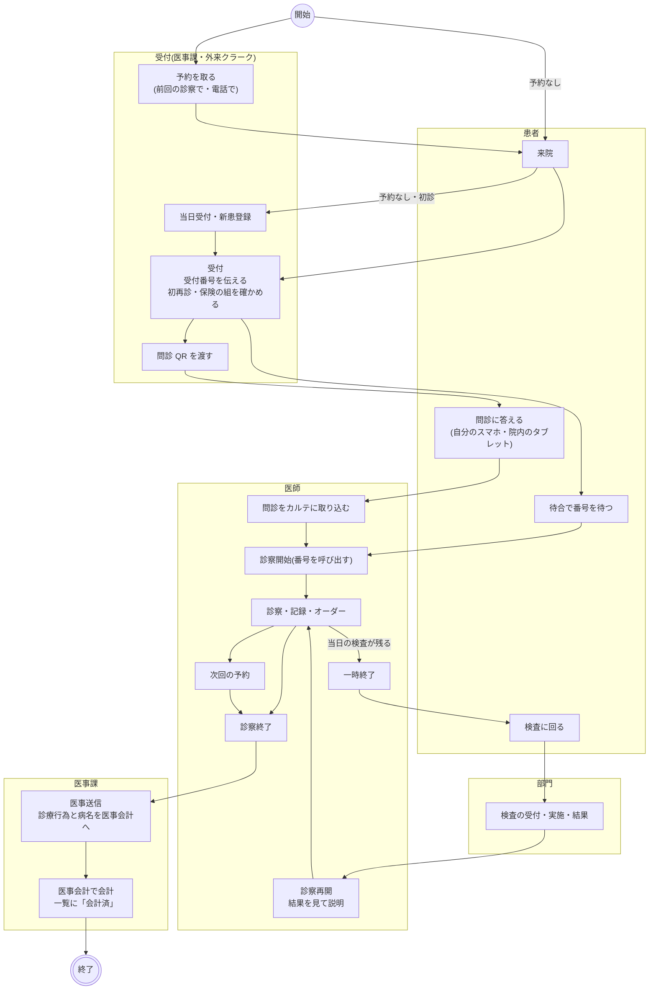

- 役割の分け方は運用で決めます。システムの権限で止めている操作はありません。受付・診察開始・診察終了・医事送信は、どの職種のログインでもできます。
- 受付・診察室・会計の端末が同じ外来患者一覧を見ます。「自動更新」をオンにした端末は 1 分ごとに読み直します。オンにするかどうかは端末ごとに決めます。
- 医事送信は診察終了を待たなくても送れます(受付済のあと、行のメニューから)。問診と次回の予約は、どちらもしない受診があります。

### 予約

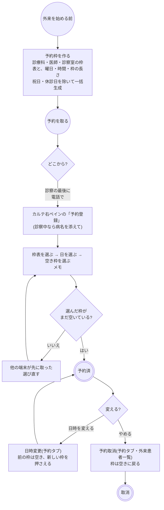

- 予約枠は「予約枠」メニュー(`/schedules`)で枠表ごとに作り、カレンダーで枠を止めたり消したりします。外来の診察の枠表は種別「診察」で、検査の枠表(CT 室・内視鏡室など)とは分けます。
- 予約は枠に結び付き、同じ枠を 2 人が取ることはありません(後から確定した方が止まります)。
- 予約日・予約時間・担当医・診察室は枠表から決まります。担当医が替わる、別の診察室に回すなどの当日の変更は、受付の「編集」で行います。
- 予約の Web 取得(患者が自分で予約を取る)はありません。

### 受付

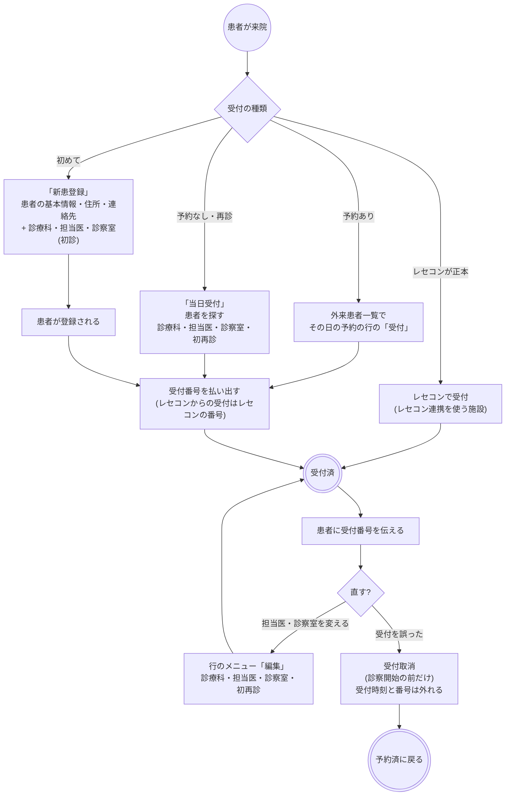

- **受付番号**は受付のたびにその日の連番を払い出し、待合表示板の呼出番号になります。払い出したあとに書き込みが失敗した番号は欠番になり、受付取消のあと受付し直すと次の番号が付きます。番号の連続に意味を持たせない運用にします。
- **初再診**は受付で「初診」「再診」から選びます。選ばなければ判定は医事会計に任せます。新患登録の既定は初診です。
- **保険の組**(請求に使う保険・公費の組み合わせ)はレセコンからの受付だけが持ち、医事送信の初期値になります。カルテで受付したときは医事送信の画面で選びます。
- **新患登録**は患者の登録と受付を続けて行います。患者の登録が通ったあとに受付だけが失敗した場合、患者の登録は残ります(作り直さず、当日受付で受け付けます)。
- **レセコン連携**を使う施設では、受付はレセコンが正本です。レセコンで受け付けると同じ内容の受付がカルテに入り、レセコンで取り消すとカルテの受付も取消になります。ただし診察が始まった受付は消しません。連携中にカルテからも受付すると、受付番号がレセコンの番号と重なることがあるので、カルテからは受け付けない運用にします。レセコンが止まっているとき・時間外は、カルテの当日受付が使えます。
- 予約の日に来なかった予約は、行のメニューの「未来院」にします(予約日の当日以降)。取消と違って記録は残ります。遅れて来たら「未来院取消」で予約済に戻してから受付します。

### Web 問診

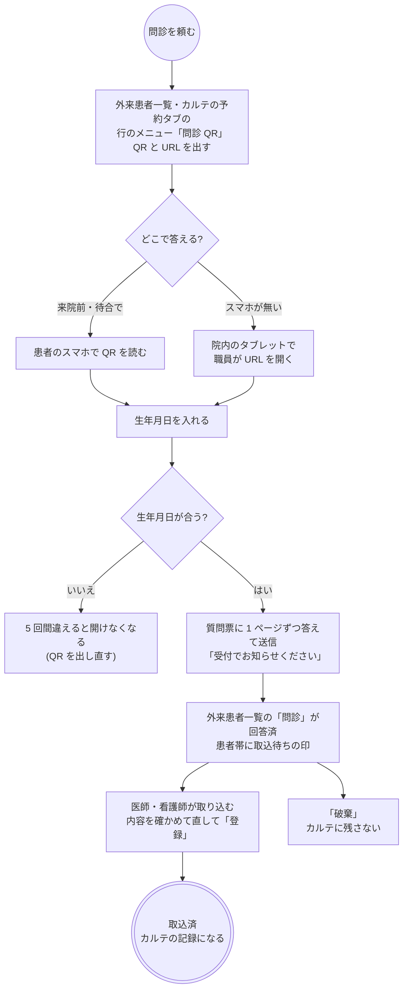

- 質問票は診療科ごとの既定、無ければ施設の既定を使います(施設設定「Web 問診」)。
- QR の有効期限は予約日の翌日の終わりまでです。予約が無ければ発行から施設設定の時間(既定 24 時間)で切れます。QR を出し直すと前の QR は使えなくなります。閉じた QR を同じ QR のままもう一度出すことはできません。
- 患者の答えは取り込むまでカルテに入りません。取り込んだ職員が記入者になり、患者が送信した日時が記入日時になります。
- 患者の画面に氏名は出しません。生年月日の照合だけで開きます。

### 呼出と診察

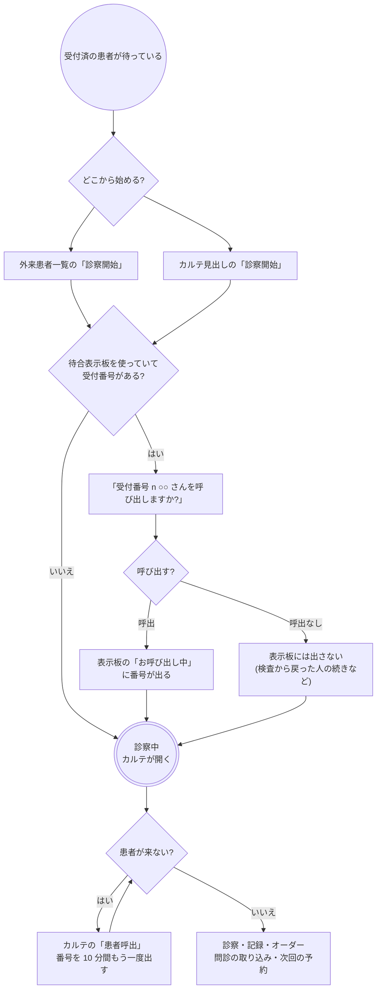

- 診察開始の時刻が診察を始めた時刻として残り、受付からの待ち時間の実測になります(待合表示板の平均待ち時間、データ抽出の「待ち時間(分)」)。
- 待合表示板は診察室ごとに、お呼び出し中の番号(1 人)・お待ちの方(受付番号・予約時間・受付時刻)・離席中の人数・本日の平均待ち時間を出します。患者番号や氏名は出しません。表示板のリンクは施設設定「待合表示板」で発行・取消します。
- 診察開始を誤って押したら、行のメニューの「診察開始取消」で受付済に戻します。

### 検査に回る(一時終了と診察再開)

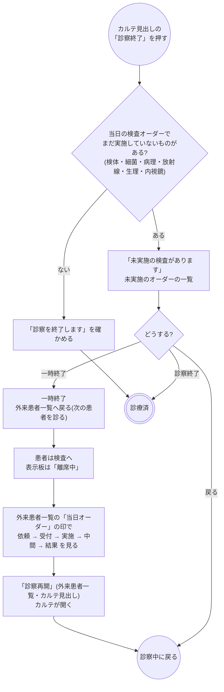

- 一時終了の判定は、カルテ見出しの「診察終了」を押したときに当日のオーダーを読み直して行います。処方・注射・処置などの未実施は聞きません。
- 外来患者一覧の行の「診察終了」は確認を挟まず、その場で診療済にします(検査の残りを確かめずに閉じる入口なので、診察室ではカルテ見出しから終える運用にします)。
- 診察再開で呼び戻すときは、カルテの「患者呼出」で番号を表示板に出します(診察再開そのものは番号を呼び出しません)。
- 一時終了の間に部門の実施や結果が進む様子は、外来患者一覧の「当日オーダー」の印の色と塗りで分かります。

### 診察終了と会計

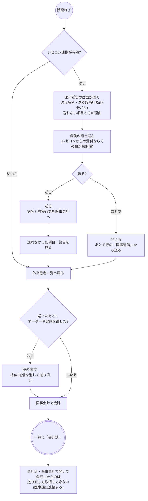

- 会計は**診療日・患者・診療科**の単位です。同じ日に同じ科を 2 回受診しても、送信は 1 回にまとまります。
- 送るのは**実施した記録**です。実施記録の無い部門オーダー、中止したオーダー、持参薬を使う処方は送らず、送れない項目に理由を並べます。初診料・再診料は医事会計の自動算定に任せます。何をどう送るかは種別ごとの文書の「医事会計と SS-MIX2」を読みます。
- 医事送信の画面には、医事会計で会計が済んでいれば請求額・入金額・未収額・点数・負担割合が出ます。
- 外来患者一覧の「会計済」は、レセコン連携が有効なときだけ医事会計に問い合わせて付けます。「自動更新」がオンの端末では一覧と一緒に 1 分ごとに読み直します。
- 「送信取消」で医事会計側の送信を消せます(会計済・医事会計で編集済みのものを除く)。

### 取消

| 取消 | どこから | 何が戻るか |
|---|---|---|
| 予約取消 | 外来患者一覧の行のメニュー・カルテの予約タブ(診察開始の前だけ) | 予約がなくなり、枠が空きに戻る |
| 受付取消 | 外来患者一覧の行のメニュー(受付済で診察開始の前だけ) | 予約済に戻る。受付時刻と受付番号は外れる |
| 未来院取消 | 外来患者一覧の行のメニュー | 予約済に戻る |
| 診察開始取消 | 外来患者一覧の行のメニュー(診察中・一時終了) | 受付済に戻る。診察の記録は誤りとして残り、どこにも出ない |
| 診察終了取消 | 外来患者一覧の行のメニュー(診療済) | 診察中に戻る |
| 送信取消 | 医事送信の画面 | 医事会計側の送信が消える。カルテの記録は変わらない |
| レセコン側の受付取消 | レセコン | カルテの受付が取消になる。診察が始まっていれば取り消さない |

- 診察が始まった受付は、受付取消も予約取消もできません。先に診察開始を取り消します。
- 診察終了取消では、医事会計に送った内容は消えません。直したあとで送り直します。
- 取消はどれも確認だけで、理由は残しません。

### ほかの画面とのつながり

| 画面 | 外来の使い方 |
|---|---|
| 外来患者一覧(`/outpatients`) | 診察日の受付を予約時間の順に並べる。状態ごとの件数、診療科・担当医・診察室・状態の絞り込み、注意のピクトグラム、当日オーダーの印、問診の状態、会計済 |
| 待合表示板(`/board/<token>`) | ロビーのモニター。診察室ごとの呼出番号・お待ちの方・離席中・平均待ち時間。ログイン無しで開く |
| カルテ | 見出しの「診察開始」「診察終了」「診察再開」、右ボタン列の「患者呼出」、右ペインの「予約登録」、予約タブ、問診の取込 |
| 予約枠(`/schedules`) | 枠表と枠の作成・停止。祝日・休診日を除いた一括生成 |
| 施設設定 | 待合表示板のリンク、Web 問診の質問票と有効時間、医事会計に送るコード |
| 部門のワークリスト | 一時終了の間に検査を受け付け・実施する。結果は外来患者一覧の印に戻る |
| データ抽出 | 「入院・外来」タブで外来の診察 1 件 1 行。待ち時間(分)の平均・中央値 |
| 通知 | 外来の流れそのものは通知を出さない。結果の確認やパニック値は各種別の通知に乗る |

## 開発者向け

### リソースの構成

| もの | リソース | 要点 |
|---|---|---|
| 予約枠 | `Schedule`(`actor` = 医師・診察室、`specialty` = 診療科)+ `Slot`(`free` / `busy` / `busy-unavailable`) | 診察の枠表は種別「診察」(`scheduleType="consultation"`)。検査の枠表と分けて選ばせる |
| 予約・受付 | `Appointment` | `status` = `booked` → `checked-in` → `fulfilled`(ほか `noshow` / `cancelled`)。`participant[0]` は必ず患者(上流が患者コンパートメントをここから索引する)、続けて医師・診察室。`specialty` = 診療科(SS-MIX2 の診療科コード)、`slot` = 押さえた枠、`reasonReference` = 予約時に添えた病名 |
| 当日受付 | `Appointment`(`appointmentType` = `WALKIN`) | 枠を持たない。`checked-in` の予約は app-3 で `start` / `end` が必須なので、受付時刻から 15 分の名目の時間を入れる |
| 受付時刻 | 拡張 `appointment-checked-in-at` | 当日受付の `start` は名目なので、受付時刻は必ずここから読む |
| 受付番号 | `Appointment.identifier`(system `http://fhir-client.local/identifier/reception-number`) | backend の日別カウンタ(`reception_number_counters`)が払い出す。レセコン連携の受付はレセコンの受付 ID |
| 初再診 | 拡張 `appointment-visit-kind`(`first` / `revisit`) | 未選択は拡張ごと持たない(医事会計に任せる) |
| 保険の組 | 拡張 `reception-coverage-set` | レセコン連携の受付だけが持つ。医事送信の初期値 |
| レセコンの受付キー | `Appointment.identifier`(レセコンの受付の system、「日付:ID」) | 条件付き PUT の突き合わせキー |
| 表示板の呼出 | 拡張 `appointment-board-called-at`(予約)、`outpatient-board-call`(診察、`valueBoolean` false) | 呼出は時刻の上書きだけで状態は変えない。「呼出なし」の診察にだけ false を付ける |
| 診察 | `Encounter`(`class` = v3-ActCode `AMB`) | `status` = `in-progress` / `onleave` / `finished` / `entered-in-error`、`appointment` = 受付、`period` = 診察開始・終了、`participant` = 担当医(`ATND`)、`location[0]` = 診察室、`statusHistory` = 一時終了などの過ぎた期間 |
| Web 問診の回答 | backend の `intake_links` / `intake_responses` → 取込で `QuestionnaireResponse` | 取込まで上流に書かない。取込の回答は拡張 `intake-source` = `patient`、`authored` = 患者の送信日時 |
| 当日オーダーの進み | 各種別のヘッダ `ServiceRequest` + `Task`・`DiagnosticReport`・`Procedure` | 外来患者一覧が `occurrence` = 診察日で読み、印の段階にする |
| 会計 | レセコン側 | カルテは控えを持たない。送信済み・会計済はそのつどレセコンに訊く |

- 外来の診察は診療科(`serviceProvider`)を持ちません。受付の `specialty` は SS-MIX2 の診療科コードだけで Organization の id が引けないためで、診療科の表示と会計の診療科は受付から読みます。
- 診察は診察開始で初めて建ちます。予約・受付の段階では `Encounter` はありません。
- 外来患者一覧は `Appointment?date={日}&status:not=cancelled,entered-in-error&_include=Appointment:patient&_revinclude=Encounter:appointment` の 1 本で読みます(500 件 × 2 ページまで。超えたら `truncated`)。検査予約(`basedOn` あり)は検索で落とせないので画面で外します(`isExamAppointment`)。

### 状態の持ち方

| 表示 | `Appointment.status` | 診察 `Encounter.status` | 判定 |
|---|---|---|---|
| 予約済 | `booked` | なし | `appointment.status` |
| 受付済 | `checked-in` | なし | 同上 |
| 診察中 | `checked-in` | `in-progress` | 擬似コード `in-exam`(`outpatientStatusCode`) |
| 一時終了 | `checked-in` | `onleave` | 擬似コード `exam-paused` |
| 診療済 | `fulfilled` | `finished` | `appointment.status` |
| 未来院 | `noshow` | なし | 同上 |
| 取消 | `cancelled` | なし | 一覧の検索で落とす |

- 同じ受付に診察が複数あれば、`entered-in-error` を除き、診察開始(同時刻なら更新時刻)の新しいものを採ります(`latestExamByAppointment`、待合表示板の backend も同じ規則)。
- 一時終了・診察再開は `statusHistory` に過ぎた期間を積みます(`withStatusChange`)。受付は `checked-in` のまま触りません。
- 診察終了は `Encounter` の `finished` + `period.end` + `location[0]` の `completed` と、受付の `fulfilled` を**同じ transaction** で書きます。診察終了取消はその逆(`in-progress`、`period.end` を消す、`location[0]` を `active`、受付を `checked-in`)です。
- カルテ見出しのボタンは今日の受付済の受付とその診察から決めます(`usePatientTodayOutpatient`)。過去の日に閉じ忘れた診察は見出しに出ないので、外来患者一覧で日付を戻して閉じます。
- 楽観ロック: 受付・診察の書き換えはどれも transaction で、`postBundle` が読んだ版を `ifMatch` に添えます。2 台で同じ受付を操作すると後の方が 412 で止まります。予約は枠を読んだ版で `busy` にするので、同じ空き枠の取り合いも 412 で止まります。

### シーケンス図の前提

`/fhir` への書き込みは backend の `FhirProxyController` が上流へ中継します。予約と枠、診察と受付のように一緒に動くものは 1 本の transaction Bundle に載せます。受付番号・待合表示板・Web 問診・会計送信は backend の独自 API で、それぞれ `/waiting_board/*`・`/intake/*`・`/integrations/receipt/*` です。
SS-MIX2 を有効にしている施設では、中継が書き込みの控えを記録し(`Ssmix2::Recorder`)、受付になった `Appointment` から ADT を組みます。

| 部品 | 場所 |
|---|---|
| 画面 | `pages/OutpatientListPage.tsx`(一覧・行のボタンとメニュー・ドロワー)、`pages/KartePage.tsx`(見出しの診察ボタン)、`pages/WaitingBoardPage.tsx`、`pages/IntakePage.tsx`、`pages/Schedule*Page.tsx` |
| モーダル・パネル | 当日受付 `WalkInCheckInModal.tsx`、新患登録 `NewPatientCheckInModal.tsx`、受付の編集 `OutpatientReceptionModal.tsx`(`ReceptionFields.tsx`)、呼出の確認 `ExamStartCallModal.tsx`、患者呼出 `PatientCallModal.tsx`、一時終了の選択 `ExamFinishChoiceModal.tsx`、医事送信 `BillingSendModal.tsx`、問診 QR `IntakeQrModal.tsx`、問診の取込 `IntakeReviewPanel.tsx`、予約 `AppointmentPanels.tsx`(`AppointmentSlotPicker.tsx`) |
| 組み立て | `fhir/appointmentHelpers.ts`(予約・当日受付・受付時刻・受付番号・初再診・取消・日時変更)、`fhir/outpatientEncounterHelpers.ts`(診察・状態の合成)、`fhir/outpatientOrderProgressHelpers.ts`(当日オーダーの印・未実施の検査)、`fhir/coverageHelpers.ts`(保険の組)、`fhir/scheduleHelpers.ts` |
| hook | `api/queries/outpatient.ts`(`useOutpatientList` / `useOutpatientOrders` / `useUpdateAppointmentStatus` / `useWalkInCheckIn` / `useStartOutpatientExam` / `useUpdateOutpatientExam` / `useUpdateOutpatientReception` / `useCallOutpatient` / `usePatientTodayOutpatient`)、`api/queries/appointment.ts`(`useBookAppointment` / `useCancelAppointment` / `useRescheduleAppointment`)、`api/queries/schedule.ts`、`api/receiptClient.ts` |
| backend | `WaitingBoard::StaffController`(受付番号・リンク)・`WaitingBoard::Snapshot`、`Intake::StaffController`・`Intake::PublicController`、`Integrations::Receipt::BillingsController`・`ReceiptComputer::BillingSender`、`ReceiptComputer::ReceptionImporter` |

### シーケンス図: 予約・受付・当日受付・新患登録

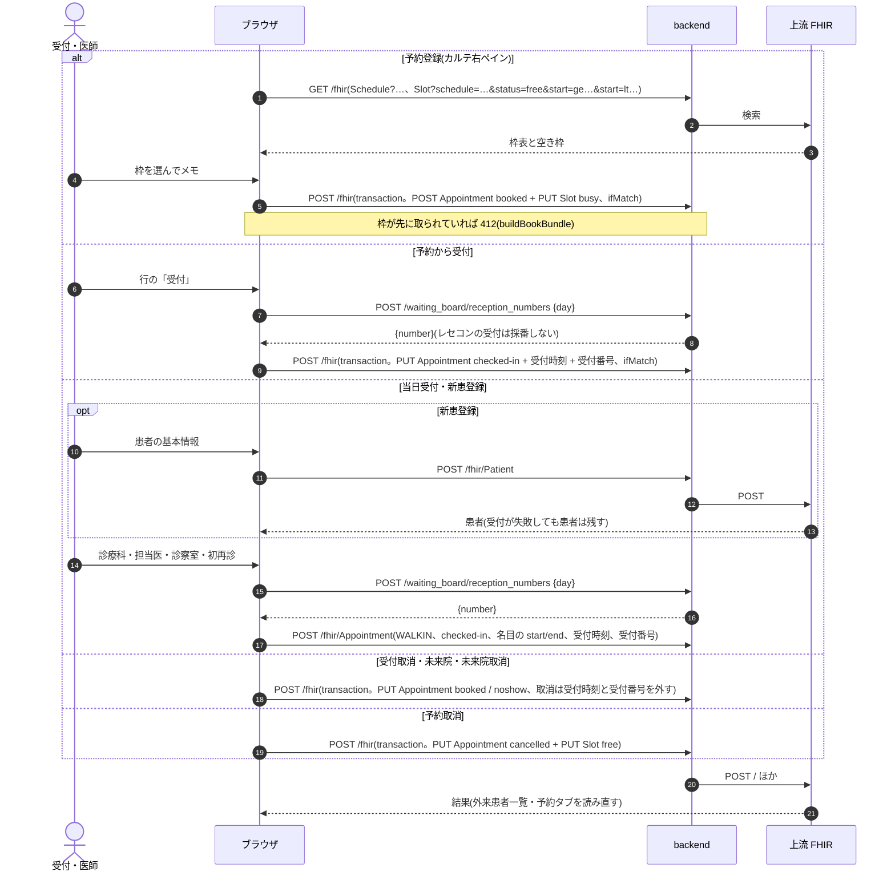

レセコン連携の受付は、院内エージェントがレセコンの通知を中立の形にして `POST /integrations/receipt/events`(`reception.created` / `.updated` / `.canceled`)に送ります。`ReceptionImporter` が受付キーの identifier で条件付き PUT(`WALKIN`・`checked-in`・レセコンの受付番号・保険の組)し、取消は診察(`Encounter?appointment=`)が無いときだけ `cancelled` にします。同じ患者の通知は `pg_advisory_xact_lock` で直列にします。

### シーケンス図: Web 問診

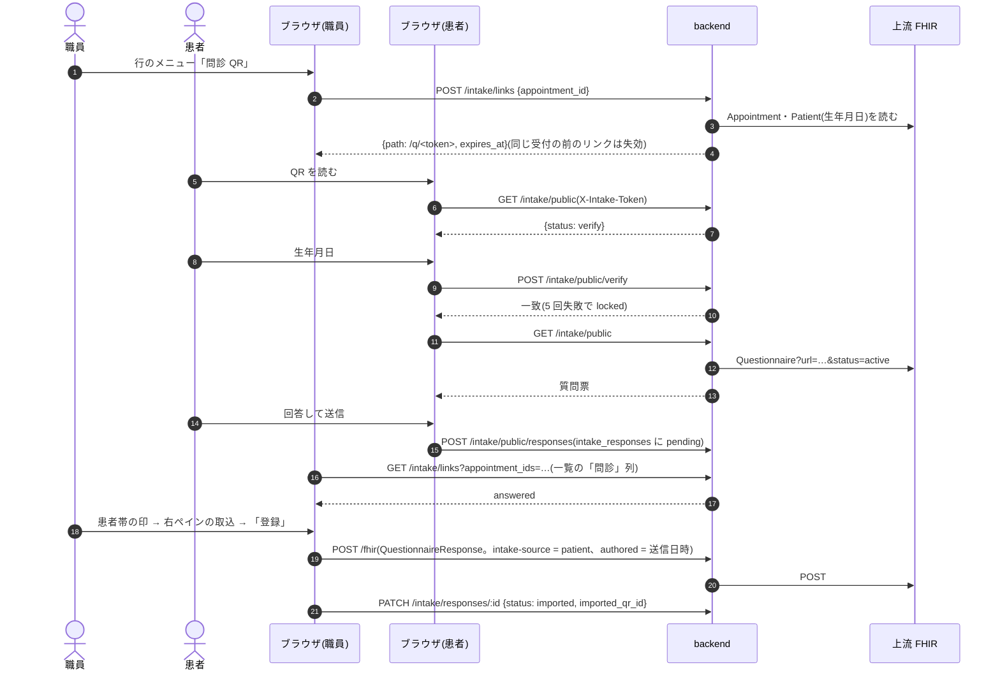

### シーケンス図: 診察開始・呼出・一時終了・診察終了

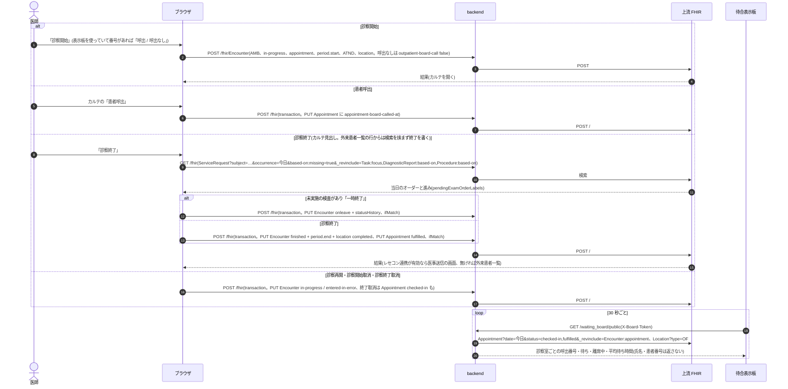

### シーケンス図: 医事送信・会計済

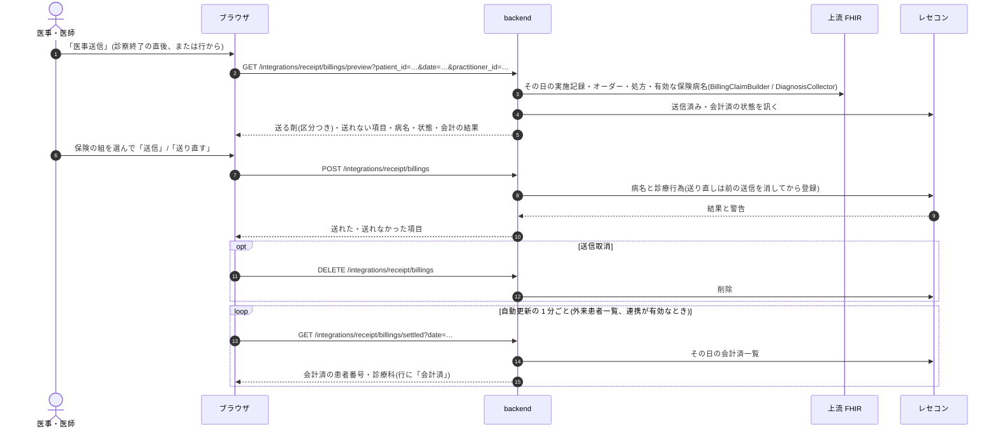

### 医事会計と SS-MIX2

医事会計に送るのは医事送信の画面で送った内容だけで、受付・診察の出来事そのものは送りません(診察開始の時刻は送信のときに実施時刻として添えます)。外来の診察(`class` = `AMB`)は SS-MIX2 の ADT を起こさず、受付だけが `ADT^A04` を出します。

| 起きたこと | 医事会計 | SS-MIX2 |
|---|---|---|
| 予約登録・日時変更・予約取消 | なし | なし |
| 受付(予約から・当日受付・新患登録・レセコンからの受付) | なし | `ADT^A04`(ADT-12、PV1-44 受付日時、PV1-7 担当医)。受付済のまま担当医などを変えた更新では出さない |
| 新患登録の患者登録 | なし(レセコン連携では患者はレセコンが正本) | `ADT^A08`(ADT-00) |
| 受付取消・未来院 | なし | なし(A04 の取り消しは出さない) |
| 診察開始・一時終了・診察再開・診察終了と各取消 | なし | なし |
| 患者呼出 | なし | なし |
| Web 問診の取込 | なし | なし |
| 医事送信 | 病名と、その日の診療行為(実施記録から組んだ剤)。初再診料は医事会計の自動算定 | なし |
| 送り直し / 送信取消 | 前の送信を消して登録し直す / 消す | なし |
| 診察中に出したオーダー | 各種別の実施記録として医事送信に乗る | 各種別のメッセージ(処方 `RDE^O11`、検体検査 `OML^O33` など) |
