# 外来の受付から会計までの業務フロー

外来受診を追う流れです。予約枠の準備と予約から始まり、来院・受付・問診・呼出と診察、検査への回り、診察終了、レセコン(医事会計のシステム)への送信と会計済の確認までを扱います。
外来は、1 回の受診を外来患者一覧の 1 行として扱います。予約から来た受診も、予約なしで来た受診(当日受付・新患登録・レセコンからの受付)も、同じ 1 行になります。
診察中に出すオーダーは、それぞれの種別の流れに乗ります([処方](prescription.md)、[検体検査](lab.md)、[放射線検査](rad.md)など)。オーダーの中身は各種別のページに任せ、ここでは検査のあいだ診察を一時終了する扱いだけを書きます。

医療機関の運用を検討する人は「運用フロー」、院内の開発者は「開発者向け」を読みます。
画面のふるまいは [features/outpatient.md](../features/outpatient.md) とカルテの見出し([features/karte.md](../features/karte.md))、受付番号と待合表示板は [waiting-board-design.md](../waiting-board-design.md)、Web 問診は [web-intake-design.md](../web-intake-design.md)、会計送信は [receipt-billing-design.md](../receipt-billing-design.md) とレセコン連携の [receipt-computer-integration.md](../receipt-computer-integration.md)、SS-MIX2 は [ssmix2-export-design.md](../ssmix2-export-design.md) が正典です。

## 運用フロー

### 全体の流れ

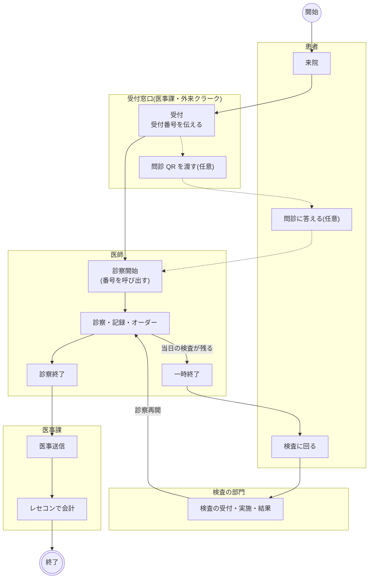

| 段 | 行うこと |
|---|---|
| 来院の前 | 予約を取る(前回の診察の最後、電話を受けたとき)。予約なしでも来院できる |
| 受付 | 予約のある患者は「受付」、予約のない患者は「当日受付」、初めての患者は「新患登録」 |
| 問診(任意) | 患者が自分のスマホか院内のタブレットで答え、医師か看護師がカルテに取り込む |
| 待つ | 患者は待合で受付番号が呼ばれるのを待つ |
| 診察・記録・オーダー | 問診の取り込み、次回の予約もここで行う |
| 診察再開 | 検査の結果を見て説明する |
| 医事送信 | 診療行為と病名をレセコンへ送る |
| レセコンで会計 | 会計が済むと、外来患者一覧に「会計済」と出る |

この文書で使う呼び名は次のとおりです。

- **レセコン**: 医事会計のシステムです。会計はレセコンで行い、カルテからは診療行為と病名を送ります。
- **レセコン連携**: カルテとレセコンをつなぐ設定です。有効にしている施設だけ、医事送信と「会計済」の表示が使えます。
- **受付**: 来院した患者を受け付ける操作です。部署は「受付窓口」、検査の部門が検査を受け付けることは「検査の受付」と書き分けます。
- **医事送信**: 診療行為と病名をレセコンへ送る操作です。
- **カルテの右ペイン**: カルテの右側のオーダー入力の欄です。
- **行のメニュー**: 外来患者一覧の行の「︙」のメニューです。

運用の前提は次のとおりです。

- **役割**: 役割の分け方は運用で決めます。システムの権限で止めている操作はありません。受付・診察開始・診察終了・医事送信は、どの職種のログインでもできます。
- **同じ一覧**: 受付窓口・診察室・会計の端末が、同じ外来患者一覧を見ます。
- **自動更新**: 「自動更新」をオンにした端末は、1 分ごとに一覧を読み直します。オンにするかどうかは端末ごとに決めます。
- **医事送信の時期**: 医事送信は診察終了を待たずに送れます。受付済のあと、行のメニューの「医事送信」から送ります。

### 外来の状態

| 状態 | 意味 | 変わるきっかけ |
|---|---|---|
| 予約済 | 来院の予定がある | 予約登録 |
| 受付済 | 来院して受付が済み、診察を待っている | 受付、当日受付、新患登録、レセコンからの受付 |
| 診察中 | 診察室で診ている | 診察開始、診察再開 |
| 一時終了 | 検査などで診察室を離れている | 「診察終了」を押して「一時終了」を選ぶ |
| 診療済 | 診察が終わった | 診察終了 |
| 未来院 | 予約の日に来なかった | 未来院 |
| 取消 | 予約がなくなった | 予約取消、レセコンでの受付の取消 |

状態ごとの見え方は次のとおりです。

| 状態 | 外来患者一覧の行 | 待合表示板 |
|---|---|---|
| 予約済 | 予約時間の順に並ぶ。「受付」が出る | 出ない |
| 受付済 | 受付時間・受付番号・待ち時間が入る。「診察開始」が出る | 「お待ちの方」 |
| 診察中 | 「診察終了」が出る | 「お呼び出し中」 |
| 一時終了 | 「診察再開」が出る | 「検査などで離席中」 |
| 診療済 | 「医事送信」が出る | 出ない |
| 未来院 | 一覧に残る | 出ない |
| 取消 | 一覧に出ない | 出ない |

- **カルテの見出し**: 診察中は「診察終了」、一時終了の間は「診察再開」が、カルテの見出しにも出ます。
- **診療済の行**: 「医事送信」はレセコン連携が有効なときだけ出ます。会計が済むと「会計済」が付きます。
- **未来院**: 予約日の当日以降に、行のメニューから付けられます。予約の枠は空きません。
- **同じ日の複数の受診**: 1 日に同じ患者の受診が複数あってもかまいません(午前は内科、午後は眼科など)。一覧では受診ごとに 1 行です。
- **検査の予約**: 放射線・生理検査・内視鏡などのオーダーに付く予約は、外来患者一覧には出ません。検査の部門の一覧で追います。

### 予約

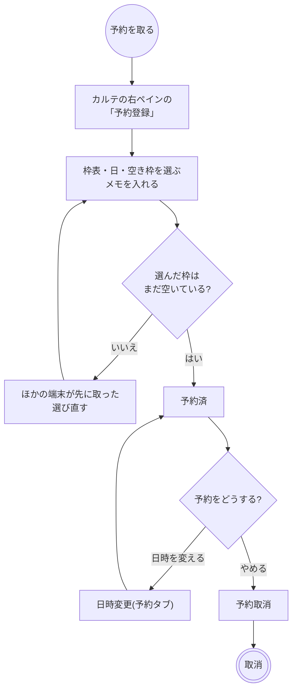

- **予約を取る場面**: 診察の最後に次回の予約を取るときも、電話を受けて取るときも、カルテの右ペインの「予約登録」を使います。診察中なら病名を添えられます。
- **同じ枠は 1 人だけ**: 同じ枠を 2 人が取ることはありません。後から確定した方が止まるので、選び直します。
- **日時変更**: カルテの予約タブから行います。前の枠は空き、新しい枠を押さえます。
- **予約取消**: カルテの予約タブか外来患者一覧から行います。枠は空きに戻ります。
- **担当医と診察室**: 予約日・予約時間・担当医・診察室は、選んだ枠表から決まります。当日に担当医が替わる、別の診察室に回すなどの変更は、行のメニューの「編集」で行います。
- **患者からの予約**: 患者が自分で Web から予約を取る機能はありません。

予約枠は、外来を始める前に設定する人が作っておきます。

- **枠表**: 「予約枠」メニューで、診療科・医師・診察室ごとの枠表を作ります。
- **枠の作成**: 曜日・時間・枠の長さを決めて、一括で作ります。祝日と休診日は除かれます。
- **枠の停止**: カレンダーで枠を止めたり消したりできます。
- **種別**: 外来の診察の枠表は種別「診察」にします。検査の枠表(CT 室・内視鏡室など)とは分けます。

### 受付

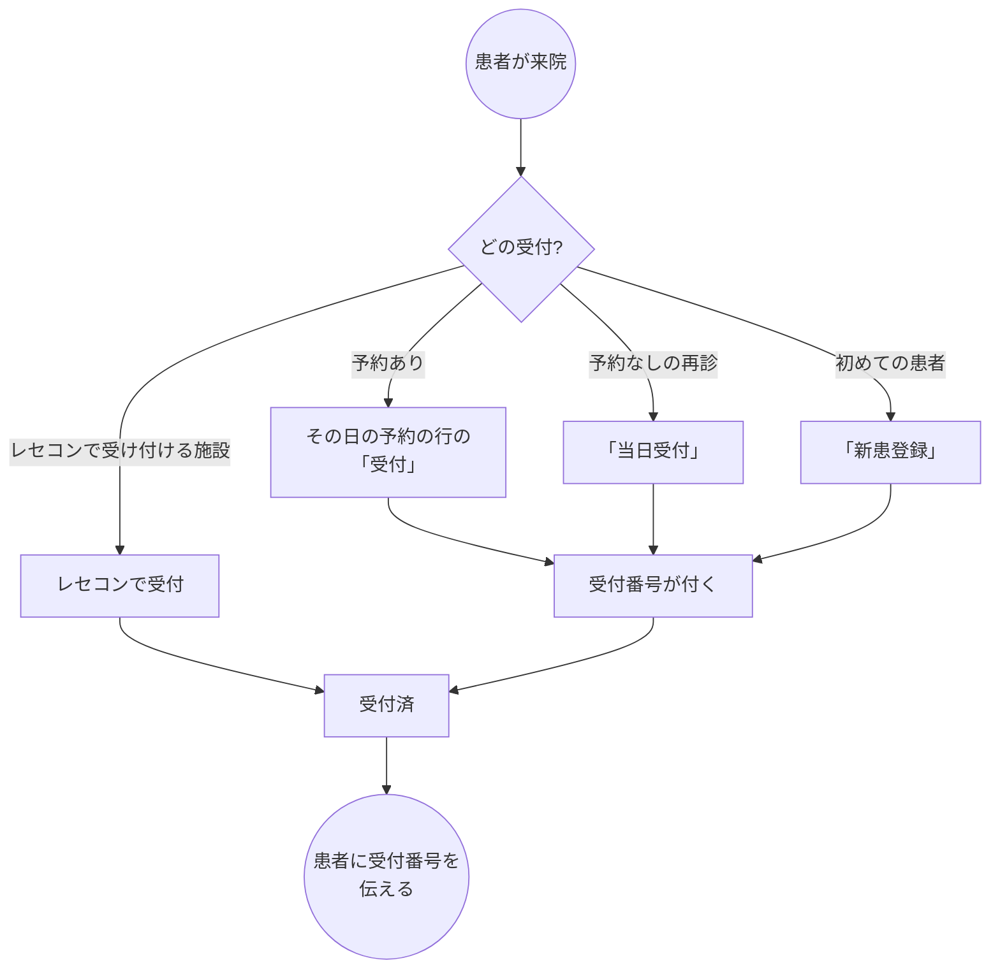

| 受付 | 入れるもの |
|---|---|
| 「受付」 | なし(押すだけ) |
| 「当日受付」 | 患者を探して選ぶ。診療科・担当医・診察室・初再診 |
| 「新患登録」 | 患者の基本情報・住所・連絡先。診療科・担当医・診察室。初再診は初診が選ばれている |
| レセコンで受付 | レセコンで受け付けると、同じ内容がカルテに入る |

- **受付番号**: 受付のたびに、その日の連番が付きます。待合表示板の呼出番号になります。レセコンからの受付は、レセコンの番号を使います。
- **受付番号は飛ぶことがあります**: 受付に失敗したときと、受付を取り消して受付し直したときです。番号の連続に意味を持たせない運用にします。
- **初再診**: 「初診」「再診」から選びます。選ばなければ、判定はレセコンに任せます。
- **保険の組**: 請求に使う保険と公費の組み合わせです。レセコンからの受付には保険の組が付いていて、医事送信のときに初めから選ばれています。カルテで受付したときは、医事送信の画面で選びます。
- **編集**: 行のメニューの「編集」で、診療科・担当医・診察室・初再診を直せます。
- **受付取消**: 受付を誤ったときは、行のメニューの「受付取消」で予約済に戻します。診察開始の前だけできます。受付時刻と受付番号は外れます。
- **未来院**: 予約の日に来なかった予約は、行のメニューの「未来院」にします。取消と違って予約は残ります。遅れて来たら「未来院取消」で予約済に戻してから受付します。
- **新患登録が途中で失敗したとき**: 患者の登録は通り、受付だけが失敗することがあります。患者の登録は残るので、作り直さずに「当日受付」で受け付けます。

#### レセコン連携を使う施設

- **受付はレセコンで行います**: レセコンで受け付けると、同じ内容の受付がカルテに入ります。
- **取消もレセコンで行います**: レセコンで受付を取り消すと、カルテの受付も取消になります。診察が始まった受付は取消になりません。
- **カルテからは受け付けない運用にします**: 連携中にカルテからも受付すると、受付番号がレセコンの番号と重なることがあります。
- **レセコンが使えないとき**: レセコンが止まっているときと時間外は、カルテの「当日受付」が使えます。

### Web 問診

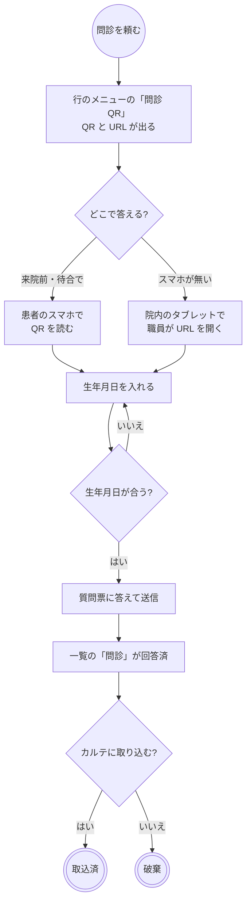

- **QR を出す場所**: 外来患者一覧の行のメニューと、カルテの予約タブの行のメニューです。
- **本人の確認**: 患者の画面に氏名は出しません。生年月日が合えば開きます。5 回間違えると開けなくなるので、QR を出し直します。
- **回答**: 質問票に 1 ページずつ答えて送信します。送信すると「受付でお知らせください」と出ます。
- **取り込み**: 回答があると、カルテの患者帯に取込待ちの印が出ます。医師か看護師が内容を確かめ、直してから「登録」します。
- **取り込むまでカルテに入りません**: 取り込んだ職員が記入者になり、患者が送信した日時が記入日時になります。
- **破棄**: 「破棄」を選ぶと、回答はカルテに残りません。
- **設定する人へ**: 質問票は「施設設定」の「Web 問診」で決めます。診療科ごとの質問票があればそれを、無ければ施設の質問票を使います。

QR の有効期限は次のとおりです。

| 場合 | 期限 |
|---|---|
| 予約がある | 予約日の翌日の終わりまで |
| 予約がない | 発行から、施設設定の時間(初めは 24 時間)まで |
| QR を出し直した | 前の QR は使えなくなる |

- QR の画面を閉じると、同じ QR をもう一度出すことはできません。もう一度開くと、新しい QR になります。

### 呼出と診察

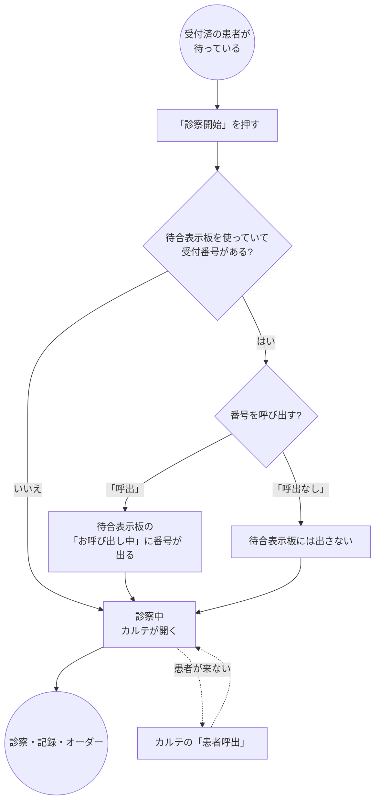

- **診察開始の場所**: 外来患者一覧の行の「診察開始」か、カルテの見出しの「診察開始」です。
- **呼出の確認**: 待合表示板を使っていて受付番号があると、「受付番号 n ○○ さんを呼び出しますか?」と出ます。
- **「呼出なし」**: 検査から戻った患者の続きなど、番号を出さずに診察だけを始めるときに選びます。
- **患者呼出**: カルテの「患者呼出」を押すと、番号を 10 分間もう一度待合表示板に出します。
- **待ち時間**: 診察開始の時刻が診察を始めた時刻として残り、受付からの待ち時間の実測になります。待合表示板の平均待ち時間と、データ抽出の「待ち時間(分)」に使います。
- **診察開始を誤ったとき**: 行のメニューの「診察開始取消」で受付済に戻します。

待合表示板は、診察室ごとに次のものを出します。患者番号と氏名は出しません。

| 出るもの | 中身 |
|---|---|
| お呼び出し中 | 番号 1 人ぶん |
| お待ちの方 | 受付番号・予約時間・受付時刻 |
| 検査などで離席中 | 人数 |
| 本日の平均待ち時間 | 受付から診察開始までの平均 |

- **設定する人へ**: 待合表示板のリンクは「施設設定」の「待合表示板」で発行し、取り消します。

### 検査に回る(一時終了と診察再開)

診察終了の入口は 2 つあります。カルテの見出しの「診察終了」は、未実施の検査を確かめてから終えます。外来患者一覧の行の「診察終了」は、確かめずにその場で診療済にします。
診察室では、カルテの見出しから終える運用にします。

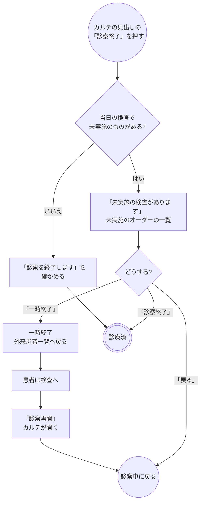

- **確かめる検査**: 検体検査・細菌検査・病理検査・放射線検査・生理検査・内視鏡の、当日のオーダーです。処方・注射・処置などの未実施は確かめません。
- **確かめる時点**: 「診察終了」を押したときに、当日のオーダーを読み直して確かめます。
- **一時終了の間**: 医師は外来患者一覧へ戻り、次の患者を診ます。待合表示板では、患者は「検査などで離席中」に数えられます。
- **診察再開**: 外来患者一覧の行か、カルテの見出しの「診察再開」です。
- **呼び戻すとき**: 診察再開は番号を呼び出しません。カルテの「患者呼出」で、番号を待合表示板に出します。

一時終了の間に検査が進む様子は、外来患者一覧の「当日オーダー」の列の印で分かります。印の見方は、列の見出しにカーソルを合わせても出ます。

| 段階 | 印 |
|---|---|
| 依頼 | 枠のみ |
| 受付 | 紫の枠 |
| 実施 | 灰の塗り |
| 中間報告 | 青の枠 |
| 結果 | 青の塗り |

### 診察終了と会計

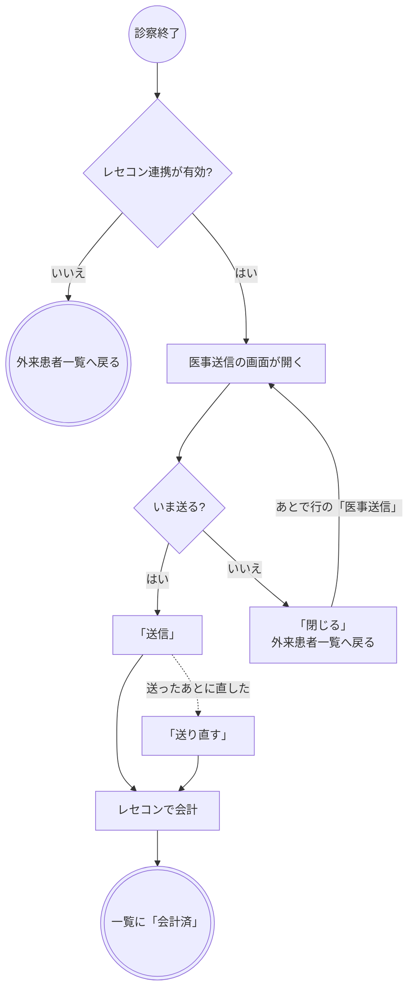

医事送信の画面には、次のものが出ます。

| 出るもの | 中身 |
|---|---|
| 送る病名 | 有効な保険病名 |
| 送る診療行為 | 区分ごとに並ぶ |
| 送れない項目 | 理由が付く |
| 保険の組 | レセコンからの受付なら、その組が初めから選ばれている |
| 会計の結果 | 会計が済んでいれば、請求額・入金額・未収額・点数・負担割合 |

- **レセコン連携が無い施設**: 診察終了で外来患者一覧へ戻り、そこで終わりです。医事送信と「会計済」は出ません。
- **会計の単位**: 会計は診療日・患者・診療科の単位です。同じ日に同じ科を 2 回受診しても、送信は 1 回にまとまります。
- **送るもの**: 実施した記録を送ります。初診料と再診料は、レセコンの自動算定に任せます。
- **送らないもの**: 実施した記録の無い部門オーダー、中止したオーダー、持参薬を使う処方です。送れない項目に理由が並びます。
- **送信のあと**: 送れなかった項目と警告が出るので、確かめます。
- **送り直す**: 送ったあとにオーダーや実施を直したときは、「送り直す」で前の送信を消して送り直します。
- **送信取消**: 「送信取消」で、レセコンに送った内容を消せます。
- **会計済のあとは直せません**: 会計済のものと、レセコンで開いて保存したものは、送り直しも送信取消もできません。医事課に連絡します。
- **「会計済」の表示**: レセコン連携が有効なときだけ、レセコンに問い合わせて付けます。「自動更新」がオンの端末では、一覧と一緒に 1 分ごとに読み直します。

### 取消

| 取消 | どこから | できるとき | 起きること |
|---|---|---|---|
| 予約取消 | 行のメニュー、カルテの予約タブ | 診察開始の前 | 予約がなくなり、枠が空く |
| 受付取消 | 行のメニュー | 受付済で診察開始の前 | 予約済に戻る |
| 未来院取消 | 行のメニュー | 未来院 | 予約済に戻る |
| 診察開始取消 | 行のメニュー | 診察中、一時終了 | 受付済に戻る |
| 診察終了取消 | 行のメニュー | 診療済 | 診察中に戻る |
| 送信取消 | 医事送信の画面 | 会計済でなく、レセコンで保存されていないとき | レセコンに送った内容が消える |
| レセコンでの受付の取消 | レセコン | 診察開始の前 | カルテの受付が取消になる |

- **確認だけ**: 取消はどれも確認だけで、理由は残しません。
- **診察が始まった受付**: 受付取消も予約取消もできません。先に診察開始を取り消します。
- **受付取消**: 受付時刻と受付番号は外れます。当日受付と新患登録の受付も、予約済の行として残ります。
- **診察開始取消**: 取り消した診察は、誤りとして残りますが、どこにも出ません。
- **診察終了取消**: レセコンに送った内容は消えません。直したあとで送り直します。
- **送信取消**: カルテの記録は変わりません。

### ほかの画面とのつながり

| 画面 | 外来に関わる所 |
|---|---|
| 外来患者一覧 | 診察日の受診を予約時間の順に並べる |
| 待合表示板 | ロビーのモニター。ログインなしで開く |
| カルテ | 見出しの診察のボタン、「患者呼出」、「予約登録」、予約タブ、問診の取込 |
| 予約枠 | 枠表と枠の作成・停止 |
| 施設設定 | 待合表示板、Web 問診、レセコンに送るコード |
| 部門のワークリスト | 一時終了の間に、検査を受け付けて実施する |
| データ抽出 | 「入院・外来」タブで、外来の診察 1 件が 1 行 |
| 通知 | 外来の流れそのものは通知を出さない |

- **外来患者一覧に出るもの**: 状態ごとの件数、注意のピクトグラム、当日オーダーの印、問診の状態、「会計済」です。診療科・担当医・診察室・状態で絞り込めます。
- **カルテのボタン**: 見出しに「診察開始」「診察終了」「診察再開」、右のボタン列に「患者呼出」、右ペインに「予約登録」があります。
- **施設設定**: 待合表示板のリンク、Web 問診の質問票と有効時間、レセコンに送るコードを決めます。
- **検査の結果**: 部門で進んだ検査は、外来患者一覧の「当日オーダー」の印に出ます。
- **データ抽出**: 待ち時間(分)の平均と中央値が出ます。
- **通知**: 結果の確認やパニック値の通知は、各種別の流れで出ます。

## 開発者向け

### シーケンス図の前提

- **上流**: backend が中継する先の FHIR サーバーです。ブラウザの `/fhir` への読み書きは、backend の `FhirProxyController` が上流へ中継します。
- **一緒に動くものは transaction**: 予約と枠、診察と受付のように一緒に動くものは、1 本の transaction Bundle に載せます。受付・診察の書き換えはどれも transaction です。
- **新規の 1 件は単発の POST**: 当日受付の `Appointment`、新患登録の `Patient`、診察開始の `Encounter` は、1 件の POST です(`createResource`)。
- **楽観ロック**: `postBundle` が読んだ版を `ifMatch` に添えます。2 台で同じ受付を操作すると、後の方が 412 で止まります。予約は枠を読んだ版で `busy` にするので、同じ空き枠の取り合いも 412 で止まります。
- **図の省略**: 応答は上流から backend を通ってブラウザへ戻りますが、図では上流からブラウザへの 1 本で書きます。同じ形の操作(入力 → transaction 1 回)は図にせず、図の下の表に出します。
- **SS-MIX2**: 有効にしている施設では、中継が書き込みの控えを記録し(`Ssmix2::Recorder`)、受付になった `Appointment` から ADT を組みます。
- **呼び名**: 画面の「医事送信」を、設計文書とコードでは会計送信(billing)と呼びます。

backend の独自 API は次の 3 つです。

| API | パス | 使う場面 |
|---|---|---|
| 待合表示板 | `/waiting_board/*` | 受付番号の採番(`/waiting_board/reception_numbers`)、表示板のリンク、表示板の読み込み |
| Web 問診 | `/intake/*` | QR の発行、患者の回答、取込 |
| レセコン連携 | `/integrations/receipt/*` | 医事送信、会計済の問い合わせ、レセコンからの受付の通知 |

| 操作 | 画面 | 組み立て | hook |
|---|---|---|---|
| 一覧を読む | `pages/OutpatientListPage.tsx` | `fhir/outpatientEncounterHelpers.ts`(状態の合成) | `useOutpatientList`、`useOutpatientOrders` |
| 予約登録・日時変更・予約取消 | `AppointmentPanels.tsx`(`AppointmentSlotPicker.tsx`) | `fhir/appointmentHelpers.ts`、`fhir/scheduleHelpers.ts` | `useBookAppointment`、`useRescheduleAppointment`、`useCancelAppointment` |
| 受付・受付取消・未来院 | `pages/OutpatientListPage.tsx` | `fhir/appointmentHelpers.ts` | `useUpdateAppointmentStatus` |
| 当日受付 | `WalkInCheckInModal.tsx` | `fhir/appointmentHelpers.ts` | `useWalkInCheckIn` |
| 新患登録 | `NewPatientCheckInModal.tsx` | `fhir/appointmentHelpers.ts` | `useCreatePatient`、`useWalkInCheckIn` |
| 受付の編集 | `OutpatientReceptionModal.tsx`(`ReceptionFields.tsx`) | `fhir/appointmentHelpers.ts` | `useUpdateOutpatientReception` |
| 診察開始 | `ExamStartCallModal.tsx`(呼出の確認) | `fhir/outpatientEncounterHelpers.ts` | `useStartOutpatientExam` |
| 患者呼出 | `PatientCallModal.tsx` | `fhir/appointmentHelpers.ts` | `useCallOutpatient` |
| 診察終了・一時終了・再開・取消 | `ExamFinishChoiceModal.tsx`(一時終了の選択) | `fhir/outpatientOrderProgressHelpers.ts` | `useUpdateOutpatientExam` |
| カルテの見出しのボタン | `pages/KartePage.tsx` | `fhir/outpatientEncounterHelpers.ts` | `usePatientTodayOutpatient` |
| 医事送信 | `BillingSendModal.tsx` | `fhir/coverageHelpers.ts`(保険の組) | `api/receiptQueries.ts`(`api/receiptClient.ts`) |
| Web 問診 | `IntakeQrModal.tsx`、`IntakeReviewPanel.tsx`、`pages/IntakePage.tsx` | – | `api/intakeQueries.ts` |
| 待合表示板 | `pages/WaitingBoardPage.tsx` | – | `api/waitingBoardQueries.ts` |
| 予約枠 | `pages/Schedule*Page.tsx` | `fhir/scheduleHelpers.ts` | `api/queries/schedule.ts` |

- 外来の hook は `api/queries/outpatient.ts`、予約の hook は `api/queries/appointment.ts` にあります。
- `fhir/outpatientOrderProgressHelpers.ts` は、当日オーダーの印と未実施の検査を判定します。

| backend の部品 | 役割 |
|---|---|
| `WaitingBoard::StaffController` | 受付番号、表示板のリンク |
| `WaitingBoard::Snapshot` | 表示板に出す内容 |
| `Intake::StaffController`、`Intake::PublicController` | Web 問診の職員側、患者側 |
| `Integrations::Receipt::BillingsController`、`ReceiptComputer::BillingSender` | 医事送信 |
| `ReceiptComputer::ReceptionImporter` | レセコンからの受付の取り込み |

### リソースの構成

受付は `Appointment`、診察は `Encounter` です。診察は診察開始で初めてでき、予約・受付の段階では `Encounter` はありません。

| リソース | 要素 | 中身 |
|---|---|---|
| `Schedule` | `actor`、`specialty` | 予約枠の枠表。医師・診察室と診療科 |
| `Slot` | `status` | `free` / `busy` / `busy-unavailable` |
| `Appointment` | `status` | `booked` → `checked-in` → `fulfilled`。ほかに `noshow` / `cancelled` |
| `Appointment` | `participant` | `participant[0]` は必ず患者。続けて医師・診察室 |
| `Appointment` | `specialty` | 診療科(SS-MIX2 の診療科コード) |
| `Appointment` | `slot` | 押さえた枠 |
| `Appointment` | `reasonReference` | 予約時に添えた病名 |
| `Appointment` | `appointmentType` | 当日受付は `WALKIN`。枠を持たない |
| `Appointment` | 拡張 `appointment-checked-in-at` | 受付時刻 |
| `Appointment` | `identifier`(受付番号) | system `http://fhir-client.local/identifier/reception-number` |
| `Appointment` | `identifier`(レセコンの受付キー) | レセコンの受付の system、「日付:ID」 |
| `Appointment` | 拡張 `appointment-visit-kind` | 初再診。`first` / `revisit` |
| `Appointment` | 拡張 `reception-coverage-set` | 保険の組 |
| `Appointment` | 拡張 `appointment-board-called-at` | 待合表示板に呼び出した時刻 |
| `Encounter` | `class` | v3-ActCode `AMB` |
| `Encounter` | `status` | `in-progress` / `onleave` / `finished` / `entered-in-error` |
| `Encounter` | `appointment` | 受付 |
| `Encounter` | `period` | 診察開始・終了 |
| `Encounter` | `participant` | 担当医(`ATND`) |
| `Encounter` | `location[0]` | 診察室 |
| `Encounter` | `statusHistory` | 一時終了などの過ぎた期間 |
| `Encounter` | 拡張 `outpatient-board-call` | 「呼出なし」の診察にだけ `valueBoolean` false を付ける |
| `QuestionnaireResponse` | 拡張 `intake-source`、`authored` | 取り込んだ Web 問診の回答 |

- **`participant[0]` は患者**: 上流が患者コンパートメントをここから索引するためです。
- **診察の枠表**: 種別「診察」(`scheduleType="consultation"`)です。検査の枠表と分けて選ばせます。
- **当日受付の `start` / `end`**: `checked-in` の予約は FHIR の制約 app-3 で `start` / `end` が必須なので、受付時刻から 15 分の名目の時間を入れます。受付時刻は必ず `appointment-checked-in-at` から読みます。
- **受付番号**: backend の日別カウンタ(`reception_number_counters`)が払い出します。レセコン連携の受付は、レセコンの受付 ID を使います。
- **初再診**: 未選択なら拡張ごと持ちません(判定はレセコンに任せます)。
- **保険の組**: レセコン連携の受付だけが持ちます。医事送信の初期値になります。
- **レセコンの受付キー**: 条件付き PUT の突き合わせキーです。
- **呼出**: 時刻の上書きだけで、状態は変えません。
- **Web 問診の回答**: 取込まで上流に書きません。backend の `intake_links` / `intake_responses` に持ち、取込で `QuestionnaireResponse` にします。取込の回答は `intake-source` = `patient`、`authored` = 患者の送信日時です。
- **当日オーダーの進み**: 各種別のヘッダ(オーダーの親の `ServiceRequest`)と `Task`・`DiagnosticReport`・`Procedure` を、`occurrence` = 診察日で読み、印の段階にします。
- **会計**: レセコン側にあります。カルテは控えを持たず、送信済みと会計済は、そのつどレセコンに訊きます。
- **診察は診療科を持ちません**: 外来の `Encounter` に `serviceProvider` はありません。受付の `specialty` は SS-MIX2 の診療科コードだけで、Organization の id が引けないためです。診療科の表示と会計の診療科は、受付から読みます。

外来患者一覧は次の 1 本で読みます。

```text
Appointment?date={日}&status:not=cancelled,entered-in-error
  &_include=Appointment:patient&_revinclude=Encounter:appointment
```

- 500 件 × 2 ページまで読みます。超えたら `truncated` になります。
- 検査予約(`basedOn` あり)は検索で落とせないので、画面で外します(`isExamAppointment`)。

### 状態の持ち方

| 表示 | `Appointment.status` | 診察 `Encounter.status` | 判定 |
|---|---|---|---|
| 予約済 | `booked` | なし | `Appointment.status` |
| 受付済 | `checked-in` | なし | `Appointment.status` |
| 診察中 | `checked-in` | `in-progress` | 画面で合成する状態コード `in-exam` |
| 一時終了 | `checked-in` | `onleave` | 画面で合成する状態コード `exam-paused` |
| 診療済 | `fulfilled` | `finished` | `Appointment.status` |
| 未来院 | `noshow` | なし | `Appointment.status` |
| 取消 | `cancelled` | なし | 一覧の検索で落とす |

- 状態コードの合成は `outpatientStatusCode` です。診察中・一時終了の間も、受付は `checked-in` のまま触りません。
- 同じ受付に診察が複数あれば、`entered-in-error` を除き、診察開始(同時刻なら更新時刻)の新しいものを採ります(`latestExamByAppointment`、待合表示板の backend も同じ規則)。
- 一時終了・診察再開は `statusHistory` に過ぎた期間を積みます(`withStatusChange`)。
- 診察終了は、`Encounter` の変更と受付の `fulfilled` を**同じ transaction** で書きます。診察終了取消はその逆です。中身は「シーケンス図: 診察開始・呼出・一時終了・診察終了」の表にあります。
- カルテ見出しのボタンは、今日の受付済の受付とその診察から決めます(`usePatientTodayOutpatient`)。過去の日に閉じ忘れた診察は見出しに出ないので、外来患者一覧で日付を戻して閉じます。

### シーケンス図: 予約・受付・当日受付・新患登録

予約登録(カルテの右ペイン)です。

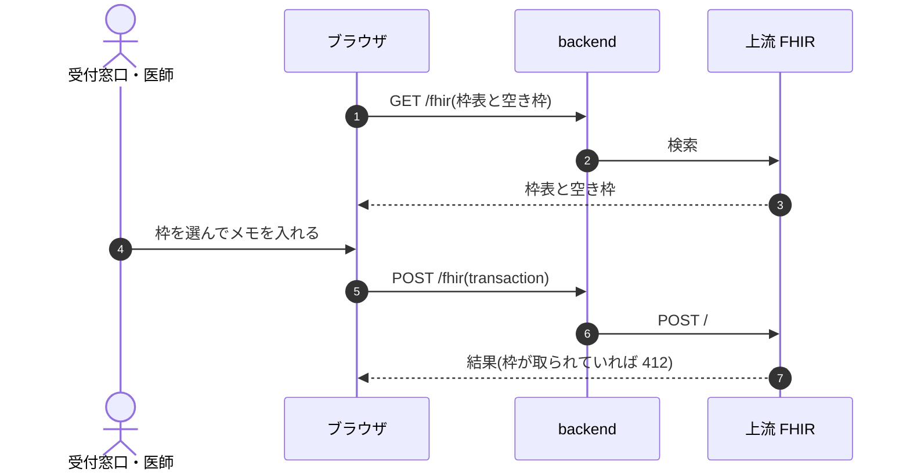

予約からの受付です。

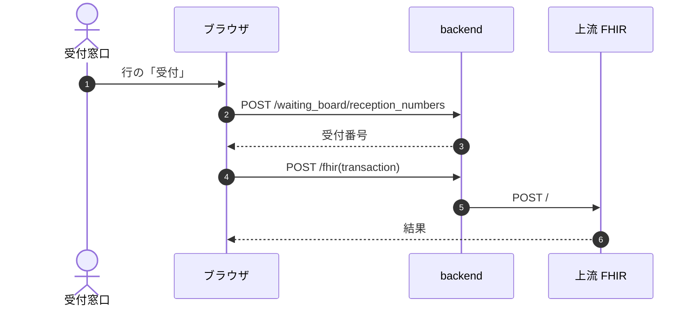

当日受付・新患登録です。

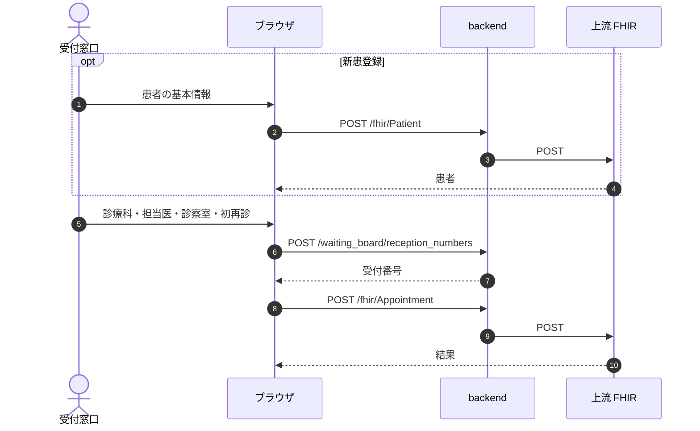

| 操作 | 前に読むもの・採番 | 書くもの |
|---|---|---|
| 予約登録 | `Schedule?…`、`Slot?schedule=…&status=free&start=ge…&start=lt…` | transaction。POST `Appointment`(`booked`)+ PUT `Slot`(`busy`、`ifMatch`)。`buildBookBundle` |
| 日時変更 | 予約の枠 | transaction。PUT `Appointment`(日時と `slot`)+ 前の `Slot` を `free`、新しい `Slot` を `busy`。`buildRescheduleBundle` |
| 予約取消 | 予約の枠 | transaction。PUT `Appointment`(`cancelled`)+ PUT `Slot`(`free`) |
| 予約から受付 | 受付番号(`{day}` を渡して `{number}` を受ける) | transaction。PUT `Appointment`(`checked-in`、受付時刻、受付番号、`ifMatch`) |
| 当日受付・新患登録 | 受付番号 | 単発の POST。`Appointment`(`WALKIN`、`checked-in`、名目の `start` / `end`、受付時刻、受付番号) |
| 受付取消 | – | transaction。PUT `Appointment`(`booked`)。受付時刻と受付番号を外す |
| 未来院・未来院取消 | – | transaction。PUT `Appointment`(`noshow` / `booked`) |

- 新患登録は、先に `Patient` を POST します。受付が失敗しても、患者は残します。
- レセコンの受付は、受付番号を採番しません。
- どの操作も、書いたあとに外来患者一覧と予約タブを読み直します。

#### レセコンからの受付

レセコン連携の受付は、ブラウザを通りません。院内エージェントがレセコンの通知を受け、backend に送ります。

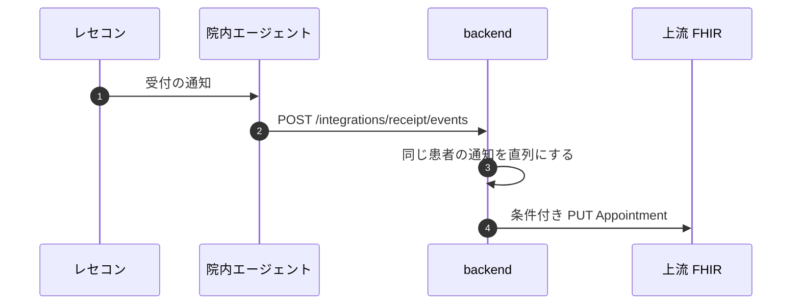

| 通知 | backend(`ReceptionImporter`)がすること |
|---|---|
| `reception.created`、`reception.updated` | 受付キーの `identifier` で条件付き PUT する。`WALKIN`・`checked-in`・レセコンの受付番号・保険の組 |
| `reception.canceled` | 診察(`Encounter?appointment=`)が無いときだけ `cancelled` にする |

- 院内エージェントは、レセコンの通知を中立の形にして送ります。
- 同じ患者の通知は `pg_advisory_xact_lock` で直列にします。

### シーケンス図: Web 問診

QR の発行です。

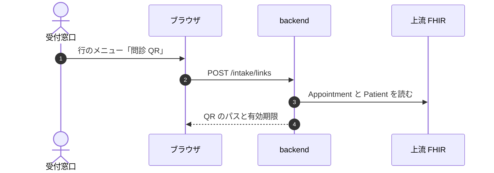

患者の回答です。

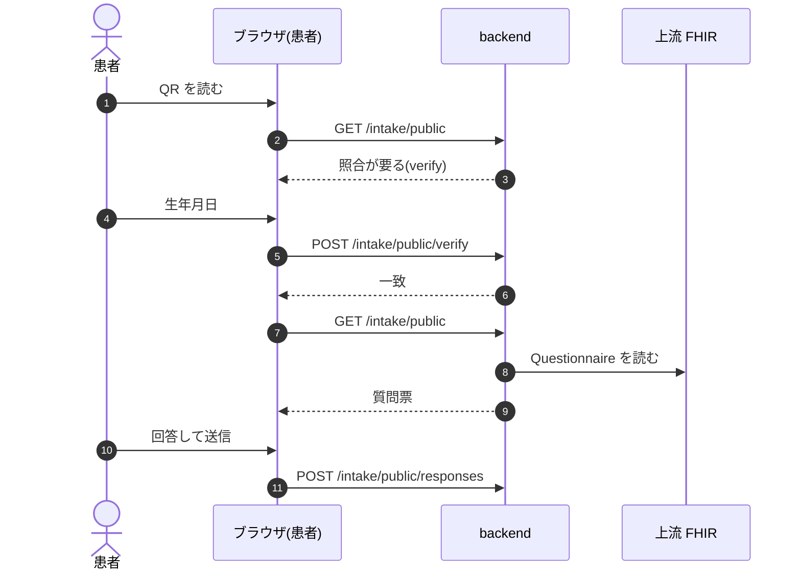

取込です。

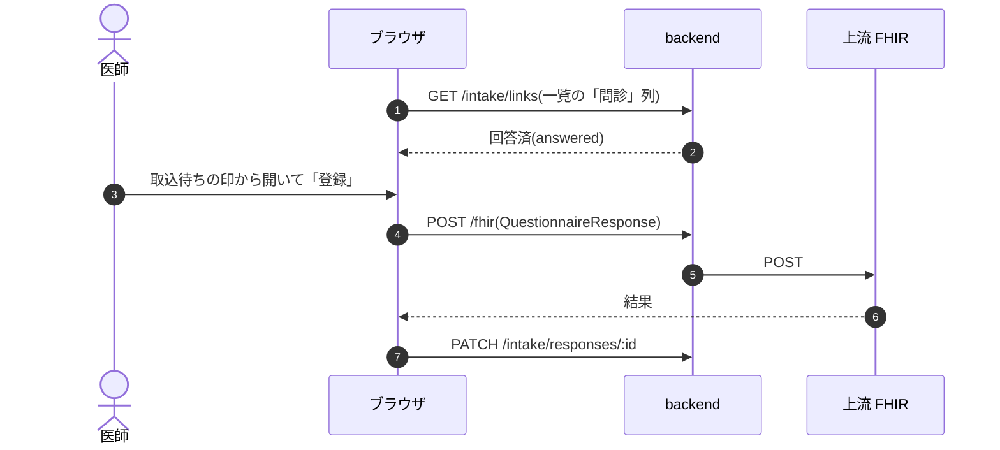

| 呼び出し | 中身 |
|---|---|
| `POST /intake/links` | `{appointment_id}` を渡し、`{path: /q/<token>, expires_at}` を受ける。同じ受付の前のリンクは失効する |
| 発行のときに読むもの | `Appointment` と `Patient`(生年月日) |
| `GET /intake/public` | ヘッダ `X-Intake-Token`。照合の前は `{status: verify}` を返す |
| `POST /intake/public/verify` | 生年月日を照合する。5 回失敗で `locked` |
| 質問票 | `Questionnaire?url=…&status=active` |
| `POST /intake/public/responses` | `intake_responses` に `pending` で保存する |
| `GET /intake/links?appointment_ids=…` | 一覧の「問診」列の状態 |
| 取込の POST | `QuestionnaireResponse`。`intake-source` = `patient`、`authored` = 送信日時 |
| `PATCH /intake/responses/:id` | 取込は `{status: imported, imported_qr_id}`、破棄は `{status: discarded}` |

- 破棄は、上流に書かずに `PATCH` だけを送ります。

### シーケンス図: 診察開始・呼出・一時終了・診察終了

診察開始です。

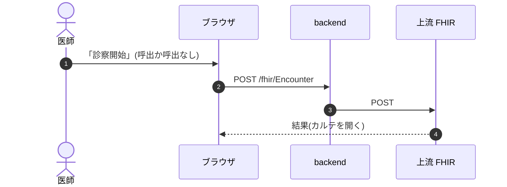

診察終了(カルテの見出しから)です。外来患者一覧の行からは、検索を挟まずに診察終了を書きます。

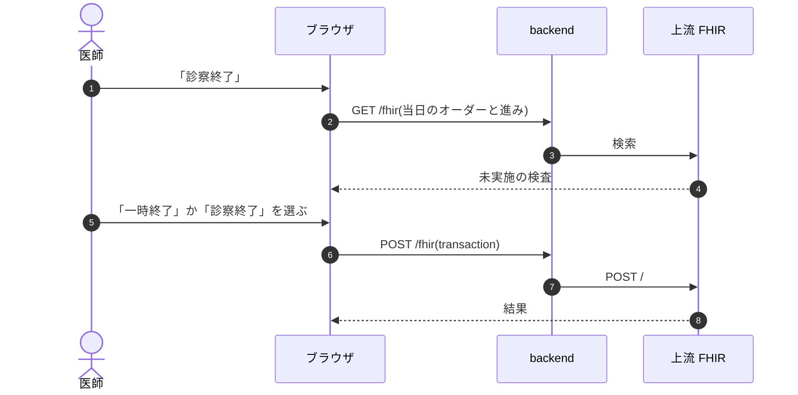

当日のオーダーの検索は次のとおりです。未実施の検査は `pendingExamOrderLabels` で拾います。

```text
ServiceRequest?subject=…&occurrence=今日&based-on:missing=true
  &_revinclude=Task:focus,DiagnosticReport:based-on,Procedure:based-on
```

| 操作 | 書くもの |
|---|---|
| 診察開始 | 単発の POST。`Encounter`(`AMB`、`in-progress`、`appointment`、`period.start`、`ATND`、`location`)。「呼出なし」は `outpatient-board-call` false |
| 患者呼出 | transaction。PUT `Appointment`(`appointment-board-called-at`) |
| 一時終了 | transaction。PUT `Encounter`(`onleave` + `statusHistory`、`ifMatch`) |
| 診察終了 | transaction。PUT `Encounter`(`finished` + `period.end` + `location[0]` を `completed`)と PUT `Appointment`(`fulfilled`)。`ifMatch` |
| 診察再開 | transaction。PUT `Encounter`(`in-progress`) |
| 診察開始取消 | transaction。PUT `Encounter`(`entered-in-error`) |
| 診察終了取消 | transaction。PUT `Encounter`(`in-progress`、`period.end` を消す、`location[0]` を `active`)と PUT `Appointment`(`checked-in`) |

- 診察開始の画面は、待合表示板を使っていて受付番号があれば「呼出 / 呼出なし」を聞きます。
- 診察終了のあとは、レセコン連携が有効なら医事送信の画面を開き、無ければ外来患者一覧へ戻ります。

待合表示板の読み込みです。

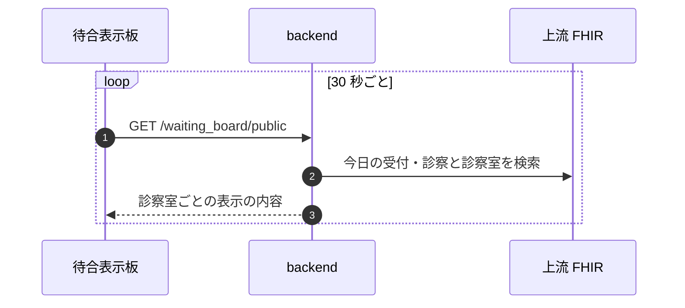

- 表示板はヘッダ `X-Board-Token` を付けて読みます。
- backend の検索は `Appointment?date=今日&status=checked-in,fulfilled&_revinclude=Encounter:appointment` と `Location?type=OF` です。
- 返すのは、診察室ごとの呼出番号・待ち・離席中・平均待ち時間です。氏名と患者番号は返しません。

### シーケンス図: 医事送信・会計済

医事送信です。

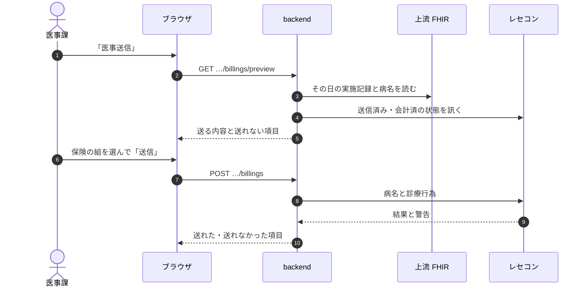

パスの `…` は `/integrations/receipt` です。剤は、レセコンに送る診療行為のまとまりです(実施記録から組みます)。

| 呼び出し | 中身 |
|---|---|
| 「医事送信」を開く場面 | 診察終了の直後、または外来患者一覧の行から |
| `GET /integrations/receipt/billings/preview` | `patient_id`・`date`・`practitioner_id` を渡す |
| backend が上流から読むもの | その日の実施記録・オーダー・処方・有効な保険病名(`BillingClaimBuilder` / `DiagnosisCollector`) |
| preview の応答 | 送る剤(区分つき)・送れない項目・病名・状態・会計の結果 |
| `POST /integrations/receipt/billings` | 「送信」と「送り直す」。送り直しは、前の送信を消してから登録する |
| `DELETE /integrations/receipt/billings` | 送信取消。レセコンの送信を削除する |
| `GET /integrations/receipt/billings/settled?date=…` | その日の会計済の患者番号・診療科。行に「会計済」を出す |

- 会計済の問い合わせは、外来患者一覧で、レセコン連携が有効なときだけ行います。「自動更新」がオンなら 1 分ごとに読み直します。

### 医事会計と SS-MIX2

医事会計に送るのは医事送信の画面で送った内容だけで、受付・診察の出来事そのものは送りません(診察開始の時刻は送信のときに実施時刻として添えます)。外来の診察(`class` = `AMB`)は SS-MIX2 の ADT を起こさず、受付だけが `ADT^A04` を出します。

| 起きたこと | 医事会計 | SS-MIX2 |
|---|---|---|
| 予約登録・日時変更・予約取消 | なし | なし |
| 受付(予約から・当日受付・新患登録・レセコンからの受付) | なし | `ADT^A04`(ADT-12、PV1-44 受付日時、PV1-7 担当医)。受付済のまま担当医などを変えた更新では出さない |
| 新患登録の患者登録 | なし(レセコン連携では患者はレセコンが正本) | `ADT^A08`(ADT-00) |
| 受付取消・未来院 | なし | なし(A04 の取り消しは出さない) |
| 診察開始・一時終了・診察再開・診察終了と各取消 | なし | なし |
| 患者呼出 | なし | なし |
| Web 問診の取込 | なし | なし |
| 医事送信 | 病名と、その日の診療行為(実施記録から組んだ剤)。初再診料は医事会計の自動算定 | なし |
| 送り直し / 送信取消 | 前の送信を消して登録し直す / 消す | なし |
| 診察中に出したオーダー | 各種別の実施記録として医事送信に乗る | 各種別のメッセージ(処方 `RDE^O11`、検体検査 `OML^O33` など) |
