# 病理検査オーダーの業務フロー

病理検査オーダーの登録から採取・ラベル発行・病理受付・レポート・結果確認・患者説明までの流れです。
結果の確認の仕組みは検体検査と同じなので、先に [lab.md](lab.md) を読むと分かりやすくなります。検体検査との違いは、流れを書いた後ろの「検体検査との違い」にまとめます。
組織診・細胞診・術中迅速は 1 つのオーダーの検査区分で分けます。免疫染色の追加依頼・遺伝子検査・剖検はオーダーにありません。標本作製(カセット・スライド)は病理部門システムの領域で、電子カルテには記録しません。

医療機関の運用を検討する人は「運用フロー」、院内の開発者は「開発者向け」を読みます。
設計は [patho-order-design.md](../patho-order-design.md)、画面のふるまいは [features/lab.md](../features/lab.md)「病理検査オーダーの検体個数・容器数と採取」「病理診断レポートの診断医・重要度・追加報告・患者説明」、
種別共通の約束(中止・削除・代行入力)は [features/orders-common.md](../features/orders-common.md)、リソースの要素は実装ガイド(`../fhir-ig`)が正典です。

## 運用フロー

### 検査区分ごとの違い

組織診・細胞診・術中迅速で変わるのは次の項目だけです。状態の進み方とレポートの書き方は、どの区分でも同じです。

| | 組織診 | 細胞診 | 術中迅速 |
|---|---|---|---|
| 検体タイプ | 生検・手術材料 | 細胞診材料 | 生検・手術材料 |
| 至急区分 | 通常が初期値 | 通常が初期値 | 至急が入る(通常に戻せる) |
| 手術室番号 | なし | なし | 入れられる |
| レポートの診断 | 自由文かテンプレート | 判定 5 段階と推定病変 | 自由文かテンプレート |
| 重要度の初期値 | なし | 判定が悪性・悪性疑いなら同じ重要度 | なし |

重要度は、レポートに付ける「悪性疑い」「悪性」の印です。

### 全体の流れ

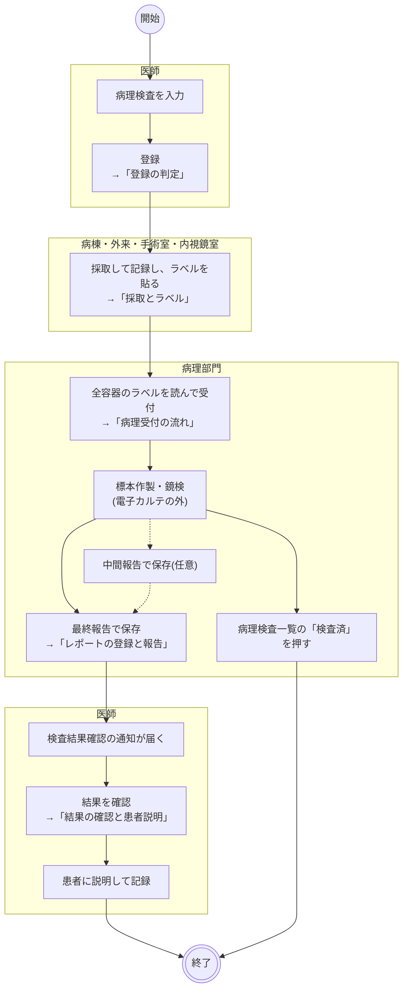

- 「検査済」とレポートは別々に進みます。最終報告を保存しても状態は受付済のままで、レポートが無くても「検査済」を押せます。
- 手術や内視鏡で採る検体も、別に病理検査オーダーを出します。手術オーダーの検体提出予定からは作られません。
- 医師は中間報告の内容をカルテで読めますが、通知は出ず、確認の記録も残せません。

この文書で使う呼び名は次のとおりです。

| 呼び名 | 指すもの |
|---|---|
| 病理検査一覧 | 病理部門の画面「部門業務 > 病理部門 > 病理検査一覧」 |
| 病理受付 | 届いた容器のラベルを読んで受け付ける画面「部門業務 > 病理部門 > 病理受付」 |
| カルテのカード | カルテに出る、そのオーダーのカード |
| 依頼医 | オーダーを指示した医師(画面では「依頼医師」「指示医師」) |
| 確定の報告 | 最終報告・訂正報告・追加報告 |
| 未説明の一覧 | 「診療業務 > 検査結果フォロー」の「患者説明」タブ |

### 病理検査の状態

病理部門の進み具合を示す状態です。レポートの報告区分はこの状態に含めず、病理検査一覧の「レポート」の列で見せます。

| 状態 | 変わるきっかけ | 病理検査一覧からできること |
|---|---|---|
| 依頼済 | 医師の登録、「取消」、「中止取消」 | 「受付」、「受付済にする」、「中止」、「ラベル発行」 |
| 受付済 | 病理受付の「受付」、「受付済にする」、検査済からの「取消」 | 「検査済」、レポート登録・編集、「取消」、「中止」、「ラベル発行」 |
| 検査済 | 病理検査一覧の「検査済」 | レポート登録・編集、「取消」、「ラベル発行」 |
| 中止 | 「中止」 | 「中止取消」 |

似た名前の操作は、次のように違います。

| 操作 | 意味 |
|---|---|
| 「受付」 | 病理受付を開き、全容器のラベルを読んでから受け付ける |
| 「受付済にする」 | ラベルを読まずに受付済にする(ラベルの無い古いオーダー用) |
| 「取消」 | 押し間違いを直すために、1 つ前の状態へ戻す(検査済 → 受付済、受付済 → 依頼済) |
| 「中止」 | 検査を取りやめる |
| 「中止取消」 | 中止をやめて依頼済に戻す |
| ラベルの取り下げ | 容器を減らしたときに、余ったラベルの番号が無効になること(「採取とラベル」) |

- **一覧の範囲**: 病理検査一覧は採取(予定)日の 1 日ぶんです。前の日のオーダーは日付を送るか、「ラベル番号・病理受付番号」欄に番号を入れて呼び出します。
- **検体の列**: 容器の総数が出ます。依頼済で採取の記録が無ければ「未採取」と出ます。
- **「レポート」の列**: 未・下書き・中間報告・最終報告・訂正報告・追加報告のどれかが出ます。

容器 1 つごとにも状態があり、未発行 → 発行済 → 到着済と進みます。病理受付の容器の表に、ラベルの番号と照合の「済」が出ます。

### 登録の判定

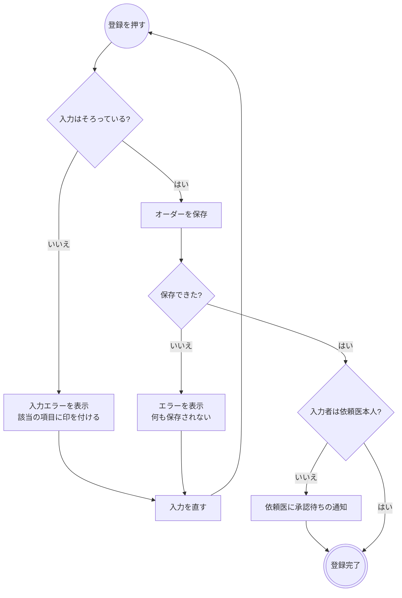

登録のときに確かめる項目は次のとおりです。

| 項目 | 条件 |
|---|---|
| 採取(予定)日時 | 必須 |
| 臓器・検査材料 | 検体ごとに必須 |
| 容器数 | 1 以上(初期値は 1) |
| 検体個数 | 空か 1 以上 |

- **検体**: 検体ごとに、検体タイプ・臓器・左右・採取法・補足・検体個数・容器数を入れます。検体タイプは検査区分で選べるものが変わり、区分を切り替えると合う値に直ります。
- **検体個数**: 依頼のときは任意です。採取するまで分からないことが多いので、空で構いません。
- **臓器・検査材料**: よく使うものがボタンで並び、ほかは検索します。検索は名称と ICD-10 で引けます。
- **臨床経過**: 自由入力かテンプレートです。既定のテンプレートはなく、毎回選びます。
- **シェーマ**: 施設が登録した臓器図の上に描きます。複数枚添付できます。
- **承認待ち**: 承認待ちのあいだも、オーダーは病理検査一覧に出ます。

### 採取とラベル

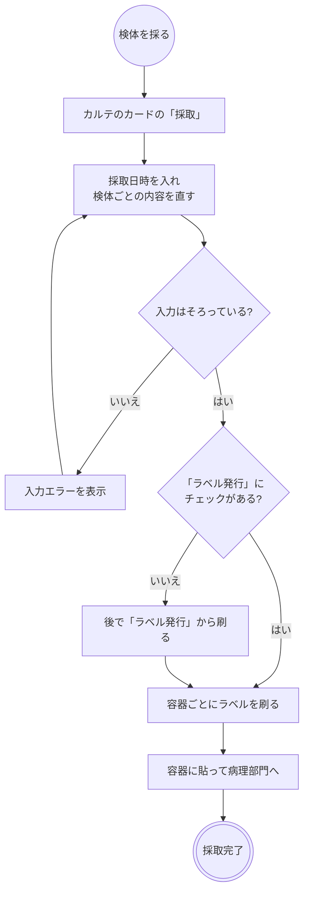

採取の記録で確かめる項目は次のとおりです。

| 項目 | 条件 |
|---|---|
| 採取日時 | 必須。1 つだけ入れ、全検体に同じ値が入る |
| 検体個数 | 必須で 1 以上。仮の数のまま搬送しないため |
| 容器数 | 1 以上 |

検体ごとに直せるのは、臓器・左右・検体個数・容器数です。

- **「採取」が出るあいだ**: 依頼済のあいだだけ出ます。記録の後は「採取修正」になり、受付済になると出なくなります。
- **記録に残らないもの**: 採取者の欄はありません。ネームバンドの照合もありません。
- **後で刷る**: カルテのカードのメニューか、病理検査一覧の行のメニューの「ラベル発行」から刷ります。
- **発行できないとき**: 中止したオーダーには発行できません。検体検査の「ラベル一括発行」に病理検査は入りません。

**容器数を変えたら、必ずラベルを刷り直します。** 番号の発行と取り下げは、ラベルを刷ったときに行われるためです。

- 同じ容器は、刷り直しても同じ番号です。
- 容器数を減らしたり検体を外したりして刷り直すと、余ったラベルは取り下げになります。元に戻して刷り直すと、同じ番号で復帰します。
- 「ラベル発行」のチェックを外して容器数だけ直すと、病理受付で数が合いません。増やした容器は「ラベル未発行」と出て、減らした容器のラベルは「オーダーの容器に当たらないラベルです」と警告されます。

ラベルは容器 1 つに 1 枚で、次の内容を刷ります。

- 番号のバーコード
- 患者番号・氏名・カナ・生年月日・性別
- 検体の番号・左右・臓器(例: 検体1 右 胃前庭部)
- 容器の番号(例: 容器 2/3)
- 検査区分・検体タイプ・採取法・個数
- 採取日(未採取なら予定日)
- 至急

### 病理受付の流れ

届いた容器のラベルを全部読んでから、1 回で受け付けます。画面は「部門業務 > 病理部門 > 病理受付」で、病理検査一覧の「受付」からも開きます。
検体検査の「検体到着確認」とは別の画面です。検体到着確認は 1 容器ごとに記録しますが、病理受付は全容器を読み終えるまで受け付けられません。

ラベルを 1 枚読むたびに、次の順で確かめます。

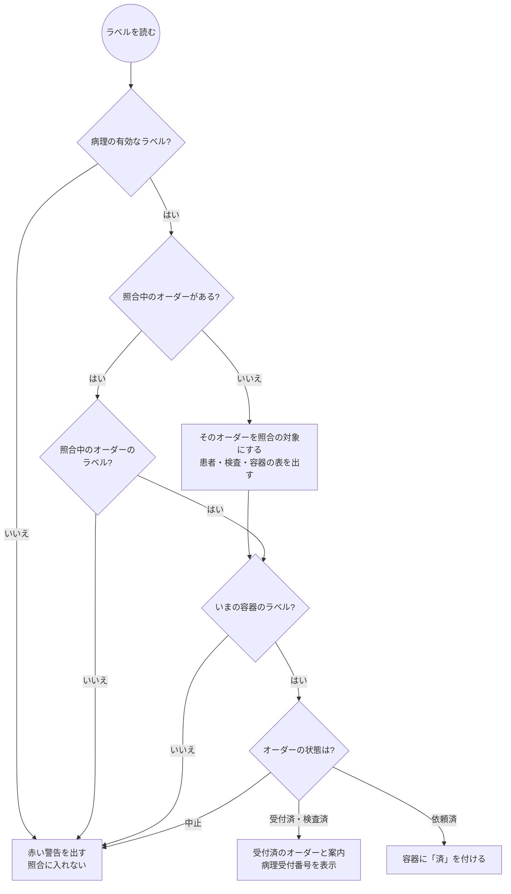

警告になるラベルと、画面に出る文言は次のとおりです。警告の後は、そのまま次のラベルを読めます。

| 読んだラベル | 画面の警告 |
|---|---|
| 番号の形式が違う | 「番号の形式が正しくありません(読み取りエラーの可能性)」 |
| 発行の記録が無い | 「この番号の発行記録がありません」 |
| 検体検査・細菌検査のラベル | 「検体検査の検体です(病理のラベルではありません)」 |
| 取り下げたラベル | 「取り下げられたラベルです(容器数の変更で刷り直されています)」 |
| 同じ患者の別のオーダーのラベル | 「同じ患者の別のオーダーのラベルです(照合中のオーダーには入れません)」 |
| 別の患者のラベル | 「別の患者(氏名)のラベルです」 |
| いまの容器に合わないラベル | 「オーダーの容器に当たらないラベルです(刷り直し前の可能性)」 |
| 中止したオーダーのラベル | 「中止されたオーダーです」 |

全容器に「済」が付くと受け付けられます。

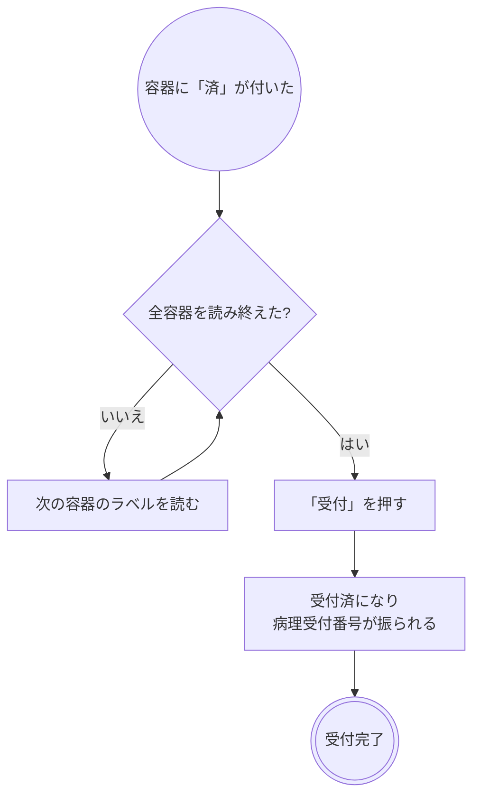

- **受付で残るもの**: 状態が受付済になり、病理受付番号が振られ、容器ごとに到着が記録されます。
- **「ラベル未発行」の容器**: ラベルを刷っていない容器が残っていると、読み終えられません。ラベルを刷り直して貼ってから読みます。
- **一覧の「受付」から開いたとき**: 照合するオーダーが決まった状態で始まります。別のオーダーのラベルは警告になり、ここでも全容器を読むまで「受付」は押せません。
- **読み間違えたとき**: 「やり直し」で、それまでの照合を捨てます。
- **ラベルの無い古いオーダー**: 病理検査一覧の行のメニューの「受付済にする」で受け付けます。病理受付番号は振られますが、容器の到着は記録されません。
- **受付の「取消」**: 依頼済に戻しても、病理受付番号と容器の到着の記録は残ります。受け付け直しても番号は変わりません。
- **検体到着確認で読んだとき**: 病理のラベルを検体到着確認で読むと、「病理検査の検体です(病理の受付で読んでください)」と出て記録されません。
- **番号から探す**: 病理検査一覧の「ラベル番号・病理受付番号」欄に番号を入れると、そのオーダーの日に移って内容を開きます。

### レポートの登録と報告

レポートは 1 オーダーに 1 件です。中間報告を編集して最終報告に切り替えます。書き始める場所は 2 つあります。

| 書き始める場所 | 書く人 | 対象のオーダー |
|---|---|---|
| 病理検査一覧のレポート登録 | 病理部門 | 受付済・検査済の行。オーダーは行で決まる |
| カルテの「検査結果」>「病理検査」タブの新規登録・編集 | 病理部門・医師 | レポートの無いオーダーから選ぶ。オーダーを選ばずに書くこともできる |

報告区分ごとに、依頼医への見え方と通知が変わります。

| 報告区分 | 保存の仕方 | カルテでの見え方 | 通知 |
|---|---|---|---|
| 下書き | 「一時保存」 | 内容は出ない | なし |
| 中間報告 | 報告区分で中間を選んで保存 | 読める | なし(確認の記録もできない) |
| 最終報告 | 報告区分で最終を選んで保存 | 読める | 検査結果確認の通知が出て、未説明の一覧に載る |
| 訂正報告・追加報告 | 確定の報告を編集して保存 | 読める | 最終報告と同じ。確認と説明は未に戻る |

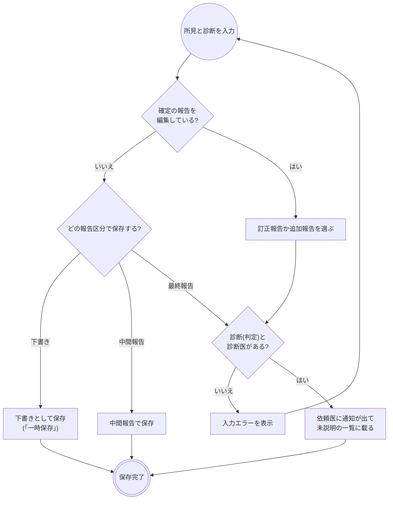

レポートに入れる項目は次のとおりです。

- 検体の情報(オーダーから写したものを確かめる)
- 肉眼所見・顕微鏡所見・追加染色
- 診断(細胞診は判定と推定病変)
- 診断医・重要度・フォロー推奨
- 画像

**状態との関係**

- レポートを保存しても、状態(受付済・検査済)は変わりません。病理検査一覧の「検査済」を別に押します。
- カルテからは、状態によらずレポートの無いオーダーを選べます。依頼済や中止のオーダーにも書けて、状態はそのままです。
- オーダーを選ばずに書いたレポートは依頼医がいないので、通知も未説明の一覧も宛先なしで作られます。

**検体の情報**

- 病理検査一覧から開くと、検査区分と検体がオーダーから写ります。
- 検体の採取日の初期値は採取の記録の日で、記録が無ければオーダーの採取予定日です。実際と違えば直します。

**下書き(「一時保存」)**

- 報告日だけ入っていれば保存でき、保存するとフォームが閉じます。
- 下書きにできるのは、まだ中間報告・最終報告で保存していないレポートだけです。中間報告以降を下書きには戻せません。
- 下書きの見え方は画面で違います。

| 画面 | 下書きの見え方 |
|---|---|
| カルテのカード | レポートなしと同じ |
| カルテの「病理検査」タブ | 日付が破線の枠で並び、内容は出ない |
| 病理検査一覧 | 内容まで見える。「レポート」の列は「下書き」 |

**訂正報告と追加報告**

- 確定の報告を編集すると、訂正報告か追加報告を毎回選びます。最終報告には戻せません。
- 診断を改めるなら訂正報告、免疫染色の結果を足すなら追加報告です。

**診断医**

- 3 人まで入れられ、ログイン中の医師が 1 人目に入ります。
- 確定の報告には 1 人以上が必須です。中間報告は、診断も診断医も空で保存できます。

**診断のテンプレート**

- 組織診・術中迅速の診断はテンプレートから書けます。用意してあるのは、固形がん共通 TNM と大腸癌のテンプレートです。
- テンプレートで書いた診断から、院内がん登録の形態コード・pTNM・病期の初期値が入ります。

**画像**

- ファイルから添付するか、シェーマに切り出し図を描き込みます。
- 種別は肉眼写真・切り出し図・鏡検写真・その他です。

### 結果の確認と患者説明

確認の仕組みは検体検査と同じです。確定の報告が保存されると依頼医に検査結果確認の通知が届き、医師がカルテでレポートを開いて確認すると、確認した人と日時が残ります。詳しくは [lab.md](lab.md)「結果の確認」にあります。
病理検査には、その後に患者へ説明したかを追う仕組みがあります。確定の報告は、説明を記録するまで未説明の一覧に残ります。

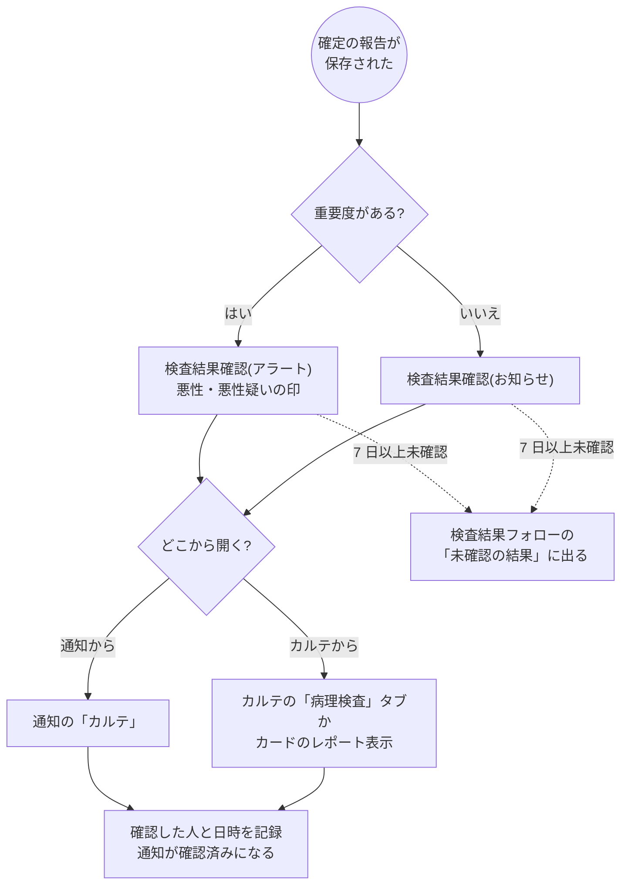

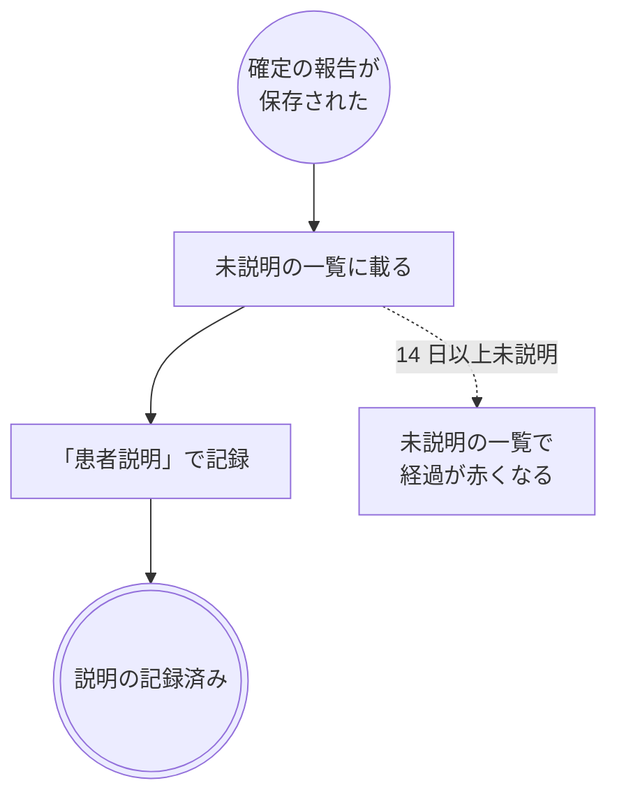

**結果の確認**

- 宛先は依頼医ですが、確認は誰でもできます。記録には確認した本人が残ります。
- 下書きと中間報告のうちは確認できません。
- 通知の「カルテ」を押すと、カルテの「検査結果」>「病理検査」タブがそのレポートを選んだ状態で開きます。

**患者説明**

- 「患者説明」では、対応(説明済・紹介先で説明・説明不要)・説明日・メモを入れます。
- まだ確認していないレポートは、説明を記録すると確認も同時に記録されます。
- 未説明の一覧は、画面上部のベル(通知)には出ません。「診療業務 > 検査結果フォロー」の「患者説明」タブで見ます。件数はホームの「検査結果フォロー」カードに出ます。
- 未説明の一覧は、「自分あてのみ」を外すと全員分を見られ、「重要度ありのみ」で絞れます。
- 記録を誤ったときは、未説明の一覧の「未説明に戻す」で直します。
- 職員(医療従事者)として登録されていないアカウントでは、説明を記録できません。
- 下書きと中間報告のうちは、未説明の一覧に載りません。

**訂正報告・追加報告が出たとき**

- 確認は未確認に戻り、説明は説明済みでも未説明に戻ります。
- 通知には「訂正報告」「追加報告」の印が付きます。

**フォロー推奨**

- レポートにフォロー推奨を書いて確定の報告で保存すると、「診療業務 > 検査結果フォロー」の「フォロー推奨」タブに載ります。
- 推奨か期限を変えると、未対応に戻ります。放射線検査の読影レポートや所見レポートのフォロー推奨と同じ扱いです。

### 変更・中止・削除

| 操作 | できる場所 | できる条件 |
|---|---|---|
| 変更 | カルテのカード | 状態によらずできる |
| 採取の修正 | カルテのカードの「採取修正」 | 依頼済のあいだ |
| 中止 | 病理検査一覧の行のメニュー | 依頼済・受付済のとき |
| 中止取消 | 病理検査一覧の行のメニュー | 中止のとき。依頼済に戻る |
| 取消 | 病理検査一覧の行のメニュー | 受付済・検査済のとき。1 つ前の状態に戻る |
| 削除 | カルテのカード | レポートが無いとき(下書きも不可) |
| レポートの削除 | カルテの「検査結果」>「病理検査」タブ | 報告区分によらずできる |

- **変更**: 検体や容器数を変えたら、ラベルを刷り直します。代行入力のときは、もう一度承認が要ることがあります。病理部門への通知は出ず、病理検査一覧の内容が変わります。
- **中止**: レポートがあっても中止できます。レポートは残ります。検査済からは中止できません。
- **取消**: 受付を取り消しても、病理受付番号と容器の到着の記録は消えません。
- **削除**: レポートがあるオーダーは、先にレポートを削除します。オーダーを削除すると状態も消えますが、発行済みの容器の記録は残ります。
- **レポートの削除**: 所見・検体・テンプレートの回答が消えます。未確認の検査結果確認、未説明の患者説明、未対応のフォロー推奨は取り下げられます。オーダーの状態は変わりません。
- **DO(前回と同じ内容で出し直す)**: オーダーの内容、検体の個数・容器数、臨床経過の文言が写ります。採取の記録・ラベル・病理受付番号・レポート・シェーマは写りません。臨床経過をテンプレートで書いていた場合、テンプレートとのつながりは写りません。

### ほかの画面とのつながり

- **外来の診察終了**: 当日の病理検査が依頼済・受付済のまま残っていると、「一時終了」を選べます。中間報告以降のレポートがあれば、対象になりません。
- **外来患者一覧**: 病理検査の印は、下書きをレポートなしと同じに扱います。
- **看護ワークシート**: 病理の採取の印は出ません。採取の記録はカルテのカードから行います。

### 検体検査との違い

| | 検体検査 | 病理検査 |
|---|---|---|
| オーダーの単位 | 検体をまたいで 1 オーダー | 1 オーダーに検体を複数入れる |
| ラベル発行 | 発行が受付を兼ねる。病棟は一括発行 | 状態を変えない。容器ごとに 1 枚刷る |
| 採取の記録 | なし | あり(採取日時と検体ごとの内容) |
| 受付済になるとき | ラベルを発行したとき | 全容器のラベルを読んで受け付けたとき |
| 終わりの状態 | 全部の管が届くと実施済 | 病理検査一覧の「検査済」を押す |
| 報告区分 | 中間・最終・訂正 | 下書き・中間・最終・訂正・追加 |
| 緊急の通知 | パニック値 | なし。重要度が付くとアラートになる |
| 確認の後 | なし | 患者説明を記録する |
| 結果の入れ方 | 手入力とファイル取込 | 手入力だけ |

- 多部位の生検は、検体ごとに臓器を分けて 1 オーダーに入れます。
- 採取の記録に、誰が採ったかは残りません。
- 採取(予定)日時は必須で、予約枠は使いません。
- ほかのオーダーにある次のものは、病理検査にはありません: 日付未定・即実施・事後の登録、登録時の警告、細菌検査一覧の「未完了(14日)」の表示。

### 帳票

| 帳票 | 出す場所 | 内容 |
|---|---|---|
| 病理検体ラベル | 採取の記録、カルテのカードのメニュー、病理検査一覧の行のメニュー | 容器 1 つに 1 枚(「採取とラベル」) |

病理診断レポートの報告書はありません。レポートはカルテと病理検査一覧で読みます。

## 開発者向け

### シーケンス図の前提

- **書き込みの経路**: `/fhir` への書き込みはどれも 1 回の transaction Bundle で、backend の `FhirProxyController` が上流へ中継します。
- **楽観ロック**: 版は `postBundle` が `ifMatch` に添え、版が違えば 412 で止まります。
- **例外**: ラベルの PDF は backend(`PathoLabelReport`)が上流を直接読み書きします。こちらは batch Bundle です。
- **図の描き方**: 応答は backend を通って戻りますが、図では上流からブラウザへ直接描きます。検索の条件と transaction の中身は、図の下の表に出します。

このページで使う呼び名は次のとおりです。

| 呼び名 | 指すもの |
|---|---|
| 上流 | 上流の FHIR サーバー |
| ヘッダ | オーダー 1 件を表す `ServiceRequest` |
| 検体明細 | 検体 1 つを表す `ServiceRequest`。`basedOn` でヘッダを指し、検体を contained `Specimen` で持つ |
| 容器の Specimen | ラベルを刷る容器 1 つを表す `Specimen`。発行・到着・取り下げを記録する |
| 結果の Specimen | レポートに書く検体を表す `Specimen` |
| 来歴 | `Provenance` |

### リソースの構成

オーダーは 2 層で、検査項目の層はありません(`fhir/pathoOrderHelpers.ts`)。

- ヘッダ: `ServiceRequest`(`order-type|pathology`、`code` = 検査区分 LPATHO001)
  - 検体明細: `ServiceRequest`(`basedOn` = ヘッダ)× 検体
    - 検体: contained `Specimen`

`Specimen` は 3 種類あり、互いに別のものです。

| 種類 | 作るとき | 表すもの | ほかとの関係 |
|---|---|---|---|
| 検体明細の contained `Specimen` | オーダーの登録 | 依頼した検体と採取の記録 | 検体明細の中にある |
| 容器の Specimen | ラベル発行 | 容器 1 つとラベル番号・到着 | `request` でヘッダと検体明細を指す |
| 結果の Specimen | レポートの保存 | レポートに書いた検体 | 結果側が所有する。容器の Specimen は参照しない |

ヘッダの拡張は次のとおりです。

| 拡張 | 中身 |
|---|---|
| `patho-clinical-info` | 臨床経過 |
| `patho-clinical-info-questionnaire-response` | 臨床経過のテンプレートの回答 |
| `patho-report-due` | 報告希望日 |
| `patho-operating-room` | 手術室番号 |
| `patho-schema-image` | シェーマ(`Binary`) |

オーダーと採取・容器の要素は次のとおりです。

| もの | リソース | 要素 | 中身 |
|---|---|---|---|
| 進捗 | `Task` | `code` | `task-code|patho-exam` |
| | | `focus` | ヘッダ |
| 採取の記録 | 検体明細の contained `Specimen` | `collection.collectedDateTime` | 採取日時 |
| | | `collection.quantity` | 検体個数 |
| | | `collection.bodySite` | 臓器・左右 |
| | 検体明細 | 拡張 `patho-container-count` | 容器数 |
| 容器 | 容器の Specimen | `request` | [ヘッダ, 検体明細] |
| | | `identifier`(`patho-container`) | 「検体明細の id:明細内の順番」 |
| | | `accessionIdentifier` | ラベル番号 |
| | | `receivedTime` と `status: available` | 到着 |
| | | `status: entered-in-error` | 取り下げ |
| 病理受付番号 | ヘッダ | `identifier`(`IdSystem/patho-accession-number`) | 受付で振る番号 |
| 代行入力 | `Provenance` | `target` | ヘッダ(明細は入れない) |
| | | `activity` | CREATE / UPDATE |

- **採取の記録**: 明細だけを PUT します。ヘッダを組み直すと依頼医が替わるためです。来歴は付けません。`collector` は持ちません。
- **容器の Specimen**: 発行で作成します。ラベル番号は検体検査の採取管と同じ採番です。
- **病理受付番号**: 上流の `ServiceRequest/$next-identifier` で払い出します。オーダーを編集しても元の値を引き継ぎます。

レポートの要素は次のとおりです。

| もの | リソース | 要素 | 中身 |
|---|---|---|---|
| 結果 | `DiagnosticReport` | `category` | v2-0074 `SP` / `CP` |
| | | `code` | LOINC `11526-1` |
| | | `basedOn` | ヘッダ |
| | | `status` | 報告区分(下の表) |
| | | `resultsInterpreter` | 診断医 |
| | | 拡張 `patho-report-importance` | 重要度 |
| | | 拡張 `patho-follow-up` | フォロー推奨 |
| | | 拡張 `patho-report-image` | 画像(`Binary`) |
| | | 拡張 `patho-diagnosis-response` | 診断のテンプレートの回答 |
| 所見 | `Observation` | `code` | 規約のセクション LOINC(下の表) |
| 結果の検体 | 結果の Specimen | `type` | 検体タイプ |
| 検査結果確認の通知 | `Task` | `code` | `task-code|result-review` |
| 患者説明 | `Task` | `code` | `task-code|result-explanation` |
| フォロー推奨 | `Task` | `code` | `task-code|followup-recommendation` |
| 確認(既読) | `Provenance` | `target` | 結果 |
| | | `agent.type` | `verifier`(`signature` を付ける) |

3 つの `Task` は、どれも `focus` = 結果、`owner` = 依頼医です。

| 報告区分 | `DiagnosticReport.status` |
|---|---|
| 下書き | `registered` |
| 中間報告 | `preliminary` |
| 最終報告 | `final` |
| 訂正報告 | `amended` |
| 追加報告 | `appended` |

| 所見 | `Observation.code`(LOINC) |
|---|---|
| 肉眼所見 | `22634-0` |
| 顕微鏡所見 | `22635-7` |
| 診断 | `22637-3` |
| 追加染色 | `10157-6` |

- **細胞診の診断**: `valueCodeableConcept`(判定)と `component`(推定病変)に持ちます。
- **追加報告の所見**: `Observation.status` に `appended` は無いので、`amended` にします。
- **テンプレートの回答**: レポートと同じ transaction に積みます。
- **検査結果確認の通知**: 確定の報告(最終・訂正・追加)のときに作ります。重要度ありは `priority = stat` で、印は `input` に持ちます。
- **患者説明**: `completed` で記録済です。対応と説明日は `output` に持ちます。通知一覧(ヘッダーのベル)には出しません。
- **フォロー推奨**: 読影・所見レポートと同じ持ち方です。
- **確認(既読)**: 検体検査と同じ持ち方です。

### 進捗 Task(`patho-exam`)

- Task は登録時には作りません。**Task が無いオーダーは依頼済**として扱い、最初の受付・中止で作ります(`fhir/pathoTaskHelpers.ts`)。
- 中止は同じ transaction でヘッダを `revoked` にし、中止取消で `active` に戻します(`orderCancelEntries`)。
- 中止したオーダーを編集しても `revoked` のままです(`keepOrderRevoked`)。

| 状態 | `Task.status` | `executionPeriod` | この状態にする操作 |
|---|---|---|---|
| 依頼済 | `requested`(または Task 無し) | なし | 受付の取消、中止取消 |
| 受付済 | `accepted` | `start` | 病理受付、受付済にする、検査済の取消 |
| 検査済 | `completed` | `start` / `end` | 一覧の「検査済」 |
| 中止 | `cancelled` | なし | 一覧の中止 |

- **レポートとの関係**: 検体検査・細菌検査と違い、レポートの保存・削除は Task に触りません。報告区分は `DiagnosticReport.status` が正本です。
- **外来患者一覧の印**: `fhir/outpatientOrderProgressHelpers.ts` が決めます。レポートがあれば、進捗より先にレポートの段階を見ます。`registered`(下書き)はレポートの段階に数えず、進捗で決めます。

### シーケンス図: 登録・編集・削除

| 操作 | 画面 | 組み立て | hook |
|---|---|---|---|
| 登録 | `components/PathoOrderForm.tsx`・`PathoOrderPanels.tsx` | `buildPathoOrderBundle` | `useCreatePrescription` |
| 編集 | 同じ | `buildPathoOrderUpdateBundle` | `useUpdatePrescription` |
| 削除 | カルテのカード | `buildPathoOrderDeleteBundle` | `useDeletePathoOrder`、`postOrderDeleteBundle` |

- 組み立ては `fhir/pathoOrderHelpers.ts` にあります。
- `useCreatePrescription` / `useUpdatePrescription` は名前に反して全種別共通の hook で、`api/queries/labResult.ts` にあります。
- `useDeletePathoOrder` は `api/queries/patho.ts`、`postOrderDeleteBundle` は `api/queries/orderDelete.ts` にあります。
- オーダーセット・クリニカルパスからの適用も、登録と同じ保存を通ります。

登録です。

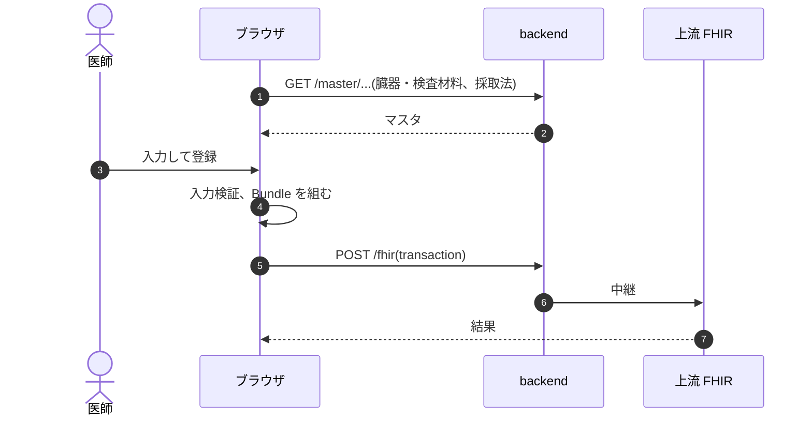

医師が入れるのは、検査区分・採取(予定)日時・検体・臨床情報です。

| 書くもの | 条件 |
|---|---|
| 画像の `Binary`・テンプレートの回答 | あれば。ヘッダより先に積む |
| ヘッダ `ServiceRequest` | `fullUrl` を付ける。登録時の入院病棟を `order-ward` に入れる |
| 検体明細 × 検体 | contained `Specimen` を持つ |
| `Provenance`(CREATE) | 毎回 |
| `Task` `order-approval` | 代行入力・研修医のとき |

編集です。

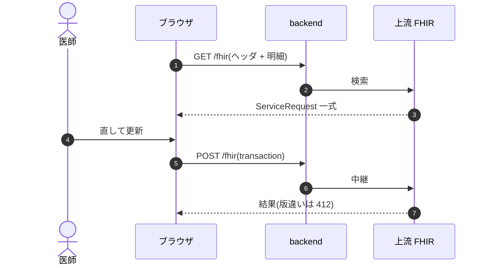

| 書くもの | 条件 |
|---|---|
| PUT ヘッダ | `ifMatch` を添える。`identifier` を引き継ぐ |
| 明細の POST / PUT / DELETE | 差分で書く。採取の記録はフォームの値に持ち回って保つ |
| DELETE テンプレートの回答 | 外した回答だけ。`Binary` は消さない |
| `Provenance`(UPDATE) | 毎回 |

削除です。

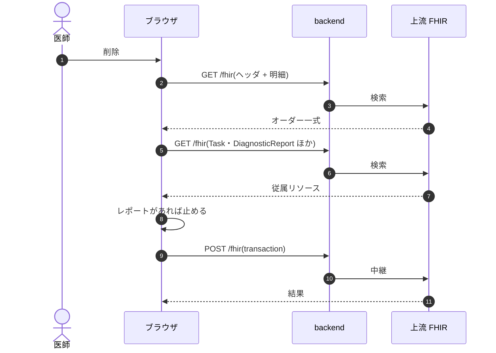

| 書くもの | 条件 |
|---|---|
| DELETE ヘッダ・明細・テンプレートの回答・`Task` | レポートが無いとき |
| 容器の Specimen | 消さずに残す |

### シーケンス図: 採取の記録とラベル発行

| 操作 | 画面 | 組み立て | hook・backend |
|---|---|---|---|
| 採取の記録 | `components/PathoCollectionModal.tsx` | `buildPathoCollectionBundle`(`fhir/pathoOrderHelpers.ts`) | `useRecordPathoCollection`(`api/queries/patho.ts`) |
| ラベル発行 | 新しいタブの PDF | `PathoLabelReport` | `Reports::PathoLabelPdfsController` |

採取の記録です。

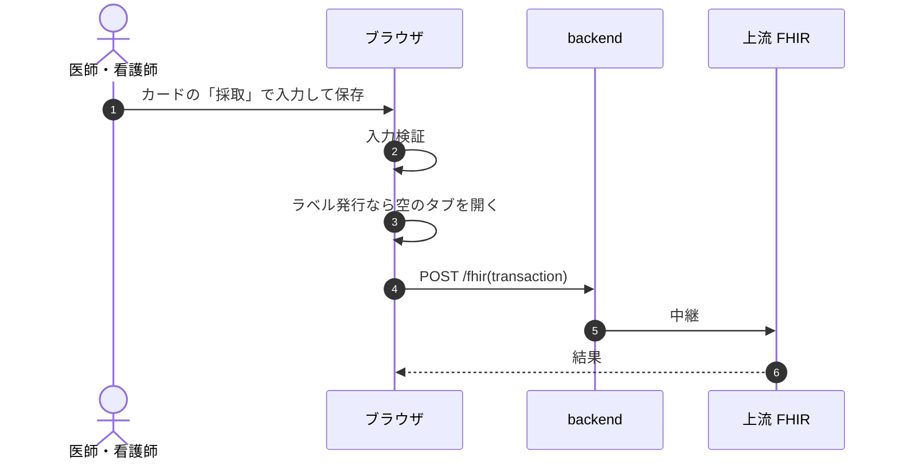

入れるのは、日時・個数・容器数です。

| 書くもの | 条件 |
|---|---|
| PUT 検体明細 × 検体 | `ifMatch` を添える |
| ヘッダ | 書かない |

- 保存の前に空のタブを開くのは、ポップアップブロックを避けるためです。
- PDF は保存の後に、そのタブへ差し替えます。保存の前に刷ると、直す前の容器数になるためです。

ラベル発行です。採取の記録で「ラベル発行」にチェックがあるときは、保存の後に続けて行います。

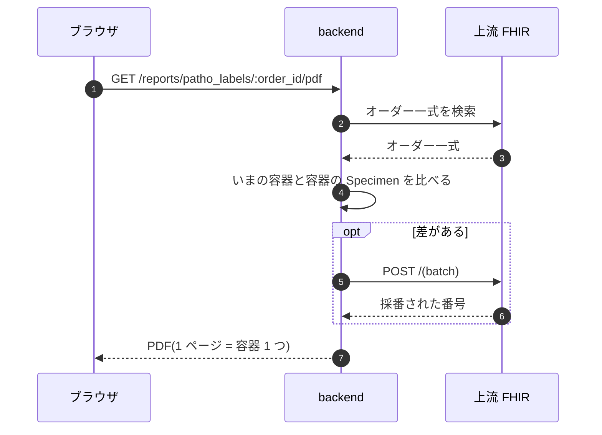

| 読む・書くもの | 条件 |
|---|---|
| 検索 | `GET /ServiceRequest?_id` に、患者・明細・容器の Specimen を含める |
| いまの容器 | 明細 × 容器数 |
| 容器の Specimen を作成 | まだ無い容器。`ifNoneExist` を添える |
| 容器の Specimen を `entered-in-error` に | 外れた容器 |
| 容器の Specimen を復帰 | 戻した容器 |

カードのメニューと病理検査一覧の行のメニューの「ラベル発行」は、このラベル発行だけを新しいタブで行います。

### シーケンス図: 病理受付

| 操作 | 画面 | 組み立て | hook |
|---|---|---|---|
| ラベルを読む | `pages/PathoReceptionPage.tsx` | `expectedPathoContainers` | `fetchContainerByLabelNumber`、`fetchPathoReceptionContext` |
| 受付 | 同じ | `buildPathoReceptionBundle` | `useReceivePathoOrder` |

組み立ては `fhir/pathoReceptionHelpers.ts`、hook は `api/queries/pathoReception.ts` にあります。

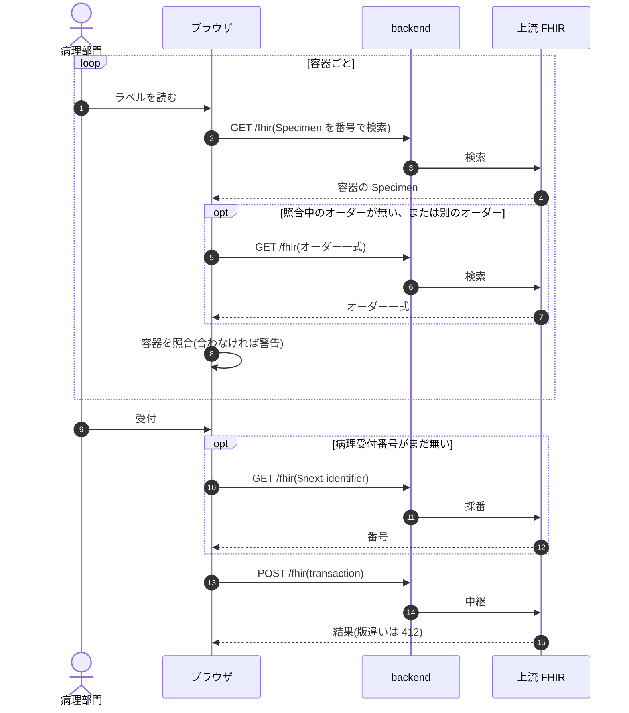

| 読む・書くもの | 条件 |
|---|---|
| オーダー一式の検索 | `ServiceRequest?_id` に、患者・明細・容器の Specimen・`Task` を含める |
| 容器の照合 | 容器の Specimen の `identifier`(`patho-container`)が、いまの容器(明細 × 容器数)にあるかを見る |
| 採番 | `ServiceRequest/$next-identifier` |
| `Task` `patho-exam` = `accepted` | 受付のとき |
| PUT ヘッダ | `identifier` に病理受付番号を入れる。`ifMatch` を添える |
| PUT 容器の Specimen × 容器 | `receivedTime` と `status: available` |

別のオーダーのラベルを読んだときは、患者が同じかを見るためにそのオーダーを読み、警告を出して照合には入れません。

### シーケンス図: 一覧・検査済・中止

| 操作 | 画面 | hook |
|---|---|---|
| 一覧 | `pages/PathoWorklistPage.tsx` | `usePathoWorklist`(`api/queries/patho.ts`) |
| 状態の変更 | 同じ | `useUpdatePathoTaskStatus`(`api/queries/patho.ts`)。`makeUpdateTaskStatusHook`(`api/queries/worklist.ts`)で作る |
| 番号から探す | 同じ | `findPathoOrderIdByNumber`(`api/queries/pathoReception.ts`) |

一覧の読み込みです。

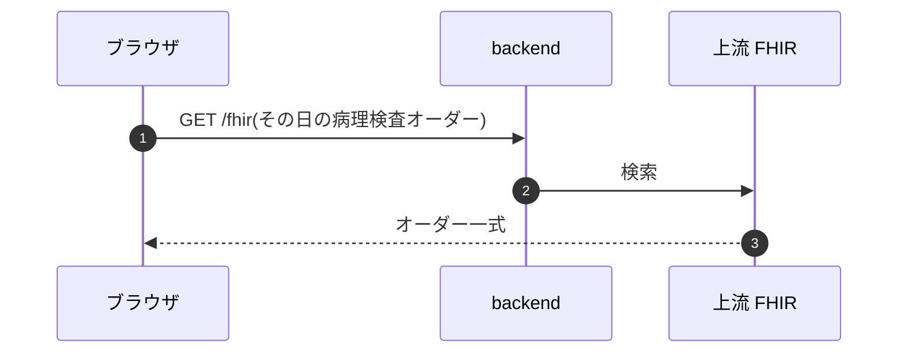

| 検索 | 条件 |
|---|---|
| `ServiceRequest` | `category=pathology`、`occurrence` = 採取日、`based-on:missing=true` |
| `_include` | 患者 |
| `_revinclude` | 明細(iterate)・`Task`・`DiagnosticReport` |

「受付済にする」(照合なしの受付)です。

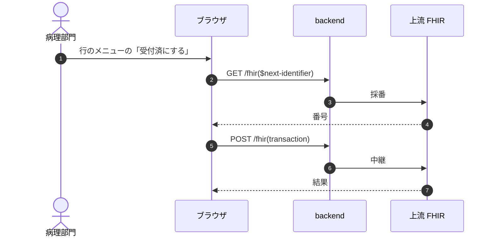

| 書くもの | 条件 |
|---|---|
| `Task` `patho-exam` = `accepted` | 毎回 |
| PUT ヘッダ | 病理受付番号を入れる |
| 容器の到着 | 書かない |

検査済・取消・中止・中止取消です。

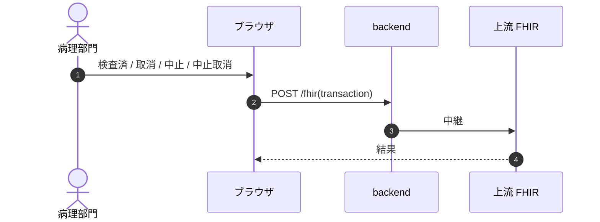

| 操作 | `Task` `patho-exam` | ヘッダ |
|---|---|---|
| 検査済 | `completed` | 書かない |
| 取消(検査済から) | `accepted` | 書かない |
| 取消(受付済から) | `requested` | 書かない |
| 中止 | `cancelled` | PUT `revoked` |
| 中止取消 | `requested` | PUT `active` |

### シーケンス図: レポートの登録・編集・削除

| 操作 | 画面 | 組み立て | hook |
|---|---|---|---|
| 登録 | `components/KartePathoResultTab.tsx`・`PathoResultForm.tsx` | `buildPathoResultBundle` | `useCreatePathoResult` |
| 編集 | 同じ | `buildPathoResultUpdateBundle`、`nextReportStatus` | `useUpdatePathoResult` |
| 削除 | `components/PathoResultDetailPanel.tsx` | `buildPathoResultDeleteBundle` | `useDeletePathoResult` |

- 組み立ては `fhir/pathoResultHelpers.ts`、hook は `api/queries/patho.ts` にあります。
- 通知と患者説明・フォロー推奨の `Task` は、`withPathoReportTasks`(`api/queries/patho.ts`)が足します。
- `PathoResultForm.tsx` は、カルテの病理タブと病理検査一覧の両方から使います。

保存(登録・編集)です。

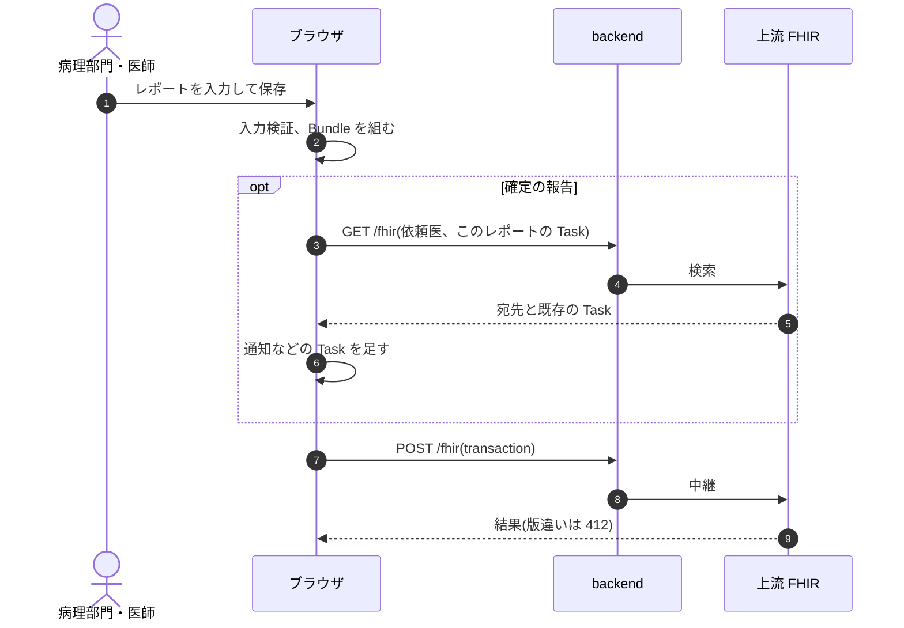

入れるのは、所見・診断・診断医・重要度・報告区分です。

| 書くもの | 条件 |
|---|---|
| 画像の `Binary`・テンプレートの回答 | あれば |
| 結果の Specimen × 検体 | 毎回 |
| `Observation` × 所見 | 毎回 |
| `DiagnosticReport` | `status` は報告区分(`registered` / `preliminary` / `final` / `amended` / `appended`) |
| `Task` `result-review`・`result-explanation`・`followup-recommendation` | 確定の報告のとき |

編集は、差分で POST / PUT / DELETE します。

削除です。

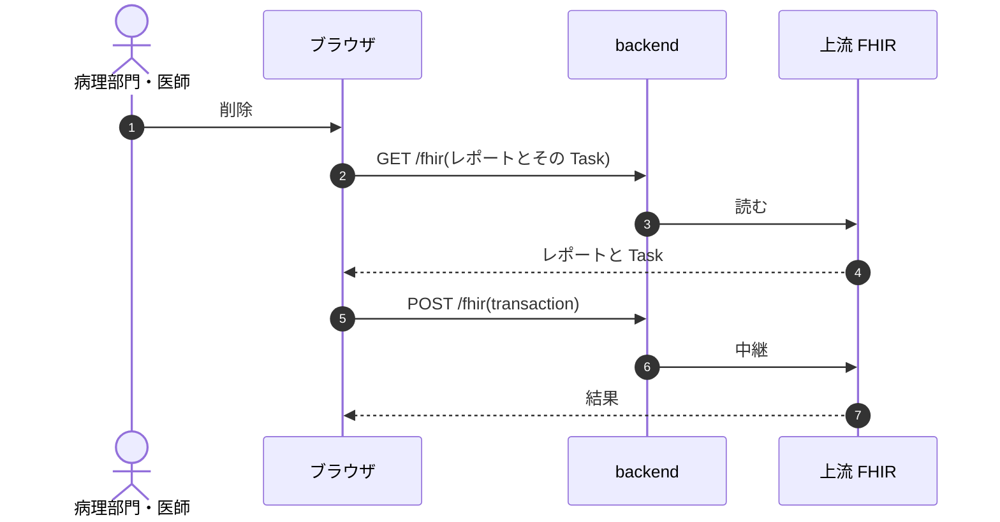

| 書くもの | 条件 |
|---|---|
| DELETE レポート → `Observation` → 結果の Specimen → テンプレートの回答 | この順に積む |
| `Task` を `cancelled` に | `requested` のもの(通知・患者説明・フォロー推奨) |
| `Task` `patho-exam` | 触らない |

結果確認の書き込みは、[lab.md](lab.md)「結果確認」のカルテからの経路と同じです(`ResultReviewAction`、`useMarkResultReviewed`)。

### シーケンス図: 患者説明の記録

| 操作 | 画面 | 組み立て | hook |
|---|---|---|---|
| 記録 | `components/ResultExplanationAction.tsx`・`ResultExplanationModal.tsx` | `recordExplanationEntry`(`fhir/resultExplanationHelpers.ts`) | `useRecordExplanation` |
| 未説明に戻す | 同じ | | `useReopenExplanation` |

hook は `api/queries/resultFollowup.ts` にあります。

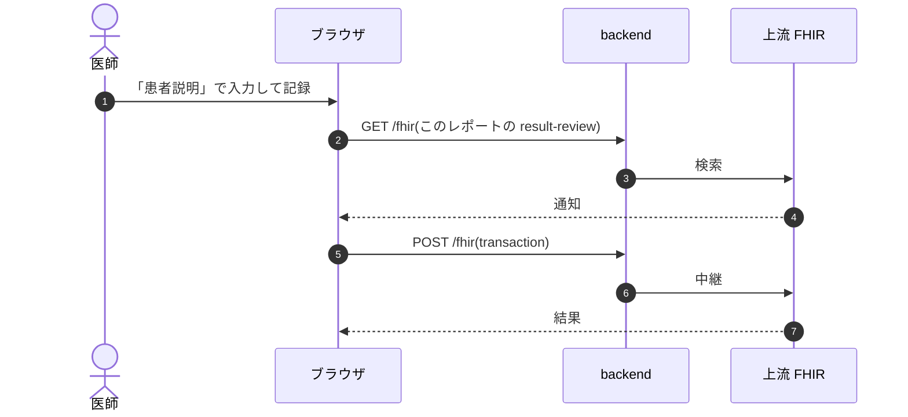

入れるのは、対応・説明日・メモです。

| 書くもの | 条件 |
|---|---|
| `Task` `result-explanation` = `completed` | `output` に対応と説明日を入れる |
| `Provenance`(verifier) | まだ確認していないとき |
| `Task` `result-review` = `completed` | まだ確認していないとき |

### 医事会計と SS-MIX2

- **集め方**: 病理検査は、検体検査と同じくオーダーで集める種別です(`BillingClaimBuilder` の `:order` 経路)。実施入力を持たないので、進捗 Task は見ず、**オーダーの採取(予定)日**で集めます。採取の記録の日時は使いません。
- **中止**: `ServiceRequest.status` で判定します。
- **コード**: レセ電算コードは、検査項目マスタではなく施設設定の「病理検査(検査区分ごと)」から検査区分で引きます(`Resolvers::Pathology`)。数量は検体明細の数です。判断料・診断料は日レセが自動算定します。
- **SS-MIX2**: 病理検査の電文は出しません。既存の電文の対象は次のとおりで、病理検査はどれにも入りません。

| 電文 | 対象 |
|---|---|
| `OmlO33` | `order-type|lab` |
| `OmgO19` | 放射線・内視鏡・生理 |
| `OulR22` | v2-0074 `LAB` |
| `OruR01` | `physio` |

| 起きたこと | 医事会計(`BillingClaimBuilder`) |
|---|---|
| 登録・編集 | 採取(予定)日のオーダーを検査区分のコードで送る。コードが未設定なら「送れない項目」に出す |
| 中止 | 対象から外れる(`ServiceRequest` が `revoked`) |
| 削除 | 対象から外れる |
| 採取・ラベル発行・受付・検査済、レポートの保存・訂正・追加・削除 | 何も送らない |
