# 病理検査オーダーの業務フロー

病理検査オーダーの登録から採取・ラベル発行・病理受付・レポート・結果確認・患者説明までの流れです。医療機関の運用を検討する人は「運用フロー」、院内の開発者は「開発者向け」を読みます。
進捗の考え方は検体検査と同じなので、この文書は [lab.md](lab.md) との違いを中心に書きます。
設計は [patho-order-design.md](../patho-order-design.md)、画面のふるまいは [features/lab.md](../features/lab.md)「病理検査オーダーの検体個数・容器数と採取」「病理診断レポートの診断医・重要度・追加報告・患者説明」、
種別共通の約束(中止・削除・代行入力)は [features/orders-common.md](../features/orders-common.md)、リソースの要素は実装ガイド(`../fhir-ig`)が正典です。
組織診・細胞診・術中迅速は 1 つのオーダーの検査区分で分けます。免疫染色の追加依頼・遺伝子検査・剖検はオーダーにありません。標本作製(カセット・スライド)は病理部門システムの領域で、電子カルテには記録しません。

## 運用フロー

### 検査区分ごとの違い

| | 組織診 | 細胞診 | 術中迅速 |
|---|---|---|---|
| 検体タイプ | 生検・手術材料 | 細胞診材料 | 生検・手術材料 |
| 至急区分 | 通常が初期値 | 通常が初期値 | 至急が入る(通常に戻せる) |
| 手術室番号 | なし | なし | 入れられる |
| レポートの診断 | 自由文かテンプレート | 判定 5 段階と推定病変 | 自由文かテンプレート |
| 重要度の初期値 | なし | 判定が悪性・悪性疑いなら同じ重要度 | なし |

レポートの持ち方と進捗はどの区分でも同じです。

### 検体検査との違い

| | 検体検査 | 病理検査 |
|---|---|---|
| オーダーの単位 | 検体をまたいで 1 オーダー | 1 オーダーに検体を複数入れる。多部位の生検は検体ごとに臓器を分ける |
| ラベル発行 | 発行が受付を兼ねる。病棟は一括発行 | **進捗を動かさない**。容器ごとに 1 枚で、カルテのカードか一覧の行から刷る |
| 採取の記録 | なし | **あり**。採取日時と、検体ごとの個数・容器数・臓器・左右。誰が採ったかは残らない |
| 受付済 | ラベルを発行した | **全容器のラベルを読んで受け付けた**。病理受付番号が振られる |
| 終わりの状態 | 全部の管が届くと実施済 | **一覧の「検査済」を押す**。レポートの保存では動かない |
| 報告区分 | 中間・最終・訂正 | 下書き・中間・最終・訂正・追加 |
| 緊急の通知 | パニック値 | なし。重要度(悪性疑い・悪性)が付くと検査結果確認がアラートになる |
| 確認の後 | なし | **患者説明の台帳**を依頼医が閉じる |
| 結果の入れ方 | 手入力とファイル取込 | 手入力だけ |

採取(予定)日時は必須で、予約枠は使いません。日付未定・即実施・事後はありません。登録時の警告もありません。

### 病理検査の状態

病理部門の進み具合を示す状態です。レポートの報告区分はこの状態に含めず、一覧の「レポート」の列(未・下書き・中間報告・最終報告・訂正報告・追加報告)で見せます。

| 状態 | 変わるきっかけ | 病理検査一覧からできること |
|---|---|---|
| 依頼済 | 医師の登録、取消、中止取消 | 受付(病理受付を開く)、受付済にする、中止、ラベル発行 |
| 受付済 | 病理受付の受付、受付済にする、検査済の取消 | 検査済、レポート登録・編集、取消(依頼済へ)、中止、ラベル発行 |
| 検査済 | 一覧の「検査済」 | レポート登録・編集、取消(受付済へ)、ラベル発行 |
| 中止 | 中止 | 中止取消(依頼済へ) |

- 検査済とレポートは別々に動きます。最終報告を保存しても受付済のままで、レポートが無くても検査済にできます。
- 一覧は採取(予定)日の 1 日ぶんです。細菌検査の「未完了(14日)」はありません。前の日のオーダーは日付を送るか、「ラベル番号・病理受付番号」欄の番号で呼び出します。
- 検体の列に容器の総数を出し、依頼済で採取の記録が無ければ「未採取」と出します。

容器 1 つごとに別の状態があります。**未発行 → 発行済 → 到着済**で、病理受付の表に番号と照合の「済」が出ます。

### 全体の流れ

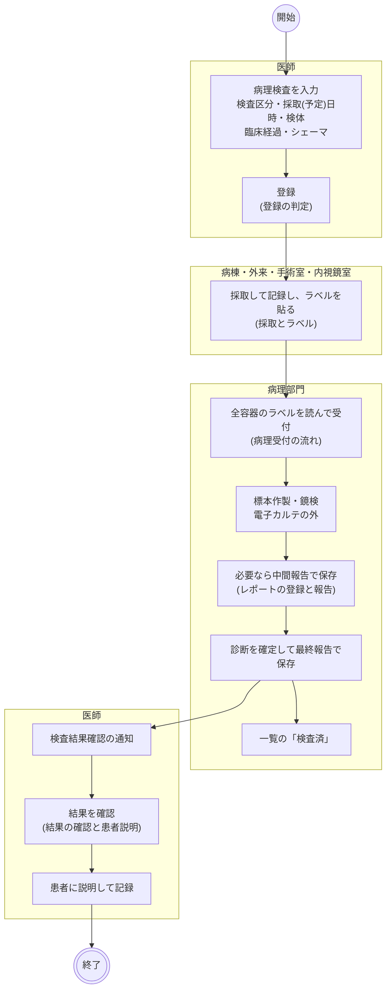

- 手術や内視鏡で採る検体も、別に病理検査オーダーを出します。手術オーダーの検体提出予定からは作られません。
- 医師は中間報告の内容をカルテで読めますが、通知は出ず、確認の記録も残せません。
- 外来の診察終了で、当日の病理検査が依頼済・受付済のまま残っていると「一時終了」を選べます。中間報告以降のレポートがあれば対象になりません。外来患者一覧の印も、下書きはレポートなしと同じに扱います。
- 看護ワークシートに病理の採取の印はありません。採取の記録はカルテのカードから行います。

### 登録の判定

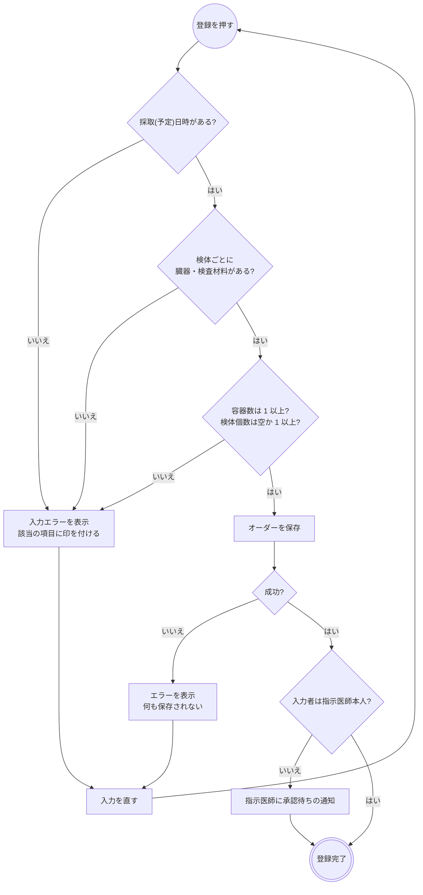

- 検体ごとに検体タイプ・臓器・左右・採取法・補足・検体個数・容器数を入れます。検体タイプは検査区分で選べるものが変わり、区分を切り替えると合う値に直ります。
- 検体個数は任意です。採取するまで分からないことが多いので、依頼時は空で構いません。容器数の初期値は 1 です。
- 臓器・検査材料は頻用の印が付いたものがボタンで並び、ほかは検索します。検索は名称と ICD-10 で引けます。
- 臨床経過は自由入力かテンプレートです。既定のテンプレートはなく、毎回選びます。
- シェーマはシェーママスタの臓器図に描き、複数枚添付できます。
- 承認待ちでもオーダーは部門に流れます。オーダーセット・クリニカルパスからの適用も同じ保存を通ります。

### 採取とラベル

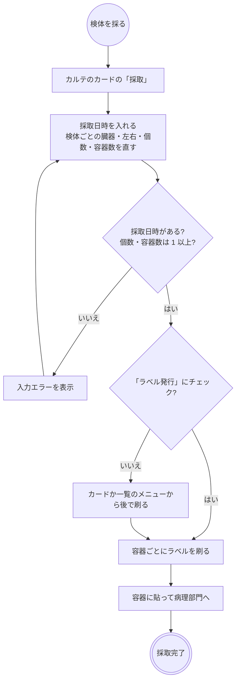

- 「採取」は依頼済のあいだだけ出ます。記録の後は「採取修正」になり、受け付けられると出なくなります。
- 検体個数は依頼時は任意ですが、採取では必須です。仮の数のまま搬送しないためです。
- 採取日時は 1 つで、全検体に同じ値が入ります。採取者の欄はなく、ネームバンドの照合もありません。
- ラベルは容器 1 つに 1 枚で、番号のバーコード・患者番号・氏名・カナ・生年月日・性別・「検体1 右 胃前庭部」・「容器 2/3」・検査区分・検体タイプ・採取法・個数・採取日(未採取なら予定日)・至急を刷ります。
- 同じ容器は刷り直しても同じ番号です。容器数を減らしたり検体を外したりして刷り直すと、余ったラベルは取り下げになります。戻すと同じ番号で復帰します。
- 取り下げも新しい容器の発行も、**ラベルを刷ったとき**に起こります。チェックを外して容器数を直すと、受付で数が合いません(増やした容器は「ラベル未発行」、減らした容器のラベルは「オーダーの容器に当たらないラベル」)。
- 検体検査の「ラベル一括発行」に病理検査は入りません。中止したオーダーには発行できません。

### 病理受付の流れ

画面は**部門業務 > 病理部門 > 病理受付**で、一覧の「受付」からも開きます。検体検査の検体到着確認とは別の画面です。1 容器ごとに記録する到着確認と違い、全容器を読み終えてから 1 回で受け付けます。

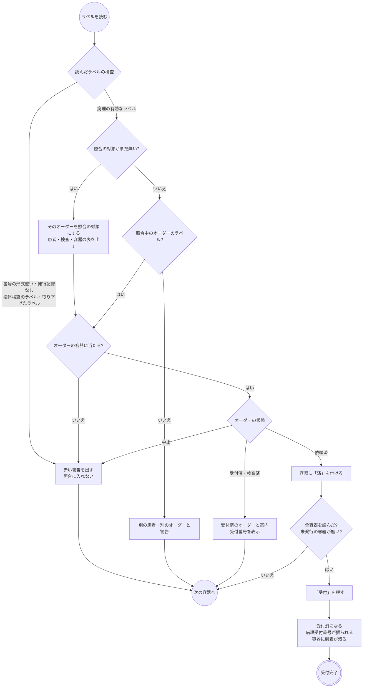

- 検体検査と細菌検査のラベルはどちらも「検体検査の検体です」で弾きます。
- 一覧の「受付」から開くと対象のオーダーが決まった状態で始まり、別のオーダーのラベルは警告になります。ここでもラベルを全部読むまで受付は押せません。
- 読み間違えたら「やり直し」で照合を捨てます。
- ラベルの無い古いオーダーは、一覧のメニューの「受付済にする」で受け付けます。照合を通らず、病理受付番号だけ振られ、容器の到着は残りません。
- 「取消」で依頼済に戻しても、病理受付番号と容器の到着の記録は残ります。受け付け直しても番号は変わりません。
- 検体到着確認で病理のラベルを読むと「病理の受付で読んでください」と出して記録しません。
- 一覧の「ラベル番号・病理受付番号」欄に番号を入れると、そのオーダーの日に移って内容を開きます。

### レポートの登録と報告

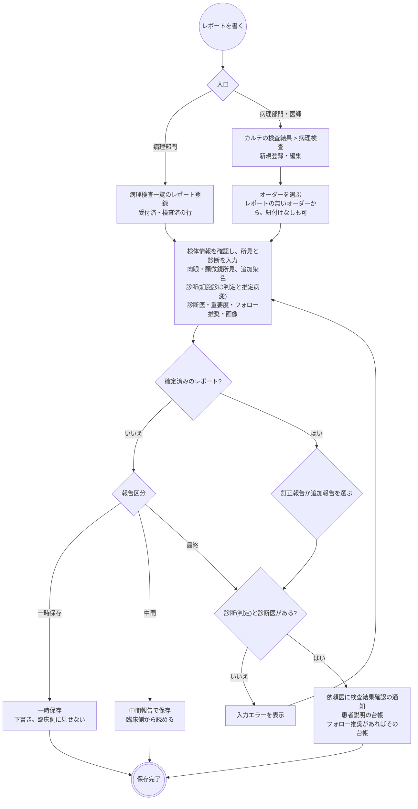

- 検査済・受付済はレポートの保存では動きません。一覧の「検査済」を別に押します。
- 一覧から開くとオーダーは行で決まり、検査区分と検体をオーダーから写します。検体の採取日の初期値は採取の記録の日で、記録が無ければオーダーの採取予定日です。実際と違えば直します。
- カルテからは、進捗によらずレポートの無いオーダーを選べます。依頼済や中止のオーダーにも書けて、状態はそのままです。オーダーに紐付けないレポートは依頼医がいないので、通知と台帳は宛先なしで作られます。
- 1 オーダーにレポートは 1 件です。中間報告を編集して最終報告に切り替えます。
- 一時保存は報告日だけで保存でき、フォームを閉じます。**下書きは公開前のレポートだけ**で、中間報告以降を下書きには戻せません。下書きはカードではレポートなしと同じ扱いで、病理タブでは破線の枠で並び、内容は出ません。病理検査一覧では内容まで見えます。
- 確定済みのレポートを編集すると、訂正報告か追加報告を毎回選びます。診断を改めるなら訂正、免疫染色の結果を足すなら追加です。最終報告には戻せません。
- 診断医は 3 人まで入れられ、ログイン中の医師が 1 人目に入ります。確定する報告には 1 人以上が必須で、中間報告は診断も診断医も空で保存できます。
- 組織診・術中迅速の診断はテンプレートから書けます。同梱は固形がん共通 TNM と大腸癌です。この回答から院内がん登録の形態コード・pTNM・病期の初期値が入ります。
- 画像はファイルからの添付と、シェーマへの切り出し図の描き込みです。種別は肉眼写真・切り出し図・鏡検写真・その他です。

### 結果の確認と患者説明

確認の仕組みは検体検査と同じです([lab.md](lab.md)「結果の確認」)。病理には、その後に患者へ伝えたかを追う台帳があります。

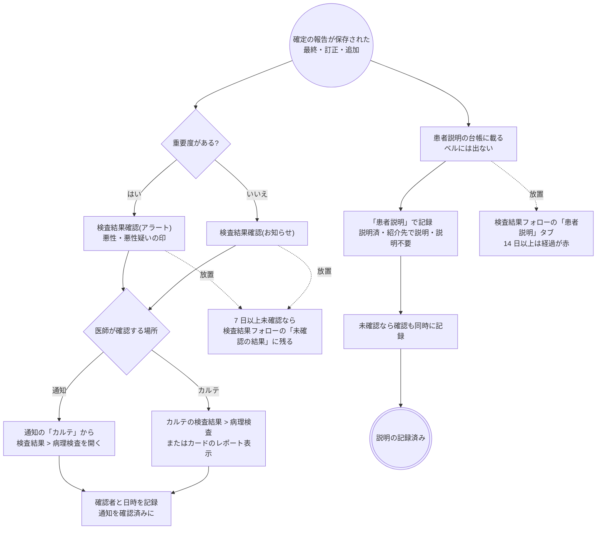

- 宛先は依頼医ですが、確認は誰でもできます。記録には確認した本人が残ります。
- 中間報告と下書きのうちは確認できず、台帳にも載りません。
- 訂正報告・追加報告で保存すると、確認は未確認に、説明は説明済みでも未説明に戻ります。通知には「訂正報告」「追加報告」の印が付きます。
- 説明の記録には対応・説明日・メモを入れます。ログインしたユーザーが医療従事者に紐付いていないと記録できません。誤りは一覧の「未説明に戻す」で直します。
- 一覧の「自分あてのみ」を外すと全員分を見られ、「重要度ありのみ」で絞れます。件数はホームの「検査結果フォロー」カードに出ます。
- フォロー推奨の扱いは読影・所見レポートと同じで、確定で台帳に載り、推奨か期限を変えると未対応に戻ります。

### 変更・中止・削除

| 操作 | できる場所 | できないとき・注意 |
|---|---|---|
| 変更 | カルテのカード | 進捗では止まりません。検体や容器数を変えたら、ラベルを刷り直します |
| 採取の修正 | カルテのカードの「採取修正」 | 依頼済のあいだだけです |
| 中止 | 病理検査一覧のメニュー | 依頼済・受付済から。検査済からはできません。レポートが付いていても止まらず、レポートは残ります |
| 中止取消 | 病理検査一覧のメニュー | 依頼済に戻ります |
| 取消 | 病理検査一覧のメニュー | 1 つ前の状態に戻す訂正です。受付の取消で病理受付番号と到着の記録は消えません |
| 削除 | カルテのカード | レポートが付いているとできません(下書きを含む。レポートを削除してから)。進捗は一緒に消え、発行済みの容器の記録は残ります |
| レポートの削除 | カルテの検査結果 > 病理検査 | 所見・検体・テンプレートの回答を消し、**未確認の検査結果確認・未説明の患者説明・未対応のフォロー推奨を取り下げます**。報告区分によらず消せます。進捗は動きません |

- 変更は再度の承認を要する場合があります(代行入力のとき)。部門への通知はなく、一覧の内容で見えます。
- DO はオーダーの内容と検体の個数・容器数を写します。採取の記録・ラベル・受付番号・レポート・テンプレートの紐付け・シェーマは写りません。臨床経過の文言は残ります。

### 帳票

| 帳票 | 出す場所 | 内容 |
|---|---|---|
| 病理検体ラベル | 採取の記録、カルテのカードのメニュー、病理検査一覧のメニュー | 容器 1 つ 1 枚(「採取とラベル」) |

病理診断レポートの報告書はありません。レポートはカルテと一覧で読みます。

## 開発者向け

### リソースの構成

オーダーは 2 層です。ヘッダの `ServiceRequest`(`order-type|pathology`、`code` = 検査区分 LPATHO001)← `basedOn` ── 検体明細(contained `Specimen`)です。検査項目の層はありません(`fhir/pathoOrderHelpers.ts`)。
ヘッダは拡張 `patho-clinical-info`(臨床経過)・`patho-clinical-info-questionnaire-response`(テンプレートの回答)・`patho-report-due`(報告希望日)・`patho-operating-room`(手術室番号)・`patho-schema-image`(シェーマ、`Binary`)を持ちます。

| もの | リソース | 補足 |
|---|---|---|
| 進捗 | `Task`(`task-code|patho-exam`、`focus` = ヘッダ) | 下の表 |
| 採取の記録 | 検体明細の contained `Specimen` の `collection`(`collectedDateTime`・`quantity`・`bodySite`)と拡張 `patho-container-count` | 明細だけを PUT する(ヘッダを組み直すと依頼医が替わる)。来歴は付けない。`collector` は持たない |
| 容器の台帳 | `Specimen`(`request` = [ヘッダ, 検体明細]、`identifier` = `patho-container`、`accessionIdentifier` = ラベル番号) | `identifier` の値は「検体明細の id:明細内の順番」。発行 = 作成、到着 = `receivedTime` + `status: available`、取り下げ = `entered-in-error`。番号は検体検査の採取管と同じ採番 |
| 病理受付番号 | ヘッダの `identifier`(`IdSystem/patho-accession-number`) | 上流の `ServiceRequest/$next-identifier` で払い出す。編集でも元の値を引き継ぐ |
| 結果 | `DiagnosticReport`(`category` = v2-0074 `SP` / `CP`、`code` = LOINC `11526-1`、`basedOn` = ヘッダ、`status` = `registered` / `preliminary` / `final` / `amended` / `appended`)+ `Observation` | 所見は規約のセクション LOINC を `Observation.code` に使う(肉眼 `22634-0`・顕微鏡 `22635-7`・診断 `22637-3`・追加染色 `10157-6`)。細胞診の診断は `valueCodeableConcept`(判定)+ `component`(推定病変)。`Observation.status` に `appended` は無いので `amended` にする |
| レポートの補足 | `resultsInterpreter`(診断医)、拡張 `patho-report-importance`(重要度)・`patho-follow-up`(フォロー推奨)・`patho-report-image`(画像、`Binary`)・`patho-diagnosis-response`(診断のテンプレートの回答) | 回答はレポートと同じ transaction に積む |
| 結果の検体 | `Specimen`(`type` = 検体タイプ) | 結果側が所有する。ラベルの台帳とは別で、参照しない |
| 検査結果確認の通知 | `Task`(`task-code|result-review`、`focus` = 結果、`owner` = 依頼医) | 確定の報告のとき。重要度ありは `priority = stat`、印は `input` |
| 患者説明 | `Task`(`task-code|result-explanation`、`focus` = 結果、`owner` = 依頼医) | `completed` で記録済。対応と説明日は `output`。通知のレジストリには載せない |
| フォロー推奨 | `Task`(`task-code|followup-recommendation`、`focus` = 結果、`owner` = 依頼医) | 読影・所見レポートと同じ |
| 確認(既読) | `Provenance`(`target` = 結果、`agent.type = verifier`、`signature`) | 検体検査と同じ |
| 代行入力 | `Provenance`(`target` = ヘッダ、`activity` CREATE / UPDATE) | 明細は `target` に入れない |

### 進捗 Task(`patho-exam`)

Task は登録時には作りません。**Task が無いオーダーは依頼済**として扱い、最初の受付・中止で作ります(`fhir/pathoTaskHelpers.ts`)。
中止は同じ transaction でヘッダを `revoked` にし、中止取消で `active` に戻します(`orderCancelEntries`)。中止したオーダーを編集しても `revoked` のままです(`keepOrderRevoked`)。

| 状態 | `Task.status` | `executionPeriod` | 進めるもの |
|---|---|---|---|
| 依頼済 | `requested`(または Task 無し) | なし | 受付の取消、中止取消 |
| 受付済 | `accepted` | `start` | 病理受付、受付済にする、検査済の取消 |
| 検査済 | `completed` | `start` / `end` | 一覧の「検査済」 |
| 中止 | `cancelled` | なし | 一覧の中止 |

検体検査・細菌検査と違い、レポートの保存・削除は Task に触りません。報告区分は `DiagnosticReport.status` が正本です。
外来の印(`fhir/outpatientOrderProgressHelpers.ts`)はレポートがあれば進捗より先にレポートの段階を見ます。`registered`(下書き)はレポートの段階に数えず、進捗で決めます。

### シーケンス図の前提

`/fhir` への書き込みはどれも 1 回の transaction Bundle で、backend の `FhirProxyController` が上流へ中継します。
楽観ロックの版は `postBundle` が `ifMatch` に添え、版が違えば 412 で止まります。
例外はラベルの PDF で、backend(`PathoLabelReport`)が上流を直接読み書きします。こちらは batch Bundle です。

### シーケンス図: 登録・編集・削除

`components/PathoOrderForm.tsx`・`PathoOrderPanels.tsx`、`buildPathoOrderBundle` / `buildPathoOrderUpdateBundle` / `buildPathoOrderDeleteBundle`(`fhir/pathoOrderHelpers.ts`)、
`useCreatePrescription` / `useUpdatePrescription`(`api/queries/labResult.ts`。全種別共通)、`useDeletePathoOrder`(`api/queries/patho.ts`)、`postOrderDeleteBundle`(`api/queries/orderDelete.ts`)。

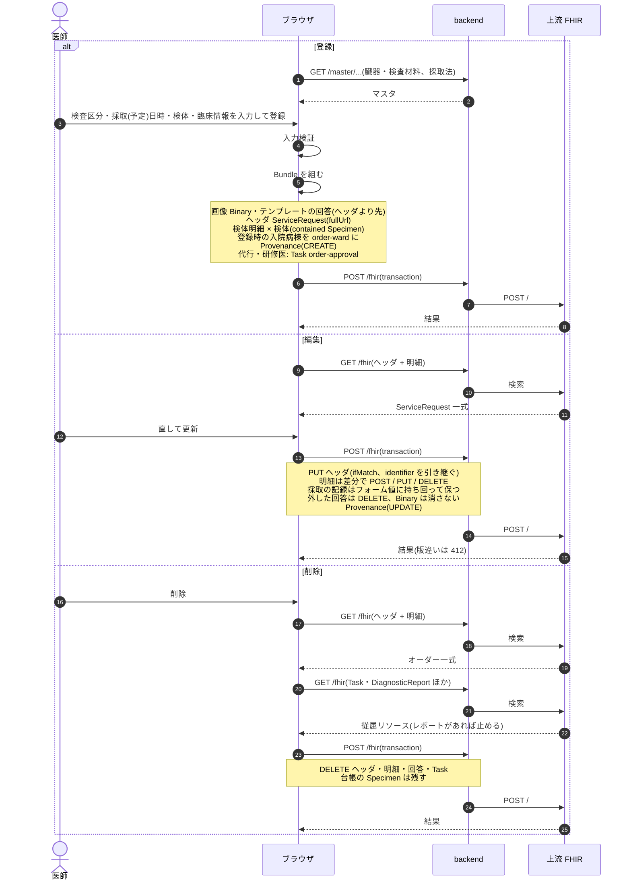

### シーケンス図: 採取の記録とラベル発行

`components/PathoCollectionModal.tsx`、`buildPathoCollectionBundle`(`fhir/pathoOrderHelpers.ts`)、`useRecordPathoCollection`(`api/queries/patho.ts`)、
`Reports::PathoLabelPdfsController`、`PathoLabelReport`。保存の前に空のタブを開くのはポップアップブロックを避けるためで、PDF は保存の後に差し替えます(保存前に刷ると直す前の容器数になる)。

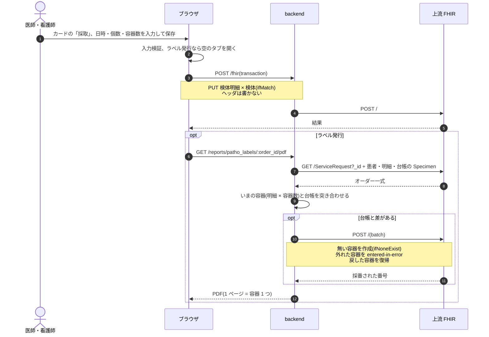

カードのメニューと一覧のメニューの「ラベル発行」は、`opt ラベル発行` の部分だけを新しいタブで行います。

### シーケンス図: 病理受付

`pages/PathoReceptionPage.tsx`、`expectedPathoContainers` / `buildPathoReceptionBundle`(`fhir/pathoReceptionHelpers.ts`)、
`fetchPathoReceptionContext` / `fetchContainerByLabelNumber` / `useReceivePathoOrder`(`api/queries/pathoReception.ts`)。

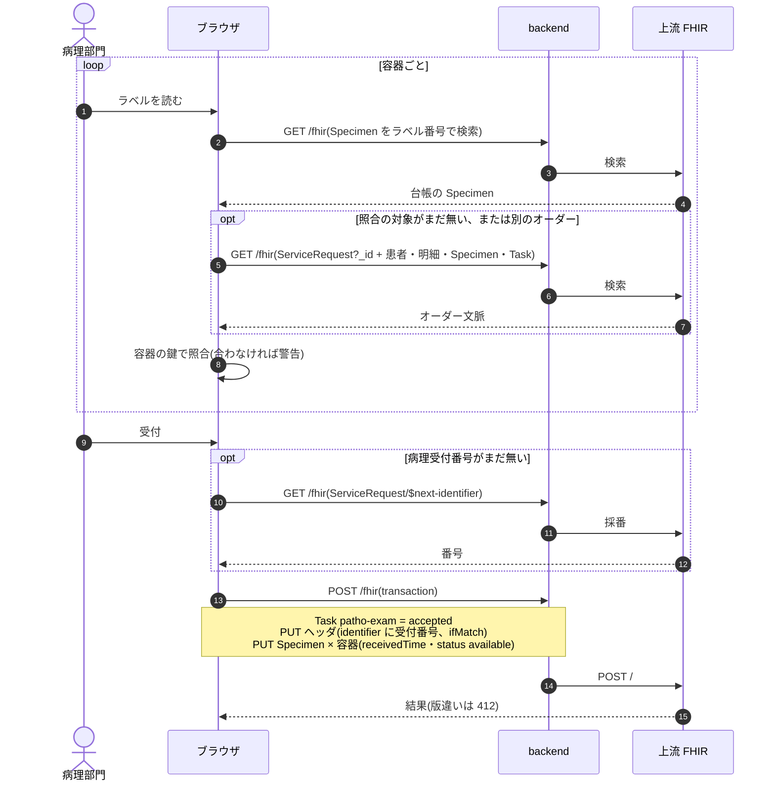

### シーケンス図: 一覧・検査済・中止

`pages/PathoWorklistPage.tsx`、`usePathoWorklist` / `useUpdatePathoTaskStatus`(`api/queries/patho.ts`)、`makeUpdateTaskStatusHook`(`api/queries/worklist.ts`)、`findPathoOrderIdByNumber`(`api/queries/pathoReception.ts`)。

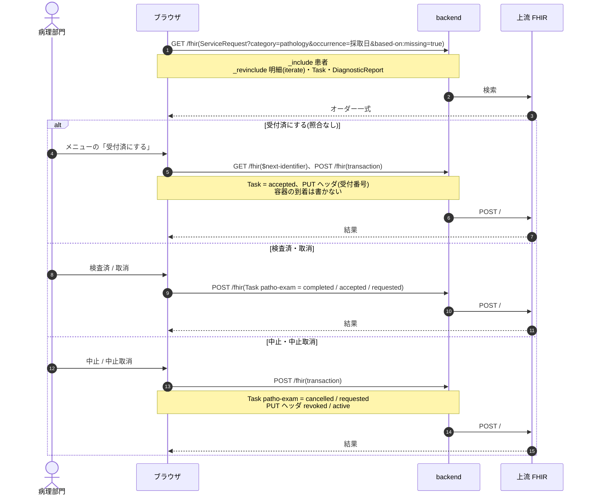

### シーケンス図: レポートの登録・編集・削除

`components/KartePathoResultTab.tsx`・`PathoResultForm.tsx`・`PathoResultDetailPanel.tsx`、`buildPathoResultBundle` / `buildPathoResultUpdateBundle` / `buildPathoResultDeleteBundle` / `nextReportStatus`(`fhir/pathoResultHelpers.ts`)、
`useCreatePathoResult` / `useUpdatePathoResult` / `useDeletePathoResult` / `withPathoReportTasks`(`api/queries/patho.ts`)。

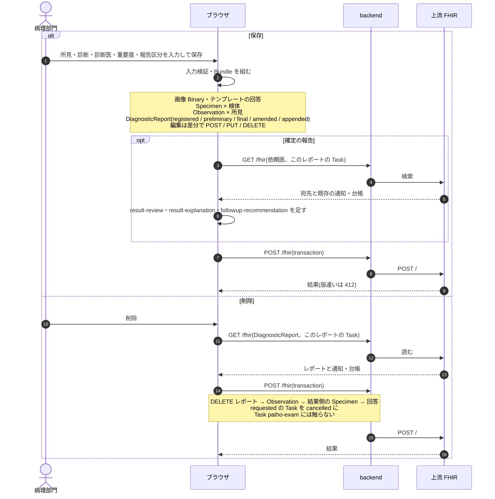

結果確認の書き込みは [lab.md](lab.md)「シーケンス図: 結果確認」のカルテからの経路と同じです(`ResultReviewAction`、`useMarkResultReviewed`)。

### シーケンス図: 患者説明の記録

`components/ResultExplanationAction.tsx`・`ResultExplanationModal.tsx`、`recordExplanationEntry`(`fhir/resultExplanationHelpers.ts`)、`useRecordExplanation` / `useReopenExplanation`(`api/queries/resultFollowup.ts`)。

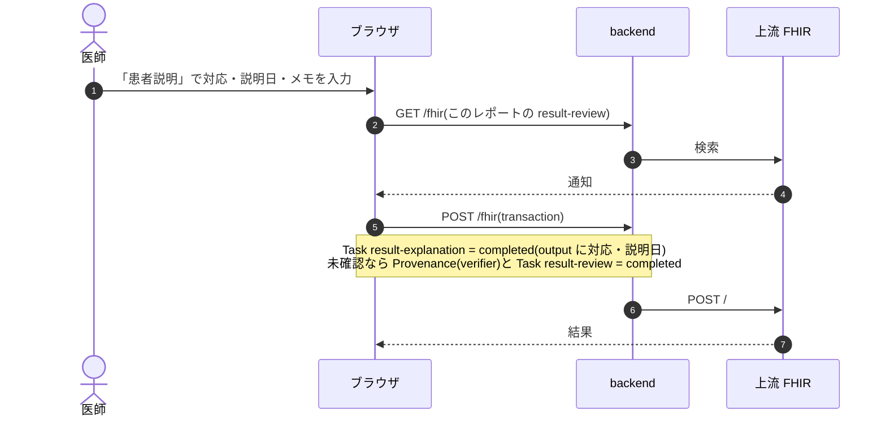

### 医事会計と SS-MIX2

病理検査は検体検査と同じくオーダーで集める種別です(`BillingClaimBuilder` の `:order` 経路)。実施入力を持たないので、進捗 Task は見ず、**オーダーの採取(予定)日**で集めます。採取の記録の日時は使いません。中止は `ServiceRequest.status` で判定します。
レセ電算コードは検査項目マスタではなく施設設定の「病理検査(検査区分ごと)」から検査区分で引きます(`Resolvers::Pathology`)。数量は検体明細の数です。判断料・診断料は日レセが自動算定します。
SS-MIX2 の電文は持ちません。`OmlO33` は `order-type|lab`、`OmgO19` は放射線・内視鏡・生理、`OulR22` は v2-0074 `LAB`、`OruR01` は `physio` だけを対象にします。

| 起きたこと | 医事会計(`BillingClaimBuilder`) | SS-MIX2 |
|---|---|---|
| 登録・編集 | 採取(予定)日のオーダーを検査区分のコードで送る。コードが未設定なら「送れない項目」に出す | なし |
| 採取・ラベル発行・受付・検査済 | なし | なし |
| レポートの保存・訂正・追加・削除 | なし | なし |
| 中止 | 対象から外れる(`ServiceRequest` が `revoked`) | なし |
| 削除 | 対象から外れる | なし |
