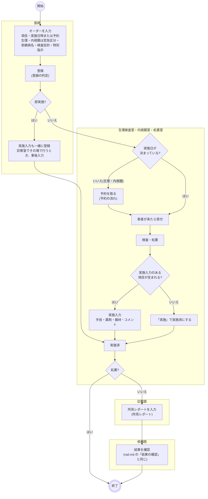
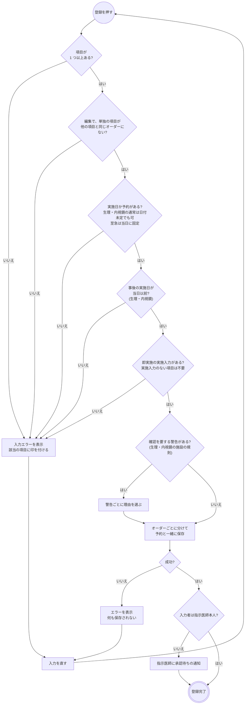
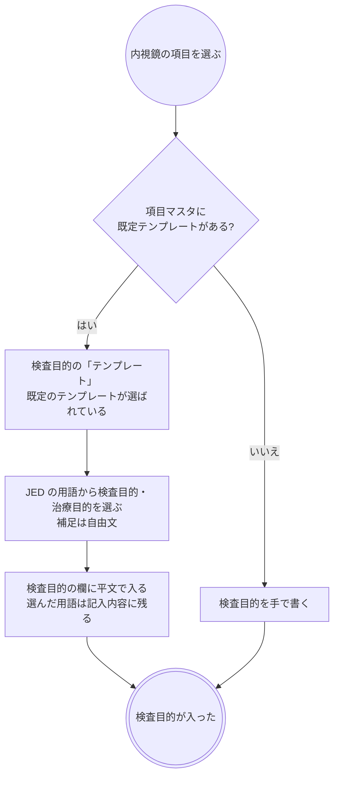
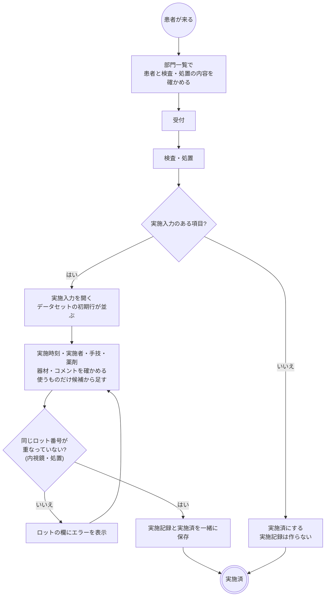
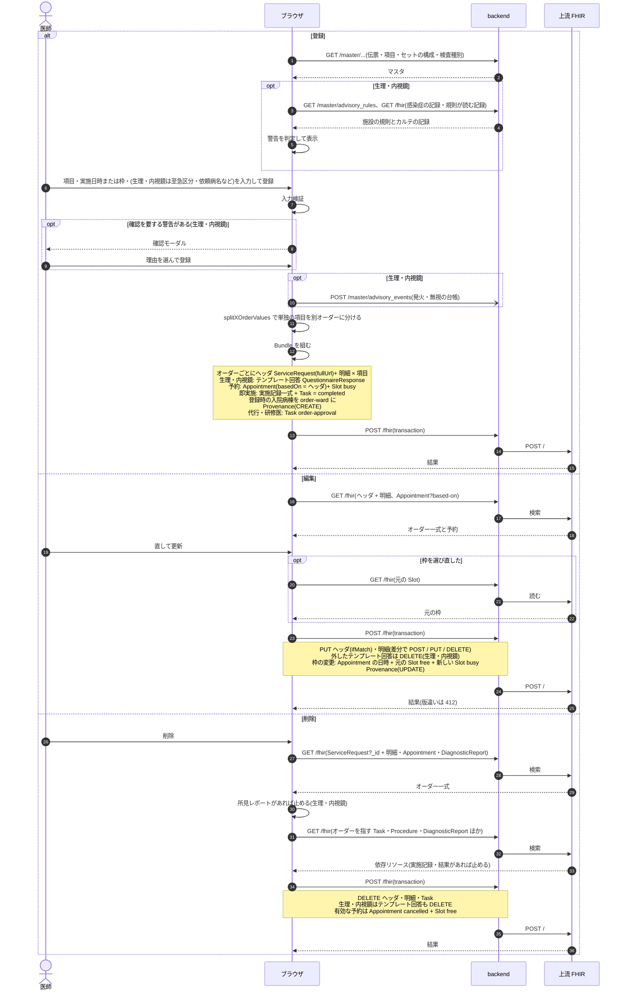
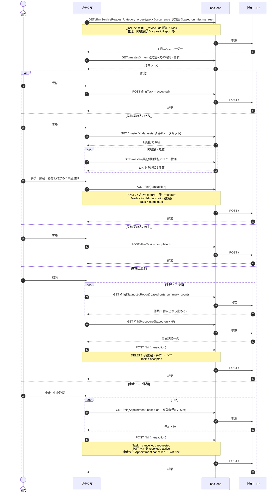

# 生理検査・内視鏡・処置オーダーの業務フロー

生理検査・内視鏡・処置オーダーの登録から予約・受付・実施・所見レポート・結果確認までの流れです。医療機関の運用を検討する人は「運用フロー」、院内の開発者は「開発者向け」を読みます。
3 種別とも放射線検査と同じ形(項目マスタ・伝票・部門一覧・実施入力・予約枠)なので、この文書は [rad.md](rad.md) との違いを中心に書きます。
設計は [physio-order-design.md](../physio-order-design.md)・[endoscopy-order-design.md](../endoscopy-order-design.md)・[treatment-order-design.md](../treatment-order-design.md)(マスタとオーダー)・
[exam-report-design.md](../exam-report-design.md)(所見レポート)、画面のふるまいは [features/lab.md](../features/lab.md)「生理検査・内視鏡の所見レポート」、
種別共通の約束(日付未定・中止・削除・代行入力・警告)は [features/orders-common.md](../features/orders-common.md)、リソースの要素は実装ガイド(`../fhir-ig`)が正典です。
内視鏡で採った組織は、別に病理検査オーダーを出します([patho.md](patho.md))。

## 運用フロー

### 放射線検査との違い

| | 放射線検査 | 生理検査 | 内視鏡 | 処置 |
|---|---|---|---|---|
| 項目の分類 | モダリティ(JJ1017) | 検査種別(施設が登録。seed 8 件) | 検査種別(JED の 4 区分と対応。seed 6 件) | なし |
| 部位・左右 | あり | なし(項目名に含める) | なし | なし |
| 至急区分 | 通常・至急・事後 | 同じ | 同じ | **なし**(すべて通常として扱い、事後もない) |
| 日付未定 | できる | できる | できる | **できない** |
| 依頼病名・検査目的・特別指示 | 項目ごと | 項目ごと | 項目ごと。検査目的は JED 用語のテンプレートで選ぶ | **なし**(対象プロブレムだけ) |
| 登録時の警告 | 造影・MRI・妊娠・感染症・施設の規則 | 感染症・施設の規則 | 感染症・施設の規則 | **なし** |
| 実施入力 | 手技・造影剤・器材・被曝線量・コメント | 手技・薬剤・器材・コメント | 手技・薬剤・器材・コメント | 手技・薬剤・器材・コメント |
| ロット番号の欄 | 造影剤で出る | **出ない** | 出る | 出る |
| 器材の選び方 | 施設の器材マスタ | 特定保険医療材料を直接(名称の手入力も可) | 同じ | 同じ |
| 結果 | 読影レポート | 所見レポート(「判定」) | 所見レポート(「診断」) | **なし** |
| 外来の診察終了の「一時終了」 | 対象 | 対象 | 対象 | **対象外** |

- 項目の 3 つの設定(オーダー単位・予約・実施入力)は放射線と同じで、流れの分かれ方も同じです([rad.md](rad.md)「区分ごとの違い」)。
- 薬剤の投与経路の選択肢は種別ごとに違います。生理検査は吸入(負荷試験・気道可逆性試験)、内視鏡は静注・筋注・外用・直腸内(鎮静・鎮痙・咽頭麻酔・前処置)、処置は外用を先頭に置きます。
- 処置は至急・日付未定・検査目的を持たないので、フォームの「選択中」の枠は実施日時(または予約)と即実施だけです。
- 入口はカルテの右ペイン「生理検査」「内視鏡」「処置」の伝票と項目検索、オーダーセット、クリニカルパスです。

### 進捗の状態

3 種別とも放射線と同じ 4 状態です。所見レポートの進み具合はこの状態に含めず、一覧の「所見」の列に報告区分で出します。

| 状態 | 変わるきっかけ | 部門一覧からできること |
|---|---|---|
| 依頼済 | 医師の登録、取消、中止取消 | 受付、中止、予約(生理・内視鏡の日付未定のとき) |
| 受付済 | 受付、実施の取消 | 実施、取消(依頼済へ)、中止、予約(生理・内視鏡の日付未定のとき) |
| 実施済 | 実施登録、即実施 | 所見(生理・内視鏡)、取消(受付済へ) |
| 中止 | 中止 | 中止取消(依頼済へ) |

- 部門一覧は**部門業務 > 生理検査一覧 / 内視鏡一覧 / 処置一覧**です。実施日ごとに実施時刻の順に並び、時刻の無いオーダーは後ろです。
- 生理検査一覧・内視鏡一覧は「実施日別」と「日付未定」のタブを持ち、検査種別で絞り込めます。至急の行は色が変わります。処置一覧は実施日別だけで、検査種別の絞り込みと至急の色はありません。
- 3 つとも入外区分・病棟・診療科・状態で絞り込め、患者の列に注意区分・アレルギー・感染症の印が出ます。通知は出ません。

### 全体の流れ

- 処置は実施済で終わります。処置の所見(創部の状態・写真)を残す報告書は無く、実施コメントに書きます。
- 外来の診察終了で、当日の生理検査・内視鏡が依頼済・受付済のまま残っていると「一時終了」を選べます。処置は対象にしません。
- 心電計・超音波装置・内視鏡システムとは接続しません。検査の事実は実施入力で記録し、波形や画像は所見レポートに添付します。

### 登録の判定

| 判定 | 生理検査・内視鏡 | 処置 |
|---|---|---|
| 実施日 | 通常は実施日か日付未定。至急は当日に固定。事後は当日以前 | 必須 |
| 予約必須の項目 | 通常は予約か日付未定。至急・事後は予約を取らない | 予約が必須 |
| 即実施 | 予約必須の項目を含む通常のオーダーと日付未定はできない。事後は必ず即実施 | 予約必須の項目を含むオーダーはできない |
| 警告 | 感染症(表示のみ)と、「警告の規則マスタ」で出す場所に生理検査・内視鏡を選んだ規則 | なし |

- 予約必須の項目は、至急区分の無い処置では「予約を取らずに今日行う」ことができません。その場で行う処置は、予約不要の項目にしておきます。
- 検査目的・特別指示は項目マスタの既定テンプレートから記入できます(内視鏡は「内視鏡の検査目的」)。
- 承認待ちでもオーダーは部門に流れます。オーダーセットの適用も同じフォームを通ります。

### 内視鏡の検査目的

- テンプレートは検査種別ごとの 4 本(上部 `END_EGD_PUR_01`・下部 `END_CS_PUR_01`・小腸 `END_SB_PUR_01`・ERCP `END_ERCP_PUR_01`)です。JED 用語集の表記をそのまま選択肢にしてあります。
- 前処置・鎮静の指示は特別指示のテンプレート(`END_EGD_01` など)で書きます。抗血栓薬の休薬は登録の判定に入りません。
- 予定性(予定 / 緊急)は至急区分で表します。
- DO すると検査目的の文言は写りますが、テンプレートの記入内容との結び付きは外れます。

### 予約の流れ

放射線と同じです([rad.md](rad.md)「予約の流れ」)。枠は項目マスタの枠表から所要時間ぶん連続して押さえ、枠の日時が実施日時になります。

| 予約を取る場面 | 生理検査・内視鏡 | 処置 |
|---|---|---|
| 登録時にフォームで枠を選ぶ | できる | できる |
| 日付未定で登録した後、部門一覧の日付未定タブの「予約」 | できる | なし(日付未定が無い) |
| 登録後にカルテのカードの編集で選び直す | できる | できる |

- 予約タブには検査予約も並び、「日時変更・取消は検査オーダーから」と出ます。変更はオーダーの編集、取消はオーダーの中止か削除で行います。
- 検査予約は外来一覧に出ません。

### 受付と実施

- 実施時刻の初期値は現在時刻、実施者はログイン中の医療従事者です。
- 手技(手技料)は医科診療行為マスタから選びます。検索の既定の章は、生理検査・内視鏡が画像診断(E)、処置が処置(J)です。会計に送る手技はここで選んだものなので、データセットの初期行に手技を入れておきます。
- 器材は特定保険医療材料から選び、マスタに無いものは名称を手で入れられます。名称だけの器材は会計に送れず、送信前の確認に「送れない項目」として出ます。
- ロット番号の欄は、内視鏡・処置で薬剤付加情報のロット管理の薬を入れたときだけ出ます。生理検査には出ません。
- 日付未定のオーダーは受付できますが、実施はできません。
- 途中でやめた記録を残す操作はありません。行わなかった検査・処置は中止にします。

### 所見レポート(生理検査・内視鏡)

入力・画像・描き込み・報告区分・重要所見・フォロー推奨・確認の流れは放射線の読影レポートと同じです([rad.md](rad.md)「読影と報告」「結果の確認」)。違いだけを書きます。

| | 読影レポート(放射線) | 生理検査 | 内視鏡 |
|---|---|---|---|
| 一覧のボタン | 「読影」 | 「所見」 | 「所見」 |
| 書く人の呼び方 | 読影医 | 記載医 | 記載医 |
| 最終報告に要るもの | 診断 | 判定 | 診断 |
| 描き込みの色 | 暗い画像向け | 既定の色(白地の波形) | 暗い画像向け |
| 既定テンプレート | 撮影項目マスタの「読影所見」 | 心電図 `PHY_ECG_RPT_01` など | 上部 `END_EGD_RPT_01`・大腸 `END_CS_RPT_01` など(検査時情報・偶発症は JED の表記) |
| 重要所見の通知 | 重要所見(放射線) | 重要所見(生理検査) | 重要所見(内視鏡) |
| カルテのタブ | 検査結果 > 放射線検査 | 検査結果 > 生理検査 | 検査結果 > 内視鏡 |

- 入口は部門一覧の実施済の行の「所見」(登録済みなら「所見編集」)、カルテのカードのメニュー「所見レポート登録 / 編集」、カルテの検査結果タブ(実施済でレポートの無いオーダーを選んでから書く)です。
- 所見レポートのある検査は、実施の取消とオーダーの削除ができません。先にレポートを削除します。
- 心電図の各間隔・心エコーの EF のような計測値は項目として持たず、所見の文章とテンプレートに書きます。

### 変更・中止・削除

放射線と同じです([rad.md](rad.md)「変更・中止・削除」)。違いは次のとおりです。

| 操作 | 生理検査・内視鏡 | 処置 |
|---|---|---|
| 変更 | 放射線と同じ。受付済・実施済でも止まりません | 同じ |
| 中止 | 部門一覧のメニュー。実施済からはできません(先に取消)。有効な検査予約を取り消して枠を空きに戻します | 同じ |
| 実施の取消 | 実施記録(薬剤を含む)を消します。所見レポートがあるとできません | 実施記録を消します |
| 削除 | 実施記録か所見レポートがあるとできません。検査予約を取り消し、検査目的・特別指示のテンプレートの記入内容も一緒に消えます | 実施記録があるとできません。検査予約を取り消します |

- DO はオーダーの内容だけを写します。予約・実施記録・所見レポートは写りません。

### 帳票

専用の帳票はありません。

## 開発者向け

### リソースの構成

オーダーはヘッダの `ServiceRequest`(`order-type|physio` / `endoscopy` / `treatment`)と、項目 1 件ずつの明細 `ServiceRequest`(`basedOn` でヘッダを指す)です。セットの構成項目はさらに親の明細を `basedOn` で指します。
放射線との違いは、明細に JJ1017 のコードと `bodySite` が無いこと、実施記録に被曝線量の `Observation` が無いこと、処置の明細が `category`・`reason*`・`note`・拡張を持たないことです。

| もの | 生理検査 | 内視鏡 | 処置 |
|---|---|---|---|
| 明細の項目コード | `physio-order-item` | `endoscopy-order-item` | `treatment-order-item` |
| 明細の `category` | `physio-exam-type`(検査種別) | `endoscopy-exam-type`(検査種別) | なし |
| ヘッダの `priority` | `routine`(通常)/ `urgent`(至急)/ `asap`(事後) | 同じ | 書かない |
| 検査目的・特別指示 | GP の明細に拡張 `physio-exam-purpose` と `note`、テンプレート回答は拡張 `physio-exam-purpose-questionnaire-response` / `physio-remarks-questionnaire-response` | `endoscopy-*` の同名の拡張 | なし |
| 進捗 | `Task`(`task-code|physio-exam`、`focus` = ヘッダ) | `Task`(`task-code|endoscopy-exam`) | `Task`(`task-code|treatment`) |
| 予約 | `Appointment`(`basedOn` = ヘッダ)+ `Slot` | 同じ | 同じ |
| 実施記録 | ハブ `Procedure`(`category` = `order-type|physio`、`code` = 手技 1 件目の `physio-procedure-code`、`usedCode` = 器材 + 拡張 `physio-material-quantity`)← `partOf` ── `Procedure`(2 件目以降の手技)、`MedicationAdministration`(薬剤) | `endoscopy-*` の同じ形。薬剤にロット番号 | `treatment-*` の同じ形。薬剤にロット番号 |
| 所見レポート | `DiagnosticReport`(`category` = `order-type|physio` と v2-0074 `OTH`、`code` = `exam-report-code|physio`、`conclusion` = 判定)+ `Observation`(所見) | `DiagnosticReport`(`category` = `order-type|endoscopy` と `OTH`、`code` = LOINC `18751-8`) | なし |
| 重要所見の通知 | `Task`(`task-code|physio-critical-finding`、`focus` = レポート) | `Task`(`task-code|endoscopy-critical-finding`) | なし |
| 検査結果確認・フォロー推奨・確認(既読) | 放射線と同じ(`result-review`・`followup-recommendation`・`Provenance` verifier) | 同じ | なし |
| 代行入力・警告の確認 | `Provenance`(`target` = ヘッダ) | 同じ | 代行入力だけ |

所見レポートの部品は放射線と共用で、違いは `EXAM_REPORT_CONFIGS.physio` / `.endoscopy`(`fhir/examReportHelpers.ts`)の設定だけです。
`category` に v2-0074 の `OTH` を持つので、検体検査・細菌・病理の結果タブには混ざりません。

### 進捗 Task

状態と遷移は 3 種別で同じで、`fhir/examTaskHelpers.ts` の `examTaskActions` と `createExamTaskHelpers` を `Task.code` だけ変えて使います。
Task は登録時には作らず、**Task が無いオーダーは依頼済**です。即実施だけは登録と同じ transaction で `completed` の Task を作ります。
各状態で同じ transaction に書くものは放射線と同じです([rad.md](rad.md)「進捗 Task」)。実施の取消で消す実施記録に `Observation` が無いことだけが違います(`performCancelEntries` の `observations: false`)。

### シーケンス図の前提

`/fhir` への書き込みはどれも 1 回の transaction Bundle で、backend の `FhirProxyController` が上流へ中継します。
SS-MIX2 を有効にしている施設では、中継が書き込みの控えを記録します(`Ssmix2::Recorder`)。
楽観ロックの版は `postBundle` が `ifMatch` に添え、版が違えば 412 で止まります。

生理検査と内視鏡の hook は `api/queries/examOrder.ts` の `createExamOrderQueries` が部門の設定から作ります(`api/queries/physio.ts`・`endoscopy.ts`)。処置は同じ形を `api/queries/treatment.ts` に直接持ちます。
下の図の `X` は `Physio` / `Endoscopy` / `Treatment` のどれかです。

| 部品 | 生理検査 | 内視鏡 | 処置 |
|---|---|---|---|
| フォーム | `components/PhysioOrderForm.tsx`・`PhysioOrderPanels.tsx` | `EndoscopyOrderForm.tsx`・`EndoscopyOrderPanels.tsx` | `TreatmentOrderForm.tsx`・`TreatmentOrderPanels.tsx` |
| オーダーの組み立て | `fhir/physioOrderHelpers.ts` | `fhir/endoscopyOrderHelpers.ts` | `fhir/treatmentOrderHelpers.ts` |
| 実施記録の組み立て | `fhir/physioResultHelpers.ts` | `fhir/endoscopyResultHelpers.ts` | `fhir/treatmentResultHelpers.ts` |
| 部門一覧 | `pages/PhysioWorklistPage.tsx` → `ExamWorklistPage.tsx` | `pages/EndoscopyWorklistPage.tsx` → `ExamWorklistPage.tsx` | `pages/TreatmentWorklistPage.tsx` |
| 実施入力 | `components/PhysioPerformModal.tsx` | `EndoscopyPerformModal.tsx` | `TreatmentPerformModal.tsx` |
| 警告 | `useInfectionAdvisory`・`useAdvisoryRuleAdvisories(…, "physio")` | 同じ(`"endoscopy"`) | なし |

### シーケンス図: 登録・編集・削除

`buildXOrderBundle` / `buildXOrderUpdateBundle` / `buildXOrderDeleteBundle`、`buildXOrderWithPerformBundle`(即実施)、`useCreatePrescription`(`api/queries/labResult.ts`。全種別共通)、`useUpdateXOrder` / `useDeleteXOrder`。

### シーケンス図: 日付未定の予約(生理検査・内視鏡)

放射線と同じ書き込みです([rad.md](rad.md)「シーケンス図: 日付未定の予約」)。`ExamWorklistPage.tsx` の日付未定タブ(`UNSCHEDULED_WORKLIST_DATE` で `occurrence:missing=true` を引く)から `components/ExamBookingModal.tsx`、`useScheduleExamOrder`(`api/queries/worklist.ts`)、`buildExamScheduleBundle`(`fhir/appointmentHelpers.ts`)を通ります。枠表と所要時間は、オーダーの項目のうち枠表を持つ最初の項目のマスタ値を初期値にします。

### シーケンス図: 受付・実施・取消・中止

`useXWorklist` / `useUpdateXTaskStatus` / `useRegisterXPerform`、`makeUpdateTaskStatusHook`(`api/queries/worklist.ts`。`releaseAppointments` と `cancelPerform` を有効にして使う)、`buildXPerformBundle` / `buildXPerformDeleteEntries`。

### シーケンス図: 所見レポートと結果確認(生理検査・内視鏡)

放射線の読影レポートと同じ書き込みです([rad.md](rad.md)「シーケンス図: 読影レポート」「シーケンス図: 結果確認」)。
部品は `components/ExamReportEntryModal.tsx`・`ExamReportForm.tsx`・`KarteExamReportTab.tsx`、`buildExamReportBundle`(`fhir/examReportHelpers.ts`)、`useSaveExamReport` / `useDeleteExamReport`(`api/queries/examReport.ts`)で、
読み替えるのは `DiagnosticReport` の `category` と `code`、重要所見の `Task.code`(`physio-critical-finding` / `endoscopy-critical-finding`)、拡張の接頭辞(`physio-` / `endoscopy-`)です。

### 医事会計と SS-MIX2

3 種別とも放射線と同じく実施記録から集めます(`BillingClaimBuilder` の `:procedure` 経路、`OrderCatalog`)。手技はハブと子の `Procedure.code` で、オーダー項目の `receipt_code` は使いません。
薬剤・器材・実施コメントと一緒に 1 剤にし、剤の区分は手技の点数表の章から決めます。放射線にある部位のコメントは付きません。日付は実施時刻の日です。
実施入力のない項目だけのオーダーに限り、オーダーの実施日と項目の `receipt_code` で組みます。

| 起きたこと | 医事会計(`BillingClaimBuilder`) | SS-MIX2 |
|---|---|---|
| 登録・編集・予約 | なし | 生理は OMG^O19(OMG-03)、内視鏡は OMG^O19(OMG-02)。ヘッダを書くと出す。OBR-4 は検査種別・項目のローカルコード。処置はなし |
| 受付 | なし | なし(進捗 Task はメッセージにしない) |
| 実施(実施入力あり) | 実施記録から手技・薬剤・器材・コメントを送る。コードの無い行(手入力の器材など)は「送れない項目」に出す | 内視鏡は OMI^Z23(OMG-12)。生理・処置はなし |
| 実施(実施入力なし) | 部門が実施済にしたオーダーの項目を `receipt_code` で送る | なし |
| 当日の未実施 | 実施入力ありは「実施記録がありません(未実施のため送りません)」、なしは「部門で実施済になっていません」と報告 | なし |
| 実施の取消 | 対象から外れる | 内視鏡は OMI^Z23 の `CA`(DEL) |
| 中止 | 対象から外れる(`ServiceRequest` が `revoked`)。送ったあとの中止は医事が送り直す | 生理・内視鏡は OMG^O19 の `CA`(DEL)。中止取消は `NW`(INS) |
| 削除 | 対象から外れる | 生理・内視鏡は OMG^O19 の `CA`(DEL) |
| 所見レポートの保存・訂正・削除 | なし | 生理は ORU^R01(OMG-13)。所見と判定を OBX の TX に置き、訂正も INS、削除は DEL。内視鏡はなし |
