# 生理検査・内視鏡・処置オーダーの業務フロー

生理検査・内視鏡・処置オーダーの登録から予約・受付・実施・所見レポート・結果確認までの流れです。
3 種別とも放射線検査と同じ形(項目マスタ・伝票・部門一覧・実施入力・予約枠)なので、この文書は [rad.md](rad.md) との違いを中心に書きます。先に [rad.md](rad.md) を読むと、流れをつかみやすくなります。
内視鏡で採った組織は、別に病理検査オーダーを出します([patho.md](patho.md))。

医療機関の運用を検討する人は「運用フロー」、院内の開発者は「開発者向け」を読みます。
設計は [physio-order-design.md](../physio-order-design.md)・[endoscopy-order-design.md](../endoscopy-order-design.md)・[treatment-order-design.md](../treatment-order-design.md)(マスタとオーダー)・
[exam-report-design.md](../exam-report-design.md)(所見レポート)、画面のふるまいは [features/lab.md](../features/lab.md)「生理検査・内視鏡の所見レポート」、
種別共通の約束(日付未定・中止・削除・代行入力・警告)は [features/orders-common.md](../features/orders-common.md)、リソースの要素は実装ガイド(`../fhir-ig`)が正典です。

## 運用フロー

### 全体の流れ

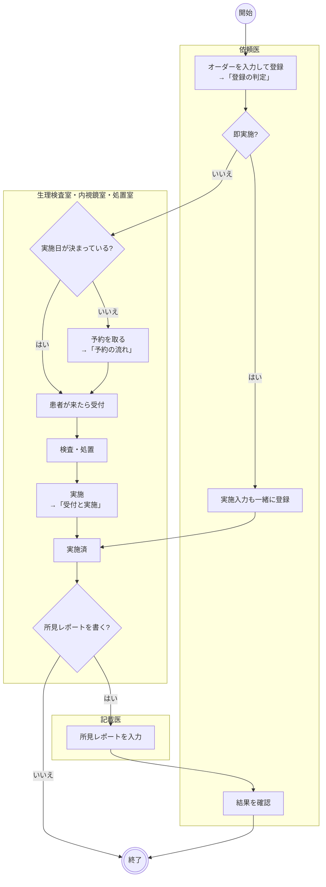

この文書で使う呼び名です。

| 呼び名 | 意味 |
|---|---|
| 依頼医 | オーダーを出した医師。結果の通知の宛先になる |
| 記載医 | 所見レポートを書く医師 |
| 部門一覧 | 「部門業務 > 生理検査一覧」「部門業務 > 内視鏡一覧」「部門業務 > 処置一覧」 |
| 即実施 | 登録と一緒に実施入力も済ませる。診察室でその場で行うときと、事後の入力に使う |
| 事後 | 終わった検査を後から入れるための至急区分 |
| 日付未定 | 実施日を決めずに登録すること |
| カード | カルテに出る、オーダー 1 件ぶんの表示 |
| 取消 | 状態を 1 つ前へ戻す訂正(実施済 → 受付済、受付済 → 依頼済) |
| 中止 | 検査・処置をやめる。「中止取消」で依頼済に戻せる |
| 削除 | オーダーそのものを消す |

- **入口**: 依頼医はカルテの右ペイン(右側のオーダー入力)の「生理検査」「内視鏡」「処置」で、伝票か項目検索から項目を選びます。オーダーセット、クリニカルパスからも出せます。
- **入力する項目**: 項目と、実施日時(または予約)です。生理検査・内視鏡は、至急区分・依頼病名・検査目的・特別指示も入れます。
- **処置の入力**: 処置は至急・日付未定・検査目的を持たないので、フォームの「選択中」の枠は実施日時(または予約)と即実施だけです。
- **日付未定**: 日付未定で登録できるのは生理検査・内視鏡だけです。処置は実施日が必ず決まっています。
- **所見レポート**: 所見レポートがあるのは生理検査・内視鏡だけです。処置は実施済で終わります。
- **処置の所見**: 処置の所見(創部の状態・写真)を残す報告書は無く、実施コメントに書きます。
- **外来の一時終了**: 外来の診察終了で、当日の生理検査・内視鏡が依頼済・受付済のまま残っていると「一時終了」を選べます。処置は対象にしません。
- **装置との接続**: 心電計・超音波装置・内視鏡システムとは接続しません。検査の事実は実施入力で記録し、波形や画像は所見レポートに添付します。

### 進捗の状態

3 種別とも放射線検査と同じ 4 つの状態です。所見レポートの進み具合はこの状態に含めず、部門一覧の「所見」の列に報告区分で出します。

| 状態 | 変わるきっかけ | 部門一覧からできること |
|---|---|---|
| 依頼済 | 依頼医の登録、受付済からの取消、中止取消 | 受付、中止、予約 |
| 受付済 | 受付、実施済からの取消 | 実施、取消(依頼済へ)、中止、予約 |
| 実施済 | 実施登録、即実施 | 所見、取消(受付済へ) |
| 中止 | 中止 | 中止取消(依頼済へ) |

- 「予約」ができるのは、生理検査・内視鏡の日付未定のオーダーだけです。
- 「所見」ができるのは、生理検査・内視鏡だけです。

**部門一覧の見え方**

- 部門一覧は、実施日ごとに実施時刻の順に並びます。時刻の無いオーダーは後ろです。
- 生理検査一覧・内視鏡一覧は「実施日別」と「日付未定」のタブを持ち、検査種別で絞り込めます。至急の行は色が変わります。
- 処置一覧は実施日別だけで、検査種別の絞り込みと至急の色はありません。
- 3 つとも入外区分・病棟・診療科・状態で絞り込め、患者の列に注意区分・アレルギー・感染症の印が出ます。
- オーダーが登録されても、部門への通知は出ません。

### 登録の判定

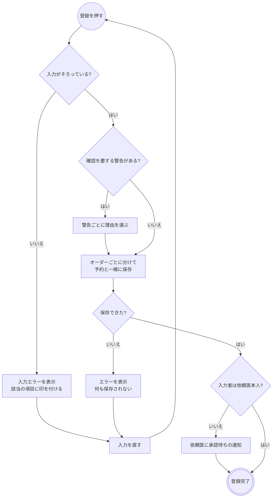

「入力がそろっている?」で確かめるのは次の項目です。

| 項目 | 生理検査・内視鏡 | 処置 |
|---|---|---|
| 項目 | 1 つ以上ある | 1 つ以上ある |
| 単独の項目(編集のとき) | 他の項目と同じオーダーにない | 他の項目と同じオーダーにない |
| 実施日 | 通常は実施日か日付未定。至急は当日に固定。事後は当日以前 | 必須 |
| 予約必須の項目 | 通常は予約か日付未定。至急・事後は予約を取らない | 予約が必須 |
| 即実施の実施入力 | 即実施のとき、実施入力がある | 即実施のとき、実施入力がある |

即実施の実施入力は、実施入力のない項目には要りません。

即実施にできないオーダーは次のとおりです。

| 種別 | 即実施にできないオーダー |
|---|---|
| 生理検査・内視鏡 | 予約必須の項目を含む通常のオーダーと、日付未定のオーダー。事後は必ず即実施 |
| 処置 | 予約必須の項目を含むオーダー |

- **警告(生理検査・内視鏡)**: 感染症の警告は表示のみです。ほかに、施設の規則(「警告の規則マスタ」で出す場所に生理検査・内視鏡を選んだ規則)が出ます。確認を要する警告は、理由を選べば登録できます。
- **警告(処置)**: 処置に登録時の警告はありません。
- **項目の設定**: 項目の 3 つの設定(オーダー単位・予約・実施入力)は放射線検査と同じで、流れの分かれ方も同じです([rad.md](rad.md)「区分ごとの違い」)。
- **テンプレート**: 検査目的・特別指示は項目マスタの既定テンプレートから記入できます(内視鏡は「内視鏡の検査目的」)。
- **承認**: 入力者が依頼医本人でないとき(代行入力)は、依頼医の承認待ちになります。承認待ちでもオーダーは部門に出ます。
- **オーダーセット**: オーダーセットの適用も同じフォームで登録します。

設定する人へ: 処置には至急区分が無いので、予約必須の項目は予約を取らずに今日行うことができません。その場で行う処置は、予約不要の項目にしておきます。

### 内視鏡の検査目的

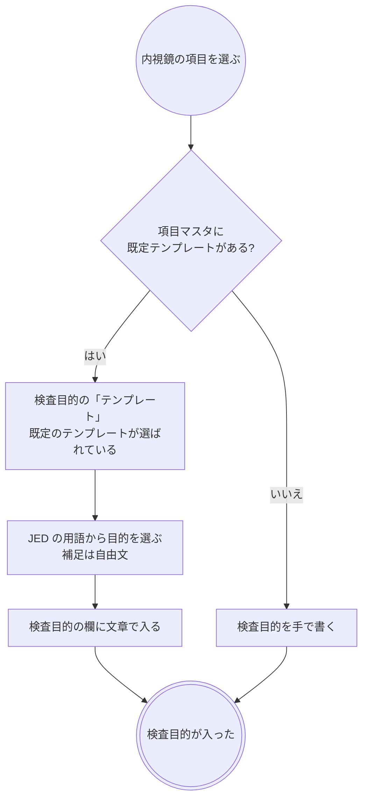

- **選ぶもの**: JED の用語から、検査目的・治療目的を選びます。選んだ用語は、テンプレートの記入内容として残ります。
- **テンプレート**: 検査種別ごとの 4 本(「上部内視鏡 検査目的」「下部内視鏡 検査目的」「小腸内視鏡 検査目的」「ERCP 検査目的」)です。JED 用語集の表記をそのまま選択肢にしてあります。
- **前処置・鎮静**: 前処置・鎮静の指示は特別指示のテンプレート(「上部内視鏡 前処置・鎮静指示」など)で書きます。抗血栓薬の休薬は登録の判定に入りません。
- **予定性**: 予定性(予定 / 緊急)は至急区分で表します。
- **DO**: DO(前回と同じ内容で出し直す)では、検査目的の文言は写りますが、テンプレートの記入内容は写りません。

### 予約の流れ

放射線検査と同じです。要点は次の 3 つです。

- 枠は項目マスタの枠表から、所要時間ぶん連続して押さえます。枠の日時が実施日時になります。
- 予約とオーダーは一緒に動きます。予約の変更はオーダーの編集、取消はオーダーの中止か削除で行います。
- 詳しくは [rad.md](rad.md)「予約の流れ」を読みます。

| 予約を取る場面 | 生理検査・内視鏡 | 処置 |
|---|---|---|
| 登録時にフォームで枠を選ぶ | できる | できる |
| 日付未定で登録した後、部門一覧の「日付未定」タブの「予約」 | できる | できない(日付未定が無い) |
| 登録後にカルテのカードの編集で選び直す | できる | できる |

- カルテの予約タブには検査予約も並び、「日時変更・取消は検査オーダーから」と出ます。
- 検査予約は外来一覧に出ません。

### 受付と実施

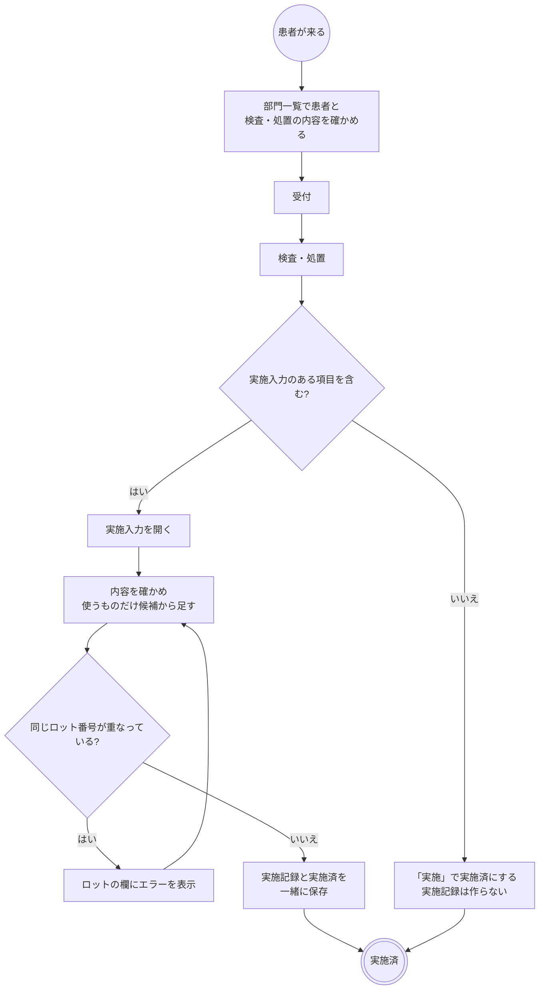

実施入力で確かめる項目は次のとおりです。

| 項目 | 内容 |
|---|---|
| 実施時刻 | 初期値は現在時刻 |
| 実施者 | 初期値はログイン中の医療従事者 |
| 手技(手技料) | 医科診療行為マスタから選ぶ |
| 薬剤 | 投与経路の選択肢は種別ごとに違う |
| 器材 | 特定保険医療材料から選ぶ |
| コメント | 実施のコメント |

- **初期の行**: 実施入力を開くと、項目に紐付けた実施入力データセットの初期の行が並びます。
- **手技**: 会計に送る手技は、実施入力で選んだものです。
- **器材**: マスタに無い器材は、名称を手で入れられます。名称だけの器材は会計に送れず、送信前の確認に「送れない項目」として出ます。
- **ロット番号**: ロット番号の欄は、内視鏡・処置で薬剤付加情報のロット管理の薬を入れたときだけ出ます。生理検査には出ません。
- **日付未定**: 日付未定のオーダーは受付できますが、実施はできません。
- **途中でやめたとき**: 途中でやめた記録を残す操作はありません。行わなかった検査・処置は中止にします。

薬剤の投与経路の選択肢は、種別ごとに次のものを先頭に置きます。

| 種別 | 先頭に置く投与経路 | 使う場面 |
|---|---|---|
| 生理検査 | 吸入 | 負荷試験・気道可逆性試験 |
| 内視鏡 | 静注・筋注・外用・直腸内 | 鎮静・鎮痙・咽頭麻酔・前処置 |
| 処置 | 外用 | — |

設定する人へ: 手技の検索の既定の章は、生理検査・内視鏡が画像診断(E)、処置が処置(J)です。会計に送る手技は実施入力で選んだものなので、データセットの初期行に手技を入れておきます。

### 所見レポート(生理検査・内視鏡)

入力・画像・描き込み・報告区分・重要所見・フォロー推奨・確認の流れは、放射線検査の読影レポートと同じです。要点は次のとおりです。

- **報告区分**: 暫定報告・最終報告で保存します。確定済み(最終報告・訂正報告)のレポートを直すと、訂正報告になります。
- **通知**: 重要所見があれば重要所見の通知が、重要所見のない最終報告・訂正報告なら検査結果確認の通知が、依頼医に出ます。
- **結果の確認**: 依頼医は、通知の一覧かカルテで結果を確認します。確認者と日時が残ります。
- 詳しくは [rad.md](rad.md)「読影と報告」「結果の確認」を読みます。

放射線検査の読影レポートとの違いは次のとおりです。

| | 読影レポート(放射線検査) | 生理検査 | 内視鏡 |
|---|---|---|---|
| 一覧のボタン | 「読影」 | 「所見」 | 「所見」 |
| 書く人の呼び方 | 読影医 | 記載医 | 記載医 |
| 最終報告に要るもの | 診断 | 判定 | 診断 |
| 描き込みの色 | 暗い画像向け | 既定の色(白地の波形) | 暗い画像向け |
| 既定テンプレート | 撮影項目マスタの「読影所見」 | 「心電図 所見」など | 「上部内視鏡 所見」「大腸内視鏡 所見」など |
| 重要所見の通知 | 重要所見(放射線) | 重要所見(生理検査) | 重要所見(内視鏡) |
| カルテのタブ | 「検査結果 > 放射線検査」 | 「検査結果 > 生理検査」 | 「検査結果 > 内視鏡」 |

所見レポートを開く入口は 3 つです。

| 入口 | 開き方 |
|---|---|
| 部門一覧 | 実施済の行の「所見」(登録済みなら「所見編集」) |
| カルテのカード | カードのメニュー「所見レポート登録 / 編集」 |
| カルテの検査結果タブ | 実施済でレポートの無いオーダーを選んでから書く |

- 内視鏡の所見のテンプレートは、検査時情報・偶発症が JED の表記です。
- 所見レポートのある検査は、実施済からの取消とオーダーの削除ができません。先にレポートを削除します。
- 心電図の各間隔・心エコーの EF のような計測値は項目として持たず、所見の文章とテンプレートに書きます。

### 変更・中止・削除

放射線検査と同じです。要点は次のとおりです。詳しくは [rad.md](rad.md)「変更・中止・削除」を読みます。

| 操作 | できる場所 | できないとき |
|---|---|---|
| 変更 | カルテのカード | なし(受付済・実施済でもできる) |
| 中止 | 部門一覧の行のメニュー | 実施済のとき(先に取消) |
| 中止取消 | 部門一覧の行のメニュー | なし |
| 取消 | 部門一覧の行のメニュー | 所見レポートがあるとき(生理検査・内視鏡) |
| 削除 | カルテのカード | 実施記録か所見レポートがあるとき |

- **中止**: 有効な検査予約を取り消して、枠を空きに戻します。
- **実施済からの取消**: 実施記録(薬剤を含む)を消します。
- **削除**: 検査予約を取り消します。生理検査・内視鏡は、検査目的・特別指示のテンプレートの記入内容も一緒に消えます。
- **DO**: DO はオーダーの内容だけを写します。予約・実施記録・所見レポートは写りません。

### 放射線検査との違い

| | 放射線検査 | 生理検査 | 内視鏡 | 処置 |
|---|---|---|---|---|
| 項目の分類 | モダリティ | 検査種別(施設が登録) | 検査種別 | なし |
| 部位・左右 | あり | なし(項目名に含める) | なし | なし |
| 至急区分 | 通常・至急・事後 | 通常・至急・事後 | 通常・至急・事後 | なし |
| 日付未定 | できる | できる | できる | できない |
| 依頼病名・検査目的・特別指示 | 項目ごと | 項目ごと | 項目ごと | なし(対象プロブレムだけ) |
| 登録時の警告 | 造影・MRI・妊娠・感染症・施設の規則 | 感染症・施設の規則 | 感染症・施設の規則 | なし |
| 実施入力 | 手技・造影剤・器材・被曝線量・コメント | 手技・薬剤・器材・コメント | 手技・薬剤・器材・コメント | 手技・薬剤・器材・コメント |
| ロット番号の欄 | 造影剤で出る | 出ない | 出る | 出る |
| 器材の選び方 | 施設の器材マスタ | 特定保険医療材料 | 特定保険医療材料 | 特定保険医療材料 |
| 結果 | 読影レポート | 所見レポート(「判定」) | 所見レポート(「診断」) | なし |
| 外来の診察終了の「一時終了」 | 対象 | 対象 | 対象 | 対象外 |

- 放射線検査のモダリティは JJ1017 の分類です。
- 生理検査の検査種別の初期値は 8 件です。内視鏡の検査種別は JED の 4 区分と対応し、初期値は 6 件です。
- 処置は、至急区分が無いので、すべて通常として扱います。事後もありません。
- 内視鏡の検査目的は、JED 用語のテンプレートで選びます。
- 生理検査・内視鏡・処置の器材は、特定保険医療材料を直接選びます。名称の手入力もできます。

### 帳票

専用の帳票はありません。

## 開発者向け

### シーケンス図の前提

- **書き込みの経路**: `/fhir` への書き込みはどれも 1 回の transaction Bundle で、backend の `FhirProxyController` が上流の FHIR サーバー(以下「上流」)へ中継します。
- **図の省略**: 図では、上流の応答が backend を通ってブラウザへ戻る矢印を省き、上流からブラウザへの 1 本で描きます。
- **楽観ロック**: 版は `postBundle` が `ifMatch` に添え、版が違えば 412 で止まります。
- **SS-MIX2**: 有効にしている施設では、中継が書き込みの控えを記録します(`Ssmix2::Recorder`)。
- **ヘッダと明細**: オーダー 1 件の `ServiceRequest`(`order-type|physio` / `endoscopy` / `treatment`)を「ヘッダ」、項目 1 件ずつの `ServiceRequest` を「明細」と呼びます。明細は `basedOn` でヘッダを指します。
- **GP の明細**: 単項目の明細か、セット親の明細です。セットの構成項目の明細は、さらに親の明細を `basedOn` で指します。
- **ハブと子**: 実施記録の中心の `Procedure` を「ハブ」、ハブを `partOf` で指すリソースを「子」と呼びます。
- **`X` と `x`**: 図と表の `X` は `Physio` / `Endoscopy` / `Treatment` のどれか、`x` は `physio` / `endoscopy` / `treatment` のどれかです。
- **部門**: 図の「部門」は、生理検査室・内視鏡室・処置室です。

### リソースの構成

- ヘッダ `ServiceRequest`(`order-type|x`)
  - 明細 `ServiceRequest`(項目 1 件ずつ。`basedOn` = ヘッダ)
    - セットの構成項目の明細(`basedOn` = 親の明細)
  - 進捗 `Task`(`focus` = ヘッダ)
  - 予約 `Appointment`(`basedOn` = ヘッダ)+ `Slot`
  - 実施記録のハブ `Procedure`
    - 子 `Procedure`(2 件目以降の手技)
    - 子 `MedicationAdministration`(薬剤)
  - 所見レポート `DiagnosticReport` + 所見 `Observation`(生理検査・内視鏡)
  - 代行入力・警告の確認の `Provenance`(`target` = ヘッダ)

放射線との違いは次の 3 つです。

- 明細に JJ1017 のコードと `bodySite` がありません。
- 実施記録に被曝線量の `Observation` がありません。
- 処置の明細は `category`・`reason*`・`note`・拡張を持ちません。

**ヘッダと明細**

| 要素 | 生理検査 | 内視鏡 | 処置 |
|---|---|---|---|
| 明細の項目コード | `physio-order-item` | `endoscopy-order-item` | `treatment-order-item` |
| 明細の `category` | `physio-exam-type`(検査種別) | `endoscopy-exam-type`(検査種別) | なし |
| ヘッダの `priority` | `routine` / `urgent` / `asap` | 生理検査と同じ | 書かない |
| 検査目的(GP の明細) | 拡張 `physio-exam-purpose` | 拡張 `endoscopy-exam-purpose` | なし |
| 特別指示(GP の明細) | `note` | `note` | なし |
| 検査目的のテンプレート回答 | 拡張 `physio-exam-purpose-questionnaire-response` | `endoscopy-` の同名の拡張 | なし |
| 特別指示のテンプレート回答 | 拡張 `physio-remarks-questionnaire-response` | `endoscopy-` の同名の拡張 | なし |

`priority` は、`routine` が通常、`urgent` が至急、`asap` が事後です。

**進捗・予約・実施記録**

| 要素 | 生理検査 | 内視鏡 | 処置 |
|---|---|---|---|
| 進捗 `Task` の `code` | `task-code|physio-exam` | `task-code|endoscopy-exam` | `task-code|treatment` |
| 予約 | `Appointment` + `Slot` | 生理検査と同じ | 生理検査と同じ |
| ハブの `category` | `order-type|physio` | `order-type|endoscopy` | `order-type|treatment` |
| ハブの `code`(手技 1 件目) | `physio-procedure-code` | `endoscopy-` の同じ形 | `treatment-` の同じ形 |
| ハブの `usedCode`(器材) | 拡張 `physio-material-quantity` を付ける | `endoscopy-` の同じ形 | `treatment-` の同じ形 |
| 子の薬剤 | `MedicationAdministration` | ロット番号も持つ | ロット番号も持つ |

**所見レポートと通知**

| 要素 | 生理検査 | 内視鏡 | 処置 |
|---|---|---|---|
| `DiagnosticReport.category` | `order-type|physio` と v2-0074 `OTH` | `order-type|endoscopy` と `OTH` | なし |
| `DiagnosticReport.code` | `exam-report-code|physio` | LOINC `18751-8` | なし |
| `DiagnosticReport.conclusion` | 判定 | 診断 | なし |
| 重要所見の通知 `Task` の `code` | `task-code|physio-critical-finding` | `task-code|endoscopy-critical-finding` | なし |
| 検査結果確認・フォロー推奨・確認(既読) | 放射線と同じ | 放射線と同じ | なし |
| `Provenance`(`target` = ヘッダ) | 代行入力・警告の確認 | 代行入力・警告の確認 | 代行入力だけ |

- 所見は `Observation` です。重要所見の通知の `focus` はレポートです。
- 検査結果確認は `result-review`、フォロー推奨は `followup-recommendation`、確認(既読)は `Provenance` の verifier です。
- 所見レポートの部品は放射線と共用で、違いは `EXAM_REPORT_CONFIGS.physio` / `.endoscopy`(`fhir/examReportHelpers.ts`)の設定だけです。
- `category` に v2-0074 の `OTH` を持つので、検体検査・細菌・病理の結果タブには混ざりません。

### 進捗 Task

- 状態と遷移は 3 種別で同じです。`fhir/examTaskHelpers.ts` の `examTaskActions` と `createExamTaskHelpers` を、`Task.code` だけ変えて使います。
- Task は登録時には作らず、**Task が無いオーダーは依頼済**です。即実施だけは、登録と同じ transaction で `completed` の Task を作ります。
- 各状態で同じ transaction に書くものは放射線と同じです([rad.md](rad.md)「進捗 Task(`rad-exam`)」)。
- 実施済からの取消で消す実施記録に `Observation` が無いことだけが違います(`performCancelEntries` の `observations: false`)。

### 部品

| 部品 | 生理検査 | 内視鏡 | 処置 |
|---|---|---|---|
| フォーム | `components/PhysioOrderForm.tsx`・`PhysioOrderPanels.tsx` | `EndoscopyOrderForm.tsx`・`EndoscopyOrderPanels.tsx` | `TreatmentOrderForm.tsx`・`TreatmentOrderPanels.tsx` |
| オーダーの組み立て | `fhir/physioOrderHelpers.ts` | `fhir/endoscopyOrderHelpers.ts` | `fhir/treatmentOrderHelpers.ts` |
| 実施記録の組み立て | `fhir/physioResultHelpers.ts` | `fhir/endoscopyResultHelpers.ts` | `fhir/treatmentResultHelpers.ts` |
| 部門一覧 | `pages/PhysioWorklistPage.tsx` → `ExamWorklistPage.tsx` | `pages/EndoscopyWorklistPage.tsx` → `ExamWorklistPage.tsx` | `pages/TreatmentWorklistPage.tsx` |
| 実施入力 | `components/PhysioPerformModal.tsx` | `EndoscopyPerformModal.tsx` | `TreatmentPerformModal.tsx` |
| 警告 | `useInfectionAdvisory`・`useAdvisoryRuleAdvisories(…, "physio")` | 同じ hook(`"endoscopy"`) | なし |

| 操作 | 組み立て | hook |
|---|---|---|
| 登録 | `buildXOrderBundle` | `useCreatePrescription` |
| 即実施の登録 | `buildXOrderWithPerformBundle` | `useCreatePrescription` |
| 編集 | `buildXOrderUpdateBundle` | `useUpdateXOrder` |
| 削除 | `buildXOrderDeleteBundle` | `useDeleteXOrder` |
| 日付未定の予約 | `buildExamScheduleBundle` | `useScheduleExamOrder` |
| 一覧・受付・取消・中止 | `fhir/examTaskHelpers.ts` | `useXWorklist`・`useUpdateXTaskStatus` |
| 実施 | `buildXPerformBundle` | `useRegisterXPerform` |
| 実施済からの取消 | `buildXPerformDeleteEntries` | `useUpdateXTaskStatus` |
| 所見レポート | `buildExamReportBundle` | `useSaveExamReport`・`useDeleteExamReport` |

- **hook の作り方**: 生理検査と内視鏡の hook は、`api/queries/examOrder.ts` の `createExamOrderQueries` が部門の設定から作ります(`api/queries/physio.ts`・`endoscopy.ts`)。処置は同じ形を `api/queries/treatment.ts` に直接持ちます。
- **全種別共通の hook**: `useCreatePrescription`(`api/queries/labResult.ts`)は、名前に反して全種別共通の登録の hook です。
- **ステータス変更**: `useUpdateXTaskStatus` は `makeUpdateTaskStatusHook`(`api/queries/worklist.ts`)を、`releaseAppointments` と `cancelPerform` を有効にして使います。
- **所見レポートの画面**: `components/ExamReportEntryModal.tsx`・`ExamReportForm.tsx`・`KarteExamReportTab.tsx` です。組み立ては `fhir/examReportHelpers.ts`、hook は `api/queries/examReport.ts` にあります。

### シーケンス図: 登録・編集・削除

**登録**

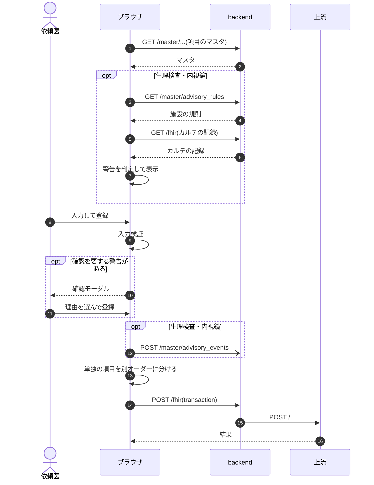

- マスタは、伝票・項目・セットの構成・検査種別です。
- 警告のために読むカルテの記録は、感染症の記録と、規則が読む記録です。
- 依頼医が入力するのは、項目・実施日時または枠です。生理検査・内視鏡は、至急区分・依頼病名なども入力します。
- 確認を要する警告があるのは、生理検査・内視鏡だけです。
- `POST /master/advisory_events` は、発火・無視の台帳です。
- 単独の項目は `splitXOrderValues` で別オーダーに分けます。

| 書くもの | 条件 |
|---|---|
| ヘッダ `ServiceRequest`(`fullUrl`)+ 明細 × 項目 | オーダーごと |
| テンプレート回答 `QuestionnaireResponse` | 生理検査・内視鏡 |
| `Appointment`(`basedOn` = ヘッダ)+ `Slot` `busy` | 予約 |
| 実施記録一式 + `Task` = `completed` | 即実施 |
| 登録時の入院病棟を `order-ward` に | いつも |
| `Provenance`(CREATE) | いつも |
| `Task` `order-approval` | 代行・研修医 |

**編集**

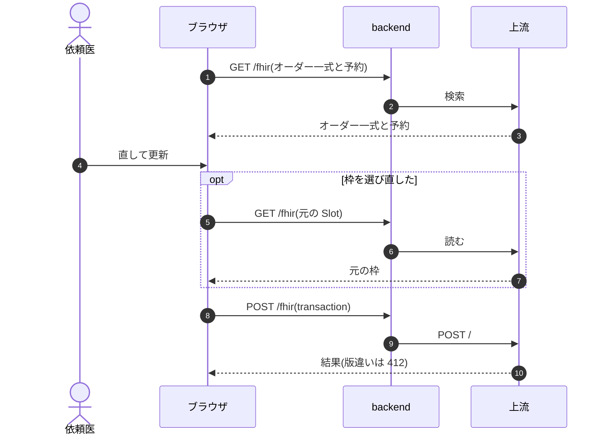

最初の検索は、ヘッダ + 明細と `Appointment?based-on` です。

| 書くもの | 条件 |
|---|---|
| PUT ヘッダ(`ifMatch`) | いつも |
| 明細を差分で POST / PUT / DELETE | いつも |
| DELETE 外したテンプレート回答 | 生理検査・内視鏡 |
| `Appointment` の日時 + 元の `Slot` `free` + 新しい `Slot` `busy` | 枠の変更 |
| `Provenance`(UPDATE) | いつも |

**削除**

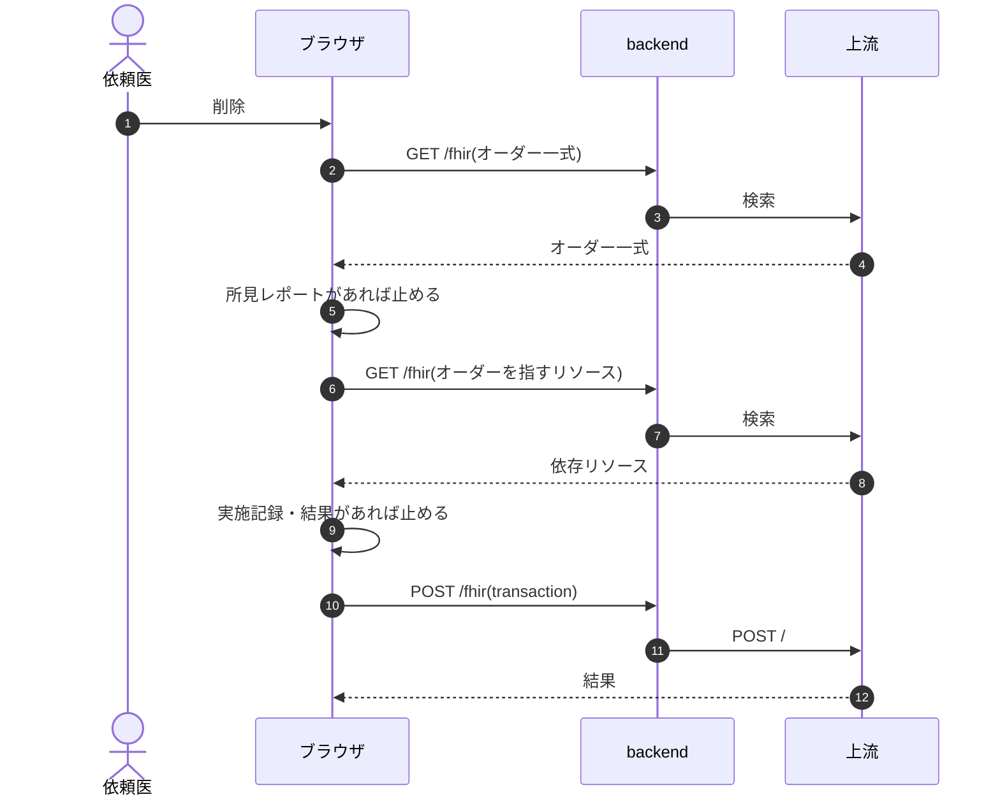

所見レポートで止めるのは、生理検査・内視鏡だけです。

| 検索 | 条件 |
|---|---|
| オーダー一式 | `ServiceRequest?_id` + 明細・`Appointment`・`DiagnosticReport` |
| 依存リソース | オーダーを指す `Task`・`Procedure`・`DiagnosticReport` ほか |

| 書くもの | 条件 |
|---|---|
| DELETE ヘッダ・明細・`Task` | いつも |
| DELETE テンプレート回答 | 生理検査・内視鏡 |
| `Appointment` `cancelled` + `Slot` `free` | 有効な予約 |

### シーケンス図: 日付未定の予約(生理検査・内視鏡)

放射線と同じ書き込みです([rad.md](rad.md)「日付未定の予約」)。通る部品は次のとおりです。

| 順 | 部品 |
|---|---|
| 1 | `ExamWorklistPage.tsx` の日付未定タブ(`UNSCHEDULED_WORKLIST_DATE` で `occurrence:missing=true` を引く) |
| 2 | `components/ExamBookingModal.tsx` |
| 3 | `useScheduleExamOrder`(`api/queries/worklist.ts`) |
| 4 | `buildExamScheduleBundle`(`fhir/appointmentHelpers.ts`) |

枠表と所要時間は、オーダーの項目のうち枠表を持つ最初の項目のマスタ値を初期値にします。

### シーケンス図: 受付・実施・取消・中止

**一覧を開く**

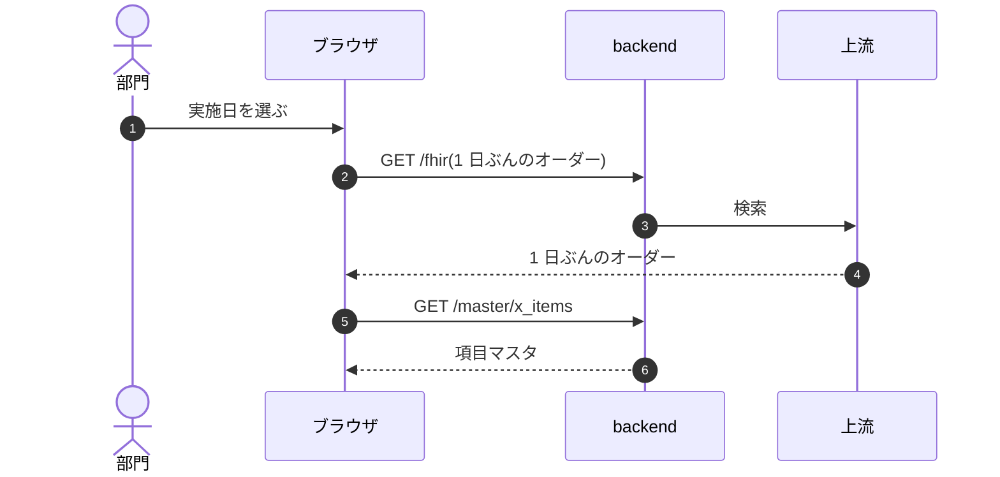

- 検索は `ServiceRequest?category=order-type|x&occurrence=実施日&based-on:missing=true` です。
- `_include` で患者、`_revinclude` で明細・`Task` を付けます。生理検査・内視鏡は `DiagnosticReport` も付けます。
- 項目マスタからは、実施入力の有無と枠表を読みます。

**受付、実施(実施入力なし)、受付済からの取消**

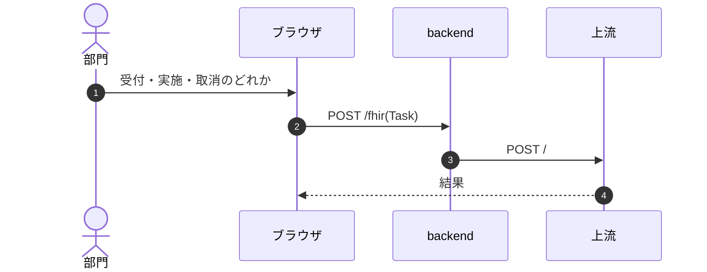

| 操作 | 書くもの |
|---|---|
| 受付 | `Task` = `accepted` |
| 実施(実施入力なし) | `Task` = `completed` |
| 受付済からの取消 | `Task` = `requested` |

**実施(実施入力あり)**

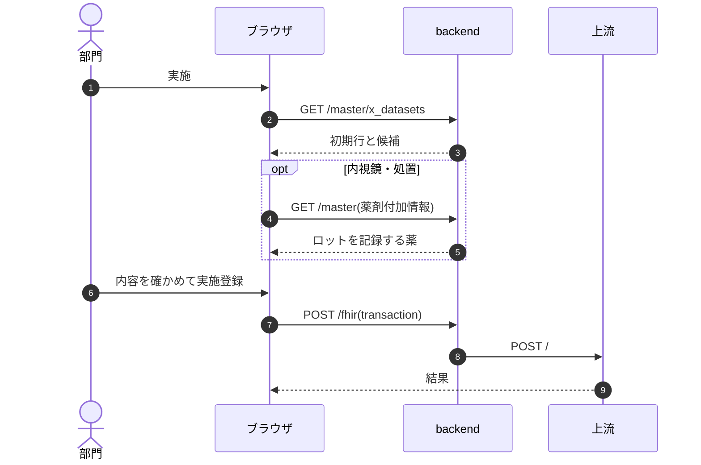

- データセットは、項目のデータセットを引きます。
- 薬剤付加情報からは、ロット管理の薬を読みます。
- 確かめるのは、手技・薬剤・器材です。

| 書くもの | 条件 |
|---|---|
| POST ハブ `Procedure` + 子 `Procedure` | いつも(子は 2 件目以降の手技) |
| POST `MedicationAdministration` | 薬剤 |
| `Task` = `completed` | いつも |

**実施済からの取消**

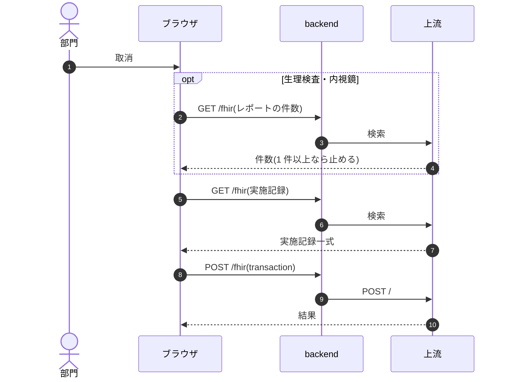

| 検索 | 条件 |
|---|---|
| レポートの件数 | `DiagnosticReport?based-on&_summary=count` |
| 実施記録 | `Procedure?based-on` + 子 |

| 書くもの | 条件 |
|---|---|
| DELETE 子(薬剤・手技)→ ハブ | いつも |
| `Task` = `accepted` | いつも |

**中止・中止取消**

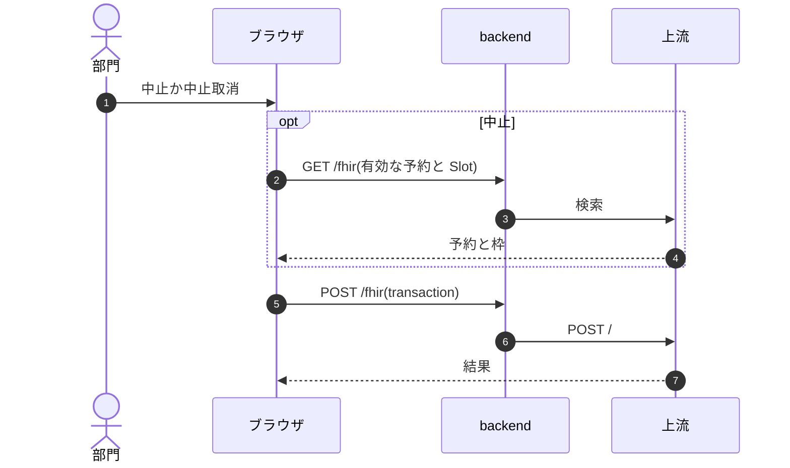

予約の検索は `Appointment?based-on` + 有効な予約、`Slot` です。

| 操作 | 書くもの |
|---|---|
| 中止 | `Task` = `cancelled`、PUT ヘッダ `revoked`、`Appointment` `cancelled` + `Slot` `free` |
| 中止取消 | `Task` = `requested`、PUT ヘッダ `active` |

### シーケンス図: 所見レポートと結果確認(生理検査・内視鏡)

放射線の読影レポートと同じ書き込みです([rad.md](rad.md)「読影レポート」「結果確認」)。読み替えるのは次の 3 つです。

| 読み替えるもの | 生理検査 | 内視鏡 |
|---|---|---|
| `DiagnosticReport` の `category` と `code` | 「リソースの構成」の表のとおり | 「リソースの構成」の表のとおり |
| 重要所見の `Task.code` | `physio-critical-finding` | `endoscopy-critical-finding` |
| 拡張の接頭辞 | `physio-` | `endoscopy-` |

### 医事会計と SS-MIX2

3 種別とも放射線と同じく実施記録から集めます(`BillingClaimBuilder` の `:procedure` 経路、`OrderCatalog`)。

- **手技**: ハブと子の `Procedure.code` で送ります。オーダー項目の `receipt_code` は使いません。
- **1 剤にまとめる**: 薬剤・器材・実施コメントと一緒に 1 剤にします。剤の区分は、手技の点数表の章から決めます。
- **部位のコメント**: 放射線にある部位のコメントは付きません。
- **日付**: 実施時刻の日です。
- **実施入力のない項目だけのオーダー**: このときに限り、オーダーの実施日と項目の `receipt_code` で組みます。

医事会計(`BillingClaimBuilder`)に送るものは、3 種別で同じです。

| 起きたこと | 医事会計 |
|---|---|
| 登録・編集・予約、受付 | なし |
| 実施(実施入力あり) | 実施記録から手技・薬剤・器材・コメントを送る |
| 実施(実施入力なし) | 部門が実施済にしたオーダーの項目を `receipt_code` で送る |
| 当日の未実施 | 送らずに報告する |
| 実施済からの取消、中止、削除 | 対象から外れる |
| 所見レポートの保存・訂正・削除 | なし |

- コードの無い行(手入力の器材など)は「送れない項目」に出します。
- 当日の未実施は、実施入力ありは「実施記録がありません(未実施のため送りません)」、なしは「部門で実施済になっていません」と報告します。
- 中止は `ServiceRequest` が `revoked` になることで外れます。送ったあとの中止は、医事が送り直します。

SS-MIX2 は種別で違います。処置は何も出しません。受付は、どの種別もメッセージにしません(進捗 Task はメッセージにしない)。

| 起きたこと | 生理検査 | 内視鏡 |
|---|---|---|
| 登録・編集・予約 | OMG^O19(OMG-03) | OMG^O19(OMG-02) |
| 実施(実施入力あり) | なし | OMI^Z23(OMG-12) |
| 実施済からの取消 | なし | OMI^Z23 の `CA`(DEL) |
| 中止 | OMG^O19 の `CA`(DEL) | OMG^O19 の `CA`(DEL) |
| 中止取消 | OMG^O19 の `NW`(INS) | OMG^O19 の `NW`(INS) |
| 削除 | OMG^O19 の `CA`(DEL) | OMG^O19 の `CA`(DEL) |
| 所見レポートの保存・訂正・削除 | ORU^R01(OMG-13) | なし |

- **登録・編集・予約**: ヘッダを書くと出します。OBR-4 は検査種別・項目のローカルコードです。
- **所見レポート(生理検査)**: 所見と判定を OBX の TX に置きます。訂正も INS、削除は DEL です。
- 実施(実施入力なし)と当日の未実施は、どの種別も何も出しません。
