# 処方オーダーの業務フロー

処方オーダーの登録から調剤・与薬までの流れです。

医療機関の運用を検討する人は「運用フロー」、院内の開発者は「開発者向け」を読みます。
画面のふるまいは [features/medication.md](../features/medication.md)、リソースの要素は実装ガイド(`../fhir-ig` の `medication.md`)、
与薬の設計は [prescription-order-design.md](../prescription-order-design.md)、監査の設計は [rx-verification-design.md](../rx-verification-design.md) が正典です。

## 運用フロー

このページで使う呼び名です。

- **RP**: 1 つの用法でまとめた薬剤の組です。処方は RP ごとに用法と日数(頓用は回数)を持ちます。
- **処方医**: その処方を出した医師です。疑義照会の宛先になります。
- **状態**: 薬剤部の作業がどこまで進んだかを示します(依頼済・受付済・調剤済など)。処方一覧の「ステータス」の列に出ます。

### 区分ごとの違い

処方区分によって、通る段が違います。

| 処方区分 | 処方監査 | 処方箋 | 調剤登録 | 与薬の記録 | 医事会計への送信 |
|---|---|---|---|---|---|
| 入院(定期・継続・臨時・退院・緊急) | する | 院内の様式 | する | 内服を経過表で記録 | 送らない |
| 外来・院内 | する | 院内の様式 | する | しない | 送る |
| 外来・院外 | しない | 院外処方箋 | しない | しない | 送る |
| 持参 | しない | 刷らない | しない | 内服を経過表で記録 | 送らない |

- 院外処方は保険薬局が監査と調剤をします。
- 持参は、入院時に持ってきた薬を続けるための処方です。カルテの「持参薬」タブの「継続」からだけ作り、薬剤部は持参薬鑑別で内容を確かめます。
- 医事会計への送信は外来だけです。

### 全体の流れ

院内処方(入院と外来・院内)を中心に描いています。院外と持参は途中の段を通りません。

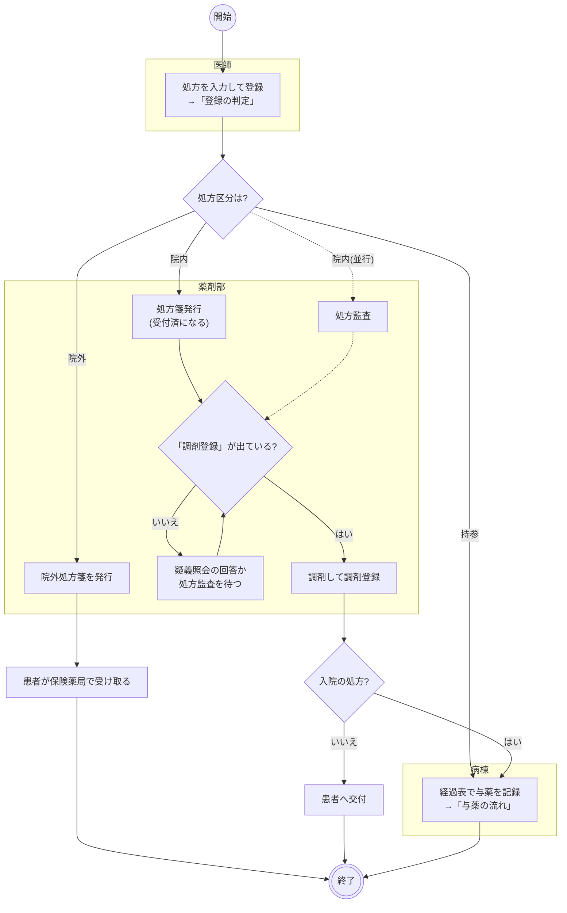

「調剤登録」が出ないのは次のときです。

| とき | 「調剤登録」が出るようになる条件 |
|---|---|
| 依頼済(処方箋を発行していない) | 処方箋発行で受付済にする |
| 照会中・処方変更待ち | 疑義照会の回答か取下げで受付済に戻る(→「疑義照会の流れ」) |
| 未監査で、施設設定「監査済まで調剤登録・払出登録を出さない」が有効 | 処方監査で監査済にする |

- **処方監査と処方箋発行**: 並行して進みます。施設設定を有効にしていなければ、未監査でも調剤登録できます。
- **処方監査の結果**: 「問題なし」か「介入あり」を記録します。介入ありのときは介入の種別・内容と処方医の対応を残します。どちらでも監査済になります。
- **疑義照会**: 依頼済の処方にも送れます(図は受付済からの経路だけを描いています)。
- **与薬**: 予定が出るのは入院の内服だけです。調剤済かどうかに関わらず記録できます。
- **システムの外の作業**: 「患者へ交付」「患者が保険薬局で受け取る」と、薬剤部から病棟へ薬を届ける作業は記録しません。

### 処方の状態

薬剤部の作業の進み具合です。与薬の記録では変わりません。

| 状態 | 変わるきっかけ | 処方一覧の行のメニューからできること |
|---|---|---|
| 依頼済 | 医師の登録 | 中止 |
| 受付済 | 処方箋発行、疑義照会の回答・取下げ | 取消(依頼済へ)、中止 |
| 照会中・処方変更待ち | 疑義照会 | なし(疑義照会の操作で変わる) |
| 調剤済 | 調剤登録 | 取消(受付済へ) |
| 中止 | 中止 | 中止取消(依頼済へ) |

- 「照会中」は薬剤師が疑義照会を送って回答を待っている状態、「処方変更待ち」は処方医が「処方を変更する」と回答して、処方の編集を待っている状態です。
- 調剤済の「取消」は状態だけを戻します。調剤登録で入れた記録は残ります。

### 登録の判定

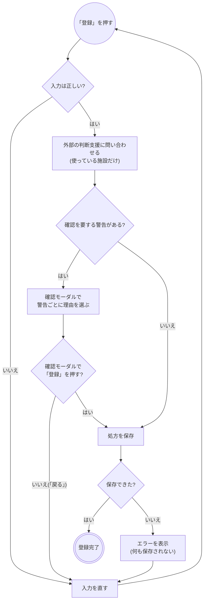

警告は薬剤の行に出ます。重さは 2 段階です。

| 重さ | 例 | 登録のとき |
|---|---|---|
| 表示のみ(橙) | 確認を要する警告以外の注意 | そのまま登録できる |
| 確認を要する(赤) | アレルギーの一致、併用禁忌、用量の上限超過、許可制の抗菌薬、病名禁忌、採用外の薬 | 確認モーダルで 1 件ずつ理由を選ぶ |

- **登録を止める警告**: いまはありません。確認を要する警告も、理由を選べば登録できます。
- **理由の記録**: 選んだ理由は、オーダーの詳細の「警告の確認」に残ります。
- **外部の判断支援**: 施設が外部の判断支援サービスをつないでいるときだけ問い合わせます。入力中にも問い合わせ、返ってきた指摘を入力欄の前に並べます(登録は止めません)。
- **判断支援の指摘の重さ**: 「登録」のときの指摘のうち「重要」のものは、確認モーダルで理由を選ぶまで登録できません。サービスから応答が無いときは、そのまま登録します。

### 疑義照会の流れ

薬剤師が処方医に問い合わせ、回答を受けるまでの流れです。

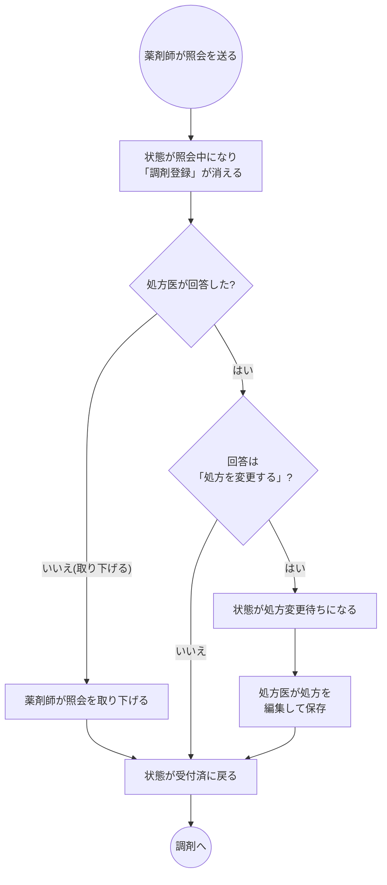

| 誰が | 操作 | 場所 |
|---|---|---|
| 薬剤師 | 照会を送る、取り下げる | 「部門業務 > 薬剤部門 > 処方一覧」の行の「疑義照会」 |
| 処方医 | 回答する | 通知の「カルテ」か、カルテの処方カードの「疑義照会中」から開く詳細の「回答」 |

- **回答の選択肢**: 「処方どおり」「薬剤部で変更してよい」「処方を変更する」の 3 つです。前の 2 つは回答した時点で受付済に戻ります。
- **薬剤師への通知**: 処方医が回答すると、照会した薬剤師に回答の通知が届きます。「処方を変更する」のときも、回答した時点で届きます。
- **処方を変更する**: 処方医が処方を編集して保存すると受付済に戻ります。監査済だった処方は未監査に戻ります。
- **照会できる数**: 1 つの処方に同時に出せる照会は 1 件です。処方医が決まっていない処方には照会できません。
- **取下げ**: 回答の前だけできます。
- **依頼済から照会したとき**: 回答や取下げのあとは、依頼済ではなく受付済になります。

### 与薬の流れ

入院の内服を、病棟が経過表で記録します。

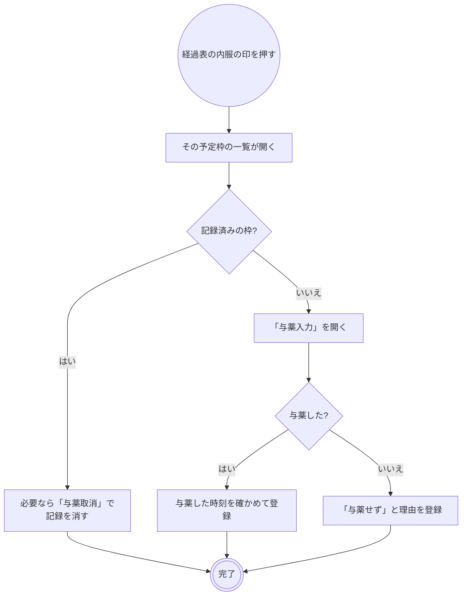

- **予定枠**: 用法(1 日 3 回・食後など)と、施設設定「内服の与薬の時刻」から、与薬の予定の時刻を出します。頓用と、時刻が決まらない用法は予定が出ません。
- **記録の単位**: 押した予定枠 1 つを記録します。与薬した時刻の初期値は予定枠の時刻です。
- **一部の薬だけ与薬しなかったとき**: 与薬入力で、その薬のチェックを外します。与薬の量は変えられません(処方の 1 回量です)。
- **与薬せず**: 理由が必須です。
- **状態との関係**: 与薬を記録しても、処方の状態(薬剤部の作業)は変わりません。

### 変更・中止・削除

| 操作 | できる場所 | できないとき |
|---|---|---|
| 編集 | カルテの処方カード | |
| DO(前回と同じ内容で出し直す) | カルテの処方カード | |
| 削除 | カルテの処方カード(理由を入力) | 与薬の記録がある |
| 取消(状態を 1 つ戻す) | 処方一覧の行のメニュー | 依頼済、照会中・処方変更待ち、中止 |
| 中止 | 処方一覧の行のメニュー | 調剤済、照会中・処方変更待ち |
| 中止取消 | 処方一覧の行のメニュー | 中止以外 |

- **編集**: 監査済の処方を編集すると未監査に戻り、処方監査の一覧に「再監査」の印で並びます。
- **削除**: 与薬の記録があるときは、先に経過表で「与薬取消」をします。
- **取消と中止の違い**: 「取消」は押し間違いなどで状態を 1 つ前に戻す操作、「中止」は処方そのものの取りやめです。
- **中止取消**: 中止の前の状態ではなく、依頼済に戻ります。
- **中止した処方の編集**: カルテで編集しても中止のままです。
- **医事会計**: 中止した処方は医事会計へ送られません。会計を送ったあとに中止したときは医事課へ連絡し、医事課が送り直します。
- **持参の処方**: 中止は処方一覧からもできます。

### 帳票

| 帳票 | 出す場所 | 内容 |
|---|---|---|
| 処方箋(院内の様式) | 処方一覧の行の「処方箋発行」、「処方箋一括発行」 | 入院と外来・院内の処方。A5 |
| 院外処方箋 | 処方一覧の行の「処方箋発行」 | 外来・院外の処方。国の様式(様式第2号)、A5 |

- **発行と状態**: 依頼済の処方は、発行すると受付済になります。再発行は同じ内容を刷り、状態は変わりません。
- **処方箋一括発行**: 病棟を選んで、その病棟の処方箋を 1 つにまとめて刷ります。外来の処方、照会中・中止の処方、持参の処方は対象になりません。
- **QR コード**: 施設設定「処方箋の印刷」の「院外処方箋にQRコードを印字する」を入れると、院外処方箋が A4 横になり、右半分に処方内容の QR コードが付きます。
- **持参の処方**: 処方箋は刷りません。

## 開発者向け

### シーケンス図の前提

- **書き込みの経路**: `/fhir` への書き込みはどれも 1 回の transaction Bundle で、backend の `FhirProxyController` が上流へ中継します。
- **上流**: 上流の FHIR サーバーです。図では「上流 FHIR」と書きます。
- **応答の中継**: 上流の応答も backend を通って画面へ戻ります。図では省いて、上流から画面へ直接返す矢印で描きます。
- **SS-MIX2**: 有効にしている施設では、中継が書き込みの控えを記録します(`Ssmix2::Recorder`)。
- **楽観ロック**: 版は `postBundle` が `ifMatch` に添え、版が違えば 412 で止まります。
- **ヘッダ**: 処方 1 件を表す `ServiceRequest` です。薬剤の行は `MedicationRequest` です。
- **進捗 Task・監査 Task**: 薬剤部の作業の状態を持つ Task(`rx-dispense`)と、処方監査を待つ Task(`rx-verification`)です。
- **CDS カード**: 外部の判断支援(CDS Hooks)が返す指摘です。カルテの処方カードとは別のものです。「運用フロー」節の「外部の判断支援」に当たります。
- **図の登場者**: 「運用フロー」節の部署(医師・薬剤部・病棟)に合わせています。薬剤部は薬剤師、病棟は看護師です。

### リソースの構成

- ヘッダ `ServiceRequest`(処方 1 件)
  - `MedicationRequest`(薬剤の行。`basedOn` でヘッダを指す)
    - `MedicationDispense`(調剤登録。`authorizingPrescription` で薬剤の行を指す)
  - 進捗 Task(`rx-dispense`。`focus` でヘッダを指す)
  - 監査 Task(`rx-verification`。院内の処方だけ)
  - 照会の Task(`rx-inquiry`)と回答の通知の Task(`rx-inquiry-answered`)
  - 与薬の記録のハブ `Procedure`(`basedOn` でヘッダを指す)
    - `MedicationAdministration`(与薬した薬剤。`partOf` でハブを指す)

| リソース | 要素 | 中身 |
|---|---|---|
| ヘッダ `ServiceRequest` | `category` | 先頭から、オーダー種別 `order-type|prescription`、入外区分(`prescription-setting`)、処方区分(`prescription-category`) |
| ヘッダ `ServiceRequest` | `orderDetail` の拡張 | 薬剤の行への参照(`prescription-medication-request`) |
| ヘッダ `ServiceRequest` | `encounter` | 入院中に登録した処方の入院 |
| ヘッダ `ServiceRequest` | `status` | 中止で `revoked`、中止取消で `active` |
| `MedicationRequest` | `identifier` | RP の番号 |
| `MedicationRequest` | `status` | 中止で `cancelled`、中止取消で `active` |
| `Provenance` | `target` | ヘッダ。登録(CREATE)と編集(UPDATE)のたびに 1 件 |

### 進捗 Task(`rx-dispense`)

Task は登録時には作りません。**Task が無いオーダーは依頼済**として扱い、最初のステータス変更で作ります。
与薬では動きません([prescription-order-design.md](../prescription-order-design.md) §1)。

| 状態 | `Task.status` |
|---|---|
| 依頼済 | `requested`(または Task 無し) |
| 受付済 | `accepted` |
| 照会中・処方変更待ち | `on-hold` + `statusReason` |
| 調剤済 | `in-progress` |
| 実施済(作る操作なし) | `completed` |
| 中止 | `cancelled` |

- `completed`(実施済)にする操作は、処方にはまだありません。一覧の表示だけが対応しています。
- 調剤済は `in-progress` です。注射の払出済と同じ値です。

### 部品

| 操作 | 画面 | 組み立て | hook |
|---|---|---|---|
| 登録 | `components/PrescriptionForm.tsx`・`PrescriptionPanels.tsx` | `fhir/prescriptionHelpers.ts` | `useCreatePrescription` |
| 編集 | `PrescriptionEditPanel` | 同上 | `useUpdatePrescription` |
| 削除 | カルテのカード | `postOrderDeleteBundle`(`api/queries/orderDelete.ts`) | 同左 |
| 取消・中止・中止取消 | `pages/RxWorklistPage.tsx` | `buildRxTaskUpdate`・`rxOrderCancelEntries` | `useUpdateRxTaskStatus` |
| 処方監査 | `pages/RxVerificationPage.tsx`・`components/RxVerificationModal.tsx` | `fhir/rxVerificationHelpers.ts` | `useCompleteRxVerification` |
| 処方箋発行 | `pages/RxWorklistPage.tsx`・`components/RxBatchIssueModal.tsx` | backend の帳票 | `useUpdateRxTaskStatus`・`useIssuePrescriptions` |
| 疑義照会 | `components/RxInquiryModal.tsx`・`RxInquirySection.tsx` | `fhir/rxInquiryHelpers.ts` | `useWriteRxInquiry` |
| 調剤登録 | `components/RxDispenseModal.tsx` | `fhir/rxDispenseHelpers.ts` | `useRegisterRxDispense` |
| 与薬 | `components/OralPerformModal.tsx`・`VitalFlowsheetPanel.tsx` | `fhir/oralPerformHelpers.ts` | `useRegisterOralPerform`・`useCancelOralPerforms` |

hook の置き場所は名前と合っていません。

- `useCreatePrescription`・`useUpdatePrescription` は `api/queries/labResult.ts` にあります。名前は処方由来ですが、全種別の登録・編集が通ります。
- `useUpdateRxTaskStatus`・`useIssuePrescriptions`・`useRegisterRxDispense` は `api/queries/injection.ts` にあります。
- `useRegisterOralPerform`・`useCancelOralPerforms` は `api/queries/encounter.ts` にあります。

### シーケンス図: 登録

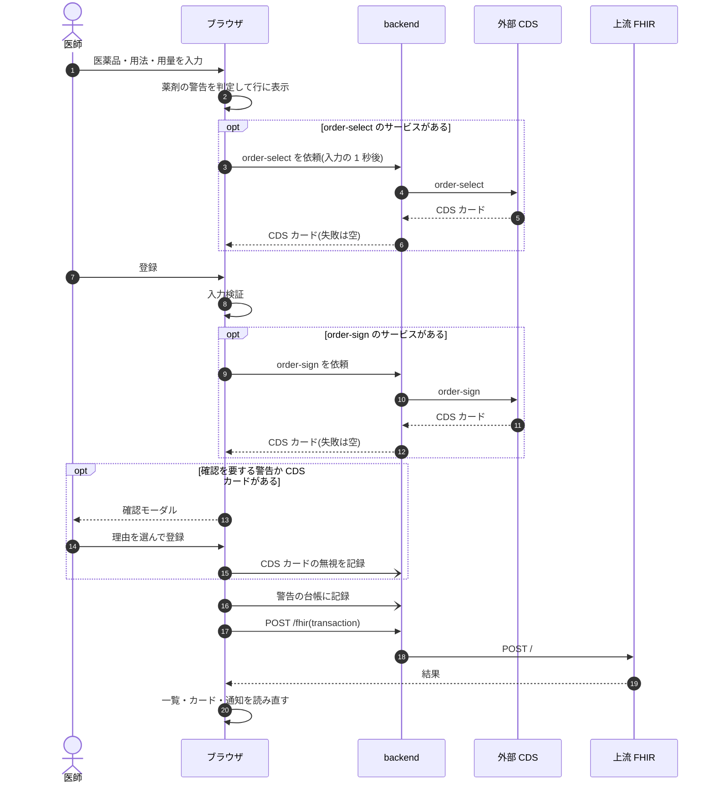

`-)` の矢印は応答を待たない送信です。失敗しても登録は続けます。

| backend への依頼 | パス |
|---|---|
| order-select | `POST /integrations/cds/order_select` |
| order-sign | `POST /integrations/cds/order_sign` |
| CDS カードの無視 | `POST /integrations/cds/feedback` |
| 警告の台帳(発火・無視) | `POST /master/advisory_events` |

| transaction で書くもの | 条件 |
|---|---|
| ヘッダ `ServiceRequest` + `MedicationRequest` × 薬剤数 | いつも |
| `Provenance`(CREATE) | いつも |
| 監査 Task `rx-verification`(未監査) | 院内の処方 |
| Task `order-approval` | 代行入力・研修医 |
| 警告の無視の `Provenance` | 確認モーダルで理由を選んだ |
| 届出の通知の Task | 特定抗菌薬を含む |
| `MedicationStatement` の更新 | 持参薬の継続 |

### シーケンス図: 編集・削除

編集です。登録と同じ警告の判定と order-sign を通ります(図では省いています)。

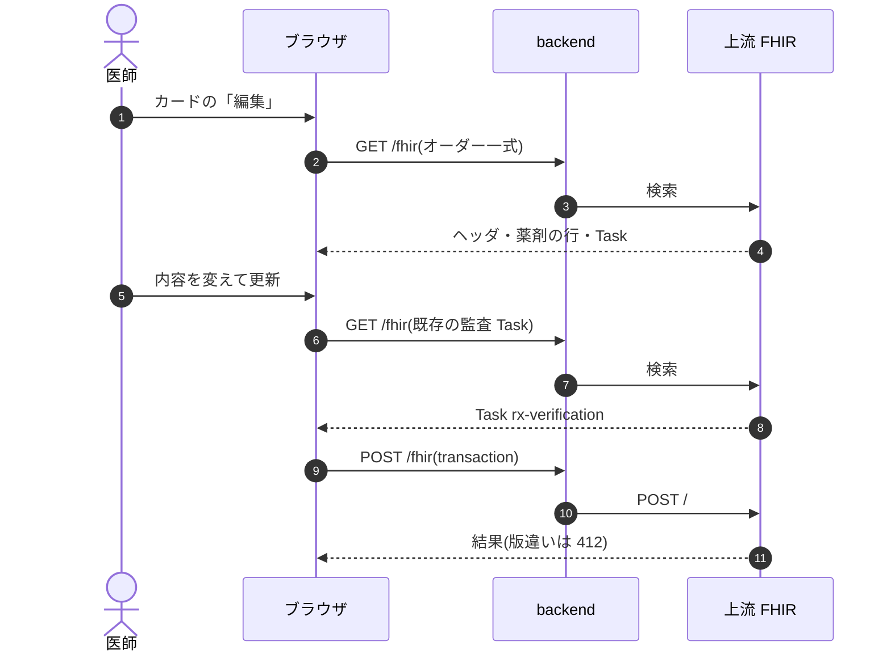

| transaction で書くもの | 条件 |
|---|---|
| PUT `ServiceRequest`・`MedicationRequest` | いつも |
| POST 追加した薬剤の行 / DELETE 消した薬剤の行 | 行を足した・消した |
| `Provenance`(UPDATE) | いつも |
| 監査 Task `rx-verification` を未監査へ | 監査 Task がある |
| 進捗 Task を受付済へ | 処方変更待ちのとき |

削除です。

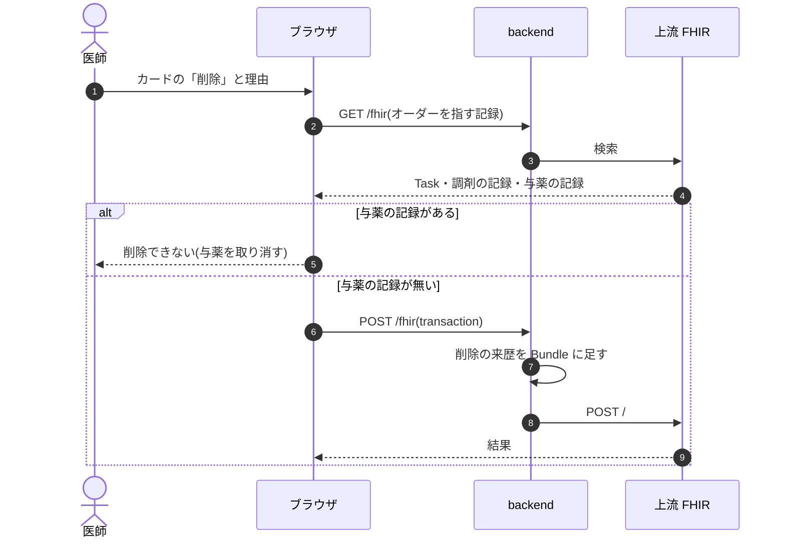

transaction は `ServiceRequest`・`MedicationRequest`・Task・`MedicationDispense` の DELETE です。

### シーケンス図: 中止・中止取消

処方一覧の行のメニューの「取消」「中止」「中止取消」は、同じ hook(`useUpdateRxTaskStatus`)で書きます。

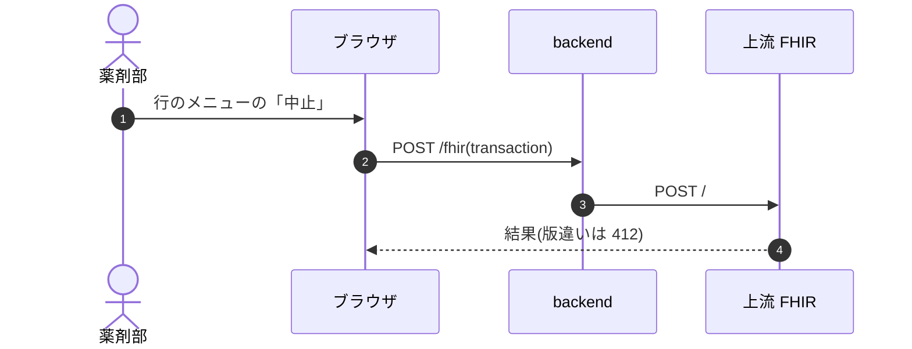

| 操作 | 進捗 Task | `ServiceRequest` | `MedicationRequest` |
|---|---|---|---|
| 中止 | `cancelled` | `revoked` | `cancelled` |
| 中止取消 | `requested` | `active` | `active` |
| 取消 | 1 つ前の状態 | 変えない | 変えない |

- オーダーの `status` を揃えるのは `rxOrderCancelEntries` です。
- 化学療法の投与日の内服は、中止・中止取消だけ別の書き込みになります([chemotherapy.md](chemotherapy.md)「シーケンス図: 投与日の中止・中止取消」)。

### シーケンス図: 処方監査

処方一覧の「監査」からも同じモーダルが開きます。

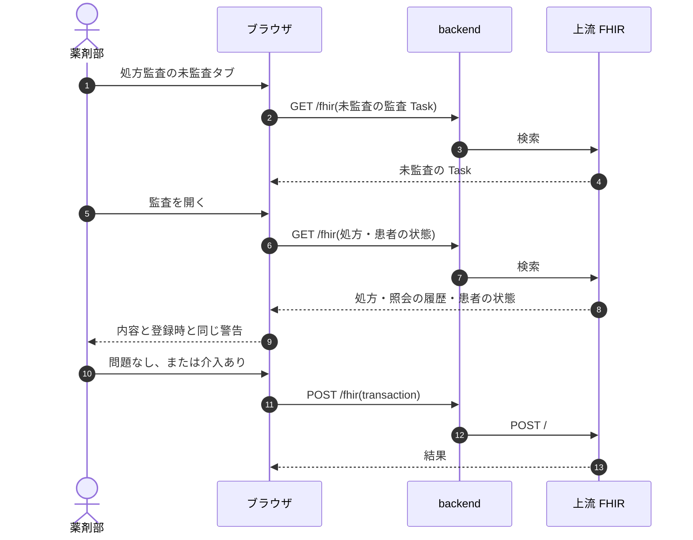

- 未監査の検索は Task `rx-verification` の `requested` です。患者の状態はアレルギーと検査値です。
- 介入ありでは、介入の種別・内容・処方医の対応を入れます。
- transaction は監査 Task の PUT です。`status = completed`、`owner` = 薬剤師、`output` = 監査結果を書きます。
- 問題なしでも介入ありでも監査済になり、進捗 Task は動きません。

### シーケンス図: 処方箋発行

PDF の生成は上流を読むだけです。再発行は同じ PDF を刷り、進捗を動かしません。

行の「処方箋発行」です。

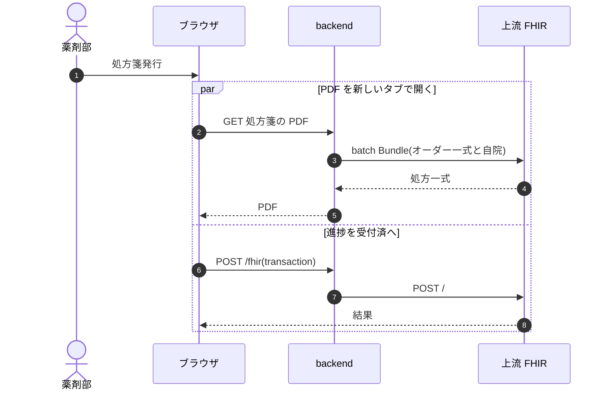

- PDF は `GET /reports/prescriptions/:order_id/pdf` です。
- transaction は進捗 Task `rx-dispense` を `accepted` にします。

「処方箋一括発行」(病棟)です。

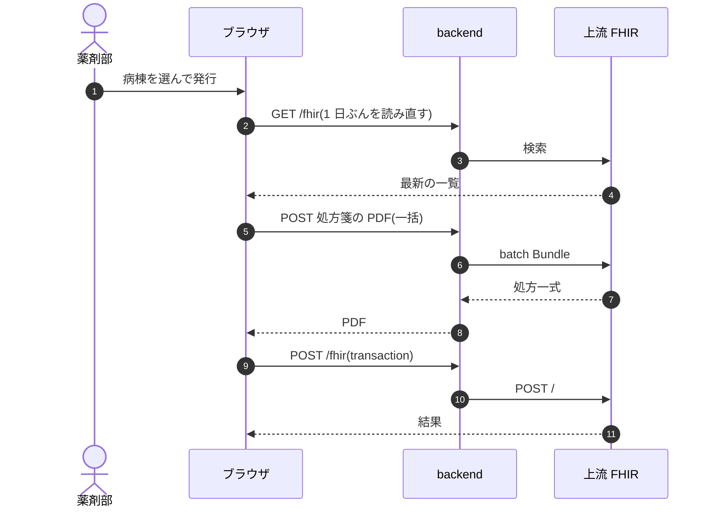

- PDF は `POST /reports/prescriptions/pdf`(`order_ids`)です。
- transaction は、依頼済の行の進捗 Task をまとめて `accepted` にします。

### シーケンス図: 疑義照会

照会です。

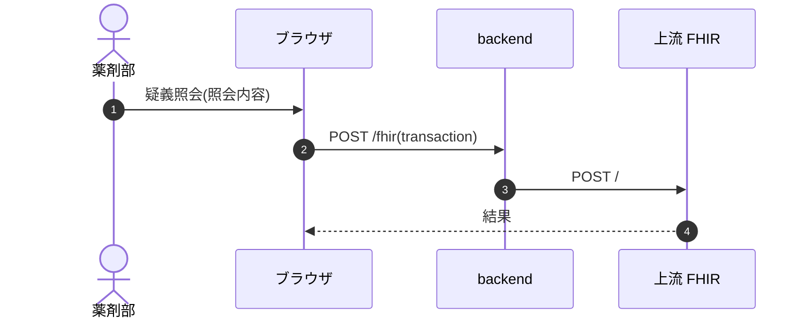

回答です。

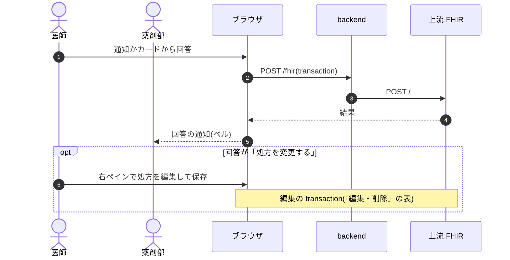

取下げは、薬剤部が同じ「疑義照会」から行います。流れは照会と同じで、transaction の中身だけが違います。

| 操作 | 照会の Task `rx-inquiry` | 進捗 Task | ほかに書くもの |
|---|---|---|---|
| 照会 | POST(`owner` = 処方医) | `on-hold`(照会中) | |
| 回答(処方どおり・薬剤部で変更してよい) | `completed`(`output` に回答) | `accepted` | POST Task `rx-inquiry-answered`(宛先 = 薬剤師) |
| 回答(処方を変更する) | `completed`(`output` に回答) | `on-hold`(処方変更待ち) | POST Task `rx-inquiry-answered`(宛先 = 薬剤師) |
| 取下げ | `cancelled` | `accepted` | |

「処方を変更する」のあとの編集の transaction が、進捗 Task を `accepted` に、監査 Task を未監査に戻します。

### シーケンス図: 調剤登録

「調剤登録」は受付済の行にだけ出ます。

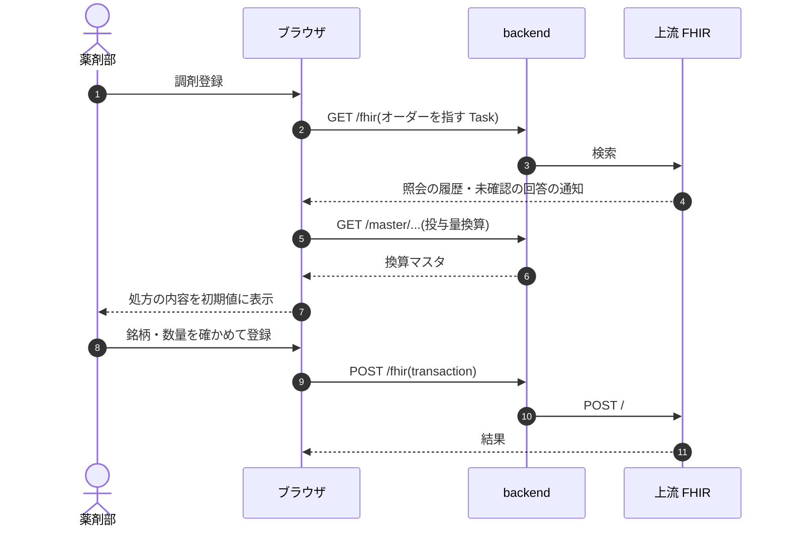

- Task の検索は `focus` がこのオーダーの Task で、照会の履歴と未確認の回答の通知を取り出します。
- 初期値では、力価の量を換算マスタで製剤数に直します。

| transaction で書くもの | 条件 |
|---|---|
| POST `MedicationDispense` × 薬剤数 | いつも |
| 進捗 Task を `in-progress`(調剤済) | いつも |
| 回答の通知を `completed` | 未確認の回答の通知がある |

### シーケンス図: 与薬

調剤済かどうかに関わらず記録でき、進捗 Task は動きません。

与薬入力です。

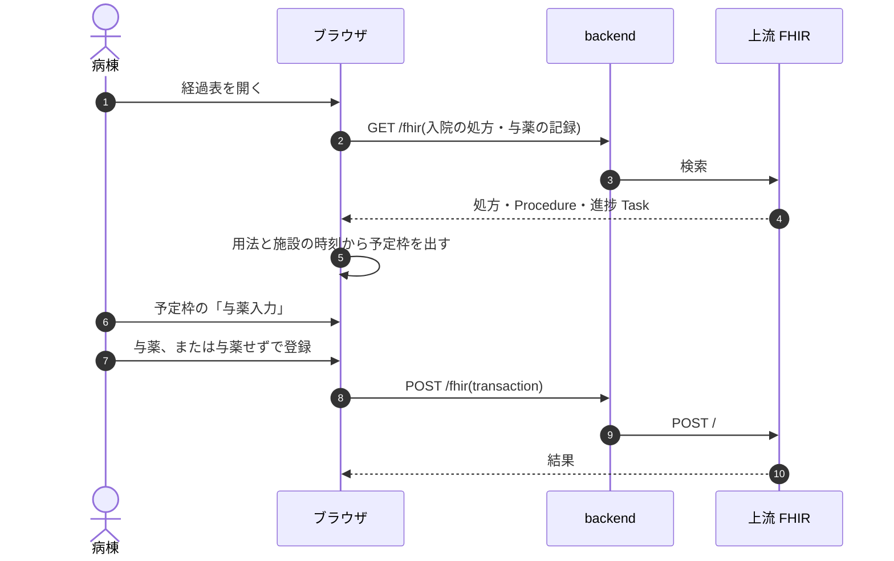

予定枠は、用法コードと施設設定の時刻から展開します。

| 結果 | transaction で書くもの |
|---|---|
| 与薬 | POST `Procedure`(`completed`、予定枠の拡張)+ POST `MedicationAdministration` × 与薬した薬剤 |
| 与薬せず | POST `Procedure`(`not-done`、理由) |

与薬取消です。

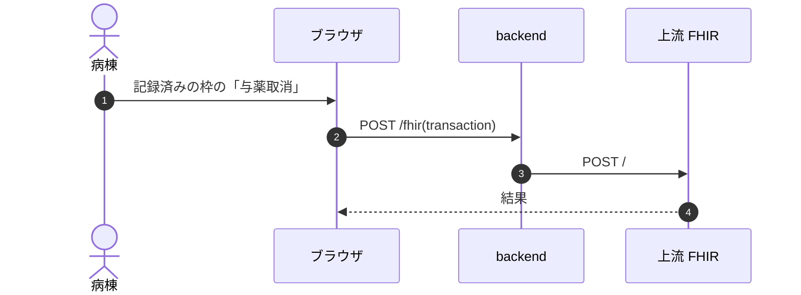

transaction は `MedicationAdministration`、`Procedure` の順の DELETE です。

### 医事会計と SS-MIX2

医事会計(`BillingClaimBuilder`)は、処方を実施記録からではなくオーダーから送ります。SS-MIX2 の括弧内はデータ種別、INS / DEL は処理区分です。

| 起きたこと | 医事会計 | SS-MIX2 |
|---|---|---|
| 登録・編集 | オーダーの日付(`occurrenceDateTime`)の会計で、RP 1 つを 1 剤で送る | RDE^O11(OMP-01) |
| 削除 | 対象から外れる | RDE^O11 の `CA`(DEL) |
| 中止 | 対象から外れる(`ServiceRequest` が `revoked`) | RDE^O11 の `CA`(DEL) |
| 中止取消 | 対象に戻る | RDE^O11 の `NW`(INS) |
| 与薬・与薬せず | 送らない | RAS^O17(OMP-11) |
| 与薬取消 | 送らない | RAS^O17 の `CA`(DEL) |

- 剤の区分は内服・頓用・外用で、内服は投与日数、頓用は投与回数を送ります。外用は日数を送りません。
- 院内・院外の区別を付けて送ります。
- 処方区分が持参の処方は送りません(送れない項目にも出しません)。
- 注射・注入の用法の RP と、レセプト電算コードを引けない薬剤は「送れない項目」に出します。一般名処方は、代表の銘柄のコードに一般名の印を付けて送ります。
- 会計を送ったあとの中止・編集は、医事課が送り直します。
- 処方監査・疑義照会・調剤登録は、医事会計にも SS-MIX2 にも出しません(Task と `MedicationDispense` はメッセージにしません)。
