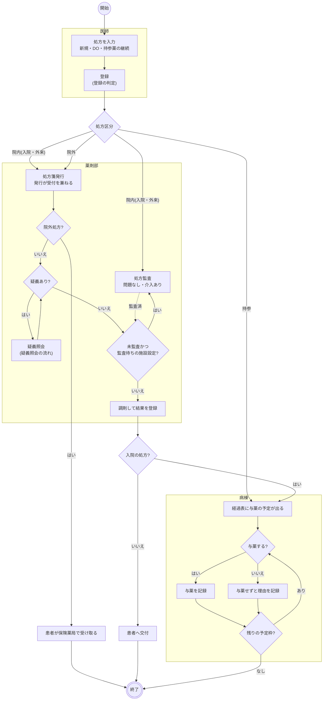
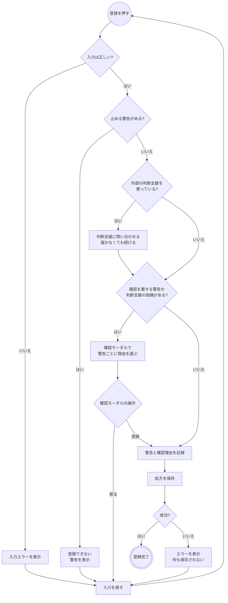
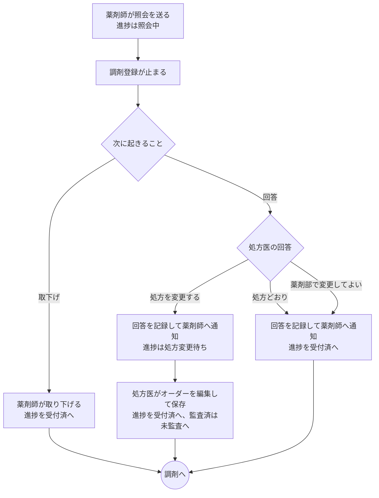
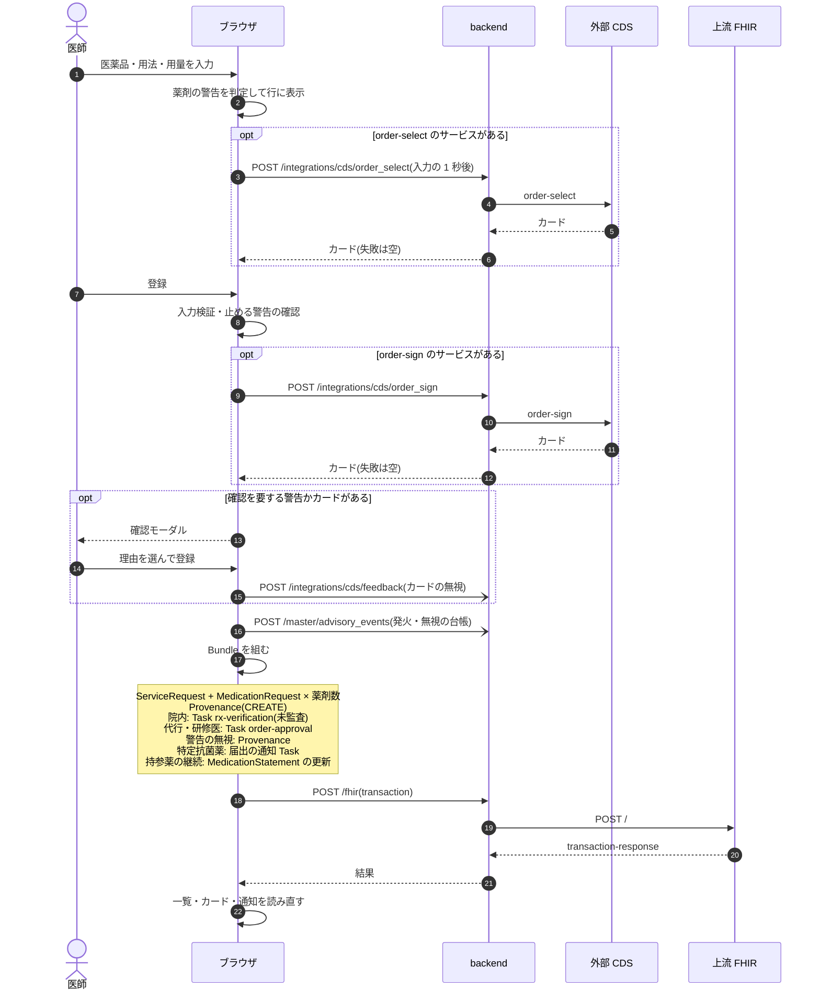
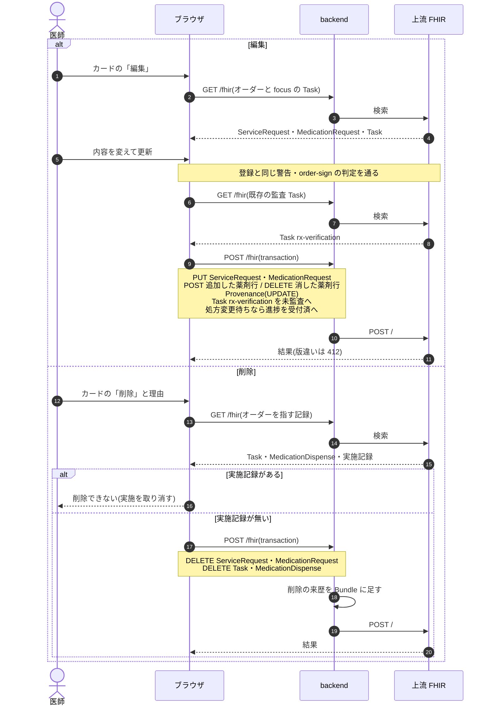
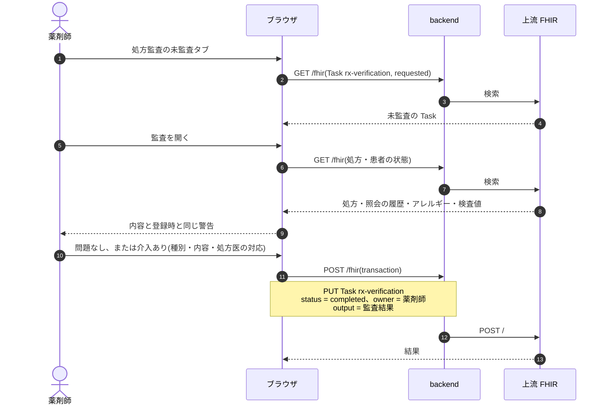
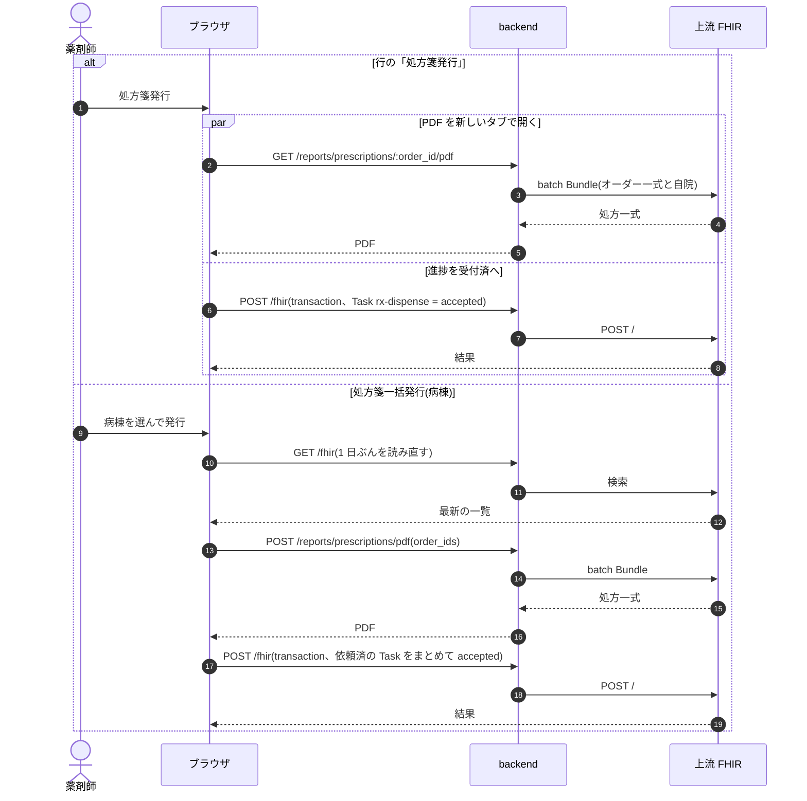
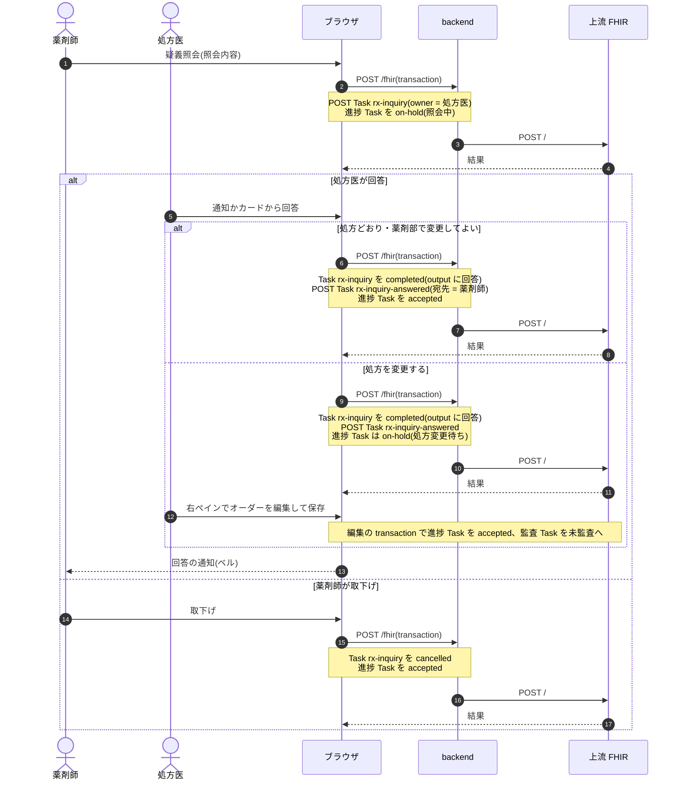
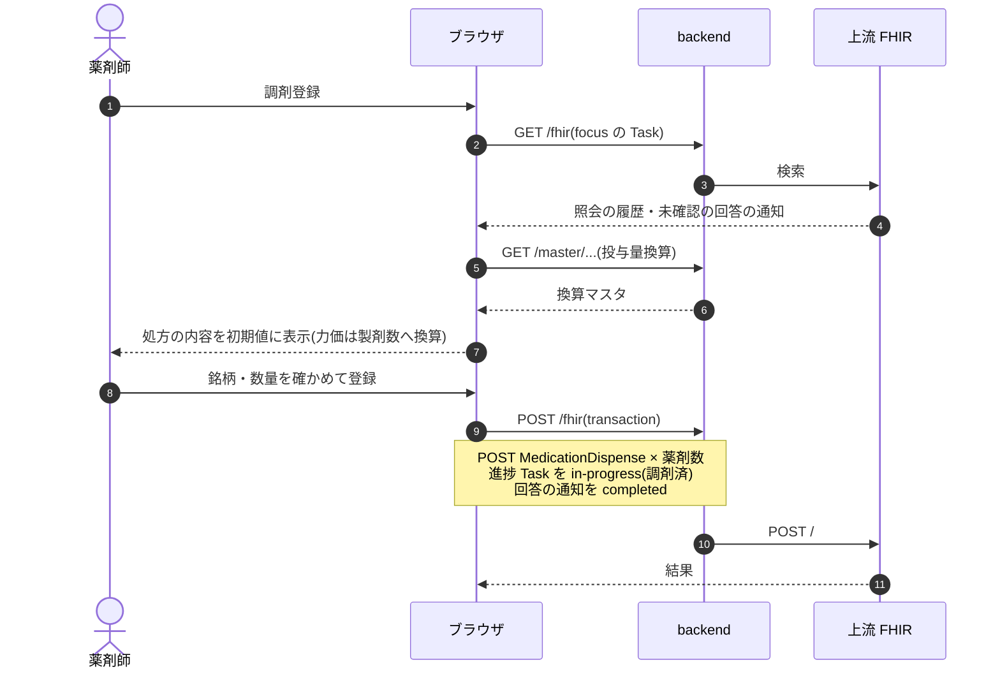
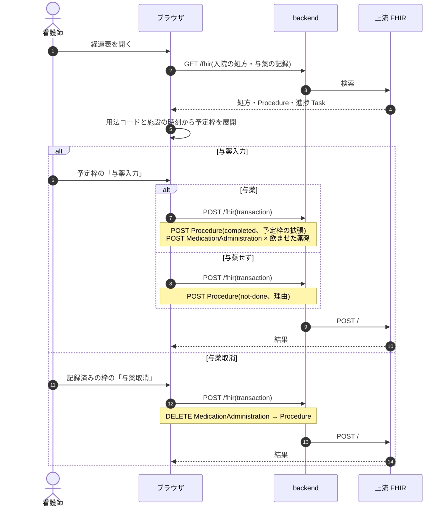

# 処方オーダーの業務フロー

処方オーダーの登録から調剤・与薬までの流れです。医療機関の運用を検討する人は「運用フロー」、院内の開発者は「開発者向け」を読みます。
画面のふるまいは [features/medication.md](../features/medication.md)、リソースの要素は実装ガイド(`../fhir-ig` の `medication.md`)、
与薬の設計は [prescription-order-design.md](../prescription-order-design.md)、監査の設計は [rx-verification-design.md](../rx-verification-design.md) が正典です。

## 運用フロー

### 区分ごとの違い

| 処方 | 処方監査 | 処方箋 | 調剤登録 | 与薬の記録 | 医事会計への送信 |
|---|---|---|---|---|---|
| 入院(定期・継続・臨時・退院・緊急) | あり | 院内様式 | あり | 内服の RP を経過表で | なし(外来のみ) |
| 外来・院内 | あり | 院内様式 | あり | なし | あり |
| 外来・院外 | なし(保険薬局が監査) | 様式第2号 | 保険薬局が調剤 | なし | あり |
| 持参(持参薬の継続) | なし(持参薬鑑別で確認) | 刷らない | なし | 経過表で | なし |

### 処方の状態

薬剤部の進み具合を示す状態です。与薬の記録では変わりません。

| 状態 | 変わるきっかけ | 処方一覧のメニューからできること |
|---|---|---|
| 依頼済 | 医師の登録 | 中止 |
| 受付済 | 処方箋発行、疑義照会の回答・取下げ | 取消(依頼済へ)、中止 |
| 照会中・処方変更待ち | 疑義照会 | なし(疑義照会の操作で変わる) |
| 調剤済 | 調剤登録 | 取消(受付済へ。調剤の記録は残る) |
| 中止 | 中止 | 中止取消(依頼済へ) |

中止した処方は医事会計への送信から外れます。会計を送ったあとに中止したときは医事へ連絡し、医事が送り直します。

### 全体の流れ

- 監査と処方箋発行は並行して進みます。既定では未監査でも調剤登録でき、施設設定「監査済まで調剤登録・払出登録を出さない」のときだけ待ちます。
- 疑義照会は依頼済からも送れます(図は受付済からの経路だけを示します)。
- 与薬の予定が出るのは入院の内服だけです。頓用と時刻指定の用法は予定が出ません。
- 「患者へ交付」「患者が保険薬局で受け取る」はシステムの外の作業です。薬剤部から病棟へ薬を届ける作業は記録の対象ではなく、調剤済かどうかに関わらず与薬を記録できます。

### 登録の判定

### 疑義照会の流れ

## 開発者向け

### 進捗 Task(`rx-dispense`)

Task は登録時には作りません。**Task が無いオーダーは依頼済**として扱い、最初のステータス変更で作ります。
与薬では動きません([prescription-order-design.md](../prescription-order-design.md) §1)。

| 状態 | `Task.status` |
|---|---|
| 依頼済 | `requested`(または Task 無し) |
| 受付済 | `accepted` |
| 照会中・処方変更待ち | `on-hold` + `statusReason` |
| 調剤済 | `in-progress` |
| 実施済(作る操作なし) | `completed` |
| 中止 | `cancelled` |

中止は同じ transaction で `ServiceRequest` を `revoked`、`MedicationRequest` を `cancelled` にします(`rxOrderCancelEntries`)。中止取消は `active` に戻します。

### シーケンス図の前提

`/fhir` への書き込みはどれも 1 回の transaction Bundle で、backend の `FhirProxyController` が上流へ中継します。
SS-MIX2 を有効にしている施設では、中継が書き込みの控えを記録します(`Ssmix2::Recorder`)。
楽観ロックの版は `postBundle` が `ifMatch` に添え、版が違えば 412 で止まります。

### シーケンス図: 登録

`components/PrescriptionForm.tsx`・`PrescriptionPanels.tsx`、`useCreatePrescription`(`api/queries/labResult.ts`)。

### シーケンス図: 編集・削除

`PrescriptionEditPanel`、`useUpdatePrescription`、`postOrderDeleteBundle`(`api/queries/orderDelete.ts`)。

### シーケンス図: 処方監査

`pages/RxVerificationPage.tsx`・`components/RxVerificationModal.tsx`、`useCompleteRxVerification`。処方一覧の「監査」からも同じモーダルが開きます。

### シーケンス図: 処方箋発行

`pages/RxWorklistPage.tsx`・`components/RxBatchIssueModal.tsx`、`useUpdateRxTaskStatus`・`useIssuePrescriptions`。
PDF の生成は読むだけで、再発行は同じ PDF を刷り進捗を動かしません。

### シーケンス図: 疑義照会

`components/RxInquiryModal.tsx`・`RxInquirySection.tsx`、`fhir/rxInquiryHelpers.ts`、`useWriteRxInquiry`。

### シーケンス図: 調剤登録

`components/RxDispenseModal.tsx`、`fhir/rxDispenseHelpers.ts`、`useRegisterRxDispense`。受付済の行にだけ出ます。

### シーケンス図: 与薬

`components/OralPerformModal.tsx`・`VitalFlowsheetPanel.tsx`、`fhir/oralPerformHelpers.ts`、`useRegisterOralPerform`・`useCancelOralPerforms`。
調剤済かどうかに関わらず記録でき、進捗 Task は動きません。

