# 放射線検査オーダーの業務フロー

放射線検査オーダーの登録から予約・受付・実施・読影・結果確認までの流れです。
放射線治療は[放射線治療の業務フロー](radiotherapy.md)で扱います。

医療機関の運用を検討する人は「運用フロー」、院内の開発者は「開発者向け」を読みます。
設計は [rad-order-master-design.md](../rad-order-master-design.md)(マスタとオーダー)・[rad-result-design.md](../rad-result-design.md)(実施入力)・
[rad-report-design.md](../rad-report-design.md)・[exam-report-design.md](../exam-report-design.md)(読影レポート)、画面のふるまいは [features/lab.md](../features/lab.md)「放射線検査の読影レポート」、
種別共通の約束(日付未定・中止・削除・代行入力・警告)は [features/orders-common.md](../features/orders-common.md)、リソースの要素は実装ガイド(`../fhir-ig`)が正典です。
未実装の機能は [rad-backlog.md](../rad-backlog.md) にまとめています。

## 運用フロー

### 全体の流れ

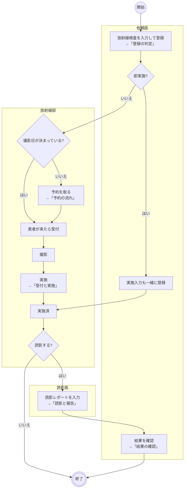

この文書で使う呼び名です。

| 呼び名 | 意味 |
|---|---|
| 依頼医 | オーダーを出した医師。結果の通知の宛先になる |
| 即実施 | 登録と一緒に実施入力も済ませる。診察室でその場で撮るときと、事後の入力に使う |
| 事後 | 撮り終えた検査を後から入れるための至急区分 |
| 日付未定 | 撮影日を決めずに登録すること |
| カード | カルテに出る、オーダー 1 件ぶんの表示 |
| 取消 | 状態を 1 つ前へ戻す訂正(実施済 → 受付済、受付済 → 依頼済) |
| 中止 | 検査をやめる。「中止取消」で依頼済に戻せる |
| 削除 | オーダーそのものを消す |

- **入口**: 依頼医はカルテの右ペイン(右側のオーダー入力)の「放射線検査」で、撮影伝票か項目検索から撮影項目を選びます。オーダーセット、クリニカルパスからも出せます。
- **入力する項目**: 撮影項目・至急区分・撮影日時(または予約)・依頼病名・検査目的・特別指示です。
- **放射線部の画面**: 放射線部は「部門業務 > 放射線検査一覧」を撮影日ごとに見ます。撮影時刻の順に並び、時刻の無いオーダーは後ろです。
- **一覧の印**: 至急の行は色が変わり、患者の列に注意区分・アレルギー・感染症の印が出ます。オーダーが登録されても、放射線部への通知は出ません。
- **読影**: 読影レポートは任意です。読影しない検査は実施済のまま終わります。
- **外来の一時終了**: 外来の診察終了で、当日の放射線検査が依頼済・受付済のまま残っていると「一時終了」を選べます。患者が撮影に行き、戻ってから診察を再開します。
- **撮影装置との接続**: 撮影装置・画像管理システム(PACS)とは接続しません。撮影の事実は実施入力で記録し、画像は読影レポートに添付します。
- **DICOM**: カルテの「DICOMビューア」タブは持ち込みの DICOM を見る画面で、オーダーとは結び付きません。

### 放射線検査の状態

放射線部の進み具合を示す状態です。読影の進み具合はこの状態に含めず、一覧の「読影」の列に報告区分(暫定報告・最終報告・訂正報告)で出します。

| 状態 | 変わるきっかけ | 放射線検査一覧からできること |
|---|---|---|
| 依頼済 | 依頼医の登録、受付済からの取消、中止取消 | 受付、中止、予約(日付未定のとき) |
| 受付済 | 受付、実施済からの取消 | 実施、取消(依頼済へ)、中止、予約(日付未定のとき) |
| 実施済 | 実施登録、即実施 | 読影、取消(受付済へ) |
| 中止 | 中止 | 中止取消(依頼済へ) |

- 受付は「患者が放射線部に来て撮影待ちになった」ことを指します。受付を飛ばして実施はできません。
- 日付未定のオーダーは受付・中止・予約はできますが、実施はできません(撮影日が無いため)。
- 読影レポートの有無は状態を変えません。

### 区分ごとの違い

至急区分(通常・至急・事後)と、撮影項目ごとの設定で、流れが分かれます。

| 至急区分 | 撮影日時 | 予約必須の項目 | 日付未定 | 即実施 |
|---|---|---|---|---|
| 通常 | 撮影日は必須、時刻は任意 | 予約か日付未定を選ぶ | できる | 選べる |
| 至急 | 当日に固定、時刻は任意 | 予約を取らない | できない | 選べる |
| 事後 | 当日以前の日付、時刻は任意 | 予約を取らない | できない | 必ず即実施 |

- 通常でも、予約必須の項目を含むオーダーと日付未定のオーダーは、即実施にできません。

撮影項目ごとの次の 3 つの設定が、流れを分けます。

| 設定 | 値 | 流れへの影響 |
|---|---|---|
| オーダー単位 | まとめられる / 単独 | 単独の項目は 1 項目 1 オーダーに分かれる |
| 予約 | 不要 / 必須 | 必須の項目は撮影室の枠を所要時間ぶん押さえる |
| 実施入力 | あり / なし | なしの項目だけのオーダーは「実施」を押すと入力なしで実施済になる |

- 単独の項目は、一度に選んでも、登録すると別のオーダー(別のカード・一覧の別の行)になります。
- 予約必須の項目は、枠の日時がそのまま撮影日時になります。
- たとえば単純撮影は「まとめられる・予約不要」、CT・MRI は「単独・予約必須」に設定します。

### 登録の判定

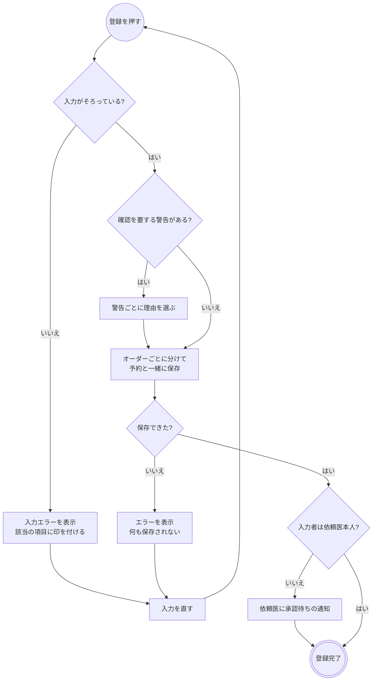

「入力がそろっている?」で確かめるのは次の項目です。

| 項目 | 条件 |
|---|---|
| 撮影項目 | 1 つ以上ある |
| 撮影日・予約 | 撮影日か予約がある。至急区分が通常なら日付未定でもよい |
| 事後の撮影日 | 至急区分が事後のとき、当日以前 |
| 即実施の実施入力 | 即実施のとき、実施入力がある。実施入力のない項目は不要 |

**警告**

警告は撮影項目を選ぶとフォームに出ます。カルテの記録から拾うので、依頼医が打ち込む必要はありません。

| 対象 | 警告 | 重さ |
|---|---|---|
| 造影(手技が造影、血管撮影) | 造影の注意区分、造影剤アレルギー、eGFR 30 未満 | 確認を要する |
| 造影(手技が造影、血管撮影) | eGFR 45 未満、eGFR を出せない、ビグアナイド系の内服中 | 表示のみ |
| MRI | 体内金属の注意区分 | 確認を要する |
| すべて | 妊娠・授乳、感染症 | 表示のみ |
| 施設の規則 | 「警告の規則マスタ」の規則 | 規則の設定による |

- 確認を要する警告は、理由を選べば登録できます。登録を止める警告はありません。
- 「eGFR を出せない」は、クレアチニンが無いなどで eGFR を出せないときです。
- 施設の規則は、「警告の規則マスタ」で出す場所に放射線を選んだ規則です。

**入力**

- 依頼病名・検査目的・特別指示は撮影項目ごとに入れます。セットは親に入れます。
- CT の造影の確認項目・MRI の安全確認は、特別指示のテンプレート(「CT検査 特別指示」「MRI検査 安全確認・特別指示」)で記入できます。
- オーダーセットの適用も同じフォームで登録します。日付は一括で入りますが、予約必須の項目は適用時に枠を選びます。

**承認**

- 入力者が依頼医本人でないとき(代行入力)は、依頼医の承認待ちになります。承認待ちでもオーダーは放射線部に出ます。

設定する人へ: 特別指示のテンプレートは、撮影項目マスタの既定テンプレートに設定すると最初から選ばれます。

### 予約の流れ

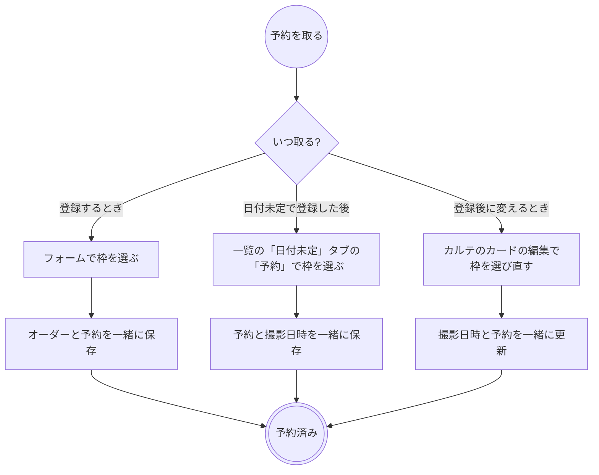

- **枠**: 枠は撮影室の枠表から、所要時間ぶん連続して押さえます。枠の日時が撮影日時です。予約とオーダーは必ず一緒に動きます。
- **日付未定からの予約**: 予約を取ると、カードと一覧の行が予約日へ移ります。
- **枠の選び直し**: 枠を選び直すと、元の枠は空きに戻ります。
- **日付未定タブ**: 放射線検査一覧の「日付未定」タブには日付の無いオーダーが並び、件数がタブ名に出ます。日付は依頼医の側の編集でも決められます。
- **予約タブ**: カルテの予約タブには検査予約も並びますが、そこから日時変更・取消はできません。変更はオーダーの編集、取消はオーダーの中止か削除で行います。
- **外来の受付との違い**: 放射線検査の受付は外来の受付とは別です。検査予約は外来一覧に出ません。

### 受付と実施

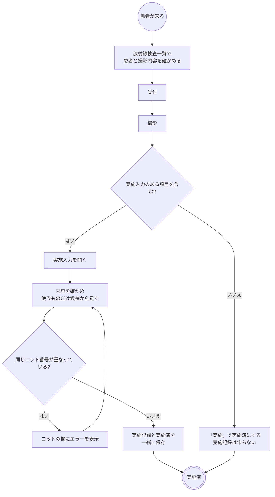

実施入力で確かめる項目は次のとおりです。

| 項目 | 内容 |
|---|---|
| 実施時刻 | 初期値は現在時刻 |
| 実施者 | ログイン中の医療従事者 |
| 手技・造影剤・器材 | 撮影項目ごとに決めてある初期の行が並ぶ |
| 被曝線量 | 撮影の種類で欄が変わる |
| コメント | 実施のコメント |

- **初期の行**: 手技・造影剤・器材の初期の行は、撮影項目に紐付けた実施入力データセットから出ます。データセットの候補に無いものだけ全件検索で足します。
- **入力なしで終わる検査**: 造影剤も器材も無い単純撮影は、そのまま「実施登録」で終わります。
- **被曝線量**: CT は CTDIvol・DLP、血管撮影と透視は DAP・透視時間です。単純撮影には欄が出ません。
- **ロット番号**: 造影剤のロット番号の列は、薬剤付加情報で記録対象にした薬のときだけ出ます。
- **途中でやめたとき**: 撮影を途中でやめた記録を残す操作はありません。撮らなかった検査は中止にします。

### 読影と報告

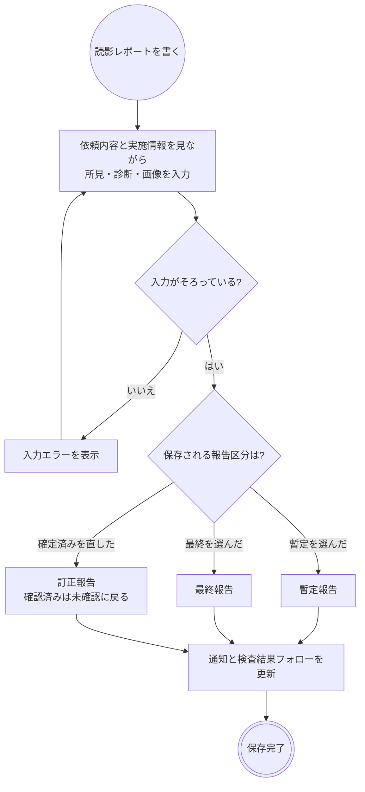

読影レポートを開く入口は 3 つです。どれも実施済のオーダーが対象です。

| 入口 | 開き方 |
|---|---|
| 放射線検査一覧 | 実施済の行の「読影」 |
| カルテのカード | カードのメニュー |
| カルテの「検査結果 > 放射線検査」 | 実施済でレポートの無いオーダーから選ぶ |

「入力がそろっている?」で確かめるのは次の項目です。

| 項目 | 条件 |
|---|---|
| 所見・診断・画像 | どれか 1 つは入っている |
| 診断 | 報告区分が最終のとき必要(「最終報告には診断が必要です。」と出る) |
| 重要所見 | 「重要所見あり」のとき、要点を 1 行書く |
| フォロー推奨 | 「フォロー推奨あり」のとき、内容と期限を書く |

保存すると、報告区分に応じて通知と検査結果フォローが変わります。この文書では、最終報告と訂正報告を合わせて「確定」と呼びます。

| 保存の結果 | 重要所見の通知 | 検査結果確認の通知 | 検査結果フォロー |
|---|---|---|---|
| 暫定報告 | 「重要所見あり」なら出す | 出さない | 載せない |
| 最終報告・訂正報告 | 「重要所見あり」なら出す | 重要所見が未確認の間は出さない | 「フォロー推奨あり」なら載せる |

- **報告区分**: 暫定報告は所見だけでも保存できます(当直帯の速報)。確定済みのレポートを直して保存すると、訂正報告になります。
- **検査結果確認の通知**: 確定のとき、重要所見が未確認で残っていなければ出します。
- **読影医**: 読影医と発行施設は入力欄を持たず、保存時にログイン中の医療従事者と自院が入ります。
- **画像**: 画像はファイル選択・ドラッグ&ドロップ・貼り付けで足し、元画像を残したまま矢印などを描き込めます。1 回に送れる量には上限があるので、超えたら分けて保存します。
- **テンプレート**: 所見は撮影項目マスタの既定テンプレートから記入できます。診断もテンプレートを選べます。
- **読影待ちの一覧**: 読影の担当割当と、日付をまたいだ読影待ちの一覧はありません。一覧は撮影日ごとです。

### 結果の確認

読影レポートが保存されると、依頼医に通知が出ます。重要所見と検査結果確認は、同じレポートに 2 件出しません。

| レポート | 出る通知 |
|---|---|
| 重要所見あり | 重要所見(アラート) |
| 重要所見なしの最終報告・訂正報告 | 検査結果確認(お知らせ) |

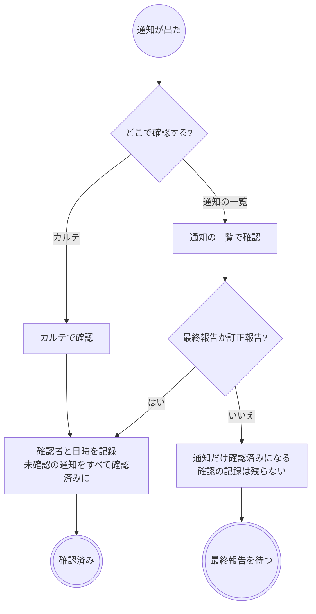

- **カルテで確認する場所**: カルテのカードの詳細か、「検査結果 > 放射線検査」です。
- **確認できる人**: 宛先は依頼医ですが、確認は誰でもできます。記録には確認した本人が残ります。
- **暫定報告のうち**: カルテに「確認」は出ません。通知の一覧で重要所見を確認しても確認の記録は残らず、最終報告になると検査結果確認の通知が出ます。
- **要点を書き換えたとき**: 重要所見は未確認に戻ります。
- **「重要所見あり」を外したとき**: 未確認の通知は取り下げます。確認済みの通知はそのまま残ります。
- **訂正報告**: 訂正報告になると未確認に戻ります。
- **未確認のまま 7 日**: 7 日以上未確認なら、検査結果フォローの「未確認の結果」に残ります。
- **フォロー推奨**: 対応を記録するまで、検査結果フォローに残ります。

### 変更・中止・削除

| 操作 | できる場所 | できないとき |
|---|---|---|
| 変更 | カルテのカード | なし(受付済・実施済でもできる) |
| 予約の変更 | カルテのカードの編集 | なし |
| 中止 | 放射線検査一覧の行のメニュー | 実施済のとき(先に取消) |
| 中止取消 | 放射線検査一覧の行のメニュー | なし |
| 取消 | 放射線検査一覧の行のメニュー | 読影レポートがあるとき(先にレポートを削除) |
| 削除 | カルテのカード | 実施記録か読影レポートがあるとき(取消・レポートの削除が先) |
| レポートの削除 | 読影レポートの編集 | なし |

- **変更**: 単独の項目は、他の撮影項目と同じオーダーにできません。変更しても放射線部への通知は出ず、一覧の内容で見えます。代行入力のときは、再度の承認を要する場合があります。
- **予約の変更**: 撮影日時と一緒に動きます。放射線検査一覧の「予約」は、日付未定のオーダーだけです。
- **中止**: 検査予約を取り消して、枠を空きに戻します。医事会計の対象から外れます。
- **中止取消**: 依頼済に戻ります。撮影日時は残りますが、予約は戻りません。必要ならカルテのカードの編集で枠を取り直します。
- **取消**: 1 つ前の状態へ戻す訂正です。実施済からの取消は、実施記録(造影剤・被曝線量を含む)を消します。
- **削除**: 検査予約を取り消して、枠を空きに戻します。状態と、テンプレートの記入内容も一緒に消えます。
- **レポートの削除**: 所見とテンプレートの記入内容を消し、未確認の通知と未対応のフォロー推奨を取り下げます。添付した画像の実体は残ります。
- **DO**: DO(前回と同じ内容で出し直す)はオーダーの内容だけを写します。予約・実施記録・読影レポートは写りません。

### 帳票

放射線検査の専用の帳票はありません。検査案内・造影剤の同意書・依頼票・照射録はまだ出せません。

## 開発者向け

### シーケンス図の前提

- **書き込みの経路**: `/fhir` への書き込みはどれも 1 回の transaction Bundle で、backend の `FhirProxyController` が上流の FHIR サーバー(以下「上流」)へ中継します。
- **図の省略**: 図では、上流の応答が backend を通ってブラウザへ戻る矢印を省き、上流からブラウザへの 1 本で描きます。
- **楽観ロック**: 版は `postBundle` が `ifMatch` に添え、版が違えば 412 で止まります。
- **SS-MIX2**: 有効にしている施設では、中継が書き込みの控えを記録します(`Ssmix2::Recorder`)。
- **ヘッダと明細**: オーダー 1 件の `ServiceRequest`(`order-type|rad`)を「ヘッダ」、撮影項目 1 件ずつの `ServiceRequest` を「明細」と呼びます。明細は `basedOn` でヘッダを指します。
- **GP の明細**: 単項目の明細か、セット親の明細です。セットの構成項目の明細は、さらに親の明細を `basedOn` で指します。
- **ハブと子**: 実施記録の中心の `Procedure` を「ハブ」、ハブを `partOf` で指すリソースを「子」と呼びます。
- **確定**: 読影レポートの `final` と `amended` を合わせて「確定」と呼びます。

### リソースの構成

- ヘッダ `ServiceRequest`(`order-type|rad`)
  - 明細 `ServiceRequest`(撮影項目 1 件ずつ。`basedOn` = ヘッダ)
    - セットの構成項目の明細(`basedOn` = 親の明細)
  - 進捗 `Task`(`focus` = ヘッダ)
  - 予約 `Appointment`(`basedOn` = ヘッダ)+ `Slot`
  - 実施記録のハブ `Procedure`(`basedOn` = ヘッダ。オーダーに 1 件)
    - 子 `Procedure`(2 件目以降の手技)
    - 子 `MedicationAdministration`(造影剤)
    - 子 `Observation`(被曝線量)
  - 読影レポート `DiagnosticReport`(`basedOn` = ヘッダ。オーダーに 1 件)
    - 所見 `Observation`(1 件)
    - 画像 `Binary` × 2(元画像・描き込み画像)
    - 通知の `Task`、確認の `Provenance`
  - 代行入力・警告の確認の `Provenance`(`target` = ヘッダ)

組み立ては `fhir/radOrderHelpers.ts` です。

**明細**

| 要素 | 中身 |
|---|---|
| 項目コード | 撮影項目のコードと JJ1017-32 / 16M / 16S |
| `category` | 種別 |
| `bodySite` | 部位と左右 |
| `reason*` | 依頼病名。GP の明細にだけ持つ |
| 拡張 `rad-exam-purpose` | 検査目的。GP の明細にだけ持つ |
| `note` | 特別指示。GP の明細にだけ持つ |
| 拡張 `rad-exam-purpose-questionnaire-response` | 検査目的のテンプレート記入の `QuestionnaireResponse` を指す |
| 拡張 `rad-remarks-questionnaire-response` | 特別指示のテンプレート記入の `QuestionnaireResponse` を指す |

テンプレート記入の `QuestionnaireResponse` は、オーダーの削除で一緒に消します。

**進捗・予約・実施記録**

| リソース | 要素 | 中身 |
|---|---|---|
| 進捗 `Task` | `code` | `task-code|rad-exam` |
| 予約 `Appointment` | `basedOn` | ヘッダ。オーダーと同じ transaction で書く |
| 予約 `Slot` | `status` | `busy` / `free`。連続した複数枠を取ることがある |
| ハブ `Procedure` | `category` | `order-type|rad` |
| ハブ `Procedure` | `code` | 手技 1 件目 |
| ハブ `Procedure` | `usedCode` | 器材 |
| ハブ `Procedure` | `performedDateTime` | 実施時刻 |
| 子 `Observation` | `code` | 被曝線量(`rad-dose`) |

実施記録は、実施入力のない項目だけのオーダーには作りません。

**読影レポート `DiagnosticReport`**

| 要素 | 中身 |
|---|---|
| `category` | LOINC `LP29684-5` と v2-0074 `RAD` |
| `code` | `18748-4` |
| `status` | `preliminary` / `final` / `amended` |
| `resultsInterpreter` | 読影医 |
| `performer` | 自院 |
| `conclusion` | 診断 |
| 拡張 `rad-report-image` | `source` / `annotated` が画像の `Binary` を指す |
| 拡張 `rad-report-findings-response` | 所見のテンプレート記入の `QuestionnaireResponse` を指す |
| 拡張 `rad-report-conclusion-response` | 診断のテンプレート記入の `QuestionnaireResponse` を指す |
| 拡張 `rad-critical-finding` | 重要所見の要点 |
| 拡張 `rad-follow-up` | フォロー推奨 |

- レポートの部品は生理検査・内視鏡と共用です(`EXAM_REPORT_CONFIGS.rad`)。
- 画像の `Binary` は、レポートを消しても残します。

**通知と確認**

| もの | リソース | 補足 |
|---|---|---|
| 重要所見の通知 | `Task`(`task-code|rad-critical-finding`、`focus` = レポート、`owner` = 依頼医) | 要点は `Task.input` にも持つ |
| 検査結果確認の通知 | `Task`(`task-code|result-review`、`focus` = レポート、`owner` = 依頼医) | 最終・訂正のときだけ。重要所見が未確認の間は作らない |
| フォロー推奨 | `Task`(`task-code|followup-recommendation`) | 確定したときに台帳へ載せる |
| 確認(既読) | `Provenance`(`target` = レポート、`agent.type = verifier`、`signature`) | 正本。通知は宛先と未確認・確認済みだけ |
| 代行入力 | `Provenance`(`target` = ヘッダ) | 明細は `target` に入れない |
| 警告の確認 | `Provenance`(`target` = ヘッダ、activity `override`) | 明細は `target` に入れない |

### 進捗 Task(`rad-exam`)

- Task は登録時には作りません。**Task が無いオーダーは依頼済**として扱い、最初のステータス変更で作ります(`fhir/radTaskHelpers.ts`)。
- 即実施だけは、登録と同じ transaction で `completed` の Task を作ります。
- 中止は同じ transaction でヘッダを `revoked` にし、中止取消で `active` に戻します(`orderCancelEntries`)。
- 中止したオーダーを編集しても `revoked` のままです(`keepOrderRevoked`)。
- 読影の進み具合は Task に足しません。撮影と読影は別の担当者の別の工程で、一覧の列は `DiagnosticReport.status` から出します。

| 状態 | `Task.status` | `executionPeriod` |
|---|---|---|
| 依頼済 | `requested`(または Task 無し) | なし |
| 受付済 | `accepted` | `start` |
| 実施済 | `completed` | `start` / `end` |
| 中止 | `cancelled` | なし |

操作ごとに、同じ transaction で書くものは次のとおりです。

| 操作 | `Task.status` | 一緒に書くもの |
|---|---|---|
| 受付 | `accepted` | なし |
| 実施 | `completed` | 実施記録(ハブ + 子)。実施入力のない項目だけなら無し |
| 実施済からの取消 | `accepted` | 実施記録の DELETE |
| 受付済からの取消 | `requested` | なし |
| 中止 | `cancelled` | ヘッダ `revoked`、有効な予約の `Appointment` `cancelled` + `Slot` `free` |
| 中止取消 | `requested` | ヘッダ `active` |

### 部品

| 操作 | 画面 | 組み立て | hook |
|---|---|---|---|
| 登録 | `components/RadOrderForm.tsx`・`RadOrderPanels.tsx`・`ExamOrderPanels.tsx` | `buildRadOrderBundle` | `useCreatePrescription` |
| 即実施の登録 | 同じ | `buildRadOrderWithPerformBundle` | `useCreatePrescription` |
| 編集 | 同じ | `buildRadOrderUpdateBundle` | `useUpdateRadOrder` |
| 削除 | 同じ | `buildRadOrderDeleteBundle` | `useDeleteRadOrder` |
| 日付未定の予約 | `pages/RadWorklistPage.tsx`・`components/ExamBookingModal.tsx` | `buildExamScheduleBundle` | `useScheduleExamOrder` |
| 一覧・受付・取消・中止 | `pages/RadWorklistPage.tsx` | `fhir/radTaskHelpers.ts` | `useRadWorklist`・`useUpdateRadTaskStatus` |
| 実施 | `components/RadPerformModal.tsx` | `buildRadPerformBundle` | `useRegisterRadPerform` |
| 実施済からの取消 | `pages/RadWorklistPage.tsx` | `buildRadPerformDeleteEntries` | `useUpdateRadTaskStatus` |
| 読影レポート | `components/ExamReportEntryModal.tsx`・`ExamReportForm.tsx`・`KarteExamReportTab.tsx` | `buildExamReportBundle` | `useSaveExamReport`・`useDeleteExamReport` |
| 結果確認 | カルテ・通知の一覧 | `ResultReviewAction`・`urgentConfirmationEntries` | 通知の hook |

- **置き場所(組み立て)**: オーダーは `fhir/radOrderHelpers.ts`、実施記録と即実施は `fhir/radResultHelpers.ts`、予約は `fhir/appointmentHelpers.ts`、レポートは `fhir/examReportHelpers.ts` です。
- **置き場所(hook)**: 放射線の hook は `api/queries/rad.ts`、レポートは `api/queries/examReport.ts`、日付未定の予約は `api/queries/worklist.ts` です。
- **全種別共通の hook**: `useCreatePrescription`(`api/queries/labResult.ts`)は、名前に反して全種別共通の登録の hook です。
- **ステータス変更**: `useUpdateRadTaskStatus` は `makeUpdateTaskStatusHook`(`api/queries/worklist.ts`)で作ります。
- **警告**: `hooks/useRadSafetyAdvisories.ts`・`fhir/radSafetyHelpers.ts` です。
- **通知の組み立て**: `fhir/examCriticalFindingHelpers.ts`・`fhir/resultReviewHelpers.ts`・`fhir/followUpHelpers.ts` です。

### シーケンス図: 登録・編集・削除

**登録**

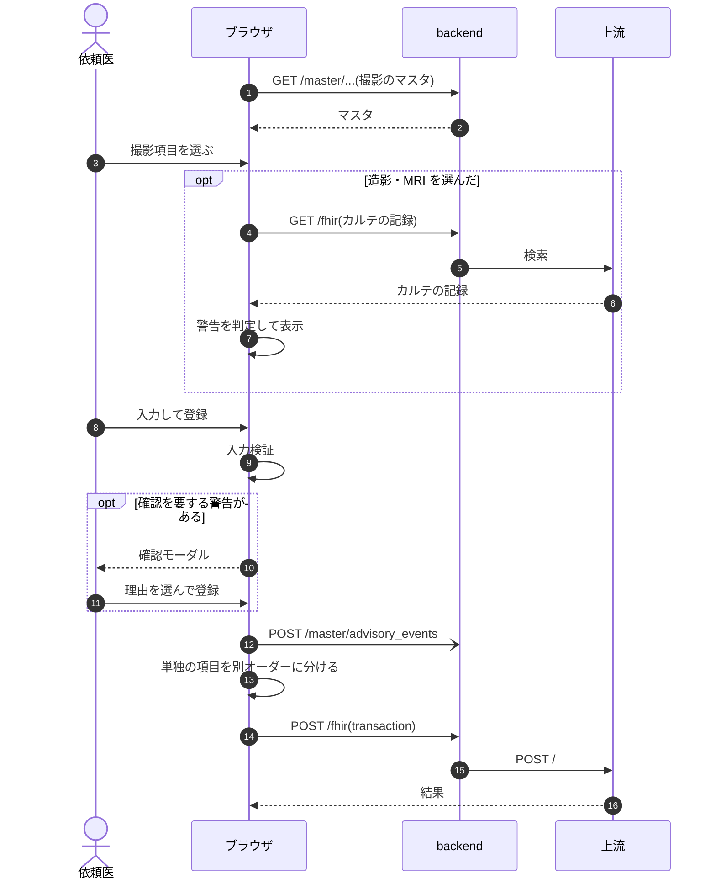

- マスタは、撮影伝票・撮影項目・セットの構成です。
- 警告のために読むカルテの記録は、`Flag`・`AllergyIntolerance`・処方・検査結果・`Patient` です。
- 依頼医が入力するのは、至急区分・撮影日時または枠・依頼病名などです。
- `POST /master/advisory_events` は、発火・無視の台帳です。
- 単独の項目は `splitRadOrderValues` で別オーダーに分けます。

| 書くもの | 条件 |
|---|---|
| ヘッダ `ServiceRequest`(`fullUrl`)+ 明細 × 項目 | オーダーごと |
| 登録時の入院病棟を `order-ward` に | いつも |
| `Provenance`(CREATE) | いつも |
| `Appointment`(`basedOn` = ヘッダ)+ `Slot` `busy` | 予約 |
| 実施記録一式 + `Task` `rad-exam` = `completed` | 即実施 |
| `Task` `order-approval` | 代行・研修医 |
| `Provenance` | 警告の無視 |

**編集**

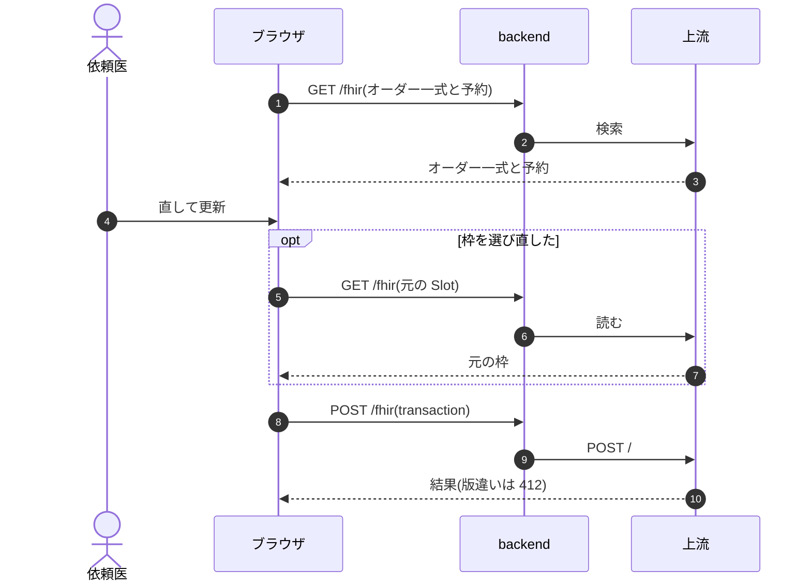

最初の検索は、ヘッダ + 明細と `Appointment?based-on` です。

| 書くもの | 条件 |
|---|---|
| PUT ヘッダ(`ifMatch`) | いつも |
| 明細を差分で POST / PUT / DELETE | いつも |
| `Appointment` の日時 + 元の `Slot` `free` + 新しい `Slot` `busy` | 枠の変更 |
| `Appointment` を作る | 予約が無ければ |
| `Provenance`(UPDATE) | いつも |

**削除**

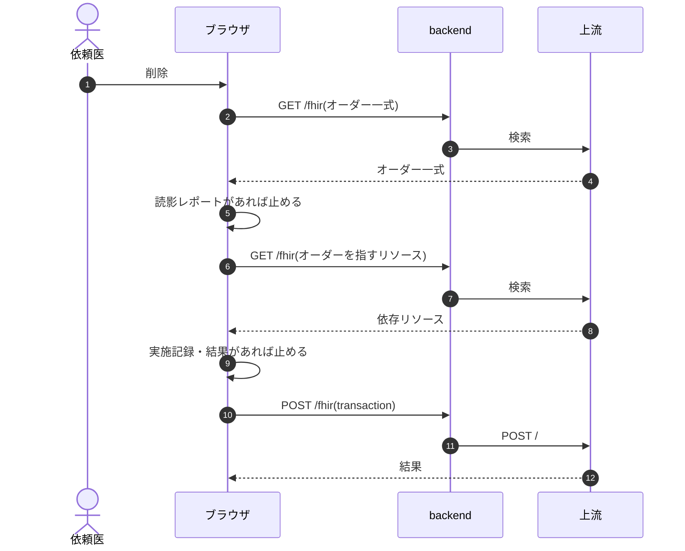

| 検索 | 条件 |
|---|---|
| オーダー一式 | `ServiceRequest?_id` + 明細・`Appointment`・`DiagnosticReport` |
| 依存リソース | オーダーを指す `Task`・`Procedure`・`DiagnosticReport` ほか |

| 書くもの | 条件 |
|---|---|
| DELETE ヘッダ・明細・テンプレート回答・`Task` | いつも |
| `Appointment` `cancelled` + `Slot` `free` | 有効な予約 |

### シーケンス図: 日付未定の予約

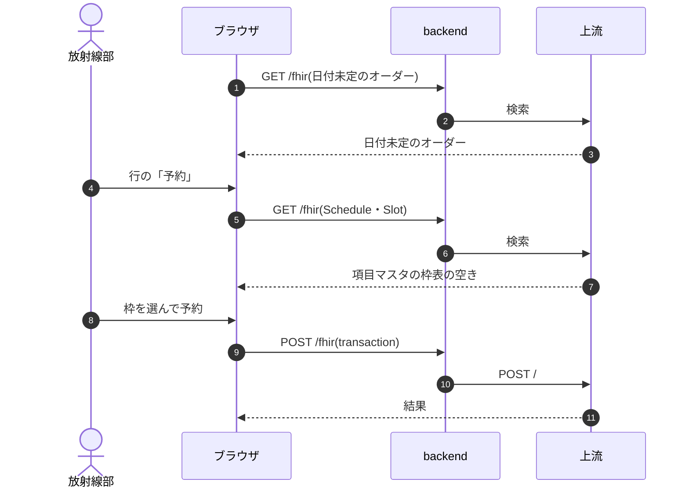

- 日付未定のオーダーの検索は `ServiceRequest?occurrence:missing=true` + 明細・`Task`・レポート・患者です。
- 依頼医の側が先に編集していれば、412 で止まります。

| 書くもの | 条件 |
|---|---|
| PUT ヘッダ・明細(`occurrenceDateTime` = 枠の開始) | いつも |
| POST `Appointment`(`basedOn` = ヘッダ)+ `Slot` `busy` | いつも |
| `Provenance`(UPDATE) | いつも |

### シーケンス図: 受付・実施・取消・中止

**一覧を開く**

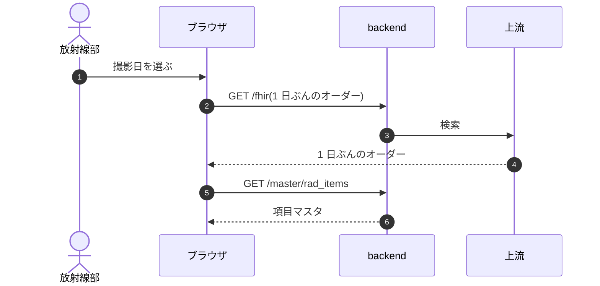

- 検索は `ServiceRequest?category=rad&occurrence=撮影日&based-on:missing=true` です。`_include` で患者、`_revinclude` で明細・`Task`・`DiagnosticReport` を付けます。
- 項目マスタからは、実施入力の有無と枠表を読みます。

**受付、実施(実施入力なし)、受付済からの取消**

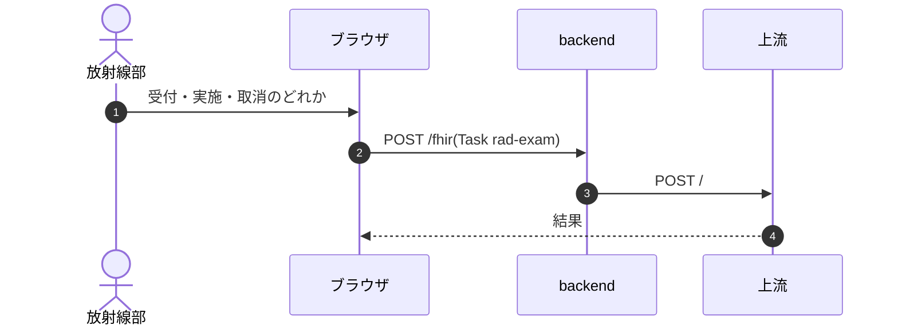

| 操作 | 書くもの |
|---|---|
| 受付 | `Task` `rad-exam` = `accepted` |
| 実施(実施入力なし) | `Task` `rad-exam` = `completed` |
| 受付済からの取消 | `Task` `rad-exam` = `requested` |

**実施(実施入力あり)**

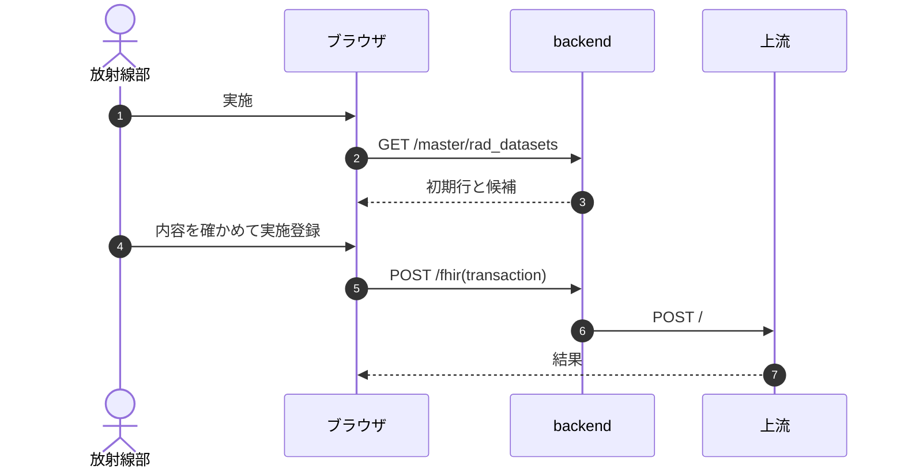

- データセットは、項目のデータセットを引きます。
- 確かめるのは、手技・造影剤・器材・線量です。

| 書くもの | 条件 |
|---|---|
| POST ハブ `Procedure` + 子 `Procedure` | いつも(子は 2 件目以降の手技) |
| POST `MedicationAdministration` | 造影剤 |
| POST `Observation` | 被曝線量 |
| `Task` `rad-exam` = `completed` | いつも |

**実施済からの取消**

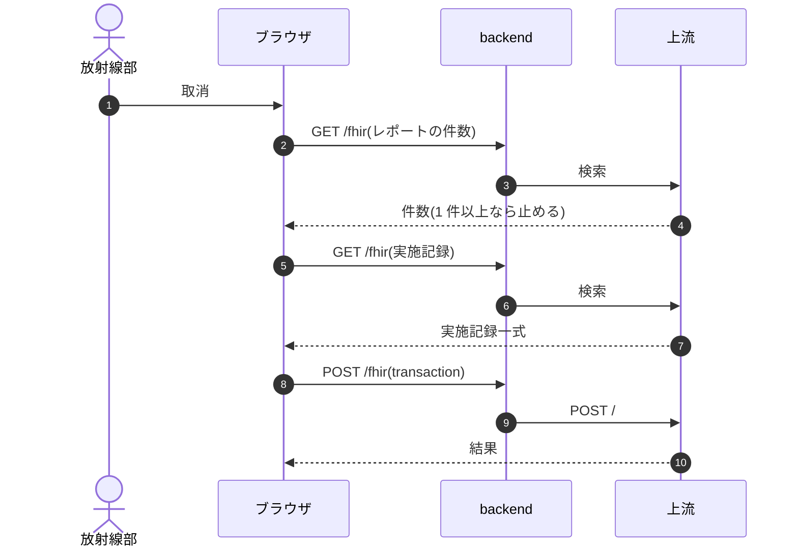

| 検索 | 条件 |
|---|---|
| レポートの件数 | `DiagnosticReport?based-on&_summary=count` |
| 実施記録 | `Procedure?based-on` + 子 |

| 書くもの | 条件 |
|---|---|
| DELETE 子(造影剤・線量・手技)→ ハブ | いつも |
| `Task` `rad-exam` = `accepted` | いつも |

**中止**

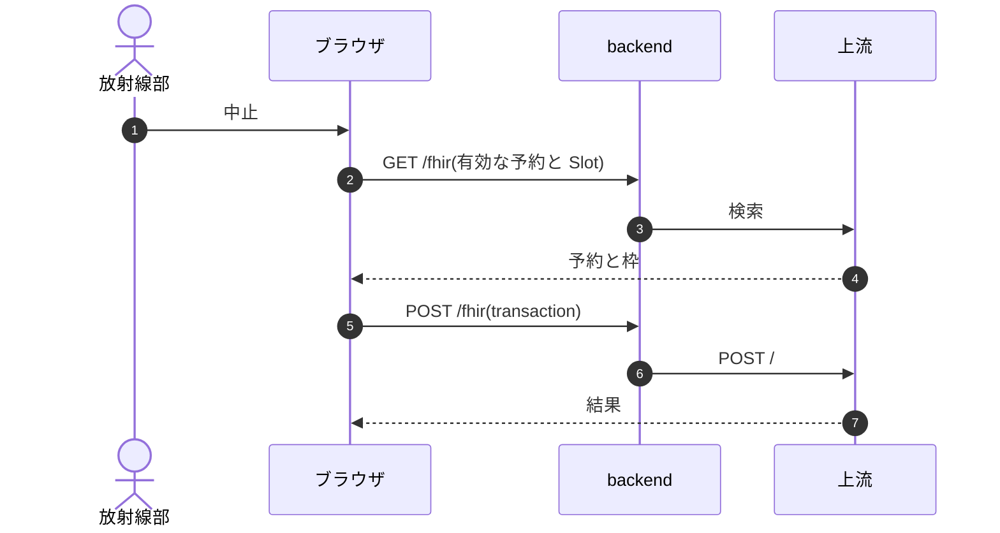

予約の検索は `Appointment?based-on` + 有効な予約、`Slot` です。

| 書くもの | 条件 |
|---|---|
| `Task` `rad-exam` = `cancelled` | いつも |
| PUT ヘッダ `revoked` | いつも |
| `Appointment` `cancelled` + `Slot` `free` | 有効な予約 |

**中止取消**

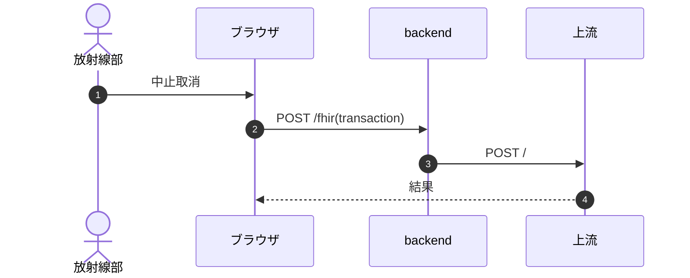

| 書くもの | 条件 |
|---|---|
| `Task` `rad-exam` = `requested` | いつも |
| PUT ヘッダ `active` | いつも |

### シーケンス図: 読影レポート

**保存**

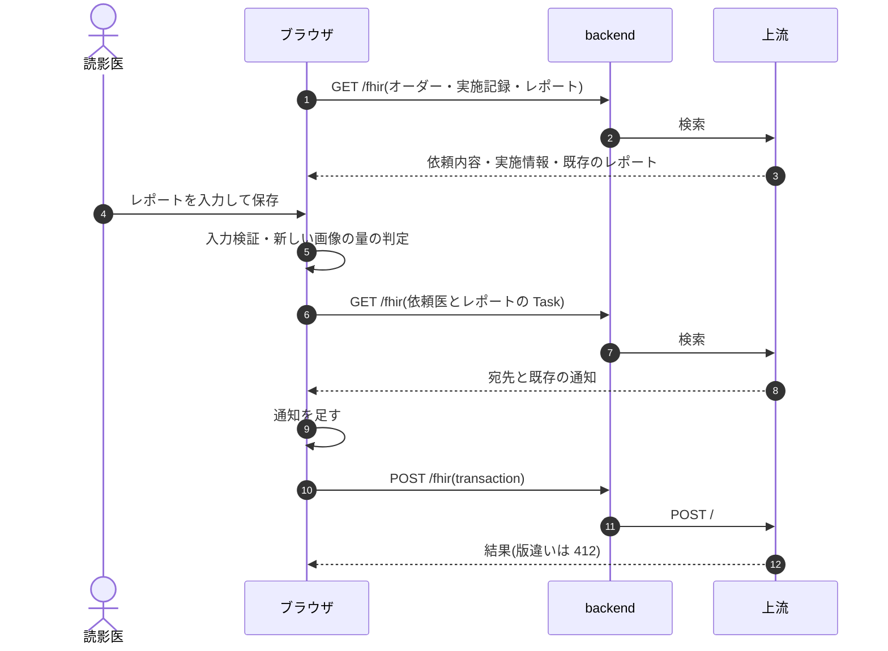

- 最初の検索は、オーダー + 明細、`Procedure` + 造影剤・線量、`DiagnosticReport?based-on` です。
- 読影医が入力するのは、所見・診断・重要所見・フォロー推奨・画像・報告区分です。

| 書くもの | 条件 |
|---|---|
| `Binary`(元画像・描き込み画像) | 画像 |
| `QuestionnaireResponse` | テンプレート |
| `DiagnosticReport` | いつも。確定済みの編集は `amended` |
| `Observation`(所見) | 所見 |
| DELETE 外れた `Observation`・回答 | 編集で外れたもの |
| `Task` `rad-critical-finding` | 要点があれば作る・書き換える。外せば `cancelled` |
| `Task` `result-review` | 確定かつ重要所見が未確認でなければ |
| `Task` `followup-recommendation` | 確定かつ推奨があれば |

**削除**

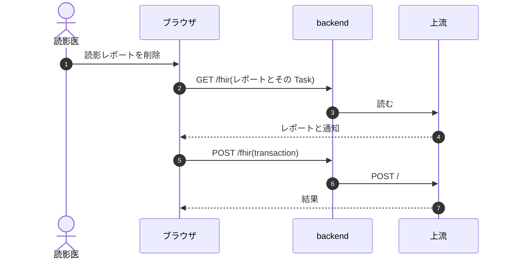

| 書くもの | 条件 |
|---|---|
| DELETE レポート・所見・テンプレート回答 | いつも |
| 通知とフォロー推奨を `cancelled` | 未確認の通知、未対応のフォロー推奨 |

`Binary` は残します(旧版が参照する)。

### シーケンス図: 結果確認

確認の書き込みは検体検査と同じです([lab.md](lab.md)「結果確認」)。放射線では緊急の通知が `rad-critical-finding` になり、`ResultReviewAction`(カルテ)と `urgentConfirmationEntries`(通知の一覧)を通ります。

**通知の一覧から(重要所見)**

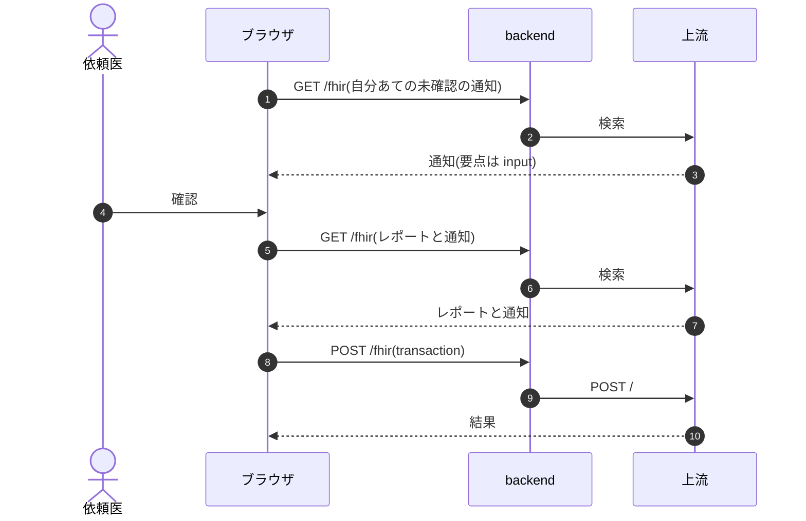

| 検索 | 条件 |
|---|---|
| 通知 | `Task` `rad-critical-finding`、自分あて・未確認 |
| レポートと通知 | レポートと、同じレポートの `result-review` |

| 書くもの | 条件 |
|---|---|
| PUT `Task` `rad-critical-finding` = `completed`(確認者を `note` に) | いつも |
| `Provenance`(verifier) | 最終・訂正なら |
| 未確認の `result-review` = `completed` | あれば |

**カルテから**

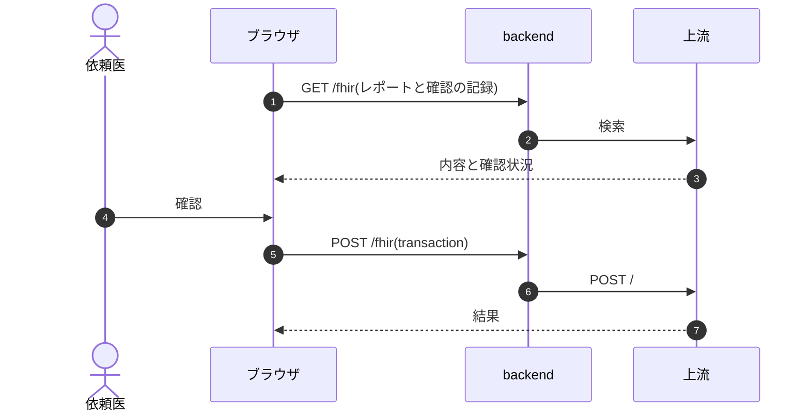

検索は、レポート + 所見と、確認の `Provenance` です。

| 書くもの | 条件 |
|---|---|
| `Provenance`(`target` = レポート、verifier、`signature`) | いつも |
| 未確認の通知をすべて `completed` | あれば |

### 医事会計と SS-MIX2

放射線は実施記録から集めます(`BillingClaimBuilder` の `:procedure` 経路)。

- **手技**: ハブと子の `Procedure.code` で送ります。オーダー項目の `receipt_code` は使いません。
- **手技の行が無いとき**: 実施入力に手技の行が無ければ、手技は送られません。データセットの初期行に手技を入れておきます。
- **部位のコメント**: 項目マスタの `site_comment_code` から足します。
- **1 剤にまとめる**: 部位のコメントは、造影剤・器材・実施コメントと一緒に 1 剤にします。
- **日付**: 実施時刻の日です。
- **実施入力のない項目だけのオーダー**: このときに限り、オーダーの撮影日と項目の `receipt_code` で組みます。

| 起きたこと | 医事会計(`BillingClaimBuilder`) | SS-MIX2 |
|---|---|---|
| 登録・編集・予約 | なし | OMG^O19(OMG-01)。ヘッダを書くと出す |
| 受付 | なし | なし(進捗 Task はメッセージにしない) |
| 実施(実施入力あり) | 実施記録から送る | OMI^Z23(OMG-11) |
| 実施(実施入力なし) | オーダーの項目を `receipt_code` で送る | なし(実施記録が無い) |
| 当日の未実施 | 送らずに報告する | なし |
| 実施済からの取消 | 対象から外れる | OMI^Z23 の `CA`(DEL) |
| 中止 | 対象から外れる(`ServiceRequest` が `revoked`) | OMG^O19 の `CA`(DEL) |
| 中止取消 | — | OMG^O19 の `NW`(INS) |
| 削除 | 対象から外れる | OMG^O19 の `CA`(DEL) |
| 読影レポートの保存・訂正・削除 | なし | なし |

- **登録・編集・予約**: 編集・日付の確定も `NW`(INS)で出します。
- **実施(実施入力あり)**: 医事会計には、手技・部位コメント・造影剤・器材・コメントを送ります。コードの無い行は「送れない項目」に出します。SS-MIX2 には、手技・使用物品(造影剤・器材)・被曝線量を出します。
- **実施(実施入力なし)**: 部門が実施済にしたオーダーが対象です。
- **当日の未実施**: 実施入力ありは「実施記録がありません(未実施のため送りません)」、なしは「部門で実施済になっていません」と報告します。
- **中止**: 医事会計へ送ったあとの中止は、医事が送り直します。
- **読影レポート**: 読影レポートに対応する電文は無く、実施通知 OMI^Z23 までです。
