# 放射線検査オーダーの業務フロー

放射線検査オーダーの登録から予約・受付・実施・読影・結果確認までの流れです。医療機関の運用を検討する人は「運用フロー」、院内の開発者は「開発者向け」を読みます。
設計は [rad-order-master-design.md](../rad-order-master-design.md)(マスタとオーダー)・[rad-result-design.md](../rad-result-design.md)(実施入力)・
[rad-report-design.md](../rad-report-design.md)・[exam-report-design.md](../exam-report-design.md)(読影レポート)、画面のふるまいは [features/lab.md](../features/lab.md)「放射線検査の読影レポート」、
種別共通の約束(日付未定・中止・削除・代行入力・警告)は [features/orders-common.md](../features/orders-common.md)、リソースの要素は実装ガイド(`../fhir-ig`)が正典です。
未実装の機能は [rad-backlog.md](../rad-backlog.md) にまとめています。放射線治療は別の文書で扱います。

## 運用フロー

### 区分ごとの違い

| 至急区分 | 撮影日時 | 予約必須の項目 | 日付未定 | 即実施 |
|---|---|---|---|---|
| 通常 | 撮影日は必須、時刻は任意 | 予約か日付未定を選ぶ | できる | 選べる(予約必須の項目を含むオーダーと日付未定はできない) |
| 至急 | 当日に固定、時刻は任意 | 予約を取らない | できない | 選べる |
| 事後 | 当日以前の日付、時刻は任意 | 予約を取らない | できない | 必ず即実施(撮り終えた検査を入れるため) |

撮影項目ごとの次の 3 つの設定が、流れを分けます。

| 設定 | 値 | 流れへの影響 |
|---|---|---|
| オーダー単位 | まとめられる / 単独 | 単独の項目は 1 項目 1 オーダーに分かれます。一度に選んでも、登録すると別のオーダー(別のカード・別の行)になります |
| 予約 | 不要 / 必須 | 必須の項目は撮影室の枠を所要時間ぶん押さえます。枠の日時がそのまま撮影日時です |
| 実施入力 | あり / なし | なしの項目だけのオーダーは「実施」を押すと入力なしで実施済になります |

たとえば単純撮影は「まとめられる・予約不要」、CT・MRI は「単独・予約必須」に設定します。
撮影項目の入口はカルテの右ペイン「放射線検査」の撮影伝票と項目検索、オーダーセット、クリニカルパスです。

### 放射線検査の状態

放射線部の進み具合を示す状態です。読影の進み具合はこの状態に含めず、一覧の「読影」の列に報告区分で出します。

| 状態 | 変わるきっかけ | 放射線検査一覧からできること |
|---|---|---|
| 依頼済 | 医師の登録、取消、中止取消 | 受付、中止、予約(日付未定のとき) |
| 受付済 | 受付、実施の取消 | 実施、取消(依頼済へ)、中止、予約(日付未定のとき) |
| 実施済 | 実施登録、即実施 | 読影、取消(受付済へ) |
| 中止 | 中止 | 中止取消(依頼済へ) |

- 受付は「患者が放射線部に来て撮影待ちになった」ことを指します。受付を飛ばして実施はできません。
- 日付未定のオーダーは受付・中止・予約はできますが、実施はできません(撮影日が無いため)。
- 読影レポートの有無は状態を変えません。読影しない検査は実施済のままです。

### 全体の流れ

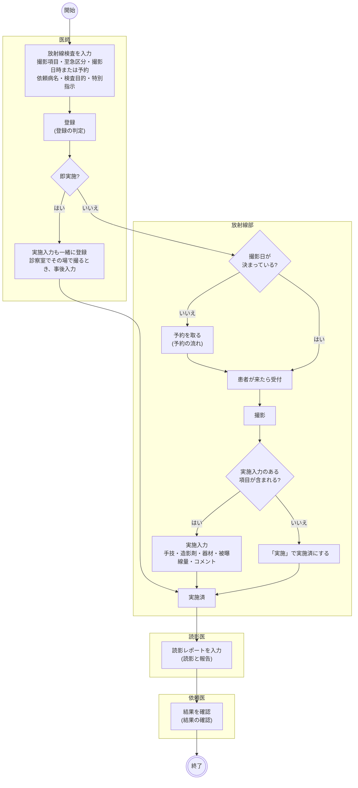

- 放射線部は**部門業務 > 放射線検査一覧**を撮影日ごとに見ます。撮影時刻の順に並び、時刻の無いオーダーは後ろです。至急の行は色が変わり、患者の列に注意区分・アレルギー・感染症の印が出ます。通知は出ません。
- 外来の診察終了で、当日の放射線検査が依頼済・受付済のまま残っていると「一時終了」を選べます。患者が撮影に行き、戻ってから診察を再開します。
- 撮影装置・画像管理システム(PACS)とは接続しません。撮影の事実は実施入力で記録し、画像は読影レポートに添付します。持ち込みの DICOM を見るカルテの「DICOMビューア」タブはオーダーと結び付きません。

### 登録の判定

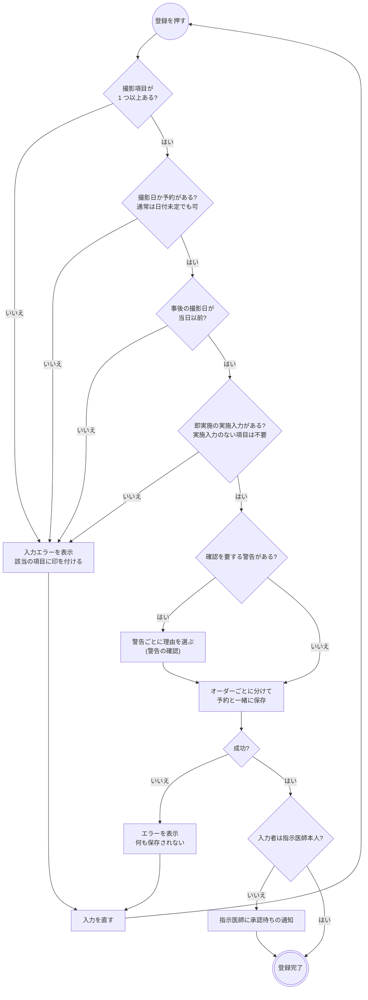

警告は撮影項目を選ぶとフォームに出ます。カルテの記録から拾うので、医師が打ち込む必要はありません。

| 対象 | 警告 | 重さ |
|---|---|---|
| 造影(手技が造影、血管撮影) | 造影の注意区分、造影剤アレルギー、eGFR 30 未満 | 確認を要する |
| 造影 | eGFR 45 未満、クレアチニンが無いなど eGFR を出せない、ビグアナイド系の内服中 | 表示のみ |
| MRI | 体内金属の注意区分 | 確認を要する |
| すべて | 妊娠・授乳、感染症 | 表示のみ |
| 施設の規則 | 「警告の規則マスタ」で出す場所に放射線を選んだ規則 | 規則の設定による |

- 確認を要する警告は、理由を選べば登録できます。登録を止める警告はありません。
- CT の造影の確認項目・MRI の安全確認は、特別指示のテンプレート(`RAD_CT_01` / `RAD_MRI_01`)で記入できます。撮影項目マスタの既定テンプレートに設定すると最初から選ばれます。
- 依頼病名・検査目的・特別指示は撮影項目(セットは親)ごとに入れます。
- 承認待ちでもオーダーは部門に流れます。
- オーダーセットの適用も同じフォームを通ります。日付は一括で入りますが、予約必須の項目は適用時に枠を選びます。

### 予約の流れ

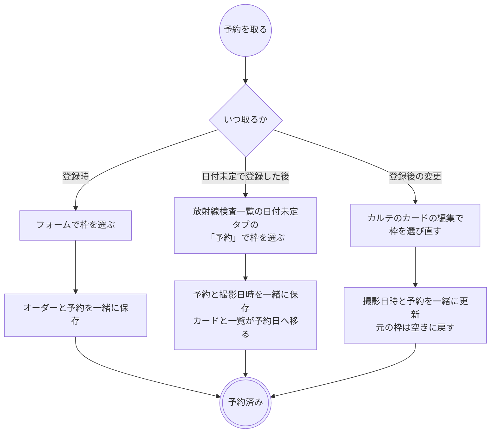

- 枠は撮影室の枠表から、所要時間ぶん連続して押さえます。
- 枠の日時が撮影日時です。予約とオーダーは必ず一緒に動きます。
- カルテの予約タブには検査予約も並びますが、そこから日時変更・取消はできません。変更はオーダーの編集、取消はオーダーの中止か削除で行います。
- 日付未定タブには日付の無いオーダーが並び、件数がタブ名に出ます。日付は依頼側の編集でも決められます。
- 放射線検査の受付は外来の受付とは別です。検査予約は外来一覧に出ません。

### 受付と実施

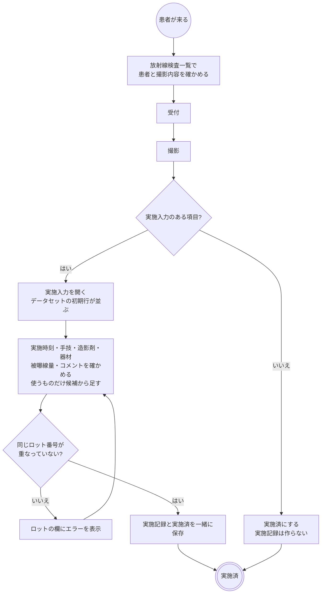

- 実施時刻の初期値は現在時刻、実施者はログイン中の医療従事者です。
- 手技・造影剤・器材の初期行は撮影項目に紐付けた実施入力データセットから出ます。データセットの候補に無いものだけ全件検索で足します。造影剤も器材も無い単純撮影は、そのまま「実施登録」で終わります。
- 被曝線量の欄は撮影の種類で出し分けます。CT は CTDIvol・DLP、血管撮影と透視は DAP・透視時間で、単純撮影には出ません。
- 造影剤のロット番号は薬剤付加情報で記録対象にした薬のときだけ列が出ます。
- 撮影を途中でやめた記録を残す操作はありません。撮らなかった検査は中止にします。

### 読影と報告

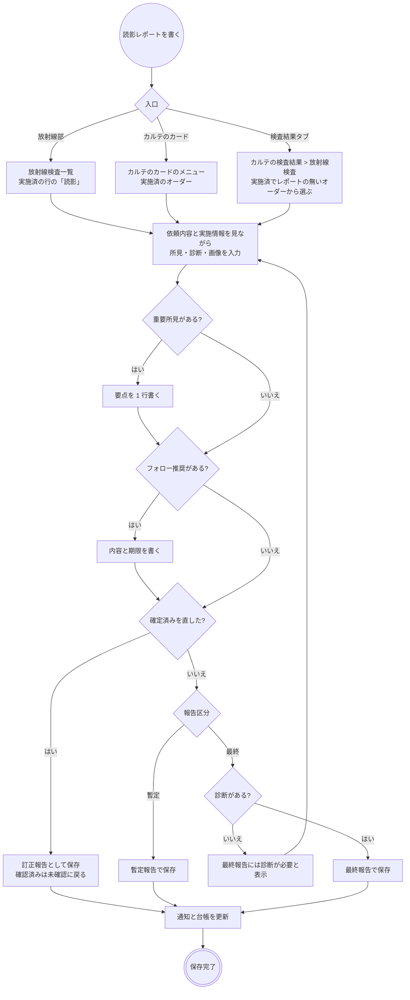

| 保存の結果 | 重要所見の通知 | 検査結果確認の通知 | 検査結果フォローの台帳 |
|---|---|---|---|
| 暫定報告 | 「重要所見あり」なら出す | 出さない | 載せない |
| 最終報告・訂正報告 | 「重要所見あり」なら出す | 重要所見が未確認で残る間は出さない。それ以外は出す | 「フォロー推奨あり」なら載せる |

- 所見・診断・画像がすべて空だと保存できません。暫定報告は所見だけでも保存できます(当直帯の速報)。
- 読影医と発行施設は入力欄を持たず、保存時にログイン中の医療従事者と自院が入ります。
- 画像はファイル選択・ドラッグ&ドロップ・貼り付けで足し、元画像を残したまま矢印などを描き込めます。1 回に送れる量には上限があるので、超えたら分けて保存します。
- 所見は撮影項目マスタの既定テンプレートから記入できます。診断もテンプレートを選べます。
- 読影の担当割当と、日付をまたいだ読影待ちの一覧はありません。一覧は撮影日ごとです(`rad-backlog.md` A-5)。

### 結果の確認

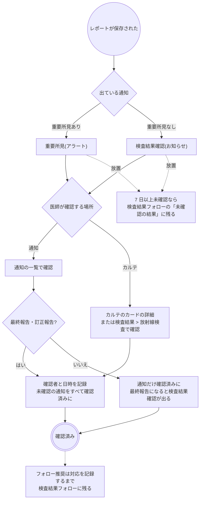

- 宛先は依頼医ですが、確認は誰でもできます。記録には確認した本人が残ります。
- 重要所見と検査結果確認は同じレポートに 2 件出しません。
- 要点を書き換えると重要所見は未確認に戻り、「重要所見あり」を外すと未確認の通知は取り下げます。確認済みの通知はそのまま残ります。
- 暫定報告のうちはカルテに「確認」が出ません。通知の一覧で重要所見を確認しても確認の記録は残らず、最終報告になると検査結果確認が出ます。
- 訂正報告になると未確認に戻ります。

### 変更・中止・削除

| 操作 | できる場所 | できないとき・注意 |
|---|---|---|
| 変更 | カルテのカード | 受付済・実施済でも止まりません。単独の項目は他の撮影項目と同じオーダーにできません。部門への通知はなく、一覧の内容で見えます |
| 予約の変更 | カルテのカードの編集 | 撮影日時と一緒に動きます。放射線検査一覧の予約は日付未定のオーダーだけです |
| 中止 | 放射線検査一覧のメニュー | 実施済からはできません(先に取消)。検査予約を取り消して枠を空きに戻します。医事会計の対象から外れ、SS-MIX2 に取消が出ます |
| 中止取消 | 放射線検査一覧のメニュー | 依頼済に戻ります。撮影日時は残りますが予約は戻らないので、必要ならカルテのカードの編集で枠を取り直します |
| 取消 | 放射線検査一覧のメニュー | 1 つ前の状態へ戻す訂正。実施の取消は実施記録(造影剤・被曝線量を含む)を消します。読影レポートがあるとできません(先にレポートを削除) |
| 削除 | カルテのカード | 実施記録か読影レポートがあるとできません(取消・レポートの削除が先)。検査予約を取り消して枠を空きに戻し、進捗とテンプレートの記入内容も一緒に消えます |
| レポートの削除 | 読影レポートの編集 | 所見とテンプレートの記入内容を消し、未確認の通知と未対応のフォロー推奨を取り下げます。添付した画像の実体は残ります |

- 変更は再度の承認を要する場合があります(代行入力のとき)。
- DO はオーダーの内容だけを写します。予約・実施記録・読影レポートは写りません。

### 帳票

放射線検査の専用の帳票はありません。検査案内・造影剤の同意書・依頼票・照射録は [rad-backlog.md](../rad-backlog.md) の C・D-3 に残っています。

## 開発者向け

### リソースの構成

オーダーはヘッダの `ServiceRequest`(`order-type|rad`)と、撮影項目 1 件ずつの明細 `ServiceRequest`(`basedOn` でヘッダを指す)です。セットの構成項目はさらに親の明細を `basedOn` で指します。
明細は項目コード・JJ1017-32 / 16M / 16S・種別(`category`)・部位と左右(`bodySite`)を写し、依頼病名(`reason*`)・検査目的(拡張 `rad-exam-purpose`)・特別指示(`note`)は GP(単項目かセット親)の明細にだけ持ちます(`fhir/radOrderHelpers.ts`)。

| もの | リソース | 補足 |
|---|---|---|
| 進捗 | `Task`(`task-code|rad-exam`、`focus` = ヘッダ) | 下の表 |
| 予約 | `Appointment`(`basedOn` = ヘッダ)+ `Slot`(`busy` / `free`) | オーダーと同じ transaction で書く。連続した複数枠を取ることがある |
| 検査目的・特別指示のテンプレート記入 | `QuestionnaireResponse` | 明細の拡張 `rad-exam-purpose-questionnaire-response` / `rad-remarks-questionnaire-response` が指す。削除で一緒に消す |
| 実施記録 | ハブ `Procedure`(`order-type|rad`、`basedOn` = ヘッダ、`code` = 手技 1 件目、`usedCode` = 器材、`performedDateTime`)← `partOf` ── `Procedure`(2 件目以降の手技)、`MedicationAdministration`(造影剤)、`Observation`(被曝線量。`rad-dose`) | オーダーに 1 件。実施入力のない項目だけのオーダーには作らない |
| 読影レポート | `DiagnosticReport`(`basedOn` = ヘッダ、`category` = LOINC `LP29684-5` と v2-0074 `RAD`、`code` = `18748-4`、`status` = `preliminary` / `final` / `amended`、`resultsInterpreter` = 読影医、`performer` = 自院、`conclusion` = 診断)+ `Observation`(所見 1 件) | オーダーに 1 件。部品は生理検査・内視鏡と共用(`EXAM_REPORT_CONFIGS.rad`) |
| 読影の画像 | `Binary` × 2(元画像・描き込み画像) | レポートの拡張 `rad-report-image` の `source` / `annotated` が指す。レポートを消しても残す |
| 読影のテンプレート記入 | `QuestionnaireResponse` | 拡張 `rad-report-findings-response` / `rad-report-conclusion-response` が指す |
| 重要所見の通知 | `Task`(`task-code|rad-critical-finding`、`focus` = レポート、`owner` = 依頼医) | 要点はレポートの拡張 `rad-critical-finding` と `Task.input` |
| 検査結果確認の通知 | `Task`(`task-code|result-review`、`focus` = レポート、`owner` = 依頼医) | 最終・訂正のときだけ。重要所見が未確認の間は作らない |
| フォロー推奨 | レポートの拡張 `rad-follow-up` + `Task`(`task-code|followup-recommendation`) | 確定したときに台帳へ載せる |
| 確認(既読) | `Provenance`(`target` = レポート、`agent.type = verifier`、`signature`) | 正本。通知は宛先と未確認・確認済みだけ |
| 代行入力・警告の確認 | `Provenance`(`target` = ヘッダ) | 明細は `target` に入れない。警告の確認は activity `override` |

### 進捗 Task(`rad-exam`)

Task は登録時には作りません。**Task が無いオーダーは依頼済**として扱い、最初のステータス変更で作ります(`fhir/radTaskHelpers.ts`)。即実施だけは登録と同じ transaction で `completed` の Task を作ります。
中止は同じ transaction でヘッダを `revoked` にし、中止取消で `active` に戻します(`orderCancelEntries`)。中止したオーダーを編集しても `revoked` のままです(`keepOrderRevoked`)。

| 状態 | `Task.status` | `executionPeriod` | 同じ transaction で書くもの |
|---|---|---|---|
| 依頼済 | `requested`(または Task 無し) | なし | 中止取消ならヘッダ `active` |
| 受付済 | `accepted` | `start` | 実施の取消なら実施記録の DELETE |
| 実施済 | `completed` | `start` / `end` | 実施記録(ハブ + 子)。実施入力のない項目だけなら無し |
| 中止 | `cancelled` | なし | ヘッダ `revoked`、有効な予約の `Appointment` `cancelled` + `Slot` `free` |

読影の進み具合は Task に足しません。撮影と読影は別の担当者の別の工程で、一覧の列は `DiagnosticReport.status` から出します。

### シーケンス図の前提

`/fhir` への書き込みはどれも 1 回の transaction Bundle で、backend の `FhirProxyController` が上流へ中継します。
SS-MIX2 を有効にしている施設では、中継が書き込みの控えを記録します(`Ssmix2::Recorder`)。
楽観ロックの版は `postBundle` が `ifMatch` に添え、版が違えば 412 で止まります。

### シーケンス図: 登録・編集・削除

`components/RadOrderForm.tsx`・`RadOrderPanels.tsx`・`ExamOrderPanels.tsx`、`buildRadOrderBundle` / `buildRadOrderUpdateBundle` / `buildRadOrderDeleteBundle`(`fhir/radOrderHelpers.ts`)、
`buildRadOrderWithPerformBundle`(`fhir/radResultHelpers.ts`。即実施)、`useCreatePrescription`(`api/queries/labResult.ts`。全種別共通)、`useUpdateRadOrder` / `useDeleteRadOrder`(`api/queries/rad.ts`)、
警告は `hooks/useRadSafetyAdvisories.ts`・`fhir/radSafetyHelpers.ts`。

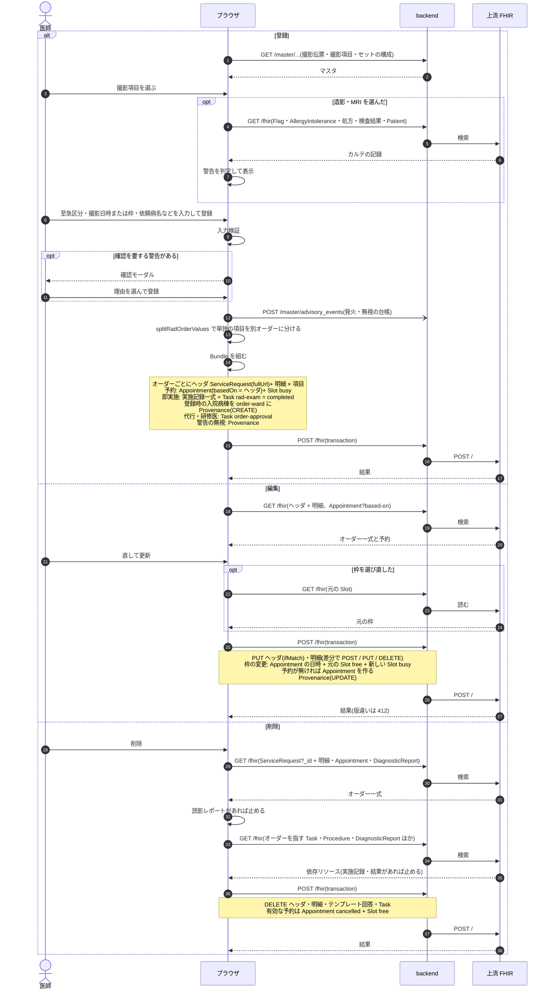

### シーケンス図: 日付未定の予約

`pages/RadWorklistPage.tsx`、`components/ExamBookingModal.tsx`、`useScheduleExamOrder`(`api/queries/worklist.ts`)、`buildExamScheduleBundle`(`fhir/appointmentHelpers.ts`)。

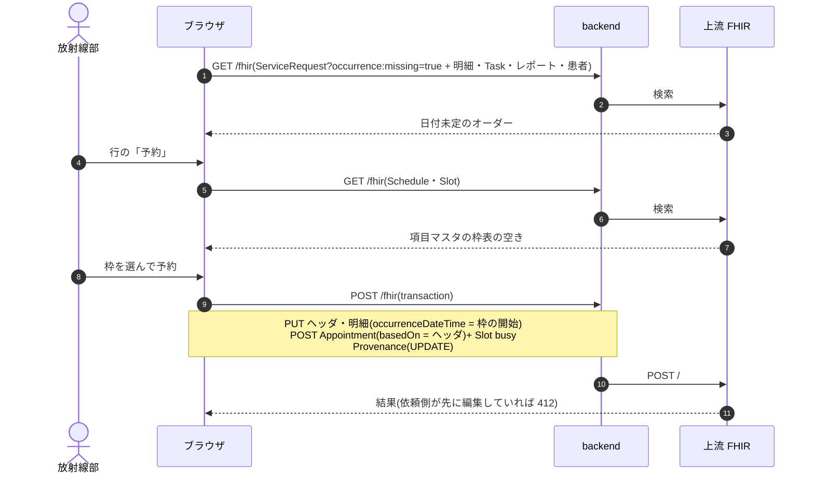

### シーケンス図: 受付・実施・取消・中止

`pages/RadWorklistPage.tsx`、`useRadWorklist` / `useUpdateRadTaskStatus` / `useRegisterRadPerform`(`api/queries/rad.ts`)、`makeUpdateTaskStatusHook`(`api/queries/worklist.ts`)、
`components/RadPerformModal.tsx`、`buildRadPerformBundle` / `buildRadPerformDeleteEntries`(`fhir/radResultHelpers.ts`)。

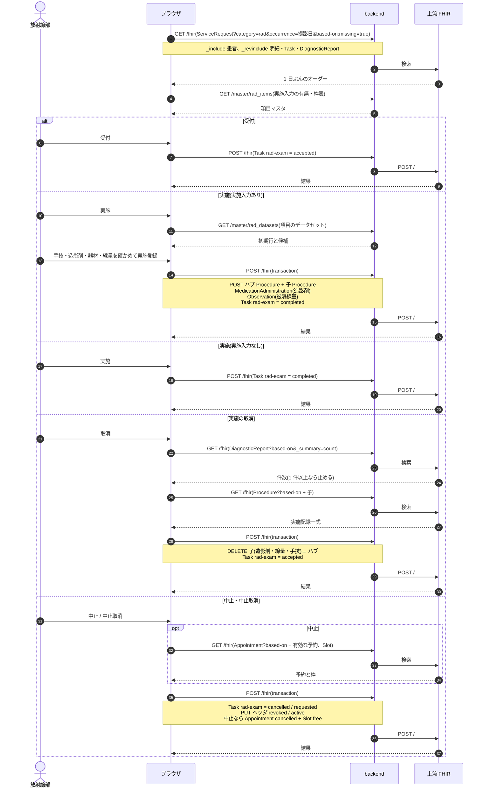

### シーケンス図: 読影レポート

`components/ExamReportEntryModal.tsx`・`ExamReportForm.tsx`・`KarteExamReportTab.tsx`、`buildExamReportBundle`(`fhir/examReportHelpers.ts`)、`useSaveExamReport` / `useDeleteExamReport`(`api/queries/examReport.ts`)。
通知の組み立ては `fhir/examCriticalFindingHelpers.ts`・`fhir/resultReviewHelpers.ts`・`fhir/followUpHelpers.ts`。

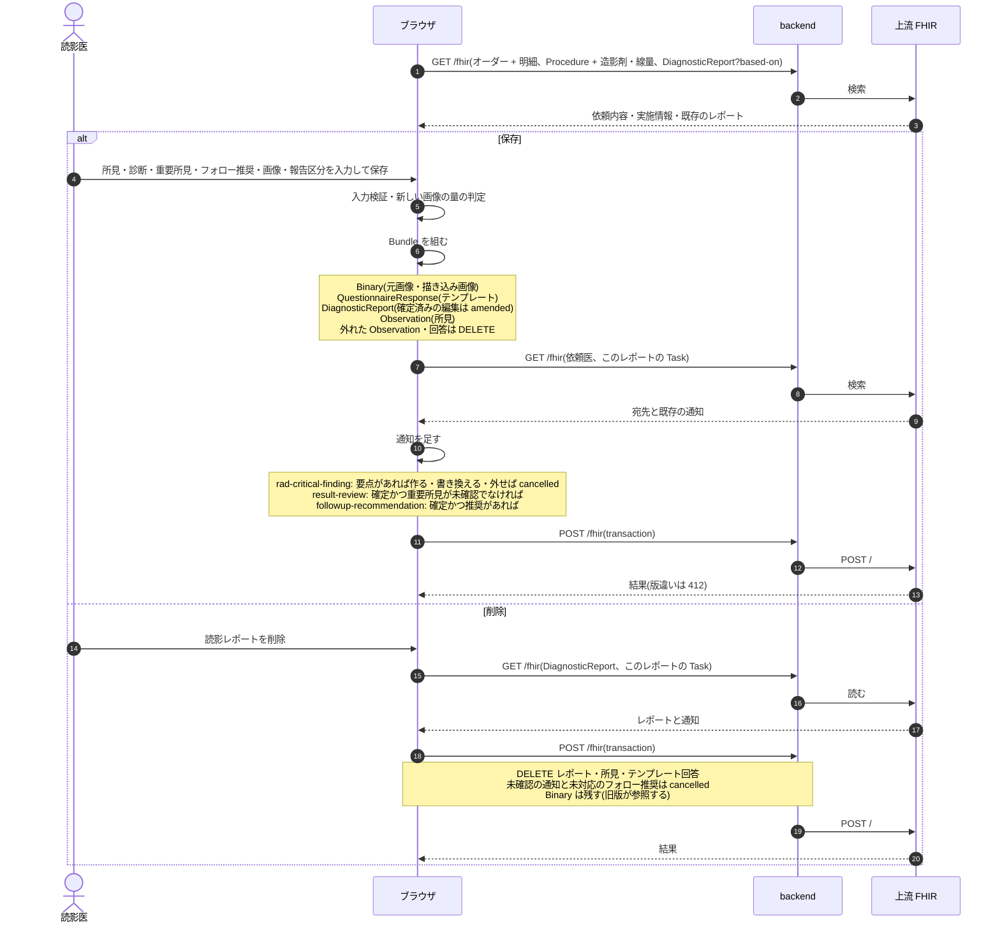

### シーケンス図: 結果確認

確認の書き込みは検体検査と同じです([lab.md](lab.md)「シーケンス図: 結果確認」)。放射線では緊急の通知が `rad-critical-finding` になり、`ResultReviewAction`(カルテ)と `urgentConfirmationEntries`(通知の一覧)を通ります。

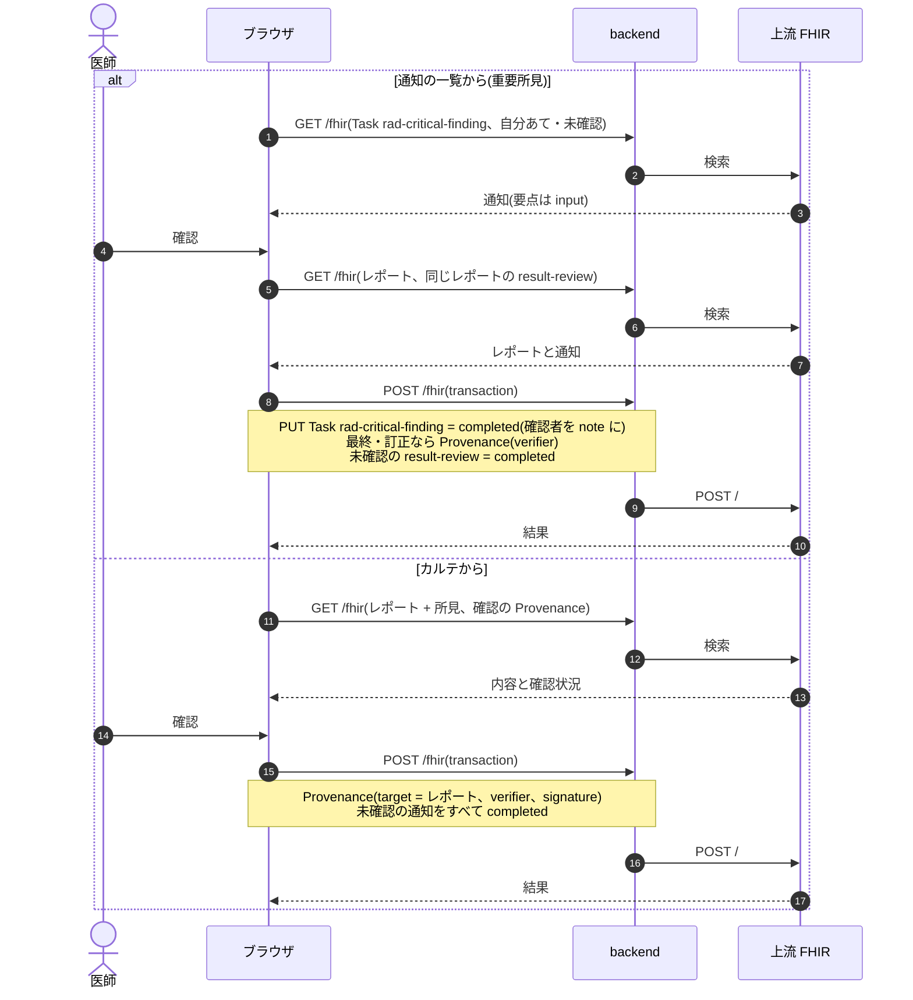

### 医事会計と SS-MIX2

放射線は実施記録から集めます(`BillingClaimBuilder` の `:procedure` 経路)。手技はハブと子の `Procedure.code` で、オーダー項目の `receipt_code` は使いません。実施入力に手技の行が無ければ手技は送られないので、データセットの初期行に手技を入れておきます。
部位のコメントは項目マスタの `site_comment_code` から足し、造影剤・器材・実施コメントと一緒に 1 剤にします。日付は実施時刻の日です。実施入力のない項目だけのオーダーに限り、オーダーの撮影日と項目の `receipt_code` で組みます。

| 起きたこと | 医事会計(`BillingClaimBuilder`) | SS-MIX2 |
|---|---|---|
| 登録・編集・予約 | なし | OMG^O19(OMG-01)。ヘッダを書くと出す。編集・日付の確定も `NW`(INS) |
| 受付 | なし | なし(進捗 Task はメッセージにしない) |
| 実施(実施入力あり) | 実施記録から手技・部位コメント・造影剤・器材・コメントを送る。コードの無い行は「送れない項目」に出す | OMI^Z23(OMG-11)。手技・使用物品(造影剤・器材)・被曝線量 |
| 実施(実施入力なし) | 部門が実施済にしたオーダーの項目を `receipt_code` で送る | なし(実施記録が無い) |
| 当日の未実施 | 実施入力ありは「実施記録がありません(未実施のため送りません)」、なしは「部門で実施済になっていません」と報告 | なし |
| 実施の取消 | 対象から外れる | OMI^Z23 の `CA`(DEL) |
| 中止 | 対象から外れる(`ServiceRequest` が `revoked`)。送ったあとの中止は医事が送り直す | OMG^O19 の `CA`(DEL)。中止取消は `NW`(INS) |
| 削除 | 対象から外れる | OMG^O19 の `CA`(DEL) |
| 読影レポートの保存・訂正・削除 | なし | なし(読影レポートに対応する電文は無く、実施通知 OMI^Z23 まで) |
