# 放射線治療の業務フロー

放射線治療を、依頼から治療処方・受付・照射予定・毎回の照射・治療中の診察・終了サマリーまで追う流れです。医療機関の運用を検討する人は「運用フロー」、院内の開発者は「開発者向け」を読みます。
放射線治療は、臨床医が**他科依頼**で放射線治療科に相談し、放射線治療医が**治療処方**(治療コース 1 件)を書き、部門が数週間かけて照射する長い流れです。
依頼・治療処方・照射の記録を別のデータで持ち、治療計画(輪郭・ビーム・線量分布)は治療計画装置の領域として持ちません。
設計は [radiotherapy-order-design.md](../radiotherapy-order-design.md)、依頼の流れは [consult-team.md](consult-team.md)(他科依頼)、
督促の通知は [features/notifications.md](../features/notifications.md)、有害事象の表示は [features/patient-profile.md](../features/patient-profile.md)「有害事象」、
種別共通の約束(代行入力・オーダーセット)は [features/orders-common.md](../features/orders-common.md)、リソースの要素は実装ガイド(`../fhir-ig`)が正典です。

## 運用フロー

### 放射線検査との違い

| | 放射線検査 | 放射線治療 |
|---|---|---|
| 登録する人 | 依頼医 | 放射線治療医。依頼医は他科依頼で放射線治療科に頼む |
| オーダーの単位 | 検査 1 回 | 治療コース 1 件(数週間・数十回の照射) |
| 入力する項目 | 撮影項目・部位・依頼病名・検査目的 | 治療目的・コース番号・開始予定日・担当医・併用療法・元の依頼・標的(名称・種別・部位・左右)・Phase(モダリティ・照射技法・使用予定装置・分割回数・週あたり回数・標的ごとの 1 回線量)・対象プロブレム・コメント |
| 入力の手間を省くもの | オーダーセット | 治療プロトコル(定型処方。選ぶと標的と Phase が入る)、DO、オーダーセット |
| 日程 | 予約枠から選ぶ | 予約枠は使わない。受付後に部門が照射予定を一括で組む |
| 実施 | 1 回 | 照射 1 回ごとに記録する。照射しなかった回も理由つきで残す |
| 結果 | 読影レポート | 週次レビュー・有害事象・治療終了サマリー |
| 部門の画面 | 放射線検査一覧(日付で切る) | 放射線治療カレンダー(格子は装置 × 時刻、右に進行中の治療コース) |
| 登録時の警告 | 確認を要するものがある | どれも表示だけ |
| 退院 | – | 退院で止めない(照射は外来で続くのが普通) |
| 医事会計 | 実施記録から送る | 照射記録から送る(照射 1 回ごと) |

- 入口はカルテの右ペイン「放射線治療」(「化学療法」の隣)です。部門で受けて代わりに起こすときは、放射線治療カレンダーの「新規登録」からも登録できます。
- クリニカルパスのタスク分類 `TPRT` の既定のオーダー種別です。オーダーセットにも入れられます(開始予定日・担当医・元の依頼は持ち込みません)。
- 処方できる医師は絞っていません。

### 治療コースの状態

| 状態 | 意味 | 変わるきっかけ | カレンダーの治療コースのカードからできること |
|---|---|---|---|
| 処方済 | 部門がまだ引き受けていない | 医師の登録、受付取消、中止取消 | 受付、中止 |
| 計画中 | 計画 CT・治療計画・検証のあいだ | 受付、治療開始取消 | 治療開始、予定登録、受付取消、中止 |
| 治療中 | 初回照射から最終照射まで | 治療開始、再開、終了取消 | 照射入力、予定登録、終了、休止、治療開始取消、中止 |
| 休止 | 体調不良・装置の故障などで中断 | 休止(休止日・理由・補足) | 再開(治療中へ)、予定登録、中止 |
| 終了 | 照射を終えた | 終了(終了日) | サマリー、終了取消(治療中へ) |
| 中止 | 途中でやめた | 中止(中止日・理由・補足) | サマリー、中止取消(処方済へ) |

- 状態を動かすのは部門(放射線治療カレンダー)だけです。照射を記録しても状態は変わらず、処方の回数に達してもカードに「完了」の印が付くだけで、終了は部門が決めます。
- 「予定登録」は予定と照射済みの回が処方の回数に届いていないときだけ出ます。押し間違いの訂正(受付取消・治療開始取消・終了取消・中止取消)と中止は、カードのケバブメニューに畳んであります。
- ケバブメニューにはほかに「表示」「予定全削除」(予定があるとき)「週次レビュー」「カルテ表示」があります。
- 一覧は「進行中」(処方済・計画中・治療中・休止)と「終了・中止」に分かれ、装置・進捗・患者(氏名・患者番号の部分一致)で絞れます。

### 全体の流れ

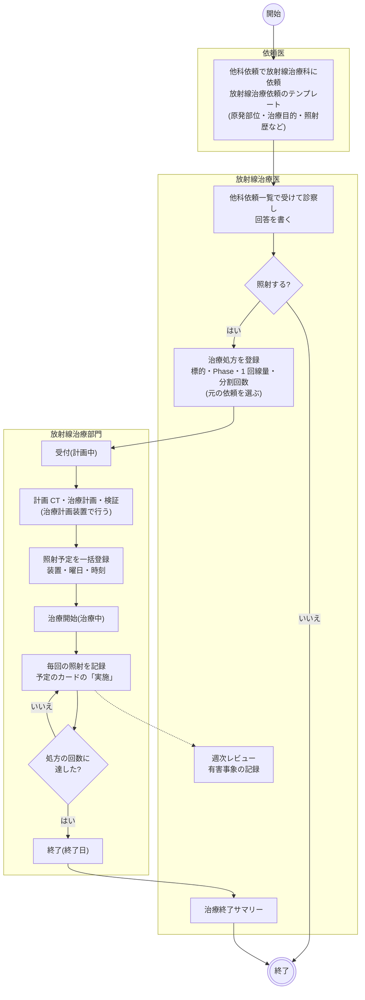

- 依頼先に放射線治療科を選ぶと、施設設定で科ごとに決めた既定のテンプレート(`CONSULT_RT_01`)が依頼目的に選ばれた状態になります。他院での照射歴はこのテンプレートが唯一の入口です。
- 依頼への回答(診療記録)と治療処方は別のものです。回答は他科依頼一覧から書き、治療処方はカルテの右ペインから登録します。元の依頼を選ぶのは任意で、選ぶと依頼目的がフォームに出ます。
- 依頼と治療処方は、依頼のカードの「治療処方表示」と治療処方のカードの「依頼表示」で行き来できます。
- 計画 CT は放射線検査オーダーで出します。固定具・呼吸同期・前処置は放射線検査の特別指示テンプレートで書けます。治療計画の中身(輪郭・ビーム・MU・線量分布)はこのアプリでは扱いません。
- 治療処方のカードはカルテの開始予定日の日に載り、部位・照射技法・併用療法と標的ごとのコース合計(「PTV 全乳房 50 Gy / 25 回」)、照射の回数と累積線量を出します。

### 登録の判定

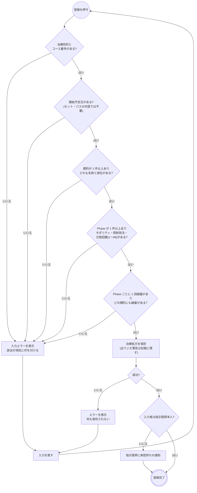

警告はフォームの先頭に出ます。カルテの記録から拾うので、医師が打ち込む必要はありません。どれも登録は止めず、理由も聞きません。

| 対象 | 警告 |
|---|---|
| 過去の放射線治療 | この患者の治療コースを表で出し、今回の標的と同じ部位(部位のコードが一致し、左右が食い違わない)のコースを強調する |
| 妊娠・授乳 | 患者プロファイルの妊娠・授乳 |
| 体内金属・ペースメーカー | 患者プロファイルの注意区分(体内金属のピクトグラム) |
| 施設の規則 | 「警告の規則マスタ」で出す場所に放射線治療を選んだ規則 |

- 再照射の強調は気づきのためのもので、隣接部位の重なりや累積線量(EQD2 など)は評価しません。部位を自由記載した標的は突き合わせません。
- 治療プロトコルを選ぶと、標的・Phase・治療目的が入ります。「骨転移」のように部位が決まらないプロトコルは部位が空なので、ここで選びます。部位の選択肢に無いときは末尾の「自由記載」で名前を書きます。
- 総線量は 1 回線量 × 分割回数から計算して保存します(入力しません)。Boost は Phase 2 に Boost の標的だけを、同時ブースト(SIB)は 1 つの Phase に標的を複数置いて 1 回線量を変えます。
- 1 日 2 回照射は週あたり回数(〜14)で表します。
- 新規登録のコース番号は、この患者の治療コースの最大の番号 + 1 で入ります。
- 承認待ちでも治療処方は部門に流れます。

### 照射予定の組み方

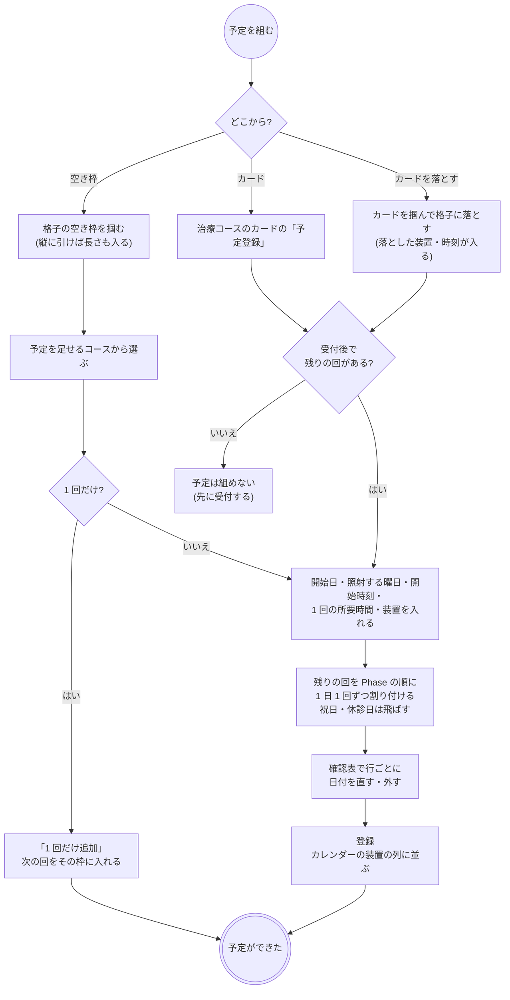

- 開始日の既定は、予定か照射記録があればその最後の日の翌日、無ければ今日です。曜日の既定は月〜金、所要時間の既定は 15 分です。
- 割り付けは装置の点検日を知りません。確認表で直してください。割り付け直すと直した内容は捨てます。
- 照射しなかった回(後述の「この回中止」)の番号は空いたままになり、次に組むときはその番号から振替として埋めます。
- 予定は掴んで動かせます(日ビューは時刻と装置、週ビューは日と装置)。日ビューでは上下の縁で開始・終了時刻を伸縮できます。刻みは 5 分です。メニューの「予定変更」でも日時と装置を直せます。
- 同じ装置・同じ時刻の重なりは止めません。格子で横に並んで見えるだけです。
- 休止で残りを後ろへずらすときは、カードのメニューの「予定全削除」→ もう一度「予定登録」です。
- 1 日 2 回照射(加速過分割)の割り付けは未対応です。1 日 1 回で割り付けてから「予定変更」で直します。

### 照射の記録

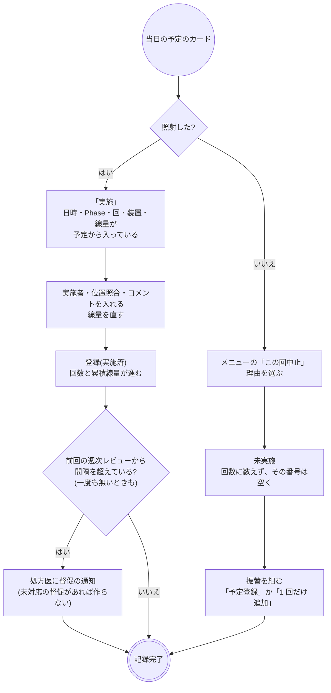

- 照射日・Phase・何回目・実照射線量・実施者が要ります。時刻を入れたときは終了時刻が開始時刻より前だとエラーです。
- 予定を作らずに 1 回ぶん入れるときは、治療中のコースのカードのメニュー「照射入力」です(何回目・Phase・線量は処方と照射済みの回から入ります)。
- 「この回中止」は照射しなかった回を残す操作で、コースの中止とは別物です。押し間違いは未実施のカードの「中止取消」で予定に戻します。
- 実施済の記録の取消は、カードの「コース表示」→ 照射記録の「取消」です。記録は消えずに取消済として残り、回数と累積線量から外れます(照射録は保存の対象のため)。カルテの詳細からは取り消せません。
- 照射録の法定の項目(患者の氏名・性別・年齢、照射年月日、照射方法、指示した医師、指示の内容)は、照射記録と治療処方を合わせて満たします。照射記録は治療処方なしでは作れません。
- 督促の間隔は施設設定(管理 > 施設設定 > 放射線治療の診察間隔、既定 7 日)です。外来放射線照射診療料の「7 日間に 1 回」に合わせた既定値で、入院・外来を問わず同じ間隔です。

### 治療中の診察(週次レビュー)と有害事象

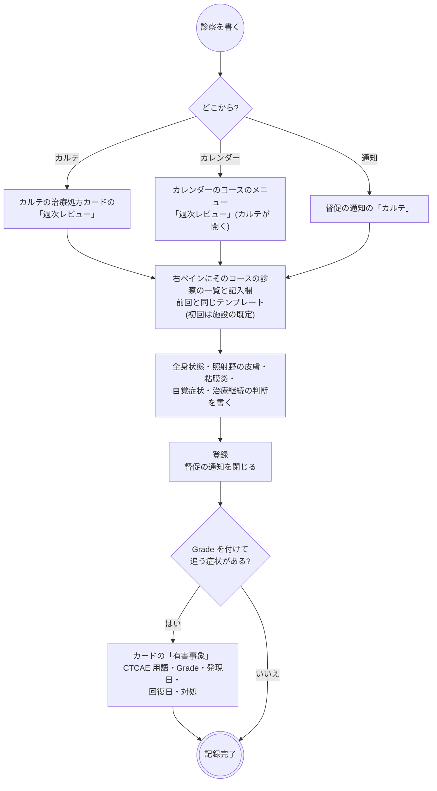

- カレンダーの治療中のコースに「診察 09-15(7 日)」のように最後の診察日と経過日数が出ます。間隔を超えたコースと「診察なし」のコースは強調します。処方済・計画中は照射が始まっていないので見張りません。
- 様式は `RT_REVIEW_01`(全身状態・体重・食事摂取、照射野の皮膚・粘膜炎・自覚症状、治療継続の判断と対応・次回予定)です。施設の既定は施設設定で選びます。記入はカルテのタイムラインにもテンプレート回答として出ます。
- 有害事象は化学療法と同じ入力欄で、治療処方の詳細とカルテのタイムライン(発現日)、患者プロファイルの「有害事象」に出ます。週次レビューは「その日に診てどう判断したか」、有害事象は 1 件ずつの記録です。

### 休止・終了・中止と治療終了サマリー

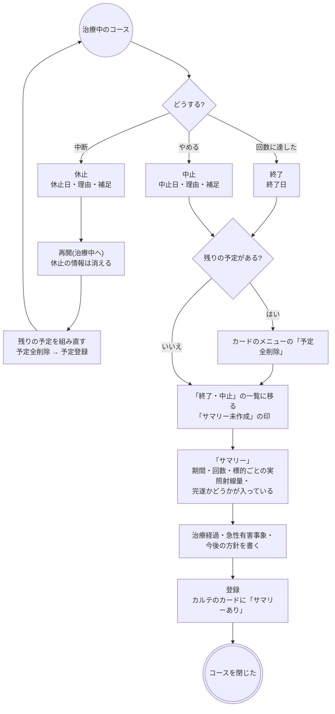

- 休止の理由は休止・中止理由マスタの「休止」用、中止の理由は「中止」用から選びます。休止のまま治療をやめるときは中止です。
- 終了・中止しても、残っている照射予定は消えません。カレンダーに予定のまま残るので、カードのメニューの「予定全削除」で消します。
- サマリーは「終了・中止」の一覧のカードから書きます。中止の理由はサマリーに引き継ぎます。書き直すと集計(期間・回数・線量)だけを取り直し、書いた本文は残ります。
- 標的ごとの回数は「その標的に線量を入れた回」を数えます(Boost は標的ごとに回数が違います)。

### 変更・中止・削除

| 操作 | できること |
|---|---|
| 変更 | カルテのカードの編集。進捗と終了・中止の情報は保たれます。治療中・終了の処方は標的と Phase を消せません(照射記録がその標的・Phase を指しているため) |
| 中止 | カレンダーのコースのカードの「中止」(中止日・理由)。カルテのカードに中止はありません |
| 削除 | 処方済だけできます。受付後(計画中以降)は削除できないので、カレンダーで中止するか受付を取り消します |
| DO | 新しいコースとして写します。コース番号は振り直し、開始予定日は今日、元の依頼は外し、打ち切った Phase は写しません |
| 照射予定 | 予定は削除できます(照射録ではないため)。実施済・未実施の記録は掴めず、日時も変えられません |

- 治療中の Phase の打ち切り(再計画)は画面から作れません。
- 入院 → 外来の切り替えを表す手段はありません。入外区分は登録時の値のままです。

### 帳票

専用の帳票はありません。

## 開発者向け

### リソースの構成

| もの | リソース | 要点 |
|---|---|---|
| 治療処方(ヘッダ) | `ServiceRequest` | `category` = `order-type|radiotherapy` + `prescription-setting`、`code` = `radiotherapy-order|course-prescription`、`occurrenceDateTime` = 開始予定日、`performer` = 担当医(任意)、`bodySite[]` = 標的の部位の写し(JJ1017 部位・左右)、`reasonReference` = 対象プロブレム。明細は持たない |
| コース・標的・Phase | ヘッダの拡張 | `radiotherapy-course`(courseNumber・intent・concurrentTherapy・protocol、終了・中止の `endedOn` / `terminationReason` / `terminationNote`、休止の `suspendedOn` / `suspensionReason` / `suspensionNote`)、`radiotherapy-volume` ×N(volumeId・label・type・bodySite)、`radiotherapy-phase` ×N(phaseId・status・modalityAndTechnique・device・fractionsPrescribed・fractionsPerWeek・dosePrescribedToVolume) |
| 元の依頼 | ヘッダの拡張 | `radiotherapy-consult-request`(他科依頼の `ServiceRequest`)。逆向きは書かず、タイムラインが逆引きする(`karteTimeline.ts` の `radiotherapyByConsultId`) |
| 進捗 | `Task`(`task-code|radiotherapy`、`focus` = ヘッダ) | **登録時には作らず**、Task が無い処方は処方済 |
| 照射予定・照射記録 | `Procedure`(`basedOn` = ヘッダ) | `category` = `order-type|radiotherapy` + `radiotherapy-procedure|fraction`。`status` = `preparation`(予定)/ `completed`(実施)/ `not-done`(この回中止、`statusReason`)/ `entered-in-error`(取消)。`code` = Phase の照射技法の写し、`performedPeriod`(時刻なしは `performedDateTime`)、`performer` = 実施者、`usedCode` = 装置、拡張 `radiotherapy-fraction`(phaseId・fractionNumber・imageGuidance・doseDeliveredToVolume) |
| 治療終了サマリー | `Procedure`(`basedOn` = ヘッダ、1 コースに 1 件) | `category` に `radiotherapy-procedure|course-summary`。`status` = `completed`(完遂)/ `stopped`、`performedPeriod` = 初回〜最終照射日、`outcome`、拡張 `radiotherapy-course-summary` |
| 週次レビュー | `QuestionnaireResponse`(`basedOn` = ヘッダ) | 通常のテンプレート回答。上流の `based-on` 検索で集める |
| 有害事象 | `Observation`(`category` = `adverse-event`、`basedOn` = ヘッダ) | `valueInteger` = Grade、`effectivePeriod` = 発現〜回復、拡張 `treatment-context`(type = radiotherapy)。化学療法と共通 |
| 診察の督促 | `Task`(`task-code|radiotherapy-review-due`、`focus` = ヘッダ、`owner` = 処方医) | 通知レジストリの `radiotherapy-review-due` |
| 代行入力 | `Provenance`(`target` = ヘッダ) | 種別共通 |

- Phase を子の `ServiceRequest` にしないのは、「`basedOn` を持たない `ServiceRequest` = オーダーのヘッダ」という前提を崩さないためです。同じ理由で元の依頼も `basedOn` ではなく拡張です。
- `volumeId` / `phaseId` は照射記録が指す安定キーです。編集では保ち、DO では振り直します(`buildDoRadiotherapyOrderForm`)。
- 線量は Gy(UCUM)。0.1 刻みの掛け算・足し算は cGy の整数にしてから行います(`radiotherapyTotalDose`、`radiotherapyProgress`)。
- 回数・累積線量・実施日の集計は `preparation` を数えません。

### 進捗 Task と status

他科依頼と同じく、**Task の遷移と同じ transaction で `ServiceRequest.status` も動かします**(`radiotherapyOrderStatusFor`)。上流の `order-period` 検索は終了日の拡張 URL が 4 種別に固定されていて使えないので、部門の一覧は status で切ります。
表示の正本は Task(処方済・計画中・治療中は status では区別できない)、status は一覧を引くための索引です。書き込みの入口は `useUpdateRadiotherapyTaskStatus` だけです。

| Task | 表示 | `ServiceRequest.status` | ヘッダに書くもの |
|---|---|---|---|
| (無し)/ `requested` | 処方済 | `active` | – |
| `accepted` | 計画中 | `active` | – |
| `in-progress` | 治療中 | `active` | 休止・終了・中止の情報を落とす |
| `on-hold` | 休止 | `on-hold` | `suspendedOn` / `suspensionReason` / `suspensionNote` |
| `completed` | 終了 | `completed` | `endedOn` |
| `cancelled` | 中止 | `revoked` | `endedOn` / `terminationReason` / `terminationNote` |

遷移の表は `radiotherapyTaskActions`(`fhir/radiotherapyTaskHelpers.ts`)、ヘッダの PUT は `buildRadiotherapyOrderStatusEntry` です。
照射しても Task は動かしません(リハビリ・栄養指導と同じ期間継続型)。`executionPeriod` は受付で `start`、終了で `end` が入ります。休止中は `end` を入れず、処方済に戻すときと中止では落とします(`createTaskHelpers` の `buildTaskUpdate`)。

### シーケンス図の前提

`/fhir` への書き込みはどれも 1 回の transaction Bundle で、backend の `FhirProxyController` が上流へ中継します。
SS-MIX2 を有効にしている施設では、中継が書き込みの控えを記録します(`Ssmix2::Recorder`。放射線治療はメッセージになりません)。
楽観ロックの版は `postBundle` が `ifMatch` に添え、版が違えば 412 で止まります。照射記録の PUT(実施・この回中止・中止取消・取消・予定変更)は、手元の写しではなく読み直した版を土台にします。

| 部品 | 場所 |
|---|---|
| 治療処方のフォーム | `components/RadiotherapyOrderForm.tsx`・`RadiotherapyOrderPanels.tsx`、安全確認 `RadiotherapyPreCheck.tsx` |
| 組み立て | `fhir/radiotherapyOrderHelpers.ts`(処方)・`radiotherapyTaskHelpers.ts`(進捗)・`radiotherapyResultHelpers.ts`(予定・照射記録)・`radiotherapySummaryHelpers.ts`(サマリー)・`radiotherapyReviewHelpers.ts`(週次レビュー・督促) |
| 部門の画面 | `pages/RadiotherapyWorklistPage.tsx`(`/radiotherapy-worklist`)、格子 `components/RadiotherapyCalendar.tsx` |
| モーダル | 照射入力 `RadiotherapyPerformModal.tsx`、一括登録 `RadiotherapyPlanModal.tsx`、空き枠 `RadiotherapySlotModal.tsx`、サマリー `RadiotherapyCourseSummaryModal.tsx`、詳細 `RadiotherapyOrderDetailPanel.tsx` |
| カルテの右ペイン | 週次レビュー `RadiotherapyReviewPanel.tsx`、有害事象 `RadiotherapyAdverseEventPanel.tsx`(フォームは `AdverseEventEditor`) |
| hook | `api/queries/radiotherapy.ts`、有害事象 `api/queries/adverseEvent.ts` |
| マスタ | `/master/radiotherapy_{modalities,techniques,devices,stop_reasons,protocols}`(`api/masterClient/radiotherapy.ts`・`api/masterQueries/radiotherapy.ts`)、画面は「マスタメンテ > 放射線治療」 |
| 通知 | `components/notifications/notificationRegistry.tsx` の `radiotherapy-review-due` |

### シーケンス図: 治療処方の登録・編集・削除

`buildRadiotherapyOrderBundle` / `buildRadiotherapyOrderUpdateBundle` / `buildRadiotherapyOrderDeleteBundle`、`useCreatePrescription`(`api/queries/labResult.ts`。全種別共通)、`useUpdateRadiotherapyOrder`、`deleteRadiotherapyOrderRequest`。

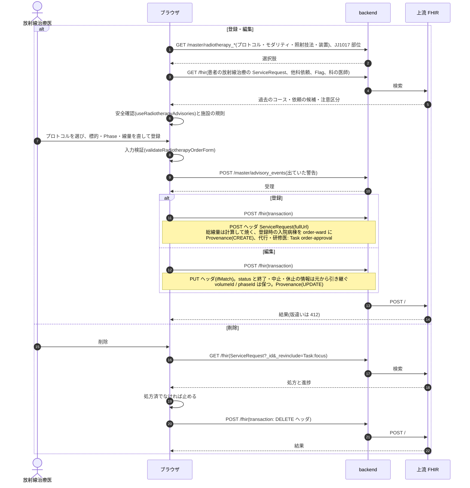

### シーケンス図: 部門の一覧と進捗の変更

`useRadiotherapyWorklist`、`useRadiotherapyProcedures`(表示中のコースの id を `based-on` に 20 件ずつ並べる)、`useRadiotherapyReviews`、`useUpdateRadiotherapyTaskStatus`。

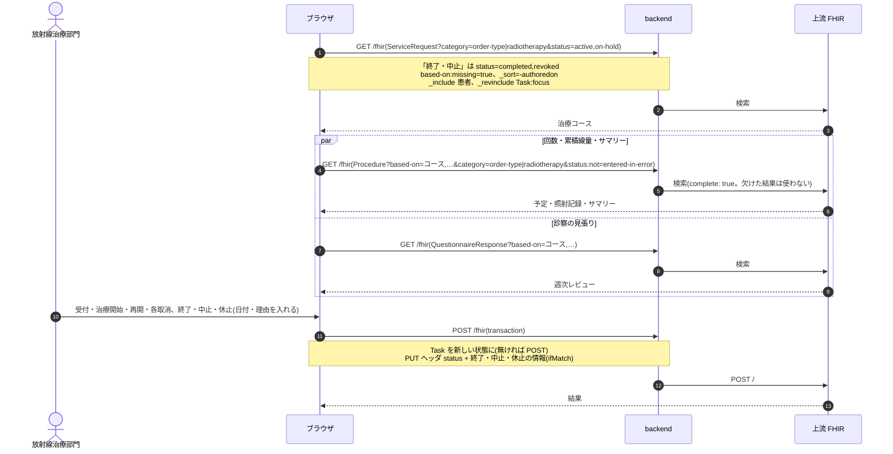

### シーケンス図: 照射予定の一括登録・移動・削除

`useRadiotherapyCalendar`、`useRadiotherapyCourseFractions`(モーダルを開く前にそのコースだけ引き直す)、`draftRadiotherapyPlan` / `buildRadiotherapyPlanBundle`、`useRegisterRadiotherapyPlan`、`useRescheduleRadiotherapyFraction`、`useDeleteRadiotherapyPlanned`。

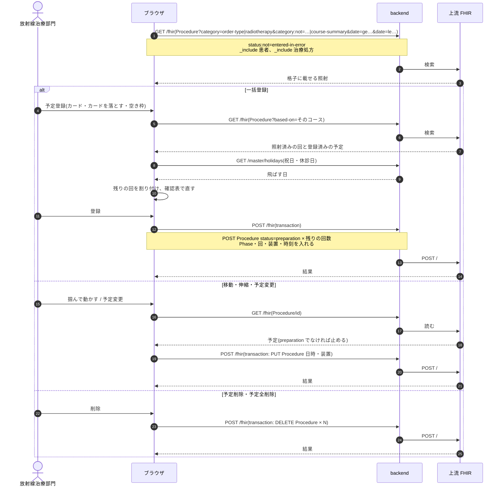

### シーケンス図: 照射入力・この回中止・取消

`nextRadiotherapyFractionForm` / `radiotherapyFractionFormFromPlanned`、`buildRadiotherapyFractionBundle`、`useRegisterRadiotherapyFraction`(督促の判定を同じ transaction に積む)、`useMarkRadiotherapyFractionNotDone`、`useRestoreRadiotherapyFraction`、`useCancelRadiotherapyFraction`。

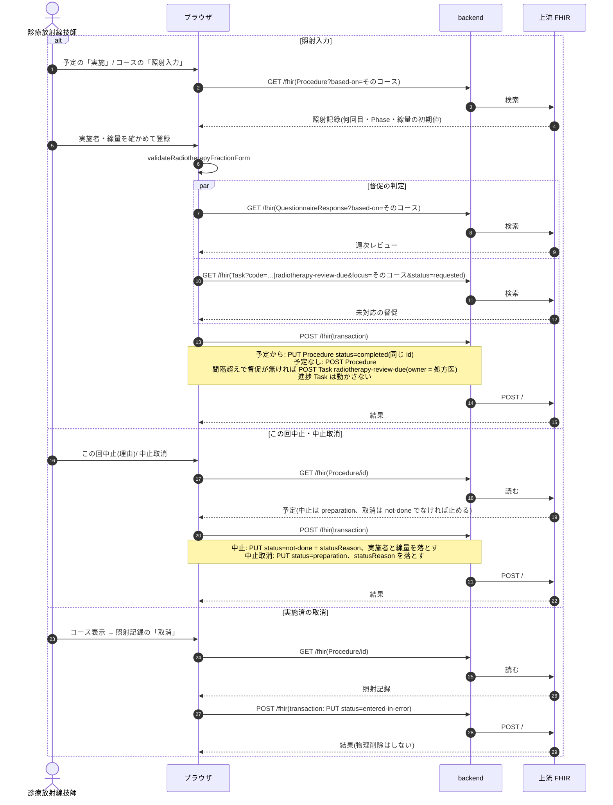

### シーケンス図: 週次レビュー・有害事象・治療終了サマリー

`useRadiotherapyCourseReviews`、`useCreateQuestionnaireResponse`(`api/queries/patientProfile.ts`)、`useCloseRadiotherapyReviewDue`、`useTreatmentAdverseEvents` / `useSaveAdverseEvent`、`draftRadiotherapyCourseSummary` / `buildRadiotherapyCourseSummaryBundle`、`useSaveRadiotherapyCourseSummary`。
カレンダーと通知からはカルテへ `open=radiotherapy-review:<id>` 付きで飛び、右ペインが開いた状態になります。

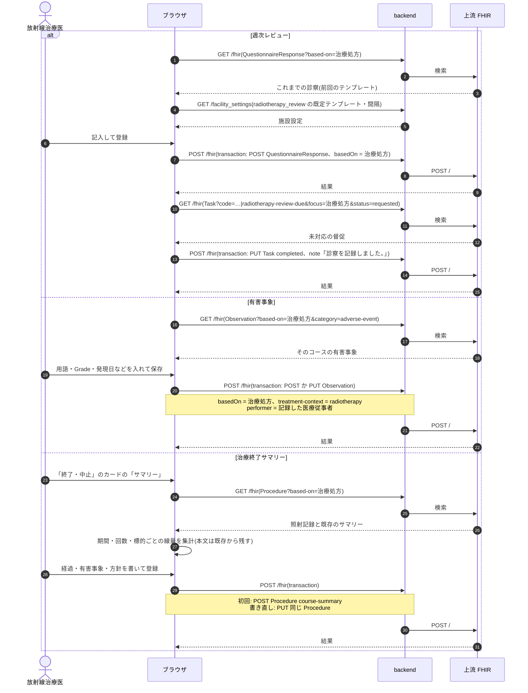

### 医事会計と SS-MIX2

放射線治療は照射記録から集めます(`BillingClaimBuilder` の `:procedure` 経路、`Resolvers::Radiotherapy`)。照射 1 回 = 1 剤で、体外照射のコードは照射記録の照射技法から照射技法マスタの `receipt_code`(その日の 1 回目)・`receipt_code_second`(同じ日の 2 回目)を引きます。
コースの初回の照射(その日より前に完了した照射が無い日)には、照射技法マスタの `management_receipt_code`(放射線治療管理料)と、治療処方の標的から組んだ照射部位のコメント(施設設定 `receipt_codes.radiotherapy.site_comment`)を添えます。
期間継続型(`continuous`)なので、照射記録の無い日のヘッダは報告しません。診療行為の区分は 840 です。

| 起きたこと | 医事会計(`BillingClaimBuilder`) | SS-MIX2 |
|---|---|---|
| 治療処方の登録・編集・削除 | なし | なし(`OMG^O19` の対象外) |
| 受付・治療開始・休止・終了・中止 | なし | なし |
| 照射予定の登録・変更・削除 | なし(`preparation` は集めない) | なし |
| 照射(実施) | 照射日に体外照射を送る。初回は放射線治療管理料と照射部位のコメントも。照射技法が無い・マスタにコードが無いときは「送れない項目」に出す | なし(`OMI^Z23` の対象外) |
| この回中止 | 「実施せずと記録されています」と報告(送らない) | なし |
| 照射の取消 | 対象から外れる(`entered-in-error`) | なし |
| 週次レビュー・有害事象 | なし | なし |
| 治療終了サマリー | 送らない(照射でないハブは resolver が読み飛ばす) | なし |

- DPC の判定では、照射記録があることを手術・処置等のダミーコード `0008`(放射線療法)の根拠に使います。看護必要度は、コードで拾えない放射線治療を実施記録から補います([features/nursing.md](../features/nursing.md))。
