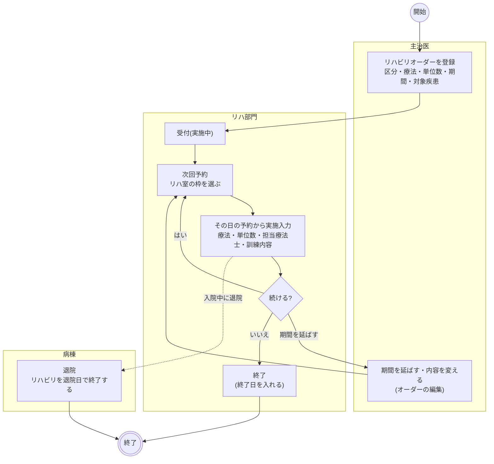
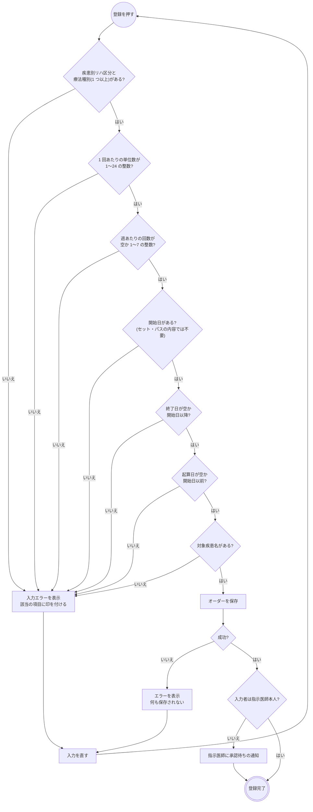
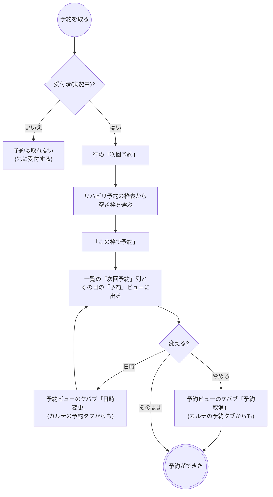
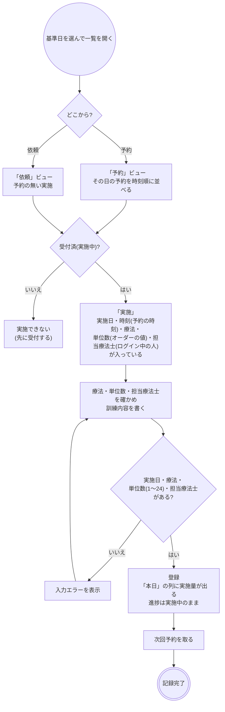
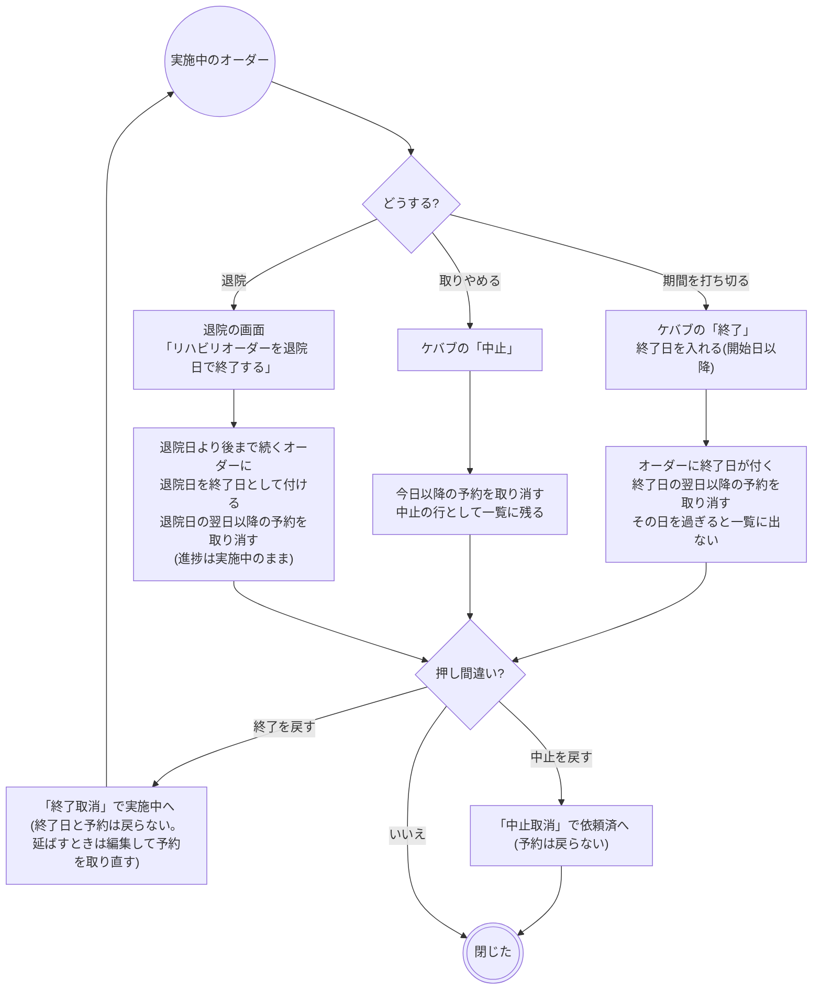
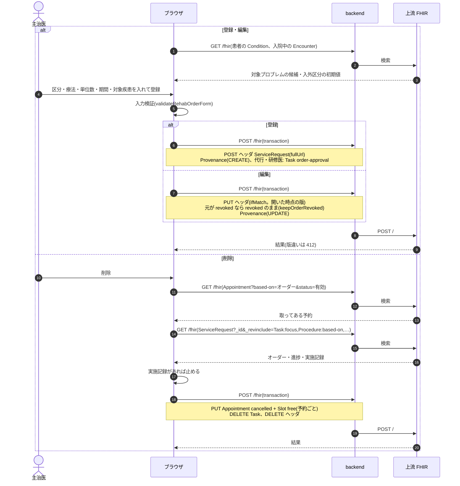
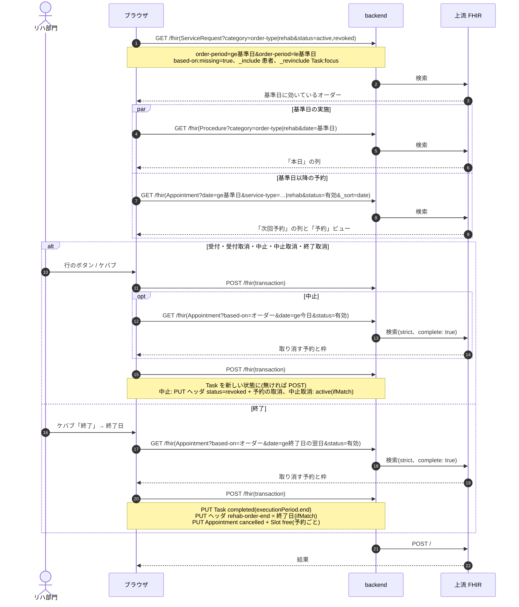
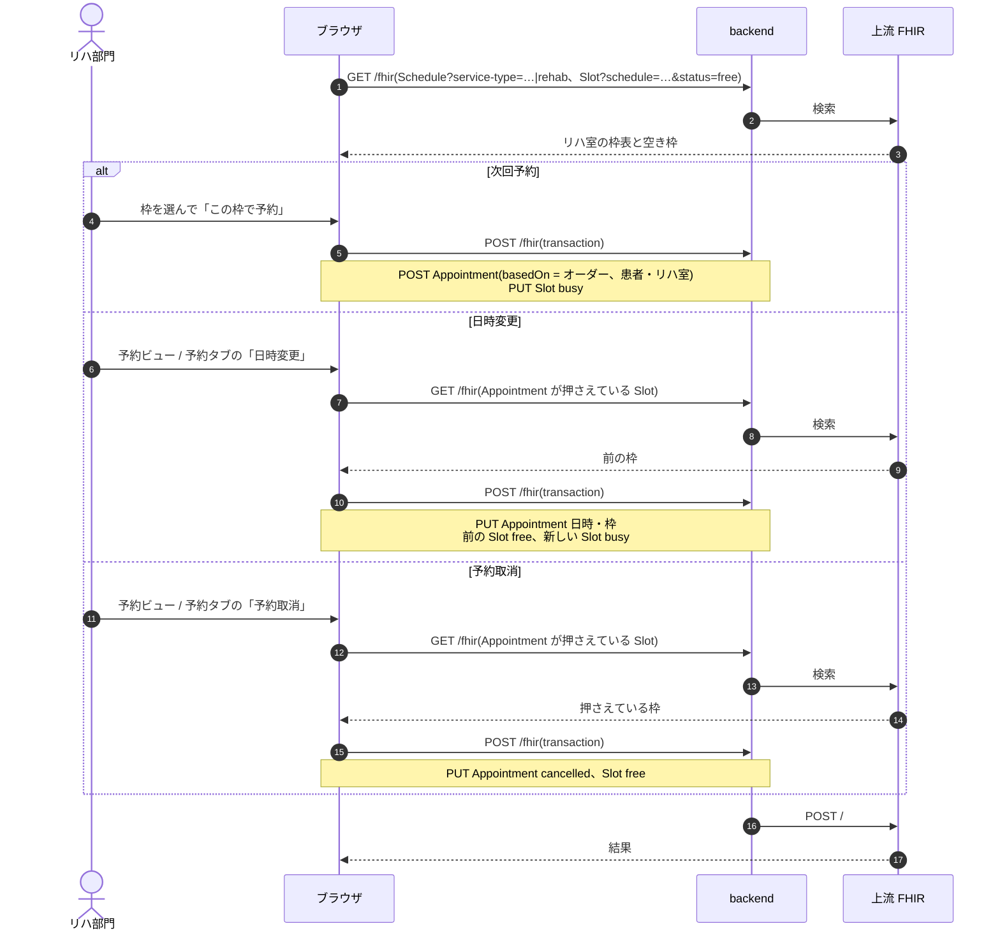
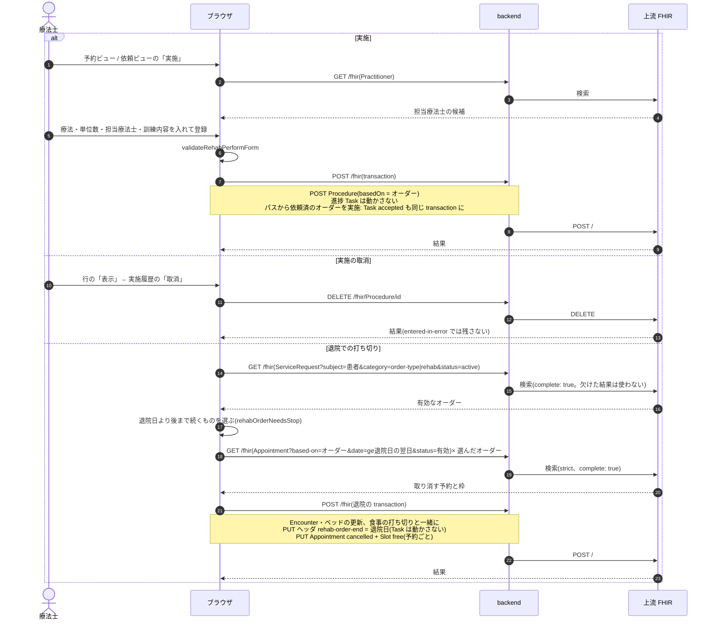

# リハビリオーダーの業務フロー

リハビリオーダーを、登録からリハ部門の受付・次回予約・日々の実施・終了(退院での打ち切り)まで追う流れです。医療機関の運用を検討する人は「運用フロー」、院内の開発者は「開発者向け」を読みます。
リハビリは 1 つのオーダーが数週間〜数か月続き、その間に実施が何度も積み上がる**期間継続型**のオーダーです。オーダーは「いつからいつまで、どの区分・療法を週何回・1 回何単位」という処方箋で、何時に行うかは部門が都度取る予約と、実際に行った日の実施記録が担います。
設計は [rehab-order-design.md](../rehab-order-design.md)、退院の画面は [features/ward.md](../features/ward.md)、
種別共通の約束(中止・削除・代行入力・オーダーセット)は [features/orders-common.md](../features/orders-common.md)、リソースの要素は実装ガイド(`../fhir-ig`)が正典です。

## 運用フロー

### 検査・処置との違い

| | 検査・処置(放射線・生理・処置など) | リハビリ |
|---|---|---|
| オーダーの単位 | 検査・処置 1 回 | 期間(開始日〜終了日。終了日が無ければ継続中) |
| 入力する項目 | 項目・部位・依頼病名など | 入外区分・疾患別リハ区分・療法種別(PT/OT/ST、併用可)・1 回あたりの単位数・週あたりの回数・開始日・終了日・対象疾患名・起算日・対象プロブレム・コメント |
| マスタ | 項目マスタ・伝票 | 持たない(疾患別リハ区分と療法種別は診療報酬の固定の分類) |
| 予約 | オーダー登録と一緒に取る(1 オーダー 1 予約) | 部門が受付後に「次回予約」を都度取る(1 オーダーに何件も) |
| 実施 | 1 回で進捗が「実施済」になる | 何回実施しても進捗は「実施中」のまま。実施記録が積み上がる |
| 部門の一覧 | その日に実施予定のオーダー | 基準日に効いている(始まっていて、まだ終わっていない)オーダー |
| 終わり方 | 実施で終わる | 部門の「終了」(終了日を入れる)か、退院での打ち切り |
| 登録時の警告 | 確認を要するものがある | 無い |
| 医事会計 | 実施記録から送る | 実施記録から送る(実施 1 回ごと) |

- 入口はカルテの右ペイン「リハビリ」です。部門の一覧から代わりに起こす入口はありません。
- クリニカルパスのタスク分類 `TPRH` の既定のオーダー種別です。オーダーセットにも入れられます(開始日・終了日・起算日・対象プロブレムは持ち込みません)。
- 部門の画面は「リハビリ部門 > リハビリ一覧」(`/rehab-worklist`)です。ホームでは理学療法士・作業療法士・言語聴覚士に件数のカードが出ます。

### 進捗の状態

| 状態 | 意味 | 変わるきっかけ | 一覧の行からできること |
|---|---|---|---|
| 依頼済 | リハ部門がまだ受けていない | 医師の登録、受付取消、中止取消 | 受付、中止 |
| 実施中 | 受けた。期間中ずっとこの状態で実施が積み上がる | 受付、終了取消 | 実施、次回予約、終了、受付取消、中止 |
| 終了 | 期間を打ち切った | 終了(終了日) | 終了取消(実施中へ) |
| 中止 | リハビリを取りやめた | 中止 | 中止取消(依頼済へ) |

- 状態を動かすのはリハ部門(リハビリ一覧)だけです。実施しても状態は変わりません。
- 一覧の行に直接出るのは「受付」「実施」「次回予約」「表示」です。終了・各取消・中止は押し間違えると期間や進捗が動くので、行のケバブメニューに畳んであります。
- 例外はクリニカルパスからの実施です。依頼済のオーダーをパスの画面から実施すると、同時に実施中になります(終了にはなりません)。

### 全体の流れ

- オーダーのカードはカルテの開始日の日に 1 枚載り、「入外区分 / 期間(8/29〜継続中)」を見出しに、区分・療法・「週 3 回・1 回 2 単位」と直近の実施履歴を出します。実施は件数と合計単位(「12回 計24単位」)を添え、全件は詳細で見ます。
- 実施履歴をカードに出すのは実施中と終了のときです。依頼済と中止のカードには出しません。
- 外来の継続リハビリは終了日を入れずに出し、部門が「終了」で打ち切ります。終了日を決めて出したオーダーも、その日を過ぎると一覧に出なくなるだけで、進捗は実施中のまま残ります。

### 登録の判定

- 対象疾患名は疾患別リハの算定要件なので必須です。登録病名(対象プロブレム)とは別に、リハビリの対象として挙げた疾患を文字で残します。
- 起算日(発症日・手術日)は任意です。一覧の「起算日」列に出し、医事会計で発症年月日のコメントを付けるときに使います。算定日数の上限(150 日・180 日など)の警告はありません。
- 1 単位は 20 分です。週あたりの回数は目安で、曜日は決めません。
- 入外区分の初期値は、入院中なら「入院」です。
- 承認待ちでもオーダーは部門に流れます。

### 予約

- 枠はリハ室(場所)ごとの「リハビリ予約」の枠表で、管理画面の「予約枠」で作ります。療法士ごとの枠は作りません(担当療法士は実施記録に残します)。
- 枠の定員は検査と違って 1 に固定しません。同じ時間帯に複数の患者を受け入れられます。
- 1 予約 = 1 枠です。単位数ぶんの連続枠をまとめて押さえることはできません。
- 次回をいつにするかは毎回の実施のあとに決めるのが外来リハの実態なので、オーダー登録のときには予約を取りません。
- カルテの予約タブでは「リハビリ」の印が付き、検査予約と違って取消・日時変更ができます(オーダーの日時と連動しないため)。
- 外来患者一覧にはリハビリの予約は出ません。

### 日々の実施

- 療法はオーダーに載っている療法から選びます。1 つだけなら選んだ状態で開きます。PT と OT を同じ日に行ったときは、療法ごとに 1 回ずつ登録します。
- 担当療法士を選ばせるのは、実施したのがログインした人とは限らないからです(受付が代わりに入れる運用があります)。
- 「本日」の列はその日に実施したかを日ごとに見るためのもので、「未実施」と出ていても進捗は実施中です。
- 実施の取消は、一覧の行の「表示」→ 実施履歴の「取消」です。一覧の表示はその日のぶんしか出さないので、別の日の実施を取り消すときは基準日をその日にします。カルテの詳細からは取り消せません。
- 器材・薬剤・訓練項目の入力はありません(リハビリの算定は単位数で決まるため)。訓練内容は自由記載です。
- 絞り込みは疾患別リハ区分・療法・入外区分・病棟・診療科・ステータスで、画面の中で行います。

### 終了・中止・退院

- 終了・中止・退院では、もう来ない日の予約を同じ操作で取り消して枠を空けます。終了は終了日の翌日以降、中止は今日以降、退院は退院日の翌日以降の予約です。それより前の予約は通院の記録として残します。
- 終了取消・中止取消で予約は戻りません(取り消したあとに枠が埋まっていることがあるため)。続けるときは「次回予約」で取り直します。
- 「終了取消」で終了日を消さないのは、打ち切った期間まで巻き戻すとその間の実施記録と食い違うためです。期間を延ばしたいときはオーダーを編集して終了日を直します。
- 退院では、外来リハに切り替えて続けることもあるので、食事とは別のチェックにしてあり外せます。退院で止めたオーダーは終了日が付くだけで、進捗は「終了」になりません。
- 中止のオーダーは一覧の基準日が期間内なら中止の行として並び、そこから中止取消できます。

### 変更・中止・削除

| 操作 | できること |
|---|---|
| 変更 | カルテのカードの編集。進捗・実施記録・予約は変わりません。中止のオーダーは中止のまま保存します |
| 中止 | リハビリ一覧の行のケバブ「中止」。カルテのカードに中止はありません |
| 削除 | 実施記録が無いオーダーだけできます。取ってある予約は同じ操作で取り消し、枠を空けます。実施があるときは実施を取り消してから削除するか、中止します |
| DO | 新しいオーダーとして写します。開始日は今日、終了日は空にし、起算日・対象疾患名はそのまま引き継ぎます |

- 入院 → 外来の切り替えを表す手段はありません。入外区分は登録時の値のままなので、外来で続けるときは新しいオーダーを出します。

### 帳票

専用の帳票はありません。リハビリテーション実施計画書の様式も未実装です。

## 開発者向け

### リソースの構成

| もの | リソース | 要点 |
|---|---|---|
| オーダー(ヘッダ) | `ServiceRequest` | `category` = `order-type|rehab` + `prescription-setting`、`code` = 疾患別リハ区分(`rehab-disease-category`)、`orderDetail[]` = 療法種別(`rehab-therapy-type`: pt / ot / st)、`quantityQuantity` = 1 回あたりの単位数(unit「単位」、UCUM なし)、`occurrenceDateTime` = 開始日(日付のみ)、`reasonReference` = 対象プロブレム。明細は持たない |
| 期間・対象 | ヘッダの拡張 | `rehab-order-end`(終了日。無ければ継続中)、`rehab-onset-date`(起算日)、`rehab-target-disease`(対象疾患名)、`rehab-frequency-per-week`(週あたりの回数) |
| 進捗 | `Task`(`task-code|rehab`、`focus` = ヘッダ) | **登録時には作らず**、Task が無いオーダーは依頼済。部門の受け入れ状態を表す |
| 実施記録 | `Procedure`(`basedOn` = ヘッダ) | `category` = `order-type|rehab`、`status` = `completed`、`code` = 実施した療法種別、`performedDateTime`(時刻なしは日付のみ)、`performer` = 担当療法士、拡張 `rehab-performed-units` = 実施単位数、`note` = 訓練内容。取消は DELETE |
| 予約 | `Appointment`(`basedOn` = ヘッダ) + `Slot` | 枠表は `Schedule`(`serviceType` = `schedule-service-type|rehab`、`actor` = リハ室の `Location`)。1 予約 1 枠、定員は 1 に潰さない |
| 代行入力 | `Provenance`(`target` = ヘッダ) | 種別共通 |

- 期間を `occurrencePeriod` にせず開始日 + 拡張にするのは、上流が `occurrenceDateTime` を索引するため(食事の `meal-order-end` と同じ判断)。上流は `order-period` で開始日と `rehab-order-end` を合わせて索引しています。
- 週あたりの回数を `occurrenceTiming` にしないのは、`occurrence[x]` が choice で開始日の `occurrenceDateTime` と併用できないためです。
- 療法種別を明細の `ServiceRequest` にしないのは、療法ごとに量が分かれないためです(単位数はオーダー全体で 1 つ)。

### 進捗 Task と status

**実施しても Task を動かしません。** 他部門の実施は「実施記録 + Task を completed に」を 1 つの transaction にしますが、リハビリで同じにすると初日の実施で終了扱いになり、2 日目以降が実施できなくなります。
この逸脱は他部門の実施入力と作りが違う唯一の点です。実施ボタンを他部門と同じ形に揃えるリファクタをしないでください(`fhir/rehabTaskHelpers.ts`・`rehabResultHelpers.ts` の冒頭コメント)。

| Task | 表示 | `ServiceRequest.status` | ヘッダに書くもの |
|---|---|---|---|
| (無し)/ `requested` | 依頼済 | `active` | – |
| `accepted` | 実施中 | `active` | – |
| `completed` | 終了 | `active` のまま | `rehab-order-end`(終了日) |
| `cancelled` | 中止 | `revoked` | – |

- 遷移の表は `rehabTaskActions`、書き込みの入口は `useUpdateRehabTaskStatus`(`api/queries/rehab.ts`)です。中止・中止取消は `orderCancelEntries` でヘッダの status を揃えます。
- 終了で `rehab-order-end` を書くのは、部門一覧が `order-period` で引くので、終了日が無いと status=active のまま基準日に永久にヒットし続けるためです(`buildRehabOrderCloseEntry`)。終了取消では消しません(意図した非対称)。
- 終了・中止・退院は、もう来ない日の有効な予約の取消を同じ transaction に積みます(`fetchOrderAppointmentCancelEntries` の `from`)。過ぎた予約は残します。取り消す対象の検索は strict で全ページを読み(条件が効かずに全件を拾うと、関係ない予約まで取り消すため)、欠けたら書き込みを止めます。
- `executionPeriod` は受付で `start`、終了で `end` が入ります(`createTaskHelpers` の `buildTaskUpdate`)。
- カルテのタイムラインは、他部門が `completed` のときだけ実施情報を出すのに対し、リハビリは `accepted` / `completed` で出します(`karteTimeline.ts` の rehab 分岐)。

### シーケンス図の前提

`/fhir` への書き込みはどれも 1 回の transaction Bundle で、backend の `FhirProxyController` が上流へ中継します。
SS-MIX2 を有効にしている施設では、中継が書き込みの控えを記録します(`Ssmix2::Recorder`。リハビリはメッセージになりません)。
楽観ロックの版は `postBundle` が `ifMatch` に添え、版が違えば 412 で止まります。編集フォームは `useEditSnapshot` で開いた時点の版に固定します(`hooks/useRehabOrderInitialValues.ts`)。

| 部品 | 場所 |
|---|---|
| オーダーのフォーム | `components/RehabOrderForm.tsx`・`RehabOrderPanels.tsx`、詳細 `RehabOrderDetailPanel.tsx`、カード `karteCardBodies/RehabOrderCardBody.tsx` |
| 組み立て | `fhir/rehabOrderHelpers.ts`(オーダー・終了日・退院の打ち切り)・`rehabTaskHelpers.ts`(進捗)・`rehabResultHelpers.ts`(実施記録)、予約 `fhir/appointmentHelpers.ts` の `buildRehabAppointmentBundle` |
| 部門の画面 | `pages/RehabWorklistPage.tsx`(`/rehab-worklist`。依頼・予約の 2 ビュー、終了のモーダル) |
| モーダル | 実施入力 `components/RehabPerformModal.tsx`、次回予約・日時変更 `RehabBookModal.tsx`(枠選びは `AppointmentSlotPicker` の `scheduleType="rehab"`) |
| hook | `api/queries/rehab.ts`、予約の取消・日時変更は `api/queries/appointment.ts` |
| 退院 | `components/DischargeModal.tsx`、`api/queries/encounter.ts`(`buildRehabOrderStopEntries` を退院の transaction に積む) |
| パス | `components/PathwayOrderModal.tsx`(`TPRH` の実施で `RehabPerformModal` に `acceptTask` を渡す) |

### シーケンス図: 登録・編集・削除

`buildRehabOrderBundle` / `buildRehabOrderUpdateBundle`、`useCreatePrescription`(`api/queries/labResult.ts`。全種別共通)、`useUpdateRehabOrder`、`deleteRehabOrderRequest` / `postOrderDeleteBundle`(`api/queries/orderDelete.ts`)。

### シーケンス図: 部門の一覧と進捗の変更

`useRehabWorklist`(`fetchWorklistBundles` で 500 件ずつ)、`useUpdateRehabTaskStatus`。一覧・実施・予約のどれかが上限で欠けたら `truncated` を出します。

### シーケンス図: 予約・日時変更・取消

`useBookRehabAppointment` / `buildRehabAppointmentBundle`、`useRescheduleAppointment`、`useCancelAppointment`。オーダー登録とは独立した単独の transaction です。

### シーケンス図: 実施・実施の取消・退院での打ち切り

`buildRehabPerformBundle`、`useRegisterRehabPerform`、`useDeleteRehabPerform`、退院は `buildRehabOrderStopEntries`(`usePatientRehabOrders` で患者の有効なオーダーを全件読む)。

### 医事会計と SS-MIX2

リハビリは実施記録から集めます(`BillingClaimBuilder` の `:procedure` 経路、`Resolvers::Rehab`)。実施 1 件 = 1 剤で、コードは施設設定の `receipt_codes.rehab`(疾患別リハ区分 × 療法)から引き、数量は実施単位数です。同じ日に PT と OT があれば剤が 2 つになります。
区分ごとに施設設定で疾患名のコメント(830 系)・発症年月日のコメント(850 系)のコードを入れておくと、オーダーの対象疾患名と起算日から組んで添えます。
期間継続型(`continuous`)なので、実施記録の無い日のヘッダは報告しません。日レセの診療種別区分は 800 です。

| 起きたこと | 医事会計(`BillingClaimBuilder`) | SS-MIX2 |
|---|---|---|
| 登録・編集・削除 | なし | なし(`OMG^O19` の対象外) |
| 受付・終了・中止・退院での打ち切り | なし | なし |
| 予約・日時変更・取消 | なし | なし |
| 実施 | 実施日に送る。区分・療法が無い、施設設定にコードが無いときは「送れない項目」に出す。コメントのコードがあるのにオーダーに対象疾患名・起算日が無いときもその旨を出す | なし |
| 実施の取消 | 対象から外れる(DELETE) | なし |

- DPC の判定では、実施記録があることを手術・処置等のダミーコード `0007`(リハビリテーション)の根拠に使います(`Dpc::DummyRules`)。
