# 手術オーダーの業務フロー

手術の申込から日程の確定・術前診察・入室・実施記録・症例登録までの流れです。

医療機関の運用を検討する人は「運用フロー」、院内の開発者は「開発者向け」を読みます。
設計は [surgery-order-design.md](../surgery-order-design.md)(申込)・[surgery-calendar-design.md](../surgery-calendar-design.md)(手術室カレンダー)・
[surgery-result-design.md](../surgery-result-design.md)(実施記録)・[anesthesia-preop-design.md](../anesthesia-preop-design.md)(麻酔科術前診察)・
[anesthesia-chart-design.md](../anesthesia-chart-design.md)(麻酔チャート)・[ncd-registration-design.md](../ncd-registration-design.md)(NCD 症例登録)、
種別共通の約束(日付未定・中止・削除・代行入力)は [features/orders-common.md](../features/orders-common.md)、リソースの要素は実装ガイド(`../fhir-ig`)が正典です。

## 運用フロー

このページでの呼び名です。

- **申込**: 手術オーダーのこと。1 件の申込が手術 1 件です。麻酔は手術の一部(麻酔方法・管理区分)として申込に入れます。
- **日程**: 予定手術日・入室時刻・所要時間・手術室の組です。
- **日程未定**: 予定手術日を入れていない申込。手術一覧の「日程未定」タブに並びます。予定手術日を入れた申込は「予定日別」タブに並びます。
- **「日程確定」**: 「日程未定」タブで日程を決める操作です。押すと受付も済み、状態が受付済になります。手術カレンダーで日程を決めるだけの操作とは別です(→「手術カレンダーでの調整」)。
- **手術部と手術室スタッフ**: 日程を組んで受け付ける側を手術部、入室から実施入力までを行う側を手術室スタッフと書きます。「手術室」は場所(部屋)を指します。
- **指示医師**: 申込の指示を出した医師。
- **K コード**: 診療報酬の手術のコードです。麻酔のコードは L で始まります。

### 全体の流れ

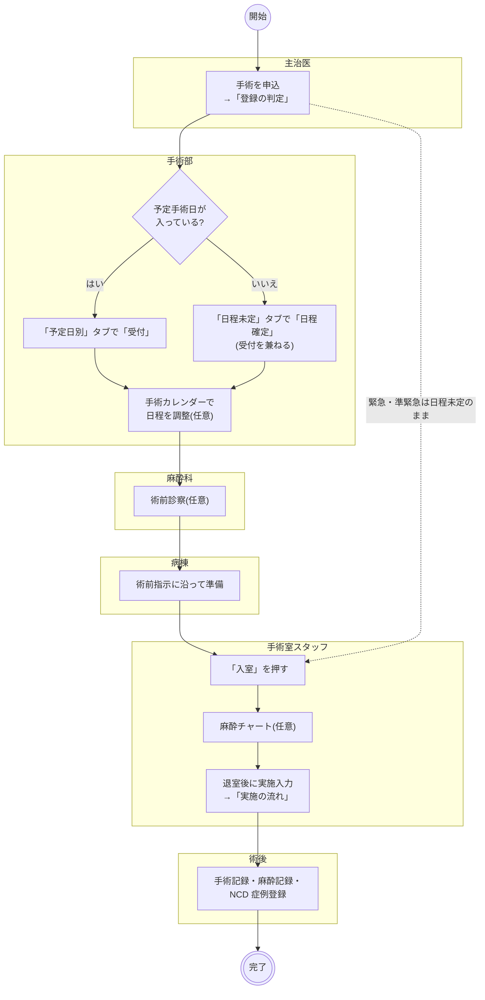

- **申込の入口**: カルテの右ペイン(右側のオーダー入力)の「手術」、手術カレンダーの空き枠、オーダーセット・クリニカルパスの適用です。
- **受付**: 予定手術日を入れた申込は「予定日別」タブの「受付」で、日程未定の申込は「日程未定」タブの「日程確定」で、受付済になります。
- **任意の段**: 術前診察・術前指示・麻酔チャートは必須ではありません。術前診察が済んでいなくても、受付・入室は止まりません。
- **緊急・準緊急**: 日程未定のまま「入室」でき、日程確定を飛ばします。押した日時が予定日時になります。
- **手術室の空き**: 予約枠は使いません。手術室の空きは、申込の予定日時と所要時間から判断します。
- **部門の画面**: 「手術部門 > 手術一覧」「手術部門 > 手術カレンダー」「手術部門 > 麻酔科術前診察」です。

### 手術の状態

手術部と手術室スタッフの進み具合を示す状態です。受付と実施の間に、入室の段があります。

| 状態 | 変わるきっかけ | 手術一覧・カレンダーからできること |
|---|---|---|
| 申込済 | 申込、受付取消、中止取消 | 受付、日程確定、入室(緊急・準緊急)、日程の移動、中止 |
| 受付済 | 受付、日程確定、入室取消 | 入室、日程の移動、受付取消、中止 |
| 入室中 | 入室、実施取消 | 実施、麻酔チャート、入室取消 |
| 実施済 | 実施登録 | 麻酔チャート(閲覧)、実施取消 |
| 中止 | 中止 | 中止取消 |

申込済のときにできることは、申込に予定手術日が入っているかどうかで変わります。

| 申込済の申込 | できること |
|---|---|
| 予定手術日あり(「予定日別」タブ) | 受付、日程の移動、日付未定・部屋未定に戻す、中止 |
| 日程未定(「日程未定」タブ) | 日程確定、中止。緊急・準緊急は入室もできる |

- **取消で戻る先**: 受付取消は申込済へ、入室取消は受付済へ、実施取消は入室中へ、中止取消は申込済へ戻ります。
- **入室**: 状態を進めるだけです。実施記録は、退室後にまとめて 1 回入れます。
- **日程の移動**: 手術カレンダーでのドラッグです。申込済・受付済のときだけでき、状態は変わりません。入室中・実施済は起きた事実なので動かせません。
- **術前診察**: 中止以外のどの状態でも書けます。
- **麻酔チャート**: 入室中に書き始め、実施済では閲覧だけになります。

### 区分ごとの違い

予定区分(予定・準緊急・緊急)による違いは、入室の 1 点だけです。

| 予定区分 | 入室 |
|---|---|
| 予定 | 受付済になってから入室する |
| 準緊急・緊急 | 受付済からの入室に加えて、**日程未定のまま入室できる** |

次の 3 つは、どの予定区分も同じです。

- **日程**: 希望日を書いて申し込むか、日程未定で申し込みます。
- **受付**: 手術部が日程を確定して受け付けます。
- **手術室の重なりの確認**: 日程を入れるたびに確かめます。重なっていれば、承知のうえで登録します。

### 登録の判定

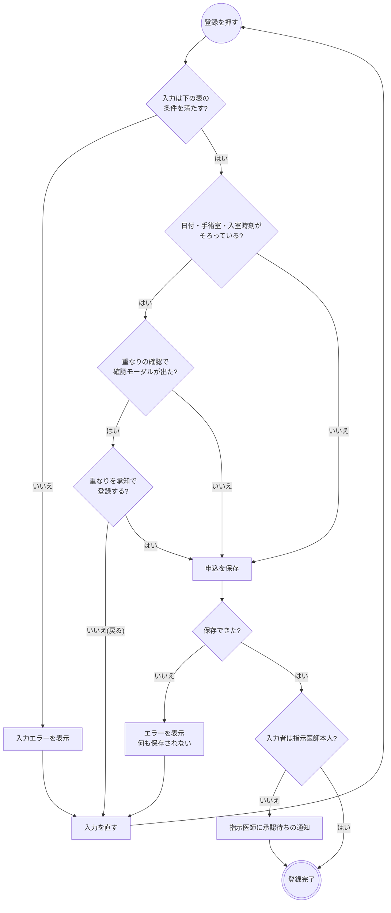

| 入力する項目 | 条件 |
|---|---|
| 術式 | 1 件以上 |
| 左右 | 術式マスタで左右が要るとしてある術式は必須(取り違え防止) |
| 執刀医 | 必須 |
| 麻酔科医 | 麻酔科管理のときは必須 |
| 予定手術日と入室時刻 | 時刻だけ入れて、日付を入れないことはできない |

このほかに、スタッフ・麻酔・準備・同意書・術前指示・希望日を入れます。

- **重なりの確認**: 日付・手術室・入室時刻がそろっているとき、登録の直前にその日の手術を読み直して、同じ手術室の重なりを確かめます。
- **確認モーダルが出るとき**: 重なる手術があるときと、重なりを確かめられなかったときです。重なる手術が並びます。登録は止まらず、承知のうえで登録できます。
- **警告**: 薬剤の相互作用のような警告はありません。出るのは、手術室の重なりと、科の割当(曜日ごとに手術室を科に割り当てたもの)に掛かる時間帯の 2 つです。どちらも登録は止めません。
- **オーダーセット・クリニカルパス**: セットやパスからまとめて登録するときは、重なりの確認が出ません。登録後に手術カレンダーで確かめます。
- **術前指示**: テンプレートから記入でき、申込と一緒に保存されます。

### 日程確定の流れ

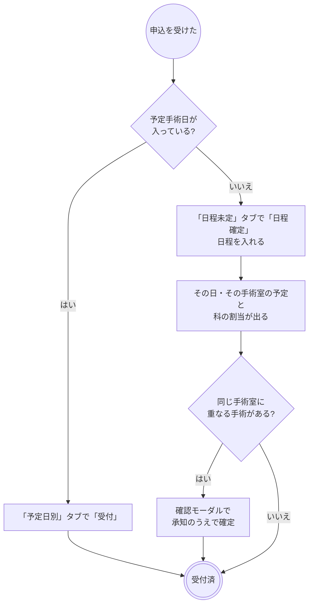

- 「日程確定」で入れるのは、日・入室時刻・所要時間・手術室です。
- 重なりがあっても確定は止まりません。緊急の割り込みや、前の手術が早く終わる読みで詰めることがあるためです。承知した事実は、確認の操作として残ります。

### 手術カレンダーでの調整

受付の後も、手術カレンダーで日程を組み直せます。

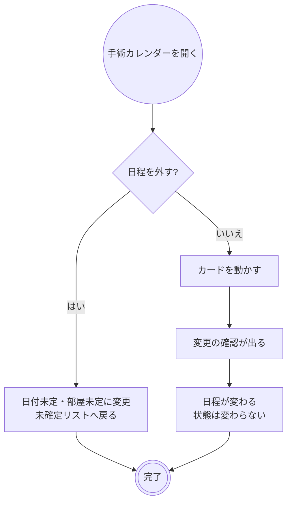

| したいこと | 操作 |
|---|---|
| 日・部屋・時刻を移す | 格子のカードをドラッグ(5 分刻み) |
| 所要時間を変える | カードの縁を引く |
| 未確定の申込に日程を入れる | 右の未確定リストから格子へドラッグ |
| 日程を外す | 日付未定・部屋未定に変更(申込済のときだけ) |

- **画面**: 日ビュー(手術室 × 時刻)と週ビュー(曜日 × 手術室)があります。右の未確定リストには、日付未定・部屋未定・時間未定の申込が並びます。
- **変更の確認**: 変更前と変更後、重なり、科の割当が出ます。
- **ドラッグと受付は別**: ドラッグで日程を決めても、申込済のままです。受付は別に行います。
- **日程を外せるとき**: 申込済のときだけです。受付済なら、先に「受付取消」をします。
- **読み切れなかった日**: 件数が多くて読み切れなかった日は「重なりなし」と言い切れないので、その旨が出ます。

### 麻酔科術前診察の流れ

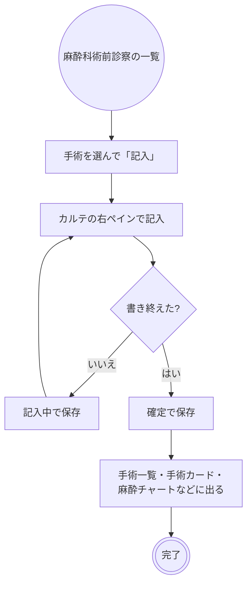

- **一覧に出る手術**: 今日から 14 日先までの手術と、日程未定の申込です。
- **「記入」の入口**: 麻酔科術前診察の一覧のほか、手術一覧の行のメニューからも開けます。
- **書く内容**: 評価・気道・手術室への指示・病棟への指示です。予定・身長体重・既往歴・アレルギー・内服薬は初期値で入ります。
- **出る場所**: 手術一覧の列・手術カード・手術の詳細・麻酔チャートの帯です。
- **ASA-PS**: 麻酔記録と NCD 症例登録の初期値に引き継がれます。
- **予測困難気道**: 「あり」は一覧で赤く出ます。麻酔チャートでは赤い枠で出ます。
- **入口に注意**: カルテの「テンプレート」から直接書いたものは、その手術の術前診察として扱われません。
- **削除との関係**: 術前診察を書いた手術は、カルテから削除できません。要らなくなったときは中止します。

### 実施の流れ

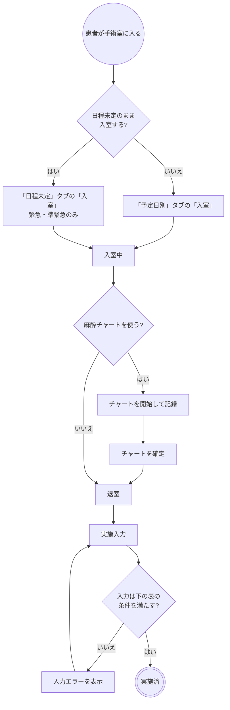

| 実施で入れる項目 | 条件 |
|---|---|
| 入室時刻・退室時刻 | 必須 |
| 中間の時刻(麻酔開始・執刀開始・執刀終了・麻酔終了) | 入れた時刻が、入室から退室までの順に並んでいること |
| 実施した術式(K コード)・麻酔(L コード) | 術式が 1 件以上 |
| スタッフ(執刀医・助手・麻酔科医・器械出し・外回り・臨床工学技士) | 執刀医は必須 |
| 出血量・尿量・輸血量 | – |
| 創分類・転帰・合併症 | – |
| カウント | 不一致のときは、実施コメントに経緯を書く |
| 薬剤・材料 | 同じ薬に同じロット番号を重ねない |

- **入口**: 実施入力は、手術一覧と手術カレンダーのカードから開きます。
- **初期値**: 申込の術式・スタッフ・予定入室時刻が入っています。K コードを持たない術式は、初期値の行になりません。
- **実施取消**: 実施記録ごと消します。直すときは「実施取消」をしてから、もう一度実施入力をします。

**麻酔チャート**

- 専用の画面で、手術中は開いたままにします。打点・イベント・薬剤を 1 点ずつ保存します。
- 実施記録とは別の記録です。実施取消をしても、チャートは消えません。
- チャートに入れた薬剤は算定されません。算定する薬剤は、実施入力に入れます。

### 術後の記録

- **手術記録・麻酔記録**: カルテのテンプレートで書きます。手術記録にはシェーマが付きます。
- **NCD 症例登録**: 「データ > NCD症例登録」で、基本項目と術後 30 日の合併症を記入します。
- **入れ直さなくてよい項目**: 時刻・スタッフ・測定値・ASA-PS は、初期値で入ります。テンプレートに入れ直す必要はありません。

### 変更・中止・削除

| 操作 | できる場所 | できないとき・注意 |
|---|---|---|
| 変更 | カルテのカード、カレンダーのカードと未確定リストのメニュー | どの状態でもできます。日程を変えると、重なりの確認が出ます |
| 日程の移動 | 手術カレンダー | 申込済・受付済のときだけできます |
| 中止 | 手術一覧・カレンダーのメニュー | 実施済からはできません。先に「実施取消」をします |
| 中止取消 | 手術一覧・カレンダーのメニュー | 申込済に戻ります |
| 受付取消・入室取消・実施取消 | 手術一覧・カレンダーのメニュー | 1 つ前の状態へ戻す訂正です |
| 削除 | カルテのカード | 実施記録・麻酔チャート・術前診察のどれかがあるとできません |

- **中止すると**: 手術カレンダーと重なりの判定から外れ、医事会計の対象からも外れます。麻酔チャートと術前診察は残ります。
- **実施取消で消えるもの**: 実施記録(術式・スタッフ・測定値・薬剤・材料)です。
- **削除できないとき**: 術前診察がある手術は、削除せずに中止します。
- **削除で一緒に消えるもの**: テンプレートで書いた術前指示です。

### 帳票

| 帳票 | 出す場所 | 内容 |
|---|---|---|
| 手術説明・同意書 | カルテのテンプレート「手術説明・同意書」から帳票 | 術式・麻酔・輸血の説明と同意欄 |
| 手術記録・麻酔記録 | カルテのテンプレート「手術記録」「麻酔記録」 | 記入内容の表示・印刷(テンプレート共通の機能) |
| NCD 症例登録の CSV | 「データ > NCD症例登録」 | 登録済の内容を項目順に出す(NCD の一括取込の形式ではない) |

麻酔チャートの印刷は、まだできません。

## 開発者向け

### シーケンス図の前提

- **書き込みの経路**: `/fhir` への書き込みはどれも 1 回の transaction Bundle で、backend の `FhirProxyController` が上流へ中継します。
- **麻酔チャートの例外**: 麻酔チャートだけは 1 点ずつ書きます(打点 1 時点の組が 1 transaction、イベント・薬剤は 1 件ずつ)。他の種別と保存の単位が違います。
- **上流**: backend の先にある FHIR サーバーのことです。図では「上流 FHIR」と書きます。
- **応答の中継は省く**: 図の `FHIR-->>UI` は、上流の応答を backend がそのままブラウザへ返すことを表します。
- **ヘッダと明細**: ヘッダは申込本体の `ServiceRequest`、明細は術式 1 件ずつの `ServiceRequest`(`basedOn` でヘッダを指す。並び順 1 が主術式)です。
- **ハブと子**: 実施記録と麻酔チャートは、`Procedure`(ハブ)1 件に、子のリソースが `partOf` でぶら下がる形です。
- **回答**: このページの「回答」は、テンプレートに記入した内容(`QuestionnaireResponse`)のことです。
- **楽観ロック**: 版は `postBundle` が `ifMatch` に添え、版が違えば 412 で止まります。
- **SS-MIX2**: 有効にしている施設では、中継が書き込みの控えを記録します(`Ssmix2::Recorder`)。手術はメッセージにしません。

### リソースの構成

親子の形は次のとおりです([surgery-order-design.md](../surgery-order-design.md) §2)。

- ヘッダ `ServiceRequest`(`order-type|surgery`)
  - 明細 `ServiceRequest` × 術式(`basedOn` = ヘッダ)
  - `Task`(進捗。`focus` = ヘッダ)
  - 術前指示の回答 `QuestionnaireResponse`(ヘッダの拡張が指す)
  - 麻酔科術前診察の回答 `QuestionnaireResponse`(`basedOn` = ヘッダ)
  - 実施記録ハブ `Procedure`(`order-type|surgery`)
    - `Procedure`(2 件目以降の術式・麻酔 L)
    - `MedicationAdministration`(薬剤)
    - `Observation`(出血量・尿量・輸血量)
    - NCD 症例登録の回答 `QuestionnaireResponse`(`partOf` = 実施記録ハブ)
  - 麻酔チャートハブ `Procedure`(`order-type|anesthesia-chart`)
    - `Observation`(打点)
    - `Observation`(イベント)
    - `MedicationAdministration`(単回 / 持続)

**実施記録と麻酔チャートは別のツリーです。振り分けは、必ずハブの `category` で行います。**

DPC の様式 1・NCD は、K コード・到達法・創分類・合併症を起点にします。構造化を崩さないでください。看護必要度の C 項目は、実施記録の K コードから推します([features/nursing.md](../features/nursing.md))。

| リソース | 要素 | 中身 |
|---|---|---|
| ヘッダ `ServiceRequest` | `occurrenceDateTime` | 予定日時。未定なら出さない |
| | ローカル拡張 | 所要時間・手術室・執刀科・スタッフ・麻酔・輸血準備・特殊機器・検体提出予定・同意書・術前指示 |
| | 拡張 `surgery-preop-instruction-questionnaire-response` | 術前指示の回答を指す |
| 明細 `ServiceRequest` | 術式コード | `surgery-order-item` |
| | `bodySite` | 部位と左右 |
| | (そのほか) | K コード・到達法・術前診断 |
| `Task` | `code` | `task-code|surgery`(→「進捗 Task(`surgery`)」) |
| 術前指示の回答 | 書く時期 | 申込と同じ transaction で書き、削除で一緒に消す |
| 麻酔科術前診察の回答 | テンプレート | `SUR_ANESPRE_01`。1 手術 1 件 |
| | `status` | `in-progress`(記入中)/ `completed`(確定) |
| | 要点の読み方 | linkId(`anes_asa` など)で読む |
| 実施記録ハブ `Procedure` | `status` | `completed` |
| | `code` | 実施術式 1 件目の K コード |
| | `performedPeriod` | 入室〜退室 |
| | `performer` | 役割つきの複数人 |
| | `usedCode` | 使用した材料。数量は拡張 `surgery-material-quantity` |
| | 拡張 | 中間時刻・創分類・カウント |
| 実施記録の `Observation` | `category` | 無し |
| 麻酔チャートハブ `Procedure` | `status` | 記録中 `in-progress` / 確定 `completed` |
| 麻酔チャートの `Observation` | 打点 | `category` 無し |
| | イベント | `anesthesia-event` |
| NCD 症例登録の回答 | テンプレート | `NCD_CASE_01`。登録状況は回答の項目 |
| ブロックスケジュール | backend `master_surgery_room_blocks` | 曜日ごとの科割当。警告だけで止めない |

実施記録は、実施取消で記録ごと消します。

### 進捗 Task(`surgery`)

Task は申込時には作りません。**Task が無い申込は申込済**として扱い、最初のステータス変更で作ります(`fhir/surgeryTaskHelpers.ts`)。
中止は同じ transaction でヘッダを `revoked` にし、中止取消で `active` に戻します(`orderCancelEntries`)。中止した申込を編集しても `revoked` のままです(`keepOrderRevoked`)。

| 状態 | `Task.status` | `executionPeriod` | 同じ transaction で書くもの |
|---|---|---|---|
| 申込済 | `requested`(または Task 無し) | なし | |
| 受付済 | `accepted` | `start` | 日程確定ならヘッダ・明細の `occurrenceDateTime`・所要時間・手術室 |
| 入室中 | `in-progress` | `start` | 緊急の入室ならヘッダ・明細の `occurrenceDateTime` |
| 実施済 | `completed` | `start` / `end` | 実施記録(ハブ + 子) |
| 中止 | `cancelled` | なし | ヘッダ `revoked` |

- **実施取消で消すもの**: 実施記録です。`category = surgery` のハブとその子だけを消し、麻酔チャートのツリーは残します。
- **何も消さない取消**: 受付取消・入室取消・中止取消です。
- **日程の移動**: `buildSurgeryMoveBundle` は Task に触りません。

### 部品

| 操作 | 画面 | 組み立て | hook |
|---|---|---|---|
| 申込 | `components/SurgeryOrderForm.tsx`・`SurgeryOrderPanels.tsx` | `buildSurgeryOrderBundle`(`fhir/surgeryOrderHelpers.ts`) | `useCreatePrescription`(名前と違い全種別共通) |
| カレンダーからの申込 | `SurgeryOrderModals.tsx`(同じパネルを包む) | 同じ | 同じ |
| 重なりの確認 | 同じフォーム | – | `hooks/useSurgeryConflictCheck.ts` |
| 編集 | 同じフォーム | `buildSurgeryOrderUpdateBundle` | `useUpdateSurgeryOrder`(`api/queries/surgery.ts`) |
| 削除 | – | `buildSurgeryOrderDeleteBundle` | `useDeleteSurgeryOrder` |
| 一覧・受付・取消・中止 | `pages/SurgeryWorklistPage.tsx` | – | `useUpdateSurgeryTaskStatus` |
| 日程確定 | `components/SurgeryScheduleModal.tsx` | `buildSurgeryScheduleBundle` | `useConfirmSurgerySchedule` |
| カレンダーでの移動 | `SurgeryCalendar.tsx`・`SurgeryMoveConfirmModal.tsx` | `buildSurgeryMoveBundle` | `useMoveSurgerySchedule` |
| 緊急の入室 | 一覧 | – | `useAdmitUnscheduledSurgery` |
| 麻酔科術前診察 | `pages/AnesthesiaPreopPage.tsx` | `fhir/anesthesiaPreopHelpers.ts`、初期値の変数は `fhir/populateSurgery.ts` | `useAnesthesiaPreopList`・`useAnesthesiaPreop` |
| 麻酔チャート | `pages/AnesthesiaChartPage.tsx`・`components/AnesthesiaChartPanel.tsx` | `fhir/anesthesiaChartHelpers.ts` | `useAnesthesiaChart`・`useAnesthesiaChartWrite`(`api/queries/anesthesia.ts`) |
| 実施 | `components/SurgeryPerformModal.tsx` | `buildSurgeryPerformBundle`(`fhir/surgeryResultHelpers.ts`) | `useRegisterSurgeryPerform` |
| 実施取消 | 一覧 | `buildSurgeryPerformDeleteEntries`(`fhir/surgeryResultHelpers.ts`) | `useUpdateSurgeryTaskStatus` |

### シーケンス図: 申込・編集・削除

**申込**

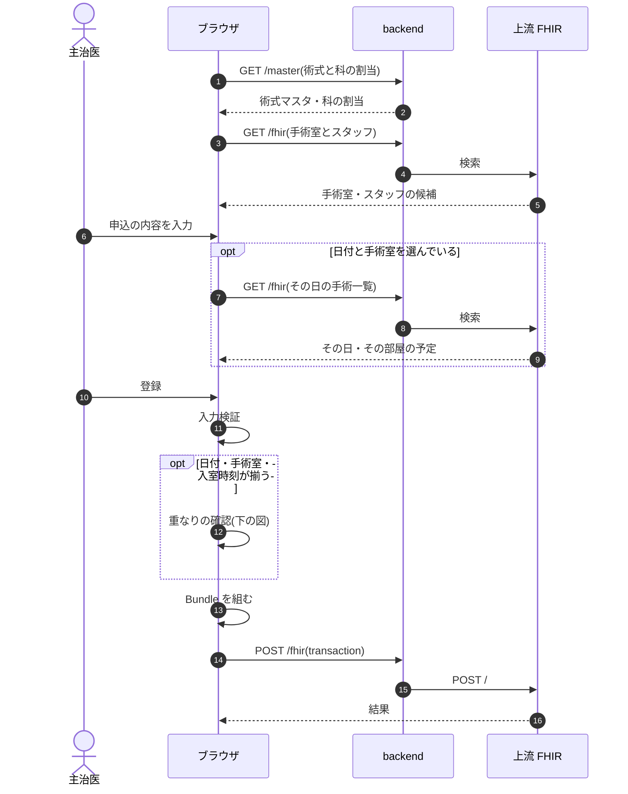

| 段 | 中身 |
|---|---|
| マスタ | `GET /master/surgery_items`(術式マスタ: 既定の所要時間・到達法・体位・麻酔・術前指示テンプレート)、`GET /master/surgery_room_blocks`(科の割当) |
| 手術室とスタッフの検索 | 手術室の `Location`、医療従事者 |
| 入力 | 術式・部位と左右・スタッフ・麻酔・準備・同意書・術前指示・希望日 |
| その日の手術一覧 | キャッシュを使わずに読み、重なりを表示する |
| 入力検証 | 術式 1 件以上、時刻だけで日付なしは不可、左右、執刀医、麻酔科管理なら麻酔科医(`SurgeryOrderForm.tsx`) |

| transaction に入れるもの | 条件 |
|---|---|
| ヘッダ `ServiceRequest`(fullUrl)+ 明細 `ServiceRequest` × 術式 | いつも。登録時の入院病棟を `order-ward` に入れる |
| `Provenance`(CREATE) | いつも |
| 術前指示の回答 `QuestionnaireResponse`(POST) | 術前指示があるとき |
| `Task` order-approval | 代行・研修医のとき |

**重なりの確認**

申込・日程確定で同じ形です。

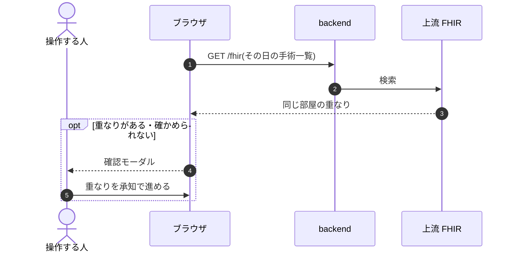

その日の手術一覧は、保存の直前に引き直します。

**編集**

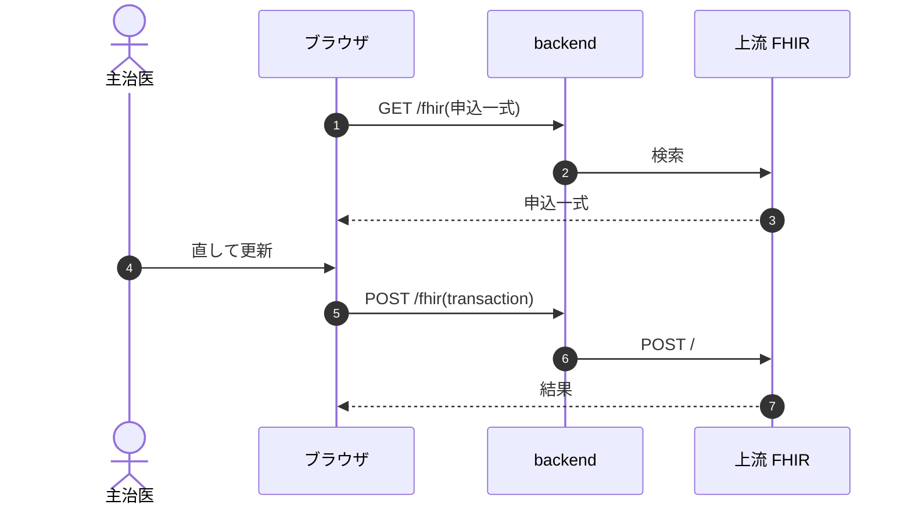

| 段 | 中身 |
|---|---|
| 申込一式の検索 | ヘッダ + 明細 + 術前指示の回答 |
| 日程を変えたとき | 重なりの確認を挟む |
| ヘッダ | PUT(`ifMatch`)。`revoked` なら `revoked` のまま |
| 明細 | 差分で POST / PUT / DELETE |
| 術前指示の回答 | POST / PUT。外したものは DELETE |
| 来歴 | `Provenance`(UPDATE) |

**削除**

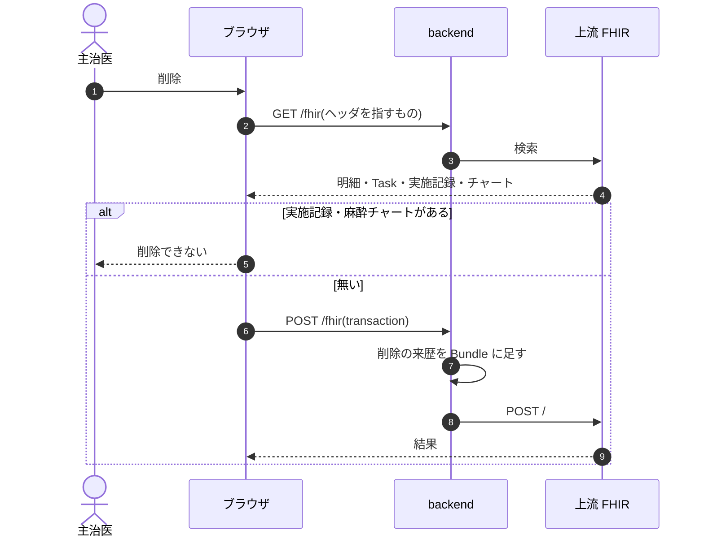

| 段 | 中身 |
|---|---|
| ヘッダを指すものの検索 | 明細・`Task`・`Procedure` |
| transaction | DELETE 明細 → ヘッダ、DELETE `Task`、術前指示の回答 |
| 術前診察があるとき | カルテのカードの削除が押せない(「術前診察があるため削除できません」。`KarteTimeline.tsx`)。この図の検索より前に止まる |

### シーケンス図: 日程確定・移動・緊急の入室

**受付(「予定日別」タブ)**

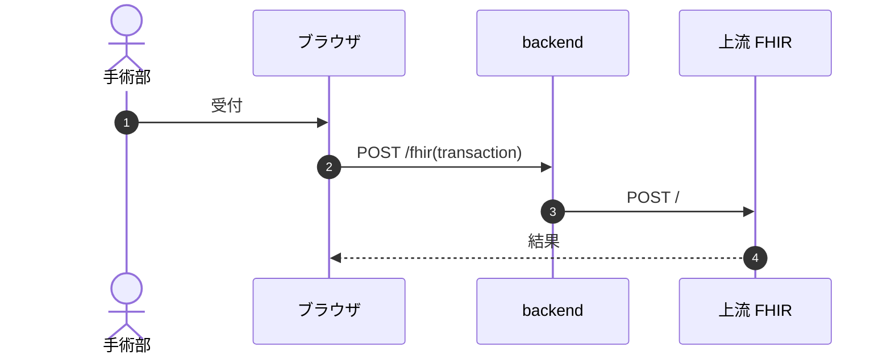

transaction は `Task` surgery = accepted です。

**日程確定(「日程未定」タブ)**

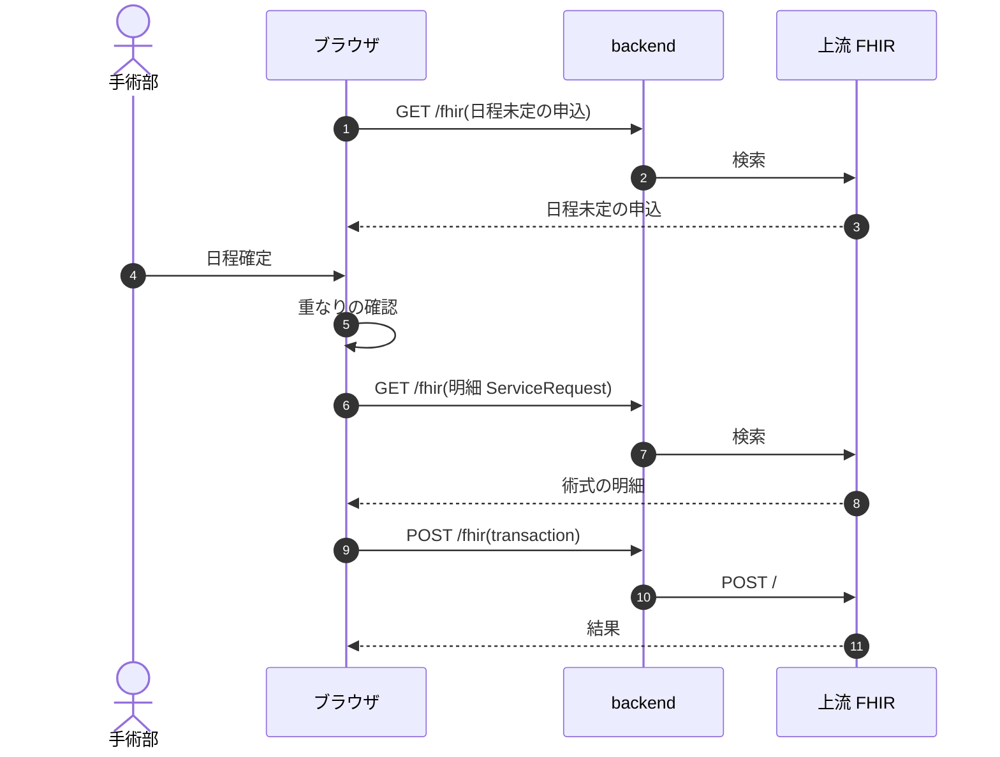

| 段 | 中身 |
|---|---|
| 日程未定の申込の検索 | `occurrence:missing=true`。並びは緊急 → 準緊急 → 予定、申込日の古い順 |
| 日程確定の入力 | 日・入室時刻・所要時間・手術室 |
| 重なりの確認 | その日の手術一覧を引き直し、同じ部屋の重なりを確認モーダルに出す(「シーケンス図: 申込・編集・削除」の図と同じ) |
| transaction | PUT ヘッダ(`occurrenceDateTime`・所要時間・手術室)、PUT 明細 × 術式(`occurrenceDateTime` を揃える)、`Task` surgery = accepted |

**カレンダーで移動・リサイズ**

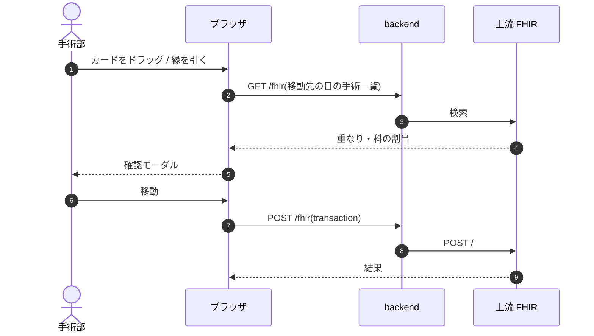

| 段 | 中身 |
|---|---|
| ドラッグ | 5 分刻み |
| 移動先の日の手術一覧 | 引き直す |
| 移動 | 重なりがあれば、承知のうえで移動する |
| transaction | PUT ヘッダ・明細(`occurrenceDateTime`・所要時間・手術室だけ差し替え)。`Task` は触らない |

**緊急の入室(「日程未定」タブ)**

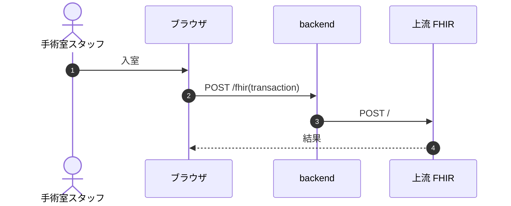

transaction は、PUT ヘッダ・明細(`occurrenceDateTime` = 押した日時)、`Task` surgery = in-progress です。

### シーケンス図: 麻酔科術前診察

記入はカルテの右ペイン「テンプレート登録」(`?open=order-template:<オーダー id>@<テンプレートの url>`)です。

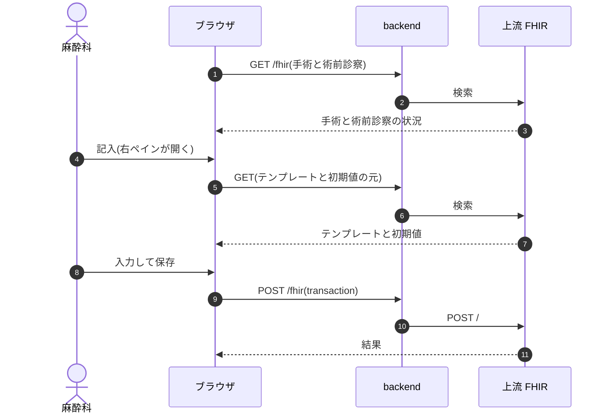

| 段 | 中身 |
|---|---|
| 手術と術前診察の検索 | 期間内と日程未定の手術 + 明細・`Task` + `QuestionnaireResponse:based-on` |
| テンプレートと初期値の元 | `GET /master/facility_settings`(テンプレート)、`GET /fhir`(`Questionnaire`、初期値の元) |
| 初期値 | 手術の予定・身長体重・既往歴・アレルギー・内服薬 |
| 入力 | 評価・気道・指示。保存は記入中 / 確定 |
| transaction(新規) | POST `QuestionnaireResponse`(`basedOn` = ヘッダ、`status` = in-progress / completed) |
| transaction(続き・訂正) | PUT `QuestionnaireResponse`(`ifMatch`) |

- 手術一覧の列・手術カード・手術の詳細・麻酔チャートの帯は、`basedOn` で術前診察を引きます。
- 麻酔記録(`SUR_ANES_01`)と NCD 症例登録(`NCD_CASE_01`)の ASA-PS は、`%preopAsa` で初期値が入ります。

### シーケンス図: 入室・麻酔チャート・実施・実施取消

**入室**

transaction は `Task` surgery = in-progress です。

**麻酔チャート**

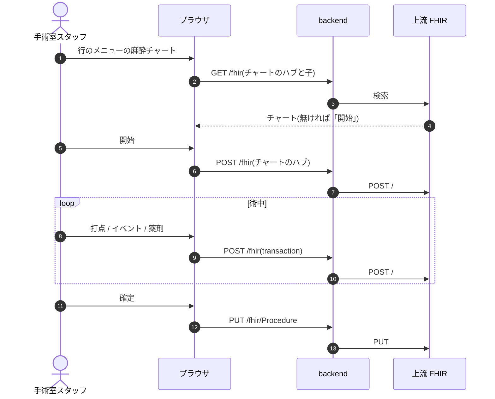

| 段 | 中身 |
|---|---|
| チャートのハブと子の検索 | `Procedure?based-on` + 子を `part-of` でページング |
| 開始 | POST `Procedure` ハブ(`anesthesia-chart`、`in-progress`) |
| 術中の入力 | 打点(1 時点の組)、イベント、薬剤(単回・持続の開始と終了) |
| 術中の transaction | `Observation` × 項目、または `MedicationAdministration` |
| 確定 | PUT `Procedure`(`completed`、`performedPeriod.end`) |

**実施入力**

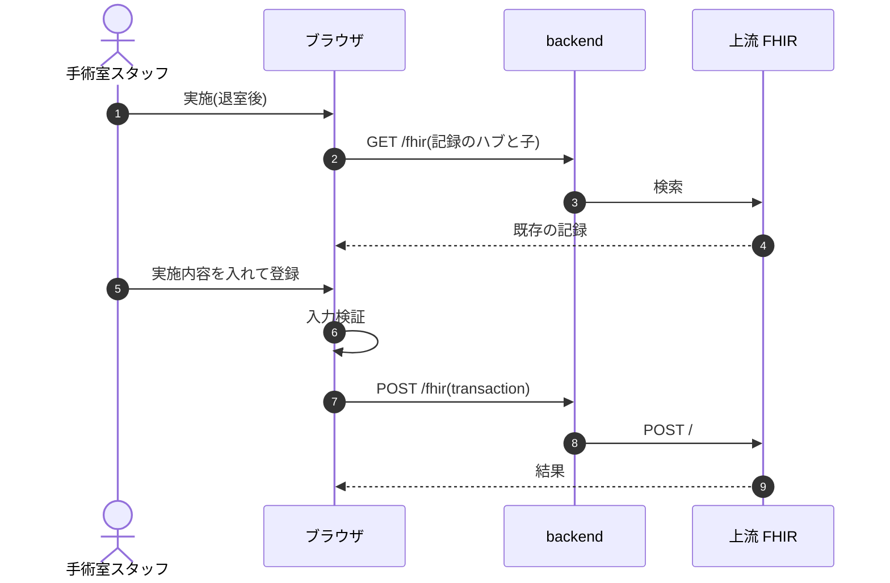

| 段 | 中身 |
|---|---|
| 記録のハブと子の検索 | `Procedure?based-on` + 子 |
| 初期値 | 申込の術式・スタッフ・予定入室時刻 |
| 入力 | 時刻・実施術式(K・L)・スタッフ・測定値・記録・薬剤・材料 |
| 入力検証 | 入室と退室の時刻、時刻の順(`validateSurgeryTimes`)、同じ薬の同じロット番号の重なり、実施術式 1 件以上、執刀医、カウント不一致のコメント(`SurgeryPerformModal.tsx`) |

| transaction に入れるもの | 補足 |
|---|---|
| POST `Procedure`(ハブ) | `code` = K、`performedPeriod`、`performer` × 役割、拡張。材料は `usedCode` |
| POST `Procedure` × 2 件目以降の術式・麻酔 | `partOf`・`basedOn` |
| POST `MedicationAdministration` × 薬剤 | |
| POST `Observation` × 測定値 | |
| `Task` surgery = completed | |

**実施取消**

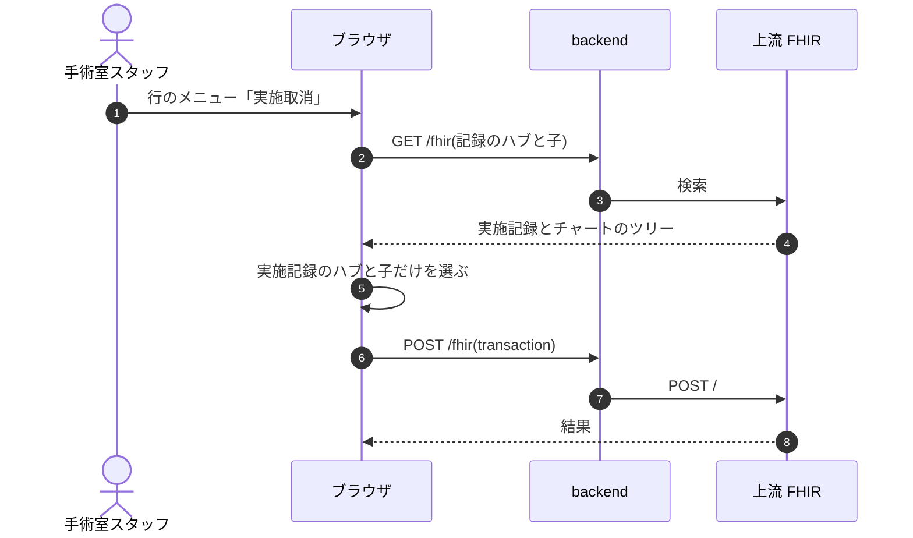

| 段 | 中身 |
|---|---|
| 選び方 | `category = surgery` のハブと子だけ |
| transaction | DELETE `Observation`・`MedicationAdministration` → 子 `Procedure` → ハブ、`Task` surgery = in-progress |

### 医事会計と SS-MIX2

手術は実施記録から集めます(`BillingClaimBuilder` の `:procedure` 経路)。ハブと子の `Procedure.code`(K 章・L 章)が手技、薬剤・材料は直前の手技の剤に付きます。
SS-MIX2 のメッセージは、どの操作でも作りません(手術のメッセージは持ちません)。申込・編集・受付・日程の移動・入室では、医事会計にも何も送りません。

| 起きたこと | 医事会計(`BillingClaimBuilder`) |
|---|---|
| 実施 | 当日の実施記録から送る(下の箇条書き) |
| 麻酔チャート | 拾わない(チャートの薬剤は算定しない) |
| 実施記録の無い当日の申込 | 「実施記録がありません(未実施のため送りません)」と報告する |
| 実施取消 | 対象から外れる |
| 中止 | 対象から外れる(`ServiceRequest` が `revoked`) |
| 削除 | 対象から外れる |

- **K 章**: 手技と、その薬剤・材料を 500 の剤として送ります。
- **L 章(麻酔)**: 手技と、その薬剤を 540 の剤として送ります。
- **麻酔時間の加算**: 実施入力で足します。
