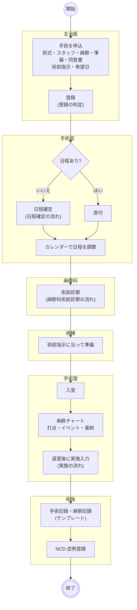
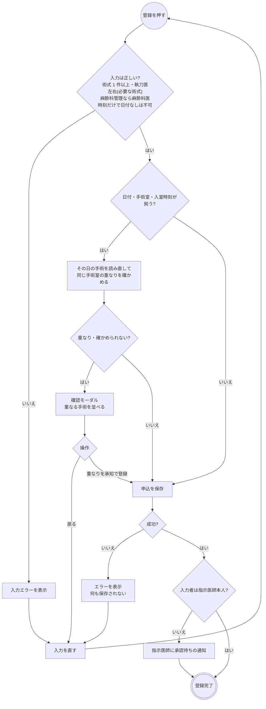
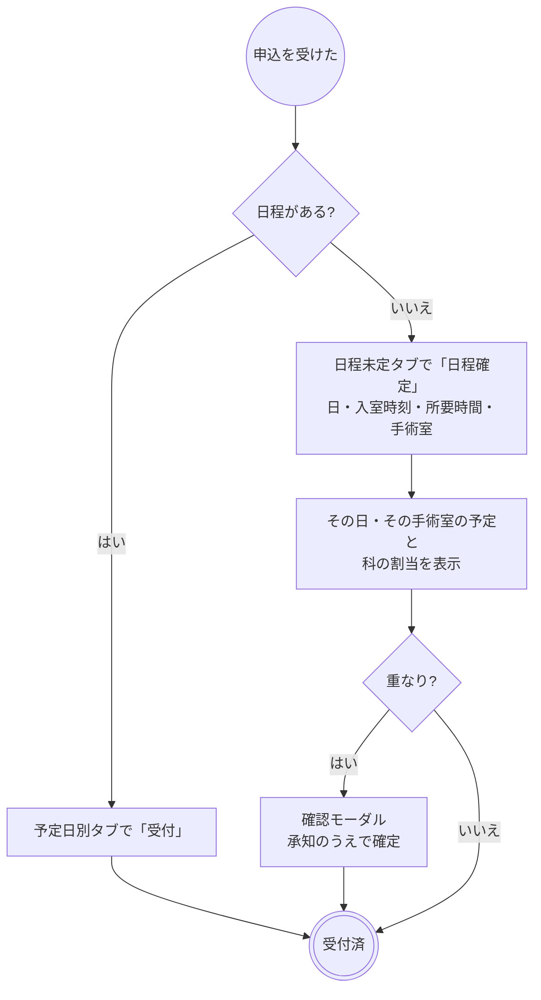
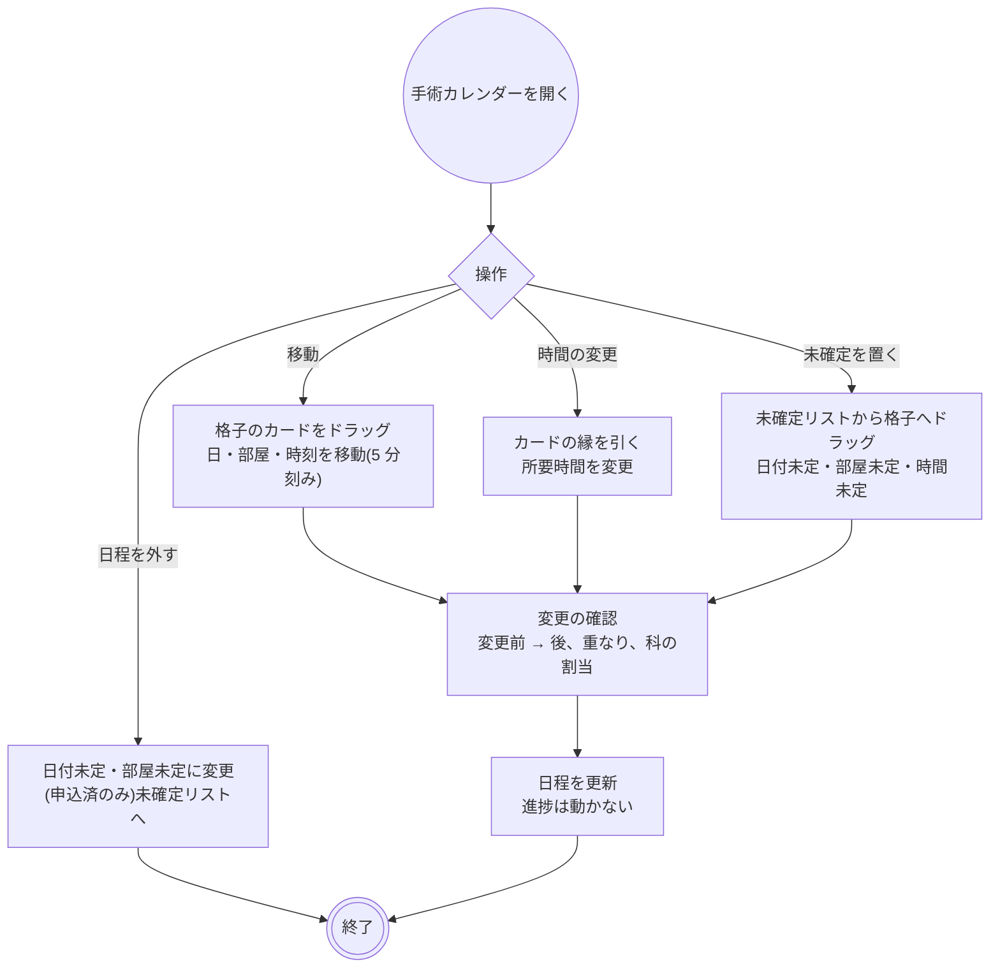
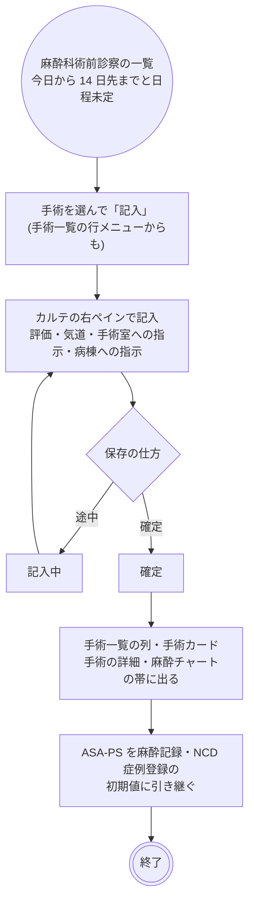
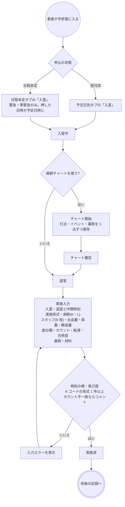
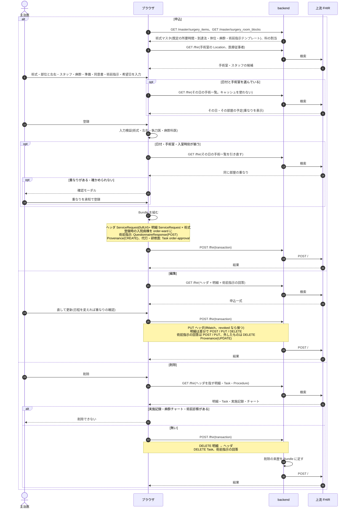
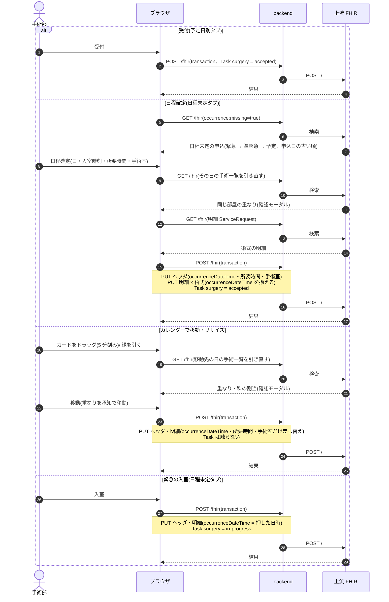
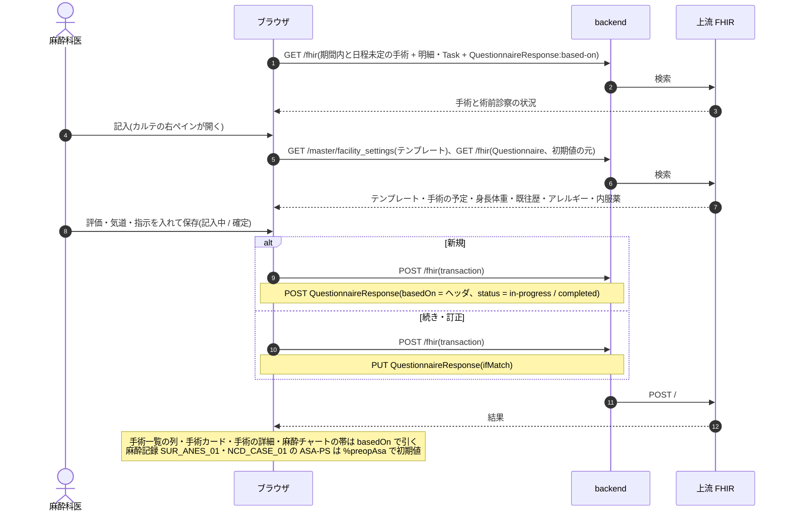
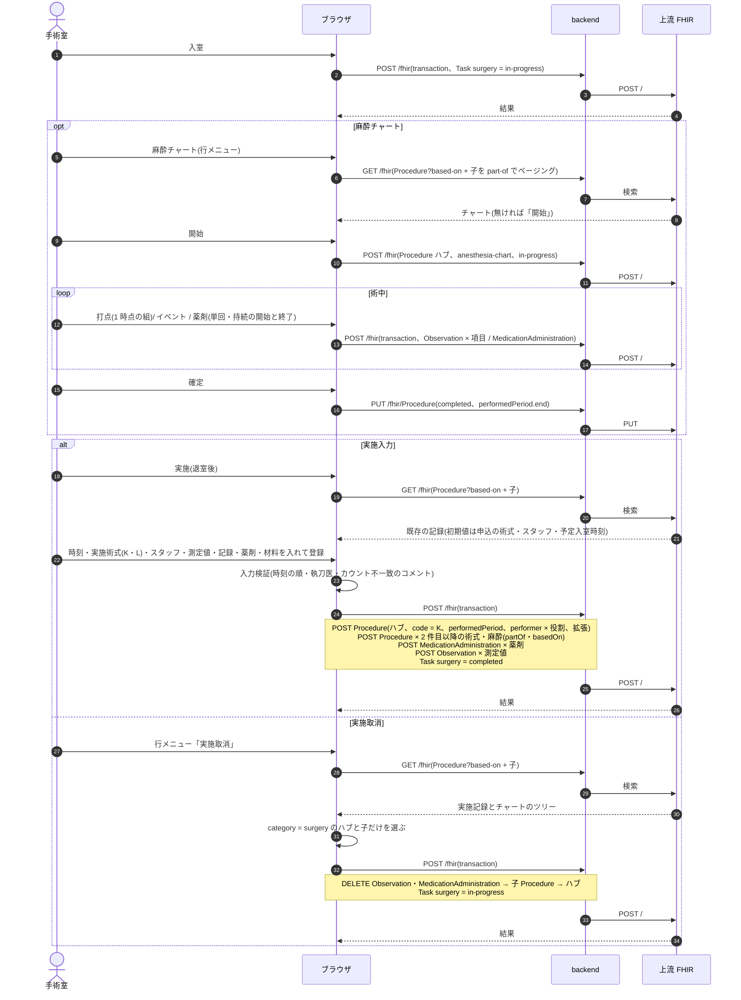

# 手術オーダーの業務フロー

手術の申込から日程の確定・術前診察・入室・実施記録・症例登録までの流れです。医療機関の運用を検討する人は「運用フロー」、院内の開発者は「開発者向け」を読みます。
設計は [surgery-order-design.md](../surgery-order-design.md)(申込)・[surgery-calendar-design.md](../surgery-calendar-design.md)(手術室カレンダー)・
[surgery-result-design.md](../surgery-result-design.md)(実施記録)・[anesthesia-preop-design.md](../anesthesia-preop-design.md)(麻酔科術前診察)・
[anesthesia-chart-design.md](../anesthesia-chart-design.md)(麻酔チャート)・[ncd-registration-design.md](../ncd-registration-design.md)(NCD 症例登録)、
種別共通の約束(日付未定・中止・削除・代行入力)は [features/orders-common.md](../features/orders-common.md)、リソースの要素は実装ガイド(`../fhir-ig`)が正典です。

## 運用フロー

### 区分ごとの違い

| 予定区分 | 日程 | 受付 | 入室 | 手術室の重なりの確認 |
|---|---|---|---|---|
| 予定 | 希望日を書いて申し込むか、日程未定で申し込む | 手術部が日程を確定して受付 | 受付済から | 日程を書くたびに確かめ、重なっていれば承知のうえで登録 |
| 準緊急・緊急 | 同上 | 同上 | **日程未定のまま入室できる**(押した日時が予定日時になる) | 同上 |

1 オーダー = 手術 1 件で、麻酔は手術の一部(麻酔方法・管理区分)です。予約枠は使わず、手術室の空きは手術オーダーの予定日時と所要時間そのものから判断します。
申込の入口はカルテの右ペイン「手術」、手術カレンダーの空き枠、オーダーセット・クリニカルパスの適用です。

### 手術の状態

手術部と手術室の進み具合を示す状態です。受付と実施の間に入室の段があります。

| 状態 | 変わるきっかけ | 手術一覧・カレンダーからできること |
|---|---|---|
| 申込済 | 申込、受付取消、中止取消 | 受付(予定日別)、日程確定・入室(日程未定、入室は緊急・準緊急のみ)、日程の移動・日付未定/部屋未定に戻す、中止 |
| 受付済 | 受付、日程確定、入室取消 | 入室、日程の移動、受付取消(申込済へ)、中止 |
| 入室中 | 入室、実施取消 | 実施(実施入力)、麻酔チャート、入室取消(受付済へ) |
| 実施済 | 実施登録 | 麻酔チャート(閲覧)、実施取消(入室中へ。実施記録は消える) |
| 中止 | 中止 | 中止取消(申込済へ) |

- 入室は進捗を進めるだけで、実施記録は退室後にまとめて 1 回入れます。
- 日程の移動(カレンダーのドラッグ)は申込済・受付済だけで、進捗は動かしません。入室中・実施済は起きた事実なので動かせません。
- 術前診察は中止以外のどの状態でも書けます。麻酔チャートは入室中に書き始め、実施済で振り返ります。

### 全体の流れ

- 受付は日程確定を兼ねます。希望日つきの申込は予定日別タブの「受付」、日程未定の申込は日程未定タブの「日程確定」で受付済になります。
- 術前診察・術前指示・麻酔チャートは必須ではありません(術前診察が済んでいなくても受付・入室は止まりません)。
- 緊急・準緊急は日程未定のまま「入室」でき、日程確定を飛ばします。

### 登録の判定

- 左右は術式マスタで「左右が要る」と印を付けた術式だけ必須です(取り違え防止)。
- 薬剤のような警告(判断支援)はありません。ブロックスケジュール(曜日ごとの科の割当)に掛かる時間帯は警告だけで止めません。
- セット・パスからの一括登録は重なりの確認を挟めないので、登録後に手術カレンダーで確かめます。
- 術前指示はテンプレートから記入でき、申込と一緒に保存します。

### 日程確定の流れ

受付の後も、手術カレンダーで日程を組み直せます。

- 手術カレンダーは日ビュー(手術室 × 時刻)と週ビュー(曜日 × 手術室)で、右の未確定リスト(日付未定・部屋未定・時間未定)から格子へドラッグして日程を決めます。ドラッグで決めた日程は申込済のまま(受付は別操作)です。
- 日程の移動は進捗を動かしません。日程を外すのは申込済のときだけで、受付済なら先に受付取消をします。
- 重なりは登録を止めません。緊急の割り込みや前の手術が早く終わる読みで詰めることがあるためです。承知した事実は確認の操作として残ります。
- 読み切れなかった日(件数が多い)は「重なりなし」と言い切れないので、その旨を出します。

### 麻酔科術前診察の流れ

- 予定・身長体重・既往歴・アレルギー・内服薬が初期値で入ります。カルテの「テンプレート」から直接書いた回答は手術に結び付きません。
- 予測困難気道「あり」は一覧で赤、麻酔チャートでは赤い枠で出ます。
- 術前診察が付いた手術はカルテから削除できません(中止します)。

### 実施の流れ

- 実施入力は手術一覧とカレンダーのカードから開きます。申込の術式・スタッフ・予定入室時刻が初期値です。K コードを持たない術式は初期行になりません。
- 麻酔チャートは専用ページで、手術中は開きっぱなしにします。実施記録とは別の記録で、実施取消でチャートは消えません。チャートの薬剤は算定に載せず、算定する薬剤は実施入力に入れます。
- 実施取消は実施記録ごと消します。直すときは「実施取消 → 実施」の 2 手です。
- 術後は手術記録(`SUR_OP_01`、シェーマつき)・麻酔記録(`SUR_ANES_01`)のテンプレートをカルテで書き、NCD 症例登録(データ > NCD症例登録)で基本項目と術後 30 日の合併症を記入します。構造化した項目(時刻・スタッフ・測定値・ASA-PS)は初期値で入り、テンプレートに再入力しません。

### 変更・中止・削除

| 操作 | できる場所 | できないとき・注意 |
|---|---|---|
| 変更 | カルテのカード、カレンダーのカードと未確定リストのメニュー | 進捗では止まりません。日程を変えると重なりの確認を挟みます |
| 日程の移動 | 手術カレンダー(ドラッグ・縁のリサイズ) | 申込済・受付済のみ。確認モーダルを挟み、進捗は動きません |
| 中止 | 手術一覧・カレンダーのメニュー | 実施済からはできません(先に実施取消)。カレンダーと重なりの判定から外れ、医事会計の対象からも外れます。麻酔チャート・術前診察は残ります |
| 中止取消 | 手術一覧・カレンダーのメニュー | 申込済に戻ります |
| 受付取消・入室取消・実施取消 | 手術一覧・カレンダーのメニュー | 1 つ前の状態へ戻す訂正。実施取消は実施記録(術式・スタッフ・測定値・薬剤・材料)を消します |
| 削除 | カルテのカード | 実施記録か麻酔チャートがあるとできません。術前診察が付いていてもできません(中止します)。術前指示のテンプレート回答は一緒に消えます |

### 帳票

| 帳票 | 出す場所 | 内容 |
|---|---|---|
| 手術説明・同意書 | カルテのテンプレート `SUR_CONSENT_01` から帳票 | 術式・麻酔・輸血の説明と同意欄 |
| 手術記録・麻酔記録 | カルテのテンプレート `SUR_OP_01` / `SUR_ANES_01` | 記入内容の表示・印刷(テンプレート共通の機能) |
| NCD 症例登録の CSV | データ > NCD症例登録 | 登録済の回答を項目順に出す(NCD の一括取込の形式ではない) |

麻酔チャートの印刷はありません(バックログ)。

## 開発者向け

### リソースの構成

申込はヘッダの `ServiceRequest`(`order-type|surgery`)と、術式 1 件ずつの明細 `ServiceRequest`(`basedOn` でヘッダを指す。並び順 1 が主術式)です。
ヘッダに予定日時(`occurrenceDateTime`。未定なら出さない)・所要時間・手術室・執刀科・スタッフ・麻酔・輸血準備・特殊機器・検体提出予定・同意書・術前指示をローカル拡張で、明細に術式コード(`surgery-order-item`)・K コード・部位と左右(`bodySite`)・到達法・術前診断を持ちます([surgery-order-design.md](../surgery-order-design.md) §2)。

| もの | リソース | 補足 |
|---|---|---|
| 進捗 | `Task`(`task-code|surgery`、`focus` = ヘッダ) | 下の表 |
| 術前指示(テンプレート記入) | `QuestionnaireResponse` | ヘッダの拡張 `surgery-preop-instruction-questionnaire-response` が指す。申込と同じ transaction で書き、削除で一緒に消す |
| 麻酔科術前診察 | `QuestionnaireResponse`(`basedOn` = ヘッダ、`SUR_ANESPRE_01`) | 1 手術 1 件。`in-progress`(記入中)/ `completed`(確定)。要点は linkId(`anes_asa` など)で読む |
| 実施記録 | ハブ `Procedure`(`order-type|surgery`、`status = completed`、`code` = 実施術式 1 件目の K コード、`performedPeriod` = 入室〜退室、`performer` = 役割つき複数、拡張 = 中間時刻・創分類・カウント)← `partOf` ── `Procedure`(2 件目以降の術式・麻酔 L)、`MedicationAdministration`(薬剤)、`Observation`(出血量・尿量・輸血量。`category` 無し) | 実施取消で記録ごと消す |
| 麻酔チャート | ハブ `Procedure`(`order-type|anesthesia-chart`、記録中 `in-progress` / 確定 `completed`)← `partOf` ── `Observation`(打点。`category` 無し)、`Observation`(イベント `anesthesia-event`)、`MedicationAdministration`(単回 / 持続) | 実施記録と別のツリー。振り分けは必ずハブの `category` で行う |
| NCD 症例登録 | `QuestionnaireResponse`(`partOf` = 実施記録ハブ、`NCD_CASE_01`) | 登録状況は回答の項目 |
| ブロックスケジュール | backend `master_surgery_room_blocks` | 曜日ごとの科割当。警告だけで止めない |

### 進捗 Task(`surgery`)

Task は申込時には作りません。**Task が無い申込は申込済**として扱い、最初のステータス変更で作ります(`fhir/surgeryTaskHelpers.ts`)。
中止は同じ transaction でヘッダを `revoked` にし、中止取消で `active` に戻します(`orderCancelEntries`)。中止した申込を編集しても `revoked` のままです(`keepOrderRevoked`)。

| 状態 | `Task.status` | `executionPeriod` | 同じ transaction で書くもの |
|---|---|---|---|
| 申込済 | `requested`(または Task 無し) | なし | |
| 受付済 | `accepted` | `start` | 日程確定ならヘッダ・明細の `occurrenceDateTime`・所要時間・手術室 |
| 入室中 | `in-progress` | `start` | 緊急の入室ならヘッダ・明細の `occurrenceDateTime` |
| 実施済 | `completed` | `start` / `end` | 実施記録(ハブ + 子) |
| 中止 | `cancelled` | なし | ヘッダ `revoked` |

取消で戻すときに消すもの: 実施取消は実施記録(`category = surgery` のハブとその子だけ。麻酔チャートのツリーは残す)。受付取消・入室取消・中止取消は何も消しません。日程の移動(`buildSurgeryMoveBundle`)は Task に触りません。

### シーケンス図の前提

`/fhir` への書き込みはどれも 1 回の transaction Bundle で、backend の `FhirProxyController` が上流へ中継します。
SS-MIX2 を有効にしている施設では、中継が書き込みの控えを記録します(`Ssmix2::Recorder`。手術は電文にしません)。
楽観ロックの版は `postBundle` が `ifMatch` に添え、版が違えば 412 で止まります。
麻酔チャートだけは 1 点ずつ書く(打点 1 時点の組が 1 transaction、イベント・薬剤は 1 件ずつ)ので、他の種別と保存の単位が違います。

### シーケンス図: 申込・編集・削除

`components/SurgeryOrderForm.tsx`・`SurgeryOrderPanels.tsx`(カレンダーからは `SurgeryOrderModals.tsx` が同じパネルを包む)、`buildSurgeryOrderBundle` / `buildSurgeryOrderUpdateBundle` / `buildSurgeryOrderDeleteBundle`(`fhir/surgeryOrderHelpers.ts`)、
`hooks/useSurgeryConflictCheck.ts`、`useCreatePrescription`(全種別共通)/ `useUpdateSurgeryOrder` / `useDeleteSurgeryOrder`(`api/queries/surgery.ts`)。

### シーケンス図: 日程確定・移動・緊急の入室

`pages/SurgeryWorklistPage.tsx`、`components/SurgeryScheduleModal.tsx`・`SurgeryCalendar.tsx`・`SurgeryMoveConfirmModal.tsx`、`buildSurgeryScheduleBundle` / `buildSurgeryMoveBundle`(`fhir/surgeryOrderHelpers.ts`)、
`useConfirmSurgerySchedule` / `useMoveSurgerySchedule` / `useAdmitUnscheduledSurgery` / `useUpdateSurgeryTaskStatus`(`api/queries/surgery.ts`)。

### シーケンス図: 麻酔科術前診察

`pages/AnesthesiaPreopPage.tsx`、`useAnesthesiaPreopList` / `useAnesthesiaPreop`(`api/queries/surgery.ts`)、`fhir/anesthesiaPreopHelpers.ts`、`fhir/populateSurgery.ts`(初期値の変数)。記入はカルテの右ペイン「テンプレート登録」(`?open=order-template:<オーダー id>@<テンプレートの url>`)です。

### シーケンス図: 入室・麻酔チャート・実施・実施取消

`pages/AnesthesiaChartPage.tsx`・`components/AnesthesiaChartPanel.tsx`、`useAnesthesiaChart` / `useAnesthesiaChartWrite`(`api/queries/anesthesia.ts`)、`fhir/anesthesiaChartHelpers.ts`、
`components/SurgeryPerformModal.tsx`、`buildSurgeryPerformBundle` / `buildSurgeryPerformDeleteEntries`(`fhir/surgeryResultHelpers.ts`)、`useRegisterSurgeryPerform` / `useUpdateSurgeryTaskStatus`。

### 医事会計と SS-MIX2

手術は実施記録から集めます(`BillingClaimBuilder` の `:procedure` 経路)。ハブと子の `Procedure.code`(K 章・L 章)が手技、薬剤・材料は直前の手技の剤に付きます。

| 起きたこと | 医事会計(`BillingClaimBuilder`) | SS-MIX2 |
|---|---|---|
| 申込・編集・受付・日程の移動・入室 | なし | なし(手術の電文は持たない) |
| 実施 | 当日の実施記録から、K 章の手技とその薬剤・材料を 500 の剤、L 章(麻酔)とその薬剤を 540 の剤として送る。麻酔時間の加算は実施入力で足す | なし |
| 麻酔チャート | 拾わない(チャートの薬剤は算定しない) | なし |
| 実施記録の無い当日の申込 | 「実施記録がありません(未実施のため送りません)」と報告 | なし |
| 実施取消 | 対象から外れる | なし |
| 中止 | 対象から外れる(`ServiceRequest` が `revoked`) | なし |
| 削除 | 対象から外れる | なし |

看護必要度の C 項目は実施記録の K コードから推します(`features/nursing.md`)。DPC の様式 1・NCD は K コード・到達法・創分類・合併症を起点にするので、構造化を崩さないでください。
