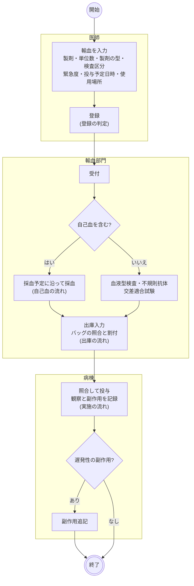
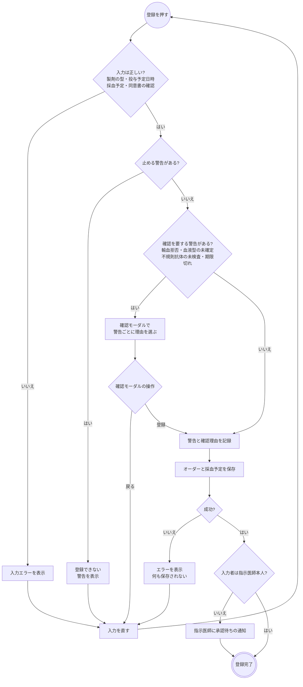
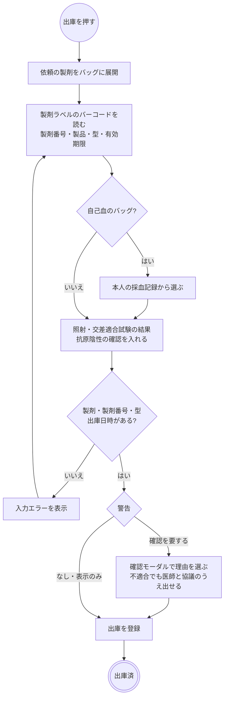
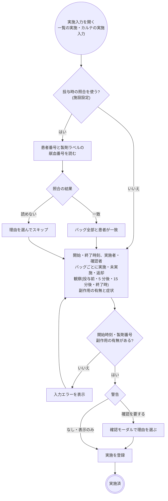
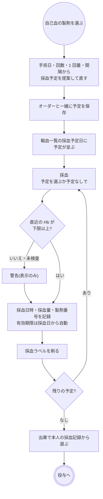
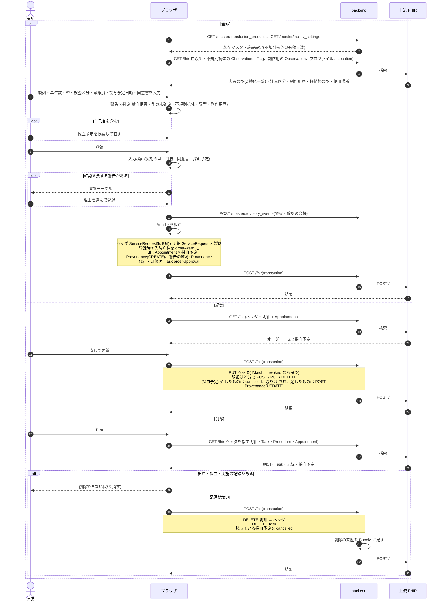
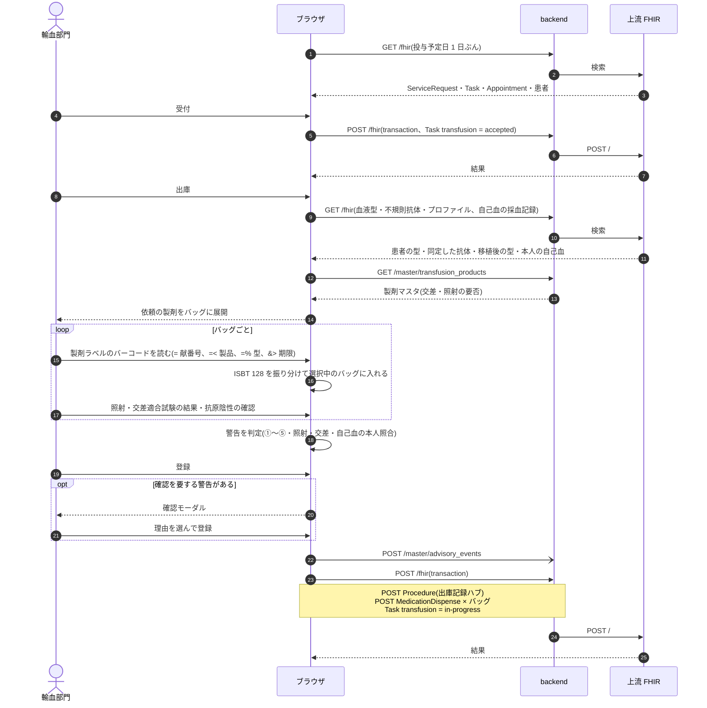
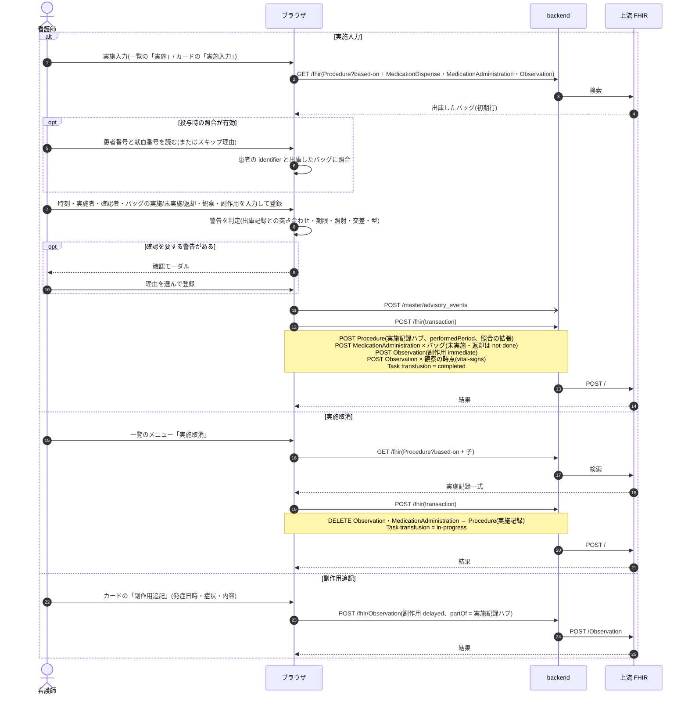
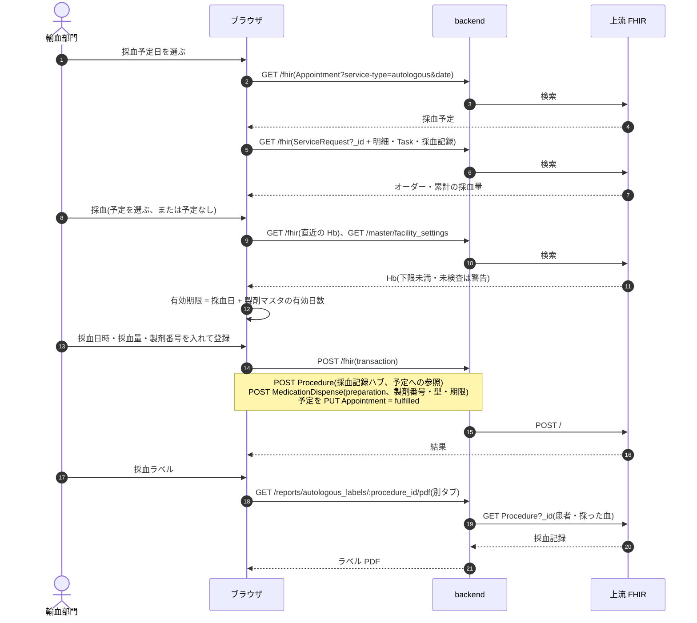
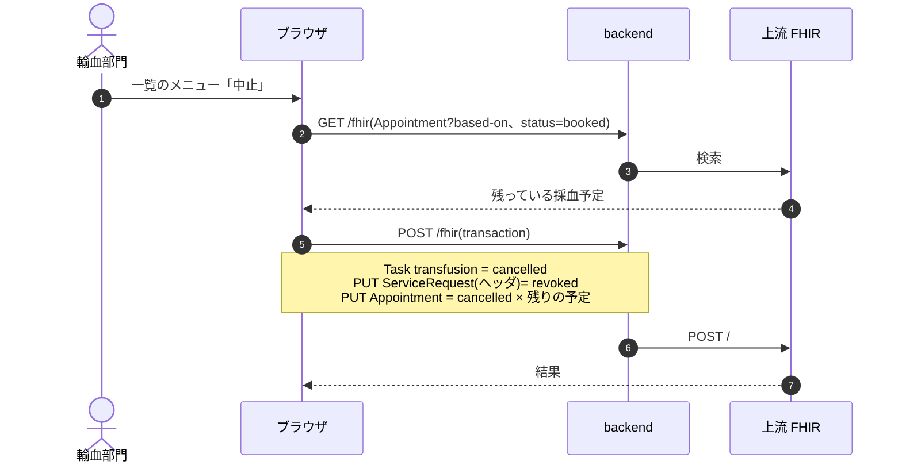

# 輸血オーダーの業務フロー

輸血オーダーの登録から出庫・投与・副作用の記録までと、自己血(貯血式)の採血の流れです。医療機関の運用を検討する人は「運用フロー」、院内の開発者は「開発者向け」を読みます。
設計と画面のふるまいは [transfusion-order-design.md](../transfusion-order-design.md)、JAHIS 患者安全ガイド(輸血編)との突合は [transfusion-backlog.md](../transfusion-backlog.md)、
血液型の確定の判定は [features/patient-profile.md](../features/patient-profile.md)「血液型」、種別共通の約束(削除・代行入力・中止)は [features/orders-common.md](../features/orders-common.md)、
リソースの要素は実装ガイド(`../fhir-ig`)が正典です。

## 運用フロー

### 区分ごとの違い

| 製剤 | 採血 | 出庫での照合 | 交差適合試験 | 投与 | 医事会計への送信 |
|---|---|---|---|---|---|
| 同種血(赤血球・血漿・血小板) | なし(日赤から入庫) | 製剤ラベルのバーコードで製剤番号・型・期限を読む。患者の型・依頼の型・依頼の製剤・期限・照射・不規則抗体を照合 | 赤血球は検査区分による。血漿・血小板は不要 | 病棟 | 外来のみ。製剤と保存血液輸血の手技 |
| 自己血(貯血式) | 採血予定を立てて輸血部門で採血。ラベルを刷る | 本人の採血記録から選ぶ(記録に無い製剤番号は警告) | 不要 | 病棟 | 製剤コードが無いので送れない項目として報告 |
| その他(アルブミンなど) | なし | 型を持たない | 不要 | 病棟 | 製剤のみ |

緊急度は危機的出血の 3 段階(レベルⅠ 準備 10 分・交差試験なし / Ⅱ 30 分・生食法 / Ⅲ 60 分)と通常です。レベルⅠでは RhD 陰性の患者にも陽性を出せます。
輸血オーダーは投与予定日時を持ち、予約枠は使いません。日付未定にはできません。

### 輸血の状態

輸血部門と病棟の進み具合を示す状態です。手術と同じく、受付と実施の間に出庫の段があります。

| 状態 | 変わるきっかけ | 輸血一覧からできること |
|---|---|---|
| 依頼済 | 医師の登録、受付取消、中止取消 | 受付、採血(自己血)、中止 |
| 受付済 | 受付、出庫取消 | 出庫(出庫入力)、採血(自己血)、受付取消(依頼済へ)、中止 |
| 出庫済 | 出庫登録、実施取消 | 実施(実施入力)、出庫取消(受付済へ。出庫記録は消える)、中止 |
| 実施済 | 実施登録 | 実施取消(出庫済へ。実施記録は消える) |
| 中止 | 中止 | 中止取消(依頼済へ) |

- 出庫済のまま投与されていない製剤を部門が把握するために、出庫と実施を分けています。
- 中止は出庫記録を消しません(出したバッグは返却の対象)。残っている自己血の採血予定は取り消します。
- 実施入力は輸血一覧とカルテのカードの両方から開けます。出すのは輸血部門、投与するのは病棟だからです。

### 全体の流れ

- 血液型検査・不規則抗体スクリーニング・交差適合試験の結果は、検体検査の結果として登録します(輸血オーダーからは自動で出ません)。
  血液型は異なる日の 2 検体で一致したときに確定し、オーダーと出庫の警告に使います。
- 受付は手で押します(検体検査のラベル発行のような、受付を兼ねる操作はありません)。
- 自己血の採血は受付の前後どちらでもできます(依頼済・受付済の間)。

### 登録の判定

- 同意書の確認は必須です。同意書なしでは登録できません。
- 止める警告は既定ではありません(施設の規則で足せます)。異型適合血・輸血副作用歴・移植後の型は表示だけで、確認を求めません。
- オーダーセット・クリニカルパスからの適用も同じ保存を通ります(セットの内容では日時・型・同意書を持たず、適用時に入れます)。

### 血液型と製剤の型

- **患者の型**は検体検査の結果だけから決めます。異なる日の 2 検体で一致すれば確定、1 回だけ・不一致・未検査は「不明」として登録し、警告を出します。医師は患者の型を手で入れません。
- **製剤の型**は製剤ごとに持ちます。患者の型・製剤区分・緊急度から既定が入り、適合する型だけを選べます(赤血球は抗原、血漿・血小板は抗体で決まります。型が不明なら赤血球は O、血漿・血小板は AB)。
- 造血幹細胞移植後の型をプロファイルに登録していれば、患者の型より優先します。
- 患者の型と違う型を選んだ製剤には「異型」の印が付きます。
- 型の色は日赤のラベルの区分色(A 黄 / B 白 / O 青 / AB 桃)です。

### 出庫の流れ

- 警告は ①患者の型との適合 ②依頼の型との一致 ③依頼の製剤との一致 ④有効期限と投与予定日 ⑤不規則抗体(同定した抗体の抗原陰性の確認、未同定の陽性)と、照射の要否、交差適合試験の未入力・不適合、自己血の本人照合です。
- 交差適合試験の結果が要るのは、交差を要する製剤(製剤マスタ)で、検査区分が交差を省略しないときです。
- 出庫者はログイン中の医療従事者、適合試験者は選びます。
- 出庫取消は出庫記録ごと消します。出し直すときは改めて出庫入力をします。

### 実施の流れ

- 出庫したバッグが初期行に入ります(製剤番号・型つき)。入れなかったバッグは消さず「未実施」「返却」で残します。
- 警告は、出庫記録に無い製剤番号、出庫したのに入力に無いバッグ、期限切れ、未照射、交差不適合、患者の型との不適合、副作用歴(表示のみ)です。
- 観察は時点ごとの血圧・脈拍・体温・SpO2・呼吸数で、経過表にもそのまま載ります。空の時点は記録しません。
- 「副作用なし」も記録します(観察して無かったことを残すため)。
- 実施取消は実施記録ごと消します(遡及調査の記録が嘘にならないように)。修正は「実施取消 → 実施」の 2 手です。
- 輸血後 24 時間以降に出た遅発性副作用は、カルテのカードの「副作用追記」で実施記録を取り消さずに足します。

### 自己血の流れ

- 提案は、最終採血日 = 手術日 − 3 日、そこから間隔(既定 7 日)ずつ遡ります。回数の既定は依頼量 ÷ 1 回量(製剤マスタの既定単位数)です。
- 1 回目の採血日に有効日数を足した日が手術日より前なら、登録時に警告します。使用予定日が有効期限より後の採血も警告します。
- 有効期限は手で変えられません。製剤番号の初期値は患者番号・採血日・連番から組みます。
- 採血予定は投与予定日の行に「採血 未 n」として出ます。オーダーの編集で予定を足す・外す・動かせます(採血済みの予定は動かせません)。
- オーダーの削除・中止で、残っている予定は取り消します。

### 変更・中止・削除

| 操作 | できる場所 | できないとき・注意 |
|---|---|---|
| 変更 | カルテのカード | 出庫・実施の後でも止まりません。採血済みの予定は動かせません |
| 中止 | 輸血一覧のメニュー | 出庫記録・採血記録は残ります。残っている採血予定は取り消されます。医事会計の対象から外れます |
| 中止取消 | 輸血一覧のメニュー | 依頼済に戻ります(受付済・出庫済には戻りません)。取り消した採血予定は戻りません |
| 受付取消・出庫取消・実施取消 | 輸血一覧のメニュー | 1 つ前の状態へ戻す訂正。出庫取消は出庫記録、実施取消は実施記録(観察・副作用を含む)を消します |
| 削除 | カルテのカード | 出庫・採血・実施のいずれかの記録があるとできません(取り消してから)。進捗と採血予定は一緒に消えます |

- 製剤番号からの逆引き(遡及調査)は薬剤部門の「ロット管理」で行います。実施記録の製剤番号を検索します。
- 変更は部門へ通知しません。一覧の内容で見えます。

### 帳票

| 帳票 | 出す場所 | 内容 |
|---|---|---|
| 採血ラベル | 採血の画面(登録した採血記録ごと) | 患者・型・製剤番号のバーコード・採血日・使用予定日・有効期限・署名欄 |
| 輸血カード | カルテのプロファイルタブ「身体」 | 血液型(検査結果と申告)・不規則抗体(スクリーニングと特異性)・移植後の型・輸血歴(実施したバッグ)・副作用歴 |

出庫票は未作成です(バックログ §7.3)。

## 開発者向け

### リソースの構成

ヘッダの `ServiceRequest`(`order-type|transfusion`)と、製剤 1 種類ずつの明細 `ServiceRequest`(`basedOn` でヘッダを指す)です。
ヘッダに検査区分(`code`)・投与予定日時(`occurrenceDateTime`)・緊急度(`priority`)・使用場所(`locationReference`)・使用目的・患者の型(`transfusion-abo` / `transfusion-rhd`。不明は `unknown`)・同意書の確認(`transfusion-consent`)、明細に製剤(`code`)・単位数(`quantityQuantity`)・製剤の型を持ちます([transfusion-order-design.md](../transfusion-order-design.md) §2)。

| もの | リソース | 補足 |
|---|---|---|
| 進捗 | `Task`(`task-code|transfusion`、`focus` = ヘッダ) | 下の表 |
| 出庫記録 | ハブ `Procedure`(`procedure-category|transfusion-dispense`、`basedOn` = ヘッダ)← `partOf` ── `MedicationDispense` × バッグ | 製剤番号は `identifier`(`blood-product-number`)、型・有効期限・照射・交差適合試験・抗原陰性は拡張。出庫者と適合試験者は `performer.function` |
| 実施記録 | ハブ `Procedure`(`order-type|transfusion`、`performedPeriod`、`performer` = 実施者・確認者、拡張 `transfusion-verification`)← `partOf` ── `MedicationAdministration` × バッグ(未実施・返却は `not-done` + `statusReason`)、`Observation`(副作用。症状は `component`、`transfusion-reaction-timing` = immediate / delayed)、`Observation`(観察のバイタル。`vital-signs` + `transfusion-observation-point`) | 製剤番号は `MedicationAdministration` の拡張 `transfusion-lot-number` |
| 自己血の採血予定 | `Appointment`(`basedOn` = ヘッダ、`serviceType` = `autologous`、予定量は拡張) | booked → fulfilled / cancelled。枠(Schedule/Slot)は使わない |
| 自己血の採血記録 | ハブ `Procedure`(`procedure-category|autologous-collection`、拡張 `autologous-appointment` = 予定)← `partOf` ── `MedicationDispense`(`status = preparation`、製剤番号・型・有効期限) | 出庫で本人の記録から選ぶ |
| 血液型・不規則抗体 | 検体検査の `Observation`(結果項目コード + JLAC11 K1001 / K1006、不規則抗体は結果項目コード) | 2 検体一致で確定(`fhir/bloodTypeHelpers.ts`) |
| 不規則抗体の特異性・移植後の型 | `Observation`(`category = exam`、`transfusion-profile|…`) | プロファイルタブで手入力 |
| 警告の確認 | 警告の台帳(`POST /master/advisory_events`)と `Provenance` | 文脈は `transfusion-order` / `transfusion-dispense` / `transfusion-perform` / `autologous-collection` |

### 進捗 Task(`transfusion`)

Task は登録時には作りません。**Task が無いオーダーは依頼済**として扱い、最初のステータス変更で作ります(`fhir/transfusionTaskHelpers.ts`)。
中止は同じ transaction でヘッダを `revoked` にし、中止取消で `active` に戻します(`orderCancelEntries`)。中止したオーダーを編集しても `revoked` のままです(`keepOrderRevoked`)。

| 状態 | `Task.status` | `executionPeriod` | 同じ transaction で書くもの |
|---|---|---|---|
| 依頼済 | `requested`(または Task 無し) | なし | |
| 受付済 | `accepted` | `start` | |
| 出庫済 | `in-progress` | `start` | 出庫記録(ハブ + `MedicationDispense`) |
| 実施済 | `completed` | `start` / `end` | 実施記録(ハブ + `MedicationAdministration` + `Observation`) |
| 中止 | `cancelled` | なし | ヘッダ `revoked`、残っている採血予定を `cancelled` |

取消で戻すときに消すもの: 出庫取消は出庫記録、実施取消は実施記録(`useUpdateTransfusionTaskStatus` の `cancelPerform`)。受付取消・中止取消は何も消しません。

### シーケンス図の前提

`/fhir` への書き込みはどれも 1 回の transaction Bundle で、backend の `FhirProxyController` が上流へ中継します。
SS-MIX2 を有効にしている施設では、中継が書き込みの控えを記録します(`Ssmix2::Recorder`。輸血は電文にしません)。
楽観ロックの版は `postBundle` が `ifMatch` に添え、版が違えば 412 で止まります。
例外は採血ラベルと輸血カードの PDF で、backend が上流を直接読みます。

### シーケンス図: 登録・編集・削除

`components/TransfusionOrderForm.tsx`・`TransfusionOrderPanels.tsx`、`buildTransfusionOrderBundle` / `buildTransfusionOrderUpdateBundle` / `buildTransfusionOrderDeleteBundle`(`fhir/transfusionOrderHelpers.ts`)、
`useCreatePrescription` / `useUpdatePrescription`(全種別共通)、`useDeleteTransfusionOrder`(`api/queries/transfusion.ts`)。警告は `fhir/transfusionAdvisoryHelpers.ts`。

### シーケンス図: 受付・出庫

`pages/TransfusionWorklistPage.tsx`、`components/TransfusionDispenseModal.tsx`、`fhir/transfusionDispenseHelpers.ts`(`dispenseAdvisories` / `buildTransfusionDispenseBundle`)、`fhir/isbt128.ts`、
`useUpdateTransfusionTaskStatus` / `useRegisterTransfusionDispense`。

### シーケンス図: 実施・実施取消・副作用追記

`components/TransfusionPerformModal.tsx`・`TransfusionVerifyStep.tsx`・`TransfusionReactionModal.tsx`、`fhir/transfusionResultHelpers.ts`(`buildTransfusionPerformBundle` / `buildTransfusionPerformDeleteEntries` / `buildDelayedReactionObservation`)、
`useRegisterTransfusionPerform` / `useAddTransfusionReaction`。カルテのカード(`KarteTimeline.tsx`)からは出庫済のときだけ「実施入力」、実施済のときだけ「副作用追記」が出ます。

### シーケンス図: 自己血の採血

`components/AutologousCollectionModal.tsx`、`fhir/autologousHelpers.ts`(`buildAutologousCollectionBundle`)・`fhir/autologousPlanHelpers.ts`、`useRegisterAutologousCollection`、`useAutologousWorklist`、`AutologousLabelReport`(backend)。

### シーケンス図: 中止

`useUpdateTransfusionTaskStatus`(`api/queries/transfusion.ts`)。出庫記録・採血記録は残します。

### 医事会計と SS-MIX2

輸血は実施記録から集めます(`BillingClaimBuilder` の `:procedure` 経路、`Resolvers::Transfusion`)。実施記録の無い当日のオーダーは「実施記録がありません(未実施のため送りません)」と報告します。

| 起きたこと | 医事会計(`BillingClaimBuilder`) | SS-MIX2 |
|---|---|---|
| 登録・編集・受付・出庫 | なし | なし(輸血の電文は持たない) |
| 実施 | 投与した(`completed`)バッグを製剤マスタの医薬品コードで 1 袋ずつ。手技は施設設定の保存血液輸血(1 回目 × 1、2 回目以降 × 単位数 − 1)。自己血だけなら手技なし、自己血の製剤は医薬品コードが無いので「送れない項目」 | なし |
| 未実施・返却のバッグ | 数えない | なし |
| 実施取消 | 対象から外れる | なし |
| 中止 | 対象から外れる(`ServiceRequest` が `revoked`) | なし |
| 削除 | 対象から外れる | なし |

製剤番号は上流の `MedicationAdministration?lot-number` で引けるので、ロット管理画面の検索で輸血の製剤番号も逆引きできます。
