# 輸血オーダーの業務フロー

輸血オーダーの登録から出庫・投与・副作用の記録までと、自己血(貯血式)の採血の流れです。

医療機関の運用を検討する人は「運用フロー」、院内の開発者は「開発者向け」を読みます。
設計と画面のふるまいは [transfusion-order-design.md](../transfusion-order-design.md)、JAHIS 患者安全ガイド(輸血編)との突合は [transfusion-backlog.md](../transfusion-backlog.md)、
血液型の確定の判定は [features/patient-profile.md](../features/patient-profile.md)「血液型」、種別共通の約束(削除・代行入力・中止)は [features/orders-common.md](../features/orders-common.md)、
リソースの要素は実装ガイド(`../fhir-ig`)が正典です。

## 運用フロー

このページでの呼び名です。

- **バッグ**: 出庫・投与する製剤 1 本。出庫と実施はバッグごとに記録します。
- **製剤番号**: バッグ 1 本を見分ける番号。同種血では、製剤ラベルの献血番号がそのまま製剤番号になります。自己血では採血のときに付けます。
- **患者の型・製剤の型・依頼の型**: 患者の型は患者の血液型、製剤の型は医師がオーダーで製剤ごとに選ぶ血液型です。出庫のときは、オーダーの製剤の型を「依頼の型」と呼びます。
- **投与と実施**: 患者に輸血することを投与、その記録を入れる操作を実施(実施入力)と呼びます。
- **投与予定日**: オーダーの投与予定日時の日付。自己血の採血では、同じ日を手術日・使用予定日と呼びます。
- **指示医師**: オーダーの指示を出した医師。

### 全体の流れ

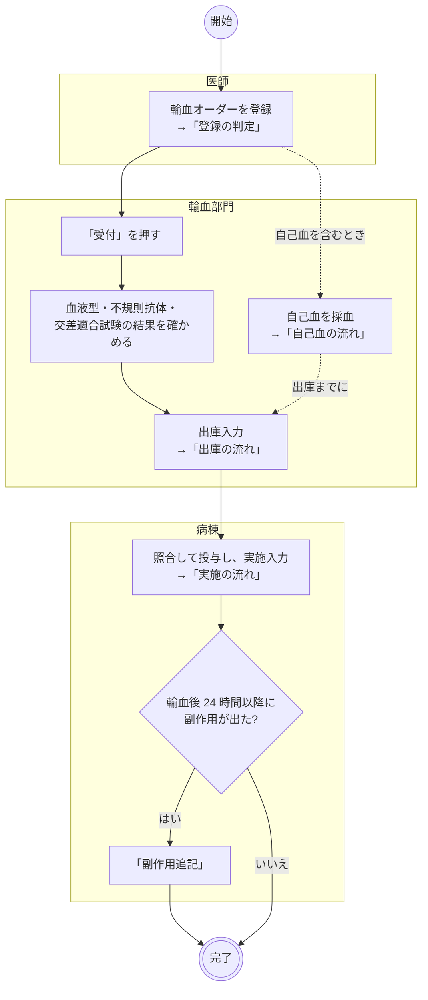

- **入力する項目**: 製剤・単位数・製剤の型・検査区分・緊急度・投与予定日時・使用場所・同意書の確認などです。
- **日時**: 輸血オーダーは投与予定日時を持ち、予約枠は使いません。日付未定にはできません。
- **検査の結果**: 血液型検査・不規則抗体スクリーニング・交差適合試験の結果は、検体検査の結果として登録します。輸血オーダーを登録しても、これらの検査は自動では出ません。
- **受付**: 輸血部門が手で押します。検体検査のラベル発行のような、受付を兼ねる操作はありません。
- **自己血の採血**: 受付の前でも後でもできます(状態が依頼済・受付済の間)。
- **部門の画面**: 「輸血部門 > 輸血一覧」です。

### 輸血の状態

輸血部門と病棟の進み具合を示す状態です。受付と実施の間に、出庫の段があります。

| 状態 | 変わるきっかけ | 輸血一覧からできること |
|---|---|---|
| 依頼済 | 医師の登録、受付取消、中止取消 | 受付、採血(自己血)、中止 |
| 受付済 | 受付、出庫取消 | 出庫、採血(自己血)、受付取消、中止 |
| 出庫済 | 出庫登録、実施取消 | 実施、出庫取消、中止 |
| 実施済 | 実施登録 | 実施取消 |
| 中止 | 中止 | 中止取消 |

- **出庫と実施を分ける理由**: 出庫済のまま投与されていない製剤を、輸血部門が把握するためです。
- **取消で戻る先**: 受付取消は依頼済へ、出庫取消は受付済へ、実施取消は出庫済へ、中止取消は依頼済へ戻ります。
- **取消で消える記録**: 出庫取消は出庫記録を、実施取消は実施記録を消します。
- **中止**: 出庫記録は消しません(出したバッグは返却の対象です)。残っている自己血の採血予定は取り消します。
- **実施入力の入口**: 輸血一覧の「実施」と、カルテのカードの「実施入力」の両方から開けます。出すのは輸血部門、投与するのは病棟だからです。

### 区分ごとの違い

**製剤の区分**

| 製剤の区分 | 採血 | 出庫でのバッグの決め方 | 交差適合試験 | 医事会計への送信 |
|---|---|---|---|---|
| 同種血(赤血球・血漿・血小板) | なし(日赤から入庫) | 製剤ラベルのバーコードを読む | 赤血球は検査区分による。血漿・血小板は不要 | 製剤と保存血液輸血の手技 |
| 自己血(貯血式) | 採血予定を立てて輸血部門で採血する | 本人の採血記録から選ぶ | 不要 | 送れない項目として報告される |
| その他(アルブミンなど) | なし | 型を持たない | 不要 | 製剤のみ |

- 投与するのは、どの区分も病棟です。
- 医事会計へ送るのは外来の輸血だけです。
- 自己血は、製剤に医事会計へ送るコードが無いので送れません。

**検査区分**

オーダーごとに 1 つ選びます。出庫のときに交差適合試験の結果が要るかどうかが、検査区分で変わります。

| 検査区分 | 内容 | 出庫での交差適合試験の結果 |
|---|---|---|
| 交差適合試験 | 製剤を指定して、患者の血液と実際に混ぜて確かめる | 要る |
| T&S(タイプ&スクリーン) | 血液型と不規則抗体だけ先に調べておく | 要らない |
| コンピュータクロスマッチ | 患者の型が 2 回の検査で確定し、不規則抗体が陰性なら、試験管の試験を省く | 要る |
| 生食法 | 危機的出血のレベルⅡで使う | 要る |
| 交差試験なし | 危機的出血のレベルⅠで使う | 要らない |

結果が要るのは、製剤マスタで交差適合試験が要るとしてある製剤だけです。

**緊急度**

通常と、危機的出血の 3 段階です。

| 緊急度 | 準備の目安 |
|---|---|
| 通常 | – |
| レベルⅢ | 60 分 |
| レベルⅡ | 30 分 |
| レベルⅠ | 10 分 |

- レベルⅠでは、RhD 陰性の患者にも陽性の製剤を出せます。

### 血液型と製剤の型

- **患者の型**: 検体検査の結果だけから決まります。異なる日の 2 検体で一致すれば確定です。医師は患者の型を手で入れません。
- **型の使い道**: 確定した患者の型は、オーダーと出庫の警告に使います。
- **確定していないとき**: 検査が 1 回だけ・結果が不一致・未検査のときは「不明」として登録し、警告が出ます。
- **製剤の型**: 製剤ごとに選びます。患者の型・製剤の区分・緊急度から初期値が入り、適合する型だけを選べます。
- **適合の決まり方**: 赤血球は抗原、血漿・血小板は抗体で決まります。患者の型が不明なら、赤血球は O、血漿・血小板は AB です。
- **移植後の型**: 造血幹細胞移植後の型を、カルテのプロファイルタブの「身体」に登録していれば、患者の型より優先します。
- **異型の印**: 患者の型と違う型を選んだ製剤には「異型」の印が付きます。
- **型の色**: 日赤のラベルの区分色(A 黄 / B 白 / O 青 / AB 桃)です。

### 登録の判定

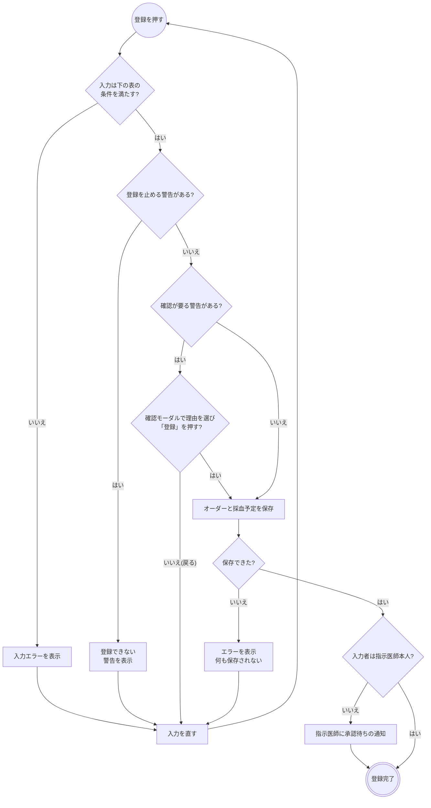

| 入力する項目 | 条件 |
|---|---|
| 製剤 | 1 つ以上 |
| 単位数 | 製剤ごとに必須 |
| 製剤の型 | 型を持つ製剤(その他の区分を除く)は必須 |
| 投与予定日時 | 必須 |
| 採血予定(自己血) | 日時が必須。投与予定日時より前 |
| 同意書の確認 | 必須。同意書なしでは登録できません |

| 登録のときの警告 | 重さ |
|---|---|
| 輸血拒否の注意区分がある | 確認が要る |
| 血液型が検査で確定していない | 確認が要る |
| 不規則抗体スクリーニングが未検査か、有効期間外 | 確認が要る |
| 自己血の 1 回目の採血が、手術日までに期限切れになる | 確認が要る |
| 製剤の型が患者の型と違う(異型適合血) | 表示のみ |
| 輸血副作用歴がある | 表示のみ |
| 移植後の型がある | 表示のみ |

- **確認が要る警告**: 確認モーダルで警告ごとに理由を選びます。出た警告と選んだ理由は記録に残ります。
- **登録を止める警告**: 初期設定では、登録を止める警告はありません。施設の規則で足せます。
- **オーダーセット・クリニカルパス**: セットやパスから適用したオーダーも、同じ判定を受けます。セットに入れておく内容には日時・型・同意書の確認を入れず、適用するときに入れます。

### 出庫の流れ

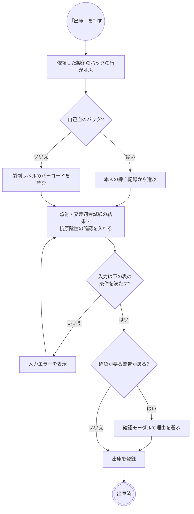

| 出庫で入れる項目 | 条件 |
|---|---|
| バッグの製剤 | 1 本以上 |
| 製剤番号 | バッグごとに必須 |
| バッグの型 | バッグごとに必須 |
| 出庫日時 | 必須 |

バーコードを読むと、製剤番号・製品・型・有効期限が入ります。

| 出庫のときの警告 | 何を確かめるか |
|---|---|
| ① 患者の型との適合 | バッグの型が患者の型に適合するか |
| ② 依頼の型との一致 | バッグの型が依頼の型と同じか |
| ③ 依頼の製剤との一致 | バッグの製剤が依頼の製剤と同じか |
| ④ 有効期限 | 有効期限が入っていて、投与予定日より前に切れないか |
| ⑤ 不規則抗体 | 同定した抗体の抗原陰性を確認したか。同定していない陽性が無いか |
| 照射 | 照射が要る製剤が未照射でないか |
| 交差適合試験 | 結果が未入力・不適合でないか |
| 自己血の本人照合 | 製剤番号が本人の採血記録にあるか |

- **警告の重さ**: どれも確認が要る警告です。確認モーダルで理由を選べば、出庫できます。
- **不適合のバッグ**: 止めはしません。医師と協議のうえ出すときに、理由を残します。
- **出庫者と適合試験者**: 出庫者はログイン中の医療従事者です。適合試験者は選びます。
- **出庫取消**: 出庫記録ごと消します。出し直すときは、改めて出庫入力をします。

### 実施の流れ

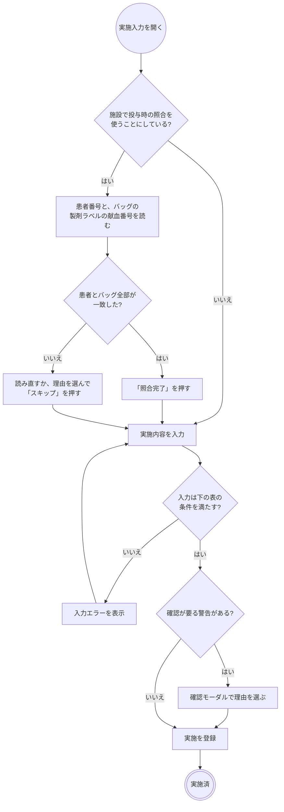

**投与時の照合**

- 患者が違うときは「患者番号 … はこの患者ではありません。」、バッグが違うときは「製剤番号 … はこの輸血のバッグにありません。」と出ます。
- 患者とバッグ全部が一致するまで、「照合完了」は押せません。
- 読めないときは、理由(「緊急・急変」「リストバンド未装着・読取不可」「製剤ラベル読取不可」「リーダー不調」など)を選んで「スキップ」を押します。

**実施で入れる項目**

| 項目 | 条件 |
|---|---|
| 開始時刻・終了時刻 | 開始時刻は必須。終了時刻は開始時刻より後 |
| 実施者・確認者 | 実施者はログイン中の医療従事者。確認者は選ぶ |
| バッグごとの実施・未実施・返却 | 実施のバッグが 1 本以上 |
| 製剤番号 | バッグごとに必須 |
| 観察(投与前・5 分後・15 分後・終了時) | 値を入れた時点は時刻が必須 |
| 副作用の有無 | 必須。「あり」は症状を選ぶか内容を入れる |

- **バッグの初期値**: 出庫したバッグが、製剤番号・型つきで入っています。投与しなかったバッグは消さず、「未実施」か「返却」で残します。
- **観察**: 時点ごとの血圧・脈拍・体温・SpO2・呼吸数です。経過表にもそのまま載ります。空の時点は記録しません。
- **副作用なし**: 「副作用なし」も記録します(観察して無かったことを残すためです)。

**実施のときの警告**

| 警告 | 重さ |
|---|---|
| 出庫記録に無い製剤番号 | 確認が要る |
| 出庫したのに入力に無いバッグ | 確認が要る |
| 有効期限切れ | 確認が要る |
| 未照射 | 確認が要る |
| 交差適合試験が不適合 | 確認が要る |
| 患者の型との不適合 | 確認が要る |
| 輸血副作用歴 | 表示のみ |

**実施の後**

- **実施取消**: 実施記録ごと消します(遡及調査の記録が嘘にならないように)。直すときは「実施取消」をしてから、もう一度実施入力をします。
- **遅発性副作用**: 輸血後 24 時間以降に出た副作用は、カルテのカードの「副作用追記」で足します。実施記録は取り消しません。

### 自己血の流れ

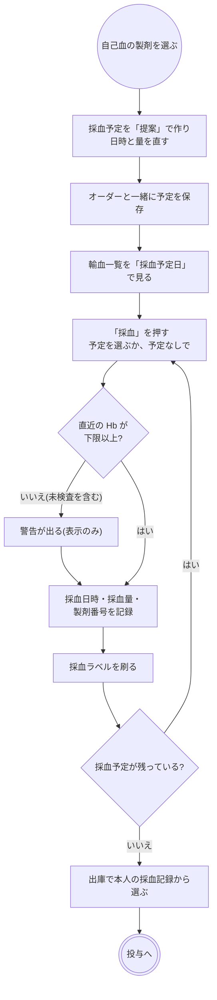

**採血予定(医師)**

- 「提案」は、手術日・回数・1 回量・間隔から採血予定を逆算します。
- 最終の採血日は手術日の 3 日前で、そこから間隔(初期値 7 日)ずつ遡ります。
- 回数の初期値は、依頼量 ÷ 1 回量です。1 回量の初期値は、製剤マスタの既定の単位数です。
- 1 回目の採血日に有効日数を足した日が手術日より前なら、登録のときに警告が出ます。
- オーダーの編集で、予定を足す・外す・動かすことができます。採血済みの予定は動かせません。
- オーダーの削除・中止で、残っている予定は取り消されます。

**採血(輸血部門)**

- 輸血一覧は、日付の見方を「投与予定日」と「採血予定日」で切り替えられます。
- 「採血予定日」では、採血予定 1 件が 1 行で並びます。「投与予定日」では、オーダーの行に未採血の予定の数が「採血 未 n」と出ます。
- 有効期限は採血日から自動で決まり、手では変えられません。使用予定日が有効期限より後のときは警告が出ます。
- 製剤番号の初期値は、患者番号・採血日・連番から作られます。
- 採血ラベルは、登録した採血記録ごとに刷れます。

### 変更・中止・削除

| 操作 | できる場所 | できないとき・注意 |
|---|---|---|
| 変更 | カルテのカード | 出庫・実施の後でもできます。採血済みの予定は動かせません |
| 中止 | 輸血一覧の行のメニュー | 出庫記録・採血記録は残ります。残っている採血予定は取り消されます |
| 中止取消 | 輸血一覧の行のメニュー | 依頼済に戻ります。取り消した採血予定は戻りません |
| 受付取消・出庫取消・実施取消 | 輸血一覧の行のメニュー | 1 つ前の状態へ戻す訂正です |
| 削除 | カルテのカード | 出庫・採血・実施のいずれかの記録があるとできません |

- **中止と医事会計**: 中止したオーダーは、医事会計の対象から外れます。
- **中止取消で戻る状態**: 受付済・出庫済だったオーダーも、依頼済に戻ります。
- **取消で消える記録**: 出庫取消は出庫記録を、実施取消は実施記録(観察・副作用を含む)を消します。
- **削除の前に**: 記録があるときは、先に取り消してから削除します。削除すると、状態と採血予定も一緒に消えます。
- **変更の通知**: 変更は輸血部門へ通知されません。輸血一覧の内容で確かめます。

### ほかの画面とのつながり

- **遡及調査**: 製剤番号からの逆引きは、薬剤部門の「ロット管理」で行います。実施記録の製剤番号を検索します。
- **経過表**: 実施で入れた観察は、経過表に載ります。
- **輸血カード**: カルテのプロファイルタブの「身体」から出せます(→「帳票」)。

### 帳票

| 帳票 | 出す場所 | 内容 |
|---|---|---|
| 採血ラベル | 採血の画面(登録した採血記録ごと) | 患者・型・製剤番号のバーコード・採血日・使用予定日・有効期限・署名欄 |
| 輸血カード | カルテのプロファイルタブ「身体」 | 血液型・不規則抗体・移植後の型・輸血歴・副作用歴 |

- 輸血カードの血液型は、検査結果と申告の両方が載ります。不規則抗体は、スクリーニングと特異性が載ります。輸血歴は、実施したバッグです。
- 出庫票は、まだ出せません。

## 開発者向け

### シーケンス図の前提

- **書き込みの経路**: `/fhir` への書き込みはどれも 1 回の transaction Bundle で、backend の `FhirProxyController` が上流へ中継します。
- **上流**: backend の先にある FHIR サーバーのことです。図では「上流 FHIR」と書きます。
- **応答の中継は省く**: 図の `FHIR-->>UI` は、上流の応答を backend がそのままブラウザへ返すことを表します。
- **ヘッダと明細**: ヘッダはオーダー本体の `ServiceRequest`、明細は製剤 1 種類ずつの `ServiceRequest`(`basedOn` でヘッダを指す)です。
- **ハブと子**: 出庫・実施・採血の記録は、`Procedure`(ハブ)1 件に、バッグごとのリソース(子)が `partOf` でぶら下がる形です。
- **PDF の例外**: 採血ラベルと輸血カードの PDF は、ブラウザが `/fhir` を読むのではなく、backend が上流を直接読みます。
- **警告の台帳**: 出た警告と確認の理由は、transaction とは別に `POST /master/advisory_events` で送ります。図の `UI-)BE` は、応答を待たない送信です。
- **楽観ロック**: 版は `postBundle` が `ifMatch` に添え、版が違えば 412 で止まります。
- **SS-MIX2**: 有効にしている施設では、中継が書き込みの控えを記録します(`Ssmix2::Recorder`)。輸血はメッセージにしません。

### リソースの構成

親子の形は次のとおりです([transfusion-order-design.md](../transfusion-order-design.md) §2)。

- ヘッダ `ServiceRequest`(`order-type|transfusion`)
  - 明細 `ServiceRequest` × 製剤の種類(`basedOn` = ヘッダ)
  - `Task`(進捗。`focus` = ヘッダ)
  - 出庫記録ハブ `Procedure`(`basedOn` = ヘッダ)
    - `MedicationDispense` × バッグ(`partOf` = ハブ)
  - 実施記録ハブ `Procedure`
    - `MedicationAdministration` × バッグ(`partOf` = ハブ)
    - `Observation`(副作用)
    - `Observation`(観察のバイタル)
  - 自己血の採血予定 `Appointment`(`basedOn` = ヘッダ)
  - 自己血の採血記録ハブ `Procedure`
    - `MedicationDispense`(`partOf` = ハブ)

| リソース | 要素 | 中身 |
|---|---|---|
| ヘッダ `ServiceRequest` | `code` | 検査区分 |
| | `occurrenceDateTime` | 投与予定日時 |
| | `priority` | 緊急度 |
| | `locationReference` | 使用場所 |
| | `reasonCode.text` | 使用目的 |
| | 拡張 `transfusion-abo` / `transfusion-rhd` | 患者の型。不明は `unknown` |
| | 拡張 `transfusion-consent` | 同意書の確認 |
| 明細 `ServiceRequest` | `code` | 製剤 |
| | `quantityQuantity` | 単位数 |
| | 拡張 `transfusion-abo` / `transfusion-rhd` | 製剤の型 |
| `Task` | `code` | `task-code|transfusion`(→「進捗 Task(`transfusion`)」) |
| 出庫記録ハブ `Procedure` | `category` | `procedure-category|transfusion-dispense` |
| 出庫の `MedicationDispense` | `identifier` | 製剤番号(`blood-product-number`) |
| | 拡張 | 型・有効期限・照射・交差適合試験・抗原陰性 |
| | `performer.function` | 出庫者と適合試験者 |
| 実施記録ハブ `Procedure` | `category` | `order-type|transfusion` |
| | `performedPeriod` | 開始〜終了 |
| | `performer` | 実施者・確認者 |
| | 拡張 `transfusion-verification` | 投与時の照合 |
| 実施の `MedicationAdministration` | `status` | 未実施・返却は `not-done` + `statusReason` |
| | 拡張 `transfusion-lot-number` | 製剤番号 |
| 副作用の `Observation` | `component` | 症状 |
| | `transfusion-reaction-timing` | immediate / delayed |
| 観察の `Observation` | `category` | `vital-signs` |
| | `transfusion-observation-point` | 観察の時点 |
| 採血予定 `Appointment` | `serviceType` | `autologous` |
| | `status` | booked → fulfilled / cancelled |
| | 拡張 | 予定量 |
| 採血記録ハブ `Procedure` | `category` | `procedure-category|autologous-collection` |
| | 拡張 `autologous-appointment` | 採血予定 |
| 採血の `MedicationDispense` | `status` | `preparation` |
| | (そのほか) | 製剤番号・型・有効期限 |

- **採血予定の枠**: 枠(`Schedule` / `Slot`)は使いません。
- **採血記録の使い道**: 出庫のときに、本人の記録から選びます。
- **血液型・不規則抗体**: 検体検査の `Observation` です(結果項目コード + JLAC11 K1001 / K1006。不規則抗体は結果項目コード)。2 検体の一致で確定します(`fhir/bloodTypeHelpers.ts`)。
- **不規則抗体の特異性・移植後の型**: `Observation`(`category = exam`、`transfusion-profile|…`)です。プロファイルタブで手入力します。
- **警告の確認**: 警告の台帳(`POST /master/advisory_events`)と `Provenance` に残します。文脈は `transfusion-order` / `transfusion-dispense` / `transfusion-perform` / `autologous-collection` です。

### 進捗 Task(`transfusion`)

Task は登録時には作りません。**Task が無いオーダーは依頼済**として扱い、最初のステータス変更で作ります(`fhir/transfusionTaskHelpers.ts`)。
中止は同じ transaction でヘッダを `revoked` にし、中止取消で `active` に戻します(`orderCancelEntries`)。中止したオーダーを編集しても `revoked` のままです(`keepOrderRevoked`)。

| 状態 | `Task.status` | `executionPeriod` | 同じ transaction で書くもの |
|---|---|---|---|
| 依頼済 | `requested`(または Task 無し) | なし | |
| 受付済 | `accepted` | `start` | |
| 出庫済 | `in-progress` | `start` | 出庫記録(ハブ + `MedicationDispense`) |
| 実施済 | `completed` | `start` / `end` | 実施記録(ハブ + `MedicationAdministration` + `Observation`) |
| 中止 | `cancelled` | なし | ヘッダ `revoked`、残っている採血予定を `cancelled` |

取消で戻すときに消すもの: 出庫取消は出庫記録、実施取消は実施記録(`useUpdateTransfusionTaskStatus` の `cancelPerform`)。受付取消・中止取消は何も消しません。

### 部品

| 操作 | 画面 | 組み立て | hook |
|---|---|---|---|
| 登録 | `components/TransfusionOrderForm.tsx`・`TransfusionOrderPanels.tsx` | `buildTransfusionOrderBundle`(`fhir/transfusionOrderHelpers.ts`) | `useCreatePrescription`(名前と違い全種別共通) |
| 編集 | 同じフォーム | `buildTransfusionOrderUpdateBundle` | `useUpdatePrescription`(全種別共通) |
| 削除 | – | `buildTransfusionOrderDeleteBundle` | `useDeleteTransfusionOrder`(`api/queries/transfusion.ts`) |
| 登録のときの警告 | 同じフォーム | `fhir/transfusionAdvisoryHelpers.ts` | – |
| 一覧・受付・取消・中止 | `pages/TransfusionWorklistPage.tsx` | – | `useUpdateTransfusionTaskStatus`(`api/queries/transfusion.ts`) |
| 出庫 | `components/TransfusionDispenseModal.tsx` | `buildTransfusionDispenseBundle`・`dispenseAdvisories`(`fhir/transfusionDispenseHelpers.ts`)、バーコードは `fhir/isbt128.ts` | `useRegisterTransfusionDispense` |
| 実施 | `components/TransfusionPerformModal.tsx`・`TransfusionVerifyStep.tsx` | `buildTransfusionPerformBundle`(`fhir/transfusionResultHelpers.ts`) | `useRegisterTransfusionPerform` |
| 実施取消 | 一覧 | `buildTransfusionPerformDeleteEntries`(`fhir/transfusionResultHelpers.ts`) | `useUpdateTransfusionTaskStatus` |
| 副作用追記 | `components/TransfusionReactionModal.tsx` | `buildDelayedReactionObservation`(`fhir/transfusionResultHelpers.ts`) | `useAddTransfusionReaction` |
| 自己血の採血 | `components/AutologousCollectionModal.tsx` | `buildAutologousCollectionBundle`(`fhir/autologousHelpers.ts`)、予定は `fhir/autologousPlanHelpers.ts` | `useRegisterAutologousCollection`、一覧は `useAutologousWorklist` |
| 採血ラベル | – | `AutologousLabelReport`(backend) | – |

カルテのカード(`KarteTimeline.tsx`)からは、出庫済のときだけ「実施入力」、実施済のときだけ「副作用追記」が出ます。

### シーケンス図: 登録・編集・削除

**登録**

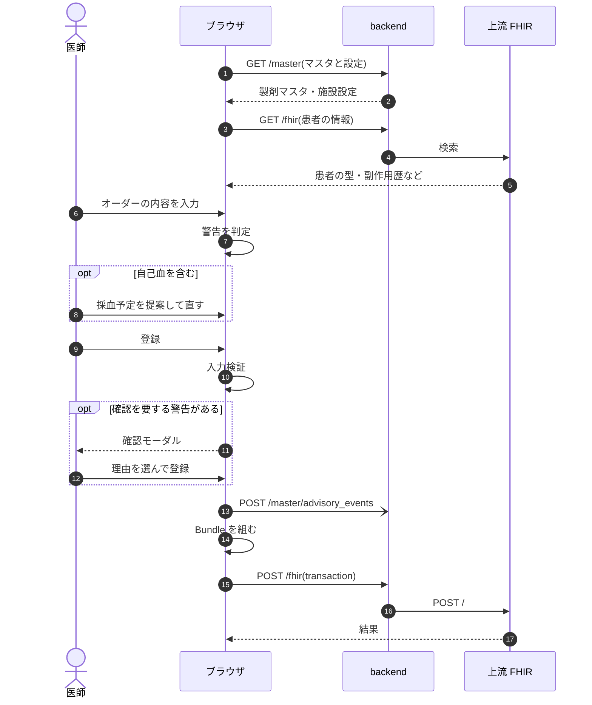

| 段 | 中身 |
|---|---|
| マスタと設定 | `GET /master/transfusion_products`(製剤マスタ)、`GET /master/facility_settings`(不規則抗体の有効日数) |
| 患者の情報の検索 | 血液型・不規則抗体の `Observation`、`Flag`、副作用の `Observation`、プロファイル、`Location` |
| 検索で分かること | 患者の型(2 検体一致)・注意区分・副作用歴・移植後の型・使用場所 |
| 入力 | 製剤・単位数・型・検査区分・緊急度・投与予定日時・同意書 |
| 警告の判定 | 輸血拒否・型の未確定・不規則抗体・異型・副作用歴 |
| 入力検証 | 製剤の型・日時・同意書・採血予定 |
| 警告の台帳 | 発火と確認を `POST /master/advisory_events` に送る |

| transaction に入れるもの | 条件 |
|---|---|
| ヘッダ `ServiceRequest`(fullUrl)+ 明細 `ServiceRequest` × 製剤 | いつも。登録時の入院病棟を `order-ward` に入れる |
| `Provenance`(CREATE) | いつも |
| `Appointment` × 採血予定 | 自己血を含むとき |
| 警告の確認の `Provenance` | 警告を確認したとき |
| `Task` order-approval | 代行・研修医のとき |

**編集**

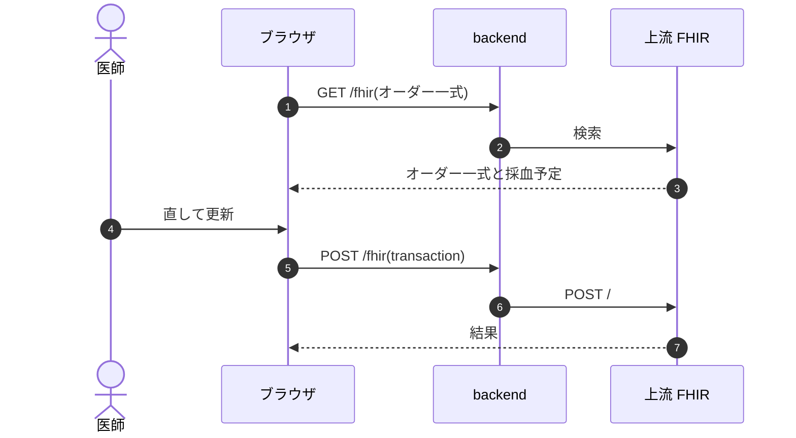

| 段 | 中身 |
|---|---|
| オーダー一式の検索 | ヘッダ + 明細 + `Appointment` |
| ヘッダ | PUT(`ifMatch`)。`revoked` なら `revoked` のまま |
| 明細 | 差分で POST / PUT / DELETE |
| 採血予定 | 外したものは cancelled、残りは PUT、足したものは POST |
| 来歴 | `Provenance`(UPDATE) |

**削除**

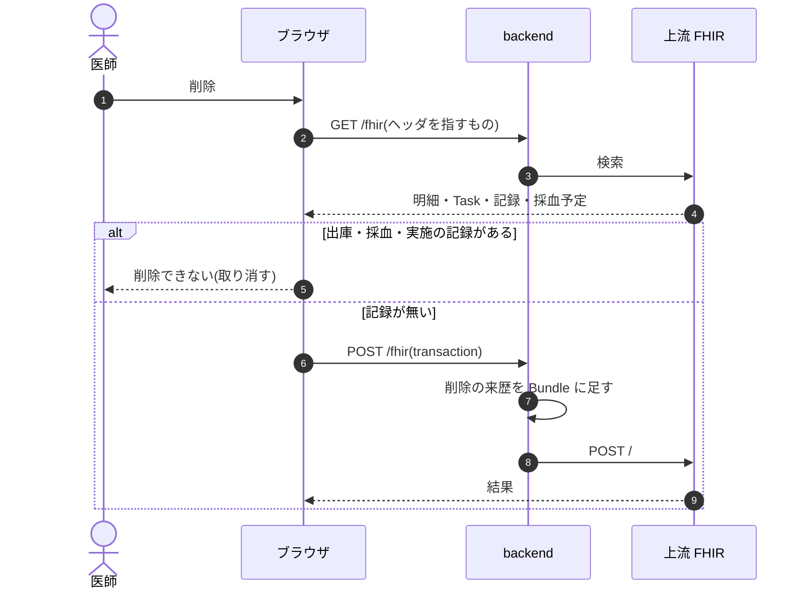

| 段 | 中身 |
|---|---|
| ヘッダを指すものの検索 | 明細・`Task`・`Procedure`・`Appointment` |
| transaction | DELETE 明細 → ヘッダ、DELETE `Task`、残っている採血予定を cancelled |

### シーケンス図: 受付・出庫

**一覧と受付**

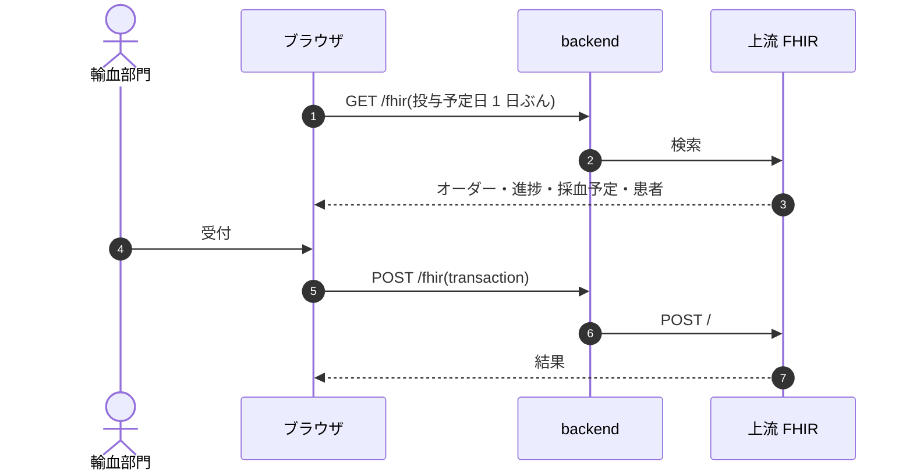

一覧の検索で返るのは `ServiceRequest`・`Task`・`Appointment`・患者です。受付の transaction は `Task` transfusion = accepted です。

**出庫**

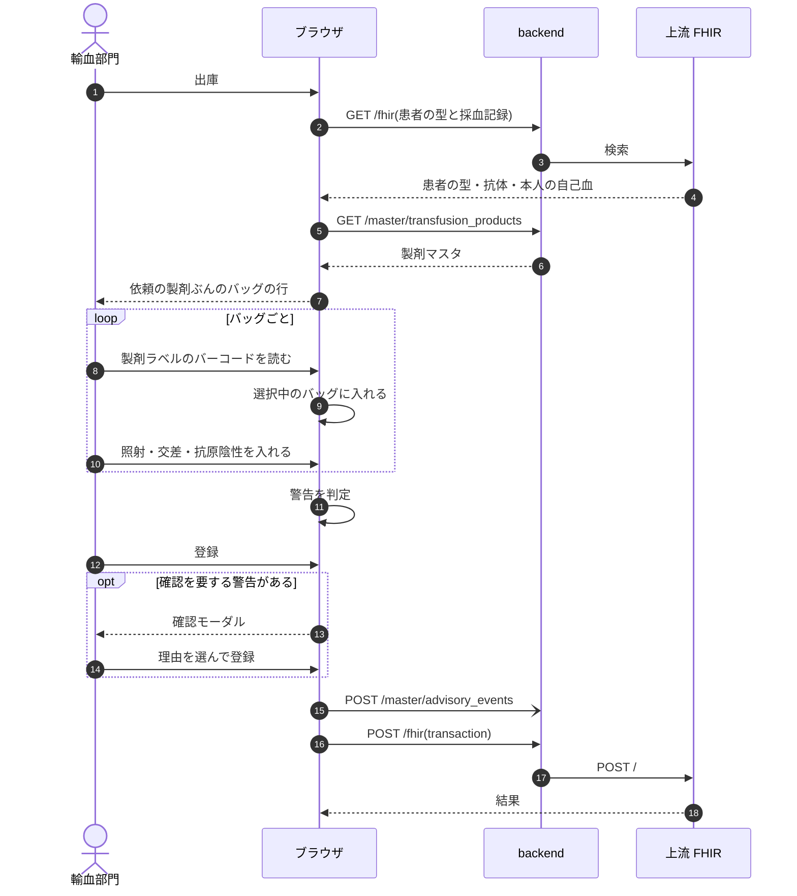

| 段 | 中身 |
|---|---|
| 患者の型と採血記録の検索 | 血液型・不規則抗体・プロファイル、自己血の採血記録 |
| 検索で分かること | 患者の型・同定した抗体・移植後の型・本人の自己血 |
| 製剤マスタ | 交差・照射の要否 |
| バーコード | ISBT 128 を振り分けて、選択中のバッグに入れる(下の表) |
| 手で入れるもの | 照射・交差適合試験の結果・抗原陰性の確認 |
| transaction | POST `Procedure`(出庫記録ハブ)、POST `MedicationDispense` × バッグ、`Task` transfusion = in-progress |

| ISBT 128 の先頭の記号 | 中身 |
|---|---|
| `=` | 献血番号(製剤番号として入る) |
| `=<` | 製品 |
| `=%` | 血液型 |
| `&>` | 有効期限 |

警告の判定(`dispenseAdvisories`)は次のとおりです。①〜⑤ は「運用フロー」の「出庫の流れ」の表と同じ番号です。

| 警告 | 種別(`kind`) |
|---|---|
| ① 患者の型との適合 | `dispense-blood-type` |
| ② 依頼の型との一致 | `dispense-requested-type` |
| ③ 依頼の製剤との一致 | `dispense-product` |
| ④ 有効期限と投与予定日 | `dispense-expiry` |
| ⑤ 不規則抗体(抗原陰性の確認、同定していない陽性) | `antibody-positive` |
| 照射 | `dispense-irradiation` |
| 交差適合試験(未入力・不適合) | `dispense-crossmatch` |
| 自己血の本人照合 | `autologous-mismatch` |

### シーケンス図: 実施・実施取消・副作用追記

**実施入力**

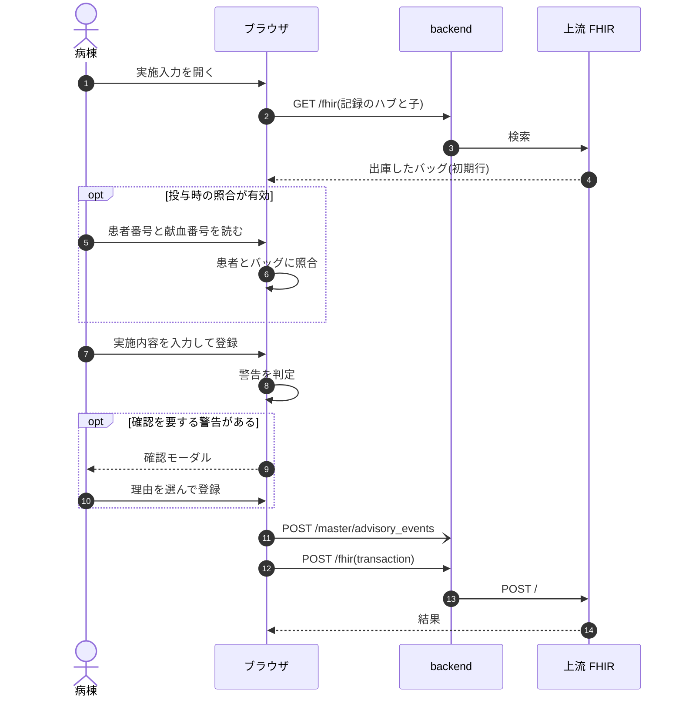

| 段 | 中身 |
|---|---|
| 入口 | 一覧の「実施」か、カードの「実施入力」 |
| 記録のハブと子の検索 | `Procedure?based-on` + `MedicationDispense`・`MedicationAdministration`・`Observation` |
| 照合 | 患者の `identifier` と、出庫したバッグに照合する。読めないときはスキップ理由を選ぶ。一致しない間は「照合完了」を押せない(`TransfusionVerifyStep.tsx`) |
| 入力 | 時刻・実施者・確認者・バッグの実施 / 未実施 / 返却・観察・副作用 |
| 警告の判定 | 出庫記録との突き合わせ・期限・照射・交差・型 |

| transaction に入れるもの | 補足 |
|---|---|
| POST `Procedure`(実施記録ハブ) | `performedPeriod`、照合の拡張 |
| POST `MedicationAdministration` × バッグ | 未実施・返却は `not-done` |
| POST `Observation`(副作用) | immediate |
| POST `Observation` × 観察の時点 | `vital-signs` |
| `Task` transfusion = completed | |

**実施取消**

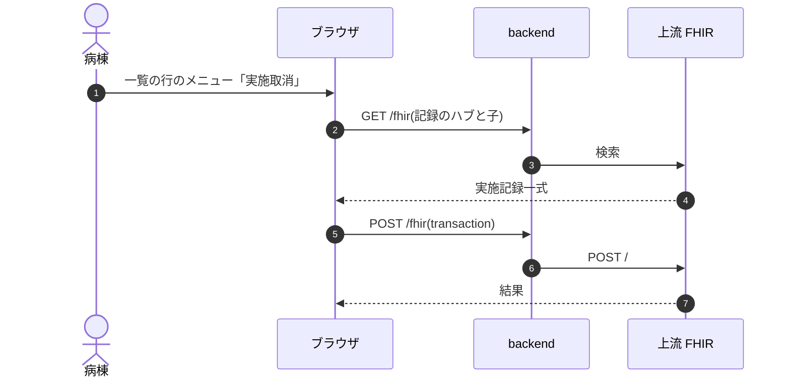

検索は `Procedure?based-on` + 子です。transaction は、DELETE `Observation`・`MedicationAdministration` → `Procedure`(実施記録)、`Task` transfusion = in-progress です。

**副作用追記**

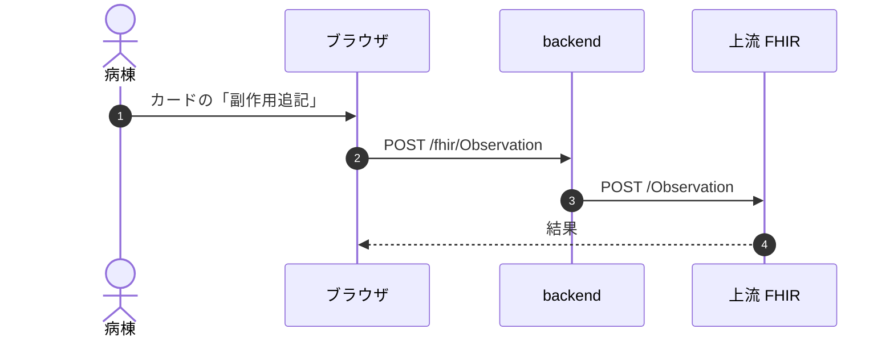

入力は発症日時・症状・内容です。`Observation` は副作用 delayed で、`partOf` = 実施記録ハブです。

### シーケンス図: 自己血の採血

**採血**

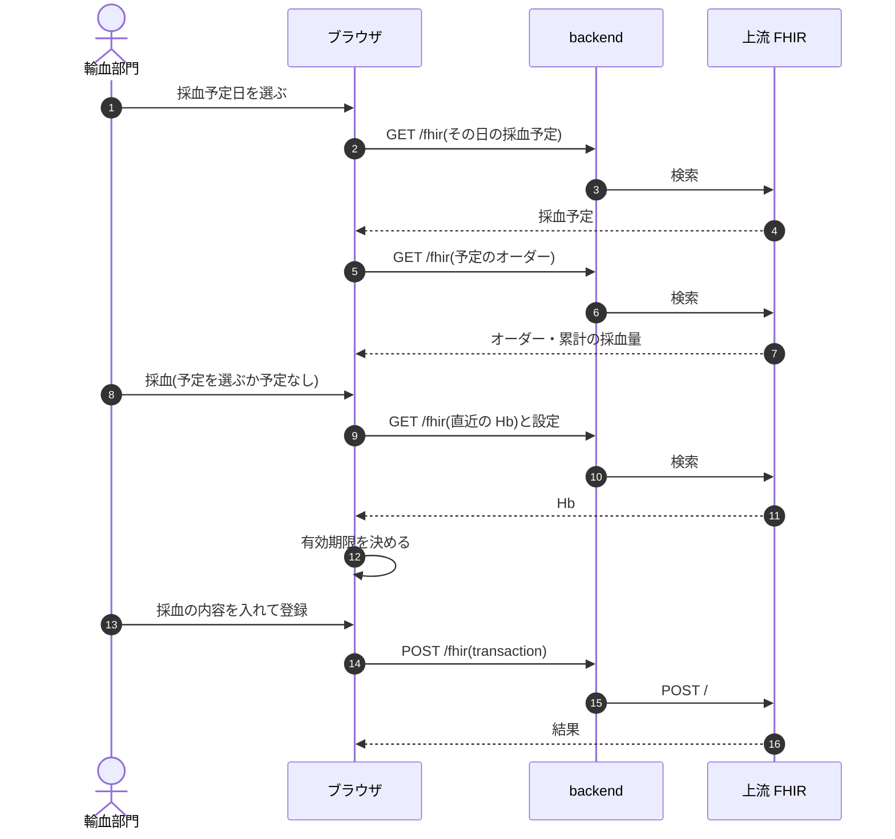

| 段 | 中身 |
|---|---|
| その日の採血予定の検索 | `Appointment?service-type=autologous&date` |
| 予定のオーダーの検索 | `ServiceRequest?_id` + 明細・`Task`・採血記録 |
| Hb と設定 | 直近の Hb と `GET /master/facility_settings`。下限未満・未検査は警告 |
| 有効期限 | 採血日 + 製剤マスタの有効日数 |
| 入力 | 採血日時・採血量・製剤番号 |
| transaction | POST `Procedure`(採血記録ハブ、予定への参照)、POST `MedicationDispense`(preparation、製剤番号・型・期限)、予定を PUT `Appointment` = fulfilled |

**採血ラベル**

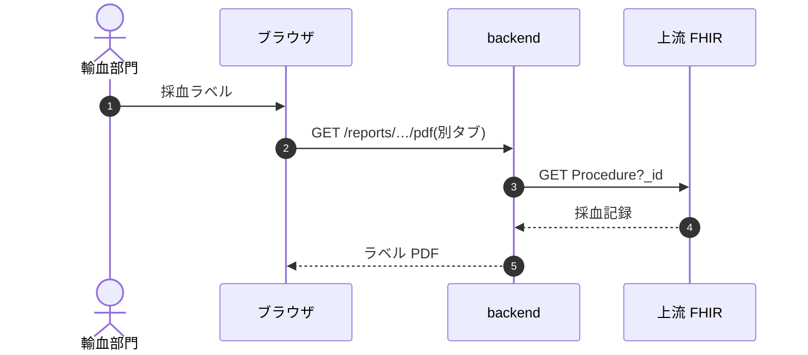

パスは `GET /reports/autologous_labels/:procedure_id/pdf` です。backend は採血記録から患者と採った血を読みます。

### シーケンス図: 中止

`useUpdateTransfusionTaskStatus`(`api/queries/transfusion.ts`)が書きます。出庫記録・採血記録は残します。

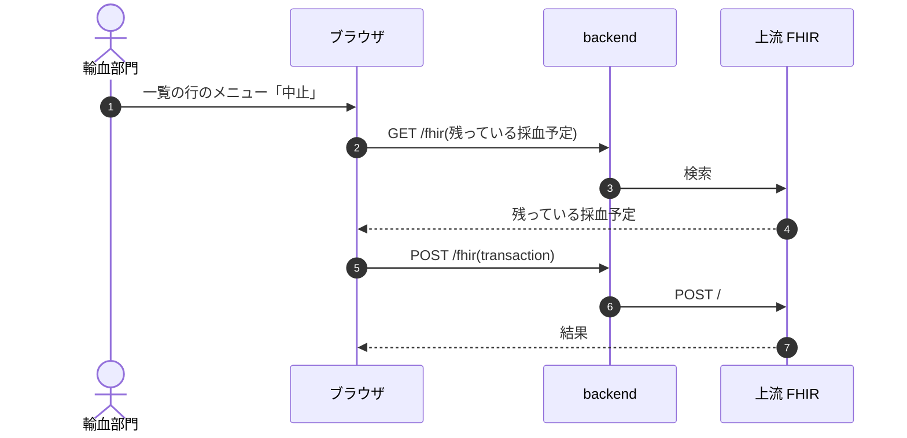

| 段 | 中身 |
|---|---|
| 残っている採血予定の検索 | `Appointment?based-on`、`status=booked` |
| transaction | `Task` transfusion = cancelled、PUT `ServiceRequest`(ヘッダ)= revoked、PUT `Appointment` = cancelled × 残りの予定 |

### 医事会計と SS-MIX2

輸血は実施記録から集めます(`BillingClaimBuilder` の `:procedure` 経路、`Resolvers::Transfusion`)。`BillingClaimBuilder` が組むのは外来 1 日ぶんの診療行為なので、送るのは外来の輸血です。
SS-MIX2 のメッセージは、どの操作でも作りません(輸血のメッセージは持ちません)。登録・編集・受付・出庫では、医事会計にも何も送りません。

| 起きたこと | 医事会計(`BillingClaimBuilder`) |
|---|---|
| 実施 | 投与した(`completed`)バッグと手技を送る(下の箇条書き) |
| 未実施・返却のバッグ | 数えない |
| 実施記録の無い当日のオーダー | 「実施記録がありません(未実施のため送りません)」と報告する |
| 実施取消 | 対象から外れる |
| 中止 | 対象から外れる(`ServiceRequest` が `revoked`) |
| 削除 | 対象から外れる |

- **製剤**: 投与したバッグを、製剤マスタの医薬品コードで 1 袋ずつ送ります。
- **手技**: 施設設定の保存血液輸血です。1 回目 × 1、2 回目以降 ×(単位数 − 1)で送ります。
- **自己血**: 自己血だけなら手技は付きません。自己血の製剤は医薬品コードが無いので「送れない項目」に出ます。

製剤番号は上流の `MedicationAdministration?lot-number` で引けるので、ロット管理画面の検索で輸血の製剤番号も逆引きできます。
